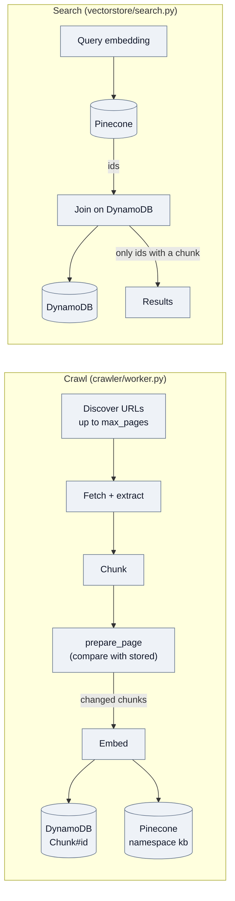
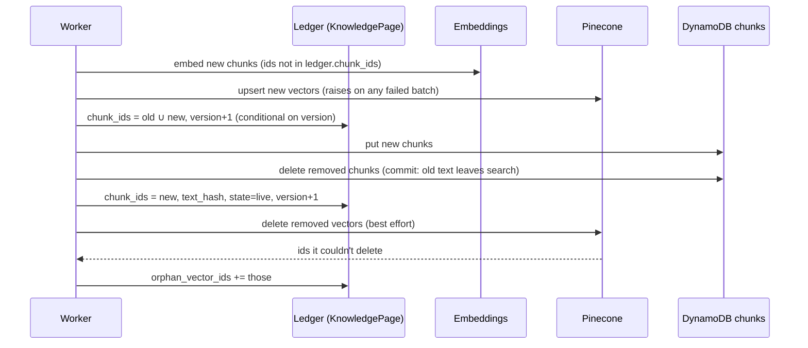
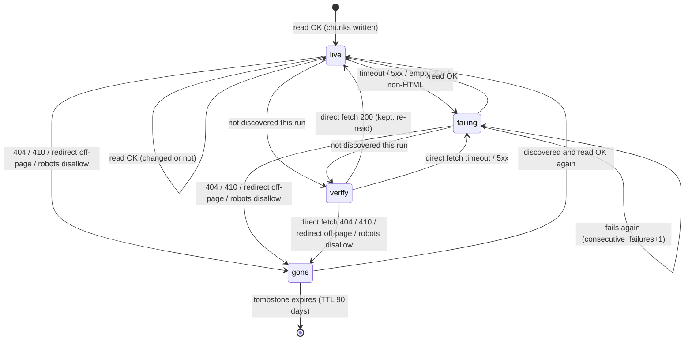
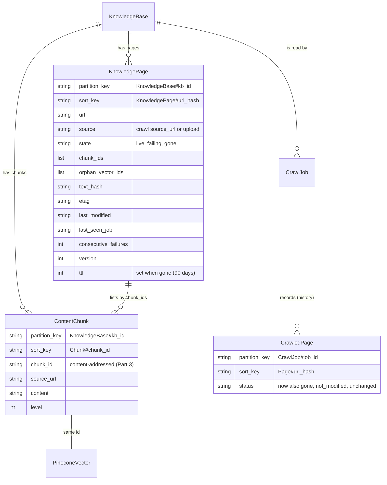

# Knowledge base freshness: no stale chunks in search

| Field | Value |
| --- | --- |
| Status | ✅ Implemented (all four phases; manual checks against a real site and the reconcile run per environment pending) |
| Owner | Platform (knowledge, crawler, vectorstore) |
| Last reviewed | 2026-10-18 |
| Scope | [`api/src/crawler/`](../api/src/crawler/), [`api/src/knowledge/`](../api/src/knowledge/), [`api/src/vectorstore/`](../api/src/vectorstore/) |
| Depends on | `95168dc` (embed only changed chunks; the `knowledge_base` skill's `recrawl` action) |
| Tracker | — |

> **Summary:** A knowledge base that is crawled again, as the scheduled `recrawl` now makes routine, has to forget
> what the site no longer says. Today it doesn't: chunks of removed pages stay searchable forever, and since
> `95168dc` a silently failed Pinecone write is never repaired. This design adds a page ledger (what each page
> currently has in the index), ordered and verified writes with a DynamoDB delete as the commit point,
> content-addressed chunk ids, a removal sweep that deletes only what the site confirms is gone, retried vector
> cleanup, and conditional fetches. The result is that search returns only text the site has now, or still had at
> the last successful read.

## Implementation notes

All six parts and all four phases are built. Where the build departs from the design below, this section is the truth.

**One crawl per knowledge base is a lease, not a status check** (Part 4, rule 5).
- Implementing the check turned up a bug: `CrawlJobRepository.find_all_by_kb` applied `Limit` before sorting job ids,
  which are random. Past the limit, which a daily `recrawl` reaches in 50 days, "the newest job" and "is one running"
  were arbitrary.
- `find_all_by_kb` now reads the partition and sorts. Single-flight is a `CrawlLease` item (`KnowledgeBase#{kb_id}` /
  `CrawlLease`), claimed by a conditional put. `create_crawl_job` takes it, and so do the route, blueprint `StartCrawl`
  and `recrawl`. The worker takes it again before starting, renews it on every heartbeat, and stops if another job
  holds it. It's released when the job completes, fails or is cancelled.
- A lease whose worker died lapses after `crawl_job_stale_timeout_seconds`, the reaper's timeout. That also frees a
  knowledge base whose pending job never launched.
- Applying a blueprint that changes the crawl while the site is being read fails after the commit point, saying to
  apply again once the crawl ends.

**Verification is part of the run, not a sweep at its end** (Part 4).
- Once discovery finishes, this source's pages it missed (up to `max_pages`, least recently read first) are appended
  to the run's URLs. They're read like every other page, so they get checkpoints, rate limiting and progress with no
  second loop.
- Nothing is ever removed for being absent, only on the site's own answer. So removal doesn't need a completed run:
  a 404 removes the page whenever it's read.

**The ledger has `pending_ids`, not a widened `chunk_ids`** (Part 2).
- With content ids, listing new ids in `chunk_ids` before writing them has a hole. A crash before the chunks were
  put would leave ids that look committed, and the next read would treat them as unchanged and never write them.
- So before a write changes anything, it moves everything it touches into `pending_ids`: the chunks it will write,
  the chunks it will delete, and anything an earlier write left pending. `chunk_ids` keeps only the committed chunks
  the write leaves alone.
- Pending ids are never trusted: the next write rewrites the ones the page still has and deletes the rest. So
  `chunk_ids` only ever lists chunks whose chunk and vector both exist. Without this, a write that died just after
  deleting would leave deleted ids looking committed, and a page that later reverted to them would never get them
  back. `remove` does the same, and a page left pending by a removal that died is removed again
  (`tests/crawler/test_keeping_pages_current.py`, the "died after deleting" tests).
- The order in the code is: embed, mark pending, upsert, put chunks, delete dropped chunks (commit), save the page,
  delete old vectors (and orphans).

**Redirects.** A redirect within the site, where `example.com` and `www.example.com` count as one site (`same_site`),
moves the page: its content is indexed under the new URL and the old page is removed. A redirect to another site is
`GONE`. 401, 403 and 429 are `FAILED`, like 5xx.

**Smaller choices.**
- `FAILING_RUNS_TO_FLAG = 3` is a constant in `knowledge/models.py`, not a `KB_PAGE_FAILING_RUNS` setting. Nothing
  needs it to vary.
- Uploads moved onto `PageIndex.write` with the content ids (phase 3), not phase 4, because positional ids went away
  there.
- Adoption doesn't take the crawl's source. Each old URL is given the source it falls under among *all* the
  knowledge base's crawl jobs (the narrowest), else one on its site. So adoption can be triggered by an upload, and
  knowledge bases with several sources adopt correctly. A `KnowledgePagesAdopted` marker item records that it ran.
- `fetch()` returns a `Fetched` (outcome, final URL, content, reason, validators). The worker returns a `PageRead`
  (`INDEXED`, `UNCHANGED`, `REMOVED`) for its counters.
- Embedding and writing are one recorded stage (`PAGE_INGEST_COMPLETE`, with embedded, unchanged and removed counts).
  `PAGE_REMOVED` is a new step.
- `CrawledPage` gains `unchanged` and `gone`, and every read now records one, failed reads included.
- `CrawlProgress` gains `removed_urls` and `unchanged_urls`. The dashboard's run stats show "Removed" in place of
  "Processed", which the progress bar already shows.
- A gone tombstone is kept only for a page the knowledge base had. A 404 for a URL it never had is a broken link: a
  failed read, as before, not a removal. So "Removed" counts only pages that left the knowledge base.
- `text_hash` includes the chunking strategy's name, so changing strategy re-chunks every page once.
- `ContentChunkRepository.find_by_ids` now batches at 100 keys and retries `UnprocessedKeys`. Search used it too,
  and it silently dropped chunks when DynamoDB was busy.
- The upload route answers 503 when the vector write fails. Knowledge base stats (route and crawl) come from the ledger.
- `scripts/reconcile_kb_vectors.py` also indexes chunks that have no vector, which the old silent-upsert bug left. With
  content ids they would otherwise count as unchanged forever.
- `knowledge/service.py` now imports the crawler inside the upload function. This breaks an import cycle that failed
  whenever the crawler was imported before the knowledge package.

**Deleting a knowledge base now deletes its vectors or nothing.**
- Found after the first real crawl. Four knowledge bases deleted together on 2026-10-09 kept 943 vectors in Pinecone.
  `soft_delete` logged a failed or skipped namespace delete and carried on, deleting the chunks (the only record that
  vectors exist) and marking the KB deleted, and both callers checked only `result.success`. Nothing could find the
  vectors afterwards.
- Now the namespace delete comes first and a failure stops the delete before anything else changes, so it can be
  retried (`DeleteResult.retryable`, 503 from the route). `delete_namespace` treats a namespace that never existed as
  deleted.
- `scripts/reconcile_kb_vectors.py --deleted` lists and (with `--apply`) deletes the namespaces of deleted knowledge
  bases that still have vectors.

**Not built.** The dashboard has no "remove this page" action for a failing page; its chunks stay until the site
answers or the knowledge base is deleted. The open question on unlinked-but-live pages is unchanged: they're kept.

## Context and problem

How a knowledge base is written and read today:



Every box exists today. Search keeps a Pinecone hit only if DynamoDB still has its chunk (`search.py:127`).

What the code does, and what goes wrong:

| # | Finding | Where | Effect |
| --- | --- | --- | --- |
| F1 | Search returns text only from DynamoDB; a vector without a chunk is dropped. | `vectorstore/search.py:119-133` | **Deleting the DynamoDB chunk is what removes text from answers.** Orphan vectors are inert; they cost storage and a top-k slot. |
| F2 | Nothing removes the chunks of a page that disappeared from the site. | `crawler/worker.py` (no sweep) | **The leak.** A removed pricing or policy page keeps being quoted. |
| F3 | `PineconeClient.upsert` and `delete_by_ids` log errors and carry on. The worker writes DynamoDB, then Pinecone. | `vectorstore/pinecone_client.py:169-175, 271-278`; `worker._store_chunks` | A failed upsert leaves new text over an old vector. Since `95168dc` the next crawl sees the text unchanged and never repairs it. |
| F4 | Discovery stops at `max_pages`. | `worker._discover_urls` (`break`) | "Not discovered" does not mean "gone"; a naive sweep would delete every page past the cap. |
| F5 | Any fetch failure is one error; `raise_for_status` doesn't separate 404/410 from 5xx or a timeout. A non-HTML 200 yields an empty page. | `crawler/extractor.py:101-106`; `worker._process_urls` | Can't tell removed from broken. An empty read can't be allowed to delete a page. |
| F6 | One namespace per knowledge base, shared by every crawl source and by uploads. | `pinecone_client._get_namespace`; `knowledge/service.py` uploads | A sweep over the whole knowledge base would delete another source's pages, or uploaded files. |
| F7 | Chunk ids are positional (`kb:url:index:level`). `parent_chunk_id` is stored but nothing reads it. | `crawler/page_chunks.generate_chunk_id`; no reader of `parent_chunk_id` outside ingestion | A paragraph inserted near the top shifts every id after it, so all of them are re-embedded. An edit overwrites in place, so a half-done write mixes versions. |
| F8 | `prepare_page` reads every chunk of the knowledge base once per run. | `CrawlContext.stored_for` | It doesn't scale: a 20k-chunk knowledge base reads about 20k items before the first page. |
| F9 | Two crawls of one knowledge base can run at once (dashboard route; `recrawl` alone checks). | `knowledge/router.py:start_crawl_job` | They race on the same pages. |
| F10 | Uploading the same file again re-embeds every chunk and leaves the tail of a shorter file. | `KnowledgeBaseService.ingest_text_content` | Cost, plus stale upload text. |

## Goals and non-goals

Goals:

- **G1 No stale text in search.** A page the site removed (404 or 410, a redirect elsewhere, or disallowed by robots.txt) leaves search on the run that confirms it. Text a page no longer has leaves search when that page is next read successfully.
- **G2 Never delete live content by mistake.** A timeout, a 5xx, an empty read, a capped discovery or a failed sitemap never removes anything.
- **G3 Crash-safe and self-repairing.** Any crash or failed call leaves a state the next run converges from, with no manual cleanup.
- **G4 Cheap re-reads.** An unchanged page costs at most one conditional request. A changed page re-embeds only the chunks whose text changed.
- **G5 Scoped.** A crawl only ever removes pages of its own source; uploads are removed only by uploads (or by deleting them).

Non-goals:

- Detecting that a live page's facts are wrong. Freshness here means matching the site.
- Per-chunk TTLs or time-based expiry. Removal is driven by the site, not by age.
- Multi-region or transactional consistency between DynamoDB and Pinecone. We order the writes and repair instead (see Alternatives).

## Design

The design has six parts. Parts 1, 2 and 4 close the leak and the F3 hole; parts 3, 5 and 6 make it cheap and tidy.

### Part 1: the page ledger

A `KnowledgePage` item per knowledge base and URL records what the page has in the index now. It is the source of
truth for "which chunk ids belong to this page", so staleness is decided per page and never by scanning chunks (F8).
It also says which source wrote the page (F6).

```python
class KnowledgePageState(str, Enum):
    LIVE = "live"          # read successfully; its chunks are in the index
    FAILING = "failing"    # the last reads failed (timeout, 5xx); its last good chunks are kept
    GONE = "gone"          # the site confirmed it's gone; its chunks are deleted (kept as a tombstone for a while)


class KnowledgePage(BaseModel):
    """One page of a knowledge base, and the chunks it has in the index now."""

    kb_id: str
    url: str
    #: The crawl source that owns the page: the job config's `source_url`, or "upload" for files.
    source: str
    state: KnowledgePageState = KnowledgePageState.LIVE
    #: Every chunk id that may exist for this page. Written *before* new chunks are, so it's never short (Part 2).
    chunk_ids: list[str] = Field(default_factory=list)
    #: Vectors whose delete failed, retried on the next write of this page or by the sweep (Part 5).
    orphan_vector_ids: list[str] = Field(default_factory=list)
    #: sha256 of the extracted text: an equal hash skips chunking and embedding.
    text_hash: str = ""
    #: From the last 200 response, for conditional GETs (Part 6).
    etag: str | None = None
    last_modified: str | None = None
    last_seen_job: str = ""
    last_read_at: datetime | None = None
    consecutive_failures: int = 0
    #: Bumped on every write; writes are conditional on it (F9).
    version: int = 0

    @property
    def pk(self) -> str:
        return f"KnowledgeBase#{self.kb_id}"

    @property
    def sk(self) -> str:
        return f"KnowledgePage#{url_hash(self.url)}"
```

One run queries `KnowledgePage#` once (one small item per page, not one per chunk) and keeps the result in
`CrawlContext.pages` in place of today's `stored_for`.

### Part 2: ordered, verified writes

Pinecone calls stop swallowing errors. `upsert` raises `VectorStoreError` if any batch fails, and `delete_by_ids`
returns the ids it could not delete. Each page write then runs in an order where a crash at any step is safe, and
**the DynamoDB delete of the old chunks is the commit point**. Because of F1, once that delete runs, the old text
can't be returned.



The DynamoDB delete of removed chunks is the commit point: before it, search shows the old text; after it, only the
new. Every arrow before it is safe to repeat.

The ledger's `chunk_ids` is widened *before* any new chunk is written. If the run stops anywhere, the next read
of the page computes `removed = ledger.chunk_ids − new_ids` and finishes the job.

What each crash point leaves, and what search shows meanwhile:

| Stops after | State | Search shows | Next run |
| --- | --- | --- | --- |
| embed / upsert | New vectors without chunks | Old text (new vectors are inert, F1) | Ledger doesn't list them yet. Content ids (Part 3) make the re-upsert the same id, so they're overwritten. |
| ledger widened | Same | Old text | `removed` includes nothing new; writes resume |
| put new chunks | Old and new chunks both | Both, for that page | Deletes `old − new` |
| delete old chunks | Committed | New text only | Narrows the ledger |
| Pinecone delete fails | Orphan vectors | New text only | Retries `orphan_vector_ids` |

With positional ids, step "put new chunks" would overwrite in place and mix versions. That's why Part 3 matters for
reliability, not only for cost.

### Part 3: content-addressed chunk ids

A chunk's id comes from what it says, not where it sits:

```python
def chunk_id(kb_id: str, url: str, level: int, content: str, occurrence: int) -> str:
    """The same text at the same level of the same page keeps its id wherever it moves; `occurrence` tells apart
    identical chunks on one page (the 2nd "Contact us" is occurrence 1)."""
    digest = hashlib.sha256(f"{kb_id}\n{url}\n{level}\n{occurrence}\n{content}".encode()).hexdigest()
    return f"{digest[:8]}-{digest[8:12]}-{digest[12:16]}-{digest[16:20]}-{digest[20:32]}"
```

- **Unchanged means same id.** `prepare_page` stops comparing text: `new = ids − ledger.chunk_ids`,
  `removed = ledger.chunk_ids − ids`. Inserting a paragraph re-embeds that paragraph and the section and document
  chunks that contain it, nothing else (F7).
- **Never overwrite in place.** A new version is a new item, so Part 2's steps never leave a vector beside text it
  wasn't made from.
- `parent_chunk_id` is still written, from the parent's new id, but leaves the change check: nothing reads it (F7),
  and a parent's id changes whenever any of its children's text does.
- `page_title` goes into the id input too: the vector metadata carries it, and a retitled page must re-index.

### Part 4: removing pages that are gone

Removal happens only at the end of a **completed** run (not on a checkpoint, a failure or a cancel). It touches only
ledger pages whose `source` is this job's source. Each page ends a run in exactly one state:



Only a response from the site moves a page to `gone`. Failures and "not discovered" never do; "verify" is a direct
fetch during the sweep.

`gone` deletes the page's chunks (DynamoDB first, then Pinecone, as in Part 2) and keeps the ledger item as a
tombstone so the knowledge base's page list can show "removed on <date>".

The rules, and why each is safe:

1. **A read classifies its response** (fixes F5). `fetch_and_extract` returns an outcome instead of raising:

   ```python
   class FetchOutcome(str, Enum):
       OK = "ok"                    # 200 with HTML and text
       NOT_MODIFIED = "not_modified"  # 304 (Part 6)
       GONE = "gone"                # 404, 410, a redirect to another page, robots.txt now disallows it
       FAILED = "failed"            # timeout, connection error, 5xx, 429, a 200 with no text or not HTML
   ```

   Only `GONE` removes. `FAILED` keeps the last good chunks and increments `consecutive_failures`. A 200 that yields
   zero chunks is `FAILED`, not an empty page, so a broken render can't wipe a page.
2. **Not discovered is not gone** (fixes F4). Ledger pages of this source with `last_seen_job != job_id` are fetched
   directly before anything happens to them. A 200 keeps the page (it's still live, merely unlinked or past the cap)
   and reads it like any other page. Only a `GONE` outcome removes it.
3. **Verification is bounded.** At most `max_pages` verification fetches per run, oldest `last_read_at` first. The
   rest wait for the next run. A broken sitemap that discovers nothing therefore costs fetches and deletes nothing:
   every page answers 200.
4. **Scoped by source** (fixes F6). Uploads have `source="upload"` and are never verified or swept by a crawl.
   Legacy chunks with no ledger are adopted on the first run (see Rollout).
5. **One crawl per knowledge base at a time** (fixes F9). Starting a job fails with 409 while another is pending or
   in progress (the route, the blueprint `StartCrawl` and `recrawl` share one check). Ledger writes are also
   conditional on `version`, so a stray second writer fails loudly instead of interleaving.
6. **Pages failing for a long time are shown, not silently trusted.** After `KB_PAGE_FAILING_RUNS` (default 3)
   consecutive failed runs, the page shows as failing in the knowledge base's page list and in the run summary. Its
   chunks stay: a site that's down for a week shouldn't empty the agent. Removing them is the owner's call.

The sweep in code, at the end of `_execute` when the job completes:

```python
async def _sweep(self, ctx: CrawlContext) -> SweepResult:
    """Pages of this source the run didn't read: fetch each, and remove only those the site says are gone."""
    unseen = sorted(
        (page for page in ctx.pages.values()
         if page.source == ctx.job.config.source_url and page.state != KnowledgePageState.GONE
         and page.last_seen_job != ctx.job.job_id),
        key=lambda page: page.last_read_at or datetime.min.replace(tzinfo=timezone.utc),
    )[: ctx.job.config.max_pages]
    result = SweepResult()
    for page in unseen:
        outcome = await self._read(ctx, page.url)  # the same read as a discovered page: OK writes, GONE removes
        result.count(outcome)
    return result
```

### Part 5: orphan vectors

Because of F1, a vector without a chunk never reaches an answer. It still takes a top-k slot and storage, so it's
cleaned up, without listing the index:

- Vector deletes that fail go to `KnowledgePage.orphan_vector_ids` and are retried on the page's next write and by
  every sweep.
- Deleting a knowledge base keeps deleting the whole namespace (`delete_namespace`), and now also deletes its
  `KnowledgePage#` items (`soft_delete`).
- Legacy orphans from before the ledger: a one-off `scripts/reconcile_kb_vectors.py <kb_id>` lists the namespace
  (`index.list`, serverless indexes only) and deletes ids with no DynamoDB chunk. Run it per knowledge base after
  rollout. It is not a scheduled job: once the ledger is in place, orphans can only come from failed deletes,
  which are already retried.

### Part 6: conditional fetches

An unchanged page should cost a 304, not a download, a parse and a hash:

- A read sends `If-None-Match: <etag>` and `If-Modified-Since: <last_modified>` from the ledger.
- `304` gives `NOT_MODIFIED`: the page is marked seen (`last_seen_job`, `last_read_at`) and nothing else happens.
- Without validators, or on a 200, the extracted text's sha256 is compared with `text_hash`. If it's equal, skip
  chunking and embedding, and just mark the page seen. Many sites send no ETag, and this catches them.
- The page still counts as read for the job's `max_pages` budget and the plan's page allowance, as now.

## Data model and contracts



`KnowledgePage` is the only new entity. `chunk_ids` is the link to `ContentChunk`; a chunk and its vector share an id.

`KnowledgePage` is new. `ContentChunk` and the Pinecone vector keep their shapes; only how the id is made changes.
`CrawledPage` stays as per-run history, with new statuses. `CrawlJob.progress` gains `pages_unchanged`,
`pages_removed`, `pages_failing` and `chunks_removed`, shown in the run summary.

Contract changes:

| Contract | Before | After |
| --- | --- | --- |
| `PineconeClient.upsert` | Logs failed batches, returns a count | Raises `VectorStoreError` if any batch fails |
| `PineconeClient.delete_by_ids` | Returns `bool`, logs | Returns the ids not deleted |
| `ContentExtractor.fetch_and_extract` | Raises on any HTTP error | Returns `(FetchOutcome, ExtractedContent \| None, validators)` |
| `POST /knowledge-bases/{id}/crawl-jobs` | Always starts | 409 while another job of the KB is pending or in progress |
| `GET /knowledge-bases/{id}/pages` | — | New: ledger pages with state, last read, failures (for the dashboard) |

`KB_PAGE_FAILING_RUNS` (default 3) goes in `config/settings.py`.

## Implementation map

| Area | Code | Responsibility |
| --- | --- | --- |
| Ledger model | `api/src/knowledge/models.py` (`KnowledgePage`, `KnowledgePageState`) | Keys, to/from item, TTL for tombstones |
| Ledger store | `api/src/knowledge/repository.py` (`KnowledgePageRepository`) | `list_by_kb`, conditional `save` on `version`, `delete_all_by_kb` |
| Page write | `api/src/crawler/page_chunks.py` | `chunk_id` (Part 3), `prepare_page` returns new and removed ids from the ledger, `write_page` runs Part 2's order |
| Fetch outcome | `api/src/crawler/extractor.py` | `FetchOutcome`, conditional headers, redirect and robots classification |
| Worker | `api/src/crawler/worker.py` | `CrawlContext.pages` replaces `stored_for`; `_read` per URL; `_sweep` on completion; progress counters |
| Vector store | `api/src/vectorstore/pinecone_client.py` | Raising `upsert`, `delete_by_ids` returns the failures; `VectorStoreError` |
| One crawl at a time | `api/src/knowledge/crawl_launch.py` (`start_crawl`), used by `knowledge/router.py`, `blueprints/kinds/knowledge_base.py` `StartCrawl`, `knowledge/recrawl.py` | Single check and job creation |
| Uploads | `api/src/knowledge/service.py` `ingest_text_content` | Same `write_page`, `source="upload"`: fixes F10 |
| Delete KB | `api/src/knowledge/service.py` `soft_delete` | Also deletes `KnowledgePage#` items |
| Pages API | `api/src/knowledge/router.py` | `GET /{kb_id}/pages` |
| Dashboard | `spa/src/pages/dashboard/KnowledgeBaseDetail.tsx` | Page list with removed and failing badges; run summary counts |
| Reconcile script | `api/scripts/reconcile_kb_vectors.py` | One-off legacy orphan cleanup (Part 5) |
| Docs | `api/src/crawler/CONTRIBUTION.md`, `api/src/knowledge/CONTRIBUTION.md`, `api/src/vectorstore/CONTRIBUTION.md` | The ledger, the write order, the removal rules |

## Rollout and compatibility

Phases, each shippable on its own:

1. **Verified writes and fetch outcomes** (Part 2's raising Pinecone calls, the write order within today's
   positional ids, `FetchOutcome`, one crawl at a time). This fixes F3, F5 and F9. It's small, and it's first
   because F3 is a regression from `95168dc`.
2. **Ledger and sweep** (Parts 1 and 4). Fixes F2, F4, F6 and F8. Includes adoption (below) and the pages API.
3. **Content ids** (Part 3). Fixes F7. Costs one full re-embed per knowledge base, on its next crawl.
4. **Orphans and conditional GETs** (Parts 5 and 6), plus uploads on `write_page` (F10).

Adopting existing knowledge bases (phase 2). On the first run with no `KnowledgePage#` items, the worker groups
existing chunks by `source_url` (the one-time cost of today's `stored_for`). It creates a ledger page for each URL
with those ids. `source` is set to this job's source when the URL is on the same host, and to `"upload"` for
`file://` URLs. Pages on other hosts are left unowned: they're never swept, and the reconcile script reports them.
After that run, the full chunk query never happens again.

Content ids (phase 3). The new ids don't match the positional ones, so every page's first read under phase 3
writes all its chunks under new ids and removes the old ones through the normal `removed` path. No separate
migration is needed. The cost is one Bedrock embedding per chunk per knowledge base, once. It can be spread by
letting scheduled recrawls do it rather than forcing a crawl of every knowledge base.

Compatibility: chunk and vector shapes are unchanged; search code is unchanged. Old workers can't run during the
switch because one crawl at a time is enforced through job status, which old workers also respect.

## Validation

Tests, each with fakes for the extractor, embeddings and Pinecone (as in `tests/crawler/test_reading_a_page_again.py`):

- A page that returns 404, or 410, or redirects elsewhere on the next run: its chunks leave DynamoDB and Pinecone,
  the ledger says `gone`, and search no longer returns it.
- A page that times out, returns 5xx, or returns an empty or non-HTML 200: its chunks stay, and
  `consecutive_failures` grows.
- A page past `max_pages` that's still live: verified with a 200 and kept.
- A sitemap that fails to load and discovers nothing: nothing is removed.
- Two sources in one knowledge base: a sweep of one never touches the other; uploads are never swept.
- Crash injection at every step of Part 2: the next run converges, and at no point does search return text the site
  removed after the commit point.
- A failed Pinecone upsert: the page is not committed, and the next run writes it again. This is the F3 regression
  test.
- A failed Pinecone delete: the ids land in `orphan_vector_ids` and the next write deletes them.
- Content ids: inserting a paragraph re-embeds only the chunks that contain it; duplicate chunks on one page get
  different ids.
- 304 and equal `text_hash`: no embedding call.
- A second crawl started while one runs: 409 from the route, skipped by `recrawl`.
- Adoption: a knowledge base with chunks and no ledger is adopted on its first run, and a page removed from the site
  before the run is swept.

Manual checks: crawl a small test site, remove a page, change a paragraph, insert one at the top, take the site down
for a run, and confirm the dashboard's page list and the agent's answers after each step.

## Alternatives and decisions

| Decision | Chosen | Rejected, and why |
| --- | --- | --- |
| How a removed page is found | Diff the ledger with this run, then **fetch to confirm** | *Delete what wasn't discovered*: wrong whenever discovery is capped (F4), flaky or the sitemap fails. *Diff with the previous job's `CrawledPage`s*: no exact chunk ids, no per-page state, and two jobs of different sources mix. |
| Unlinked but live pages | **Keep** (verified 200) | *Remove*: deletes live content the owner may rely on. The source's scope is "what this crawl reads", not "what is linked today". Open to revisit with a per-source "strict" option. |
| Atomicity across DynamoDB and Pinecone | **Ordered writes, delete as commit, repair on the next run** | *DynamoDB transactions*: 100-item limit per transaction, and they still don't cover Pinecone. *Two-phase commit*: no coordinator; far more machinery for no better guarantee. |
| Where "what a page has" lives | **A ledger item per page** | *A GSI on chunks by URL*: costs a write per chunk forever and still has no page state. *Pinecone metadata filter deletes*: not supported on every index type, and the source of truth would be the index, not DynamoDB. |
| Chunk ids | **Content-addressed** | *Positional* (today): overwrites in place (mixed versions mid-write) and re-embeds everything after an insertion. |
| Pages failing for a long time | **Keep the chunks, show the page as failing** | *Remove after N failures*: a site outage would empty the agent. The owner can remove a page by hand. |
| Change detection | **ETag / Last-Modified, then `text_hash`, then content ids** | *Only content ids*: still downloads, parses and chunks every page. |

Open questions:

- Should unlinked-but-live pages be removable per source (a "strict" crawl option)? The default stays "keep".
- Phase 3's one-time re-embed: let scheduled recrawls spread it (proposed), or run it in a batch per tier?

## Related documentation

- [Crawler contribution guide](../api/src/crawler/CONTRIBUTION.md)
- [Knowledge contribution guide](../api/src/knowledge/CONTRIBUTION.md)
- [Vectorstore contribution guide](../api/src/vectorstore/CONTRIBUTION.md)
- [Scheduler architecture](../api/docs/LLD-scheduler-architecture.md)
- [Ila capabilities](LLD-ila-capabilities.md): how Ila sets up the scheduled `recrawl`
