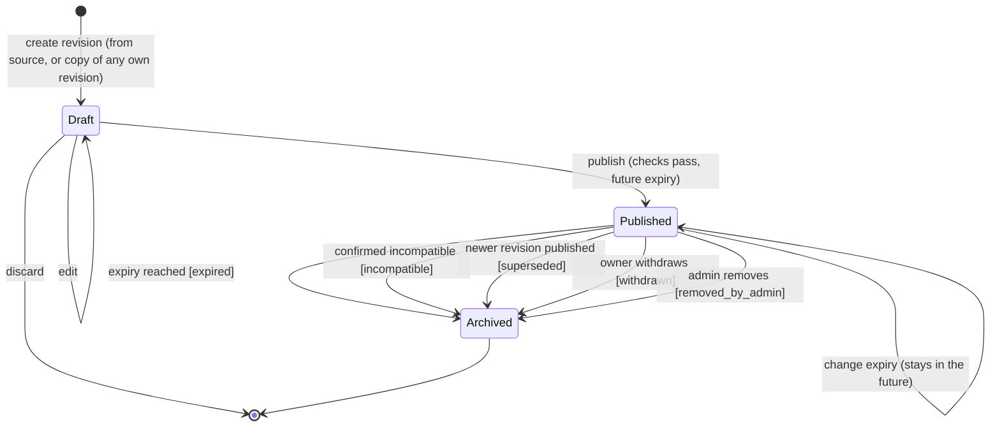
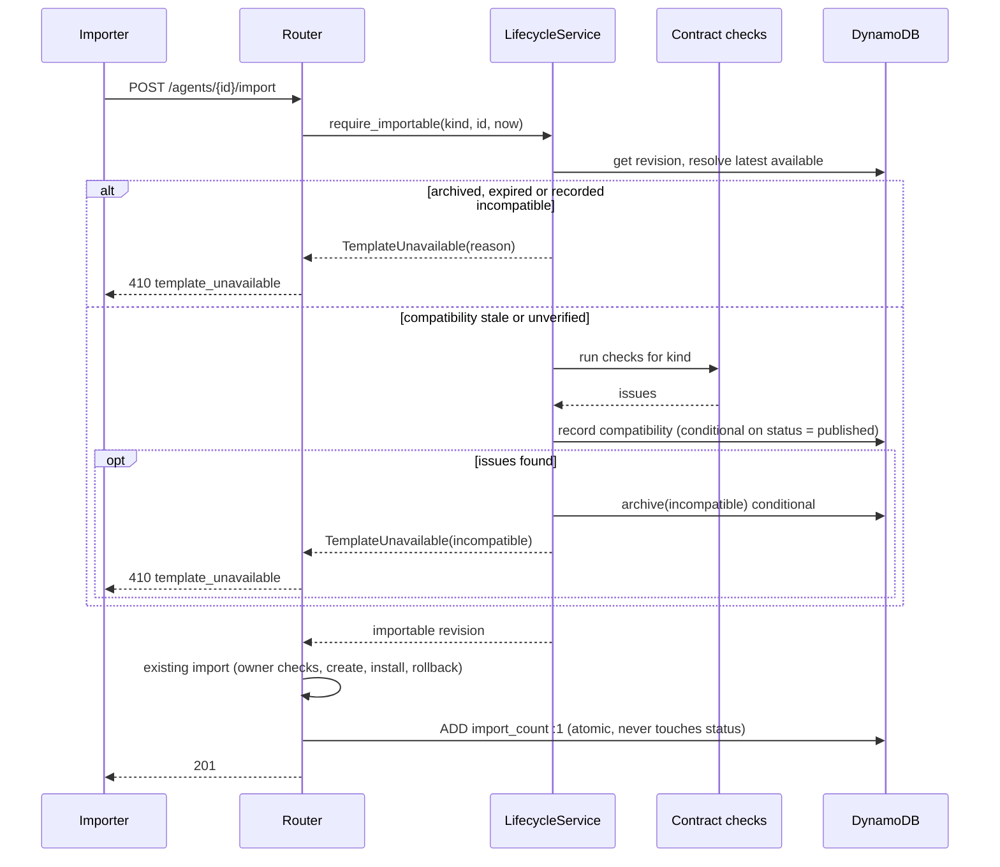
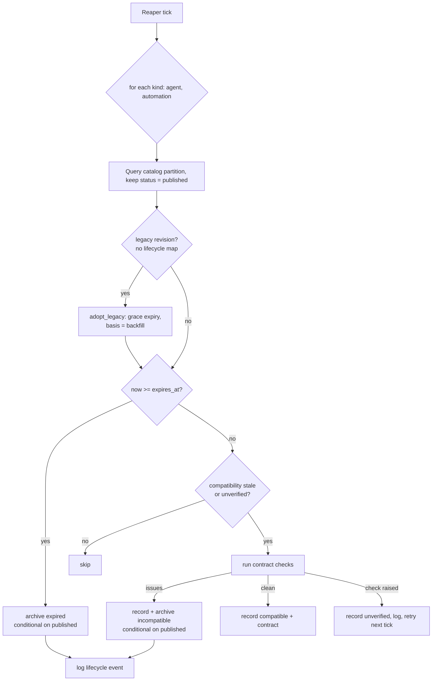

# Marketplace template lifecycle: compatibility, expiry and archival

| Field | Value |
| --- | --- |
| Status | 📝 Proposed |
| Owner | InnomightLabs API / SPA |
| Last reviewed | 2026-10-18 |
| Depends on | [LLD-agent-marketplace.md](LLD-agent-marketplace.md), [LLD-automation-marketplace.md](LLD-automation-marketplace.md), [LLD-scheduler-architecture.md](LLD-scheduler-architecture.md) |
| Tracker | [KAN-99](https://vslala007.atlassian.net/browse/KAN-99) (epic [KAN-37](https://vslala007.atlassian.net/browse/KAN-37) Agent Templates Marketplace) |

> **Summary:** A marketplace template is a snapshot of an agent or automation taken against the import
> contract of the day. Today nothing records which contract that was, nothing expires, and an import
> fails late with a raw error when the snapshot has rotted. This design stamps each published revision
> with the app version (provenance only) and a template schema version, checks it against the
> *current* import contract with a list of owner-independent checks, gives every publication an expiry
> timestamp, and archives a publication automatically when it expires or is confirmed incompatible.
> The same availability function guards listings, direct links and every import entry point, so a
> late sweep cannot let an invalid import through. Archived revisions stay with their publisher, who
> copies one into a draft revision, fixes it, and republishes it explicitly. It covers both
> marketplaces (agents and automations) through one shared module.

## Context and problem

Both marketplaces share a shape: a global partition of template revisions (`pk=MarketplaceAgent` /
`pk=MarketplaceAutomation`, `sk=Template#{template_id}`), a `DRAFT | PUBLISHED | ARCHIVED` status, and a
lineage (`template_version`, `parent_template_id`, `latest_template_id`). What exists today:

| Fact | Where |
| --- | --- |
| The status enum already has `ARCHIVED`, but only the publisher sets it, by hand. | `api/src/agent_marketplace/service.py:189` (`archive_agent`), `api/src/automation_marketplace/service.py:219` |
| Availability is "status is `PUBLISHED`", nothing else. The redirect to the lineage's latest revision only happens when the requested revision is itself still published. | `_published_template`, `api/src/agent_marketplace/service.py:198`, `api/src/automation_marketplace/service.py:232` |
| No revision records the app version, the shape it was saved in, when it was published, or when it should stop being offered. | `MarketplaceAgentTemplate` (`api/src/agent_marketplace/models.py:42`), `MarketplaceAutomationTemplate` |
| Publishing a new revision leaves the older revisions `PUBLISHED`. They drop out of listings only because `list_latest_published` keeps `latest_template_id == template_id`. | `api/src/agent_marketplace/repository.py:46` |
| A publisher has no API or page listing their own templates. Once archived, a template is invisible to its owner too. | routers in both modules |
| `increment_import_count` and `save` read the item and `put_item` it back whole. An archive written between the read and the put is overwritten: the template is silently reactivated. | `api/src/agent_marketplace/repository.py:80`, `api/src/automation_marketplace/repository.py:88` |
| There is no server-side cache, search index or recommendations surface. Listing and search are a partition query plus an in-process filter; the SPA fetches on mount with no query cache. | `list_latest_published`, `spa/src/services/agentMarketplace/` |
| The API does not know its own version. `pyproject.toml` says `0.1.0` and nothing reads a build id. Production deploys run `railway up` from a local directory (`scripts/deploy_prod_railway.sh:423`), not from a connected GitHub repo, so Railway's `RAILWAY_GIT_COMMIT_SHA` isn't available to fall back on. There are no version tags in the repo. | `api/src/config/settings.py`, `scripts/deploy_prod_railway.sh` |
| The architecture and provider name maps are local dicts inside the factory functions, so nothing can ask "is `krishna-mini` still a thing?" without building one. | `api/src/agents/architectures/factory.py:35`, `api/src/llm/providers/factory.py:29` |

So a template published against an architecture, skill or skill action that has since been removed
stays listed. Its import fails part-way (the agent and some skills are created, then rolled back) with
an error the importer cannot act on, and the publisher never learns why.

## Goals and non-goals

Goals:

- Record, on each published revision, the app version and template schema version it was published
  under, plus `published_at`, `expires_at`, compatibility, and archival reason and time.
- One compatibility rule: a revision is importable when the schema policy still supports its shape and
  it passes the current import contract. The app version is never part of the rule.
- Expiry per publication, set or changed by the publisher or a marketplace admin within bounds that
  live in settings.
- Archive automatically on expiry or confirmed incompatibility, idempotently and safely across
  processes, and check the same rule at import time.
- Owners keep archived content, see why it was archived, and republish a fixed revision explicitly.
- Backfill existing templates honestly: unknown history is shown as unknown.

Non-goals:

- Changing template content automatically when the contract changes. The owner fixes it.
- An approval queue for publishing.
- Updating or deleting agents and automations that were imported earlier. They are private copies and
  stay as they are.
- Email reminders before expiry. The data supports them; they're a follow-up.
- Paginating the catalog partition. It is read whole today and will be for the sweep too; a GSI is the
  next step if it grows past one query page (see "Alternatives and decisions").

## Design

### Two versions with different jobs

| Stamp | Value | Used for |
| --- | --- | --- |
| `published_app_version` | `settings.app_version`: the `APP_VERSION` the deploy script sets (`1.0.3`, see [Application version](#application-version)), else `"dev"` | Provenance and troubleshooting, and as part of the contract fingerprint that triggers a re-check after a deploy. **Never gates.** A newer release alone archives nothing. |
| `published_schema_version` | the kind's `SchemaPolicy.current` at publish time | Says which stored shape the revision uses. The importer supports `min_supported..current`. |

The schema version moves only when the *stored template shape* changes (a field renamed, a node
config restructured). Adding an optional field leaves `min_supported` where it is. `min_supported` is
raised only when the importer can no longer read an older shape, and doing so archives those revisions
with reason `incompatible` and issue code `schema_unsupported`. Version 1 is today's shape for both
kinds.

### Application version

The version is `MAJOR.MINOR.PATCH` (`1.0.0`, `1.0.1`, ... `1.1.0`). Every production deploy increments the
patch. Minor and major are bumped deliberately. The counter is a set of git tags named `v1.0.3`:
the tag is the single source of truth, it records which commit shipped as which version, and it needs no
extra storage.

New `scripts/next_app_version.sh` prints the version for the deploy about to happen:

```bash
#!/usr/bin/env bash
# usage: next_app_version.sh [patch|minor|major]   (default: patch)
set -euo pipefail
bump="${1:-patch}"
git fetch --tags --quiet 2>/dev/null || true
latest="$(git tag --list 'v[0-9]*.[0-9]*.[0-9]*' --sort=-v:refname | head -n1)"
IFS=. read -r major minor patch <<<"${latest:-v1.0.-1}"
major="${major#v}"
case "$bump" in
  major) echo "$((major + 1)).0.0" ;;
  minor) echo "${major}.$((minor + 1)).0" ;;
  patch) echo "${major}.${minor}.$((patch + 1))" ;;
  *) echo "unknown bump: $bump" >&2; exit 1 ;;
esac
```

In `scripts/deploy_prod_railway.sh`:

```bash
APP_VERSION="$("$SCRIPT_DIR/next_app_version.sh" "${VERSION_BUMP:-patch}")"
set_railway_var "APP_VERSION" "$APP_VERSION"          # with the other variables, before `railway up`
...
railway up "$API_DIR" ...                             # existing
git tag "v$APP_VERSION" && git push origin "v$APP_VERSION"   # only after railway up succeeded
```

| Case | Behaviour |
| --- | --- |
| Normal deploy | Latest tag `v1.0.2` → deploys as `1.0.3`. |
| Minor or major release | `VERSION_BUMP=minor scripts/deploy_prod_railway.sh` → `1.1.0`. `major` → `2.0.0`. The patch resets to 0. |
| First deploy | No tag exists → `1.0.0`. |
| Failed deploy | The tag is created only after `railway up` succeeds, so a retry computes the same version and no number is burned. |
| Two deploys at once | The second `git push` of the same tag is rejected. The deploy script then fails after `railway up` has already run, so the second person re-runs to get the next number. |
| Uncommitted changes | The script prints a warning: the tag points at `HEAD`, which does not contain the local edits. |
| Local dev and tests | `APP_VERSION` is unset, so `settings.app_version` is `"dev"`. |

The variable is synced before `railway up` uploads the build, so the new container starts with the new
`APP_VERSION`. Because the version changes on every deploy, the
contract fingerprint changes too, and the sweep re-checks every published template once per deploy.
Versions are only ever compared for equality (to detect a deploy) and displayed. They never gate
compatibility.

### The compatibility rule

```text
compatible(revision) =
    policy(kind).supports(revision.published_schema_version)      # None (legacy) passes to the checks
    and not any(check(revision) for check in CONTRACT_CHECKS[kind])
```

The checks are a strategy list per kind (see `api/src/rate_limits/strategies.py` for the pattern).
Each returns a list of `CompatibilityIssue(code, message, path)`, where the message says what to change.
Every check is **owner-independent**: it asks whether the platform can still import this template,
not whether *this* importer has the provider key or connector. Those importer checks stay where they
are (`validate_provider_model`, `validate_install_config`, the strict graph validation in import).

| Kind | Check | Issue code | Example message |
| --- | --- | --- | --- |
| both | Schema version supported | `schema_unsupported` | "Saved in template format 1; this release imports 2 and later. Create a new revision to update it." |
| both | Every template skill is in the skill registry | `skill_unknown` | "Skill `riot_lol_api_client` is no longer available. Remove it from the template." |
| agent | `agent_architecture` is a known architecture | `architecture_unknown` | "Architecture `krishna-legacy` was retired. Choose `krishna-mini` or `krishna-memgpt`." |
| agent | `agent_provider` is a known provider | `provider_unknown` | "Provider `Foo` is no longer supported." |
| agent | `default_config` keys are fields of the skill's install form | `skill_config_field_unknown` | "`wordpress_search` no longer has a `site_key` setting. Remove it from the defaults." |
| automation | Each `skill_action` node names a template skill whose manifest still has the action (`SkillManifest.find_action`, `api/src/skills/models.py:134`) | `skill_action_unknown` | "Step 'Fetch posts' calls `wordpress_search.search_posts`, which no longer exists." |
| automation | Each node config parses into its config model (`SkillActionConfig`, `InvokeAgentActionConfig`, `ConditionNodeConfig`) | `node_config_invalid` | "Step 'Branch' is missing `expression`." |
| automation | Graph shape passes `AutomationGraphValidator` in `GraphValidationMode.DRAFT` (identity, boundaries, edges, reachability, cycles; it returns before any owner-specific check) | `graph_invalid` | the validator's message |
| automation | Placeholders are declared (the existing `_validate_placeholders_declared`, `api/src/automation_marketplace/service.py:730`) | `placeholder_undeclared` | the existing message |

A check returns issues: that is a **confirmed** incompatibility. A check that raises is not; the
result is `unverified`, the error is logged, and the next sweep tries again. Only confirmed
incompatibility archives.

The architecture and provider maps move from inside the factory functions to module level
(`ARCHITECTURE_FACTORIES` in `api/src/agents/architectures/factory.py`, a `PROVIDER_NAMES` frozenset next to
`get_llm_provider`) so the checks can read the names without building instances. The factories read
the same maps, so there's still one source of truth.

### Contract fingerprint and re-checking

Each revision stores the outcome of its last check and what it was checked against:

```python
def current_contract(kind: TemplateKind) -> str:
    return f"{kind.value}/schema-{SCHEMA_POLICIES[kind].current}/app-{settings.app_version}"
```

A stored compatibility whose `contract` differs from `current_contract(kind)` is *stale*. Every deploy
changes the app version, so every published revision is re-checked once after a deploy, which is what
"reevaluate compatibility after relevant application/schema changes" needs. The checks are in-process
registry lookups, so re-checking the whole catalog costs milliseconds.

### Lifecycle states



*One revision, one `template_id`. Archived is final for that revision: remediation creates a new Draft
revision (new `template_id`, next `template_version`) and never sets an archived revision back to
published.*

Decisions in the diagram:

- **One archived state plus a reason**, not `expired` / `incompatible` statuses. Every visibility rule
  then reads one field, and the reason is just for display.
- **`superseded`.** Publishing a revision archives the lineage's previously published revision. The
  published set is then exactly the discoverable set, so the sweep and the gate never have to reason
  about the latest-pointer, and old revisions can't stay importable on their own expiry. The direct-link
  redirect to the latest available revision keeps working (see the gate below).
- **At most one open draft per lineage.** Asking for a second returns the existing draft (409 with its
  id), so two drafts never race to become latest.

### Availability: one function for every surface

```python
def unavailable_reason(template: MarketplaceTemplate, now: datetime) -> UnavailableReason | None:
    """None when the revision may be listed and imported at `now` (UTC)."""
    for rule in AVAILABILITY_RULES:
        reason = rule.reason(template, now)
        if reason:
            return reason
    return None

AVAILABILITY_RULES: list[AvailabilityRule] = [
    NotPublished(),      # DRAFT -> not_found; ARCHIVED -> lifecycle.archive_reason
    Expired(),           # expires_at is not None and now >= expires_at -> expired
    Incompatible(),      # compatibility.status == incompatible -> incompatible
]
```

Expiry is inclusive at the boundary: a revision is available while `now < expires_at`. All timestamps
are timezone-aware UTC. Inputs with an offset are converted; naive inputs are rejected at the request
boundary.

Where it's applied:

| Surface | Behaviour |
| --- | --- |
| `GET /agents`, `GET /automations` (listing and search) | Filter with `unavailable_reason(t, now) is None` on top of today's latest-only filter. A stale-but-compatible revision stays listed; the import gate re-checks it. |
| `GET /{id}` (direct link) | Resolve the lineage's latest *available* revision and return it. If none is available, return **410** `{"code": "template_unavailable", "reason": "expired", "title": "..."}`. Only the title and reason are shown; archived content stays private. Drafts and unknown ids stay 404. |
| `GET /{id}/import-plan`, `POST /{id}/import-session`, `POST /{id}/import` | The **import gate**, below. 410 with the same body when unavailable. |

### The import gate

The gate makes import independent of the sweep. Every import entry point goes through
`LifecycleService.require_importable`:



*`now` is read once, at the start of the request. An import that passes the gate a moment before
expiry finishes; one that starts at or after `expires_at` is rejected even if the sweep hasn't run.*

Concurrency:

- **Expiry against import.** The gate decides once per request at `now`. The window is the length of
  one import request, and no import can *start* after expiry. Tests pin both sides of the boundary.
- **Archive against `import_count`.** `increment_import_count` becomes
  `update_item(UpdateExpression="ADD import_count :one")`, so it can't overwrite `status`. This fixes the
  lost-update bug described above.
- **Sweep against owner edits.** Lifecycle writes are targeted `update_item` calls with
  `ConditionExpression="#status = :published"` (archive, record compatibility) or `= :draft` (draft
  edits, publish). They never `put_item` the whole item. A `ConditionalCheckFailedException` means
  another process or request got there first, and the caller treats it as done.

### The sweep

A new entry in `SchedulerRuntime`'s reaper loop (`api/src/scheduler/runtime.py:62`), next to the
crawl-job and lead-event reapers, interval `settings.marketplace_lifecycle_sweep_interval_seconds`. It
runs at startup and then on the interval, and `_reap` already stops one failure from stopping the loop.



*Every write is conditional on the revision still being published, so two Railway replicas ticking at
once produce one archive, and the loser's condition failure is a no-op. Running the sweep twice
changes nothing the second time.*

The sweep returns a count (as reapers do) and logs one summary line per kind:
`marketplace.lifecycle.sweep kind=agent checked=41 archived_expired=2 archived_incompatible=1 unverified=0`.

### Expiry policy

All bounds are in settings (code defaults, env overrides). The product values are open questions
below, so the defaults are placeholders, not decisions.

| Setting | Env | Default | Meaning |
| --- | --- | --- | --- |
| `marketplace_default_expiry_days` | `MARKETPLACE_DEFAULT_EXPIRY_DAYS` | 365 | Used when publish leaves out `expires_at`. |
| `marketplace_max_expiry_days` | `MARKETPLACE_MAX_EXPIRY_DAYS` | 730 | Latest allowed `expires_at`, measured from now. |
| `marketplace_min_expiry_hours` | `MARKETPLACE_MIN_EXPIRY_HOURS` | 24 | Earliest allowed `expires_at`, so nothing is published to expire the same minute. |
| `marketplace_legacy_grace_days` | `MARKETPLACE_LEGACY_GRACE_DAYS` | 30 | Expiry given to pre-existing templates on adoption. |
| `marketplace_lifecycle_sweep_interval_seconds` | `MARKETPLACE_LIFECYCLE_SWEEP_INTERVAL_SECONDS` | 900 | Sweep interval. |
| `marketplace_admin_user_ids` | `MARKETPLACE_ADMIN_USER_IDS` (comma-separated) | empty | Users who can change expiry on, view and remove any template. |
| `app_version` | `APP_VERSION` (set by the deploy script) | `"dev"` | Provenance stamp and part of the contract fingerprint. |

One function owns the expiry rules, so publish, change-expiry and republish validate the same way:

```python
def resolve_expiry(requested: datetime | None, now: datetime) -> datetime:
    """The expiry to store, or ExpiryValidationError naming the allowed window."""
    policy = ExpiryPolicy.from_settings()
    expires_at = (requested or now + policy.default).astimezone(timezone.utc)
    if expires_at < now + policy.minimum:
        raise ExpiryValidationError(f"Expiry must be at least {policy.minimum} from now")
    if expires_at > now + policy.maximum:
        raise ExpiryValidationError(f"Expiry can be at most {policy.maximum.days} days from now")
    return expires_at
```

Changing the expiry of a **published** revision is a metadata update (conditional on `published`) with
no new revision. An **archived** revision's expiry can't be changed: that would silently reactivate it.
Republishing is the only way back.

### Owner management and remediation

A management surface under each router, `/agent-marketplace/mine/...` and
`/automation-marketplace/mine/...`, serves the publisher's own revisions in any status:

1. **List** every revision the caller published, grouped by lineage: status, archive reason and time,
   expiry, compatibility status and issues, the stamped versions, `import_count`.
2. **Detail** of any own revision, archived included, with the full content and the last lifecycle
   events.
3. **Create revision** from any own revision. This copies the content into a new `DRAFT`
   (`template_version = max(lineage) + 1`, same `parent_template_id`) and runs the checks, so the draft
   opens with its issues listed. `latest_template_id` does not move until publish.
4. **Edit draft** (`PATCH`, conditional on `draft`):
   - Agents: title, descriptions, tags, changelog, `agent_name`, `agent_persona`, `agent_description`,
     `agent_architecture`, `agent_provider`, `agent_model`, `allow_model_override`, and the skills list
     (remove a skill, edit its `default_config`; the existing secret-stripping rule applies to defaults).
   - Automations: title, descriptions, tags, changelog, `automation_title`, `automation_description`,
     `import_inputs`, removing a skill, and `nodes` / `edges` as a whole replacement. The SPA's
     primary graph fix is **Refresh from source automation**, which re-snapshots the graph through
     the existing `_template_from_graph` path when the caller still owns the source. Hand-editing the graph
     JSON is API-only.
5. **Validate draft** returns the checks' issues without publishing (the editor's "Check" button).
6. **Publish draft** takes `expires_at` (optional, defaults by policy). It runs the checks, and any
   issue means **422** with the issue list. `resolve_expiry` must pass. Then it stamps
   `published_app_version`, `published_schema_version`, `published_at`, `expires_at` and a fresh
   compatibility record, sets `PUBLISHED`, points the lineage's `latest_template_id` at it (as
   `_promote_latest_version` does today, `api/src/automation_marketplace/service.py:386`), and archives
   the previous published revision as `superseded`.
7. **Discard draft** deletes the draft item. Only drafts can be deleted, never published or archived
   revisions.
8. **Change expiry** on a published revision (owner or admin).
9. **Withdraw** is the existing `POST /{id}/archive`, now recording reason `withdrawn` (or
   `removed_by_admin` when an admin, not the publisher, calls it).

The existing publish-from-source endpoints (`POST /agents/publish`, `POST /automations/publish`) take
the same optional `expires_at`, run the same checks (422 on issues), stamp the same metadata and
archive the previous revision as `superseded`. Both publish paths go through one
`LifecycleService.publish(template, expires_at, actor)`.

Nothing here touches agents or automations created by earlier imports. Archival, supersession and
republishing only write template items.

### Permissions

```python
def can_manage(template: MarketplaceTemplate, owner: Owner) -> bool:
    return template.publisher_user_id == owner.user_id or owner.user_id in settings.marketplace_admin_user_ids
```

| Action | Publisher | Admin | Anyone else |
| --- | --- | --- | --- |
| List / view own revisions, any status | ✅ | ✅ (any publisher's) | 404 |
| Create / edit / validate / publish / discard a draft | ✅ | ❌ | 404 |
| Change expiry of a published revision | ✅ | ✅ | 404 |
| Withdraw / remove | ✅ (`withdrawn`) | ✅ (`removed_by_admin`) | 404 |

"Anyone else" gets 404, not 403, so private revisions don't reveal that they exist. This matches
today's "Marketplace agent not found". Publishing from a source agent or automation still requires
`agents:Share` / `automations:Share` on it, as today.

### Troubleshooting record

Each revision keeps its last 25 `LifecycleEvent`s in its `lifecycle` map (published, expiry changed,
checked, archived, adopted), each with `at`, `actor` (`user:<id>`, `system:sweep`, `system:import-gate`,
`system:backfill`), `from_status`, `to_status`, `reason`, and the issue codes when relevant. Every event is
also logged as a structured line `marketplace.lifecycle.event kind=... template_id=... ...`. A publish
rejected for issues is logged with its codes. The 25-event cap keeps the item well inside DynamoDB's
400 KB, since the content (persona, graph) is already the bulk of it.

## Data model and contracts

### Shared lifecycle model

New module `api/src/marketplace_lifecycle/models.py`:

```python
class TemplateKind(str, Enum):
    AGENT = "agent"
    AUTOMATION = "automation"

class ArchiveReason(str, Enum):
    EXPIRED = "expired"
    INCOMPATIBLE = "incompatible"
    SUPERSEDED = "superseded"
    WITHDRAWN = "withdrawn"
    REMOVED_BY_ADMIN = "removed_by_admin"

class CompatibilityStatus(str, Enum):
    COMPATIBLE = "compatible"      # checks ran against `contract` and found nothing
    INCOMPATIBLE = "incompatible"  # checks found issues (confirmed)
    UNVERIFIED = "unverified"      # never checked, or a check raised

class CompatibilityIssue(BaseModel):
    code: str          # e.g. "skill_unknown"
    message: str       # what to change, shown to the owner verbatim
    path: str | None = None   # e.g. "skills[wordpress_search].default_config.site_key"

class Compatibility(BaseModel):
    status: CompatibilityStatus = CompatibilityStatus.UNVERIFIED
    contract: str | None = None    # current_contract(kind) at check time
    checked_at: datetime | None = None
    basis: Literal["publish", "sweep", "import_gate", "backfill"] | None = None
    issues: list[CompatibilityIssue] = Field(default_factory=list)

class LifecycleEvent(BaseModel):
    at: datetime
    actor: str
    event: Literal["published", "expiry_changed", "checked", "archived", "adopted"]
    from_status: str | None = None
    to_status: str | None = None
    reason: str | None = None
    issue_codes: list[str] = Field(default_factory=list)

class TemplateLifecycle(BaseModel):
    published_app_version: str | None = None    # None = published before tracking
    published_schema_version: int | None = None # None = published before tracking
    published_at: datetime | None = None
    expires_at: datetime | None = None
    archived_at: datetime | None = None
    archive_reason: ArchiveReason | None = None
    compatibility: Compatibility = Field(default_factory=Compatibility)
    events: list[LifecycleEvent] = Field(default_factory=list)  # newest last, capped at 25
    legacy: bool = False   # adopted by backfill: versions unknown, not inferred

@dataclass(frozen=True)
class SchemaPolicy:
    current: int
    min_supported: int

    def supports(self, version: int | None) -> bool:
        return version is None or self.min_supported <= version <= self.current

SCHEMA_POLICIES: dict[TemplateKind, SchemaPolicy] = {
    TemplateKind.AGENT: SchemaPolicy(current=1, min_supported=1),
    TemplateKind.AUTOMATION: SchemaPolicy(current=1, min_supported=1),
}
```

The schema policy lives in code, not settings, because it describes what the importer in *this
build* can read. An env override could claim support for a shape the code can't import.

### Template models

`MarketplaceAgentTemplate` and `MarketplaceAutomationTemplate` each gain one field,
`lifecycle: TemplateLifecycle`, stored as a DynamoDB map attribute `lifecycle`. `status` stays top-level
because the conditional writes test it. `from_dynamo_item` reads a missing map as
`TemplateLifecycle(legacy=True)`, which is how the sweep recognises unadopted revisions.

### Responses

| Model | Change |
| --- | --- |
| `Marketplace{Agent,Automation}SummaryResponse` | `+ expires_at: datetime \| None` (the public card can show "Available until …"). |
| `Marketplace{Agent,Automation}DetailResponse` | `+ expires_at`, `+ published_at`. |
| new `TemplateUnavailableResponse` | `code: "template_unavailable"`, `reason: ArchiveReason \| "expired" \| "incompatible"`, `title: str`. Body of every 410. |
| new `Managed{Agent,Automation}TemplateResponse` | The detail fields plus `status` and the whole `lifecycle` (including `events` and `compatibility.issues`). Owner and admin only. |
| new `TemplateValidationResponse` | `compatible: bool`, `issues: list[CompatibilityIssue]`. Returned by validate, and as the 422 body of publish. |
| `Publish{Agent,Automation}Request` | `+ expires_at: AwareDatetime \| None`. |
| new `UpdateTemplateExpiryRequest` | `expires_at: AwareDatetime`. |
| new `Update{Agent,Automation}DraftRequest` | The editable fields listed under "Owner management", all optional. |

### API

Agents are shown here; automations mirror them under `/automation-marketplace/automations` and
`/automation-marketplace/mine`.

| Method and path | Who | Result |
| --- | --- | --- |
| `GET /agent-marketplace/agents` | any user | Available latest revisions only. |
| `GET /agent-marketplace/agents/{id}` | any user | Latest available revision in the lineage, or 410 / 404. |
| `GET /agent-marketplace/agents/{id}/import-plan` | any user | Import gate, then as today. 410 when unavailable. |
| `POST /agent-marketplace/agents/{id}/import` | `agents:Create` | Import gate, then as today. 410 when unavailable. |
| `POST /agent-marketplace/agents/publish` | `agents:Share` on source | `+ expires_at`. 422 with issues. Archives the previous revision as `superseded`. |
| `POST /agent-marketplace/agents/{id}/archive` | publisher / admin | Records `withdrawn` / `removed_by_admin`. |
| `GET /agent-marketplace/mine` | publisher (admin: `?publisher_user_id=`) | Own revisions, any status, grouped by lineage. |
| `GET /agent-marketplace/mine/{id}` | publisher / admin | `ManagedAgentTemplateResponse`. |
| `POST /agent-marketplace/mine/{id}/revisions` | publisher | 201 new draft, or 409 with the open draft's id. |
| `PATCH /agent-marketplace/mine/{id}` | publisher, draft only | Updated draft. 409 if not a draft. |
| `POST /agent-marketplace/mine/{id}/validate` | publisher | `TemplateValidationResponse`. |
| `POST /agent-marketplace/mine/{id}/publish` | publisher, draft only | 200 published, or 422 issues / expiry error. |
| `DELETE /agent-marketplace/mine/{id}` | publisher, draft only | 204. 409 if not a draft. |
| `PUT /agent-marketplace/mine/{id}/expiry` | publisher / admin, published only | Updated lifecycle. 409 if not published, 422 if out of bounds. |
| `POST /automation-marketplace/mine/{id}/refresh-from-source` | publisher, draft only, owns source | Draft with a re-snapshotted graph. |

## Frontend

| Where | Change |
| --- | --- |
| `spa/src/types/agentMarketplace.ts`, `automationMarketplace.ts` | Lifecycle, compatibility, issue, unavailable and managed-template types. |
| `spa/src/services/agentMarketplace/AgentMarketplaceApiService.ts`, `spa/src/services/automationMarketplace/AutomationMarketplaceApiService.ts` | The `/mine` calls. Map 410 to a typed `TemplateUnavailableError` and 422 to `TemplateValidationError`. |
| `AgentMarketplacePage.tsx`, `AutomationMarketplacePage.tsx` | A **Published by me** tab: one row per lineage with a status badge (Live · Expires in 12 days · Archived: expired / incompatible / superseded / withdrawn), the issues inline with their actionable messages, and actions: Change expiry, Withdraw, Create revision, Continue draft. |
| `MarketplaceAgentDetail.tsx`, `AutomationMarketplaceDetail.tsx` | On `TemplateUnavailableError`, show "This template is no longer available" with the reason and no import controls. A cached page whose import gets a 410 shows the same state. |
| new draft editor (one per kind, under the marketplace folders) | Uses the existing form primitives. Shows the issue list from create/validate and highlights the field named by `path`. The automation editor has **Refresh from source automation**. Publish opens the expiry dialog. |
| Publish dialogs in `AgentOverviewPage.tsx` and the automation `WorkspaceTopBar.tsx` flow | An expiry date picker defaulting to the policy default (`GET /mine` returns the bounds), sent as a UTC ISO string. 422 issues are shown in the dialog. |

After any lifecycle action, the SPA refetches the affected list. There's no client cache to invalidate
today; if one is added later, these actions must invalidate the public list and detail keys too.

## Implementation map

| Area | Code | Responsibility |
| --- | --- | --- |
| Lifecycle models and policy | new `api/src/marketplace_lifecycle/models.py`, `policy.py` | Enums, `TemplateLifecycle`, `SchemaPolicy`, `ExpiryPolicy`, `resolve_expiry`, `current_contract`. |
| Availability rules | new `api/src/marketplace_lifecycle/availability.py` | `AVAILABILITY_RULES`, `unavailable_reason`. |
| Lifecycle service | new `api/src/marketplace_lifecycle/service.py` | `require_importable`, `publish`, `archive`, `record_compatibility`, `change_expiry`, `adopt_legacy`, `sweep`. Takes a small `LifecycleRepository` protocol and the kind's checks. |
| Agent contract checks | new `api/src/agent_marketplace/contract.py` | `AGENT_CONTRACT_CHECKS` strategy list. |
| Automation contract checks | new `api/src/automation_marketplace/contract.py` | `AUTOMATION_CONTRACT_CHECKS`. Reuses the graph validator in DRAFT mode and `_validate_placeholders_declared` (moved here). |
| Registries | `api/src/agents/architectures/factory.py`, `api/src/llm/providers/factory.py` | Hoist the name maps to module level. |
| Repositories | `api/src/agent_marketplace/repository.py`, `api/src/automation_marketplace/repository.py` | Atomic `ADD import_count`. Conditional `update_lifecycle(template_id, expected_status, ...)`. `list_by_publisher`. `delete_draft`. Implements `LifecycleRepository`. |
| Template models | both `models.py` | `lifecycle` field and its Dynamo mapping. The new response and request models. |
| Services | both `service.py` | `_published_template` → `lifecycle.require_importable`. Publish goes through `lifecycle.publish`. Draft create, edit and refresh. |
| Routers | both `router.py` | `/mine` routes. 410 / 422 / 409 mapping. |
| Sweep | `api/src/scheduler/runtime.py` | `_sweep_marketplace_templates` reaper entry (imports the lifecycle module inside the method, as `_recover_blueprint_applies` does). |
| Settings | `api/src/config/settings.py` | The settings in the expiry policy table. |
| Deploy | `scripts/deploy_prod_railway.sh`, new `scripts/next_app_version.sh` | `set_railway_var` for the `MARKETPLACE_*` vars and `APP_VERSION`; tags the release after `railway up` succeeds. See [Application version](#application-version). |
| Backfill | new `api/scripts/backfill_marketplace_lifecycle.py` | Dry run by default, `--apply` to write. Same `adopt_legacy` code as the sweep. |
| SPA | see "Frontend" | Management tab, unavailable state, draft editor, expiry picker. |
| Docs | this LLD; both marketplace LLDs' "Template Versioning" / "Versioning" sections and their wiki copies | Point to this design (supersession, lifecycle) once implemented. |

## Rollout and compatibility

Existing revisions have no `lifecycle` map. They have to become honest lifecycle records without
being shown as verified when nothing was verified.

`adopt_legacy(template, now)` handles each one:

- **Published, and the lineage's latest:** set `legacy=True` and keep both version stamps `None` (shown
  as "Published before version tracking"). Keep `published_at=None` too; the UI shows `created_at`,
  labelled as such. Set `expires_at = now + legacy_grace_days`. Run the contract checks
  with `basis="backfill"`: clean → `compatible`, issues → archive `incompatible`, check raised →
  `unverified`. An adopted template is compatible only because it *passed today's checks*, and the
  record says that basis.
- **Published, but not the lineage's latest:** archive as `superseded`.
- **Draft or archived:** set `legacy=True` and nothing else. Archived revisions get
  `archive_reason=None`, shown as "Archived before reasons were recorded".

Order:

1. Ship the code with the sweep enabled. Until a revision is adopted, `from_dynamo_item` reads it as
   `legacy` with `unverified` compatibility. Listings keep showing it (no expiry yet, not
   incompatible), and the import gate checks it inline, so nothing becomes importable that wasn't
   already, and nothing broken gets through the gate.
2. The sweep runs at startup and adopts every legacy revision on its first tick.
3. Run `uv run python scripts/backfill_marketplace_lifecycle.py` (dry run) and report its counts:
   adopted, archived incompatible (with issue codes), archived superseded, unverified. Rerunning with
   `--apply` is safe: adoption is idempotent because adopted revisions have a `lifecycle` map.
4. The 30-day grace expiry gives publishers time to see their templates in **Published by me** and
   republish. Anything left expires through the normal path.

The first deploy of this change is also the first version-tagged deploy, so it ships as `1.0.0`. Templates published before then carry no app version (see `legacy`), not `dev`.

Rollback: the old code ignores the `lifecycle` attribute and reads `status`, so revisions archived by
the sweep stay archived and the rest behave as before.

## Validation

Focused while working, then the full suites:

```bash
cd api
uv run pytest tests/test_marketplace_lifecycle.py tests/test_agent_marketplace.py tests/test_automation_marketplace.py -q
uv run pytest -q
uv run ruff check src/marketplace_lifecycle src/agent_marketplace src/automation_marketplace src/scheduler/runtime.py
uv run mypy src/marketplace_lifecycle src/agent_marketplace src/automation_marketplace
cd ../spa && yarn test && yarn lint && yarn build
```

Tests (moto via the `dynamodb_table` fixture, `owner_for` / `test_owner` from `tests/mock_data.py`, a
fixed `now` passed in rather than patched):

| Acceptance criterion | Tests |
| --- | --- |
| A publication records versions, timestamps, expiry and state | Publish from source and from a draft. Assert every `lifecycle` field, UTC aware. |
| Expiry is validated; already-expired is rejected | `resolve_expiry` below min, at min, above max, default, naive datetime rejected at the request model, offset converted to UTC. |
| A version difference alone doesn't archive | Change `settings.app_version`, run the sweep: the template is re-checked, `compatible`, contract updated, still listed. |
| Confirmed incompatibility archives with a reason | Remove a skill from the registry or retire an architecture in the test: sweep → archived `incompatible` with an `skill_unknown` / `architecture_unknown` issue. A check that raises → `unverified`, not archived. Raised `min_supported` → `schema_unsupported`. |
| Expiry archives; the gate rejects before the sweep | `now = expires_at - 1µs` imports; `now = expires_at` → 410 from import-plan, import-session and import with no sweep run. Then the sweep archives `expired`. |
| Excluded from listing, search, direct links | Listing and `query=` search skip archived, expired and incompatible revisions. Direct link to an archived v1 with available v2 → v2. With none available → 410 body, no content. Draft id → 404. |
| Stale state can't bypass import | Template recorded `compatible` under an old contract, then made incompatible: listing still shows it, import → 410 and the gate archives it. |
| Concurrent expiry / import / archive | The archive condition fails when the status is no longer published (no-op). `ADD import_count` after an archive leaves it archived. Two sweeps over the same data: the second writes nothing. |
| Unauthorized changes | A second user gets 404 on every `/mine` route and on archive. An admin can change expiry and remove but not edit or publish drafts. `agents:Share` is still required on publish from source. |
| Owner remediation and republish | Archive incompatible → create revision (issues listed) → patch (remove the skill) → validate clean → publish with a future expiry → listed. The old revision stays archived. `version + 1`, `latest_template_id` moved, fresh stamps. |
| Republish fails with actionable errors | Publish a draft with issues → 422 listing codes and messages. Past expiry → 422. Publishing a non-draft → 409. A second open draft → 409 with its id. |
| Imported agents are untouched | Import, then archive / supersede / republish: the imported agent and its skills are unchanged. |
| Backfill | Legacy items: the latest published is adopted with `legacy=True`, versions `None`, grace expiry and `basis="backfill"`. A non-latest published is `superseded`. The dry run writes nothing. A rerun is a no-op. |
| Sweep wiring | `SchedulerRuntime` registers the reaper with the configured interval (as the existing reaper tests do), and an exception inside it is swallowed. |

SPA (vitest): the badge and status-text helper for each lifecycle state, the 410 → unavailable state
on the detail page, and 422 issues rendered in the publish dialog.

Manual checks after deploy: the backfill dry-run report, one republish from **Published by me** in
production, and a direct link to an archived template.

## Alternatives and decisions

| Option | Decision |
| --- | --- |
| Gate compatibility on the app version (match the latest, or a semver range) | Rejected. The ticket rules it out, and app releases mostly don't touch the template shape. The app version is provenance and a re-check trigger only. |
| Separate `expired` / `incompatible` statuses | Rejected. One `archived` status and a reason keep every visibility rule to a single test. |
| DynamoDB TTL on `expires_at` | Rejected. TTL deletes the item, and the owner must keep the content. |
| Only the sweep enforces expiry | Rejected. The ticket requires import-time enforcement, and sweeps can lag. The gate is authoritative; the sweep makes listings and owner views tidy. |
| Re-check everything inside the listing request | Rejected. It would write on GET. Listing trusts the last recorded check, and the gate re-checks before any import. |
| Reactivate an archived revision by extending its expiry | Rejected: "do not silently reactivate". Remediation always makes a new revision. |
| Keep superseded revisions published | Rejected. They would each need their own expiry and checks while no listing shows them. `superseded` keeps "published" equal to "discoverable". |
| A GSI on `expires_at` for the sweep | Deferred. The sweep reads the same single partition the listing already reads in one query. Add `gsi2_pk=MarketplaceExpiry#<kind>` / `gsi2_sk=<expires_at>#<id>` (the scheduler's due-index pattern) if the catalog outgrows one query page. |
| Store the schema policy in settings | Rejected. It describes what the code in this build can import, so it ships with the code. The expiry policy, a product choice, is in settings. |

## Open questions (product configuration)

1. The default expiry, the max horizon and the minimum lead time. The placeholders are 365 days,
   730 days and 24 hours.
2. The legacy grace period for existing templates. The placeholder is 30 days.
3. Who the marketplace admins are. The proposal is a settings allowlist of user ids until there's a
   platform-admin role.
4. Expiry reminders to publishers (for example 14 and 3 days before). Out of scope here; the
   `expires_at` data supports them.

## Related documentation

- [LLD-agent-marketplace.md](LLD-agent-marketplace.md) and [LLD-automation-marketplace.md](LLD-automation-marketplace.md): the catalog, import and versioning this extends
- [LLD-scheduler-architecture.md](LLD-scheduler-architecture.md) and `api/src/scheduler/CONTRIBUTION.md`: reapers and idempotent dispatch
- [CODE_PHILOSOPHY.md](../../CODE_PHILOSOPHY.md)
