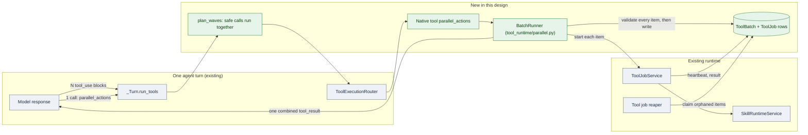
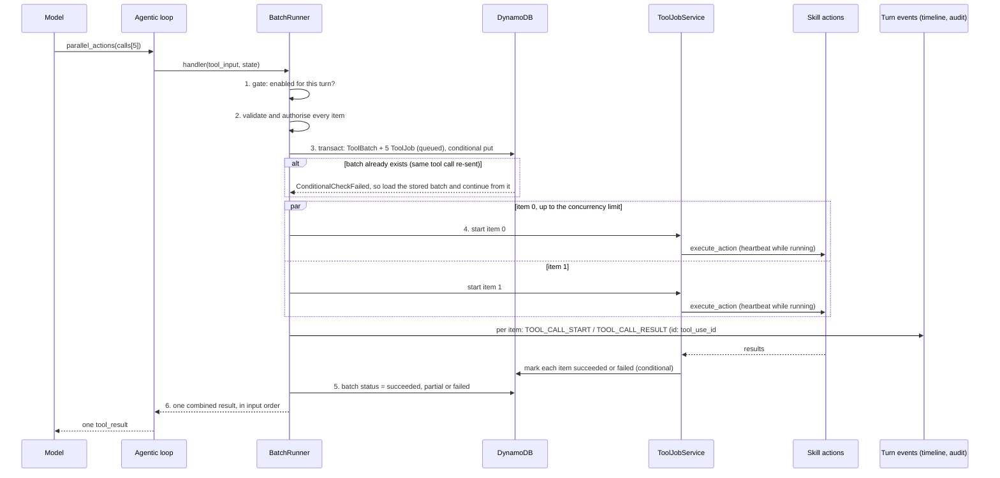
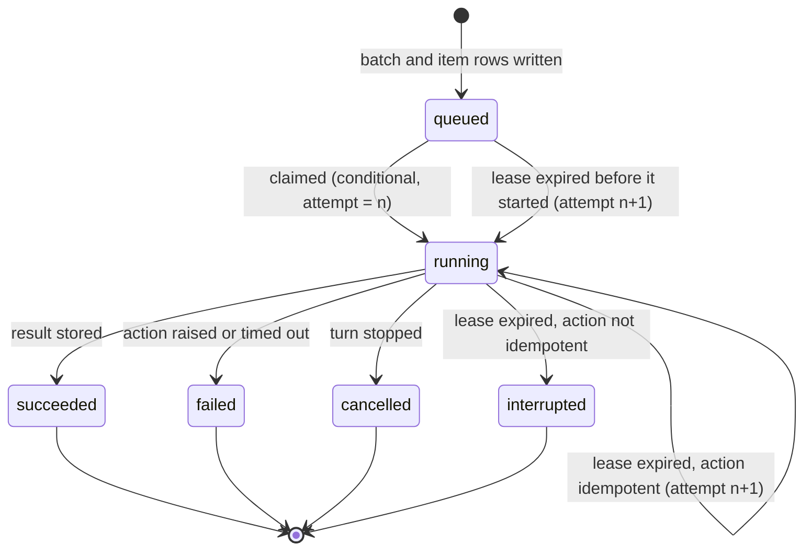

# LLD: Parallel actions, a native tool that runs several skill actions at once

| Field | Value |
| --- | --- |
| Status | 📝 Proposed |
| Owner | InnomightLabs API |
| Last reviewed | 2026-10-11, against the working tree (`main`) |
| Depends on | [LLD-async-tool-runtime.md](LLD-async-tool-runtime.md) (tool jobs), [LLD-agent-core-readability.md](LLD-agent-core-readability.md) (the loop's current shape), [LLD-async-chat-turns.md](LLD-async-chat-turns.md) (turn liveness) |
| Tracker | [KAN-92](https://vslala007.atlassian.net/browse/KAN-92). Follow-up, not designed here: choosing the tool per agent on Agent details → Tools |

> **Summary:** An agent with N independent jobs spends N model round trips, and each one re-sends the whole context. This design adds a **native tool, `parallel_actions`**, that takes a list of skill actions, runs them concurrently as durable tool jobs, and returns one combined result. A smaller first step makes the loop run the model's own parallel tool calls concurrently instead of one after another. The tool is a native tool, not a skill: it needs the tool router and the caller's authorisation, which a skill action can't reach. It is gated per agent from the start, so the later Tools-page toggle only has to flip a switch that already exists.

Paths are relative to `api/` unless marked otherwise. Line references describe the working tree on the review date and will move.

## 1. Context and problem

### 1.1 What a multi-step turn costs today

The agentic loop (`src/agents/agentic_loop.py`) asks the model, runs the tools it asked for, appends the results, and asks again, up to `MAX_TOOL_ITERATIONS = 37` model calls (`src/common/constants.py`). Every call re-sends the system prompt, the history and all earlier tool results. For N independent actions that is N model calls, so the cost grows with N times the context, and the wait is N times (model latency plus tool latency).

### 1.2 Two facts about the code today

1. **The loop already receives several tool calls in one model response and runs them one after another.** `_Turn.run_tools` (`agentic_loop.py`) does `for tool_event in call.tool_calls:` and awaits each in turn. A model that batches by itself saves round trips but not time.
2. **Not every model batches.** Several providers (Ollama, some Bedrock models) return one tool call per response. For them only a tool that carries a list of actions can cut round trips.

### 1.3 What we can build on

| Piece | Where | Why it matters |
| --- | --- | --- |
| Concurrency groundwork | `src/agents/tool_execution.py`: `current_tool_call_id` is a `ContextVar` "because a turn runs several tools at once" | Each concurrently created task gets its own copy |
| One execution policy | `ToolExecutionRouter.execute` | Timeout, error shape, and "never raises" are decided in one place |
| Tool jobs | `src/agents/tool_runtime/jobs/` (`ToolJob`, `ToolJobRepository`, `ToolJobService`) | A durable row per job, conditional status changes, results kept whole (inline or S3), 7-day TTL, a reaper |
| Turn events | `src/agents/turn_runtime.py`: `emit_turn_event`, `AgentTurnRuntime.stream_while` | A running tool can stream events to the turn |
| Audit | `src/agents/tool_audit.py`: `ToolCallAuditLog.observe` | One audit row per `TOOL_CALL_START` / `TOOL_CALL_RESULT` pair, keyed by `tool_call_id` |
| Native tool recipe | `src/tools/CONTRIBUTION.md` | Definition, contract, spec, handler |

### 1.4 Gaps this design closes

- `NativeToolHandler` (`src/tools/native/handlers.py`) is stateless and only knows memory and knowledge. It cannot reach the skill runtime or the router.
- All `ToolCategory.NATIVE` tools go to **every** agent (`_tool_categories_for`, `src/agents/architectures/krishna_memgpt.py`). There is no per-agent choice of native tools; skills (`state.enabled_skills`), MCP (`enabled_mcp_connections`) and knowledge (`linked_kb_ids`) each have one.
- A tool job has no heartbeat and no retry. `ToolJobRepository.fail_stale_jobs` fails anything unfinished after ten minutes: a restart orphans the row, and there is no way to tell "died" from "slow".
- `_await_async_job` (a private function in `agentic_loop.py`) polls a job every two seconds and, past ten minutes, raises `AsyncToolJobStillRunningError`, which ends the turn.

## 2. Goals and non-goals

**Goals**

1. One tool call can start N skill actions; the model gets one combined result in input order.
2. Actions the skill marks safe run at the same time; the rest run in order inside the batch.
3. A crash, deploy or disconnect never loses a record, never reports success for unfinished work, and never silently runs a side effect twice.
4. No new privilege: every item is authorised exactly as a single `execute_skill_action` would be.
5. The tool is offered only to agents that have it enabled, and the switch is a single, honest source of truth.
6. Part A makes the loop run the model's own parallel calls concurrently, for every tool.

**Non-goals (v1)**

- Dependencies between items (item 2 using item 1's output). Dependent work stays sequential across model calls.
- Batching MCP tools or native tools. The runner dispatches by registered tool name so they can be added to an allowlist later, but v1 allows skill actions only.
- The Agent details → Tools page and its API (`Agent.enabled_native_tools`). Section 4.6 builds the gate it will use.
- Resuming the model call of a turn that died. Recovery covers the work, not the conversation.
- A queue or workflow engine (SQS, Step Functions). See section 9.

## 3. Overview



Green is new, grey exists. Each item goes back through `ToolExecutionRouter`, so timeouts, errors and audit rows behave as for any call.

Two parts, shipped in order:

- **Part A** (section 4.1): the loop runs a model response's parallel-safe calls concurrently.
- **Part B** (sections 4.2 to 4.7): the `parallel_actions` native tool and its durable batch.

## 4. Design

### 4.1 Part A: concurrent tool calls in the loop

**What changes.** `_Turn.run_tools` stops awaiting each call in turn. It splits the calls into **waves** and runs each wave concurrently:

- A call is *parallel-safe* when the registry says so (below).
- A wave is a maximal run of consecutive safe calls. An unsafe call is a wave of one, so it is a barrier: everything before it finishes first, then it runs alone, then the next wave starts. Order-dependent calls (a core-memory write followed by a read) keep their meaning.
- Within a wave, at most `settings.tool_batch_max_concurrency` calls run at once.

```python
# agents/tool_runtime/parallel.py
def plan_waves(calls: list[LLMEvent], is_safe: Callable[[LLMEvent], bool]) -> list[list[LLMEvent]]:
    """Consecutive safe calls share a wave; an unsafe call runs alone, in order."""
    waves: list[list[LLMEvent]] = []
    for call in calls:
        if is_safe(call) and waves and all(is_safe(c) for c in waves[-1]):
            waves[-1].append(call)
        else:
            waves.append([call])
    return waves
```

```python
# agents/agentic_loop.py  (_Turn.run_tools, shape of the change)
for wave in plan_waves(call.tool_calls, self._is_parallel_safe):
    task = asyncio.create_task(self._run_wave(wave))      # gathers the wave under a semaphore
    async for event in self.runtime.stream_while(task):   # tool events stream while it runs
        yield event
    for tool_event, outcome in zip(wave, task.result()):  # request order, for the model
        tool_results.append(tool_result_block(tool_event.tool_use_id, outcome.result))
        refresh_prompt = refresh_prompt or outcome.refresh_prompt
```

**Events.** Each call emits its own `TOOL_CALL_RESULT` through `emit_turn_event` as it finishes, so the timeline shows fast results immediately instead of waiting for the slowest call in the wave. `TOOL_CALL_START` events are already emitted while the model streams, so the audit `sequence` (assigned in `ToolCallAuditLog.observe`) keeps the model's order. The results given to the model stay in request order.

**What counts as safe.** One function decides, so the rule is in one place:

```python
def is_parallel_safe(call: LLMEvent, registry: ToolRegistry, state: AgentTurnState) -> bool:
    spec = registry.get(call.tool_name).spec
    if call.tool_name == "execute_skill_action":
        return skill_action_is_parallel(state, call.tool_input)   # the action's manifest: execution.parallel
    return spec.parallel_safe                                      # a flag on ToolSpec, default False
```

`ToolSpec` (`src/agents/tool_runtime/specs.py`) gains `parallel_safe: bool = False`. Set it on tools with no ordering or mutation concerns: `core_memory_read`, `core_memory_list_blocks`, `archival_memory_search`, `recall_conversation`, `knowledge_base_search`, `load_skill`, `check_tool_job`, `mcp_list_tools`. Core-memory writes stay `False` (they also set `mutates_prompt_context`). `call_mcp_tool` stays `False` until we have a per-connection signal.

**Failure and cancellation.** `ToolExecutionRouter.execute` never raises, so one failing call returns its error result and the wave carries on. If the turn is stopped, cancelling the wave task cancels every call in it.

### 4.2 Part B: the native tool

`parallel_actions` is declared like any native tool (`src/tools/CONTRIBUTION.md`), but its executor lives in `src/agents/tool_runtime/` because it needs the registry and the skill runtime, which `NativeToolHandler` deliberately does not have.

```python
# src/tools/native/definitions.py
PARALLEL_ACTIONS = {
    "name": "parallel_actions",
    "description": (
        "Run several independent skill actions at once and get all their results together. "
        "Use it instead of calling execute_skill_action repeatedly when the actions do not depend on "
        "each other's results. Put every action parameter inside that call's `arguments`. "
        "Set `detach` to true on a long-running call to start it and check it later with check_tool_job."
    ),
    "parameters": {
        "type": "object",
        "properties": {
            "calls": {
                "type": "array", "minItems": 1, "maxItems": 20,
                "items": {
                    "type": "object",
                    "properties": {
                        "skill_id": {"type": "string"},
                        "action": {"type": "string"},
                        "arguments": {"type": "object"},
                        "detach": {"type": "boolean"},
                    },
                    "required": ["skill_id", "action", "arguments"],
                    "additionalProperties": False,
                },
            }
        },
        "required": ["calls"],
        "additionalProperties": False,
    },
}
```

```python
# src/tools/native/contracts.py
class ParallelCallInput(BaseModel):
    model_config = ConfigDict(extra="forbid")
    skill_id: str = Field(min_length=1)
    action: str = Field(min_length=1)
    arguments: dict[str, Any]
    detach: bool = False

class ParallelActionsInput(BaseModel):
    model_config = ConfigDict(extra="forbid")
    calls: list[ParallelCallInput] = Field(min_length=1, max_length=MAX_PARALLEL_CALLS)
```

```python
# src/tools/native/specs.py
PARALLEL_ACTIONS_SPEC = ToolSpec(PARALLEL_ACTIONS, ToolCategory.PARALLEL, ParallelActionsInput, timeout_seconds=None)
```

The tool's `timeout_seconds` is `None` on purpose: each item carries its own timeout, and the batch has its own deadline (4.4).

**Binding.** `tool_runtime/factory.py` builds the registry first and then registers the tool with a handler that closes over it, since the runner runs each item back through the router:

```python
registry = ToolRegistry([...existing bindings...])
registry.register(BoundTool(PARALLEL_ACTIONS_SPEC, partial(run_parallel_actions, registry, batch_service)))
return registry
```

`run_parallel_actions(registry, batches, tool_name, tool_input, state)` builds a `ToolExecutionRouter(registry)` and a `BatchRunner`, and returns the combined JSON string.

**Why not a skill.** A skill action runs inside `SkillRuntimeService.handle_tool_call` with its own manifest-defined context. It has no handle on other skills, on the router's timeout and error policy, or on the caller's authorisation; and an installable skill would make the capability depend on an install per agent, with its own config and secrets, for something that has none. A native tool is the existing home for built-in capabilities.

### 4.3 The batch, step by step



**1. Gate.** The runner refuses unless `PARALLEL_ACTIONS` is in `state.enabled_native_tools` (4.6). The tool is also withheld from the model, so this is a second lock for a crafted or replayed call.

**2. Validate and authorise all items before running any.** For each item:

- `SkillRuntimeService` resolves the install with the same check `execute_skill_action` uses (`_resolve_usable_skill(agent_id, skill_id, actor_kind)`). That method is private today; it becomes public as `usable_skill(...)` so the runner calls it rather than reimplementing it.
- The action must exist in the manifest (`SkillManifest.find_action`), and its arguments must satisfy the action's `input_schema`.
- A bad item rejects the whole batch with a readable error naming the item index. Nothing has run yet, so there is nothing to undo.

**3. Persist before running.** One `transact_write_items` writes the `ToolBatch` and one `ToolJob` per item, each with `attribute_not_exists(pk)`. A crash after this point leaves a complete, inspectable record. The ids are deterministic (4.5), so a replayed call finds the stored batch and resumes from it instead of creating a second one.

**4. Run the items.** Every item is a `ToolJob`, whether it waits or detaches. That gives one path for durability, heartbeat, recovery and result storage, instead of an inline path with none of them.

- *Parallel-safe items* (the action's `execution.parallel`) start together, bounded by `tool_batch_max_concurrency` and the skill's `execution.max_concurrency`.
- *Other items* run one after another in input order, in a single worker task; their rows stay `queued` until their turn.
- *Waiting.* The runner awaits the job's in-process task directly (new `ToolJobService.wait(job_id, timeout)`, backed by the existing `_running_jobs` set), and falls back to reading the row when the job runs elsewhere. It does not poll on the two-second timer that `_await_async_job` uses, which would add up to two seconds to every fast action.
- *Detach.* An item with `detach: true` is started but not awaited. Its entry in the result carries `status: "running"` and its `job_id`, and the model checks it later with `check_tool_job`.

**5 and 6. Combine.** The result is a JSON object whose `items` are in input order:

```json
{
  "batch_id": "toolbatch_9f2c…",
  "status": "partial",
  "succeeded": 4,
  "failed": 1,
  "items": [
    {"index": 0, "skill_id": "jira", "action": "create_issue", "status": "succeeded", "result": {"key": "KAN-95"}},
    {"index": 4, "skill_id": "jira", "action": "create_issue", "status": "interrupted", "retry_safe": false,
     "error": "The process restarted while this was running. It may have been created: check before retrying."}
  ]
}
```

Each item's `result` is capped (4.7). The full result stays on its `ToolJob` (inline, or in S3 through `result_ref`).

**Events and audit.** For each item the runner emits `TOOL_CALL_START` and `TOOL_CALL_RESULT` through `emit_turn_event` with `tool_call_id = f"{tool_use_id}#{index}"` and the item's own `tool_name`/`tool_args`. `ToolCallAuditLog` then writes one audit row per item with no change. `SSEEvent` gains an optional `parent_tool_call_id` (additive) so the timeline can group them under the `parallel_actions` call.

### 4.4 Durability

#### Storage

```mermaid
erDiagram
  CONVERSATION_TURN ||--o{ TOOL_BATCH : "turn_id, tool_use_id"
  TOOL_BATCH ||--|{ TOOL_JOB : "job_ids (ordered), batch_id + batch_index"
  TOOL_JOB ||--o| S3_RESULT : "result_ref (large results)"
  TOOL_BATCH {
    string pk "Account#aid#Member#uid"
    string sk "ToolBatch#batch_id"
    string status "running, succeeded, partial, failed"
    list job_ids "in input order"
    int ttl "7 days"
  }
  TOOL_JOB {
    string pk "Account#aid#Member#uid"
    string sk "ToolJob#job_id"
    string status "queued, running, succeeded, failed, cancelled, interrupted"
    int attempt
    string heartbeat_at
    bool idempotent
    string idempotency_key
  }
```

Both items live in the owner's member partition (`member_partition(account_id, owner_id)`), as `ToolJob` already does, so nothing about account scoping changes. `ToolBatch` also gets `gsi2` key `ToolBatch#{batch_id}`, like `ToolJob`, to look it up by id.

#### Status



Every transition is a conditional update (`status` and `attempt` must still be what the caller read), as `ToolJobRepository._update_by_id` already does for `queued/running → succeeded/failed`. Two workers cannot both finish an item. `ToolJobStatus` gains `CANCELLED` and `INTERRUPTED`; the "pending" set in `src/agents/async_jobs.py` stays `queued` and `running`, and `ToolJob.to_status_payload` reports `ok: false` for every terminal state except `succeeded`.

#### Heartbeat and lease

Today there is no way to tell a dead job from a slow one except waiting ten minutes. Batch items add a heartbeat:

- A running item updates `heartbeat_at` every `tool_item_heartbeat_seconds` (default 30), a conditional `SET heartbeat_at` on `status = running AND attempt = :n`.
- An item is **orphaned** when its heartbeat is older than `tool_item_lease_seconds` (default 90), or when it is still `queued` for that long.
- Jobs without a `batch_id` keep today's behaviour (the existing ten-minute stale rule) so single async jobs are unchanged.

#### Recovery

The tool job reaper (`scheduler/runtime.py`, `internal:stale-tool-job-reaper`) claims orphans:

```python
# ToolJobRepository
def claim_orphaned_batch_items(self, *, now: datetime) -> list[ToolJob]:
    """Move each orphaned item to its next attempt, or to `interrupted`. Safe with several replicas."""
    claimed = []
    for job in self._find_orphaned(now):          # batch items with an expired lease
        if job.status is QUEUED or job.idempotent:
            # attempt n -> n+1, conditional on attempt = n: only one replica wins
            if self._claim(job, attempt=job.attempt): claimed.append(job)
        else:
            # A non-idempotent action that was running may already have taken effect: never rerun it
            self._mark_interrupted(job)
    return claimed
```

- A `queued` item never started, so rerunning it is safe.
- A `running` item whose manifest says `idempotent: true` is retried, at most `tool_item_max_attempts` times (default 2).
- A `running` item that is not idempotent becomes `interrupted` with `retry_safe: false`. The result tells the model to check the outside system before trying again. **We never rerun a side effect we cannot prove is safe.**
- The reaper starts the claimed item with `ToolJobService.execute_skill_action_job`, exactly as a fresh job runs.

`ToolJobRepository._find_unfinished` is a full table scan today. v1 reuses it, filtered to batch items, and leaves the reaper interval unchanged; a status index is a later optimisation (section 10).

#### Deadline and the dead turn

- **In-turn deadline.** The runner waits for non-detached items for at most `ASYNC_TOOL_MAX_IN_TURN_WAIT_SECONDS` (ten minutes). Past that it does **not** raise: it returns the unfinished items as `running` with their `job_id`s, so the model can carry on and the work stays checkable. (A single async job still raises, as today.)
- **Stop.** If the user stops the turn, the runner cancels the in-process tasks of waiting items and marks them `cancelled` (`retry_safe: false` if they had started). Detached items keep running.
- **The turn itself dies** (a deploy, for example). The turn reaper ends that turn, and the model call that asked for the batch is gone. The batch rows survive and the reaper still finishes or interrupts every item, so nothing is lost, but nothing tells the conversation. That is the one limit of v1; section 10 proposes a small follow-up (a system note on the next turn listing batches that finished while the turn was dead).

### 4.5 Idempotency

```python
def batch_id(state: AgentTurnState, tool_use_id: str) -> str:
    """The same tool call always maps to the same batch, so a replay cannot create a second one."""
    return f"toolbatch_{uuid5(NAMESPACE_URL, f'{state.conversation_id}:{state.user_message_id}:{tool_use_id}').hex}"

def job_id(batch: str, index: int) -> str:
    return f"tooljob_{uuid5(NAMESPACE_URL, f'{batch}:{index}').hex}"
```

- `tool_use_id` is the provider's id for the call. The handler reads it from `current_tool_call_id`, which `ToolExecutionRouter` sets around every call.
- Because the ids are deterministic and the rows are written with `attribute_not_exists`, re-sending the same call finds the stored batch (and its items' states) and resumes. Items already `succeeded` are returned from their stored result, not run again.
- Each item's `idempotency_key` (`{batch_id}:{index}`) is passed to the action in its context. A skill whose provider supports idempotency keys (Stripe-style) can forward it; the runtime does not require it.
- An item whose action has `idempotent: false` is never retried after it may have started (4.4).

### 4.6 Per-agent selection (the gate this design builds)

The Tools-page toggle comes later. This design makes it a one-line change.

**A new category.** `ToolCategory` (`src/agents/tool_runtime/specs.py`) gains `PARALLEL = "parallel"`, so the existing `definitions_for_categories` mechanism withholds the tool from the model unless the turn asks for it:

```python
# src/agents/architectures/krishna_memgpt.py
def _tool_categories_for(state: AgentTurnState) -> set[ToolCategory]:
    return {
        ToolCategory.NATIVE,
        *([ToolCategory.KNOWLEDGE] if state.linked_kb_ids else []),
        *([ToolCategory.SKILL] if state.enabled_skills else []),
        *([ToolCategory.MCP] if state.enabled_mcp_connections else []),
        # Batching needs something to batch: no skills means nothing to offer
        *([ToolCategory.PARALLEL] if PARALLEL_ACTIONS in state.enabled_native_tools and state.enabled_skills else []),
    }
```

**Turn state.** `AgentTurnState` (`src/agents/runtime_state.py`) gains `enabled_native_tools: frozenset[str] = frozenset()`, filled during preflight next to `enabled_skills` (`krishna_memgpt.py`, `state.enabled_skills = ...`) by one function, `selected_native_tools(agent)`.

**Where the selection comes from in v1.** `Agent` has no field for it yet. Until the Tools page and the field land, `selected_native_tools` reads one setting:

```python
# src/config/settings.py
parallel_actions_agent_ids: tuple[str, ...] = ()   # env PARALLEL_ACTIONS_AGENT_IDS, comma-separated agent ids
```

This is a temporary, explicit allowlist so the feature can be turned on for chosen agents in production and tested end to end. It has one reader, `selected_native_tools`, and is deleted when `Agent.enabled_native_tools` replaces it. New settings also go into `scripts/deploy_prod_railway.sh`.

**Catalogue for the future page.** `ToolSpec` gains optional presentation fields so the Tools page can list selectable native tools from the same list the runtime uses, with no second copy:

```python
@dataclass(frozen=True)
class ToolSpec:
    ...
    parallel_safe: bool = False
    selectable: bool = False          # may a user switch it on per agent? Memory and wait tools: no
    label: str | None = None          # "Parallel actions"
    summary: str | None = None        # one line for the page
```

**The follow-up (separate ticket):** `Agent.enabled_native_tools: list[str]`, `GET/PUT /agents/{id}/native-tools` guarded by `agents:Update`, validation against the `selectable` catalogue, a "Native tools" section on the agent's Tools page beside skills and MCP, and removal of `parallel_actions_agent_ids`.

### 4.7 Safety and limits

| Concern | Rule |
| --- | --- |
| Authority | Every item is authorised like a single `execute_skill_action`: the install must exist, be enabled and be usable by the actor (`actor_kind`). Items run as the agent's owner on the account's connections, as skills do today. No new permission is introduced, and no item can do what the same call outside a batch could not |
| All or none up front | Validation and authorisation of every item happens before anything runs |
| Gate | Offered only when enabled; the runner re-checks `state.enabled_native_tools` |
| Allowlist | Items are `skill_id` + `action` only. A batch cannot contain `parallel_actions` (no nesting), `load_skill`, `check_tool_job`, MCP or native tools |
| Size of a batch | At most `tool_batch_max_calls` items (20) |
| Concurrency | At most `tool_batch_max_concurrency` (5) running at once per turn, and at most the skill's `execution.max_concurrency` per skill, so a provider's rate limit is respected |
| Time | Each item keeps the action's timeout; the batch waits at most `ASYNC_TOOL_MAX_IN_TURN_WAIT_SECONDS` |
| Result size | Each item's `result` in the combined string is capped (`MAX_ITEM_RESULT_CHARS`, 4,000) with `truncated: true` and the `job_id` to read the whole thing; the combined result is also held under the audit cap (`MAX_TOOL_RESULT_CHARS`, 12,000) by shrinking the per-item cap for large batches |
| Secrets | Decrypted skill config is loaded when an item runs, never stored on the job (as `start_skill_action_job` does today) |
| Accounting | Usage and rate limits count each item as one action |
| Logs | Item arguments and results are not logged; only ids, counts and statuses |

## 5. Data model and contracts

### 5.1 Skill manifest: `execution`

An optional block on an action (`SkillActionManifest`, `src/skills/models.py`). It is the only place a skill says how its actions may be batched:

```yaml
actions:
  - name: create_issue
    execution:
      parallel: true        # safe to run alongside other calls (default false)
      max_concurrency: 4    # at once, per turn (default: the turn limit)
      idempotent: false     # may the runtime rerun it after an interruption? (default false)
```

```python
class SkillActionExecution(BaseModel):
    parallel: bool = False
    max_concurrency: int | None = Field(default=None, ge=1)
    idempotent: bool = False
```

Defaults are the conservative ones: a skill that says nothing runs serially inside a batch and is never rerun. Document the field in `src/skills/SKILL_MANIFEST.md`. Marking real actions (read-only searches first) is a separate, per-skill review; v1 ships the mechanism and marks nothing without that review.

### 5.2 Stored items

`ToolBatch` (new, `src/agents/tool_runtime/jobs/models.py`):

| Field | Meaning |
| --- | --- |
| `batch_id` | Deterministic (4.5) |
| `account_id`, `owner_id` | The agent's, as for `ToolJob` |
| `agent_id`, `conversation_id`, `user_message_id`, `tool_use_id` | Where it came from |
| `job_ids` | Item ids, in input order |
| `status` | `running`, `succeeded`, `partial`, `failed` |
| `created_at`, `completed_at`, `ttl` | Seven-day TTL, as for jobs |

Keys: `pk = member_partition(account_id, owner_id)`, `sk = ToolBatch#{batch_id}`, `gsi2_pk = gsi2_sk = ToolBatch#{batch_id}`.

`ToolJob` gains optional fields, all with defaults so existing rows read unchanged: `batch_id`, `batch_index`, `idempotency_key`, `idempotent: bool`, `attempt: int = 1`, `heartbeat_at`, `retry_safe: bool | None`.

The batch status is derived: `running` while any item is non-terminal, `succeeded` if all succeeded, `failed` if none did, otherwise `partial`. It is stored on the batch row by a conditional update when the last item finishes, and recomputed from the items on read.

### 5.3 Settings

| Setting (env) | Default | Meaning |
| --- | --- | --- |
| `tool_batch_max_calls` (`TOOL_BATCH_MAX_CALLS`) | 20 | Items per batch |
| `tool_batch_max_concurrency` (`TOOL_BATCH_MAX_CONCURRENCY`) | 5 | Items running at once per turn; also Part A's wave limit |
| `tool_item_heartbeat_seconds` (`TOOL_ITEM_HEARTBEAT_SECONDS`) | 30 | Heartbeat interval |
| `tool_item_lease_seconds` (`TOOL_ITEM_LEASE_SECONDS`) | 90 | A heartbeat older than this means the item is orphaned |
| `tool_item_max_attempts` (`TOOL_ITEM_MAX_ATTEMPTS`) | 2 | Tries for an idempotent item |
| `parallel_actions_agent_ids` (`PARALLEL_ACTIONS_AGENT_IDS`) | empty | Temporary per-agent switch (4.6) |

All go in `src/config/settings.py` (defaults in code, overridden by env) and `scripts/deploy_prod_railway.sh`.

### 5.4 Wire format

The tool definition is in 4.2 and the result in 4.3. Error results are plain readable strings, like other tools:

| Case | Result |
| --- | --- |
| Not enabled for this agent | `Error: parallel_actions is not enabled for this agent.` |
| A bad item | `Error: call 3 (skill 'x', action 'y'): <reason>. Nothing was run.` |
| More than the limit | rejected by the contract (`max_length`) |

## 6. Implementation map

| Area | Code | Change |
| --- | --- | --- |
| Loop | `src/agents/agentic_loop.py` (`_Turn.run_tools`, `_execute_and_settle`) | Waves, concurrent execution, per-call result events. Move `_await_async_job` to `src/agents/async_jobs.py` so the loop and `BatchRunner` share it |
| Parallel policy | `src/agents/tool_runtime/parallel.py` (new) | `plan_waves`, `is_parallel_safe`, `BatchRunner`, `run_parallel_actions` |
| Tool spec | `src/agents/tool_runtime/specs.py` | `ToolCategory.PARALLEL`; `ToolSpec.parallel_safe`, `selectable`, `label`, `summary` |
| Native declaration | `src/tools/native/definitions.py`, `contracts.py`, `specs.py` | `PARALLEL_ACTIONS`, `ParallelActionsInput`, spec; mark `parallel_safe` on read tools |
| Binding | `src/agents/tool_runtime/factory.py` | Register the tool with a handler closing over the registry |
| Gate | `src/agents/runtime_state.py`, `src/agents/architectures/krishna_memgpt.py` | `enabled_native_tools`; `_tool_categories_for`; `selected_native_tools(agent)` |
| Router | `src/agents/tool_execution.py` | No change; items go through `execute` |
| Jobs | `src/agents/tool_runtime/jobs/models.py`, `repository.py`, `service.py` | `ToolBatch`; new `ToolJob` fields and statuses; `heartbeat`, `claim_orphaned_batch_items`, `mark_interrupted/cancelled`; `ToolJobService.wait`, `start_batch_item`, `cancel` |
| Skill runtime | `src/skills/service.py`, `src/skills/models.py` | Public `usable_skill`; `SkillActionExecution` on `SkillActionManifest`; `execution` documented in `SKILL_MANIFEST.md` |
| Reaper | `src/scheduler/runtime.py` | The tool job reaper also claims orphaned batch items |
| Events | `src/llm/events.py` | Optional `parent_tool_call_id` on `SSEEvent` |
| SPA timeline | `spa/src/components/chat/` (tool activity) | Group item events under their `parallel_actions` call (can ship after the API) |
| Settings | `src/config/settings.py`, `scripts/deploy_prod_railway.sh` | Section 5.3 |
| Docs | `src/tools/CONTRIBUTION.md`, `src/skills/SKILL_MANIFEST.md`, `docs/AGENTS.md` index, the wiki copy | Keep in step |

## 7. Rollout and compatibility

1. **Part A first.** It changes behaviour for every agent, but only where a model already sent several calls and the registry marks them safe, and it keeps result order. Ship it alone and watch tool timelines and error rates.
2. **Part B behind the allowlist.** Deploy the tool with `PARALLEL_ACTIONS_AGENT_IDS` empty (nothing changes), then add one internal agent. Existing agents never see the tool.
3. **Mark actions.** Review skills one by one and mark read-only actions `parallel: true`, then idempotent writes `idempotent: true`. Until then a batch runs serially, which still saves round trips.
4. **The Tools-page follow-up** replaces the setting with the per-agent field.

Compatibility:

- New `ToolJob` fields have defaults, so rows written before the deploy read unchanged, and `ToolJob` ignores unknown attributes, so an older process reads newer rows.
- **The new statuses are the hazard.** `ToolJobStatus` is an enum, and an older process that reads a row with status `cancelled` or `interrupted` raises, which would break the reaper's scan for every job. So the enum values and fields ship in a deploy of their own, **before** any code writes them; the batch tool ships after that.
- Anything that switches on a job status string must be checked before release: the job status payload, `extract_async_job_status`, and the SPA's tool activity view.
- A deploy while a batch is running is the case recovery exists for: the process dies, items are claimed after the lease, idempotent ones rerun, the rest are marked `interrupted`.
- Roll back by emptying `PARALLEL_ACTIONS_AGENT_IDS`. Part A can be turned off by setting `tool_batch_max_concurrency` to 1.

## 8. Validation

Tests live beside the modules they exercise, named `tests/test_<module>_*.py`, and run on moto.

| Area | Test | Proves |
| --- | --- | --- |
| Waves | `tests/test_parallel_waves.py` | Consecutive safe calls share a wave; an unsafe call is a barrier; request order is kept for results |
| Concurrency | same | N slow safe calls finish in about the time of one (fake clock or `asyncio.sleep`), and the limit is respected |
| Loop | `tests/test_agentic_loop_parallel.py` | Results are appended in request order; each call emits its own result event; a failing call does not stop the wave; stop cancels the wave |
| Gate | `tests/test_parallel_actions_gate.py` | Not offered without the setting or without skills; the runner refuses if the state lacks the tool |
| Validation | `tests/test_parallel_actions_batch.py` | A bad item rejects the whole batch before any row is written; an unusable skill is refused the same way a single call is |
| Persistence | same | Batch and item rows are written before any item runs; deterministic ids; a replayed call resumes and does not run succeeded items again |
| Partial failure | same | One failing item gives `partial`; the others' results are returned; order is input order |
| Detach and deadline | same | A detached item returns `running` with a `job_id`; passing the in-turn deadline returns unfinished items instead of raising |
| Recovery | `tests/test_tool_batch_recovery.py` | Kill a worker mid-batch (drop the task, age the heartbeat): a queued item reruns; an idempotent running item reruns once; a non-idempotent one becomes `interrupted` with `retry_safe: false`; two reapers racing claim an item once; max attempts are honoured |
| Statuses | `tests/test_tool_job_statuses.py` | `cancelled` and `interrupted` payloads are not "pending" and report `ok: false`; legacy jobs keep the ten-minute rule |
| Audit | `tests/test_parallel_actions_audit.py` | One audit row per item, with ids `{tool_use_id}#{i}`, linked to the parent |
| Manifest | `tests/test_skill_action_execution.py` | `execution` parses with conservative defaults; invalid values are rejected |
| Limits | `tests/test_parallel_actions_batch.py` | 21 calls are refused; results are capped and point at the `job_id` |
| No privilege | same | A non-owner actor cannot batch an action it could not run singly |

Commands, from `api/`:

```bash
uv run pytest tests/test_parallel_*.py tests/test_tool_batch_recovery.py tests/test_tool_job_statuses.py -q
uv run pytest -q                                   # full suite before merging
uv run ruff check src/agents src/tools src/skills && uv run mypy src/agents src/tools
```

Manual check on a non-production agent: enable it by id, ask for five independent actions of a safe skill, and confirm one model call, one timeline group of five items, and total time near the slowest. Then restart the API mid-batch and confirm every item ends `succeeded`, rerun (idempotent) or `interrupted`, with none lost.

## 9. Alternatives and decisions

| Decision | Chosen | Rejected, and why |
| --- | --- | --- |
| What it is | A native tool | **A skill:** cannot reach other skills, the router or the caller's authorisation, and would need an install per agent for a built-in capability |
| Where the executor lives | `tool_runtime/parallel.py`, bound in `factory.py` | In `NativeToolHandler`: it is stateless and has no router or skill runtime, by design |
| Items | Always tool jobs; detach is a flag | Inline calls for waiting items and jobs only for async ones: two code paths, and the inline path has no durability, heartbeat or recovery |
| Waiting | Await the in-process task | Poll every two seconds: adds up to two seconds to each fast action |
| Recovery | Heartbeat, lease and conditional claim; rerun only provably safe items | Rerun everything (double side effects), or fail everything after ten minutes as jobs do today (loses work and waits too long) |
| Idempotency | Deterministic ids plus conditional puts | A separate de-duplication table: another item type for what the key schema already gives |
| Safety flags | Per action, in the manifest | A list in code: it drifts from the skills it describes. Per tool name: too coarse, since one skill has safe and unsafe actions |
| Selection in v1 | A temporary agent-id setting | Offering to every agent: changes behaviour for all with no way back. Building the Agent field and page now: out of scope, and it can wait for the gate |
| Infrastructure | The existing runtime and table | SQS or Step Functions: a new service, new failure modes and an operational burden for work the monolith already does (`CODE_PHILOSOPHY.md`: no distributed system without evidence) |
| Part A | Waves with barriers | Run all calls of a response at once: reorders a write and the read that follows it |

## 10. Open questions

1. **Defaults.** Are 5 concurrent and 20 per batch right? They are settings, so changing them is cheap, but the starting point should match provider rate limits for the first skills marked.
2. **Which actions to mark first.** Read-only searches and listings are the obvious start. Which writes are idempotent needs each provider's semantics (does it accept an idempotency key?).
3. **The dead turn.** v1 leaves results of a batch that finished after its turn died unannounced. A small follow-up: on the next turn, add a system note listing recent batches whose turn ended abnormally, with their statuses. Is that wanted, and where in the prompt does it belong?
4. **Detach and the audit view.** A detached item's result arrives after its audit row. Should a later `check_tool_job` result also produce an audit update?
5. **Full-table scan in the reaper.** `ToolJobRepository._find_unfinished` scans the table. It is acceptable at today's volume. A status index would remove it if tool jobs grow.
6. **Final tool name.** `parallel_actions` is the working name. Names matter to the model: confirm against how it describes itself in prompts before building.

## 11. Related documentation

- [LLD-async-tool-runtime.md](LLD-async-tool-runtime.md): tool jobs, large results, `current_tool_call_id`
- [LLD-agent-core-readability.md](LLD-agent-core-readability.md): the loop this design extends
- [LLD-tool-command-execution.md](LLD-tool-command-execution.md): splitting the tool execution router
- [LLD-async-chat-turns.md](LLD-async-chat-turns.md): detached turns and the reaper
- `src/tools/CONTRIBUTION.md`, `src/skills/SKILL_MANIFEST.md`, `src/agents/CONTRIBUTION.md`
