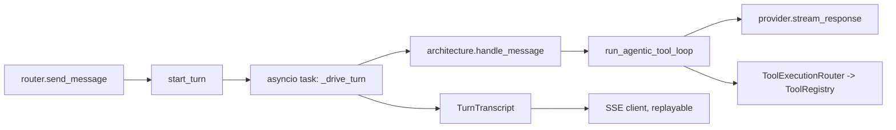

# Agents Module Guide

`src/agents/` owns two things: the agent record and its dashboard CRUD, and the chat runtime that
runs an agent's turn (history -> LLM -> tools -> LLM -> saved reply). Everything user-facing that talks to an
agent (dashboard, widget, `/v1` API, A2A, automations, Ila) ends up in `turns/` or an architecture here.
LLM providers and model catalogs live in `src/llm/`; the native tools themselves live in `src/tools/native/`.

Architectures have their own guide: [architectures/CONTRIBUTING.md](architectures/CONTRIBUTING.md). Read it
before touching `krishna_*.py` or `vishwakarma.py`; it is not repeated here.

## Layout

```text
src/agents/
  router.py            /agents routes: CRUD, A2A sharing, send-message, turn reattach/stop, image generation
  service.py           AgentService.create/delete (shared with marketplace import and blueprints)
  repository.py        AgentRepository (DynamoDB) and AgentPage
  models.py            Agent, CreateAgentRequest, AgentResponse, AgentAccess
  schemas.py           create/update agent forms (FormInput), model/timeout/thinking options
  access.py            require_agent, agent_with, access_to, visible_agents, owner_of, usable_agent
  agentic_loop.py      run_agentic_tool_loop: the LLM -> tools -> LLM state machine
  runtime_state.py     AgentTurnState: who speaks, what was asked, what the architecture loaded
  loop_context.py      append tool_use / tool_result blocks to the provider context
  turn_runtime.py      AgentTurnRuntime: ambient queue tools use to emit SSE events mid-tool
  provider_session.py  open_provider_session: provider settings + credentials + client, ProviderNotConfigured
  tool_execution.py    ToolExecutionRouter: timeout and error policy, current_tool_call_id
  tool_results.py      interpreters for structured tool results (UI form, canvas, connect request)
  tool_audit.py        ToolCallAuditMessage and the log persisted to messages
  tool_display.py      unwraps wrapper tools (call_mcp_tool) into the name/args the UI shows
  async_jobs.py        recognises an async tool job in a tool result (queued/running -> pending)
  prompts.py           shared Jinja environment for system prompts; templates in prompt_templates/
  book.py              page/index framework for agents that read a reference book (used by blueprints)
  architectures/       agent types (krishna-mini, krishna-memgpt, vishwakarma) and their factory
  tool_runtime/        ToolSpec/BoundTool/ToolRegistry, handlers per tool family, jobs/ (background skill actions)
  turns/               detached chat turns: run.py, transcript.py, models.py, repository.py
  image_generation/    capability registry, provider adapters, S3 storage, orchestration service
```

## Request flow



The router never runs the LLM itself. `start_turn` (`turns/run.py`) creates a `ConversationTurn` row and
launches the turn as a detached `asyncio` task, so a closed browser does not stop it. Events go into a
`TurnTranscript`; the HTTP response only follows it (`id:` = sequence number, so a client reattaches with
`GET .../turns/{turn_id}/events?after_sequence=N`). A heartbeat ticker keeps the row alive;
`ConversationTurnRepository.fail_stale_turns`, called by the reaper in `scheduler/runtime.py`, fails turns whose
process died.

## Conventions

**Layers.** Router: auth, request validation, HTTP errors. `AgentService`: create/delete with side
effects (dream schedule, shares, API keys, S3 media); callers other than the router (marketplace, blueprints)
use it, so put new lifecycle behaviour there, not in the route. Repository: only DynamoDB.

**Keys.**

| Item | pk | sk | GSI |
| --- | --- | --- | --- |
| Agent | `Account#{account_id}` | `Agent#{agent_id}` | `gsi2`: `Agent#{agent_id}` / `Agent` (ids are global) |
| ConversationTurn | `CONVERSATION#{conversation_id}` | `TURN#{created_at}#{turn_id}` | `gsi2`: `ConversationTurn#{turn_id}` (both keys), TTL 7 days |
| ToolJob (`tool_runtime/jobs`) | `member_partition(account_id, owner_id)` | `ToolJob#{job_id}` | `gsi2`: `ToolJob#{job_id}` (both keys), TTL 7 days |

Agents belong to an account and have an `owner_id`; names are unique per owner. `AgentRepository.get(agent_id)` uses
the GSI, which is eventually consistent, so right after a write read with `find_in_account`. Turn rows share a
partition with messages; they never collide because message queries filter on `MESSAGE#`.
`list_agent2agent_enabled` is a scan by design (documented in its docstring); do not copy it.

**Access.** Dashboard routes get the agent through `require_agent(principal, agent_id, "agents:<Action>")` or
`Depends(agent_with("agents:Update"))`: 404 if the agent is not in the caller's account, 403 if the IAM action
is denied. `agents:Chat` gates chatting, `agents:Describe` is the admin metadata view (persona blanked in
`to_response`). `require_own_agent` is for wiring the caller's own skill/MCP connections. Finding an agent by id
(`AgentRepository.get`) is not authorization: credentials must be bound to the agent they were issued for.
An agent always runs as its owner (`owner_of(agent)`: their provider settings, skills, connections); the caller is
only the actor (`actor_email`, `actor_kind`), and conversations are looked up in the caller's member partition.

**Errors.** Routes raise `HTTPException`. Provider/config problems that the user can act on raise
`UserFacingError` subclasses (`ProviderNotConfigured`); `turn_error_message` shows owners the real error and
everyone else a generic one unless it is user-facing. Image generation raises `AgentImageGenerationError`
subclasses, mapped to 404/409/403/500 in `router.py`. A tool never raises into the loop:
`ToolExecutionRouter.execute` turns timeouts and exceptions into `Error: ...` results the model reads.

**Forms and settings.** Agent forms live in `schemas.py` and are served hydrated by `hydrate_form_options`.
Model options depend on provider through `FormOptionsFilter(field="agent_provider")`; options carry a `group`.
`create_agent` re-validates with `validate_provider_model`. New env vars go in `src/config/settings.py`
(`chat_turn_*`, `openai_image_generation_*` are examples) plus the deploy config.

**The loop.** `run_agentic_tool_loop` is a small state machine (`Step`: ASK_MODEL, RUN_TOOLS, SUMMARISE, DONE,
STOPPED); `next_step_after_call` is the one decision function. It yields `SSEEvent`s plus two control values,
`PromptRefreshNeeded` (a tool changed core memory) and `TurnComplete`. It stops after `MAX_TOOL_ITERATIONS` model
calls and forces a summary with tools off. It owns token usage recording, not message persistence.

**Tools.** A tool is a `ToolSpec` (definition, `ToolCategory`, optional pydantic `input_model`,
`mutates_prompt_context`, `timeout_seconds`) bound to a handler in `tool_runtime/factory.py`. Categories decide
whether the definition is offered this turn. Handlers receive narrow contexts (`NativeToolContext`), never the
full turn state or credentials. `current_tool_call_id` is a context var because tools run concurrently.

**Async jobs.** A skill action marked async starts a `ToolJob` (`tool_runtime/jobs/service.py`) that runs in a
background task; the tool result is JSON `{"async": true, "job_id", "status"}`. `async_jobs.extract_async_job_status`
spots it and the loop polls (`_await_async_job`, up to `ASYNC_TOOL_MAX_IN_TURN_WAIT_SECONDS`) via the
`check_tool_job` tool. Secrets are loaded when the job runs, never stored on it. Jobs are stale after 10 minutes.
Keep strong references to job tasks (`_running_jobs`): asyncio holds tasks weakly.

**Image generation.** `image_capability_registry` says which providers can generate (OpenAI: every model it offers, so a new model
needs no change); `Agent.to_response` exposes it as `capabilities`. `ImageProviderFactory` picks the
adapter, `AgentImageGenerationService` persists the turn's messages, `ConversationMediaStorage` stores bytes in the
private bucket under `agents/{agent_id}/conversations/{conversation_id}/messages/{message_id}/`.

## How to add a native tool

1. Add the spec to `src/tools/native/specs.py` (`NATIVE_TOOL_SPECS`) and its implementation under
   `src/tools/native/`. `build_default_tool_registry` binds the list, so nothing here changes.
2. Give it an `input_model` for validation and `timeout_seconds` if it can hang; set `mutates_prompt_context=True`
   only if the system prompt must be rebuilt after it runs.
3. If its result has meaning beyond text (form, canvas, credential prompt), add one interpreter in `tool_results.py`.
4. Test with `tests/test_tool_execution.py`, `tests/test_tool_results.py` as models.

Other common changes: a new agent route (add to `router.py`, guard with `agent_with("agents:<Action>")`, put logic in
`AgentService` or a new service, add an IAM action in `src/iam`); a new tool family (new `ToolCategory`, spec list, handler
in `tool_runtime/handlers.py`, bind in `factory.py`); a new architecture (see `architectures/CONTRIBUTING.md`).

## Testing

```bash
uv run pytest tests/test_agents_*.py -q                       # agents CRUD, router, repository
uv run pytest tests/test_agentic_loop*.py tests/test_chat_turn_*.py tests/test_tool_*.py tests/test_async_*.py -q
uv run pytest tests/test_agent_image_*.py tests/test_provider_session.py -q
uv run ruff check src/agents && uv run mypy src/agents
```

Tests run on moto via `tests/conftest.py`: `dynamodb_table`, `agent_repository`, `test_client`, `auth_headers`;
`tests/mock_data.py` has `agent_fields`, `owner_ids`, `AGENT_CREATE_REQUEST`. Test the loop with fake providers and
routers (see `test_agentic_loop.py`) rather than patching internals.

## Do / Don't

- Do put access checks at the route with `require_agent` / `agent_with`; do not re-check inside the repository.
- Do read a just-written agent with `find_in_account`, not the GSI.
- Do keep new loop behaviour as a `Step` plus a clause in `next_step_after_call`, not scattered flags.
- Do add structured tool-result handling as one interpreter class, not a branch in an architecture.
- Do emit liveness from the heartbeat ticker only; do not tie it to LLM or tool activity.
- Don't give tools provider credentials or the full `AgentTurnState`; extend a narrow context instead.
- Don't let a tool exception escape the loop; return an error result.
- Don't store decrypted secrets on jobs, turns or messages.
- Don't add a second path that runs an architecture outside `start_turn` for chat; reuse `TurnRequest.architecture`
  for agents outside the factory (Ila).
- Comments explain why (see the heartbeat and `_running_jobs` comments); no speculative registries.
