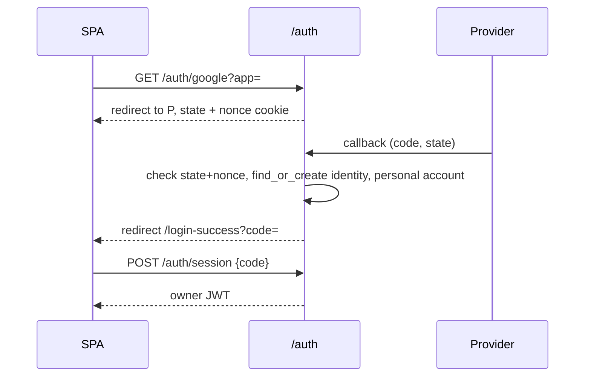

# Auth Contribution Guide

`auth/` owns sign-in and what proves who you are: OAuth login (Google, Cognito), owner JWTs, the request middleware, one-time login codes and app tokens for apps sharing this login, and the OAuth connect flows used by skills and LLM providers (OpenAI Codex, Google Drive/Mail/Ads). It produces an `Identity` (see `identity/`) and a token; what that person may do is decided later by `iam/`.

## Layout

```text
src/auth/
  __init__.py            exports create_access_token, decode_access_token, get_current_user, GoogleOAuth, auth_router
  router.py              /auth: login start/callback, /auth/session, /auth/me, skill and OpenAI connect flows, dev-only local signup
  middleware.py          AuthMiddleware (owner JWT -> request.state), PUBLIC_PATHS and prefixes that skip it
  jwt_utils.py           create/decode tokens, audiences (owner, widget_visitor, app:{name}), get_current_user
  oauth_providers.py     OAuthProvider protocol; GoogleOAuthProvider, CognitoOAuthProvider
  google_oauth.py        Google client used by the Google provider
  apps.py                login state (signed, with browser nonce cookie) and per-app frontend URLs
  app_tokens.py          one-time login codes and per-app refresh tokens (hashes only)
  app_router.py          /auth/token, /auth/refresh, /auth/revoke for app backends (HTTP Basic app auth)
  oauth_handoff.py       encrypted handoff of code+state from provider callback to the signed-in SPA
  openai_oauth.py        OpenAI (Codex) PKCE flow and credential refresh
  google_drive_oauth.py  Google Drive connect flow (Mail and Ads live in src/skills/*/oauth.py)
```

## Conventions

- **Login flow.** `GET /auth/{google|cognito}?app=` signs a state (`apps.create_state`, 10 minute JWT) and sets a nonce cookie; the callback only proceeds if `app_from_state(state, nonce)` matches (login CSRF defence). It then requires a verified email, `identity_repository.find_or_create`, `AccountService().ensure_personal_account` (default app, non-invitation login only), and redirects to `{frontend}/login-success?code=`. The SPA trades the code at `POST /auth/session`; no token ever sits in a URL.
- **Invited sign-in.** Default-app Google/Cognito start accepts `invitation=<hash>` from preview. Signed `LoginContext` carries only that hash and retains nonce, expiry and audience validation. Callback revalidates the live pending invite and verified matching provider email before identity creation; it skips personal-account creation and redirects with `invitation=1` for same-tab continuation. It never creates a membership: authenticated token acceptance is in `iam/invitations`. Do not put raw invite tokens in OAuth state, URLs or logs.
- **Tokens.** `sub` is the `user_id`; `email` is display only. Every token names an audience and every decoder names the ones it accepts (`OWNER_AUDIENCE`, `WIDGET_VISITOR_AUDIENCE`, `app_audience`). Owner routes accept only `owner`; `/auth/me` additionally accepts app tokens (`token_audiences_for`).
- **Middleware.** `AuthMiddleware` sets `request.state.identity`, `user_id`, `user_email`, `auth_token`. It does not authorize actions: routes do that with `iam.dependencies.get_principal`. Widget, A2A, `/v1/`, `/embed/` and plugin download paths bypass it and authenticate themselves.
- **Keys.** Login codes: `AuthCode#{hash}` / `AuthCode#Metadata` with `ttl`, deleted on redeem (single use). Refresh tokens: `Identity#{uid}` / `RefreshToken#{app}`. Only SHA-256 hashes are stored.
- **Connect flows (skills, MCP).** Provider callbacks store nothing; they redirect to the SPA with an encrypted blob (`oauth_handoff.handoff_redirect`), and the SPA completes the flow with the user's own token, which proves the same user started it. `safe_return_to` restricts redirects to the SPA origin.
- **Errors.** Routes raise `HTTPException`; callback failures redirect to `/login?error=` rather than showing JSON.
- **Config.** All settings come from `config/settings.py` (`JWT_SECRET`, `GOOGLE_*`, `COGNITO_*`, `OPENAI_OAUTH_*`, `AUTH_APP_URLS` as a JSON map). Never read `os.environ` here. Never print or log secrets.



## How to add a login provider

1. Add a class with `name`, `get_authorization_url`, `exchange_code_for_tokens`, `get_user_info` to `oauth_providers.py` (mirror `CognitoOAuthProvider`).
2. Add its settings and env parsing in `config/settings.py`, plus Railway/Terraform config.
3. Add a branch in `_get_provider` (`router.py`) that fails with a clear 500 when unconfigured.
4. Add `GET /auth/{name}` calling `_start_login`, a `GET /auth/callback/{name}` calling `_oauth_callback`, and list both in `middleware.PUBLIC_PATHS`.
5. Make sure the userinfo maps to `email`, `name`, and a verified flag that `_email_verified` understands.

A new skill OAuth connect flow follows `GoogleSkillOAuthFlow` in `router.py`: add a `skills/<id>/oauth.py` with the state/credentials helpers and an entry in `_google_skill_oauth_flows`.

## Testing

```bash
uv run pytest tests/test_auth_*.py tests/test_google_*_oauth.py tests/test_openai_oauth.py tests/test_widget_guest_auth.py -q
uv run ruff check src/auth && uv run mypy src/auth
```

Fixtures: `test_client` and `auth_headers` from `tests/conftest.py`; `dynamodb_table` uses moto and seeds identities and personal accounts. Mint tokens with `jwt.encode(..., "test-secret")` as in `tests/test_auth_middleware.py`. Mock provider HTTP calls; never hit real providers.

## Do / Don't

- Do put the audience in every new token and decoder.
- Do keep new public routes in `PUBLIC_PATHS` explicit; an omission means 401, which is the safe failure.
- Do keep secrets in settings and out of logs and URLs.
- Don't authorize by email or by anything in a token except `sub` and audience.
- Don't store a token or code unhashed.
- Don't complete a connect flow in an unauthenticated callback.
- Don't add a provider abstraction beyond the `OAuthProvider` protocol already here.
- `router.py` is large; put new flow-specific logic in its own module, as `openai_oauth.py` does.
