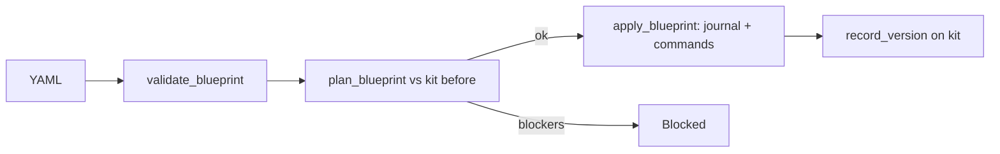

# Blueprints Contribution Guide

`src/blueprints/` is the solution-blueprint engine: it reads an `innomight/v2` YAML document describing agents,
knowledge bases, MCP connections, widget keys and lead forms, validates it, plans it against what the account already has, applies
it with an undo journal, and records each apply as a version of a kit. The dashboard (`/blueprints`, `/kits`) and Ila
(`src/builder/`) both deploy through `service.py`. Design: `docs/LLD-solution-blueprints.md`.

## Layout

```text
src/blueprints/
  spec.py          field-level spec models (Metadata, ParamSpec, OutputSpec, per-kind specs); descriptions are the docs
  document.py      Blueprint model; `resources` is a union built from RESOURCE_KINDS
  parser.py        safe YAML load, size limit (blueprint_max_bytes), path -> line map
  validator.py     structure, params, templates, references, skills; reports all BlueprintIssues together
  issues.py        BlueprintIssue / BlueprintInvalid, the one shape of every problem
  params.py        param types and how each is read and asked for in the run form
  references.py    fields marked x-ref-kind: the one list validator, drawing and apply read
  skills_schema.py skill config variants generated from skills/*/manifest.yml
  diff.py          Scalar / Each: per-field comparison rules, declared next to the field
  reconcile.py     now vs before vs actual: the changes, and drift
  planner.py       plan_blueprint / plan_removal: steps, ordered commands, blockers; no side effects
  commands.py      Command classes with reversibility and undo; command_order topological sort
  executor.py      apply_blueprint: journaled run, undo on failure, recover_interrupted, rate limit
  service.py       deploy_blueprint / apply_planned / apply_kit_plan; typed outcomes (Invalid, Blocked, RateLimited, Deployed)
  approval.py      plan_id hash so an agent can only apply what the person approved
  draft.py         raw (maybe invalid) document view used by Ila before validation
  export.py        write an existing agent out as a blueprint
  catalog.py       JSON Schema, Markdown reference, compact catalog, params form, example loading
  book.py          Ila's book pages generated from kinds, skills and examples
  kits.py          Kit model, KitRepository, pin/declared/record_version, rollback and removal plans
  kits_router.py   /kits routes
  router.py        /blueprints routes (schema and reference are public)
  access.py        require_kit / kit_with / visible_kits; registers the "kit" share resolver
  repository.py    DeploymentRepository
  models.py        Deployment, JournalEntry, request/response shapes
  kinds/
    base.py        ResourceKind, ManagedKind, LookupKind and the plan/apply context types
    __init__.py    RESOURCE_KINDS, kind_for, managed_kind_for
    agent.py, knowledge_base.py, widget_key.py, lead_form.py   managed kinds
    mcp_connection.py                            lookup kind (a blueprint uses it, never creates it)
  examples/*.yaml  example blueprints; each is also a validated test fixture and one of Ila's recipes
```

## Conventions

- **Kinds are the extension point.** Everything keyed by kind (document union, catalog, drawing, book pages,
  validation, planning) reads `RESOURCE_KINDS` in `kinds/__init__.py`. Do not branch on kind names elsewhere.
- **One schema, many views.** Field `description`s in `spec.py` feed the JSON Schema, reference, catalog and Ila's book.
  Skill config is generated from manifests (`skills_schema.py`); never hand-write per-skill fields.
- **Keys.** Kit: `pk=Account#{account_id}, sk=Kit#{kit_id}` (`entity_type=Kit`). Deployment:
  `pk=Account#{account_id}, sk=BlueprintDeployment#{created_at}#{deployment_id}`. While a deployment is `applying`
  it also carries `gsi2_pk=BlueprintApplying, gsi2_sk=updated_at` so the reaper finds interrupted applies;
  saving it with another status drops the entry. `find_by_id` filters the account's deployments (few per account).
- **Access.** A new kit needs `kits:Create` on `ResourceRef("kit")`; a new version needs `kits:Apply` on the kit
  (`_authorize_deploy` in `router.py`); kit routes use `kit_with("kits:<Verb>")` (404 if unseen, 403 if forbidden).
  Everything a blueprint builds belongs to the kit's owner (`owner_of_kit`), whoever applies it.
- **Errors.** Blueprint problems are `BlueprintIssue`s (path, line, hint, who fixes it), raised as `BlueprintInvalid`.
  `service.py` returns typed outcomes and each caller maps them (HTTP 422/429/201, or a tool result for Ila). Kit
  problems are `KitError`/`KitNotFound` (404 vs 409 in the router).
- **Apply semantics.** Reversible and compensatable commands run first; irreversible ones (deleting, crawling) run after
  `COMMIT`. A failure before commit undoes everything; after it, the deployment is `failed_partial` and re-applying
  finishes the job. Applying twice changes nothing the second time.
- **Settings.** `blueprint_max_resources`, `blueprint_max_bytes`, `blueprint_apply_limit` (env `BLUEPRINT_*`) are in
  `config/settings.py`.



## How to add a resource kind

1. Add the spec model to `spec.py` (with `Field(description=...)`, `Scalar`/`Each` diff rules, `x-ref-kind` for links).
2. Create `kinds/<name>.py` subclassing `ManagedKind` (or `LookupKind`): set `kind`, `label`, `use_when`, `spec_model`,
   `exposes`, `export_name`, `deletes`; implement `observe`, `commands`, `describe`, `applied`, `delete_commands`; add
   `check`/`validate`/`usage` as needed. Use `kinds/widget_key.py` as the smallest managed example and
   `kinds/mcp_connection.py` for a lookup.
3. Register an instance in `RESOURCE_KINDS` (order matters for readability only; the planner sorts commands).
4. Add an example in `examples/` using it, so the book page and tests have one.
5. Test in `tests/test_blueprints_kinds.py` and `tests/test_blueprints_apply.py`.

## Testing

```bash
uv run pytest tests/test_blueprints_*.py tests/test_kit_access.py -q
uv run ruff check src/blueprints && uv run mypy src/blueprints
```

Tests use moto via `dynamodb_table`, `test_client` and `auth_headers`. `tests/test_builder_book.py` also checks every
file in `examples/` still validates, so run it after touching examples or specs.

## Do / Don't

- Do put behaviour on the kind (`observe`, `commands`) and keep the planner and executor kind-agnostic.
- Do declare diff rules on the field; don't compare fields by hand in a kind.
- Do make every command say how it is undone (or that it cannot); don't run irreversible work before `COMMIT`.
- Do keep validation messages specific with a path and hint; don't raise bare exceptions for author mistakes.
- Do go through `service.deploy_blueprint`; don't call `apply_blueprint` from a new entry point.
- Don't hand-write skill fields in specs, schemas or docs; they come from manifests.
- Note: `AGENTS.md` still says `innomight/v1`; the code is `innomight/v2` (`Blueprint.api_version`).
