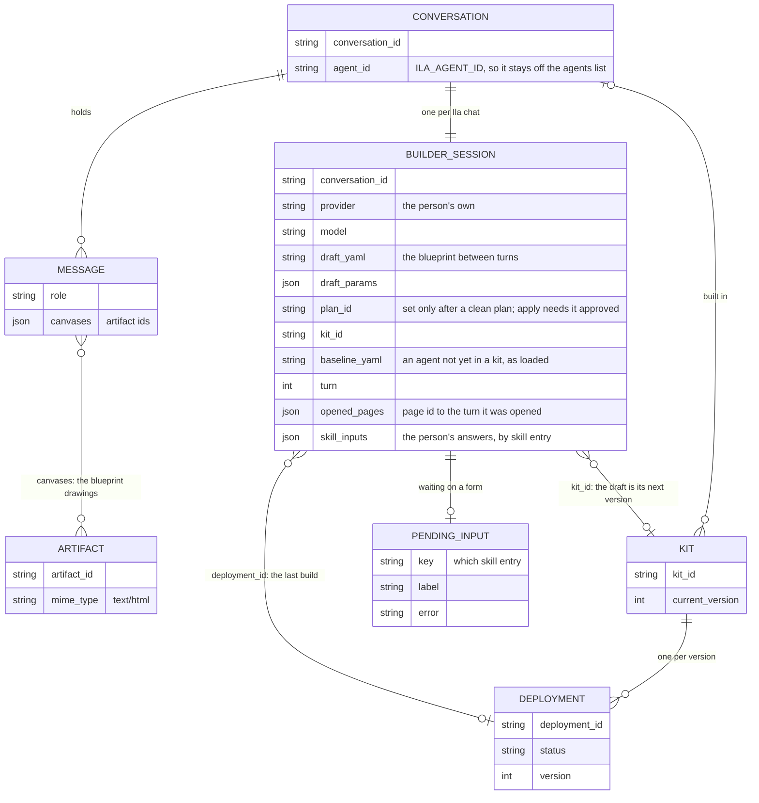

# Builder (Ila) Contribution Guide

`src/builder/` is Ila, the solution builder: a chat that turns a conversation into a blueprint, plans it, and applies it
once the person approves. Ila is not a stored agent; she is built per turn on the person's own provider and runs on
`src/agents/architectures/vishwakarma.py`. The engine she drives (validate, plan, apply, kits) lives in
`src/blueprints/`, and her knowledge comes from the generated book in `src/blueprints/book.py`.

## Layout

```text
src/builder/
  router.py        /builder routes: session form, sessions, send-message (SSE), active turn, events, stop, connect
  models.py        BuilderSession (the draft between turns), ILA_AGENT_ID, request/response shapes
  repository.py    BuilderSessionRepository
  ila.py           ila_agent(session) builds the Agent for a turn; ila_architecture(); GREETING
  tools.py         BuilderTools + build_builder_tool_registry: open_pages, search, show_form, plan, apply, add_to_draft, status
  plan_gates.py    PLAN_GATES: ordered gates deciding what plan_blueprint tells Ila
  requirements.py  REQUIREMENTS: things the system (not Ila) asks the person for
  connections.py   MCP accounts to connect from a chat card; start_connection for the popup sign-in
  skill_inputs.py  skill settings only the person knows, asked as a chat form built from the manifest
  canvas.py        the blueprint drawing and its canvas artifact; the before/after of long texts a plan rewrites
  templates/
    blueprint_canvas.html.j2   Jinja template of the drawing (draft awaiting approval, then "built")
```

## What is stored

Ila stores one thing of her own, the session. Everything else is an existing record she points at: the chat, its
messages and drawings, and the kit and deployments that her builds create (`src/blueprints/`).



*Session key: `Account#{account_id}#Member#{user_id}` / `BuilderSession#{conversation_id}`, the member's own partition, same as
their conversations. The book's pages aren't stored: they are generated each turn, and `opened_pages` only remembers
which ones are open. A `plan_id` is a hash of the draft and params, not an entity.*

## Conventions

- **Session storage.** `pk=Account#{account_id}#Member#{user_id}` (via `member_partition`), `sk=BuilderSession#{conversation_id}`,
  `entity_type=BuilderSession`. The session holds the draft YAML, params, `plan_id`, `kit_id`, opened book pages and skill
  inputs, because chat history keeps only messages, not Ila's tool calls. Routes load it with `resolve_build`
  (session and conversation in the caller's `owner.member_pk`; 404 otherwise). Ila's conversations carry `ILA_AGENT_ID`
  and stay off the agents list.
- **Ila never writes accounts or secrets.** The person signs in to MCP providers through the Connect card
  (`POST /builder/{id}/connect`, which requires an account settings manager via `settings_manager`) and gives skill
  settings through system-built forms. Secrets are never asked in chat, since a form submission is a chat message.
- **Lists, not branches.** What `plan` answers is decided by `PLAN_GATES` in `plan_gates.py` (author issues, needs a
  person, blocked, nothing to change, await approval; the last always answers). What the system asks the person is
  `REQUIREMENTS` in `requirements.py`, in the order asked. A new kind of ask or gate is one more entry, not a new
  `if` in `tools.py`.
- **Approval.** `apply` only runs for the `plan_id` the person approved in their latest message
  (`src/blueprints/approval.py`); deploys go through `blueprints.service.deploy_blueprint`, never `apply_blueprint` directly.
- **Tools.** Each tool is a `BoundTool(ToolSpec(definition, ToolCategory.BUILDER), method)`; set `mutates_prompt_context=True`
  when the call changes what Ila's prompt shows (the draft, the open pages). Tool definitions are in
  `builder_tool_definitions()`, and the registry unpacks them positionally, so keep the order in step.
- **Her knowledge is generated.** A new resource kind, skill manifest or example blueprint appears as a book page with no
  change here; do not hand-write capability lists into her prompt (`agents/architectures/prompt_templates/vishwakarma/`).
- **Pages for reading, tools for changing.** What the person already has is the book's Your account branch
  (`blueprints/account_pages.py`), read through each kind's `existing`/`read`/`observe` when Ila opens a page. Don't
  add a list tool for a new kind; give the kind those methods. Changing one is `add_to_draft`, then plan and apply.
- **Features only through their kinds.** `builder/` doesn't import a feature's repository or service (agents, leads,
  automations, API keys, skills); `tests/test_builder_account_pages.py` fails if it does. A change to how a feature
  stores things is then made once, in its kind.
- **The canvas is decoration.** `save_blueprint_canvas` may fail without failing the plan or the build.
- **Long texts are shown as they change.** A plan that rewrites a long text (`is_long_text`, in `blueprints/kinds/base.py`,
  the same rule that gives it its own account page) opens the drawing on its before and after, line by line, so the
  person approves the words. It's computed from the plan, for every kind; don't add per-field diffs.
- **Settings.** Blueprint limits live in `config/settings.py` (`BLUEPRINT_*`); nothing builder-specific is read from env here.

## How to add a tool for Ila

1. Add its definition to `builder_tool_definitions()` and a method on `BuilderTools` in `tools.py`.
2. Register a `BoundTool` in `build_builder_tool_registry` and update the unpacking line.
3. If it changes the draft or open pages, set `mutates_prompt_context=True` and save the session via
   `BuilderSessionRepository`.
4. Prefer extending `PLAN_GATES` or `REQUIREMENTS` over adding logic to `plan`/`apply`.
5. Tests: `tests/test_builder_ila.py`, `tests/test_builder_plan_gates.py`, `tests/test_builder_skill_inputs.py`.

## Testing

```bash
uv run pytest tests/test_builder_*.py tests/test_cleanup_ila_builds.py -q   # test_builder_account_pages.py: the account branch
uv run ruff check src/builder && uv run mypy src/builder
```

Tests use moto through `dynamodb_table`; `tests/test_builder_book.py` also validates every example blueprint, so run it
after changing specs or examples.

## Do / Don't

- Do keep the draft on `BuilderSession`; don't rely on Ila's tool calls surviving in history.
- Do keep forms and sign-ins in the system's hands; don't let Ila collect settings or secrets in prose.
- Do add gates and requirements as list entries; don't grow `tools.plan` with conditionals.
- Don't make Ila a stored agent or list her with the person's agents.
- Don't treat the drawing as load-bearing; a template error must not block a build.
