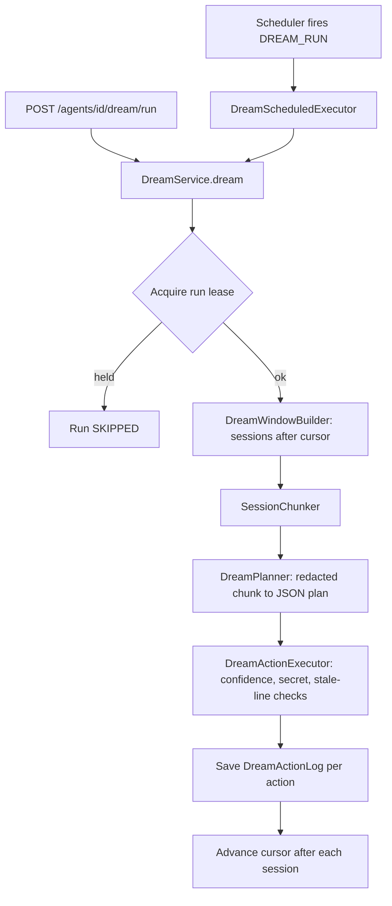

# Dream

Nightly, per-agent memory organisation. A scheduled run reads the owner's closed conversation sessions since the last cursor, asks an LLM for a strict-JSON plan of memory edits, and applies the safe ones to core and archival memory (`src/memory/`). Only `krishna-memgpt` agents dream. Settings are per account; runs, cursors and audit logs are per agent and user.

## Layout

```text
src/dream/
  __init__.py     re-exports models and session helpers
  models.py       DreamSettings, DreamCursor, DreamRun(+status), DreamAction/Plan/Outcome, DreamActionLog
  repository.py   DreamRepository: settings, cursor, runs, run lease, stale-run reaper, action logs
  service.py      DreamService: schedule management and the resumable dream() orchestration
  window.py       DreamWindowBuilder: picks closed, unprocessed sessions (backfill / daily / manual)
  sessions.py     SessionSegmenter and SessionChunker: split messages into sessions and word-bounded chunks
  planner.py      DreamPlanner: one LLM call per chunk, parsed into a DreamPlan, retried on bad JSON
  actions.py      DreamActionExecutor: validates and applies each planned action idempotently
  redaction.py    secret patterns: redact() for transcripts and logs, is_safe() gate for memory writes
  executor.py     DreamScheduledExecutor: the scheduler target for DREAM_RUN schedules
  schemas.py      build_dream_settings_form(): schema-driven settings form
  router.py       /dream/status, /dream/settings(+form), /agents/{id}/dream/{runs,cursor,run}
```

## Flow



## Conventions

**Keys.**

| Item | pk | sk |
| --- | --- | --- |
| `DreamSettings` (per account) | `Account#{account_id}` | `DreamSettings` |
| `DreamCursor` | `Agent#{agent_id}#User#{user_id}` | `DreamCursor` |
| `DreamRun` | `Agent#{agent_id}#User#{user_id}` | `DreamRun#{started_at}#{run_id}` |
| run lease | `Agent#{agent_id}#User#{user_id}` | `DreamRunLease` |
| `DreamActionLog` | `DreamRun#{run_id}` | `Action#{index:04d}` |

**Access.** Reading status, runs, cursor and triggering a run need `agents:Chat` on the agent (`require_agent`), because a dream reorganises the caller's own memory. Saving settings needs the `settings_manager` dependency (`src/settings/access.py`); reading them is open to any member. Settings apply to every memory agent in the account, so `save_settings` calls `ensure_schedule` for each one, as that agent's owner (`owner_of(agent)`).

**Session atomicity.** The cursor advances only after a whole session is processed; a failed run re-dreams the session next time. Executed actions must therefore be idempotent (`insert_archival` hash check, `line_exists` before append, `SKIPPED_DUPLICATE`, `SKIPPED_STALE_LINE`). Actions in a plan run in descending `line_number` so earlier deletes do not shift later lines.

**Safety gates.** Transcripts are passed through `redact()` before planning, and `is_safe(content)` blocks any action whose content matches a secret pattern. Add new patterns to `SECRET_PATTERNS` in `redaction.py`; both uses pick them up.

**Lease and reaper.** `try_acquire_run_lease` uses a conditional put; `renew_run_lease` is called per chunk. `DreamRepository.fail_stale_runs` (driven from `src/scheduler/runtime.py`) marks runs whose lease is gone as failed. Budgets (`soft_sessions_per_run`, `soft_chunks_per_run`, `soft_actions_per_run`) are soft: a run stops starting new sessions past them and ends `PARTIAL`.

**Settings and env.** Global flag and defaults live in `src/config/settings.py` (`dream_enabled`, `dream_run_lease_seconds`, `dream_chunk_max_words`, `dream_planner_timeout_seconds`, ...), read from `DREAM_*` env vars in `Settings.from_env()`. Per-account values live in `DreamSettings`. The form (`schemas.py`) uses `FormInput` with `options_source` and `options_filter`; the router validates it with `validate_form_options`.

**Boundaries.** `DreamRunner` (executor.py) and `ConversationLister` (window.py) are small Protocols so tests can fake the one call that matters. Keep them that narrow.

## How to add a new action type

1. Add the value to `DreamActionType` in `models.py` and mention it in the planner `SYSTEM_PROMPT`.
2. Handle it in `DreamActionExecutor._execute_one` (`actions.py`), returning a `DreamActionOutcome` and a short detail; keep it idempotent.
3. Add cases to `tests/test_dream_actions.py`, and a planner parse case to `tests/test_dream_planner.py`.

To add a setting: field on `DreamSettings` and `DreamSettingsRequest`, a `FormInput` in `schemas.py`, and a default in `config/settings.py` if it has a global default.

## Testing

```bash
uv run pytest tests/test_dream_*.py -q
uv run ruff check src/dream && uv run mypy src/dream
```

Tests use moto (`dynamodb_table`, `test_client`, `auth_headers`) and fake providers/planners injected through the `DreamService(...)` constructor. `tests/test_dream_atomicity.py` pins the cursor and lease behaviour; run it after touching `service.py`.

## Do / Don't

- Do inject collaborators through `DreamService.__init__`; defaults build the real ones.
- Do audit every action with a `DreamActionLog`, including skipped ones.
- Do treat a planner reply as untrusted: validate through `DreamPlan`, then gate in the executor.
- Don't persist raw transcript text in logs; `content_preview` is redacted and truncated.
- Don't advance the cursor mid-session.
- Don't let a lease-release or usage-recording error replace the run's real result (both are swallowed on purpose).
