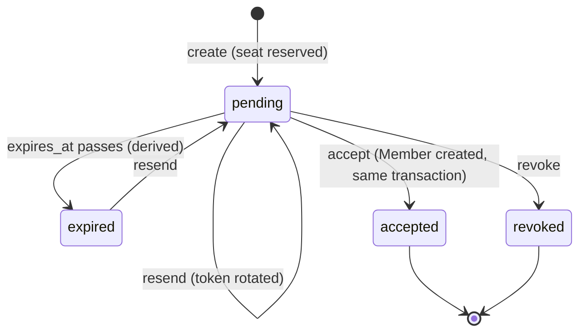

# Account Invitations Contribution Guide

`iam/invitations/` lets an account member holding `iam:Invite` invite a person by email, and lets that person, signed in with the invited address, become a member. It owns the invitation items, the one-time token, email delivery and the atomic acceptance. Permissions themselves stay in the parent `iam/` module; design and rationale are in `docs/LLD-account-invitations.md`. Read the [IAM guide](../CONTRIBUTION.md) first: every write here goes through its version-checked commit.

## Layout

```text
src/iam/invitations/
  __init__.py     exports Invite, InvitationRepository, InvitationService and the router (as invitations_router)
  models.py       Invite (frozen dataclass): keys, hashed token, effective_status(), token_digest()
  schemas.py      request/response models: bounded token body, metadata-only responses
  repository.py   InvitationRepository: consistent reads, token lookup through gsi2, and every conditional
                  transaction operation (put_invite, put_member, identity_unchanged, ...)
  service.py      InvitationService: create/resend/revoke/list, deliver, preview, accept, rate limits
  router.py       thin HTTP: /iam/invitations (authenticated), /invitations/preview (public), /invitations/accept
```

Related code outside the module: `src/email/invitation.py`, `EmailService.send_account_invitation_email` and `send_account_invitation_email_safe` in `src/email/helpers.py` (template `assets/templates/emails/account_invitation.html`); the OAuth handoff that continues an invitation sign-in in `src/auth/router.py` (calls `InvitationService.pending_by_hash`); the public-route entry for `/invitations/preview` in `src/auth/middleware.py`; the SPA pages in `spa/src/pages/invitations/` and `spa/src/services/iam/invitations.ts`.

## Where code belongs

| Layer | Owns | Must not |
| --- | --- | --- |
| `router.py` | Parsing, `principal.require(...)`, calling one service method, shaping the response | Reach into `service.repository`, send email, build DynamoDB expressions, hold business rules |
| `service.py` | Rules: authorization on fresh state, seats, duplicates, throttling, token rotation, the order of steps | Write a raw `Put`/`ConditionCheck`/`ConditionExpression`, or run blocking I/O from an `async` function |
| `repository.py` | Every DynamoDB read and every transaction operation, with its guarding condition | Decide policy (who may invite, whether a seat is free) |
| `models.py` | The stored shape, key layout, derived status | Do I/O |

If you find yourself writing a condition string in `service.py` or calling `service.repository` from the router, move it down a layer.

## Conventions

- **Keys.** `pk = Account#{aid}`, `sk = Invite#{id}`. Both gsi2 keys are `InviteToken#{sha256(token)}`, so a token resolves to an invitation without a scan. A gsi2 hit is never trusted: `by_hash` re-reads the item by primary key and compares the hash, because the index can keep an old hash after rotation or revocation.
- **Token.** 32 random bytes (`secrets.token_urlsafe`), shown only in the email link `{FRONTEND_URL}/invitations/accept#token=...` (a fragment, so it never reaches a server log). Only the hash is stored. Never return, log or put the raw token in an error, a `PendingEmail` or a response. `TokenRequest` hides its input in validation errors.
- **Status is derived.** `status` is stored, but `Invite.effective_status(now)` is what every decision and response uses: a pending invitation past `expires_at` is `expired` even before the TTL deletes it. `ttl` is cleanup, never authorization.
- **Every write is one conditional transaction** through `IamRepository.commit`, which also bumps and checks `Account.authz_version`. The service reads a `Snapshot` (state, account, members, invites), decides on it, then commits operations conditioned on what it read. A lost race raises `ConcurrentChange`, which `_commit` turns into a retryable 409 `CONFLICT`; one attempt only, never a retry on stale state.
- **Authorization is checked on fresh state.** The router's `principal.require(...)` is the fast path; `_snapshot(..., caller, action)` re-evaluates the caller against the state the transaction is conditioned on. Keep both. Do not replace either with a cached principal.
- **Seats.** `Account#Metadata.seat_limit` must be a positive integer, otherwise `SEAT_LIMIT_UNAVAILABLE` (fail closed, no plan fallback). Stored members, including suspended ones, count; pending unexpired invitations reserve a seat; the commit is conditioned on `seat_limit = :seats` so a billing change that does not bump `authz_version` still fails the transaction.
- **Blocking I/O.** Service methods use synchronous boto3. Async routes run them with `asyncio.to_thread`; `deliver` is the only `async` service method and does the same for its repository calls. Plain `def` routes are already run in a thread by FastAPI.
- **Delivery.** `create`/`resend` persist the invitation first and return `(invite, raw)`; `deliver` then emails the link once and records `delivery_status`. A failed email keeps the invitation and raises 502 `INVITATION_DELIVERY_FAILED` with the invite id; resend rotates the token. `mark_delivery` is conditional on the token hash and status so a late result cannot overwrite a resend or revocation. Always use `send_account_invitation_email_safe`.
- **Rate limits.** Per account (`ACCOUNT_INVITE_RATE_LIMIT`, `ACCOUNT_INVITE_RATE_WINDOW_SECONDS`) and per client address for the public preview (`INVITATION_PREVIEW_RATE_LIMIT`, `INVITATION_PREVIEW_RATE_WINDOW_SECONDS`), both fail closed. A slot taken for an invitation is released only when the commit fails. New settings go in `src/config/settings.py` and `scripts/deploy_prod_railway.sh`.
- **Errors.** Raise `IamError(status, code, message, **extra)`: `INVALID_INVITATION` 404 (unknown, expired, revoked or rotated, deliberately one answer), `NOT_A_MEMBER`/`ACCESS_DENIED` 403, `ACCOUNT_INACTIVE`, `SEAT_LIMIT_UNAVAILABLE`, `SEAT_LIMIT_REACHED`, `PENDING_LIMIT_REACHED`, `ALREADY_MEMBER`, `INVITATION_EXISTS`, `INVITATION_NOT_PENDING`, `INVITATION_ACCEPTED`, `MEMBERSHIP_UNAVAILABLE`, `CONFLICT` 409, `EMAIL_NOT_VERIFIED`, `INVITATION_EMAIL_MISMATCH` 403, `INVITATION_RATE_LIMITED` 429. Validation errors are redacted app-wide by `src/exceptions.py`; do not add a per-route handler.
- **Acceptance** needs an authenticated identity with a verified, active email equal to the invited one. It is not a member of the target account yet, so `accept` has no `get_principal` dependency. One transaction guards the exact stored identity email, creates the `Member` (`attribute_not_exists`), and consumes the live invitation (token hash, status and unexpired TTL). Repeating an accepted invitation succeeds only while that person is still an active member. No policy attachments or groups are created; that is Phase 3.



## How to add an invitation behaviour

For a new route or rule (for example, changing the invited role):

1. **Model.** Add the field to `Invite` and `InvitationResponse`; the dataclass drives `item()` and `from_item`, so no migration is needed for optional fields with defaults.
2. **Repository.** If it needs a new conditional write, add a `put_...`/`..._check` operation beside the existing ones, carrying the condition that makes the transaction fail when what you read has changed.
3. **Service.** Add one method that takes a `_snapshot(...)`, applies the rule, and commits the operations with `_commit(state, account, [...], seats)`. Raise an `IamError` with a stable code. Do not repeat the seat or duplicate checks; call `_capacity`, `_not_member` and `_no_duplicate`.
4. **Router.** Add a route that calls `principal.require("iam:...")` (or none, with a comment why, as `accept` does) and then one service call. `async def` only if it awaits something (email); run blocking service calls with `asyncio.to_thread`.
5. **Auth.** A route that must work signed out also needs an entry in the public list in `src/auth/middleware.py` and its own rate limit through the service, as `throttle_preview` does.
6. **Tests and docs.** See below; update `docs/LLD-account-invitations.md` if the behaviour changes the approved design.

## Testing

```bash
uv run pytest tests/test_invitations_lifecycle.py tests/test_invitation_integration.py \
  tests/test_auth_invitations.py tests/test_invitation_email.py tests/test_invitation_boundaries.py -q
uv run ruff check src/iam/invitations && uv run mypy src/iam/invitations
```

- `test_invitations_lifecycle.py` drives `InvitationService` directly on moto (the `lifecycle` fixture) and the routes through `routes`, which uses the app's real exception handlers. `test_invitation_integration.py` goes through the full app with `test_client`. Mock only the email helper (`send_account_invitation_email_safe`) and time (`clock`).
- Races are tested with controlled interleavings: monkeypatch `service.repository.iam.commit` to run the competing change first, then call the real one. Do not use threads with moto.
- Cover for every change: stale gsi2 entries, expired/revoked/rotated tokens, identity or billing changes between read and commit, duplicate acceptance, removed or suspended members, accountless acceptance, and that no response, log or error contains the raw token.

## Do / Don't

- Do keep the router to one service call per route and the service free of raw DynamoDB expressions.
- Do read a `Snapshot`, decide, and commit with conditions on what you read; let a lost race return a 409.
- Do answer unknown, expired, revoked and rotated tokens identically (`unavailable()`).
- Do run blocking service calls from async routes with `asyncio.to_thread`.
- Do add a regression test beside the one that exercises the same state transition.
- Don't store, return, log or email-queue the raw token, or trust a gsi2 result without the primary-key re-read.
- Don't treat `ttl`, a cached `Principal`, or the stored `status` as the source of truth for expiry or access.
- Don't invent a seat fallback when `seat_limit` is missing.
- Don't add a per-route validation-error handler or a custom `APIRoute` class; `src/exceptions.py` owns that.
- Don't send email through anything but `send_account_invitation_email_safe`.
