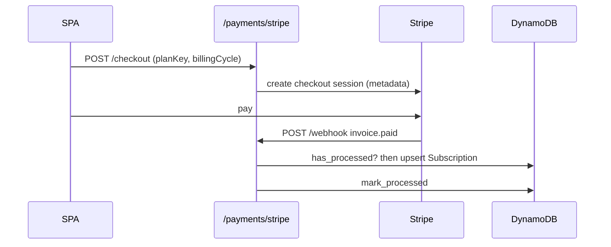

# Payments Contribution Guide

`payments/` owns Stripe checkout, the webhook that turns Stripe events into local subscription records, and the per-environment pricing catalogue. The pricing JSON is the single source for tier names, prices, Stripe price ids and plan limits; `src/rate_limits/` reads the same file to enforce quotas, and the SPA pricing page reads it through `GET /payments/stripe/pricing`.

## Layout

```text
src/payments/
  pricing_config.py          get_pricing_config(): loads {env}_pricing_config.json into Pydantic models
  dev_pricing_config.json    Pricing for ENVIRONMENT=dev (and local, via _PRICING_ENV_ALIASES)
  uat_pricing_config.json    Pricing for uat
  prod_pricing_config.json   Pricing for prod (live Stripe price ids)
  stripe/
    router.py                /payments/stripe: pricing, checkout, session, subscription status/cancel, webhook + handlers
    service.py               StripeService: small httpx client used by users/router.py (account deletion cancels subscriptions)
    models.py                Request/response models for the router
  subscriptions/
    models.py                Subscription dataclass (pk/sk, dynamo mapping)
    repository.py            SubscriptionRepository, WebhookEventRepository
```

## Conventions

- **Keys.** Subscription: `pk=User#{email}`, `sk=Subscription#{subscription_id}`. Webhook dedupe: `pk=sk=WebhookEvent#{event_id}`. Payments are keyed by email, not account; billing stays per person (KAN-86).
- **Active subscription.** `get_active_for_user` picks the newest by `updated_at` among statuses `active`, `trialing`, `past_due` whose `current_period_end` has not passed. No active subscription means tier `free`.
- **Pricing config.** The file is chosen by the `ENVIRONMENT` env var (default `dev`; `local` aliases `dev`). Every environment file must define the same tier keys (`free`, `starter`, `pro`, `enterprise`) and `limits` (`agents`, `messages_per_month`, `kb_pages`, `memory_blocks`; `0` is unlimited). Only `stripe_price_ids` and `stripe_product_id` differ per environment: dev and uat use test-mode Stripe ids, prod uses live ones. Edit all three files together and never copy ids across environments.
- **Plan lookup.** `get_price_id(plan_key, billing_cycle)` reads `stripe_price_ids` from the config; the webhook reads `plan_key` and `billing_cycle` back from subscription metadata set at checkout. `settings.stripe_price_*` in `config/settings.py` have no readers in `src/`.
- **Env vars.** `STRIPE_SECRET_KEY`, `STRIPE_PUBLISHABLE_KEY`, `STRIPE_WEBHOOK_SECRET` are in `Settings`; set them in Railway and Terraform, never in the JSON. `StripeClient` / `StripeService` raise 500 "Stripe not configured" without the secret key.
- **Webhook rules.** The signature is verified with `stripe.Webhook.construct_event`. Dedupe first (`has_processed`), run the handler, and `mark_processed` only on success; on any exception return 500 so Stripe retries. Handlers must therefore be idempotent. Invoice events can arrive in the old (`invoice.subscription`) or new (`invoice.parent.subscription_details`) shape; `invoice_payment` objects are resolved by fetching the invoice.
- **Auth.** Checkout, session and subscription routes read `request.state.user_email` set by the auth middleware. `GET /session/{id}` returns 404 unless the session's `customer_email` is the caller's, since the session id is not a credential.
- **Errors.** `HTTPException`: 400 for plan or checkout validation (`validate_checkout_request` blocks same plan and downgrades), 401 unauthenticated, 502 when Stripe returns an error.
- **Email.** Use the `send_*_email_safe` helpers from `src/email`.
- `router.py` and `service.py` each define a small Stripe HTTP client (`StripeClient`, `StripeService`); new code should reuse one rather than add a third.



## How to add a plan or tier limit

1. Create the product and prices in Stripe (test mode for dev/uat, live for prod).
2. Add the tier, or the new `limits` field, to all three JSON files. A new limit field also goes into `PricingTierLimits` in `pricing_config.py`.
3. If the tier order matters, update `tier_order` in `validate_checkout_request`.
4. Enforce a new limit in `src/rate_limits/service.py` and `middleware.py`.
5. Extend `tests/test_pricing_config.py` if a new environment or required field is introduced.

## Testing

```bash
uv run pytest tests/test_stripe_*.py tests/test_pricing_config.py -q
uv run ruff check src/payments && uv run mypy src/payments
```

Webhook tests use captured payloads in `tests/fixtures/stripe/` and patch `StripeClient` (`AsyncMock`) and the email helpers; checkout tests use `test_client` and `auth_headers`; repositories run on moto through `dynamodb_table`. Never call Stripe from tests.

## Do / Don't

- Do keep handlers idempotent and mark events processed only after success.
- Do keep the three pricing files structurally identical.
- Don't put Stripe secrets or webhook secrets in the repo or in logs (the existing signature-failure log prints lengths only; keep it that way).
- Don't trust client-supplied email; use the authenticated one.
- Don't add plan logic in the router that belongs in the pricing config.
