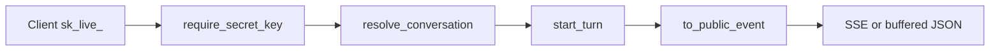

# Public API Module

Owns the `/v1` HTTP API: an external program chats with one agent using that agent's secret key (`sk_live_...`), plus the dashboard routes that manage those keys. A key acts as the agent's owner (same provider settings, skills, knowledge, tools) but its conversations live in the key's own partition. Design: `docs/LLD-public-api-and-embeddable-widget.md`.

## Layout

```text
src/public_api/
  __init__.py     package marker
  keys.py         AgentSecretKey item, key request/response models, SecretKeyRepository
  keys_router.py  dashboard: /agents/{agent_id}/secret-keys (create, list, patch, usage, delete)
  auth.py         require_secret_key dependency -> PublicApiCaller
  router.py       /v1/agents/{agent_id}: agent, conversations, messages, send (SSE or buffered)
  models.py       V1* request/response models; the public contract
  events.py       maps internal SSEEvent types to the public stream events
```

## Conventions

- **Two surfaces, two auths.** `keys_router.py` is the dashboard, authorised with `agent_with("apikeys:ListKeys" | "CreateKey" | "RevokeKey")` (same actions as `src/apikeys/`). `router.py` is the public API and authorised only by `require_secret_key`; it never uses IAM principals.
- **Secrets.** Only `sha256(secret)` is stored. The plaintext is returned once, in `CreatedSecretKeyResponse`. `key_hint` is what the dashboard shows afterwards.
- **Keys.** `pk = Agent#{agent_id}`, `sk = SecretKey#{key_id}`, GSI `gsi2`: `gsi2_pk = SecretKey#{hash}`. Auth is a `gsi2` lookup by hash. Creation uses `attribute_not_exists(pk)`; updates and usage counts use `attribute_exists(pk)` conditions so they cannot resurrect a deleted key.
- **Auth checks, in order** (`auth.py`): bearer starts with `sk_live_` (401), key found and active (401), key belongs to the path's `agent_id` (403), agent exists (404), owner identity active (401, so a deactivated owner's keys stop working). Usage recording failure is logged, never fails the request.
- **Conversations.** `ApiConversation.partition_for(account_id, key_id, end_user_id)` (in `src/conversations/models.py`) is the partition; `resolve_conversation` returns 404 unless the conversation is in it and belongs to the agent. Any new conversation route must depend on `Target`, not load by id itself. `end_user_id` scopes conversations and memory per end user.
- **Turns.** `send_message` rejects a second message while a turn is active (409), then `start_turn(... actor_kind=ActorKind.API, api_key_id=...)`. The turn finishes server-side even if the client disconnects; `X-Turn-Id` carries its id.
- **Stable contract.** Event names and `V1*` payloads are public. `events.py` has an explicit table, so an internal `SSEEventType` with no entry never leaks. Changing an existing name or field is a breaking change.
- **Pagination** uses `Paginated[...]` with `limit` (1-100) and `cursor`.



## How to add an endpoint

1. Add `V1*` request/response models to `models.py`, with an `of(...)` constructor that picks exactly the public fields (see `V1ConversationResponse.of`).
2. Add the route in `router.py` taking `caller: Caller` (or `target: Target` for a conversation). Use `HTTPException` for errors.
3. A new public stream event: add an entry to `_PUBLIC_EVENTS` in `events.py` and document it in `send_message`.
4. Add a test in `tests/test_public_api_router.py`.

## Testing

```bash
uv run pytest tests/test_public_api_*.py -q
uv run ruff check src/public_api && uv run mypy src/public_api
```

`test_public_api_router.py` swaps in a recording architecture (`_RecordingArchitecture`) so no LLM is called; it creates agents and keys through the real routers with `test_client` / `auth_headers` on moto. `test_public_api_keys.py` covers the key model and repository.

## Do / Don't

- Do build responses with `V1*.of(...)` so internal fields cannot leak.
- Do keep the key bound to one agent and check `agent_id` on every request.
- Don't expose internal event types, thoughts or tool arguments in the public stream.
- Don't reuse the widget's public key as a credential here, or the reverse.
- Don't add per-route IAM checks to `/v1`; the key is the identity.
