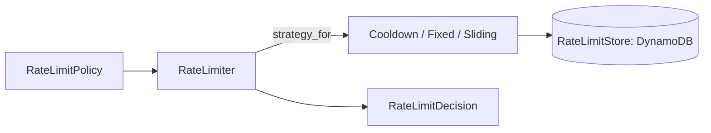

# Rate Limits Contribution Guide

`rate_limits/` holds two unrelated things. (1) Subscription usage limits: how many agents, messages per month and knowledge-base pages an account owner's plan allows, enforced by a middleware. (2) Request limiters: a small policy/strategy engine for throttling routes (contact form, guest chat, blueprint apply) with DynamoDB counters.

## Layout

```text
src/rate_limits/
  billing.py      account_billing_email: whose plan an account's work is charged to (its owner's)
  quotas.py       Quota (allowance, how usage is measured, refusal text) + AGENTS, MESSAGES, KB_PAGES
  service.py      RateLimitService.check(billed_email, quota, requested): tier -> allowance -> usage -> HTTP 429
  middleware.py   QUOTA_RULES (route -> quota -> amount requested), rule_for, RateLimitMiddleware
  repository.py   UsageRepository: monthly usage counters (atomic update_item)
  models.py       UsageRecord (dataclass) for the usage item
  policy.py       RateLimitPolicy, RateLimitAlgorithm, RateLimitDecision, RateLimitSlot
  limiter.py      RateLimiter (acquire / release), strategy_for
  strategies.py   Cooldown, FixedWindow, SlidingWindow + RATE_LIMIT_STRATEGIES
  store.py        RateLimitStore protocol and DynamoRateLimitStore
```

## A. Subscription usage limits

- **Whose quota.** The account owner's, whoever does the work: a member creating an agent, chatting or crawling in a shared account uses the owner's plan, and an owner on the superuser list exempts the whole account. `billing.account_billing_email(account_id)` is the one place that decides it; the middleware, the blueprint planner and the usage stream all call it. Don't read the caller's email for a limit. (A member's own personal account is still charged to them: they own it.)
- **Keys.** `pk=User#{owner email}`, `sk=Usage#{YYYY-MM}` for `messages_used` and `kb_pages_used`. Usage is keyed by the owner's email, not the account, until billing moves to accounts (KAN-86). Agents have no counter: the `AGENTS` quota counts the agents in every account the billed person owns (`_agents_charged_to`), whoever created them.
- **Limits** come from `get_pricing_config()` in `src/payments/pricing_config.py` (per-env JSON). Tier = the active subscription's `plan_name`, else `free`. A limit of `0` means unlimited. Superusers (`settings.is_superuser_email`) bypass every check.
- **Enforcement.** The middleware runs after auth (`main.py` registers it first, so it runs after `AuthMiddleware`). For the routes below it resolves the account the request acts in (`get_principal`) and bills its owner; a caller who isn't in the account is skipped, and the route refuses them. `QUOTA_RULES` lists the limited routes: `POST /agents`, `.../send-message` (agents and `/builder`) and crawl-job start/run. Each rule names its quota and how much one request asks for (`None`: nothing, such as re-creating an agent by name or a crawl saved with `auto_start=false`); `rule_for` is the only selector. A refusal is a `JSONResponse` with the 429 `detail` (`message`, `limit`, `current`, `remaining`, `tier`, `upgrade_url`); a limited route whose body isn't JSON gets 400.
- **Counting.** Nothing in this module increments messages or pages on the request path. `lambdas/usage_stream_handler/handler.py` reads DynamoDB stream events and, through one `UsageMeter` per item kind (`USAGE_METERS`: which change uses a unit, in which month, who pays), calls `UsageRepository.increment_messages` / `increment_kb_pages` for the owner of the account the event happened in: a message's account comes from its conversation, a crawled page's from its own `account_id`. A message whose conversation can't be found (a widget visitor's, for one) is charged to its author, and a page without an `account_id` (from before it was recorded) to no one.
- Always update counters with `update_item` and `if_not_exists`, as `repository.py` does.

## B. Request limiters



- A caller declares a module-level policy with a constructor (`RateLimitPolicy.cooldown`, `.fixed_window`, `.sliding_window`) and calls `RateLimiter(policy).acquire(subject)`. Examples: `src/contact/router.py` (cooldown), `src/widget/guests.py`, `src/blueprints/service.py`.
- If the guarded work fails, call `limiter.release(decision)` so it does not count.
- Keys: `pk=RATE_LIMIT#{scope}#{sha256(subject)[:16]}`, `sk=COOLDOWN` or `WINDOW#{start}`. Only a hash of the subject (IP, email) is stored. `scope` must be stable and contain no `#`.
- `ttl` only cleans up; every decision compares stored timestamps with the clock because TTL can lag 48h.
- `fail_open` (default True) decides what happens when DynamoDB errors; set `False` for limits that guard cost or abuse.
- Refused requests undo their increment so a blocked client is not penalised further.

## How to add a limit

- Throttle a route: add a `RateLimitPolicy` constant next to the route, `acquire` at the top, raise 429 with `Retry-After: decision.retry_after_seconds` when not allowed.
- New plan quota: add the field to the pricing JSONs and `PricingTierLimits`, a `Quota` in `quotas.py`, a `QuotaRule` for each route that spends it in `middleware.py`, and (for a monthly quota) a `UsageMeter` in the usage stream handler that charges `account_billing_email`.
- Limit another route on an existing quota: add a `QuotaRule` only.
- New algorithm: add a value to `RateLimitAlgorithm`, a class with `acquire`/`release` in `strategies.py`, and append it to `RATE_LIMIT_STRATEGIES`. `strategy_for` is the only selector.

## Testing

```bash
uv run pytest tests/test_rate_limits.py tests/test_rate_limits_account_owner.py tests/test_rate_limiter.py tests/test_usage_stream_billing.py -q
uv run ruff check src/rate_limits && uv run mypy src/rate_limits
```

Limiter tests inject a fake `Clock` and a `BrokenStore` into `RateLimiter` and use `DynamoRateLimitStore` on moto. Usage-limit tests use `test_client`, `auth_headers` and `dynamodb_table`, seeding `Usage#` items and subscriptions directly.

## Do / Don't

- Do pick behaviour by choosing a policy constructor; never branch on algorithm in callers.
- Do keep new algorithms built from the `RateLimitStore` atomic operations.
- Don't read-then-write counters; use `add` / conditional `claim`.
- Don't store raw IPs or emails in rate limit keys.
- Don't duplicate plan limits in code; they live in the pricing JSON.
