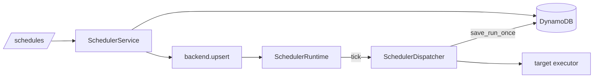

# Scheduler Contribution Guide

`scheduler/` owns user schedules (cron and one-time) that fire an agent message, an automation run or a dream run, plus the in-process reapers that fail stale work on Railway. DynamoDB is the source of truth; APScheduler only keeps the process-local clock. Schedules are created through `/schedules` and by skills (`source_type` / `source_ref` record who asked).

## Layout

```text
src/scheduler/
  router.py       /schedules routes; maps SchedulerValidationError to 400/404
  service.py      SchedulerService: validate, persist, sync backend; mark_dispatched; owner_of_schedule
  repository.py   SchedulerRepository: schedules, lookup items, runs
  models.py       Schedule, ScheduleRun, request/response models, enums, key + dynamo mapping
  timing.py       OneTime / Recurring strategies chosen by timing_for(schedule)
  cron.py         croniter + zoneinfo helpers, ScheduleExpressionError
  targets.py      Per-target payload validators (TARGET_VALIDATORS)
  executors.py    Per-target executors (agent message, automation run)
  dispatcher.py   SchedulerDispatcher: idempotent run record, execute, record result
  runtime.py      SchedulerRuntime (APScheduler) + stale-work reapers, started from main.py lifespan
  backends/       SchedulerBackend protocol, get_scheduler_backend factory, in_app backend
```

## Conventions

- **Keys.** Schedule: `pk=Account#{account_id}`, `sk=Schedule#{schedule_id}`. Run: `pk=Schedule#{schedule_id}`, `sk=Run#{scheduled_for}#{run_id}`. Active schedules with a `next_run_at` also carry `gsi2_pk=ScheduleDue#active` and `gsi2_sk={next_run}#Schedule#{id}` (see `Schedule.due_gsi_pk`), which `list_active_schedules` reads at startup.
- **Lookup items.** `to_lookup_items` writes extra rows under `Agent#`, `Conversation#` and `Automation#` partitions so a schedule can be found from its target. `save_schedule` deletes stale lookups and writes the new set in one batch; always go through it.
- **Scoping.** A schedule runs as one member. `SchedulerService.get_schedule` returns it only for `owner.user_id == schedule.owner_id` in the caller's account; anything else is "Schedule not found". The router takes the `Owner` from `get_owner(request)`. Executors rebuild the owner with `owner_of_schedule`.
- **Errors.** Services raise `SchedulerValidationError`; the router turns it into 400 (create/update) or 404 (get/pause/resume/runs). Delete is idempotent and swallows it. Bad cron or timezone raises `ScheduleExpressionError`, which `_time` converts.
- **Timing is a strategy list.** `timing.py` has `TIMINGS` and `timing_for`. A schedule with `run_at` is one-time and becomes `COMPLETED` after its run; otherwise it needs a 5-field `cron_expression`. Do not add `if run_at` branches elsewhere.
- **Idempotent dispatch.** `ScheduleRun.deterministic_run_id` plus `save_run_once` (conditional put) means two processes ticking the same minute produce one run; the loser records `SKIPPED` (`duplicate_dispatch`). `mark_dispatched` runs in `finally`, so a failed run still advances `next_run_at`.
- **Backends.** `SCHEDULER_BACKEND` (default `in_app`) selects the adapter in `backends/factory.py`. `SCHEDULER_RUNTIME_ENABLED` turns the runtime off (tests, Lambda). Both are in `config/settings.py`.
- **Reapers.** Intervals come from settings (`crawl_job_reaper_interval_seconds`, `chat_turn_reaper_interval_seconds`, ...). `_reap` swallows exceptions so one failing reaper cannot stop the scheduler. Import heavy modules inside the reaper method (see `_recover_blueprint_applies`).
- `executors.PhaseOneTargetExecutor` is not wired into the dispatcher; do not copy it.



## How to add a target type

1. Add a value to `ScheduleTargetType` in `models.py`.
2. Add a validator class in `targets.py` and register it in `TARGET_VALIDATORS` (example: `DreamRunTargetValidator`).
3. Add an executor in `executors.py` (or the owning module, like `src/dream/executor.py`) and register it in `SchedulerDispatcher._default_executors`.
4. Add the `target_ref` mapping in `SchedulerDispatcher._target_ref`; if the target has an id worth looking up, extend `Schedule.to_lookup_items`.
5. Test in `tests/test_scheduler_targets.py` and `tests/test_scheduler.py`.

Adding a backend: implement `SchedulerBackend` (`backends/base.py`) and add it to `get_scheduler_backend`.

## Testing

```bash
uv run pytest tests/test_scheduler*.py -q
uv run ruff check src/scheduler tests/test_scheduler*.py && uv run mypy src/scheduler
```

Tests use moto through `dynamodb_table` and the repository fixtures, a `FakeSchedulerBackend` for the service, fake executors for the dispatcher, and `tests/mock_data.py` (`schedule_fields`, `test_owner`). Do not start the real APScheduler loop.

## Do / Don't

- Do keep persistence in `repository.py` and validation in `service.py` / `targets.py`.
- Do check ownership through `get_schedule`, not by reading the repository directly in a router.
- Do add a new timing or target as another entry in a list, not another `if` chain.
- Don't read-then-write for dispatch dedupe; use the conditional put.
- Don't let a reaper or executor exception escape into the scheduler loop.
- Don't add a backend abstraction layer beyond the protocol until a second backend exists.
