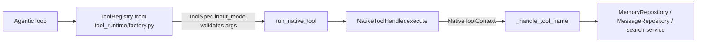

# Tools (native)

Native tools are the built-in functions a `krishna-memgpt` agent can call: core and archival memory, recalling earlier messages in the conversation, waiting, and searching linked knowledge bases. This package declares them (`definitions.py`, `contracts.py`, `specs.py`) and executes them (`handlers.py`). The registry and dispatch live in `src/agents/tool_runtime/`; skills and MCP tools are separate (`src/skills/`, `src/connectors/`).

`src/tools/research/` has no source (only bytecode) and is not covered here.

## Layout

```text
src/tools/
  __init__.py          re-exports NATIVE_TOOLS, NATIVE_TOOLS_MAP, NativeToolHandler
  native/
    definitions.py     provider-facing JSON definitions (name, description, parameters); NATIVE_TOOLS, KNOWLEDGE_TOOLS, NATIVE_TOOLS_MAP
    contracts.py       one Pydantic input model per tool; validates the model's arguments
    specs.py           NATIVE_TOOL_SPECS: ties definition + category + input model (+ flags) into ToolSpec
    handlers.py        NativeToolHandler: execute() and one _handle_<tool_name> per tool; normalize_block_name
```

## How a call flows



## Conventions

**Three declarations per tool.** A tool exists in `definitions.py` (what the LLM sees), `contracts.py` (what the runtime validates) and `specs.py` (how the registry treats it). `test_every_declared_tool_validates_its_input` in `tests/test_tool_execution.py` fails if a spec has no input model or no name.

**Dispatch by name.** `NativeToolHandler.execute` looks up `_handle_{tool_name}` with `getattr`; an unknown name raises `ValueError`. Tools prefixed `core_memory_` or `archival_memory_` receive `(args, agent_id, user_id)`; `recall_conversation` and `knowledge_base_search` get their extras (`conversation_id`, `linked_kb_ids`) from the context; anything else gets `(args, agent_id)`. A new tool that needs different inputs needs a branch in `execute`.

**Stateless handler.** Everything turn-specific arrives in `NativeToolContext` (`src/agents/tool_runtime/contexts.py`): `agent_id`, `user_id` (the turn's `actor_id`, which scopes memory), `conversation_id`, `linked_kb_ids`. Do not stash per-turn state on the handler; one instance serves concurrent turns. Note that `_handle_recall_conversation` and `_handle_knowledge_base_search` still fall back to `self._conversation_id` / `self._linked_kb_ids`, which nothing sets: always pass them through the context.

**Return strings, do not raise, for model mistakes.** A missing block, an out-of-range line or an empty query returns an `Error: ...` string the LLM can act on (`_get_block_or_error`). Raise only for programmer errors. Unexpected failures of external services (knowledge search) are logged and returned as a short error string.

**Idempotent memory writes.** Appends skip duplicate lines; archival inserts dedupe by content hash. Keep that when adding writers, because models retry.

**Prompt staleness.** Core-memory writes are registered with `_memory_write(...)` in `specs.py`, which sets `mutates_prompt_context=True` so the loop re-renders the system prompt after them. Archival writes do not, because the prompt renders only core memory. `test_only_core_memory_writes_are_declared_as_making_the_prompt_stale` pins this.

**Categories.** The category decides whether a tool's definition is offered to the model on a turn (`ToolCategory` in `src/agents/tool_runtime/specs.py`); `knowledge_base_search` is `KNOWLEDGE`, the rest `NATIVE`. `NATIVE_TOOLS_MAP` includes both for lookup by name.

**Block names.** Use `normalize_block_name` on any block name from the model; `src/dream/actions.py` reuses it.

## How to add a native tool

1. `definitions.py`: add the `NAME = {"name": ..., "description": ..., "parameters": {...}}` dict and put it in `NATIVE_TOOLS` (or `KNOWLEDGE_TOOLS`). Re-export it from `native/__init__.py` if other modules import it.
2. `contracts.py`: add `<Name>Input(BaseModel)` with the same fields and constraints (see `WaitInput` for bounds, `CoreMemoryListBlocksInput` for `extra="forbid"` on a no-arg tool).
3. `specs.py`: add a `ToolSpec(DEFINITION, ToolCategory.NATIVE, InputModel)` to `NATIVE_TOOL_SPECS` (use `_memory_write` if it changes core memory).
4. `handlers.py`: add `async def _handle_<name>(self, args, agent_id[, user_id]) -> str`, and extend `execute` only if it needs more than that signature.
5. Test it (below). Existing example to copy: `wait` (`_handle_wait`, `WAIT`, `WaitInput`).

## Testing

```bash
uv run pytest tests/test_tool_execution.py tests/test_async_tool_runtime.py tests/test_krishna_memgpt_tool_audit.py -q
uv run ruff check src/tools && uv run mypy src/tools
```

Handlers are tested against moto-backed `MemoryRepository` (`dynamodb_table` fixture) or an `InMemoryMessageRepository`; `tests/test_async_tool_runtime.py` shows `monkeypatch` of `asyncio.sleep` for `wait`. Run the full suite for `tests/test_tool_*.py` when changing specs, because audit and display tests read them.

## Do / Don't

- Do keep definition, contract and spec in step; the description is prompt text and affects model behaviour, so change it deliberately.
- Do return model-readable error strings for bad arguments.
- Do bound anything the model controls (`MAX_WAIT_SECONDS`, `KB_SEARCH_MAX_RESULTS`, `RECALL_PAGE_SIZE`).
- Don't add a plugin or registration framework here; `NATIVE_TOOL_SPECS` is a plain list on purpose.
- Don't put business logic in handlers that belongs in `MemoryRepository` or a service; handlers format text for the model.
- Don't read per-turn state from the handler instance.
