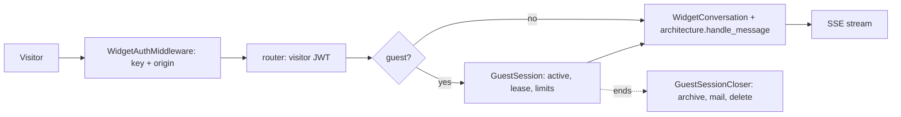

# Widget Module

Owns `/widget/*`, the API behind the embeddable chat: visitor sign-in (Google or an email-only guest), visitor sessions, widget conversations and messages, and the guest session lifecycle (limits, close, archive, emailed transcript). Callers are the iframe app (`spa/embed`, served by `src/embed/`) and the IDE/WordPress plugins. Visitors are not dashboard users: they authenticate with a public key (`src/apikeys/`) plus a visitor JWT, and the agent runs as its owner.

## Layout

```text
src/widget/
  __init__.py      exports middleware, models, repository, widget_router
  middleware.py    WidgetAuthMiddleware (X-API-Key + origin check), get_api_key_from_request
  router.py        all /widget routes, visitor JWT create/decode, get_visitor_from_request
  models.py        WidgetVisitor (google | guest), WidgetConversation and request/response models
  repository.py    WidgetConversationRepository
  sessions.py      Google sign-in state, one-time login codes, rotating refresh tokens
  guests.py        GuestSession item and repository, guest rate limits, GuestSessionEnded / GuestTurnInProgress
  guest_email.py   deliverability check for guest emails (GuestEmailRejected)
  guest_closer.py  GuestSessionCloser.sweep: archive to S3, email transcript, delete
  transcript.py    builds and renders the guest transcript email
```

## Conventions

- **Request flow.** `WidgetAuthMiddleware` runs for every `/widget` path except `/widget/auth/google` and `/widget/auth/callback`. It validates `X-API-Key` (401), requires the key active, and checks the `Origin` against `allowed_origins` (403) unless the browser sent `Sec-Fetch-Site: same-origin` (the iframe). It puts `api_key` and `agent_id` on `request.state`. Routes then take `get_api_key_from_request` and, for visitor routes, `get_visitor_from_request`, which checks the JWT audience, that its `agent_id` matches the key, and for guests that the session is still active.
- **No IAM.** There is no `Principal` here. Authorisation is: key bound to one agent, visitor token bound to that agent, and `conversation.visitor_id == visitor.visitor_id` (403 otherwise).
- **Keys.**
  - Conversation: `pk = Agent#{agent_id}#Widget`, `sk = Conversation#{conversation_id}`; GSI `gsi2`: `gsi2_pk = Visitor#{visitor_id}`, `gsi2_sk = Agent#{agent_id}#Conversation#{conversation_id}`.
  - Guest session: `pk = WidgetGuest#{visitor_id}`, `sk = WidgetGuest#Metadata`, `gsi2_pk = WidgetGuestSessionEnd`, `gsi2_sk = {session_ends_at}#{visitor_id}` (the closer queries this by time). `ttl` is set as a backstop; check expiry in code too.
  - Login code and refresh token: `pk = WidgetLoginCode#{sha256}` / `WidgetRefresh#{sha256}`, `sk = <same>#Metadata`. Only hashes are stored.
- **Sign-in.** The OAuth `state` is a signed, expiring JWT whose nonce must match a cookie in the starting browser. The callback never puts a token in a URL: it returns a one-time code redeemed at `POST /widget/auth/token`. Refresh tokens are ours, bound to the agent, and rotated on use (`rotate_refresh_token` consumes the old item in a transaction). Guests get a 1 hour JWT, Google visitors 4 hours (the `WIDGET_JWT_EXPIRATION_HOURS` constant in `router.py`, not an env var).
- **Guest concurrency.** State changes are conditional updates, not read-then-write (`GuestSessionRepository._update_active`). A turn is a lease (`turn_id`, `turn_expires_at`, renewed by a 30 s heartbeat in `send_message`); a second message while the lease is live gets 409 `guest_turn_in_progress`, an ended session 401 `guest_session_ended`. Take the turn before spending rate limits, and `finish_turn` on every exit path.
- **Guest limits** go through `enforce_guest_limit(scope, subject)` (`RateLimiter` policies from `src/rate_limits/`), returning 429 with `Retry-After`. Tunables are `widget_guest_*` in `src/config/settings.py` (`WIDGET_GUEST_*` env vars).
- **Closing.** `scheduler/runtime.py` calls `GuestSessionCloser.sweep` every `widget_guest_sweep_interval_seconds` in a worker thread (it uses sync boto3 and Mailjet). The session item carries the lease and checkpoints; steps are retryable, with `widget_guest_transcript_attempts` bounded mail attempts. Emails go through the `*_safe` helper in `src/email/helpers.py`.
- **Errors.** Routes raise `HTTPException`; the SSE stream turns exceptions into an `SSEEventType.ERROR` event with `GENERIC_ERROR_MESSAGE`, never the exception text. Domain errors (`GuestSessionEnded`, `GuestEmailRejected`) are `ValueError`s mapped in the router.
- **Transcript email** escapes everything a visitor or agent wrote; assistant markdown uses a small allowlist renderer. Do not widen it casually.



## How to add a widget endpoint

1. Add the route to `router.py` (prefix `/widget` is already set). Take `api_key` from `get_api_key_from_request`; add `visitor` from `get_visitor_from_request` if it is per visitor. The middleware already covers it; only paths under `/widget` are checked, and sign-in navigation paths are the sole exemptions in `middleware.py`.
2. Check ownership explicitly (`conversation.visitor_id`), and load by `api_key.agent_id`, never by an id from the body.
3. Request/response models go in `models.py`. New persistence goes in `repository.py` with the key shape in the class docstring.
4. If the SPA needs it, update `spa/embed` and the loader docs.
5. Test it (below). For a guest-only behaviour, extend the `test_widget_guest_*.py` file for that area.

## Testing

```bash
uv run pytest tests/test_widget*.py -q
uv run ruff check src/widget && uv run mypy src/widget
```

Files: `test_widget.py` (config, conversations, messages), `test_widget_sign_in.py`, `test_widget_guest_auth.py`, `test_widget_guest_sessions.py`, `test_widget_guest_email.py`, `test_widget_guest_closer.py`, `test_widget_guest_transcript.py`. They use moto (`dynamodb_table`), `test_client`, and create agents and keys through the routers. The closer takes `table`, `s3` and `bucket` in its constructor so tests inject moto resources. DNS in `guest_email.py` should be patched, not hit.

## Do / Don't

- Do use conditional writes and `transact_write_items` for session, token and lease changes.
- Do store only hashes of codes and refresh tokens, and bind every token to its agent.
- Do read trusted widget flags (`allow_guests`) from the key, never from the request.
- Don't put tokens in URLs or in the sign-in page beyond the one-time code.
- Don't add new guest limits as inline `if` chains; add a policy to `_guest_limits()` and a setting.
- Don't call sync boto3 or Mailjet from async routes; the closer runs in a thread for that reason.
