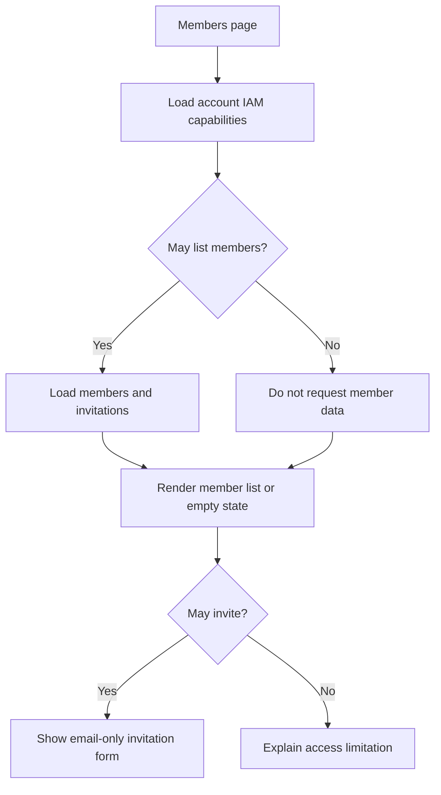
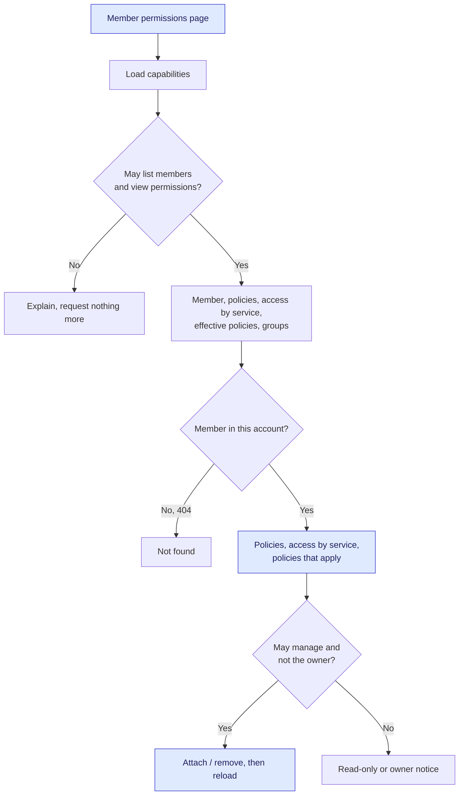

# Account Invitations — Phased Implementation

| Field | Value |
| --- | --- |
| Status | 🚧 In progress |
| Owner | InnomightLabs API / SPA |
| Last reviewed | 2026-11-02 |
| Depends on | Existing identity, account context and IAM implementation; account billing/seat contract for Phase 2 |
| Tracker | [KAN-82](https://vslala007.atlassian.net/browse/KAN-82) |

## Implementation notes

**Phase 3 (2026-11-02):** invitations stay email-only and accepting one attaches nothing. An admin grants
permissions afterwards on the member's page (`/dashboard/iam/members/{user_id}`), by attaching built-in or
custom policies, and sees the member's access service by service. This replaces `docs/LLD-shared-accounts-and-iam.md`'s "attach `MemberAccess` by default".
Groups and the custom-policy editor are not built yet. See [Phase 3](#phase-3-member-permissions).

The revised phase guidance removes permission selection from Phases 1 and 2; the user will plan it in Phase 3. Invitation links carry a high-entropy token. Six-digit codes and code-entry UI are removed from the plan. These decisions supersede the corresponding invitation-form details in `docs/LLD-shared-accounts-and-iam.md`, not the existing IAM engine.

Phase 1 supplied the dashboard foundation. Phase 2 now enables real invitation creation, email delivery, resend, revocation and explicit acceptance. No policies or groups are attached; permissions are granted afterwards (Phase 3). Only API-confirmed delivery displays success; a failed send leaves a visible invitation that can be resent with a new token.

Confirmed authentication decision: only the separate code/verification step is removed. The OAuth identity must still have a verified email equal to the invited email. An invitation token never verifies or changes an identity's email by itself.

**Rollout dependency:** production accounts currently have no billing-provided seat limit. Create/resend/accept require a positive integer `seat_limit` on `Account#Metadata` and otherwise fail closed with `SEAT_LIMIT_UNAVAILABLE`. Implementing plan mapping and billing updates is outside this change; do not treat this field as an unlimited fallback or silently assign arbitrary plan entitlements. The one exception is an account whose owner is a superuser (`SUPERUSER_EMAILS`, as in `RateLimitService`): it has no seat limit, while the pending-invitation cap still applies.

## Phase 1: IAM and Members

### Files and routes

| Boundary | Implementation |
| --- | --- |
| Route composition | `spa/src/App.tsx`: `/dashboard/iam` redirects with replace to `members`; the Members page is nested in `IamLayout` |
| Dashboard navigation | `spa/src/components/dashboard/Sidebar.tsx`: IAM link; `DashboardLayout.tsx`: IAM titles |
| Panel chrome | `spa/src/pages/dashboard/iam/IamLayout.tsx`: semantic Members subnav and outlet |
| Page state | `MembersPage.tsx`: loading/error/retry and cancellation on unmount/retry |
| Request sequencing | `loadMembers.ts`: capabilities first, then directory only if permitted |
| Presentation | `MembersPanel.tsx`: state-specific content, email-only form and invitation rows |
| Styles | `Iam.module.css`: scoped classes and existing theme variables |
| Transport | `spa/src/services/iam/index.ts`: typed singleton via shared HTTP client |
| Capability API | `api/src/iam/router.py`, `schemas.py`: authenticated `GET /iam/capabilities` |

### Capability contract

```json
{
  "can_list_members": true,
  "can_invite": true
}
```

The API uses `Depends(get_principal)` and the existing actions `iam:ListMembers` and `iam:Invite`. It does not introduce the ticket's differently named `iam:InviteMember` action. Each boolean comes from `Principal.can(...).allowed`, so direct/group grants and explicit Deny semantics remain unchanged. Account selection, membership checks and permission cache invalidation remain with the existing principal loader.

These booleans govern presentation only. `GET /iam/members` continues to enforce its own authorization. Invite writes authorize against the state they change, not trust a browser flag or a previous capability response.

### Load flow



The capability gate prevents invitation-only users from querying the directory; it is not a replacement for API authorization. Failure shows retry rather than assuming capabilities. Cleanup aborts requests and ignores stale completion. Account switching already reloads the dashboard, so this phase introduces no account-sensitive cache.

### Styling and accessibility

Use existing Button, Input and Label components. The form email label is associated with its input. Submit and row actions disable during a mutation; errors and success are explicitly announced. The directory has a caption and scoped column/row headers. The owner label is informational, never an authorization rule. Navigation uses real links and current-route semantics. The local stylesheet controls narrow layouts, table overflow and token-based colors without changing shared tokens.

## Phase 2: invitation lifecycle and onboarding

### Storage and transactions

`api/src/iam/invitations/` owns the model, repository, service, schemas and routes. An Invite uses `Account#{account_id}` / `Invite#{invite_id}`, with both GSI2 keys equal to `InviteToken#{sha256(token)}`. The token uses `secrets.token_urlsafe(32)`; only its hash is stored. Records carry normalized email, inviter, expiry, TTL, lifecycle status, delivery status and accepted identity. Expiry is checked in code; DynamoDB TTL deletion is not the access-control boundary. An expired pending record is presented as expired without requiring a write/reaper.

A GSI lookup is only discovery: a consistent primary-key read must match the current hash/status. This prevents stale index results from reviving a revoked or rotated link. Invitations, members, permission state and account metadata use paginated consistent reads. Duplicate pending invitations and existing memberships, including suspended ones, are refused.

`IamRepository.commit` accepts conditional DynamoDB operations alongside its mandatory account-version bump. Create/resend/revoke/accept serialize on `authz_version`. Seat-sensitive operations also condition on the current account status and exact seat limit, so an unversioned billing change fails the transaction. Conflicts return 409; retries must reload state and reauthorize.

Acceptance atomically checks the identity's current active status, verified flag and exact stored email; conditionally creates the Member; marks the live invitation accepted; and advances `authz_version`. Repeated acceptance by the same identity verifies the existing active membership and does not recreate a removed or suspended member. Races may return 409 and be retried, but create one membership. No default `MemberAccess`, groups or policy attachments are written.

### API and authorization

| Method and route | Boundary |
| --- | --- |
| `GET /iam/invitations` | Active account principal with `iam:ListMembers` |
| `POST /iam/invitations` `{email}` | `iam:Invite`, rechecked against the transaction snapshot |
| `POST /iam/invitations/{id}/resend` | `iam:Invite`; rotates token and refreshes expiry |
| `DELETE /iam/invitations/{id}` | `iam:Invite`; revokes a pending/expired invitation |
| `POST /invitations/preview` `{token}` | Public, fail-closed IP throttle; returns account/email/expiry/status and nonredeemable hash context |
| `POST /invitations/accept` `{token}` | Owner-audience JWT for the invited identity, **without** requiring target-account membership |

Raw tokens are request bodies, never URL parameters. Validation errors omit input values. API responses expose neither raw tokens nor token hashes except the preview's nonredeemable `login_context`; possession of a hash cannot call acceptance successfully.

### Seats and abuse controls

Pending, unexpired invitations reserve seats. All stored memberships, including suspended memberships, consume seats. Sending adds a reservation; acceptance converts a reservation without double counting. Expiry/revocation frees pending capacity logically, independent of TTL cleanup. Failed delivery retains the reservation until resend, revocation or expiry. A lowered limit is rechecked on resend and acceptance. Missing/invalid limits are refused, never replaced by person-level subscription quotas.

Settings are centralized and mirrored in `scripts/deploy_prod_railway.sh`:

| Environment variable | Default |
| --- | --- |
| `ACCOUNT_INVITE_EXPIRY_DAYS` | 7 |
| `ACCOUNT_INVITE_PENDING_LIMIT` | 50 |
| `ACCOUNT_INVITE_RATE_LIMIT` | 20 |
| `ACCOUNT_INVITE_RATE_WINDOW_SECONDS` | 3600 |

These must be positive integers. Create/resend use the existing sliding-window rate limiter per account, explicitly fail closed. An aborted transaction releases the slot; a persisted invitation consumes the slot even if mail fails. Preview permits 30 requests per IP per rolling 60 seconds; trusted proxy interpretation remains the ASGI deployment's responsibility.

### Secure email delivery

`send_account_invitation_email_safe` makes one attempt through `EmailService`, rendering `account_invitation.html` inside the house `_layout.html` with autoescaping and a plain-text alternative. Success requires HTTP 200 and all Mailjet message statuses successful. Click/open tracking is disabled. Provider I/O runs off the event loop; exceptions/provider responses/links are not logged.

A raw token is never written to `PendingEmail`. Failed delivery marks only `delivery_status=failed` on the same hash, returns 502 with the persisted invitation ID, and reloads the UI. Resend generates a replacement token rather than retrieving an old secret. A provider acceptance and DynamoDB delivery checkpoint are not atomic: an interruption can leave delivery uncertain; resend rotates the token, and an already delivered old link then becomes invalid.

### OAuth and frontend continuation

1. The email points to `/invitations/accept#token=...`. Synchronous bootstraps in `spa/index.html` and `spa/public/404.html` remove the token before analytics/external resources, retaining it only in same-tab sessionStorage. The 404 redirect must never encode it into a query string. Storage failure clears the fragment and carries only a nonsecret error marker; no stale token is used.
2. The public, nonindexed acceptance page previews the token through POST. OAuth links contain only the preview hash context. Analytics and SiteConcierge are suppressed on this surface. The build emits a nonindexed acceptance HTML shell and omits it from the sitemap.
3. Google/Cognito login start validates a pending invitation. Signed, nonce-bound, expiring state carries only the hash. Callback revalidates invitation and provider-verified email before identity creation. Invite sign-in skips automatic personal-account creation and creates no membership.
4. `/login-success?code=...&invitation=1` still exchanges the normal single-use session code. Invitation continuation takes precedence over checkout/dashboard routing. No raw invite token passes through the provider or session-code URL.
5. The signed-in invitee explicitly accepts through POST. On success, the existing account-switch service persists the server selection before changing local account context or clearing the pending token. Acceptance/account-switch 401s clear auth but stay in the invitation flow for sign-in. Normal requests retain their existing redirect behavior.

The shared HTTP client preserves structured error details; domain code only narrows invitation errors, without duplicating authentication/interceptors. Browser state is an affordance, never identity or authorization proof.

## Phase 3: member permissions

### Decisions

- **Invitations stay simple.** The invite form takes an email and nothing else, and accepting attaches no policy
  or group. A new member holds only the implicit `OwnerAccess`: they can use what they own and what's shared with
  them, and can't create anything (`agents:Create` and the rest need a policy). An admin then grants permissions.
- **Granting is attaching a policy to the member**, as on an AWS user's Permissions tab. The member's page attaches
  or detaches any policy in the account: the built-ins (`MemberAccess`, `AdministratorAccess`, `ViewOnlyAccess`) and
  existing custom policies. `OwnerAccess` is implicit and never offered. The page is a client of
  `PUT/DELETE /iam/members/{user_id}/policies/{policy}`, so the escalation guard (you can grant only what you hold),
  the owner rule (`ACCOUNT_OWNER`) and `authz_version` invalidation all apply: a change takes effect on the member's
  next request.
- **Access is shown service by service**, like the AWS console's policy summary: for every service in the action
  catalog (Agents, Knowledge bases, Settings and MCP connections, ...), how far each action reaches. The API computes
  it (`api/src/iam/access_summary.py`, pure, beside the engine) so the browser never evaluates policies.
- **Not in this phase:** groups, the custom-policy editor and its visual builder, and invite-time presets.

### Access by service

`summarize(policies)` reads the member's policies (`AccountIam.policies_for`) against `actions.SERVICES`. For each
action it reports how far the Allow statements reach and how far the Deny statements reach:

| Reach | Meaning |
| --- | --- |
| `all` | An unconditional statement on `*` or `{type}/*` |
| `some` | Only the resources a statement names (`agent/8c1e`) |
| `own` | Only resources they own (the `iml:ResourceOwner` condition) |

The owner condition can only reach an action that names one resource (`Action.names_a_resource`): Create, List and
account-wide actions name none, so `OwnerAccess` never allows them, exactly as `evaluate` decides. An action's
level is `denied` when a Deny reaches `all`, otherwise its Allow's reach, or `none`. A service is `full` when every
action is allowed everywhere with no Deny, `none` when nothing is allowed, otherwise `limited`. Shares
(per-resource grants) are not part of the summary; the page says so.

The catalog groups actions into `Service`s, each with a label and a one-line summary for the portal; that list is the
one source for the policy grammar, the routes and this view.

### Capabilities and API

`GET /iam/capabilities` gains two flags, each from `Principal.can(...)`. Like the others they decide which controls
show, never whether a request is allowed.

```json
{
  "can_list_members": true,
  "can_invite": true,
  "can_view_permissions": true,
  "can_manage_permissions": true
}
```

| Flag | Action | Shows |
| --- | --- | --- |
| `can_view_permissions` | `iam:ListPolicies` | Member names link to their permissions page |
| `can_manage_permissions` | `iam:AttachPolicies` | Attach and remove controls on that page |

| Route | Guard | Returns |
| --- | --- | --- |
| `GET /iam/members/{user_id}` (new) | `iam:ListMembers` | One member; 404 `NOT_FOUND` if not in the account |
| `GET /iam/members/{user_id}/access` (new) | `iam:ListPolicies` | `[{service, label, summary, level, actions: [{action, verb, level, allow, deny}]}]`, each reach `{scope, resources, policies}` |
| `GET /iam/members`, `GET /iam/members/{user_id}` | `iam:ListMembers` | `policies` is now `[{policy, name}]`, so custom policies show their names |
| `GET /iam/members/{user_id}/effective-policies` | `iam:ListPolicies` | Each policy now carries `name` and `description` |
| `GET /iam/policies` | `iam:ListPolicies` | Built-ins now carry their description |

A policy's title and description live on the policy (`NamedPolicy.title`, `.description`; a built-in's title is its
name). The page also reads `GET /iam/groups`, only to name the group a permission comes from; it still loads without
`iam:ListGroups`.

### Load flow



*New surfaces in blue. Every change reloads the page, success or failure, because another admin may have changed
the member first (409 `CONFLICT`).*

### Files

| Boundary | Implementation |
| --- | --- |
| Catalog | `api/src/iam/actions.py`: `Service` (label, summary) and `SERVICES`; `Action.names_a_resource` |
| Summary | `api/src/iam/access_summary.py`: `summarize`, `ServiceAccess`, `ActionAccess`, `Reach` |
| Policy names | `api/src/iam/engine.py` `NamedPolicy.title/description`; `builtins.py`; `models.AccountIam.resolve` |
| API | `api/src/iam/router.py` (`get_member`, `member_access`, `_member_response`), `schemas.py` |
| Route | `spa/src/App.tsx`: `/dashboard/iam/members/:userId` inside `IamLayout` |
| Members table | `MembersPanel.tsx`: an Access column (Full access, No policies, or the attached policies by name) and a link per member when `can_view_permissions` |
| Loading | `loadMemberPermissions.ts`: capabilities first, then the five reads; `PermissionsUnavailable` when not allowed |
| Presentation | `MemberPermissionsPanel.tsx`: loading, error, owner, read-only, empty and loaded states; attached policies and the attach form; access by service (a table, cards on a phone); policies that apply with their JSON |
| Wording | `describeAccess.ts`: source labels, which policies can be attached, a service's access as lines (allowed, only on named resources, on what they own, denied) |
| Changes | `MemberPermissionsPage.tsx` with `runMutation.ts` (shared with the members page) |
| Errors | `spa/src/services/iam/errors.ts`: `iamErrorMessage`, the API's message plus what to do next, for every IAM page |
| Transport | `spa/src/services/iam/index.ts`: `getMember`, `memberAccess`, `listPolicies`, `listGroups`, `effectivePolicies`, `attachPolicy`, `detachPolicy` |

## Validation and rollout

Backend tests cover capability gates, token storage/rotation, email verification, identity/seat/status interleavings, duplicate/concurrent acceptance, email redaction, configuration and the mounted middleware/API flow. Key files are `test_invitations_lifecycle.py`, `test_auth_invitations.py`, `test_invitation_email.py`, `test_invitation_integration.py` and `test_invitation_boundaries.py`. SPA coverage includes lifecycle transport and errors, directory gates, mutation reloads, OAuth continuation, account-selection failure and actual pre-analytics HTML bootstraps executed in Node VM.

Run focused backend tests, `uv run ruff check` on changed files, and the full `uv run pytest -q`; run focused SPA tests/ESLint, full `yarn test`, `yarn lint`, `yarn build` and `yarn design:audit`. Report existing failures and timeouts instead of treating them as passed. SSR tests do not establish browser accessibility or visual correctness; manually check both themes, keyboard navigation and responsive layout.

Deploy the API routes, email template and frontend build together, including the acceptance shell and updated 404 fallback. Configure Mailjet and Google/Cognito as usual. Billing must provision and maintain account `seat_limit` before production invitations can send or accept. No infrastructure deployment or live provider smoke test is performed as part of the code change. Groups and custom policies in the portal come after Phase 3.

## Related documentation

- `docs/LLD-shared-accounts-and-iam.md`
- `api/src/iam/CONTRIBUTION.md`
- `spa/src/pages/dashboard/iam/CONTRIBUTION.md`
- `spa/src/services/iam/CONTRIBUTION.md`

