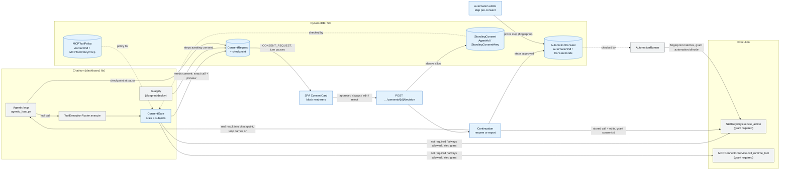
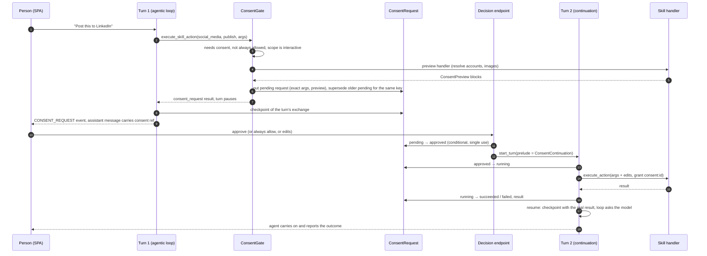
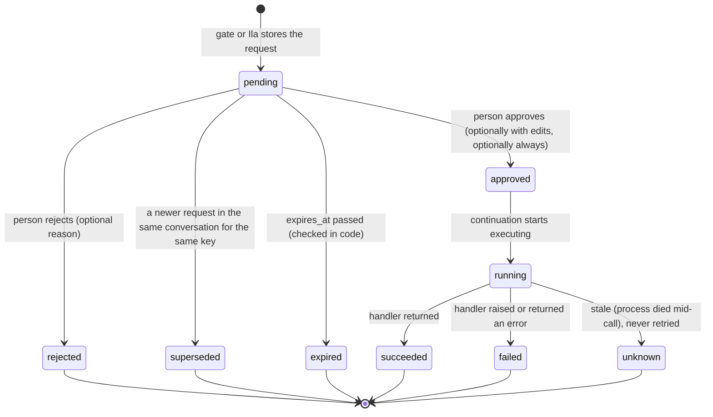
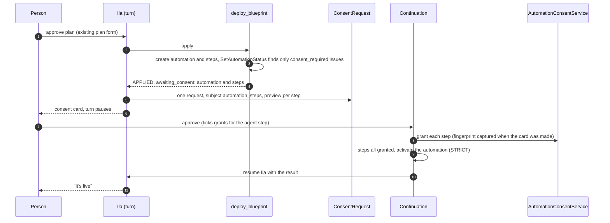
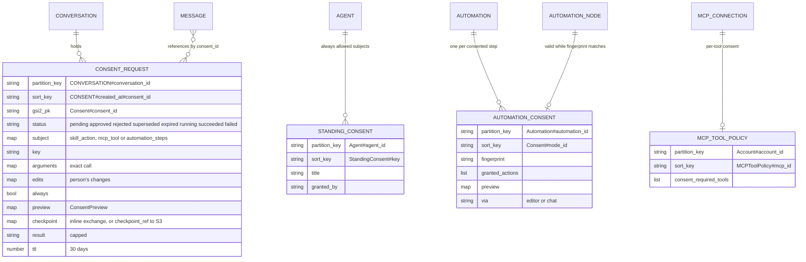

# LLD: Action consent: asking the person before a tool acts for them

| Field | Value |
| --- | --- |
| Status | 🚧 In progress: all four phases built and tested locally; deploy and manual checks pending. Start at "Implementation notes" |
| Owner | InnomightLabs API + SPA |
| Last reviewed | 2026-10-25 |
| Depends on | [LLD-async-chat-turns](../api/docs/LLD-async-chat-turns.md), [LLD-unified-skill-automation-actions](../api/docs/LLD-unified-skill-automation-actions.md), [LLD-mcp-connector-machinery](LLD-mcp-connector-machinery.md), [LLD-social-cross-posting](LLD-social-cross-posting.md), [LLD-solution-blueprints](LLD-solution-blueprints.md) |
| Scope | `api/src/consent/` (new), `api/src/agents/`, `api/src/skills/`, `api/src/automations/`, `api/src/blueprints/`, `api/src/builder/`, `api/src/connectors/mcp/`, `spa/src/components/chat/consent/` (new), automation editor, agent skills and MCP tools pages |

> **Summary:** Today an agent "asks" before it publishes a post or sends an email only because its prompt
> tells it to (`social_media`), or because it sets a `confirmed: true` argument itself (`google_mail`).
> Neither is consent. This design adds a platform-level gate in front of every tool call:
> - **Which actions need consent.** A skill action declares it with a `consent:` block in its manifest.
>   For an MCP tool, the person switches it on per tool.
> - **In chat.** The gate stores the exact call as a `ConsentRequest`, shows it as a card built from typed
>   preview blocks (text, email, images, targets…), and pauses the turn with a checkpoint of its exchange.
> - **The decision.** The person can approve, **always allow**, edit or reject. The server runs exactly
>   what was approved and resumes the paused turn with the real result.
> - **Standing consent.** "Always allow" is remembered per agent and tool, so scheduled and unattended
>   runs go ahead.
> - **Automations.** Consent is asked when a step is chosen, whether the person builds the automation in
>   the editor or Ila builds it in chat. It is tied to a fingerprint of the step's configuration.
> - **Enforcement.** The skill registry refuses to run a consent-required action without a recorded
>   grant, so no path can skip the gate.

## Implementation notes (2026-10-26)

Built in one pass, all four phases. Where the build departs from the design below:

- **One continuation, not two strategies.** `ConsentContinuation` resumes the paused turn when it can and otherwise
  reports the decision as a message. The choice is one guard in `_resumable_exchange`, not a two-item strategy list.
- **MCP defaults keep existing shares.** Without a chosen policy, destructive tools ask the owner in their own chats,
  but a tool the owner already shared with outsiders stays shared (`MCPToolPolicy.keeps_from_outsiders`): sharing it
  was their choice. Only tools the owner chose to be asked about are owner-only. A connection whose tools were never
  listed asks about none of them until the owner lists the tools and chooses.
- **A `runnable` validation mode.** It is used instead of a `require_consent` flag. STRICT plus consent for every step
  that acts for the owner is the default of `AutomationService.validate_graph`, which activation and every run path
  use. Saves keep their own mode, so editing an active step never fails its autosave. Marketplace import passes STRICT.
- **No load-time check of preview handlers.** A preview that fails to import or raises falls back to the default
  preview, which shows every argument. Skill tests cover each real preview.
- **`allow` is checked against the manifests.** Each entry must be a consent action of a real skill. An entry naming
  a skill the step's agent doesn't have is simply not ticked on the card. `export.py` does not write `allow` back.
- **Ila reaches automations through the kind.** `blueprints/kinds/automation.py:steps_awaiting_consent` lists a
  deploy's waiting steps, and `builder/step_consent.py` only builds the card, as the builder's boundary test requires.
- **No phase-1 automation bypass.** All phases shipped together, so it was not needed, and there is no backfill: the
  What's New entry asks owners to approve their publishing and sending steps once.
- **The editor's issues panel is unchanged.** A step waiting on approval shows "Needs your approval" on its card,
  with the approval panel inside. Going live without approval returns the `ConsentRequiredError` message.
- **Settings are defaults only**, like the `chat_turn_*` settings: nothing to add to the Railway deploy script.
- **Clean-ups made on the way:**
  - `TurnOutputs` moved to `agents/turn_outputs.py`, with one `save_reply` for both architectures.
  - `TurnTranscript.as_sse` replaces two copies of the SSE framing.
  - `AutomationRepository.resolve_skill` replaces the runner's private copy.
  - `LoadedSkillRuntimeAction.of` replaces two hand-built copies.
  - `SkillRegistry.find_action` is shared by running and previewing an action.
  - `ChatService.streamTurn` is shared by sending a message and deciding a card.

## Decisions confirmed with the owner (2026-10-25)

| Question | Decision |
| --- | --- |
| How a chat turn waits | Pause and resume later. The pending action and a checkpoint of the turn are stored; the decision resumes it. No worker blocks and no timeout applies, and it survives restarts. |
| What the person can do | Approve; **Always allow** (approve, and remember it for this agent and tool until changed back); edit the fields the action marks as editable and then approve; or reject with an optional reason that goes back to the agent. |
| Which tools | Skill actions (declared in `manifest.yml`) and MCP tools (a per-tool switch), through one gate. |
| Non-owner actors (widget visitor, guest, `/v1`, A2A, shared member) | Consent-required actions are hidden from them and refused if called. |
| Automation pre-consent | Asked when the step is chosen, and the flow is the same in the editor and through Ila. A `skill_action` step is approved with its configured arguments. An agent step gets a chosen list of consent-required actions it may take. |
| Invalidation | Consent is tied to a fingerprint of the step's action and argument templates. Editing them asks again. |
| Existing ad-hoc guards | Replace them: drop Gmail's `confirmed` argument and the "never publish on your own" prompt text. |
| Existing active automations | No backfill. A What's New announcement tells owners to approve their publishing and sending steps once. |
| Gmail drafts | Not gated. Adding `consent:` to `create_draft` / `update_draft` later is a manifest change. |
| Google Ads | Left as it is, with its own `confirmation_token` flow. Moving it onto this gate is a manifest change if it's ever wanted. |
| Blueprint agent steps | Declare `allow: [skill.action]`, so the plan and Ila's consent card show and pre-tick the actions the agent will take. |

## Context and problem

What exists today (file references are from the exploration on 2026-10-25):

- **`social_media.publish`** has no guard at all. The only protection is the prompt text "call `publish` only
  after they say yes … Never publish on your own" (`api/src/skills/social_media/manifest.yml:14-15`).
- **`google_mail.send` / `send_draft`** require `confirmed: true` (`api/src/skills/google_mail/models.py:105-125`),
  which the model sets itself. The manifest admits it is "a safety guard, not proof of human authorization"
  (`manifest.yml:9`).
- **Google Ads** has its own preview → `confirmation_token` round trip, and skips it inside automations
  (`api/src/skills/google_ads/session.py:60-74`: "Automation runs apply directly: the user authored the node,
  and nobody is there to confirm"). This is the precedent this design turns into a platform rule.
- **Ila's blueprint plan approval** (`api/src/blueprints/approval.py`) is the nearest real approval. It is a
  form card whose submission comes back as an ordinary user message.

The facts that constrain the design:

1. **Tool calls are recorded, but not in a form a turn can resume from.**
   - The loop's `toolUse`/`toolResult` blocks live in the in-memory `context` of one run
     (`api/src/agents/loop_context.py`).
   - Every call is also written as a `TOOL_AUDIT` row in the conversation
     (`api/src/agents/tool_audit.py:62-111`), kept out of the LLM context. These rows make a resume
     possible in principle, but rebuilding the exact model context from them loses four things:
     - which calls came from the same model call;
     - the text the model wrote alongside them;
     - Gemini's `thoughtSignature` (`api/src/llm/providers/gemini.py:112`). Gemini rejects a replayed
       function call that lacks it.
     - every result past 12 000 characters (`MAX_TOOL_RESULT_CHARS`).
   - The design therefore checkpoints the exact exchange at the pause (see "Pausing and resuming the
     turn"). The audit rows stay what they are: the record.
2. **Chat cards are page state.** `activeForm` and `activeConnect` in
   `spa/src/pages/dashboard/ConversationDetail.tsx:90-97` vanish on reload. A consent card must survive a
   reload, so it needs a durable record.
3. **One choke point for chat tools.** `ToolExecutionRouter.execute` (`api/src/agents/tool_execution.py:25-67`)
   sees every call: native, `execute_skill_action`, `call_mcp_tool`, builder tools, and core skills. It
   has `tool_name`, `tool_input`, `tool_use_id` and the full `AgentTurnState`.
4. **One choke point for skill actions.** `SkillRegistry.execute_action` (`api/src/skills/registry.py:114-147`)
   runs every skill action, whether it comes from chat, an async job, a core tool or an automation.
   Automation steps call it directly and never reach the router (`api/src/automations/runner.py:470`).
5. **Unattended turns exist.** Automation agent steps, scheduled wakeups, nested `agent_invocation` and
   the League report all run the agentic loop with nobody watching, through `handle_message_buffered`
   (`api/src/automations/runner.py:370`, `api/src/scheduler/executors.py:66`,
   `api/src/skills/agent_invocation/actions.py:50`, `api/src/skills/league_insights_report/report_agent.py:42`).
6. **Who can reach these tools.** Skills that touch a third-party account are already owner-only
   (`SkillManifest.runs_only_for_owner`, `api/src/skills/models.py:132-135`). MCP tools can be shared with
   outsiders through `MCPSharing.allowed_tools` (`api/src/connectors/mcp/models.py:492-497`).
7. **A blueprint deploy is all-or-nothing.** `deploy_blueprint` keeps an undo log, and
   `SetAutomationStatus` runs STRICT validation when it turns an automation on
   (`api/src/blueprints/kinds/automation.py:444-455`). A step that needs consent must not make the whole
   deploy fail and undo itself.

## Goals and non-goals

Goals:

- One mechanism for any tool. Adding consent to an action is a manifest change; a richer preview is one
  optional function.
- The card shows **exactly** what will run: final text, images, recipients, target accounts. What runs is
  the stored call (plus the person's edits), never something the model writes again afterwards.
- No consent-required action runs without a recorded grant: a chat decision, a standing consent, or an
  automation step consent. The registry enforces it.
- Approve once with "Always allow", then schedule the agent: it works every time.
- Automations keep running unattended once consented, as they do now. Building one asks for consent at
  the same point, whoever builds it.
- The SPA renders any action's preview from a small, closed set of typed blocks. A new tool composes
  existing blocks; a new block kind is the rare extension.

Non-goals (v1):

- An approval inbox or email notification for consents raised in unattended turns. "Always allow" covers
  the scheduled case.
- Consent for non-owner actors; they never get these actions.
- Consent on native tools (memory, KB search). They act only inside the platform. The gate supports them
  if that is ever needed: add a subject kind.
- Migrating the Google Ads `confirmation_token` flow.

## Design

### Concepts

| Concept | What it is |
| --- | --- |
| **Subject** | What a consent covers. For a tool call: a skill action (`skill:<installed_skill_id>.publish`) or an MCP tool (`mcp:<mcp_id>.<tool>`). For Ila: an automation's steps. One strategy per kind identifies, previews and executes it. |
| **Consent policy** | Whether a subject needs consent, its title and warning, and which arguments the person may edit. Comes from the manifest for skills and from `MCPToolPolicy` for MCP. |
| **Consent scope** | How the current turn settles a call that needs consent: ask the person (interactive), use an automation step's grants, or refuse (nobody to ask). It is on `AgentTurnState`. |
| **Consent request** | The stored, exact pending call in a conversation, with its preview and the turn's checkpoint. Its lifecycle is below. |
| **Standing consent** | "Always allow": the owner's lasting yes for one agent and one subject key, until revoked. |
| **Step consent** | The owner's yes for one automation step, valid while the step's config fingerprint is unchanged. |
| **Preview** | `ConsentPreview`: a title plus a list of typed blocks. Built by the action's optional preview handler, or by a default renderer from the arguments. |
| **Checkpoint** | The paused turn's own exchange (its `toolUse`/`toolResult` blocks, exactly as the model saw them), saved so the turn can carry on. |
| **Grant** | The proof attached to an execution: `consent:<consent_id>`, `standing:<agent_id>/<key>` or `automation:<automation_id>/<node_id>`. The registry refuses consent-required actions without one. |

Skill subject keys use the **installed** skill id, because a skill can be installed twice (`repeatable`,
for example two Gmail accounts). Approving "send from work Gmail" is not approval for the personal one,
and reinstalling a skill asks again.

### Overview



Blue: new components; grey: existing ones that change. The registry and the MCP service refuse a
consent-required call that carries no grant, whichever path reached them.

### Chat flow



A rejection skips steps 13–16: the checkpoint is resumed with a "rejected" result and the reason. When
the turn can't be resumed, step 17 falls back to a `<consent_decision>` message (see "Continuation").

### Consent request lifecycle



`unknown` is derived, not stored: `running` for longer than `consent_running_stale_seconds`. It follows
Gmail's rule of not retrying an uncertain send. The card says "the outcome is unknown, check before
trying again".

**Rules for pending requests:**

- **A pause raises exactly one request.** The gate stops at the first consent-required call in a batch.
  Ila raises one request covering all the steps in a deploy.
- **A newer request supersedes the older pending one with the same subject key** in the same
  conversation, by conditional update. When the person types "make it shorter", the agent proposes again
  and only the new card can be approved.
- **Typing a message supersedes nothing.** The person can ask a question and still approve the card. Its
  continuation then reports the decision instead of resuming, because the conversation has moved on.

### The manifest contract

A new optional `consent:` block on an action (`SkillActionManifest`, `api/src/skills/models.py:77-100`):

```yaml
  - name: publish
    description: Publish the text to the selected accounts now.
    consent:
      title: Publish to social media          # card heading; also "Always allow <agent> to publish to social media"
      warning: Public and permanent. It can't be undone from here.   # optional
      editable: [text]                        # arguments the person may change before approving; default []
      preview: actions:publish_preview        # optional; default renderer when omitted
    automation:
      required_arguments: [text]
    input_schema: …
    handler: actions:publish
```

```python
# api/src/skills/models.py
class SkillActionConsent(BaseModel):
    """The action acts for the person outside the platform, so it runs only with their consent."""

    title: str
    warning: str | None = None
    #: Arguments the person may change before approving. Each must be a top-level input_schema property.
    editable: list[str] = Field(default_factory=list)
    #: `module:function` with the action handler's signature, returning a ConsentPreview dict.
    preview: str | None = None


class SkillActionManifest(BaseModel):
    …
    consent: SkillActionConsent | None = None
```

`SkillRegistry.reload` validates at load time that every `editable` name is a property of `input_schema`
and that `preview` resolves. A bad manifest is skipped with a warning, as invalid manifests are today.

A preview handler has the action handler's signature, so it gets the same `config` (secrets) and
`context`:

```python
async def publish_preview(arguments: dict[str, Any], config: dict[str, Any], context: dict[str, Any]) -> dict[str, Any]:
    ...  # return ConsentPreview(...).model_dump()
```

A preview handler must not cause side effects. If it raises, the gate logs the error and falls back to
the default preview: the person can still decide, because the default shows every argument.

### Preview blocks: the shared vocabulary

`api/src/consent/preview.py`: a discriminated union on `kind`. The SPA has exactly one renderer per kind.

```python
class TextBlock(BaseModel):
    kind: Literal["text"] = "text"
    label: str | None = None
    value: str
    format: Literal["plain", "markdown"] = "plain"
    #: The argument this shows; editable when it is in the request's `editable`.
    argument: str | None = None

class EmailBlock(BaseModel):
    kind: Literal["email"] = "email"
    to: list[str]
    cc: list[str] = []
    bcc: list[str] = []
    subject: str
    body: str
    html_body: str | None = None          # rendered in a sandboxed iframe
    #: Which arguments hold subject/body, so they can be edited in place.
    arguments: dict[Literal["subject", "body"], str] = {}

class ImagesBlock(BaseModel):
    kind: Literal["images"] = "images"
    label: str | None = None
    items: list[PreviewImage]             # PreviewImage(s3_key, alt_text); presigned at read time

class TargetsBlock(BaseModel):
    """Where the action goes, and what will be skipped and why."""
    kind: Literal["targets"] = "targets"
    label: str = "Goes to"
    items: list[PreviewTarget]            # PreviewTarget(label, detail, will_run, reason)

class FieldsBlock(BaseModel):
    kind: Literal["fields"] = "fields"
    label: str | None = None
    items: list[PreviewField]             # PreviewField(label, value: str, argument: str | None)

class GrantsBlock(BaseModel):
    """Actions an automation's agent step may take without asking; the person ticks the ones to allow."""
    kind: Literal["grants"] = "grants"
    label: str
    argument: str                         # e.g. "grants:<node_id>"; its value is the list of ticked keys
    items: list[PreviewGrant]             # PreviewGrant(key, title, warning, checked, always_allowed)

class CodeBlock(BaseModel):
    kind: Literal["code"] = "code"
    label: str | None = None
    language: str = "json"
    value: str

class WarningBlock(BaseModel):
    kind: Literal["warning"] = "warning"
    text: str

ConsentBlock = Annotated[
    TextBlock | EmailBlock | ImagesBlock | TargetsBlock | FieldsBlock | GrantsBlock | CodeBlock | WarningBlock,
    Field(discriminator="kind"),
]

class ConsentPreview(BaseModel):
    title: str
    summary: str | None = None
    blocks: list[ConsentBlock]
    #: A handler may narrow the manifest's editable list for this call (e.g. no body edit when there is an HTML body).
    editable: list[str] | None = None
```

How the blocks fit the motivating cases:

| Action | Blocks |
| --- | --- |
| `social_media.publish` | `text` (post, editable) · `images` · `targets` (accounts that will post, and accounts skipped by `check` with the reason) · `fields` (per-network overrides) · `warning` |
| `google_mail.send` | `email` (subject and body editable; body not editable when `html_body` is set) · `warning` |
| `google_mail.send_draft` | `email` loaded from the draft (the preview handler reads it through the Gmail API) |
| An automation step (editor or Ila) | `fields` of the configured arguments, with templates such as `{{ trigger.input.text }}` shown as smart values · `grants` for an agent step · `warning` |
| Any MCP tool, or an action with no preview handler | `fields` from top-level scalar arguments, labelled by `input_schema` descriptions · `code` with the full arguments as JSON |

**Images are presigned at read time.** The record stores `s3_key`. `ConsentRequest.to_response()`
replaces it with a presigned URL (`ArtifactStorage.presign_get_url`, `api/src/artifacts/storage.py:50`),
so stored previews never hold expiring URLs and the response holds no keys.

Default preview (`api/src/consent/preview.py`):

```python
def default_preview(title: str, arguments: dict[str, Any], input_schema: dict[str, Any]) -> ConsentPreview:
    """Every argument, so a missing or failing preview handler never hides what will run."""
    properties = input_schema.get("properties", {})
    fields = [
        PreviewField(label=_label(name, properties.get(name, {})), value=str(value), argument=name)
        for name, value in arguments.items()
        if isinstance(value, (str, int, float, bool))
    ]
    return ConsentPreview(
        title=title,
        blocks=[FieldsBlock(items=fields), CodeBlock(label="Exact arguments", value=json.dumps(arguments, indent=2))],
    )
```

### The gate

`api/src/consent/gate.py`. It is called from `ToolExecutionRouter.execute` between `self._registry.get`
and `tool.run` (`api/src/agents/tool_execution.py:36-39`). It is built once per turn, next to the
router, at `krishna_memgpt.py:227` and `vishwakarma.py:173`.

Two strategy lists, following the repository's pattern of a list of strategies plus one selection
function:

- **Subject kinds** recognise which tool calls act on something consent can cover.
- **Rules** decide what to do with a recognised call.

```python
@dataclass(frozen=True)
class GatedCall:
    """A tool call the gate recognised, resolved to what it acts on."""

    subject: ConsentSubject              # SkillActionSubject | McpToolSubject (stored on the request)
    key: str                             # "skill:<installed_skill_id>.publish" / "mcp:<mcp_id>.<tool>"
    arguments: dict[str, Any]
    policy: ConsentPolicy | None         # None: this subject needs no consent


class SubjectKind(Protocol):
    def identify(self, tool_name: str, tool_input: dict[str, Any], state: AgentTurnState) -> GatedCall | None: ...
    async def preview(self, call: GatedCall, state: AgentTurnState) -> ConsentPreview: ...
    async def execute(self, request: ConsentRequest, arguments: dict[str, Any]) -> str: ...


#: execute_skill_action → the installed skill's manifest action; call_mcp_tool → MCPToolPolicy.
SUBJECT_KINDS: list[SubjectKind] = [SkillActionSubjectKind(), McpToolSubjectKind()]


class Verdict(Enum):
    PROCEED = auto()
    ASK = auto()
    REFUSE = auto()


class ConsentRule(Protocol):
    def settle(self, call: GatedCall, state: AgentTurnState) -> tuple[Verdict, str | None] | None:
        """(verdict, grant or refusal reason), or None when this rule doesn't decide."""


#: First rule that decides wins.
RULES: list[ConsentRule] = [
    NeedsNoConsent(),        # policy is None → PROCEED
    OwnerOnly(),             # actor_kind != OWNER → REFUSE "not available here"
    StepGranted(),           # call.key in state.consent_scope.granted → PROCEED, grant automation:<id>/<node>
    AlwaysAllowed(),         # a StandingConsent for (agent, key) → PROCEED, grant standing:<agent>/<key>
    AskThePerson(),          # scope.can_ask → ASK
    NobodyToAsk(),           # → REFUSE "needs the person's approval, and nobody is here to give it"
]


class ConsentGate:
    async def check(self, *, tool_name, tool_input, tool_use_id, state) -> str | None:
        """None: run the tool. Otherwise, the result to return instead of running it."""
        call = next((c for kind in SUBJECT_KINDS if (c := kind.identify(tool_name, tool_input, state))), None)
        if call is None:
            return None
        verdict, detail = next(r for rule in RULES if (r := rule.settle(call, state)))
        match verdict:
            case Verdict.PROCEED:
                current_consent_grant.set(detail)          # read into action_context / MCP call
                return None
            case Verdict.REFUSE:
                return refusal_payload(call, detail)
            case Verdict.ASK:
                request = await self._requests.open_for_call(
                    call, state, tool_use_id, preview=await self._preview(call, state)
                )
                return consent_request_payload(request)
```

Notes on the gate:

- `AlwaysAllowed` reads one item (`Agent#{agent_id}` / `StandingConsent#{key}`), and only when a
  consent-required call happens, so ordinary turns pay nothing.
- `current_consent_grant` is a `ContextVar` beside `current_tool_call_id`
  (`api/src/agents/tool_runtime/current_call.py:9`). `action_context()`
  (`api/src/skills/runtime_context.py:12-42`) copies it into the context as `consent_grant`, and so does
  the MCP handler. This needs no new parameters through the handlers, and async jobs keep it because they
  store the context (`ToolJob.context`).
- A refusal is ordinary JSON the model reads, for example:
  `{"ok": false, "consent": "refused", "reason": "This action needs the person's approval…"}`.

**Any tool can raise a consent request, not only the gate.** Ila's `apply` does (below).
`ToolExecutionRouter.execute` recognises the `consent_request` payload in any result and sets
`ends_turn` on the outcome. So "this result pauses the turn" has one definition, `is_consent_request`
in `api/src/consent/payloads.py`.

### Pausing and resuming the turn

`ToolExecutionOutcome` (`api/src/agents/tool_runtime/specs.py:59-64`) gains one field:

```python
@dataclass(frozen=True)
class ToolExecutionOutcome:
    result: str
    success: bool
    refresh_prompt: bool = False
    #: The turn must pause after this call: the person has to decide before anything else happens.
    ends_turn: bool = False
```

**Pausing.** `_Turn` (`api/src/agents/agentic_loop.py:218-236`) remembers where its own exchange starts
(`turn_start = len(context)` when it is built, after the history and the user's message):

- `run_tools` (`agentic_loop.py:280-301`) skips the calls after a turn-ending one, because they may
  depend on it, and does not nudge.
- The driver then yields a new control signal, `TurnPaused`, carrying the checkpoint, and stops.
- The model gets no extra call: the card speaks for itself.

```python
SKIPPED_FOR_CONSENT = ToolExecutionOutcome(
    result='{"ok": false, "skipped": "waiting for the person to approve an earlier action in this turn"}',
    success=False,
)


@dataclass(frozen=True)
class TurnPaused:
    """The turn stopped for the person's decision. `exchange` is everything it added to the context."""

    exchange: list[dict[Any, Any]]        # toolUse/toolResult blocks with thoughtSignatures, nudges removed
    tool_use_id: str                      # the call waiting for consent


    async def run_tools(self, call: _ModelCall) -> AsyncIterator[LoopYield]:
        append_assistant_tool_uses(self.context, iteration_text=call.text, tool_events=call.tool_calls)
        tool_results: list[dict[str, Any]] = []
        refresh_prompt = False
        for tool_event in call.tool_calls:
            if self.paused_on is not None:
                outcome = SKIPPED_FOR_CONSENT
            else:
                task = asyncio.create_task(self._execute_and_settle(tool_event))
                async for event in self.runtime.stream_while(task):
                    yield event
                outcome = task.result()
                if outcome.ends_turn:
                    self.paused_on = tool_event.tool_use_id
            refresh_prompt = refresh_prompt or outcome.refresh_prompt
            yield _tool_call_result_event(tool_event, outcome)
            tool_results.append(tool_result_block(tool_event.tool_use_id, outcome.result))
        append_user_tool_results(self.context, tool_results)
        self.tools_ran = True
        if self.paused_on is None:
            self.nudge(POST_TOOL_CONTINUATION_PROMPT)
        if refresh_prompt:
            yield PromptRefreshNeeded()

# driver
                case Step.RUN_TOOLS:
                    async for item in turn.run_tools(call):
                        yield item
                    step = Step.PAUSED if turn.paused_on else Step.ASK_MODEL
    …
        if step is Step.PAUSED:
            yield TurnPaused(exchange=turn.exchange(), tool_use_id=turn.paused_on)
            return
```

`_Turn.exchange()` returns a deep copy of `context[turn_start:]` without nudge blocks.

When the architecture receives `TurnPaused`:

1. It saves the checkpoint on the turn's consent request: `ConsentRequests.attach_checkpoint(...)`.
   - **Inline vs S3.** Up to 200 KB it is stored inline, otherwise as JSON in S3 under
     `{member_prefix}/consents/{consent_id}/checkpoint.json`, the same rule as `ToolJobResultStore`
     (`api/src/agents/tool_runtime/jobs/repository.py:22-44`).
   - **The checkpoint also records** the turn's `model_name` and, once it is saved, the assistant
     message id.
2. It saves the assistant message as usual, with the consent reference. Its text is what the model wrote
   before the call, or the interpreter's fallback, "Please review this before I go ahead."

The turn ends `SUCCEEDED`: it did its part. The request record holds the waiting.

**Resuming** is the continuation's job; see "The decision and the continuation" below.

### Showing the card: an interpreter and a message reference

A new interpreter in `api/src/agents/tool_results.py` next to `ConnectRequest`. It turns the
`{"type": "consent_request", …}` result into a `CONSENT_REQUEST` SSE event and a reference on the
assistant message, the same way `CanvasArtifact` attaches canvases:

```python
class ConsentRequested:
    """A request for the person's approval: the chat shows the card and the message keeps it."""

    def interpret(self, payload: dict[str, Any]) -> InterpretedToolResult | None:
        if payload.get("type") != "consent_request" or not isinstance(payload.get("consent"), dict):
            return None
        consent = payload["consent"]                       # ConsentRequestResponse JSON
        return InterpretedToolResult(
            event=SSEEvent(event_type=SSEEventType.CONSENT_REQUEST, content=consent["title"], consent=consent),
            consent=MessageConsent(consent_id=consent["consent_id"], title=consent["title"]),
            fallback_text="Please review this before I go ahead.",
        )
```

- `InterpretedToolResult` gains `consent: MessageConsent | None`.
- `TurnOutputs` (`krishna_memgpt.py:391-414`) collects them like `canvases`.
- `Message` gains `consents: list[MessageConsent]`, and `MessageResponse` returns them.
- `SSEEventType.CONSENT_REQUEST`, `CONSENT_UPDATED` and `SSEEvent.consent: dict | None` are added
  (`api/src/llm/events.py`), mirrored in `spa/src/types/message.ts`.

After a reload the SPA reads `message.consents` and fetches their current state in one call (below), so
the card survives.

### The decision and the continuation

**Endpoints** (`api/src/consent/router.py`, mounted beside the chat routes; the builder mounts the same
under `/builder/{conversation_id}`):

```
POST /agents/{agent_id}/{conversation_id}/consents/{consent_id}/decision
     body: {"decision": "approve" | "reject", "always": false, "edits": {"text": "…"}?, "reason": "…"?}
     → SSE stream of the continuation turn (same as send-message, X-Turn-Id header); 409 if a turn is active
GET  /agents/{agent_id}/{conversation_id}/consents
     → [ConsentRequestResponse]  (all states, newest first; one query on CONVERSATION#id / CONSENT#)
```

What the decision endpoint checks, in order:

1. `resolve_chat_target` (`api/src/agents/router.py:441`): the caller can chat with the agent, and the
   conversation belongs to it.
2. `caller.user_id == request.owner_id`: only the person who raised the request (always the owner) decides.
3. The request is `pending` and `expires_at` has not passed. TTL can lag, so expiry is also checked in code.
4. Edits are valid:
   - their keys are a subset of the request's `editable`;
   - each value's type matches its `input_schema` property (string, or array of strings);
   - for `grants:<node_id>`, every value is one of that step's candidates;
   - the handler's own validation still runs at execution.
5. `always` is only accepted for tool-call subjects. An automation step already has its own lasting
   consent.
6. `pending → approved|rejected`, a conditional update recording `decided_by`, `decided_at`, `edits`,
   `always` and `reason`. A second click gets 409 and nothing runs twice.
7. If `always`, put `StandingConsent(agent_id, key)`.
8. Start the continuation turn: `start_turn(TurnRequest(..., prelude=ConsentContinuation(consent_id)))`.

**Turn prelude.** `TurnRequest` (`api/src/agents/turns/run.py:49-66`) gains
`prelude: TurnPrelude | None`. `_drive_turn` (`run.py:138`) runs it before `handle_message`, recording
its events in the transcript. It then passes what the prelude returns: the turn's user message, and
optionally a resume point.

```python
@dataclass(frozen=True)
class TurnResume:
    """Carry on a paused turn: its exchange, with the waiting call's real result in place."""

    exchange: list[dict[Any, Any]]
    #: Messages the resumed context leaves out: the paused turn's reply and the decision line, both shown as the card.
    exclude_message_ids: frozenset[str]


@dataclass(frozen=True)
class TurnInput:
    user_message: str
    resume: TurnResume | None = None


class TurnPrelude(Protocol):
    async def run(self, emit: Callable[[SSEEvent], None]) -> TurnInput:
        """Do the platform's part of the turn, emitting its events; return what the turn starts from."""

# _drive_turn
        turn_input = await request.prelude.run(transcript.record) if request.prelude else TurnInput(request.user_message)
        async for event in architecture.handle_message(..., user_message=turn_input.user_message, resume=turn_input.resume):
```

**Executing the decision** (`api/src/consent/continuation.py`):

```python
class ConsentContinuation:
    """Runs what the person approved, exactly as approved, then picks the turn up again."""

    async def run(self, emit) -> TurnInput:
        request = self._requests.get(self.consent_id)
        if request.status is ConsentStatus.APPROVED:
            emit(tool_call_start_event(request))                  # the card and activity list show it running
            request = self._requests.mark_running(request)        # approved → running (conditional)
            try:
                result = await subject_kind_for(request).execute(request, request.arguments | request.edits)
                request = self._requests.finish(request, ConsentStatus.SUCCEEDED, result=result)
            except Exception as exc:
                request = self._requests.finish(request, ConsentStatus.FAILED, result=safe_error(exc))
            emit(tool_call_result_event(request))
        emit(SSEEvent(event_type=SSEEventType.CONSENT_UPDATED, content=request.title, consent=request.to_response()))
        how = next(c for c in CONTINUATIONS if c.applies(request))
        return how.turn_input(request)
```

Subjects run the stored call with grant `consent:<consent_id>`:

- **Skill.** It goes through `SkillRuntimeService.run_consented(request, arguments)`, which:
  - re-resolves the installed skill (it must still be installed and enabled);
  - loads its runtime config fresh;
  - builds `action_context` from the identities stored on the request plus `consent_grant`;
  - calls `registry.execute_action`.
  A consent-required action always runs synchronously here, ignoring `async`, because the person is
  waiting for its result.
- **MCP.** It goes through `MCPConnectorService.call_runtime_tool(..., consent_grant=…)`.
- **Automation steps** (Ila). They go through `AutomationConsentService.grant(...)`; see below.

**Two ways to continue, first that applies wins:**

```python
#: Resume when the paused turn can be picked up exactly; otherwise tell the agent in a message.
CONTINUATIONS: list[Continuation] = [ResumePausedTurn(), ReportDecision()]
```

| Continuation | Applies when | Turn input |
| --- | --- | --- |
| `ResumePausedTurn` | The request has a checkpoint that loads, **and** the paused turn's assistant message is still the conversation's newest message, **and** the agent's model is the one the checkpoint was made with (thought signatures are model-specific). | `TurnResume`: the checkpoint's exchange, with the waiting call's `toolResult` replaced by the decision. The user message is the decision line, saved for the chat and for later turns' history but left out of this turn's context, since the `toolResult` already says it. |
| `ReportDecision` | Always (the fallback): the conversation has moved on, the checkpoint is gone, or the model changed. | No resume. The user message is the `<consent_decision>` block below, and the agent answers it as a new turn. |

The `toolResult` a resume puts in place of the waiting call:

```json
{"consent": "approved", "edited": ["text"], "always_allowed": false,
 "result": {"targets": [{"network": "linkedin", "status": "published", "url": "https://…"}]}}
```

A rejection gives `{"consent": "rejected", "reason": "…"}` instead. The skipped calls keep their
"skipped" results, and the model calls them again if they are still needed.

**Resuming in the architecture.** `handle_message` (`api/src/agents/architectures/base.py:70`) gains
`resume: TurnResume | None = None`. In `KrishnaMemGPT._run_turn` and `Vishwakarma._run_turn`, when it is
set:

1. Save the user message (the decision line) as usual, so the chat shows it.
2. Build the system prompt fresh, so memory and the skills section are current.
3. Build history leaving out `exclude_message_ids`.
4. Append `resume.exchange` and call
   `run_agentic_tool_loop(..., resumed=True)`, which starts with `tools_ran=True` and the
   post-tool nudge.

`krishna-mini` has no tools, so it never pauses.

**The decision line** is the same text in both cases. It is what later turns read in history, because
user messages stay in context:

```text
<consent_decision consent_id="consent_…" action="Publish to social media" decision="approved" edited="text">
Result:
{"targets": [{"network": "linkedin", "status": "published", "url": "https://…"}]}
</consent_decision>
```

- A rejection carries the reason and has no result.
- The result is capped at the audit limit (12 000 characters).
- The SPA renders the line as a compact "Approved: Publish to social media (edited)", the way
  `SubmittedFormMessage` renders form submissions: one parser, `consentDecisionParser.ts`.

**What the model is told.** This is generated once by the platform; `load_skill` and the skills section
mark consent actions "asks for approval":

```text
Actions marked "asks for approval" show the person the exact call to approve, edit or reject (or allow
always). Call them with the final content when it is ready; don't ask for a yes in text first. The turn
pauses while they decide and carries on with their answer as the tool's result.
```

### Standing consent: "Always allow"

```python
class StandingConsent(BaseModel):
    """The owner said: this agent may do this without asking, until I say otherwise."""

    agent_id: str
    key: str                       # "skill:<installed_skill_id>.<action>" | "mcp:<mcp_id>.<tool>"
    title: str                     # from the policy, for the settings list
    granted_by: str                # user_id, the agent's owner
    granted_at: datetime
    consent_id: str | None = None  # the card it came from, if any

    # pk = Agent#{agent_id}, sk = StandingConsent#{key}
```

- **Where it is given:**
  - the card's **Always allow** (`decision: "approve", always: true`), which also runs this call;
  - the agent's Skills page and MCP tools page.
- **What it covers.** Every later call to that subject by that agent, with any arguments, in every
  scope: chat, a scheduled wakeup, and an automation's agent step. The card says so plainly before it
  is saved ("Always allow Ada to publish to social media? It won't ask again until you change it on
  Ada's Skills page.").
- **Who can give it.** Only the owner. The `OwnerOnly` rule runs first, so a standing consent never
  reaches a visitor, a member or an API caller.
- **How it ends:**
  - `DELETE /agents/{agent_id}/standing-consents/{key}` ("Ask every time");
  - uninstalling the skill or unlinking the MCP connection removes the agent's standing consents for it
    (an uninstall hook in `api/src/skills/lifecycle.py` and the MCP unlink path);
  - deleting the agent removes its partition.
- **API:**
  - `GET /agents/{agent_id}/standing-consents`;
  - `PUT /agents/{agent_id}/standing-consents/{key}` (body `{}`, owner only);
  - `DELETE …/{key}`.
  - The `PUT` checks that the key resolves to a consent-required subject of this agent.

This is what makes scheduling work: approve the post once with **Always allow**, schedule the agent,
and every wakeup publishes without a card.

### Enforcement at the registry and the MCP service

This is the invariant behind everything else. `SkillRegistry.execute_action`
(`api/src/skills/registry.py:126`) refuses a consent-required action without a grant:

```python
        if action.consent is not None and not context.get("consent_grant"):
            raise ConsentMissingError(f"{skill_id}.{action.name} needs the person's consent and none was recorded")
```

Grant strings are `consent:<consent_id>`, `standing:<agent_id>/<key>` or
`automation:<automation_id>/<node_id>`. The registry does not look them up again: whoever sets them has
already checked them (the gate's rules, the continuation, the runner). The check catches a new code path
that forgets the gate. It is not meant to authenticate a grant.

`MCPConnectorService.call_runtime_tool` (`api/src/connectors/mcp/service.py:546`) does the same after
`link.allows`, against `MCPToolPolicy`.

### Non-owner actors: hidden, and refused

- **Skills.** Consent-required actions are filtered out of the non-owner disclosure: the `load_skill`
  payload `_build_loaded_skill_runtime_payload` / `disclose(...)` (`api/src/skills/service.py:685-691`)
  and `recent_actions` (`service.py:600-605`). This is defence in depth: today every skill that touches a
  third party is already `runs_only_for_owner`.
- **MCP.** `AgentMCPConnection.offered_tools` and `allows` (`api/src/connectors/mcp/models.py:671-678`)
  leave out consent-required tools for non-owners, even if they are in `sharing.allowed_tools`. The
  sharing dialog shows them as "asks for approval: owner only".
- **The gate.** The `OwnerOnly` rule refuses anything that slips through.

The widget, `/v1` and A2A therefore never see a consent card and need no changes.

### Consent scope: who is there to ask

`AgentTurnState` gains `consent_scope: ConsentScope`, passed through `handle_message` /
`handle_message_buffered` (`api/src/agents/architectures/base.py:70-188`) as an optional argument that
defaults to `interactive`:

```python
@dataclass(frozen=True)
class ConsentScope:
    """How this turn settles an action that needs consent and has no standing consent."""

    can_ask: bool = True
    #: Subject keys an automation step was approved for.
    granted: frozenset[str] = frozenset()
    #: The grant recorded on executions those keys allow.
    grant_ref: str | None = None

    @classmethod
    def interactive(cls) -> "ConsentScope":
        return cls()

    @classmethod
    def unattended(cls) -> "ConsentScope":
        return cls(can_ask=False)

    @classmethod
    def automation_step(cls, keys: Iterable[str], grant_ref: str) -> "ConsentScope":
        return cls(can_ask=False, granted=frozenset(keys), grant_ref=grant_ref)
```

| Caller | Scope | Standing consent applies? |
| --- | --- | --- |
| Dashboard chat, Ila (`start_turn`) | `interactive` | Yes |
| Scheduled wakeup into a conversation (`scheduler/executors.py:66`) | `interactive`: without "Always allow", the card waits in that conversation until the owner opens it, and nothing runs without them | Yes, which is how a scheduled agent posts every time |
| Automation agent step (`runner._execute_agent_action`, and `agent_invocation` inside an automation) | `automation_step(record.granted_actions, "automation:<id>/<node>")`. Anything else is refused and the step reports it | Yes |
| Nested `agent_invocation` from a chat turn; League report agent | `unattended`. The inner conversation is in memory and nobody sees it. The calling agent gets the refusal and can make the call itself, through its own gate | Yes |

Defaulting to `interactive` is safe: a caller that forgets to pass a scope can only create a card
nobody acts on. It can never cause an execution.

### Automations: step consent

**Where consent is stored.** Not in `node.config`:

- `update_node` replaces config wholesale (`api/src/automations/service.py:440`);
- marketplace publish copies config (`api/src/automation_marketplace/service.py:632-659`);
- blueprints rebuild it (`api/src/blueprints/kinds/automation.py:248`).

Consent lives in its own item in the automation's partition:

```python
class AutomationConsent(BaseModel):
    """The owner's consent for one step, valid while the step's config still has this fingerprint."""

    automation_id: str
    node_id: str
    fingerprint: str
    #: For agent steps: the subject keys the agent may use without asking. Empty for skill_action steps.
    granted_actions: list[str] = Field(default_factory=list)
    #: What the owner saw when consenting, for the record.
    preview: ConsentPreview
    granted_by: str                     # user_id; must be the automation's owner
    granted_at: datetime
    via: Literal["editor", "chat"]      # the editor's panel or a card in Ila's chat

    # pk = Automation#{automation_id}, sk = Consent#{node_id}
```

**Fingerprint.** It covers only the fields that change what runs, using the raw templates before smart
values are rendered:

```python
CONSENT_FINGERPRINT_FIELDS = ("action_type", "installed_skill_id", "skill_id", "action", "arguments", "agent_id", "prompt_template")

def step_fingerprint(config: dict[str, Any]) -> str:
    material = {name: config.get(name) for name in CONSENT_FINGERPRINT_FIELDS}
    return hashlib.sha256(json.dumps(material, sort_keys=True, separators=(",", ":"), default=str).encode()).hexdigest()
```

Editing the text template, the target accounts or the agent's prompt changes the fingerprint, and the
consent no longer applies. Renaming the step or moving it does not. A blueprint re-apply that produces
the same config keeps the consent; one that changes it asks again.

**Which steps need it.**

- A `skill_action` step whose manifest action has `consent` **requires** it. Without a matching record,
  STRICT validation reports an issue with code `consent_required`, which blocks activation and every run.
  Validation goes through `SkillActionValidator` (`api/src/automations/validation.py:151-213`, after line
  203), and every run path validates STRICT: test runs, `execute_run`, scheduled runs and lead-captured
  runs.
- An agent step (native `invoke_agent`, or `skill_action` with `agent_invocation`) **may** have one. With
  no grants the agent runs with only its standing consents, and refuses the rest. This is valid, so it
  is not an issue.

`ActionValidationContext` (`validation.py:57`) gains `node_id` and `require_consent: bool = True`.
Marketplace import passes `False`, because an imported automation is created as a draft and the importer
approves its steps in the editor.

**The service** (`api/src/automations/consent.py`). One place grants step consent, for both the editor
and Ila's card:

```python
class AutomationConsentService:
    def state(self, automation: Automation, owner: Owner) -> list[StepConsentState]:
        """Per step: required, granted / missing / stale, fingerprint, preview, candidates for agent steps."""

    def grant(self, automation_id: str, node_id: str, *, fingerprint: str, granted_actions: list[str],
              owner: Owner, via: str) -> AutomationConsent:
        """Refuses (StepChangedError) when the step's current fingerprint isn't the one the owner saw."""

    def revoke(self, automation_id: str, node_id: str, owner: Owner) -> None: ...
```

For an agent step, the candidates are:

- the agent's installed skills' consent actions (`SkillRuntimeService.list_usable(agent, OWNER)`, then
  each manifest's actions with `consent`);
- its MCP connections' consent-required tools.

Candidates the agent already has a standing consent for are shown as "Always allowed", ticked and
locked.

**Runner.**

- `_execute_skill_action` (`runner.py:404-502`) loads the record, rechecks the fingerprint (defence in
  depth, since the record could change between validation and the step), and adds
  `"consent_grant": f"automation:{automation_id}/{node_id}"` to the context it passes to `execute_action`.
- For `agent_invocation` it also passes `"preconsented_actions": record.granted_actions`, and the
  `agent_invocation` handler builds `ConsentScope.automation_step(...)` from it.
- `_execute_agent_action` (`runner.py:351-402`) passes the scope directly to `handle_message_buffered`.

**Editor API** (`api/src/automations/router.py`):

```
GET    /automations/{id}/consents                      → [StepConsentState]
PUT    /automations/{id}/nodes/{node_id}/consent       body: {"fingerprint": "…", "granted_actions": [...]?}
DELETE /automations/{id}/nodes/{node_id}/consent
```

- The `PUT` recomputes the fingerprint from the stored node and rejects the request with 409 if it
  differs from the one the client sent. The owner therefore consents to the configuration they were
  looking at, not to one an autosave changed a moment later.
- Only the automation's owner may `PUT`.

**Asked when the step is chosen, in the editor.** Picking a consent-required action from the step
palette, or picking an agent step whose agent has consent-required actions, opens the pre-consent card
inside that `StepCard` straight away. The step shows "Needs your approval" until it is approved. Editing
its arguments makes the consent stale and brings the card back. Approval waits for the pending autosave
(`useAutomationDraft`), then sends the fingerprint of the saved config.

### Ila: the same consent, asked in her chat

The flow is the same as in the editor: consent is asked when the automation's steps are created. Only
the place differs: a card in Ila's chat instead of a panel in the editor.



- **Deploy.** `SetAutomationStatus.run` (`blueprints/kinds/automation.py:453`):
  - when STRICT validation's only issues are `consent_required`, it leaves the automation off and adds
    it to `ctx.awaiting_consent` instead of raising;
  - the deployment is `APPLIED` and reports `awaiting_consent: [{automation_id, node_ids}]`;
  - any other issue still fails the deploy and undoes it, as today;
  - a later re-apply is idempotent: it defers again until the steps are approved.
- **Apply.** `BuilderTools.apply` (`api/src/builder/tools.py:294`) opens one `ConsentRequest` for all
  the deploy's awaiting steps when `awaiting_consent` is not empty, and returns its `consent_request`
  payload with the applied result. The router sees the payload, so Ila's turn pauses with a checkpoint
  like any other.
  - The subject kind is `AutomationStepsSubjectKind`, with items
    `[{automation_id, node_id, fingerprint, activate}]`.
  - The preview has one `fields` section per step, a `grants` block per agent step, and a `warning`
    ("These steps will run on their own, without asking, every time the automation runs").
- **Approve.** `AutomationStepsSubjectKind.execute`:
  - calls `AutomationConsentService.grant(..., via="chat")` for each step with the fingerprint captured
    when the card was made. A step edited in between fails with "this step changed since you saw it".
  - then turns on each automation the blueprint wanted on, through the normal STRICT path.
  - The result goes back to Ila by resume, and she reports it.
- **Reject.** The automations stay off. Ila is told and can offer to change the steps.
- **Plan approval stays a separate click.** It approves the solution's shape. The consent card approves
  what will act for the person unattended, in the same words the editor uses.

**Blueprint `allow`: what an agent step means to do, declared up front.** An agent step can say which
consent-required actions it intends to take, so the plan and the card show them before anything runs:

```yaml
steps:
  - name: post_summary
    agent: weekly_writer
    prompt: "Write this week's summary and post it to LinkedIn."
    allow: [social_media.publish]       # skill.action, as the blueprint names skills
```

```python
# api/src/blueprints/spec.py, StepSpec
    allow: list[str] = Field(
        default_factory=list,
        description="Agent steps only: consent-required actions (`skill.action`) this step's agent may take without "
        "asking. The person still approves them on the consent card; this only pre-ticks them.",
    )
```

- **Validation** (`validator.py`, as blueprint issues):
  - `allow` is only valid on an agent step;
  - each entry must be a consent-required action of a skill that the step's agent has, either installed
    or declared in this blueprint;
  - an entry naming a skill the agent has installed twice (`repeatable`) is ambiguous, and is reported
    so Ila names the install.
- **Plan.** The drawing and the plan summary list each step's `allow`, for example "May publish to social
  media without asking", so plan approval shows them too.
- **Card.**
  - At apply, `allow` is resolved to subject keys (`skill:<installed_skill_id>.<action>`) and carried on
    `awaiting_consent` to the request.
  - Those keys are the `grants` block items that start ticked. The person can untick any of them; what
    they approve is what is stored.
  - The card shows an action the agent could take but the blueprint didn't list, unticked, so nothing is
    hidden.
- **Not part of the step's config.** `allow` is a suggestion for the card: it is not written to
  `node.config`, it is not in the fingerprint, and it is not published. Changing only `allow` and
  re-applying therefore doesn't ask again while the consent stands. To change what a running step may do,
  the owner edits the step's approval in the editor.
- **Book.** The automation page of the blueprint book (`blueprints/book.py`) tells Ila to write `allow`
  for any agent step that will post, send or otherwise act for the person.
- **Export.** `export.py` writes a step's current `granted_actions` back as `allow`, so a round trip
  keeps them visible.

Size: one field and its validator, resolving the keys at apply, two lines in the plan drawing, a book
paragraph and the export mapping. Nothing in the consent machinery changes, because `grants` blocks
already carry `checked`.

### MCP tools: per-tool consent

MCP tools have no manifest, so the policy is the person's setting, per account connection (the
connection is account-level, `MCPConnection`). It is a new item, not a field on `MCPToolCatalog`,
because refreshing the catalog rewrites that item:

```python
class MCPToolPolicy(BaseModel):
    """Which of a connection's tools ask the person before they run."""

    account_id: str
    mcp_id: str
    consent_required_tools: list[str] = Field(default_factory=list)
    updated_by: str
    updated_at: datetime
    # pk = Account#{account_id}, sk = MCPToolPolicy#{mcp_id}
```

- **Default when no policy exists:** tools the catalog marks `destructive` ask for consent; all others
  don't. Annotations come from the server, so this is a starting point, not a guarantee. The settings UI
  says so.
- **Endpoints:** `GET/PUT /connectors/mcp/{mcp_id}/tool-policy`, owner of the connection only.
- **Preview:** the default renderer, titled with the catalog tool's `title`. No edits in v1, because MCP
  argument schemas are arbitrary.
- **Subject key:** `mcp:<mcp_id>.<tool_name>`. It can be always-allowed per agent and granted to an
  automation agent step like any skill action.

## Data model and contracts



Note on key names: `erDiagram` reserves `pk`, so the keys are spelled out. They are stored as `pk`/`sk`.

`ConsentRequest` (`api/src/consent/models.py`):

```python
class ConsentStatus(str, Enum):
    PENDING = "pending"
    APPROVED = "approved"
    REJECTED = "rejected"
    SUPERSEDED = "superseded"
    EXPIRED = "expired"
    RUNNING = "running"
    SUCCEEDED = "succeeded"
    FAILED = "failed"


class TurnCheckpoint(BaseModel):
    exchange: list[dict[str, Any]] | None = None   # inline when small
    exchange_ref: str | None = None                # S3 key when over 200 KB
    tool_use_id: str
    model_name: str
    assistant_message_id: str | None = None        # set once the paused turn's reply is saved


class ConsentRequest(BaseModel):
    consent_id: str = Field(default_factory=lambda: f"consent_{uuid4().hex}")
    conversation_id: str
    agent_id: str
    account_id: str
    owner_id: str
    owner_email: str
    actor_id: str
    actor_email: str
    user_message_id: str | None = None
    tool_use_id: str
    subject: ConsentSubject                    # discriminated on kind: "skill_action" | "mcp_tool" | "automation_steps"
    key: str
    title: str
    arguments: dict[str, Any]
    preview: ConsentPreview
    editable: list[str]
    checkpoint: TurnCheckpoint | None = None
    status: ConsentStatus = ConsentStatus.PENDING
    edits: dict[str, Any] = Field(default_factory=dict)
    always: bool = False
    reason: str | None = None
    result: str | None = None
    decided_by: str | None = None
    decided_at: datetime | None = None
    started_at: datetime | None = None         # set by approved → running
    completed_at: datetime | None = None
    created_at: datetime = Field(default_factory=lambda: datetime.now(timezone.utc))
    expires_at: datetime                       # created_at + consent_decision_window_hours
    ttl: int                                   # created_at + 30 days: cards stay readable in history

    def is_open(self, now: datetime) -> bool:
        return self.status is ConsentStatus.PENDING and now < self.expires_at

    def outcome_unknown(self, now: datetime) -> bool:
        return (
            self.status is ConsentStatus.RUNNING
            and self.started_at is not None
            and (now - self.started_at).total_seconds() > settings.consent_running_stale_seconds
        )
```

`ConsentRequestResponse` adds a computed `state`: the status, with `expired` and `unknown` derived. It
presigns images, and it leaves out the checkpoint, `owner_email` and `actor_*`.

New settings (`api/src/config/settings.py`, with defaults in code and env overrides; Railway deploy
script entries):

| Setting | Default | Meaning |
| --- | --- | --- |
| `consent_decision_window_hours` | `24` | How long a chat card can be approved. |
| `consent_running_stale_seconds` | `600` | After this, a `running` request shows "outcome unknown". |

## SPA

### Consent card (`spa/src/components/chat/consent/`)

```
consent/
  ConsentCard.tsx            header, blocks, actions, state badge; modes: "decide" | "view" | "pre-consent"
  blocks/                    one renderer per block kind
    TextBlockView.tsx  EmailBlockView.tsx  ImagesBlockView.tsx  TargetsBlockView.tsx
    FieldsBlockView.tsx  GrantsBlockView.tsx  CodeBlockView.tsx  WarningBlockView.tsx
  blockRenderers.ts          the registry
  consentDecisionParser.ts   recognises <consent_decision> user messages
  ConsentDecisionMessage.tsx
```

The registry is an exhaustive mapped type. A block kind added in the API, and mirrored in
`types/consent.ts`, fails to compile until it has a renderer:

```ts
// spa/src/types/consent.ts
export type ConsentBlock =
  | { kind: "text"; label?: string; value: string; format: "plain" | "markdown"; argument?: string }
  | { kind: "email"; to: string[]; cc: string[]; bcc: string[]; subject: string; body: string; html_body?: string;
      arguments: Partial<Record<"subject" | "body", string>> }
  | { kind: "images"; label?: string; items: { url: string; alt_text?: string }[] }
  | { kind: "targets"; label: string; items: { label: string; detail?: string; will_run: boolean; reason?: string }[] }
  | { kind: "fields"; label?: string; items: { label: string; value: string; argument?: string }[] }
  | { kind: "grants"; label: string; argument: string;
      items: { key: string; title: string; warning?: string; checked: boolean; always_allowed: boolean }[] }
  | { kind: "code"; label?: string; language: string; value: string }
  | { kind: "warning"; text: string };

// spa/src/components/chat/consent/blockRenderers.ts
type BlockOf<K extends ConsentBlock["kind"]> = Extract<ConsentBlock, { kind: K }>;
export interface BlockProps<K extends ConsentBlock["kind"]> {
  block: BlockOf<K>;
  /** Editable arguments and their current draft values; a block edits in place only the arguments it shows. */
  edit?: { editable: ReadonlySet<string>; draft: Record<string, unknown>; onChange: (argument: string, value: unknown) => void };
}
export const BLOCK_RENDERERS: { [K in ConsentBlock["kind"]]: ComponentType<BlockProps<K>> } = {
  text: TextBlockView, email: EmailBlockView, images: ImagesBlockView, targets: TargetsBlockView,
  fields: FieldsBlockView, grants: GrantsBlockView, code: CodeBlockView, warning: WarningBlockView,
};
```

Card behaviour:

- **Decide** (state `pending`, tool-call subjects):
  - **Approve** sends `{decision: "approve"}`.
  - **Always allow** shows a one-line confirmation naming the agent and the action, then sends
    `{decision: "approve", always: true}`.
  - **Edit** switches the blocks whose argument is editable into editors (textarea for text and body,
    input for subject) and shows **Approve with changes**. Edits are sent as `edits`.
  - **Reject** opens an optional reason field and sends `{decision: "reject", reason}`.
  - The buttons disable while a turn is active, as `ConnectAccountCard` does.
- **Decide** (`automation_steps`, in Ila's chat):
  - **Approve steps** and **Reject**.
  - `grants` blocks are tick lists whose values are sent as `edits`.
  - No **Always allow**, because a step consent already lasts.
- **View** (any other state): read-only blocks with a badge (Approved, Edited and approved, Always
  allowed, Rejected, Expired, Superseded, Running, Done ✓, Failed, Outcome unknown) and, once finished,
  the result summary.
- **Pre-consent** (automation editor):
  - the same blocks as Ila's card, from `GET /automations/{id}/consents`, with **Approve this step**
    calling the `PUT`;
  - once approved, "Approved by you on …" with **Revoke**.
- HTML email bodies render in a sandboxed iframe (the canvas pattern, `InlineCanvasCard`), never as
  inline HTML.

### Chat wiring (`spa/src/pages/dashboard/ConversationDetail.tsx`, `ChatStreamRenderer.tsx`)

- `applyTurnEvent` handles `CONSENT_REQUEST` and `CONSENT_UPDATED` by upserting the request into a
  `consents: Record<consent_id, ConsentRequest>` state.
- On load, `chatService.listConsents(chatPath, conversationId)` fills the same map (`chatPath` also
  covers Ila's `/builder/{cid}`). Messages with `consents` render their cards from it in
  `ChatStreamRenderer`, beside `renderCanvases`, so cards survive a reload and show their current state.
- `chatService.decideConsent(chatPath, consentId, body, streamOptions)` reuses the `sendMessage`
  streaming path: `X-Turn-Id`, 409 → attach to the active turn.
- The optimistic user message is the decision line. `ConsentDecisionMessage` renders the saved
  `<consent_decision>` message compactly, through `isConsentDecisionMessage`, next to
  `isSubmittedFormMessage`.
- `STREAM_COMPLETE`'s "incomplete response" check (`ConversationDetail.tsx:618-632`) treats a turn that
  paused for consent as complete.
- The embed widget needs no changes, because non-owners never get consent actions.

### Standing consent settings

- **`AgentSkillsPage.tsx`:** under each installed skill, its consent actions, each with **Ask every
  time** / **Always allow**.
- **`AgentMCPToolsPage.tsx`:** the same for the connection's consent-required tools.
- Both use `GET/PUT/DELETE /agents/{agent_id}/standing-consents`.

### Automation editor

- The catalog item (`AutomationActionCatalogItemResponse`, `api/src/automations/models.py:237`, and
  `spa/src/types/automation.ts:112`) gains `consent: {title, warning} | null`. The step palette shows an
  "asks for approval" tag.
- `StepCard.tsx`, near the "needs setup" block (`:255-265`), shows the pre-consent card as soon as the
  step is chosen (see "Asked when the step is chosen, in the editor").
- Consent state comes from `GET /automations/{id}/consents`, refetched after autosave
  (`useAutomationDraft.ts`), since an edit can make it `stale`.
- `IssuesPanel.tsx` lists `consent_required` issues, which come from STRICT validation like any other
  issue.

### MCP connector settings

`ConnectorDetailsDialog.tsx` gains a **Tools** section. It lists the catalog's tools, grouped by risk the
way `ToolAllowlist.tsx` groups them, each with an "Ask before running" switch, and saves through
`PUT /connectors/mcp/{mcp_id}/tool-policy`. `MCPSharingDialog` marks consent-required tools "owner only".

## Skill changes

**`social_media`** (`api/src/skills/social_media/`):

- `publish` gets `consent: {title: Publish to social media, warning: Public and permanent…, editable: [text], preview: actions:publish_preview}`.
- `publish_preview`:
  - runs the same `SocialPublisher().plan(...)` that `check` runs, which gives a `targets` block with the
    skipped accounts and the reasons;
  - resolves `images` to S3 keys through `resolve_images` (`images.py:27-37`), which gives an `images`
    block;
  - adds a `text` block (`argument: text`), a `fields` block for `overrides`, and a `warning`.
- The system prompt loses "Show the person the exact final text… Never publish on your own" and keeps
  "call `check` first". The platform's consent line covers the rest.

**`google_mail`** (`api/src/skills/google_mail/`):

- `send` and `send_draft` get `consent` blocks: `editable: [subject, body]` on `send`, none on
  `send_draft`.
- Previews: `send_preview` builds an `email` block from the arguments (narrowing `editable` to
  `[subject]` when `html_body` is set). `send_draft_preview` reads the draft through the Gmail API and
  builds the `email` block from it, so the person approves the draft's **current** contents.
- `confirmed` is removed from both input schemas and from `GoogleMailSendRequest` /
  `GoogleMailSendDraftRequest` (`models.py:105-125`), along with its prompt text (`manifest.yml:9`).
- `create_draft` and `update_draft` stay ungated.

**Docs:**

- `api/src/skills/SKILL_MANIFEST.md` gets a `consent` entry under Action Keys and a "Consent-Required
  Action" example.
- `api/src/skills/CONTRIBUTION.md`'s checklist gains: "Does this action act for the person outside the
  platform? Declare `consent`."

## Implementation map

| Area | Code | Responsibility |
| --- | --- | --- |
| Consent domain (new) | `api/src/consent/models.py`, `preview.py`, `payloads.py`, `repository.py` (requests, checkpoints, standing consents), `gate.py`, `subjects.py`, `rules.py`, `continuation.py`, `router.py`, `CONTRIBUTION.md` | Request model and lifecycle, preview blocks and default renderer, payload recognition, conditional transitions, gate, subject and rule strategies, continuation strategies, decision / list / standing-consent endpoints |
| Manifest | `api/src/skills/models.py` (`SkillActionConsent`), `registry.py` (load-time checks, grant invariant), `lifecycle.py` (drop standing consents on uninstall), `SKILL_MANIFEST.md`, `CONTRIBUTION.md` | Declare consent; refuse execution without a grant |
| Tool runtime | `api/src/agents/tool_execution.py` (gate, `ends_turn` from payload), `tool_runtime/specs.py`, `tool_runtime/current_call.py` (`current_consent_grant`), `skills/runtime_context.py` | Gate before `tool.run`; carry the grant into the action context |
| Loop | `api/src/agents/agentic_loop.py` (`Step.PAUSED`, `TurnPaused`, `exchange()`, `resumed=`) | Pause with a checkpoint; resume from one |
| Architectures | `api/src/agents/architectures/base.py` (`consent_scope`, `resume`), `krishna_memgpt.py`, `vishwakarma.py` (gate wiring, `TurnPaused` → checkpoint, resume context), `runtime_state.py`, `tool_results.py` (`ConsentRequested`) | Event, message reference, scope, checkpoint, resume |
| Turns | `api/src/agents/turns/run.py` (`TurnRequest.prelude`, `TurnInput`, `_drive_turn`) | The continuation turn |
| Messages / events | `api/src/messages/models.py` (`MessageConsent`, `Message.consents`), `api/src/llm/events.py` | Persistence and SSE |
| Skill disclosure | `api/src/skills/service.py` (filter for non-owners, "asks for approval" marker, `run_consented`), skills prompt section | What the model sees |
| MCP | `api/src/connectors/mcp/models.py` (`MCPToolPolicy`, `offered_tools`/`allows`), `service.py` (grant check, drop standing consents on unlink), `router.py` (`tool-policy`) | Per-tool consent |
| Automations | `api/src/automations/consent.py` (`AutomationConsentService`), `models.py` (`AutomationConsent`, catalog `consent`), `repository.py`, `validation.py` (`consent_required`), `runner.py` (grant, scope), `router.py` | Step consent |
| Blueprints / Ila | `api/src/blueprints/kinds/automation.py` (`SetAutomationStatus` defers on consent), deployment result `awaiting_consent`, `api/src/blueprints/spec.py` + `validator.py` (`StepSpec.allow`), plan drawing, `book.py` (automation page), `export.py`, `api/src/builder/tools.py` (`apply` opens the request), `api/src/builder/router.py` (consent routes), `AutomationStepsSubjectKind` | Consent at creation through Ila, with the blueprint's `allow` pre-ticked |
| Marketplace | `api/src/automation_marketplace/service.py` (`require_consent=False` on import) | No consent travels with templates |
| Unattended callers | `api/src/skills/agent_invocation/actions.py`, `api/src/automations/runner.py`, `api/src/skills/league_insights_report/report_agent.py` | Pass the right scope |
| Skills | `api/src/skills/social_media/{manifest.yml,actions.py}`, `api/src/skills/google_mail/{manifest.yml,actions.py,models.py}` | Declare consent, previews, drop `confirmed` |
| Settings | `api/src/config/settings.py`, `scripts/deploy_prod_railway.sh` | Decision window, stale threshold |
| SPA chat | `spa/src/components/chat/consent/*`, `spa/src/types/consent.ts`, `spa/src/types/message.ts`, `spa/src/services/chat/ChatService.ts`, `ConversationDetail.tsx`, `ChatStreamRenderer.tsx` | Card, blocks, decision streaming, persistence across reload |
| SPA settings | `AgentSkillsPage.tsx`, `AgentMCPToolsPage.tsx`, `ConnectorDetailsDialog.tsx`, `MCPSharingDialog.tsx`, their services and types | Always allow / ask every time; MCP tool policy |
| SPA automations | `StepCard.tsx`, `IssuesPanel.tsx`, `AddStepPalette.tsx`, `hooks/useAutomationDraft.ts`, `services/automations/AutomationApiService.ts`, `types/automation.ts` | Pre-consent at step selection, issue, tag |
| Announcement | `spa/src/pages/whats-new/whatsNewData.ts` | Tell owners what changed and what to approve |
| Docs | this LLD, `docs/AGENTS.md` index, wiki copy, `api/docs/LLD-google-mail-skill-actions.md` and `LLD-social-cross-posting.md` notes | One source of truth |

## Rollout and compatibility

Phases. Each ships with its tests; phases 1 and 2 ship together, because a gate without a card would
strand requests.

1. **Backend core:** consent domain, gate, loop pause and resume, continuation, registry invariant,
   events, message references, standing consent, scope, non-owner filtering, the `social_media` and
   `google_mail` manifest changes.
2. **SPA chat:** card, block renderers, Always allow, decision line, list on load, standing-consent
   settings.
3. **Automations and Ila:** `AutomationConsent`, validation issue, runner grants, editor pre-consent at
   step selection, deploy deferral and Ila's card.
4. **MCP:** tool policy, defaults, settings UI, sharing marker.

**Existing active automations.** There is no backfill. When phase 3 ships, an ACTIVE automation whose
step calls `social_media.publish` or `google_mail.send*` stops running, because it fails STRICT
validation with `consent_required`, until its owner approves the step in the editor.

The phase 3 release adds a What's New entry (`spa/src/pages/whats-new/whatsNewData.ts`) covering:

- approval cards in chat;
- **Always allow**;
- steps that act for you now asking once when you add them;
- "If you have an automation that posts or sends email, open it and approve its step once."

**Between phase 1 and phase 3**, automation steps carry no grant yet, so the registry invariant would
break them before owners have anywhere to approve. Phase 1 therefore treats
`orchestrator_type == "automation"` as granted, with a `# TODO(consent phase 3)` marker. Phase 3
removes that line.

**Gmail `confirmed`.**

- Removing it from the schema makes an old model output that still sends `confirmed: true` fail
  `extra="forbid"`.
- `GoogleMailSendRequest` should therefore ignore a stray `confirmed` for one release (pop it before
  validation).
- Then it is removed.

**MCP defaults** change behaviour for existing connections: destructive tools start asking. This is
intended, and called out in the What's New entry.

## Validation

Focused tests (`api/tests/`, against moto):

- **`test_consent_gate.py`**
  - The rule order: not required, non-owner refused even with a standing consent, step grant proceeds
    with its grant, always-allowed proceeds in interactive and unattended scopes, interactive asks,
    unattended refuses.
  - The subject kinds identify `execute_skill_action` and `call_mcp_tool`, and ignore native tools.
  - A preview handler that raises falls back to the default preview.
  - The router sets `ends_turn` for a consent payload from any tool.
- **`test_consent_requests.py`**
  - Lifecycle transitions are conditional: a double approve gets 409 and the handler runs once.
  - A newer request supersedes the pending one with the same key only.
  - Expiry is checked in code.
  - Edits outside `editable`, or of the wrong type, are rejected.
  - `always` is refused for automation steps.
  - Images are presigned at read time.
  - A checkpoint over 200 KB goes to S3 and loads back.
- **`test_agentic_loop_consent.py`**
  - Pausing skips the rest of the batch with `SKIPPED_FOR_CONSENT`, makes no further model call, and
    yields `TurnPaused` whose exchange has no nudges and keeps `thoughtSignature`s.
  - `resumed=True` starts with the post-tool nudge.
- **`test_consent_continuation.py`**
  - Approve runs the stored arguments plus edits with grant `consent:<id>`, then resumes with the real
    result as the waiting call's `toolResult`, leaving out the paused reply and the decision line.
  - Falls back to `ReportDecision` when a newer message exists, the checkpoint is missing, or the model
    changed.
  - Reject runs nothing and resumes with the reason.
  - A handler error ends `failed`.
  - The decider must be the owner.
  - The endpoint returns 409 while a turn is active.
- **`test_standing_consent.py`**
  - Always allow runs this call and stores the consent.
  - A later call in chat, a scheduled wakeup and an automation agent step all proceed without a card.
  - "Ask every time" removes it.
  - Uninstalling and unlinking drop it.
  - The `PUT` refuses keys the agent doesn't have.
- **`test_skill_registry_consent.py`**
  - A consent action without a grant raises `ConsentMissingError` on every path: sync, async job,
    automation.
  - Load-time validation rejects unknown `editable` names.
- **`test_automation_consent.py`**
  - The fingerprint is stable across renames and changes on argument edits.
  - STRICT validation reports `consent_required` for a missing or stale consent.
  - `PUT` rejects a mismatched fingerprint and a non-owner.
  - The runner passes the grant.
  - The agent step's scope allows only `granted_actions` and standing consents.
  - Marketplace import is not blocked, and nothing is published.
- **`test_builder_consent.py`**
  - A deploy whose only issues are `consent_required` is APPLIED with `awaiting_consent` and the
    automation off; any other issue still fails and undoes.
  - `apply` opens one request and pauses Ila.
  - Approving grants every step and activates, then resumes Ila.
  - A step changed in between fails with the "changed since you saw it" message.
  - `allow` is refused on a skill step and for an action the agent doesn't have; it resolves to
    installed-skill keys; those keys arrive ticked on the card; unticking one stores only the rest; it is
    not in `node.config` or the fingerprint; export writes `granted_actions` back as `allow`.
- **`test_mcp_tool_policy.py`**
  - Destructive tools ask by default.
  - The policy is honoured.
  - Consent-required tools are hidden from non-owners even when allow-listed.
  - `call_runtime_tool` refuses without a grant.
- **Skill tests:**
  - `publish_preview` (targets including skipped accounts, images, editable text);
  - the Gmail previews, including `send_draft` reading the draft;
  - `confirmed` no longer required.
- **SPA:**
  - unit tests for `consentDecisionParser`;
  - the block-renderer registry is exhaustive (a type test);
  - `ConsentCard` modes (decide, always-allow confirmation, edit, reject, grants, view states);
  - StepCard shows the pre-consent card on step selection.

Then the full suites: `uv run pytest -q`, plus the SPA's lint, typecheck and test commands from
`spa/AGENTS.md`.

Manual checks:

1. In the dashboard, ask an agent to post to LinkedIn with an image, then email the team about it.
   - The card shows the text, the image, the target account and a skipped account.
   - Edit the text and approve. The post appears with the edited text.
   - The resumed turn carries straight on to the email step, whose card appears next.
2. Reload the page mid-decision: the card is still there, and still actionable.
3. Ask for a Gmail send and reject it with a reason. Nothing is sent, and the agent acknowledges the
   reason in the same turn.
4. Approve a post with **Always allow**, then schedule the agent to post daily. The wakeup posts without
   a card. Switch it back to "Ask every time": the next wakeup leaves a card in the conversation.
5. In the editor, add a "Publish to social media" step. The pre-consent card appears straight away.
   - Approve it.
   - Edit the text template: the consent goes stale and the card returns.
   - Activate, and it runs unattended.
6. Ask Ila to build "post my weekly summary to LinkedIn every Monday".
   - The plan lists "May publish to social media without asking" for the agent step.
   - After plan approval, her chat shows the step consent card with that action ticked.
   - Approve it: the automation turns on and Ila confirms.
7. In an automation agent step, tick `social_media.publish` and not `google_mail.send`. The agent can
   post, and is refused when it tries to email.
8. Mark an MCP tool "Ask before running". Calling it from chat shows the default preview, and approving
   it calls the tool.

## Alternatives and decisions

| Alternative | Why not |
| --- | --- |
| Keep the turn open and block until the person answers | Ties up a worker, is lost on restart or deploy, and needs a timeout policy. Chosen against with the owner. |
| Rebuild the paused turn from the `TOOL_AUDIT` rows | Possible, but lossy: no model-call grouping, no text alongside the calls, no Gemini `thoughtSignature` (Gemini rejects the replay), and results cut at 12 000 characters. A checkpoint taken at the pause is exact and costs one write. The audit rows remain the record. |
| Only report the decision in a new turn, never resume | The agent would lose its working state (search results, drafts, the next steps it had planned), and multi-step requests would stall after each approval. Kept only as the fallback, for when resuming wouldn't be coherent. |
| Let the model re-issue the call after approval | What runs could then differ from what was approved. Running the stored call server-side is the point. |
| A `requires_consent: true` flag plus a generic JSON view | The person would see raw arguments instead of the post. Typed blocks give a real preview while a new tool still needs only YAML. |
| Free-form preview HTML from the skill | An XSS surface, inconsistent cards, and nothing the SPA can make editable. A closed block set is safe and composable. |
| Standing consent per account, or per skill across agents | Too broad: a different agent has different instructions. Per agent and per installed skill (or MCP connection) is what the person actually saw. |
| Store step consent inside `node.config` | Overwritten by `update_node`, published by the marketplace, rebuilt by blueprints (see Automations). |
| A boolean "pre-approved" flag per automation | It would survive edits to the text or the targets. The fingerprint ties consent to what the owner saw. |
| Count Ila's plan approval as step consent | It is a different question: the plan approves a solution's shape. The step card shows, in the editor's words, what will act for the person unattended. The owner chose one consent flow for both builders. |
| Fail Ila's deploy when consent is missing | It would undo everything for one missing click. Deferring activation keeps the build, and the card finishes it. |
| A new `AWAITING_CONSENT` turn status | Not needed: the request record carries the waiting state. The turn really did finish, so `find_active`, the reaper and the SPA's reattach logic stay as they are. |
| Gate only in the registry | The registry lacks the turn state needed to ask (actor, conversation, scope) and does not cover MCP. The gate decides; the registry only enforces. |

## Open questions

None at the moment.

## Related documentation

- [LLD-async-chat-turns](../api/docs/LLD-async-chat-turns.md): turns, transcripts and reattach that the
  continuation reuses.
- [LLD-agent-runtime-refactor](../api/docs/LLD-agent-runtime-refactor.md): why tool rows stay out of the
  LLM context.
- [LLD-async-tool-runtime](../api/docs/LLD-async-tool-runtime.md): tool jobs, whose large-result storage
  the checkpoint follows.
- [LLD-unified-skill-automation-actions](../api/docs/LLD-unified-skill-automation-actions.md): manifests as
  the single source of truth for automation actions.
- [LLD-solution-blueprints](LLD-solution-blueprints.md) and [REFACTOR-blueprints](REFACTOR-blueprints.md):
  the deploy that now defers activation on consent.
- [LLD-social-cross-posting](LLD-social-cross-posting.md): the `social_media` skill.
- [LLD-google-mail-skill-actions](../api/docs/LLD-google-mail-skill-actions.md): Gmail actions and the
  `confirmed` flag this replaces.
- [LLD-mcp-sharing-for-widget-a2a-api](LLD-mcp-sharing-for-widget-a2a-api.md): MCP sharing, extended with
  the owner-only marker.
- `api/src/skills/SKILL_MANIFEST.md`: the manifest contract, to gain `consent`.
