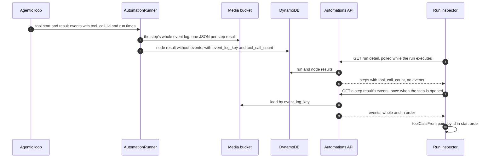

# Automation run inspector

| Field | Value |
| --- | --- |
| Status | 🚧 In progress (built and tested locally; deploy and manual checks pending) |
| Owner | vslala |
| Last reviewed | 2026-11-09 |
| Scope | `api/src/automations/`, `api/src/llm/events.py`, `api/src/agents/agentic_loop.py`, `spa/src/pages/dashboard/automations/run-inspector/` |
| Depends on | [Automations module](../api/docs/LLD-automations-module.md), [Workflow editor redesign](../spa/docs/LLD-automation-workflow-editor-redesign.md) |
| Mockup | [docs/mockups/automation-run-diagnosis.html](mockups/automation-run-diagnosis.html) |

> **Summary:** Diagnosing an automation run meant expanding one step card at a time and reading raw JSON trees,
> and the tool calls an agent made could be paired with the wrong results, listed out of order, and cut at 16,000
> characters. A dedicated, phone-first run page now shows every step and every tool call in the order the agent
> made them, each with its tool, arguments, timings and whole response. Each step's tool calls are kept whole in
> S3 instead of inside DynamoDB items.

## Context and problem

The step card's data panel (`StepDataPanel`) showed a run's input and output as JSON trees, plus two accordions:
"Lifecycle" and "Tool calls". It had five defects:

1. **Results matched to the wrong call.** `runDisplay.getToolCalls` paired a `TOOL_CALL_RESULT` with the oldest
   open `TOOL_CALL_START` of the same tool name. An agent fetching three pages calls the same tool three times,
   so a result could land on another call's arguments. The API already sent `tool_call_id` on both events.
2. **Wrong order.** Calls were listed when their result arrived, and calls without a result were appended at the
   end, so the list was not the agent's sequence.
3. **Wrapper names.** `display_tool_name` / `display_tool_args` (the MCP tool behind `call_mcp_tool`) were
   ignored, so MCP calls all read "Call Mcp Tool".
4. **No timings.** Recorded events carried no timestamps. The tool audit log timed a call from when the model
   asked for it, but the model asks for a turn's tools all at once, so every call after the first looked slower
   than it was.
5. **Truncated and bounded by DynamoDB.** Each recorded tool result was cut at 16,000 characters, because a step's
   output lands in its node-result item and again in the run's context, both under DynamoDB's 400KB item limit.
   34 calls at the cap could already exceed it.

The "Lifecycle" accordion never appeared for automations: only tool events are recorded (`RECORDED_EVENT_TYPES`).

## Goals and non-goals

Goals: every move an agent made in a run is reachable in a couple of taps on a phone; nothing is trimmed (long
values are folded behind "Show all"); pairing and order are exact; each call shows its tool, arguments, start time
and duration; a link can point at one tool call.

Non-goals: recording agent thoughts or lifecycle notices (decided against, to keep logs to tool calls); live tool
calls for an agent step that is still running (results are written when a step finishes, see "Known gaps").

## Design

The run detail stays small enough to poll every 1.5s; a step's log is fetched only when someone opens the step.
Results recorded before the log existed are served from their inline events by the same route.

### Backend

- **Timings.** `SSEEvent` gains `started_at` and `completed_at`. `_Turn.run_tools` (`agentic_loop.py`) stamps them on each
  `TOOL_CALL_RESULT` around the tool's own execution (None for a call skipped while the turn waits for consent);
  `ConsentContinuation._run_approved` does the same for an approved call. `ToolCallAuditLog` now prefers the event's
  `started_at` over the moment it saw the START.
- **Helpers.** `recorded_events` became two functions in `llm/events.py`: `tool_call_events` (filter, whole) and
  `capped_events` (the 16,000-character cap, for a copy that must fit an item). `InvocationHistoryStore` uses
  `tool_call_events` instead of its own duplicate.
- **Event log.** `api/src/automations/event_log.py`. `AutomationRunner._move_events_to_log` runs before each node
  result is saved: it finds the events (`events_holder`: `output.events` for an agent step, `output.result.events`
  for an invoke-agent skill action), writes them to `StepEventLogStore`, and saves the result with the events
  removed, `event_log_key` and `tool_call_count`. The run context is built from the same result, so it no longer
  carries events either. If S3 fails, a capped copy stays inline where the events were and the run continues.
- **Storage.** `ArtifactStorage` (the conversation media bucket) under the owner's member prefix, like tool-job
  results, consent checkpoints and invocation histories. Not the documents bucket, which holds documents only.
- **Route.** `GET /automations/{automation_id}/runs/{run_id}/results/{result_id}/events` (`automations:Get`)
  returns `{"events": [...]}`: the S3 log, or the inline events of a result recorded before logs existed.
  `event_log_key` is never sent to the browser; `tool_call_count` is.
- **Legacy results.** `AutomationRunNodeResult.from_dynamo_item` counts inline tool calls when the item has no
  `tool_call_count`. Nothing is migrated.

### Frontend

- **Route.** `/dashboard/automations/:automationId/runs/:runId` → `run-inspector/RunInspectorPage.tsx`, inside
  `AutomationDetailLayout`. The bare `runs` route still redirects into the workspace drawer.
- **URL state.** `?step=<result_id>&tab=activity|output|input|raw&call=<tool_call_id>`, through
  `useWorkspaceParams` (now also `tab` and `call`).
- **Pairing.** `toolCallsFrom` (`run-inspector/toolCalls.ts`): one call per `tool_call_id`, in order of first START;
  a repeated START refreshes the same call; a RESULT attaches by id. Name order is used only for events with no
  id. Display name and args come from `display_tool_*`, keeping the wrapper for the JSON view.
- **Layout.** Phone first. One column: run summary (status, error, duration, steps passed, tool calls, trigger),
  the steps the run took, then the selected step with sticky tabs. Activity is a timeline: prompt → numbered calls
  (title, tool name, one-line argument summary, status if not succeeded, duration) → reply, with search and filter
  chips (all, failed, no result, each tool). A call opens in a bottom sheet (the shared `Dialog`) with
  previous/next pinned at the bottom; from a 46rem-wide activity area it opens in a sticky side pane instead
  (`useWidthAtLeast`, matched by the `run-activity` container query). From a 64rem page the summary and steps
  become a sticky left column. Breakpoints are container queries.
- **No trimming.** `ExpandableText` folds text over 600 characters or 10 lines behind "Show all · N characters";
  the whole text stays in the DOM. Only list rows use one-line summaries, and the full value is one tap away.
- **Workspace.** `StepDataPanel` keeps input/output and insert-a-smart-value, drops the accordions, and links to
  the inspector ("Inspect N tool calls"). The runs drawer links the selected run. Both links come from the
  optional `WorkspaceOperations.inspectRunHref`, absent in the docs sandbox.

## Data model and contracts

| Field | Where | Meaning |
| --- | --- | --- |
| `started_at`, `completed_at` | `SSEEvent` (TOOL_CALL_RESULT) | When the tool itself ran |
| `event_log_key` | `AutomationRunNodeResult` item | S3 key of the step's log; never in responses |
| `tool_call_count` | item and `AutomationRunNodeResultResponse` | TOOL_CALL_START events in the step |
| `AutomationStepEventsResponse.events` | new route | Recorded events, whole and in order |

## Implementation map

| Area | Code | Responsibility |
| --- | --- | --- |
| Event timing | `api/src/agents/agentic_loop.py`, `api/src/consent/continuation.py`, `api/src/agents/tool_audit.py` | Stamp and use real run times |
| Event helpers | `api/src/llm/events.py` | `tool_call_events`, `capped_events` |
| Step log | `api/src/automations/event_log.py`, `runner.py`, `models.py`, `router.py` | Store, move, count, serve |
| Pairing | `spa/src/pages/dashboard/automations/run-inspector/toolCalls.ts` | Events → ordered tool calls |
| Page | `run-inspector/RunInspectorPage.tsx`, `RunOverview.tsx`, `RunStepPanel.tsx`, `ActivityTimeline.tsx`, `ToolCallDetail.tsx`, `RunsDialog.tsx`, `parts.tsx`, `run-inspector.css` | The inspector |
| Workspace links | `components/StepDataPanel.tsx`, `components/RunsDrawer.tsx`, `AutomationWorkspacePage.tsx` | Into the inspector |

## Rollout and compatibility

No migration and no new settings: the media bucket and the Railway IAM user's access to it already exist. Runs
recorded before this keep their capped inline events and show in the inspector without timings. Deploy the API
before the SPA (the SPA reads `tool_call_count` and the new route).

Behaviour change: a step's `output.events` is no longer in its output or the run context, so a smart value such as
`{{ steps.draft.output.events.0.content }}` no longer resolves. Tool events were never a documented output.

## Validation

- API: `uv run pytest tests/test_automations_event_log.py tests/test_llm_recorded_events.py tests/test_agentic_loop.py tests/test_automations_runner.py tests/test_automations_router.py -q`
  (S3 log written whole, capped fallback when S3 fails, both output shapes, legacy counts, the route and its 404,
  run times on results).
- SPA: `yarn test src/pages/dashboard/automations/run-inspector/toolCalls.test.ts` (out-of-order results, calls
  without results, repeated starts, id-less fallback, wrapper unwrapping, titles, filters, search).
- Manual, pending: a real scheduled run with an agent step on a phone and on desktop; deep links to `?call=`;
  a run whose S3 write fails; an old run recorded before this change.

## Known gaps

- An agent step that is still running shows no tool calls until it finishes: node results are written at the
  end of a step. Live activity would need the runner to append to the log as events arrive.
- Account deletion does not remove automation runs (DynamoDB) today, and so not their S3 logs either. Both belong
  in the account-deletion Lambda.

## Alternatives and decisions

- **Embed the log in the run detail response:** rejected; the detail is polled while a run executes.
- **Key the log by node id:** rejected; a node can run more than once in a run, a result id cannot.
- **Live tool timings from the START event:** rejected; the model requests every tool of a turn before the first
  runs, so START time is request time.
- **Documents bucket:** rejected in favour of the media bucket, where every other per-member tool record lives.

## Related documentation

- [Automations module](../api/docs/LLD-automations-module.md)
- [Workflow editor redesign](../spa/docs/LLD-automation-workflow-editor-redesign.md)
- [Action consent](LLD-action-consent.md)
