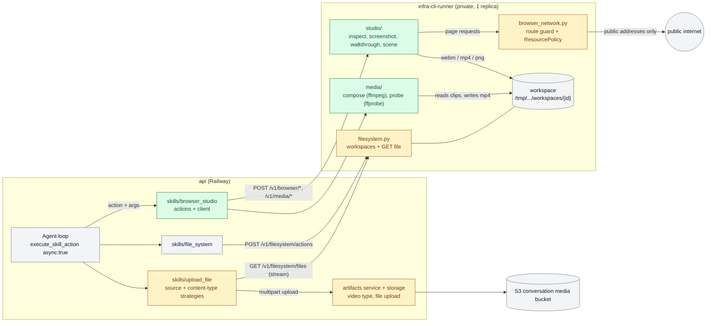
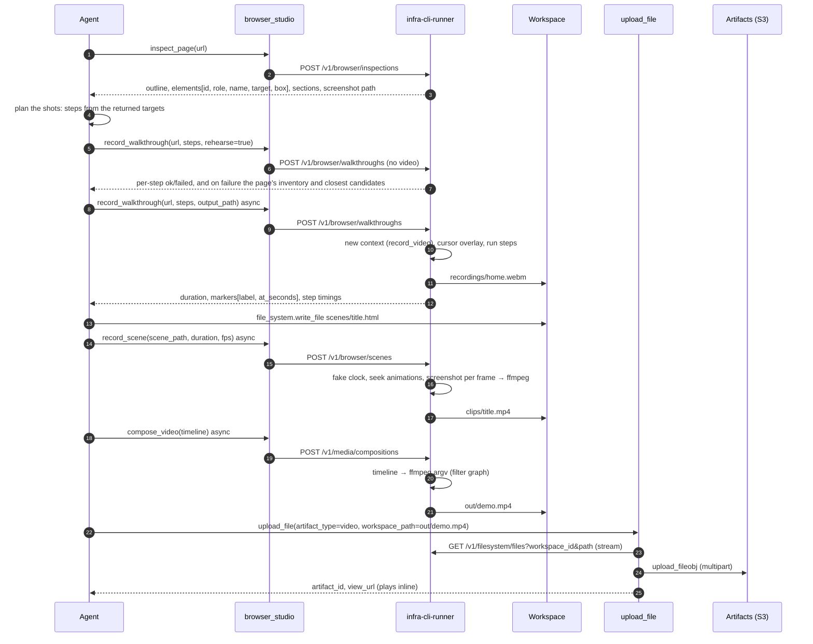

# Browser Studio: record site walkthroughs and motion-graphics videos

| Field | Value |
| --- | --- |
| Status | 🚧 In progress (runner endpoints, the API skill and the video upload built; Railway deploy and Ila's recipe not) |
| Owner | InnomightLabs API + infra-cli-runner |
| Last reviewed | 2026-10-21 |
| Depends on | [infra-cli-runner](../infra-cli-runner/README.md) (browser render, filesystem workspaces), [File System skill](../api/src/skills/file_system/manifest.yml), [Upload File Artifact Skill](../api/docs/LLD-upload-file-artifact-skill.md), [Async Tool Runtime](../api/docs/LLD-async-tool-runtime.md) |
| Tracker | — |

> **Summary:** A new `browser_studio` skill drives the runner's headless Chromium. It can inspect a page (an
> accessibility outline plus an inventory of visible elements, each with a ready-to-use target and position), take
> screenshots, rehearse and then record scripted walkthroughs of public sites, and render agent-authored HTML/CSS/JS scenes frame by frame. A typed
> `compose_video` operation then uses ffmpeg to join the clips, with zooms, transitions, overlays and an audio bed,
> into one MP4. Every file is written into the conversation's existing sidecar workspace, so the File System and
> Python skills can see it. `upload_file` is refactored into two kinds of strategy, *source* (inline text, inline
> base64, workspace file) and *content type* (text, HTML, image, video, binary file). Passing `workspace_path`
> streams a workspace file from the runner into S3 as an artifact, and a new `video` artifact type plays inline.

## Implementation notes

**`inspect_page` runner endpoint (built 2026-10-22).** `POST /v1/browser/inspections` and its tests are in
`infra-cli-runner` (see its README, "Page inspection"). Where it departs from the design below:

- **No `browser_network.py` yet.** `ResourcePolicy`, `RENDER_POLICY` and `STUDIO_POLICY` live in `browser.py`, with
  `BrowserRenderer.studio_page()` (its own `BROWSER_STUDIO_CONCURRENCY` slot, same network guard). Move the guard out
  when the scene origin needs it.
- **`FileSystemService.write_output`** (path, suffix and quota rules, atomic write) replaces the planned
  `output_path` and `commit_output` pair. Recordings that are staged first can add `commit_output` later.
- **`inspect_page` takes `steps`** (up to 30, run like a rehearsal), so it can reach a state such as an open menu.
- **Targets are verified by identity**, not just count: the inventory script keeps its elements in
  `window.__studioCandidates` and each proposed target must resolve to that same element. A target that matches several
  gets `nth`.
- **Lazy content.** Elements that load on scroll are found because inspection scrolls through first, but they do not
  exist in a fresh page. A walkthrough must scroll (`scroll` by pixels) before it targets one. The skill prompt and the
  `scroll` step should say so.
- **`record_walkthrough` runner endpoint (built 2026-10-22):** `POST /v1/browser/walkthroughs`, with the step
  strategies in `studio/steps.py`, `studio/cursor.js`, rehearsal, failure candidates and recording. Departures:
  - `status` is `success` or `partial` only; a run that can't start is an HTTP error (`502` for the page, `400` for a
    path), as for inspection.
  - `StepFailure` also carries `message`, and `page` is a `PageSnapshot` (an inspection without the screenshot). The
    failure `error_code` list gained `workspace_error`.
  - `step_timeout_seconds` (default 10) is a request field, so a rehearsal can fail fast.
  - `FileSystemService.staging_dir`, `commit_output` and `release_staging` are how the video gets from the browser into
    the workspace: staged in the reserved `.runs`, moved into place if the quota allows, then cleaned up.
  - Recording needs no image change: `--only-shell` still installs Playwright's ffmpeg.
  - The video `duration_seconds` is the browser clock's, not probed from the file (no ffprobe in the runner yet).
  - Pydantic doesn't validate defaults, so the env caps (`BROWSER_STUDIO_MAX_RECORD_SECONDS`,
    `BROWSER_STUDIO_MAX_INSPECT_SECONDS`) use `validate_default=True`.
- **The agent loop was run for real (2026-10-22):** two sites, inspected, recorded, joined with title cards, captions and
  zooms into a 21 s advert in 11 calls and about 11.6 KB of traffic. Doing it as the agent found what was missing, built in
  this order:
  - `POST /v1/browser/scenes` with built-in templates (`title`, `outro`, `lower_third`), because writing HTML for every card
    costs far more tokens than `{heading, subheading}`; custom `scene_path` HTML is supported too.
  - `POST /v1/media/compositions` and `POST /v1/media/probes` (`media/compose.py`, a pure filter-graph builder).
    Defaults differ from the sketch above: output is 1280x720 (what recordings are), `fit` is `cover`.
  - Overlays attach to a clip (`clip` + `at`), so an agent never adds up transition overlaps.
  - A `ready` marker and a `box` for scroll steps, so trim and zoom values are copied, not guessed.
  - Recordings were truncated about 3 times in 10 (the browser stops filming a page that doesn't repaint); a one-pixel
    keepalive fixed it (20 of 20). The file is trimmed to the last step by a checked stream copy.
  - Inspection responses were halved (6.7 KB to 3.1 KB): no outline unless asked, sections to h2, no repeated names, no boxes.
  - `ffmpeg` is added to the runner image.
- **The `browser_studio` skill is built (`api/src/skills/browser_studio/`).** Departures from the sketch above:
  - Five actions: `inspect_page`, `record_walkthrough`, `render_scene` (not `record_scene`), `compose_video`,
    `probe_media`. There is no standalone `screenshot`: inspection and the `screenshot` step cover it.
  - **No `models.py`.** The runner validates every request strictly and names the field that is wrong, so the skill
    doesn't repeat its models. `client.py` turns a 422 into `steps.3.target: <reason>` lines (at most five) and passes the
    runner's own messages for a failed page, a missing file or a bad timeline. An agent was shown these against the live
    runner; a dead site and a private address read the same.
  - **The manifest is written by hand, so a contract test guards it** (`infra-cli-runner/tests/test_browser_studio_contract.py`):
    every property, required field and enum it offers must exist on the runner's models. Checked by introducing drift.
  - **Schemas are the per-turn cost**, since recently used actions' schemas are re-rendered into each turn. They are kept
    to about 9.8 KB (steps appear once, not in both `inspect_page` and `record_walkthrough`; only the top level carries
    `additionalProperties: false`), and a test fails above 10 KB.
  - `request_id` and `workspace_id` are filled in last by the client, so an agent can't pick another workspace (tested, and
    seen against the live runner).
  - Each call waits as long as its job can take, plus 45 s (`record_walkthrough`: `max_duration_seconds`; `render_scene`:
    frames at 4 a second; compose 315 s), never over `BROWSER_STUDIO_TIMEOUT_SECONDS` (default 330, in `settings.py` and
    the Railway deploy script). A timeout tells the agent the studio does one job at a time and may be busy.
  - Owner-only and not an automation action, like File System.
- **`upload_file` and the `video` artifact (built, departures from the design below):**
  - Two strategy lists, as designed, but smaller: `sources.py` (`WorkspaceFileSource` when `workspace_path` is set,
    else `InlineContentSource`; one `source_for`) and the existing `validators.py` (now taking an `UploadContent`, with a
    `VideoArtifactValidator`). `mime.py` stays; there is no `content_types.py`. `UploadContent` (`content.py`) is the
    spooled file plus its size.
  - Only `video` is added, as asked: the `image` type and non-UTF-8 inline base64 are left for later. A video must come
    from `workspace_path` (inline is refused with that message).
  - A video is `.mp4`, `.webm` or `.mov`, checked against its first bytes (`ftyp` or the EBML marker), up to 100 MB (other
    types still 10 MB; `max_bytes_for`). Its MIME type comes from the extension and ignores the agent's `mime_type`, since
    a video is served inline.
  - The handler is `async`; the S3 upload and DynamoDB calls run in `asyncio.to_thread`. The runner side is `GET
    /v1/filesystem/files?workspace_id&path` (`FileSystemService.resolve_file`: any regular file, no symlinks, same path
    rules), and the API derives the workspace id from the run, never from arguments. The download is capped while
    streaming, first by `Content-Length`.
  - `ArtifactService.create_artifact` and `ArtifactStorage.put_artifact` accept a file (`upload_fileobj`); `video` is a
    viewable type (the artifact page redirects to the inline link, which plays in the browser) but not a content-proxy
    type. The SPA has the type, label, badge and a "Videos" filter.
- **Still not built:** Ila's recipe for an advert video; the `social_media` publish step that could post it; a check of
  the upload against real S3 and the Railway runner.

## Context and problem

Ila and other agents can already crawl, write files and run Python. They can't produce what a product team uses to
show a product: a short video that moves through the site, zooms in on what matters, and is cut together with
titles and transitions.

What exists today:

| Piece | Where | What it gives us | What's missing |
| --- | --- | --- | --- |
| Headless Chromium | `infra-cli-runner/src/infra_cli_runner/browser.py` | One `BrowserRenderer`, launched lazily. Every page request is intercepted and sent through `outbound.py`, which reaches only public addresses. | Returns HTML only. It blocks images, fonts and media, and offers no steps, no recording and no screenshots. |
| Conversation workspace | `infra_cli_runner/filesystem.py`, `api/src/skills/workspaces.py` | A private directory per (owner, agent, conversation or run), keyed by the 48-hex `workspace_id`. It is shared by the File System and Python skills, with canonical paths, traversal and symlink guards and a quota. | Binary files can be listed and stat'd, but nothing can take their bytes out of the runner. |
| Python execution | `infra_cli_runner/service.py`, `python_policy/sitecustomize.py` | Runs scripts in the workspace. | `subprocess.Popen` and `os.exec*` are blocked by audit hooks, so a script can't run ffmpeg. It is also capped at a 60 s deadline. |
| `upload_file` | `api/src/skills/upload_file/` | Saves generated text as an artifact. | **UTF-8 only, 10 MB, inline content only** (`models.py:to_body_bytes`). It can't take a binary file, and it can't read the workspace. |
| Artifacts | `api/src/artifacts/` | S3 plus DynamoDB. `ArtifactOpenPage` redirects to an inline presigned URL for viewable types. | There is no `video` type. `create_artifact` takes `bytes` only, which means the whole body sits in memory. |

## Goals and non-goals

Goals

1. The agent can **see what is on a page before acting**. It gets a compact list of its interactive elements and
   sections, each with a target that is checked to resolve to exactly one element. It can **rehearse** a
   walkthrough without recording, and when a step fails it is told what the page holds instead.
2. The agent can **record a walkthrough** of a public site from a typed list of steps (go to, click, hover, type,
   scroll, wait, mark, screenshot). A visible cursor and smooth movement make it read as a demo, not a test run.
3. The agent can **author motion-graphics scenes** (title cards, lower thirds, callouts, transitions) as HTML, CSS
   and JS in the workspace, and **render them deterministically** at a fixed fps, whatever the runner's CPU load.
4. The agent can **compose** clips into one MP4 from a JSON timeline (trims, speed, keyframed zoom and pan,
   transitions, overlays, audio) without ever passing ffmpeg arguments.
5. Every output is a **workspace file**, visible through `file_system.list_dir` and `stat`.
6. **`upload_file` takes any file type.** If `workspace_path` is present, the bytes come from the runner.
   Otherwise the skill behaves as it does now. Video artifacts play in the browser.

Non-goals (v1)

- **Logged-in pages.** No cookies, credentials or storage state get into the browser. That needs the secrets vault
  (see [Ila capabilities](LLD-ila-capabilities.md)) and is a later phase.
- **Agent-supplied JavaScript on third-party sites.** There is no `evaluate` step. Agent JS runs only inside its
  own scenes.
- **Voice-over and text-to-speech.** The audio is a workspace file the agent got some other way, for example by
  downloading it with Python.
- **Automation actions.** v1 is chat only (`automation.enabled: false`, like `file_system`). The workspace already
  works for automation runs (`automation_run_id`), so enabling them later is a manifest change.
- **The agent looking at its own frames.** `read_image` reads conversation images, not workspace files. See
  [Open questions](#open-questions).

## Design

### Components



*Green is new, amber is changed and grey is existing. Every file stays in the workspace until `upload_file` streams
it to S3.*

### A full run, end to end



*Inspect, rehearse, record: the agent writes steps only from targets the runner gave it, and fixes them from a
rehearsal before it pays for a recording. Markers from the walkthrough are what the agent uses to trim and time zooms in the timeline, so it never has to
guess where something happened in the clip.*

### Decisions

1. **One skill, six actions: `inspect_page`, `screenshot`, `record_walkthrough`, `record_scene`, `compose_video`,
   `probe_media`.**
   They share a workspace, a runner and a set of limits, and the agent uses them together, so they belong in one
   manifest. Splitting "browser" from "media" would only add a second `load_skill` call to every task.
2. **Typed steps, not scripts.** The runner keeps its rule that it "never accepts shell command strings". A
   walkthrough is a discriminated union of step models, and each kind is one strategy class (see
   [Step strategies](#step-strategies)). Selectors are data (CSS, role plus name, or text), not code.
3. **Two capture modes, because they answer different questions.**
   - *Walkthrough* uses Playwright's `record_video_dir`, in real time. A real site has real timing (network,
     hydration), and it can't be stepped frame by frame. Some dropped frames are acceptable on a page that is
     mostly still.
   - *Scene* is **frame-stepped and deterministic**. `page.clock.install()` fakes `Date`, timers,
     `requestAnimationFrame` and `performance.now`. The runner's own fixed script pauses every
     `document.getAnimations()` and seeks it to `t`. Each frame is a screenshot piped into ffmpeg. A 10 s, 30 fps
     title card comes out identical on a loaded container, which real-time capture cannot promise for motion
     graphics.
4. **Titles and text are scenes, not ffmpeg `drawtext`.** The agent already writes good HTML and CSS (canvases,
   reports). Fonts, layout and easing come from the browser, and ffmpeg needs no fonts. That keeps the compose
   model small.
5. **ffmpeg runs in the runner process, not in Python execution.** The Python sandbox blocks child processes on
   purpose (`sitecustomize.py`). Compose is a typed endpoint whose argv the runner builds from a validated
   timeline, the same way `_python_command_argv` maps operations to argv. ffmpeg runs with
   `-protocol_whitelist file,pipe` and `-nostdin`, so no input can make it fetch a URL.
6. **Workspace files are served to scenes from a fake origin.** `https://scene.studio.invalid/<path>` is fulfilled
   from the workspace through `FileSystemService` path canonicalisation. A scene can therefore use relative URLs
   (`./logo.png`, `./style.css`) and can never read outside its workspace. Every other origin goes through
   `outbound.py`, as rendering does today. `.invalid` can never resolve, so nothing reaches the network for it.
7. **The browser's resource rules depend on the use.** The crawler blocks images, fonts and media because it wants
   text. A recording needs all three. `BLOCKED_RESOURCE_TYPES` becomes a `ResourcePolicy` (`RENDER_POLICY`,
   `STUDIO_POLICY`) passed to the shared route handler. The network guard itself does not change: web sockets
   and service workers stay refused under both.
8. **Recording has its own slot.** `BrowserRenderer` keeps `BROWSER_RENDER_CONCURRENCY=1` for the crawler.
   Studio jobs use a separate `BROWSER_STUDIO_CONCURRENCY=1` semaphore and a separate `MEDIA_COMPOSE_CONCURRENCY=1`,
   so a three-minute recording doesn't stall a crawl. Studio jobs share the one Chromium process but get a new
   context each.
9. **The calls are synchronous to the runner and async to the agent.** The runner holds the request open for the
   length of the job, capped by its own limits. That's fine on Railway's private network, and it avoids building a
   second job system in the runner. The API side runs the actions as async tool jobs (`async: true`), so the chat
   loop never blocks. The skill's `system_prompt` says so, and `client.py` sets the HTTP timeout per call to the
   job's maximum plus a margin.
10. **`upload_file` picks where the bytes come from by which field is present.** There are three source
    strategies, chosen by one function, and exactly one field may be set: `text_content`, `base64_content` or
    `workspace_path`. A workspace file is **streamed** from the runner into a spooled temporary file, then into S3
    with `upload_fileobj`, so a 200 MB video never sits whole in API memory.
11. **What the content is decides how it's validated.** Content-type strategies (text, HTML report, image, video,
    binary file) replace `mime.py` and `validators.py`. Each owns its size limit, its validation and its MIME type.
    Image and video **sniff** the MIME type from magic bytes and ignore `mime_type` overrides, because their
    content is served `inline` from a presigned URL.
12. **The agent discovers before it acts, and the runner hands it the targets.** Raw HTML is far too large for a
    model, and guessed CSS selectors break. `inspect_page` returns the page as the accessibility tree describes it,
    with a target per element (role plus name where that's unique, otherwise a test id, id or CSS path). The runner
    has already checked that each target matches exactly one element. Targets are durable data, not session refs,
    because each recording is a fresh browser context. An ambiguous target fails (`ambiguous_target`, with the
    matches) instead of clicking the first one.

## Data model and contracts

### Skill manifest (`api/src/skills/browser_studio/manifest.yml`)

```yaml
id: browser_studio
namespace: media.browser_studio
owner_only: true
name: Browser Studio
description: Record walkthroughs of public websites, render HTML motion-graphics scenes and compose them into videos.
system_prompt: |
  Files you create here live in the conversation workspace shared with File System and Python Code Execution.
  Paths are workspace-relative. Call record_walkthrough, record_scene and compose_video with async: true.
  Before writing steps, call inspect_page (with steps to reach a state, e.g. an open menu) and copy targets from its
  elements; never invent selectors. Rehearse with record_walkthrough rehearse: true, fix any failed step from the
  returned candidates, then record.
  Walkthroughs: public pages only; no logins. Use mark steps before and after the moments you will zoom on or cut to;
  the result returns each mark's time in the video, and each targeted step's box, which you can use as a zoom focus.
  Scenes: write a self-contained HTML file in the workspace (relative URLs for assets). Drive every animation from
  CSS animations, the Web Animations API, GSAP or requestAnimationFrame timestamps, never wall-clock waits; the
  renderer fakes time and seeks animations frame by frame. Set window.__studioReady = <Promise> if you need to load
  data first. Use a transparent background and webm output for overlays.
  Compose: build a timeline of clips (trim, speed, zoom keyframes, transition_in), overlays and an optional audio bed.
  Use probe_media to read a clip's duration and size before composing, and probe_media with frame_at_seconds to save
  a still for checking.
  When the video is ready, save it with upload_file using artifact_type video and workspace_path.
automation:
  enabled: false
actions:
  - name: inspect_page
    handler: actions:inspect_page
  - name: screenshot
    handler: actions:screenshot
  - name: record_walkthrough
    handler: actions:record_walkthrough
  - name: record_scene
    handler: actions:record_scene
  - name: compose_video
    handler: actions:compose_video
  - name: probe_media
    handler: actions:probe_media
```

Each action's `input_schema` is generated from the Pydantic models below, written out in the manifest (one source of
truth: the runner's models, mirrored in `api/src/skills/browser_studio/models.py` with `extra="forbid"`, as
`file_system/models.py` does). Write `additionalProperties: false` on every object.

### Runner request models (`infra_cli_runner/studio/models.py`)

```python
class Viewport(BaseModel):
    width: int = Field(1280, ge=320, le=1920)
    height: int = Field(720, ge=240, le=1080)
    device_scale_factor: float = Field(1, ge=1, le=2)

class Target(BaseModel):
    """Exactly one way to find an element. Must resolve to one element, or to the nth match when nth is set."""
    model_config = ConfigDict(extra="forbid")
    selector: str | None = Field(None, max_length=512)   # CSS or Playwright selector engine string
    role: str | None = Field(None, max_length=32)         # get_by_role(role, name=name)
    name: str | None = Field(None, max_length=200)
    text: str | None = Field(None, max_length=200)        # get_by_text(text)
    nth: int | None = Field(None, ge=0, le=50)            # pick among several matches, as inspect_page reports them
    # model_validator: exactly one of selector / role / text; name only with role

class GotoStep(BaseModel):     action: Literal["goto"];      url: HttpUrl
class ClickStep(BaseModel):    action: Literal["click"];     target: Target; move_ms: int = Field(600, ge=0, le=3000)
class HoverStep(BaseModel):    action: Literal["hover"];     target: Target; move_ms: int = Field(600, ge=0, le=3000)
class TypeStep(BaseModel):     action: Literal["type"];      target: Target; text: str = Field(max_length=500); delay_ms: int = Field(60, ge=0, le=300)
class PressStep(BaseModel):    action: Literal["press"];     key: str = Field(pattern=r"^(?:(?:Shift|Control|Alt|Meta)\+)*[A-Za-z0-9]$|^(Enter|Tab|Escape|Arrow(Up|Down|Left|Right)|PageUp|PageDown|Home|End|Space)$")
class ScrollStep(BaseModel):   action: Literal["scroll"];    to: Target | None = None; by_pixels: int | None = Field(None, ge=-20000, le=20000); duration_ms: int = Field(1200, ge=0, le=10000)
class WaitStep(BaseModel):     action: Literal["wait"];      ms: int = Field(ge=0, le=15000)
class WaitForStep(BaseModel):  action: Literal["wait_for"];  target: Target; state: Literal["visible", "hidden"] = "visible"; timeout_ms: int = Field(10000, le=30000)
class MarkStep(BaseModel):     action: Literal["mark"];      label: str = Field(pattern=r"^[a-z0-9_-]{1,40}$")
class ShotStep(BaseModel):     action: Literal["screenshot"]; path: str; full_page: bool = False

Step = Annotated[GotoStep | ClickStep | HoverStep | TypeStep | PressStep | ScrollStep | WaitStep
                 | WaitForStep | MarkStep | ShotStep, Field(discriminator="action")]

class WalkthroughRequest(BaseModel):
    request_id: str = Field(min_length=1, max_length=128)
    workspace_id: str = Field(pattern=r"^[a-f0-9]{48}$")
    url: HttpUrl
    steps: list[Step] = Field(max_length=100)
    output_path: str                                  # must end .webm
    viewport: Viewport = Viewport()
    show_cursor: bool = True
    max_duration_seconds: int = Field(120, ge=5)      # clamped to BROWSER_STUDIO_MAX_RECORD_SECONDS (180)
    rehearse: bool = False                            # run the steps with no video: no glide, waits capped at 500 ms;
                                                      # output_path is then optional

class InspectRequest(BaseModel):
    request_id: str; workspace_id: str
    url: HttpUrl
    steps: list[Step] = Field(default_factory=list, max_length=30)   # reach a state first: open a menu, go to a tab
    viewport: Viewport = Viewport()
    scroll_through: bool = True                       # scroll to the bottom and back first, so lazy sections render
    roles: list[str] = Field(default_factory=list)    # narrow the inventory, e.g. ["link", "button"]
    query: str | None = Field(None, max_length=100)   # or only elements whose name contains this
    max_elements: int = Field(80, ge=1, le=200)
    screenshot_path: str | None = None                # default inspect/<n>.png; annotate draws element ids on it
    annotate: bool = False

class SceneRequest(BaseModel):
    request_id: str; workspace_id: str
    scene_path: str                                   # .html in the workspace
    output_path: str                                  # .mp4 (opaque) or .webm (transparent)
    duration_seconds: float = Field(gt=0, le=30)
    fps: Literal[24, 25, 30, 60] = 30
    viewport: Viewport = Viewport(width=1920, height=1080)
    transparent: bool = False                         # requires .webm; VP9 yuva420p

class ScreenshotRequest(BaseModel):
    request_id: str; workspace_id: str
    url: HttpUrl | None = None                        # or
    scene_path: str | None = None                     # exactly one
    at_seconds: float = 0                             # scenes: seek before capture
    output_path: str                                  # .png or .jpg
    viewport: Viewport = Viewport(); full_page: bool = False
```

Responses are compact, like `FileSystemResult`, and carry no bytes:

```python
class Box(BaseModel):
    x: float; y: float; width: float; height: float   # fractions of the viewport (steps) or of the page (inventory)

class PageElement(BaseModel):
    id: str                                           # "e12": stable within one response, matches annotate labels
    role: str; name: str                              # accessible role and name, name cut to 120 chars
    target: Target                                    # verified: resolves to exactly this element
    box: Box; in_first_viewport: bool
    section: str | None = None                        # nearest heading or landmark above it
    state: list[str] = []                             # e.g. ["disabled"], ["expanded"], ["checked"]

class Section(BaseModel):
    heading: str; level: int; target: Target; top: float   # top as a fraction of page height, for scroll steps

class InspectResponse(BaseModel):
    status: Literal["success", "error"]
    final_url: str; title: str
    page_height_px: int
    outline: str                                      # page.locator("body").aria_snapshot(), cut to 12 KB
    elements: list[PageElement]
    sections: list[Section]
    truncated: bool                                   # more elements than max_elements
    screenshot: str | None
    steps: list[StepTiming]                           # when steps were given

class StepTiming(BaseModel):
    index: int; action: str; status: Literal["ok", "failed", "skipped"]
    started_at_seconds: float; ended_at_seconds: float; error: str | None = None
    box: Box | None = None                            # the target's box when the step ran: a ready zoom focus

class WalkthroughResponse(BaseModel):
    status: Literal["success", "partial", "error"]   # partial: a step failed; video up to that point is saved
    output: MediaFile | None                          # {path, size_bytes, duration_seconds, width, height}
    markers: list[Marker]                             # {label, at_seconds}
    steps: list[StepTiming]
    screenshots: list[str]
    final_url: str
    failure: StepFailure | None = None                # what the page held when a step failed
    error_code: str | None = None; message: str | None = None

class StepFailure(BaseModel):
    index: int
    error_code: Literal["not_found", "ambiguous_target", "not_actionable", "timeout", "navigation_failed"]
    candidates: list[PageElement]                     # up to 10: same role, or a name sharing words with the target
    page: InspectResponse                             # inventory at the moment of failure (max_elements 40)
```

### Compose timeline (`infra_cli_runner/media/models.py`)

```python
class ZoomKeyframe(BaseModel):
    at: float = Field(ge=0)                  # seconds into the clip (after trim, before speed)
    duration: float = Field(0.8, gt=0, le=10)
    x: float = Field(ge=0, le=1)             # focus centre, fraction of the frame
    y: float = Field(ge=0, le=1)
    scale: float = Field(ge=1, le=4)         # 1 = no zoom
    ease: Literal["linear", "ease_in_out"] = "ease_in_out"

class Transition(BaseModel):
    kind: Literal["fade", "fadeblack", "dissolve", "wipeleft", "wiperight",
                  "slideleft", "slideright", "smoothleft", "circleopen"]   # ffmpeg xfade names, allowlisted
    duration: float = Field(0.5, gt=0, le=3)

class Clip(BaseModel):
    source: str                              # workspace .webm/.mp4/.png
    start: float = 0; end: float | None = None
    speed: float = Field(1.0, ge=0.25, le=4)
    hold_seconds: float | None = Field(None, le=30)   # images only
    fit: Literal["cover", "contain"] = "contain"
    background: str = Field("#000000", pattern=r"^#[0-9a-fA-F]{6}$")
    zoom: list[ZoomKeyframe] = Field(default_factory=list, max_length=20)
    transition_in: Transition | None = None  # ignored on the first clip

class Overlay(BaseModel):
    source: str                              # transparent .webm or .png
    at: float = Field(ge=0); duration: float | None = None
    x: float = Field(0, ge=0, le=1); y: float = Field(0, ge=0, le=1)   # top-left, fraction of output
    width: float = Field(1, gt=0, le=1)                               # fraction of output width

class AudioBed(BaseModel):
    source: str                              # workspace .mp3/.m4a/.wav/.ogg
    volume: float = Field(0.8, ge=0, le=2)
    fade_in: float = Field(0, ge=0, le=10); fade_out: float = Field(1.5, ge=0, le=10)

class Output(BaseModel):
    path: str                                # .mp4 (H.264 + AAC, yuv420p, +faststart) or .webm
    width: int = Field(1920, le=1920); height: int = Field(1080, le=1080)
    fps: Literal[24, 25, 30, 60] = 30

class CompositionRequest(BaseModel):
    request_id: str; workspace_id: str
    output: Output
    clips: list[Clip] = Field(min_length=1, max_length=40)
    overlays: list[Overlay] = Field(default_factory=list, max_length=20)
    audio: AudioBed | None = None
    # model_validator: total duration <= MEDIA_COMPOSE_MAX_SECONDS (300)
```

`compose.py` is a **pure function** from `CompositionRequest` and probed input metadata to an argv list, so it can
be unit-tested without ffmpeg.

- **Each clip** becomes `trim=start:end,setpts=(PTS-STARTPTS)/speed`, then `scale` and `pad` (for `contain`) or
  `crop` (for `cover`) to the output size, then `fps`, then the zoom filter.
- **Zoom** is `crop=w=iw/S(t):h=ih/S(t):x=X(t):y=Y(t),scale=W:H`. `S`, `X` and `Y` are piecewise expressions built
  from the keyframes: hold the previous value, then smoothstep `3p²-2p³` across `duration`, with the focus clamped
  so the crop never leaves the frame. The zoom is chosen over `zoompan`, which is meant for still images and
  judders on video.
- **Transitions** chain `xfade=transition=<kind>:duration=d:offset=o`. The runner computes the offsets from the
  probed clip durations, so the agent never does that arithmetic.
- **Overlays** are `overlay=x:y:enable='between(t,a,b)'`. A transparent webm input is decoded with
  `-c:v libvpx-vp9`, which keeps its alpha.
- **Audio** is `afade` in and out plus `volume`, trimmed to the video length with `-shortest`. Walkthrough clips
  have no audio track.
- **The flags are fixed:** `-hide_banner -nostdin -y -protocol_whitelist file,pipe`, `-threads 2`,
  `-c:v libx264 -preset medium -crf 20 -pix_fmt yuv420p -movflags +faststart`.

### Page inspection (`infra_cli_runner/studio/inspect.py`)

`inspect_page` is how the agent learns the page. It opens the URL in a studio context (no video), runs any `steps`,
optionally scrolls through, then builds the inventory in two passes.

1. **Collect, in the page.** A runner-owned `studio/inventory.js` (fixed code, never agent input) runs through
   `page.evaluate` and walks the DOM, including open shadow roots. It collects visible elements that a person can act
   on: `a[href]`, `button`, `input`, `select`, `textarea`, `summary`, `[role=button|link|tab|menuitem|checkbox|switch|option]`
   and `[tabindex="0"]`. It also collects `h1` to `h3` and landmarks (`header`, `nav`, `main`, `footer`,
   `[role=region][aria-label]`). "Visible" means a non-zero box, `visibility` not `hidden`, and not inside
   `[aria-hidden=true]`. For each element it returns the tag, an approximate role and name (aria-label,
   aria-labelledby, label, alt, title, placeholder, or the trimmed text), `data-testid`, `id`, a short CSS path, the
   box, and the nearest heading.
2. **Choose and verify a target, in Python.** For each candidate, in order:
   1. `get_by_role(role, name=name, exact=True)` if `count() == 1`.
   2. `[data-testid=…]`, then `#id`, if unique.
   3. `get_by_text(name, exact=True)` if unique.
   4. The CSS path with `nth`.

   An element no target can single out is dropped. The real role and name come from Playwright (`aria_snapshot`
   agrees with what `get_by_role` matches), so the target is what the walkthrough will resolve.
3. **Rank and cut.** Elements in the first viewport come first, then in page order. The inventory is cut to
   `max_elements` after any `roles` or `query` filter, and `truncated` says whether anything was left out.
4. **Outline and screenshot.** `outline` is the accessibility snapshot of `body`, cut to 12 KB. That is a cheap
   overview of the whole page, even when the inventory is truncated. The screenshot goes into the workspace. With
   `annotate`, the runner overlays each element's `id` on its box before the capture, the "set of marks" style, so
   a vision model can line the picture up with the list (see [Open questions](#open-questions)).

Rehearsal (`record_walkthrough` with `rehearse: true`) runs the same step strategies in a context without video.
The cursor doesn't glide and waits are capped, so a 20-step walkthrough rehearses in seconds. A real recording runs
the same checks, so a rehearsal that passes leaves only timing-dependent failures. On any failure, `StepFailure`
returns the page's inventory at that moment and the closest candidates to the missing target. The agent fixes the
step from data, not by guessing again.

Example: the agent wants the pricing page and its "Start free" button.

```json
{"action": "inspect_page", "arguments": {"url": "https://example.com", "roles": ["link", "button"], "max_elements": 20}}
```

```json
{"elements": [
  {"id": "e3", "role": "link", "name": "Pricing", "target": {"role": "link", "name": "Pricing"},
   "box": {"x": 0.62, "y": 0.02, "width": 0.05, "height": 0.02}, "in_first_viewport": true, "section": "navigation"},
  {"id": "e9", "role": "button", "name": "Start free", "target": {"role": "button", "name": "Start free", "nth": 0},
   "box": {"x": 0.41, "y": 0.31, "width": 0.18, "height": 0.05}, "in_first_viewport": true, "section": "Ship agents faster"}
 ],
 "sections": [{"heading": "Features", "level": 2, "target": {"role": "heading", "name": "Features"}, "top": 0.38}]}
```

The steps then copy targets verbatim: `{"action": "click", "target": {"role": "link", "name": "Pricing"}}`,
`{"action": "scroll", "to": {"role": "heading", "name": "Features"}}`.

### Step strategies (`infra_cli_runner/studio/steps.py`)

```python
class StepStrategy(Protocol):
    action: str
    async def run(self, page: Page, step: BaseModel, run: WalkthroughRun) -> None: ...

class ClickStrategy:
    action = "click"
    async def run(self, page: Page, step: ClickStep, run: WalkthroughRun) -> None:
        locator = await run.locate(step.target)        # count()==1 (or nth) else not_found / ambiguous_target
        await locator.scroll_into_view_if_needed()
        await run.cursor.glide_to(locator, step.move_ms)   # page.mouse.move(..., steps=n) along an eased path
        await locator.click()

STEP_STRATEGIES: list[StepStrategy] = [GotoStrategy(), ClickStrategy(), HoverStrategy(), TypeStrategy(),
    PressStrategy(), ScrollStrategy(), WaitStrategy(), WaitForStrategy(), MarkStrategy(), ScreenshotStrategy()]

def strategy_for(step: Step) -> StepStrategy:
    return next(s for s in STEP_STRATEGIES if s.action == step.action)
```

- **`WalkthroughRun`** holds the clock origin, which is `time.monotonic()` taken when the page is created, the
  same moment Playwright starts the video. It also holds the markers, the step timings and the cursor. Times are
  accurate to roughly ±100 ms, which is fine for trimming. The response notes this.
- **The cursor overlay** is a runner-owned `cursor.js` added with `context.add_init_script`. It draws an arrow that
  follows `mousemove`, with a ripple on `mousedown`. Headless capture shows no system cursor, so without this a
  demo has clicks that come from nowhere.
- **Smooth scroll** is a series of `page.mouse.wheel` deltas spread over `duration_ms`, or
  `locator.scroll_into_view_if_needed()` followed by an eased wheel scroll back to centre the target.
- **A failed step** stops the run. The remaining steps are marked `skipped`, the context is still closed (which
  writes the video), and the status is `partial`. The agent can fix the step and record again, or use what it got.
- **The overall deadline** is `max_duration_seconds`. When it's reached, the current step is cancelled and the
  video is kept.

### Scene renderer (`infra_cli_runner/studio/scenes.py`)

```python
SEEK_ANIMATIONS = "t => document.getAnimations().forEach(a => { a.pause(); a.currentTime = t; })"

async def render_scene(page: Page, request: SceneRequest, encoder: FrameEncoder) -> None:
    await page.clock.install(time=0)
    await page.goto(f"{SCENE_ORIGIN}/{request.scene_path}", wait_until="load")
    await page.evaluate("() => Promise.all([document.fonts.ready, window.__studioReady])")  # bounded by a timeout
    frame_ms = 1000 / request.fps
    for index in range(round(request.duration_seconds * request.fps)):
        await page.evaluate(SEEK_ANIMATIONS, index * frame_ms)
        image = await page.screenshot(type="png", omit_background=request.transparent)
        await encoder.write(image)            # ffmpeg -f image2pipe -framerate fps -i - ...
        await page.clock.run_for(frame_ms)
```

- `FrameEncoder` owns one ffmpeg process, started through the runner's existing process-group spawn and kill helpers
  (`CliRunnerService._execute_process` and `_terminate_and_collect`, moved into a shared `processes.py`).
- The budget is about 50 to 100 ms per 1080p screenshot. A 10 s, 30 fps scene (300 frames) takes 15 to 30 s,
  which is why scenes are capped at 30 s and run as async jobs.

### Network and workspace guard (`infra_cli_runner/browser_network.py`)

The `_serve` route handler and `PublicFetcher` move out of `browser.py` unchanged, and gain a policy:

```python
@dataclass(frozen=True)
class ResourcePolicy:
    blocked_types: frozenset[str]
    max_resource_bytes: int
    workspace: Path | None = None            # set for studio contexts; serves SCENE_ORIGIN

RENDER_POLICY = ResourcePolicy(frozenset({"image", "media", "font"}), 10 * MB)
def studio_policy(workspace: Path) -> ResourcePolicy:
    return ResourcePolicy(frozenset(), 25 * MB, workspace)
```

A request to `SCENE_ORIGIN` (`https://scene.studio.invalid`) is answered from
`FileSystemService.resolve_existing(workspace, path)`. That is a new public wrapper around `_path` and
`_validate_existing_components`. The MIME type comes from the file extension. Everything else is unchanged: other
origins go through `outbound`, cookies are neither forwarded nor set, and web sockets and service workers are
refused.

### Writing outputs into the workspace

Two new public methods on `FileSystemService` give studio and media code the same guarantees as `write_file`:

```python
def output_path(self, workspace: Path, raw: str, *, suffixes: set[str]) -> Path:
    """Canonical, inside the workspace, not reserved, parent created, suffix allowed."""

def commit_output(self, workspace: Path, staged: Path, target: Path) -> dict[str, Any]:
    """Quota check on the staged size, then os.replace into place; returns _metadata()."""
```

Recordings are staged in `workspace/.runs/<uuid>/` (already reserved and hidden from listings), then committed.
`.runs` is removed afterwards, as `run_python` does.

### Reading a workspace file's bytes

```
GET /v1/filesystem/files?workspace_id=<48 hex>&path=<workspace-relative>
Authorization: Bearer <CLI_RUNNER_SHARED_TOKEN>
→ 200 FileResponse (Content-Length, Content-Type from extension)
→ 404 {error_code: "not_found"} | 400 {error_code: "invalid_path" | "not_a_file"}
```

It uses the same canonicalisation as `read_chunk`, but without the binary check or the read cap. The caller enforces
the size, by checking `Content-Length` first and then counting bytes as they arrive.

### `upload_file` refactor

```
api/src/skills/upload_file/
  manifest.yml       + workspace_path; artifact_type adds image, video
  models.py          UploadFileRequest: exactly one of text_content | base64_content | workspace_path
  sources.py         NEW  where the bytes come from
  content_types.py   NEW  what the bytes are (replaces mime.py + validators.py)
  actions.py         async: request → source → content type → ArtifactService.create_artifact_from_file
```

```python
@dataclass
class ArtifactBody:
    file: SpooledTemporaryFile[bytes]        # max_size=8 MB in memory, then disk
    size_bytes: int
    head: bytes                              # first 4 KB, for sniffing

class BodySource(Protocol):
    def applies(self, request: UploadFileRequest) -> bool: ...
    async def read(self, request: UploadFileRequest, context: dict[str, Any], max_bytes: int) -> ArtifactBody: ...

class InlineTextBody:        # applies when text_content is set; max_bytes = min(type limit, 10 MB)
class InlineBase64Body:      # applies when base64_content is set; no UTF-8 requirement any more
class WorkspaceFileBody:     # applies when workspace_path is set; streams GET /v1/filesystem/files
    async def read(self, request, context, max_bytes):
        workspace_id = workspace_id_from_context(context)
        async with httpx.AsyncClient(timeout=settings.cli_runner_file_timeout_seconds) as http:
            async with http.stream("GET", f"{base}/v1/filesystem/files",
                                   params={"workspace_id": workspace_id, "path": request.workspace_path},
                                   headers=auth) as response:
                raise_for_runner_error(response)
                if int(response.headers.get("content-length", 0)) > max_bytes:
                    raise ValueError(f"{request.workspace_path} is larger than {max_bytes // MB} MB")
                return await spool(response.aiter_bytes(), max_bytes)   # counts as it reads

BODY_SOURCES: list[BodySource] = [InlineTextBody(), InlineBase64Body(), WorkspaceFileBody()]

def source_for(request: UploadFileRequest) -> BodySource:
    return next(source for source in BODY_SOURCES if source.applies(request))
```

```python
class ArtifactContentType(Protocol):
    artifact_types: frozenset[ArtifactType]
    max_bytes: int
    def mime_type(self, request: UploadFileRequest, body: ArtifactBody) -> str: ...
    def validate(self, request: UploadFileRequest, body: ArtifactBody) -> ArtifactBody: ...

class TextContent:        # csv, markdown, json, text, code: UTF-8 decode check; today's MIME rules (mime.py)
class HtmlReportContent:  # html_report: extract_html_document + validate_safe_report_html; text/html
class ImageContent:       # image: sniff PNG/JPEG/GIF/WEBP magic, sniffed MIME, override ignored; 20 MB
class VideoContent:       # video: sniff MP4 ('ftyp' at offset 4) / WebM (1A 45 DF A3), sniffed MIME; 200 MB
class BinaryFileContent:  # file: any bytes; mimetypes.guess_type(filename) or override or application/octet-stream; 50 MB

CONTENT_TYPES: list[ArtifactContentType] = [TextContent(), HtmlReportContent(), ImageContent(),
                                            VideoContent(), BinaryFileContent()]

def content_type_for(artifact_type: ArtifactType) -> ArtifactContentType:
    return next(c for c in CONTENT_TYPES if artifact_type in c.artifact_types)
```

```python
async def upload_file(arguments, config, context) -> dict[str, Any]:
    request = _validate_request(arguments)
    content = content_type_for(request.artifact_type)
    body = await source_for(request).read(request, context, content.max_bytes)
    body = content.validate(request, body)
    artifact = ArtifactService().create_artifact_from_file(..., mime_type=content.mime_type(request, body),
                                                           file=body.file, size_bytes=body.size_bytes,
                                                           source=ArtifactSource(..., metadata={**request.metadata,
                                                               **({"workspace_path": request.workspace_path}
                                                                  if request.workspace_path else {})}))
    return {...}                              # unchanged response shape
```

- **A behaviour change, on purpose:** `artifact_type: file` with `base64_content` now accepts any bytes. Today it
  rejects non-UTF-8 content. Text types keep rejecting it, through `TextContent.validate`.
- **Naming:** the strategies are `BodySource`s, because `artifacts/models.py` already has an `ArtifactSource`
  (provenance) model, which `upload_file` keeps filling as it does today.

### Artifacts

- `artifacts/models.py`: `ArtifactType` gains `"video"`.
- `artifacts/service.py`:
  - Add `"video"` to `VIEWABLE_ARTIFACT_TYPES` but not to `CONTENT_PROXY_ARTIFACT_TYPES`. `ArtifactOpenPage`
    already redirects to an inline presigned URL, and browsers play MP4 and WebM from it with range requests, so
    the SPA needs no player.
  - Add `create_artifact_from_file(..., file, size_bytes)`. `create_artifact(body: bytes)` becomes a thin wrapper
    around `BytesIO`, so both go through one path.
- `artifacts/storage.py`: `put_artifact_file(key, file, content_type)` uses `client.upload_fileobj` with
  `ExtraArgs={"ContentType": ...}`, which switches to multipart above 8 MB.
- SPA:
  - `services/artifacts/ArtifactApiService.ts`: add `"video"` to `ArtifactType`.
  - `pages/dashboard/artifactLibrary.ts`: label `video: "Video"`, badge `VID`, and MIME badges
    `video/mp4 → MP4`, `video/webm → WEBM`.

## Implementation map

| Area | Code | Responsibility |
| --- | --- | --- |
| Runner network guard | `infra-cli-runner/src/infra_cli_runner/browser_network.py` (new, from `browser.py`) | `PublicFetcher`, route handler, `ResourcePolicy`, scene origin |
| Runner render | `infra_cli_runner/browser.py` | Unchanged behaviour on `RENDER_POLICY`; shared `launched()` browser |
| Runner studio | `infra_cli_runner/studio/{models,steps,walkthrough,scenes,screenshot}.py`, `studio/cursor.js` | Step strategies, rehearsal and recording, frame-stepped scenes |
| Runner inspection | `infra_cli_runner/studio/inspect.py`, `studio/inventory.js` | Element inventory, verified targets, outline, annotated screenshot, failure candidates |
| Runner media | `infra_cli_runner/media/{models,compose,probe}.py` | Timeline → argv (pure), ffprobe metadata, still frames |
| Runner processes | `infra_cli_runner/processes.py` (moved from `service.py`) | Process-group spawn, deadline, kill; shared by Python and media |
| Runner filesystem | `infra_cli_runner/filesystem.py` | `output_path`, `commit_output`, `resolve_existing`; `GET /v1/filesystem/files` |
| Runner routes | `infra_cli_runner/router.py` | `POST /v1/browser/{inspections,screenshots,walkthroughs,scenes}`, `POST /v1/media/{compositions,probes}`, `GET /v1/filesystem/files` |
| Runner image | `infra-cli-runner/Dockerfile.railway` | `apt-get install ffmpeg`; `playwright install --with-deps --only-shell chromium` (unchanged; ffmpeg comes from apt) |
| Skill | `api/src/skills/browser_studio/{manifest.yml,actions.py,client.py,models.py}` | Thin client, as `file_system`; audit log line per action |
| Upload | `api/src/skills/upload_file/{models,sources,content_types,actions}.py`, `manifest.yml` | Strategies; delete `mime.py`, `validators.py` |
| Artifacts | `api/src/artifacts/{models,service,storage}.py` | `video` type, file upload path |
| Settings | `api/src/config/settings.py` | `browser_studio_timeout_seconds` (330), `cli_runner_file_timeout_seconds` (120) |
| SPA | `spa/src/services/artifacts/ArtifactApiService.ts`, `spa/src/pages/dashboard/artifactLibrary.ts` | `video` type, labels and badges |
| Docs | `api/docs/LLD-upload-file-artifact-skill.md`, `infra-cli-runner/README.md`, `api/src/skills/AGENTS.md` | Record the refactor, new endpoints, skill list |

Playwright's video recorder needs its own ffmpeg build. Check whether the `--only-shell` install already has it.
If not, add `ffmpeg` to the `playwright install` line. That build only encodes VP8, which is why compose uses the
apt `ffmpeg`.

### Runner environment variables

| Variable | Default | Meaning |
| --- | --- | --- |
| `BROWSER_STUDIO_CONCURRENCY` | `1` | Recordings, scenes and screenshots at once |
| `BROWSER_STUDIO_MAX_RECORD_SECONDS` | `180` | Walkthrough cap |
| `BROWSER_STUDIO_MAX_SCENE_SECONDS` | `30` | Scene cap |
| `MEDIA_COMPOSE_CONCURRENCY` | `1` | ffmpeg composes at once |
| `MEDIA_COMPOSE_MAX_SECONDS` | `300` | Output length cap |
| `MEDIA_COMPOSE_TIMEOUT_SECONDS` | `300` | Wall-clock deadline for one compose |
| `FILE_SYSTEM_WORKSPACE_QUOTA_BYTES` | `100 MB` → set `500 MB` in prod | Raw recordings are 5 to 20 MB a minute |

All new variables are added to `scripts/deploy_prod_railway.sh`, as `BROWSER_RENDER_*` were.

## Rollout and compatibility

1. **Runner first.** Ship the network refactor (no behaviour change, and the render tests prove it), then the
   studio, media and file-download endpoints, the `ffmpeg` image layer and the raised quota. Bump the Railway
   service to at least 2 vCPU and 4 GB, because 1080p screenshots and x264 are CPU-bound.
2. **`upload_file` refactor and the `video` type.** This is compatible: the existing `text_content` and
   `base64_content` calls behave the same, apart from the intended relaxation for `file`. Update the upload-file LLD
   in the same change.
3. **The `browser_studio` skill.** Install it on Ila and on internal agents first.
4. **Optional:** add a Kit or blueprint recipe for Ila ("product demo video": crawl, plan the shots, record, scenes,
   compose, upload).

**Workspaces are ephemeral.** They live in the runner's `/tmp`, so a redeploy clears them. The system prompt tells
the agent to upload the finished video. Durable storage for intermediates is not in scope.

## Validation

Runner (`uv run python -m unittest discover -s tests -v`; browser tests skip without Chromium, media tests skip
without ffmpeg):

- `test_browser_network.py`:
  - The render policy blocks images; the studio policy fetches them through `outbound`.
  - A scene-origin request for `../x` or a symlink escape gets a 404.
  - A localhost URL is still refused under both policies.
- `test_studio_inspect.py`, against a fixture page with a nav, two "Start free" buttons, a lazy section, a shadow-DOM
  button and an `aria-hidden` link:
  - Every returned target resolves to exactly its element.
  - The duplicate buttons get `nth`.
  - The hidden link is absent, the lazy section appears with `scroll_through`, and the shadow button is found.
  - `roles`, `query` and `max_elements` filter and set `truncated`.
  - `annotate` doesn't change the page's inventory.
- `test_studio_walkthrough.py`, against a local fixture page served by a fake `fetch`:
  - Rehearsal writes no video. A click on a renamed button fails with `not_found`, and the candidates include the new
    name. `{text: "Start free"}` fails with `ambiguous_target`.
  - Click, type and scroll run in order, and the markers increase.
  - A missing selector gives `partial`, a saved `.webm` and the remaining steps `skipped`.
  - The deadline is honoured.
  - The output passes the quota check, and `.runs` is cleaned up.
- `test_studio_scene.py`: a CSS animation that moves a box 0 → 100 px over 1 s, rendered at 10 fps, puts the box at
  the expected position in frame 5 (pixel probe on the PNG). The same scene rendered twice gives identical frames.
- `test_media_compose.py`:
  - Golden argv for a two-clip timeline with zoom, xfade, overlay and audio, with no ffmpeg needed.
  - Every argv contains `-protocol_whitelist file,pipe`.
  - Paths outside the workspace are rejected.
  - With ffmpeg present, a 2 s compose gives an MP4 whose ffprobe duration is within 0.1 s.
- `test_filesystem.py`: `GET /v1/filesystem/files` returns the bytes with `Content-Length`, a traversal gets a 400,
  and a missing token gets a 401.

API (`uv run pytest tests/ -q -k "upload_file or browser_studio or artifact"`):

- `source_for` and `content_type_for` select correctly, and two body fields set at once are rejected.
- A workspace source streams from a mocked runner (`httpx.MockTransport`). An oversized `Content-Length` is
  refused before any bytes are read, and a lying `Content-Length` is caught by counting.
- Video sniffing accepts MP4 and WebM, rejects HTML named `.mp4`, and ignores a `mime_type` override.
- A binary `file` passes; a binary `text` fails.
- `create_artifact_from_file` with moto: multipart for 20 MB, and the object's content type is set.
- The existing `test_upload_file*` tests pass unchanged.

Manual: record a walkthrough of `https://innomightlabs.com`, render a title scene and compose 20 to 30 s with one
zoom and a fade. Upload it, open the artifact page, and check that it plays and seeks.

## Alternatives and decisions

| Option | Why not (for v1) |
| --- | --- |
| Compose in Python execution with PyAV | No new binary, but it is slow, the agent writes fragile encoding code, and it is capped at 60 s. A typed timeline is something the agent gets right. |
| Remotion (React) renderer | Very capable, but it means Node in the runner, a large image and licence terms to check. HTML scenes plus frame stepping cover titles and callouts. |
| Real-time recording for scenes | It drops frames under load, so the motion would stutter. |
| Send the page HTML or the full accessibility tree to the model | Tens to hundreds of KB per page, and the model still has to write selectors that may not be unique. A verified inventory plus a 12 KB outline is enough to plan. |
| Ephemeral element refs (Playwright MCP style, `ref=e12`) | Refs live only in one browser session, and each recording is a fresh context. Refs would also tie us to Playwright's private snapshot API. Verified targets are durable. |
| Vision only (screenshot and click by coordinates) | Needs the agent to see workspace images, which isn't possible yet, and coordinates break with layout shifts. Kept as a complement through `annotate`. |
| Raw Playwright scripts from the agent | Breaks the runner's "typed operations only" rule, and agent JS would run on third-party pages. |
| A separate `upload_video` skill | Duplicates the artifact plumbing. Source and content-type strategies make `upload_file` the one way in. |
| Runner-side job queue | Async tool jobs already keep the agent loop free, and one replica with semaphores is enough at this volume. |

## Open questions

1. **Seeing frames.** Should `read_image` accept a `workspace_path`, so the agent can look at an annotated
   `inspect_page` screenshot (and so judge layout and what's worth showing, not just what's clickable) or a
   `probe_media` still before uploading? It would close the quality loop, but it widens the read_image design
   ([LLD](LLD-image-input-and-read-image-tool.md)).
2. **Logged-in recordings (phase 2).** These would use `fill_secret` steps and a storage state resolved from the
   secrets vault by the API, never by the model.
3. **Background music.** Do we bundle a small set of licence-free beds in the image, so the agent doesn't have to
   find audio?

## Related documentation

- [infra-cli-runner README](../infra-cli-runner/README.md)
- [Upload File Artifact Skill](../api/docs/LLD-upload-file-artifact-skill.md)
- [Canvas artifacts](../api/docs/LLD-canvas-artifacts.md): the same HTML authoring habits the scenes rely on
- [Async Tool Runtime](../api/docs/LLD-async-tool-runtime.md)
- [CLI executor skill architecture](../api/docs/LLD-cli-executor-skill-architecture.md)
- [Social cross-posting](LLD-social-cross-posting.md): where a finished video could be published next
