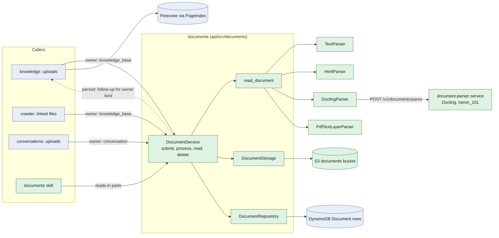
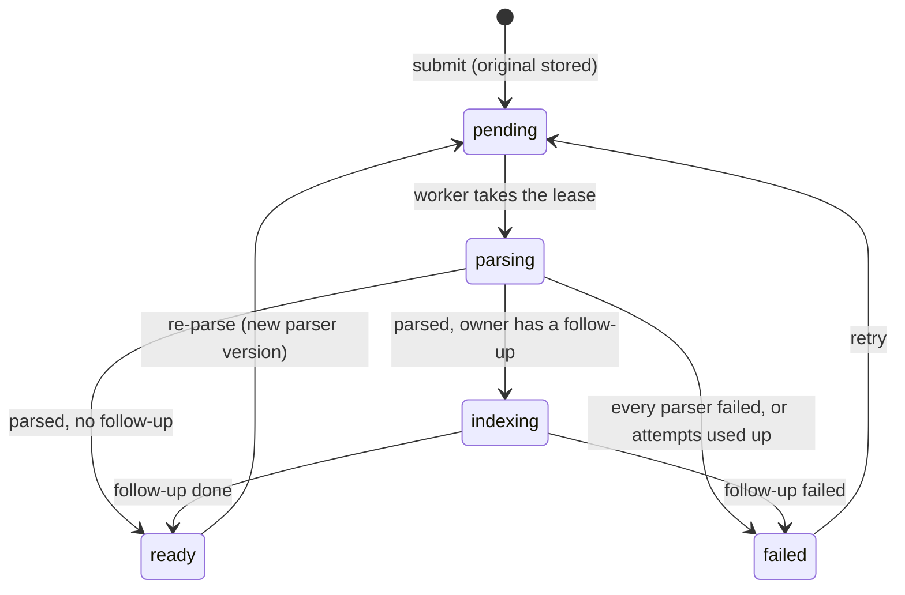
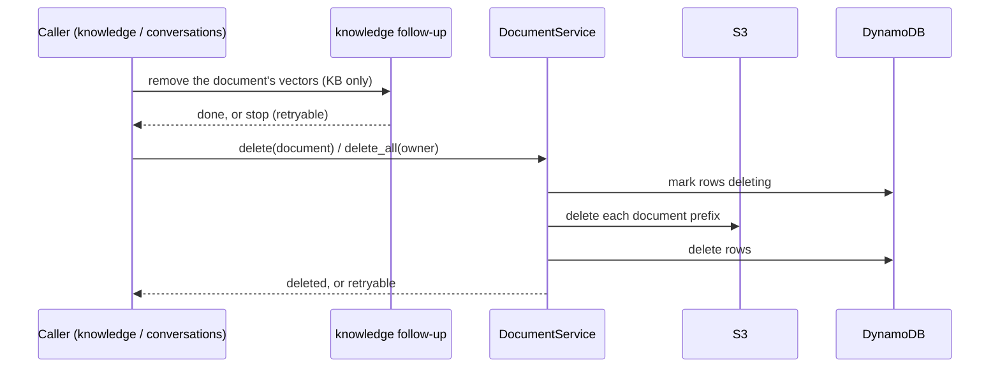
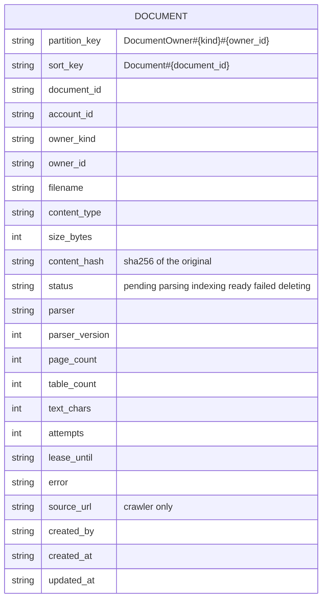

# LLD: Documents: reading, storing and serving files for knowledge bases, conversations and agents

| Field | Value |
| --- | --- |
| Status | 🚧 In progress: phases 1–7 built and tested locally; not yet deployed (see Implementation notes) |
| Owner | InnomightLabs API |
| Last reviewed | 2026-10-24, against the working tree (`main`) |
| Depends on | [LLD-shared-accounts-and-iam.md](LLD-shared-accounts-and-iam.md) (shares, `RESOLVERS`), [LLD-image-input-and-read-image-tool.md](LLD-image-input-and-read-image-tool.md) (vision model for page images) |
| Tracker | — |

> **Summary:** Users and agents bring files: payslips, invoices, statements, contracts, Office files, scans. Today a
> knowledge base accepts only text files, reads them synchronously and keeps nothing but chunks. This design adds one
> **`documents` module**: a caller hands it a file and an **owner** (a knowledge base or a conversation), and it stores
> the original, parses it in the background (Docling in a private parsing service, with the PDF text layer as a
> fallback), stores the parsed output in S3, and records it in DynamoDB. Knowledge bases add their own step on top
> (chunk, embed, index in Pinecone); conversations don't. Agents read stored documents in parts through a skill.
> Deletion runs in reverse: vectors (by their owner), then S3, then DynamoDB.

## Implementation notes

Built 2026-10-24 (all seven phases, tested against moto and fakes; not deployed). Where the build departs from the
design below, the design sections are left as proposed and this table says what was built.

| Design said | Built | Why |
| --- | --- | --- |
| A separate `document-parser/` Railway service with `DOCUMENT_PARSER_BASE_URL` / `_SHARED_TOKEN` (3.2) | `POST /v1/documents/parse` in **`infra-cli-runner`**, called with the existing `CLI_RUNNER_BASE_URL` / `CLI_RUNNER_SHARED_TOKEN`; only `DOCUMENT_PARSER_TIMEOUT_SECONDS` is new on the API | One private sidecar for typed operations (it already renders pages for the crawler); no new service, token or deploy step |
| The service returns `page_images` | It returns `pages: [{page, markdown, png_base64}]`: each page's Markdown (`export_to_markdown(page_no=n)`) and its render | `read_pages` needs page-level text; the text-layer parser fills the same field from `pypdf` pages |
| `lease_until` timestamp | `lease_expires_at`, epoch seconds | DynamoDB conditions compare numbers; no string-format coupling |
| Crawler submits linked files as documents owned by the KB (3.8) | The crawler reads a linked PDF/Office file with `read_document` **inside the crawl** (`crawler/extractor.py`) and indexes it as the `KnowledgePage` at its URL; no `Document` row, nothing stored in S3 | The crawl's page ledger already owns freshness and gone-detection for every URL it reads; a document follow-up indexing the same URL would race the crawl's removal sweep. Cost: `view_page`/`read_table` aren't available for crawled files (search is) |
| Existing uploads also write `ContentUpload` (6) | New uploads write only the `Document`; `GET .../uploads` stays for the history | One record per upload |
| Re-parse script for an older `PARSER_VERSION` (3.4) | `PARSER_VERSION` is saved on each row; no script yet | Nothing to re-read until a parser changes |
| — | Upload rate limit: 200 per account per hour across owners (`documents/uploads.py`), size cap `DOCUMENT_MAX_BYTES` (25 MB) checked while reading the upload | P8 |
| — | `vision.analysis.ImageReader.look_at` reads an image that isn't a chat attachment (a page) with the account's vision model; `_look` now shares `_ask` with it | `view_page` |
| — | The skill's conversation owner uses the agent's account (`account_id` in the skill context); the upload route uses the conversation's | They are the same account for dashboard chats; documents of a conversation started in another account than its agent's would not be found by the skill |
| — | Found with a real spreadsheet (2026-10-25): Docling tables are compacted (`compact_tables`, `PARSER_VERSION` 2); a retry after only the follow-up failed resumes from the stored reading; the worker renews its lease every third of it (`DocumentRepository.renew`) so a long index isn't handed to a second worker | A 68 KB xlsx was 298k characters of padded Markdown, Bedrock throttled, and indexing 215 chunks outlasted the 10-minute lease |
| — | Shared fixes outside `documents/`: the hierarchical chunker splits a large Markdown table into row groups under its header and caps the overview and the overlap for tables (`READER_VERSION` 3); `knowledge_base_search` shows up to 2,000 characters per hit and marks hits from uploaded files as documents to read whole; Ollama embeds in batches of 16; internal reapers get a misfire grace equal to their interval | The whole table was one 166k-character chunk, search showed the agent 500 characters of it, one Ollama request for every chunk timed out, and APScheduler's 1 s grace skipped reapers that started late |
| — | Bounded reading (2026-10-25): parsers fill `ParsedDocument.outline` (`outline_from_markdown`, with pages), storage keeps `outline.json` (headings, pages with little text, per-table rows and columns), and `PARSER_VERSION` is 3. The service gained `describe`, `read_section`, `read_pages` (30,000-character cap with `next_page`), ranked `search` (passages with context and section), and `describe_table` / `read_table` (paged) / `query_table` (filter, group, aggregate; `documents/tables.py`). The skill's `read_table` no longer returns the whole table | An agent asking about one player's runs in a 17,000-row sheet was handed every row. A document read before outlines were kept still has its headings (found in the Markdown) and no weak pages |
| A Documents **skill**, installed on the agent (3.7) | The same manifest and actions as **core tools** (`core: true`), offered by the `DOCUMENT` tool family when the conversation references a document or a knowledge base is linked; documents sent in chat are message references (`<attached_document>`) | [LLD-message-references-and-tool-families.md](LLD-message-references-and-tool-families.md): the agent is told a file arrived, and needs no install or `load_skill` round trip |

Still to do before calling it done: deploy (Terraform `documents.tf`; the Railway API's IAM user already has full S3
access, so the bucket needs no grant; the runner image with Docling), a manual pass with real payslips through the deployed runner, and the wiki copy of this
table.

## 1. Context and problem

What exists (2026-10-24):

- `POST /knowledge-bases/{kb_id}/content-upload` ([`api/src/knowledge/router.py`](../api/src/knowledge/router.py))
  accepts only the text extensions of message attachments (`messages/models.py` `ALLOWED_EXTENSIONS`), up to 5 MB,
  decodes them as UTF-8, and indexes them **inside the request** through `KnowledgeBaseService.ingest_text_content`
  (`crawler/page_index.py` `PageIndex`). The original file is not kept. A PDF is refused.
- A knowledge base is deleted whole ([`knowledge/service.py`](../api/src/knowledge/service.py) `soft_delete`): Pinecone
  namespace first (stop if that fails), then chunks and pages, links, shares, then the KB is marked `DELETED`. There is
  no per-file delete.
- `web_pages/` reads only HTML (`readable()`), so the crawler skips PDFs a site links to.
- Conversations take images (`vision/`) but no documents. Conversation media lives in the conversation media bucket
  under `agents/{agent_id}/conversations/{conversation_id}/`, removed with the conversation
  (`conversations/router.py` `delete_conversation`).

The Docling trial (`developer-manual/docling-parsing/`, 51 real files) found:

| Kind | Quality |
| --- | --- |
| Text PDFs (statements, contracts, receipts, Atlassian payslips) | Good: text complete, tables right cell by cell. Loose label/value text is sometimes paired wrongly. |
| Decorated PDFs (Amazon/ADP payslips) | The default layout model reads the page as one picture and drops all text. `heron_101` recovers most; some still collapse. The PDF's own text layer has everything. |
| Photos and scans | OCR reads them (parking ticket, penalty notice). |
| App screenshots | Poor: large UI text on dark backgrounds is read as images. |
| Speed | 1–35 s for most files, 152 s for a 28-page PDF, about 18 s of model load per process. |

So: parse in the background, outside the API process; never trust one reading alone; keep the original and the
structured output so an agent can look again.

## 2. Goals and non-goals

Goals:

1. One way to read a file (P1), used by knowledge bases, conversations, the crawler and skills.
2. Parsing runs in a private, isolated service (P2) and in the background with visible status (P3).
3. The original and every parsed output are stored and recorded (P4), so they can be re-read, re-parsed and audited.
4. One pipeline whose last stage the owner chooses: knowledge bases index, conversations stop after parsing (P5).
5. Deleting a document, a knowledge base or a conversation leaves nothing behind (P6).
6. Agents read documents in parts: Markdown ranges, tables, page images (P7).
7. Crawled sites' linked files are read like uploads (P9).

Non-goals (for now): editing documents; a vision-model parser for screenshots (a later parser, section 3.1); sharing
conversations (the design keeps it possible, section 3.6); plan-based limits beyond one size and page cap (P8 is the
caps below plus encryption and access, nothing per plan yet).

## 3. Design



Green is new, blue exists. The dotted edge is the only place owner kinds differ: what happens after parsing.

### 3.1 The reader (P1, built)

`read_document(data, filename) -> ParsedDocument` asks every parser that supports the file and keeps the best reading.

```python
class DocumentParser(Protocol):
    name: str
    def supports(self, filename: str) -> bool: ...
    async def parse(self, data: bytes, filename: str) -> ParsedDocument: ...
```

- Parsers, richest first (`default_parsers()`): `TextParser` (code, Markdown, CSV), `HtmlParser`
  (`web_pages.fragment_to_markdown`), `DoclingParser` (PDF, DOCX, PPTX, XLSX, images; only when the service is
  configured), `PdfTextLayerParser` (`pypdf`).
- **The first reading wins unless a later one holds more than `MORE_TEXT_FACTOR` (2) times its text**
  (`ParsedDocument.text_chars`: letters and digits, without image links and table padding). This is what rescues the
  decorated payslips: Docling's near-empty reading loses to the text layer.
- A parser that fails raises `DocumentReadError` and is skipped; the read fails only when every parser did.
- A new kind of file (a vision parser for screenshots, an email parser) is a new parser class, nothing else.

### 3.2 The parsing service (P2)

A private Railway service, `document-parser/` at the repository root, beside `infra-cli-runner/`. It is the
`developer-manual/docling-parsing/parse_documents.py` conversion behind one route.

- `POST /v1/documents/parse`, multipart `file`, `Authorization: Bearer <DOCUMENT_PARSER_SHARED_TOKEN>`.
- Answers the contract `DoclingParser` already reads, plus page images:

```json
{
  "markdown": "…",
  "page_count": 1,
  "tables": [{"page": 1, "rows": [["Net pay", "5,608.87"]]}],
  "structured": {"…": "Docling's lossless JSON"},
  "page_images": [{"page": 1, "png_base64": "…"}]
}
```

- Docling options: `heron_101` layout model, OCR on, table structure on, page images at scale 2.0.
- One converter per process, loaded at start (the 18 s model load is paid once). A semaphore bounds concurrent
  conversions (`DOCUMENT_PARSER_CONCURRENCY`, default 2); a request over a page cap (`DOCUMENT_PARSER_MAX_PAGES`,
  default 100) is refused with 413 before conversion.
- It holds no state and no credentials: file in, reading out. It is reachable only on the private network.
- `scripts/deploy_prod_railway.sh` deploys it like the CLI runner: generates the shared token and sets
  `DOCUMENT_PARSER_BASE_URL` / `DOCUMENT_PARSER_SHARED_TOKEN` on the API.
- `ParsedDocument` gains `page_images: list[PageImage]` (bytes, page). The text and HTML parsers return none.

Why a separate service: Docling brings torch, a model load and up to minutes per file, and it parses untrusted input.
In the API it would slow every deploy, hold memory in every replica and share a process with requests.

### 3.3 Storage (P4)

**DynamoDB: the ledger.** One `Document` row per document, in its owner's partition:

```text
pk = DocumentOwner#{owner_kind}#{owner_id}      e.g. DocumentOwner#knowledge_base#kb_123
sk = Document#{document_id}
```

The owner's partition lists its documents in one query, which is what deletion and the skill need. The key holds the
owner's id only, never the uploader or the conversation's member partition (section 3.6).

**S3: the content.** A new private bucket, `innomightlabs-documents` (Terraform: SSE, public access blocked,
versioning **disabled** so a delete is final):

```text
{account_id}/{owner_kind}/{owner_id}/{document_id}/
  original/{safe_filename}
  document.md
  structured.json        (Docling only)
  tables/{n}.csv
  pages/{n}.png          (Docling only)
```

One prefix per document makes delete a prefix delete. A separate bucket, not the conversation media bucket, because
knowledge-base documents live as long as the knowledge base, payslips and statements want their own access policy,
and the media bucket's lifecycle rules (pending-image expiry) are written for images.

### 3.4 Lifecycle and the background worker (P3, P5)



`submit` stores the original and writes the row as `pending`, then launches `process` the way crawls are launched
(`knowledge/crawl_launch.py` `launch_crawl`: `BackgroundTasks` from a request, a task on the loop from a tool call).

`process(document)`:

1. Take the lease with a conditional update (`status IN (pending, parsing)` and `lease_until < now`); another worker
   holding it means stop.
2. Read the original from S3, call `read_document`.
3. Write `document.md`, `structured.json`, `tables/*.csv`, `pages/*.png`; save the reading's summary on the row
   (`parser`, `parser_version`, `page_count`, `table_count`, `text_chars`).
4. Run the owner kind's follow-up, if any, then mark `ready`.

The follow-up is the only owner-specific step, one entry per kind:

```python
FOLLOW_UPS: dict[OwnerKind, FollowUp] = {
    OwnerKind.KNOWLEDGE_BASE: index_into_knowledge_base,   # chunk + embed + PageIndex.write
}
# Conversations have none: parsed is ready.
```

The follow-up functions live in their owning module (`knowledge/documents.py`) and register themselves, like share
`RESOLVERS`, so `documents` imports nobody.

A reaper in `scheduler/runtime.py` (`DOCUMENT_REAPER_ID`) puts documents whose lease lapsed back to `pending` up to
`document_max_attempts` (3), then `failed` with the last error, like `fail_stale_jobs` for crawls. It finds them by the
same filtered scan the crawl reaper uses; documents in flight are few.

`PARSER_VERSION` in `documents/reader.py` is bumped when parsers change meaningfully; a script re-submits `ready`
documents with an older version (like the crawler's `READER_VERSION`).

### 3.5 Deletion (P6)



The owner of the vectors removes them first (Pinecone), then `documents` deletes S3, then DynamoDB. DynamoDB goes last
because it is the record of what exists in S3: a row with no objects can be cleaned up again, objects with no row
cannot be found. A failure at any step stops and is retryable, as `soft_delete` does today. Marking rows `deleting`
first stops the worker and the skill from using a half-deleted document.

- **One KB document:** `DELETE /knowledge-bases/{kb_id}/documents/{document_id}`: the KB removes its page (chunks and
  vectors, `PageIndex.remove`), then `documents.delete`.
- **A whole KB:** `soft_delete` deletes the namespace (as now), then `documents.delete_all(owner)` before the chunks.
- **A conversation:** `delete_conversation` calls `documents.delete_all(owner)` beside the media prefix delete.

### 3.6 Owners, access and sharing

```python
class OwnerKind(str, Enum):
    KNOWLEDGE_BASE = "knowledge_base"
    CONVERSATION = "conversation"

@dataclass(frozen=True)
class DocumentOwner:
    account_id: str
    kind: OwnerKind
    owner_id: str
```

Invariants:

1. **The owner is a resource, never a person.** Keys use `owner_id` (the KB or conversation id). `created_by` is kept on
   the row for audit and is never part of a key or an access rule.
2. **`documents` checks no permissions.** The caller resolves the owner with its own rules (`can_update_kb`, the
   conversation's partition) and passes it in. A document is readable by whoever can read its owner.
3. **S3 paths are never handed out.** Readers get content through the API or a short-lived presigned URL after the
   access check.
4. **One document, one owner.** The same file in two places (a conversation file promoted to a KB) is a copy: S3
   copies the prefix server-side and the parsed output is reused. Each owner's delete stays complete and independent;
   no reference counting.

With these, sharing a conversation later is an access change only: register `RESOLVERS["conversation"]`, and a shared
reader reaches the conversation's documents through the same owner key.

### 3.7 Agent access (P7)

A `documents` skill (`api/src/skills/documents/`, manifest-driven) gives agents the stored output, cheap to read and
never re-parsed. The owner comes from context: the conversation, or a KB the agent can read (`readable_by_agent`).

| Action | Returns |
| --- | --- |
| `list_documents` | id, filename, status, pages, tables, `text_chars` |
| `describe_document` | Numbered sections (title, page, size), tables (rows, columns), pages with little text: the map to read by |
| `read_section` | One section by number, in parts from an offset inside it |
| `read_document` | Markdown from `offset` for `length` characters (default 8,000), with the total, so large files are read in parts |
| `read_pages` | Markdown of pages `from`–`to` (at most 10 and 30,000 characters; `next_page` when cut short) |
| `describe_table` | Total rows, each column's type with min, max and sum or distinct values, sample rows |
| `read_table` | A page of rows (`from_row`, `max_rows` up to 200, `columns`) with `total_rows` and `next_row` |
| `query_table` | `where`, `select`, `group_by`, `aggregate` (sum, count, avg, min, max), `order_by`, `limit`: the answer, not the rows |
| `view_page` | One page image, passed to the account's vision model through `vision/` (`read_image` path) |
| `search_document` | The best passages (up to 10) with surrounding lines, their section and offset |

The reading logic (outline, sections, table queries) lives in `documents/` (`outline.py`, `tables.py`, `service.py`); the
skill only turns arguments into service calls.

The skill is what turns "the Markdown pairs labels wrongly" into "look at the table or the page".

### 3.8 Crawler (P9)

When `fetch_page` gets a 2xx response whose content type is a document kind (`application/pdf`, Office types) for a
URL the crawl wants, the crawler submits it as a document owned by the KB, with `source_url` set. The document's
follow-up indexes it as a `KnowledgePage` at that URL, so it shows in the KB's pages like any other. HTML pages keep the
existing path: they already have their ledger (`KnowledgePage`, chunks) and storing each as a document would double
every crawl's writes.

### 3.9 Limits and privacy (P8)

- Size cap per file: `document_max_bytes` (25 MB) on every upload route; page cap in the parsing service.
- Accepted kinds: what `default_parsers()` supports, so the upload form's `accept` is derived from the parsers.
- Uploads rate-limited per account with a `RateLimitPolicy` (`rate_limits/`).
- Bucket SSE, no public access, no versioning; rows and objects removed on delete; nothing logged but ids, sizes and
  parser names (never document text).

## 4. Data model and contracts



`entity_type = "Document"`. Uploading a file whose `content_hash` matches a `ready` document of the same owner and
filename returns that document instead of parsing again. A changed file under the same name replaces it: the KB
follow-up re-indexes only changed chunks, as `PageIndex.write` does today.

Settings (`config/settings.py`, plus the deploy script):

| Setting | Default | Used by |
| --- | --- | --- |
| `DOCUMENT_PARSER_BASE_URL`, `DOCUMENT_PARSER_SHARED_TOKEN` | empty | `DoclingParser` (unset: text layer only) |
| `DOCUMENT_PARSER_TIMEOUT_SECONDS` | 300 | `DoclingParser` |
| `DOCUMENTS_BUCKET` | `innomightlabs-documents` | `DocumentStorage` |
| `DOCUMENT_MAX_BYTES` | 26214400 | upload routes |
| `DOCUMENT_LEASE_SECONDS`, `DOCUMENT_MAX_ATTEMPTS`, `DOCUMENT_REAPER_INTERVAL_SECONDS` | 600, 3, 300 | worker, reaper |

## 5. Implementation map and phases

Each phase ships with its tests and leaves the system working.

| Phase | Problem | Code | Done when |
| --- | --- | --- | --- |
| 1 ✅ | P1 reader | `api/src/documents/{models,parsers,reader}.py` | `read_document` picks the best reading; 14 tests |
| 2 | P2 parsing service | `document-parser/` (FastAPI + Docling), `scripts/deploy_prod_railway.sh`, `DoclingParser` page images | The 51 trial files parse through the service with the trial's results |
| 3 | P3, P4 store and worker | `documents/{service,repository,storage,worker}.py`, `scheduler/runtime.py` reaper, `terraform/documents.tf` | submit → ready with S3 output, lease and reaper tested on moto |
| 4 | P5, P6 knowledge bases | `knowledge/documents.py` (follow-up), upload route → `submit`, `GET/DELETE /knowledge-bases/{id}/documents[/{doc}]`, `soft_delete` → `delete_all`; SPA upload status | A PDF upload shows parsing → ready and is searchable; delete leaves no vectors, objects or rows |
| 5 | P5, P6 conversations | `POST /conversations/{id}/documents`, `delete_conversation` → `delete_all`; SPA attach | A conversation file is parsed and listed; deleting the conversation removes it |
| 6 | P7 skill | `api/src/skills/documents/` | An agent reads a payslip's table and page image to answer "what was my net pay" |
| 7 | P9 crawler | `crawler/` document branch | A site's linked PDF is a KB page |

## 6. Rollout and compatibility

- Existing uploads keep working: phase 4 routes text files through the same pipeline; their chunks and pages are
  unchanged (same `file://{kb_id}/{filename}` page URL).
- Without the parsing service (local, tests), PDFs read from their text layer and Office files fail with a clear error.
- No migration: existing `ContentUpload` rows stay as history; new uploads also write a `Document`.

## 7. Validation

- Unit: parsers and selection (`tests/test_documents_reader.py`); service, repository, storage, lease, reaper and
  deletion order on moto (`tests/test_documents_*.py`); the KB follow-up with faked Pinecone.
- Service: the trial set through `document-parser`, compared with `developer-manual/docling-parsing` output.
- Manual: upload an Atlassian and an Amazon payslip to a KB, search them, ask an agent for net pay, delete the KB, and
  check the bucket prefix and rows are gone.

## 8. Alternatives and decisions

| Decision | Alternative | Why |
| --- | --- | --- |
| `documents` stores and parses; owners index | `documents` also embeds into Pinecone | Keeps dependencies one-way; conversations need no flags to skip indexing |
| Docling in a separate service | In the API process | torch, model load, minutes per file and untrusted input stay out of the API |
| Best of several readings | Docling only | Decorated PDFs lose all text to the layout model; the text layer catches it |
| One owner per document, copy to share content | Many owners by reference | Deletion stays complete per owner without reference counting |
| Crawled HTML stays a `KnowledgePage` | Every crawled page a document | Pages already have a ledger; doubling writes buys no audit the ledger lacks |
| New documents bucket | Conversation media bucket | Different lifetime, access and lifecycle rules |

## Related documentation

- [`api/src/documents/CONTRIBUTION.md`](../api/src/documents/CONTRIBUTION.md)
- [`api/src/knowledge/CONTRIBUTION.md`](../api/src/knowledge/CONTRIBUTION.md)
- [`developer-manual/docling-parsing/README.md`](../developer-manual/docling-parsing/README.md)
