# DynamoDB single-table map and optimisation candidates

| Field | Value |
| --- | --- |
| Status | 📝 Proposed (analysis; first decisions recorded 2026-11-15; nothing implemented) |
| Owner | Platform / backend |
| Last reviewed | 2026-11-15 |
| Depends on | [`terraform/dynamodb.tf`](../terraform/dynamodb.tf), [api/README.md "Single Table Design"](../api/README.md#single-table-design) (out of date; this doc supersedes its key table) |

> **Summary:** The API stores about 110 item types in one DynamoDB table, `pk`/`sk` plus one GSI, `gsi2`,
> projected `ALL`, with TTL on `ttl`. This doc maps every item type, its keys and how the types relate,
> grouped by domain, and then lists the access patterns that cost the most: full-table scans, whole-partition
> reads paginated in memory, N+1 loops, hot GSI partitions and email-keyed partitions. The key changes
> proposed at the end follow the decisions recorded so far (no new GSI, billing stays with the account owner but
> keyed by `user_id`, memory per agent per user, the newest 10 runs kept).

## Contents

- [How to read the diagrams](#how-to-read-the-diagrams)
- [Table shape](#table-shape)
- [Partition families](#partition-families)
- [Domain overview](#domain-overview)
- [Entity diagrams by domain](#entity-diagrams-by-domain)
- [GSI2 usage](#gsi2-usage)
- [Full key catalogue](#full-key-catalogue)
- [Findings](#findings)
- [Decisions so far](#decisions-so-far-2026-11-15)
- [Optimisation candidates](#optimisation-candidates)
- [Related documentation](#related-documentation)

## How to read the diagrams

- In `erDiagram` blocks, **`pkey` / `skey` are the table's `pk` / `sk`**, and **`gsi_key` / `gsi_sort` are
  `gsi2_pk` / `gsi2_sk`**. Mermaid reserves `pk` as a key marker, so the attributes are renamed. Each
  attribute's quoted comment is the literal key pattern.
- Each entity name is the item type. Its model class is in the [catalogue](#full-key-catalogue).
- Each relationship label says which attribute links the two items, or "same partition" when the child
  is found through the parent's `pk`.
- `MEMBER_PARTITION` means `Account#{account_id}#Member#{user_id}` (`api/src/accounts/owner.py:11`).

## Table shape

| Property | Value |
| --- | --- |
| Table | `${project_name}-main`, on-demand (`PAY_PER_REQUEST`) |
| Primary key | `pk` (S, hash), `sk` (S, range) |
| GSIs | One: `gsi2` (`gsi2_pk` / `gsi2_sk`), projection **ALL** |
| TTL | `ttl` (epoch seconds; deletion can lag up to 48 h, so code also checks expiry) |
| Stream | `NEW_AND_OLD_IMAGES`, consumed by `api/lambdas/usage_stream_handler` |
| Access layer | No shared query helper. Each module has a `repository.py` with its own `LastEvaluatedKey` loop. Cursors are `common/pagination.py` (base64 JSON of the key) |

## Partition families

Each box is one `pk` pattern, with the `sk` prefixes that live under it. A red box is a partition or GSI
key that is read through a scan, read whole and then paginated in memory, or shared by every tenant.

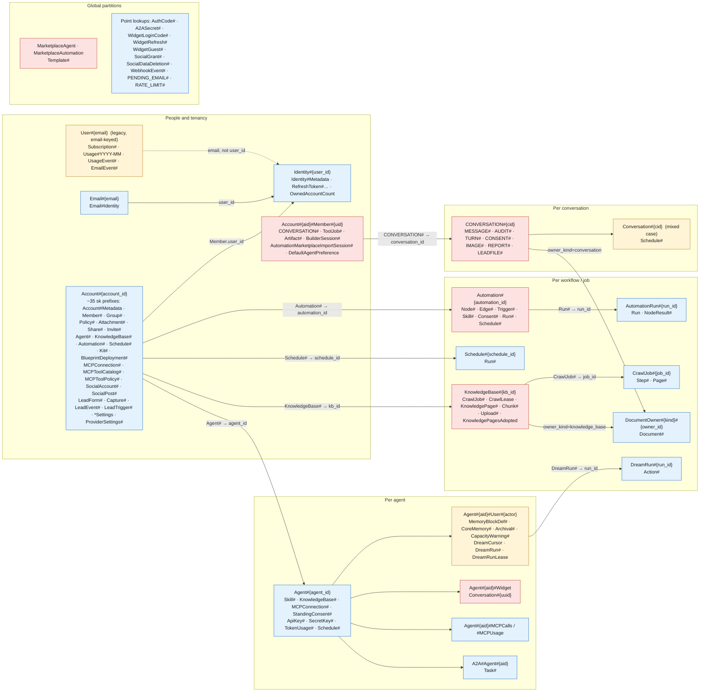

Blue: keyed and queried well. Red: scanned, read whole and paged in memory, or a global hot key. Amber:
keyed by a mutable value (email) or by inconsistent casing. A solid edge means the child partition's key
is an id held by the parent item. The dotted edge is a join on email.

## Domain overview

This shows how the main items relate across domains. The per-domain diagrams below add every item type
and its keys.

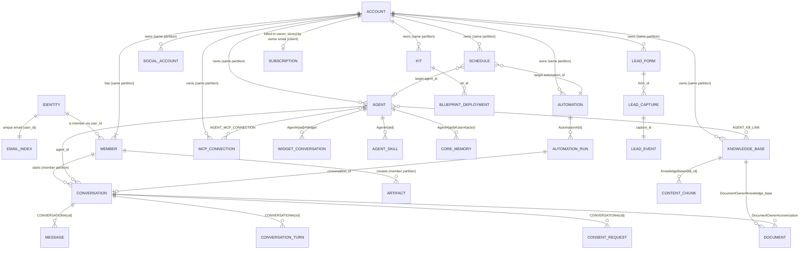

## Entity diagrams by domain

### 1. Identity, accounts and IAM

```mermaid
erDiagram
    IDENTITY {
        string pkey "Identity#{user_id}"
        string skey "Identity#Metadata"
        string email "mutable"
        string last_account_id FK
        number ttl "optional"
    }
    EMAIL_INDEX {
        string pkey "Email#{lower(email)}"
        string skey "Email#Identity"
        string user_id FK
    }
    REFRESH_TOKEN {
        string pkey "Identity#{user_id}"
        string skey "RefreshToken#{app} or RefreshToken#mobile#{device_id}"
        string token_hash
        number ttl "expires_at"
    }
    LOGIN_CODE {
        string pkey "AuthCode#{sha256(code)}"
        string skey "AuthCode#Metadata"
        string user_id FK
        number ttl "60 s"
    }
    OWNED_ACCOUNT_COUNT {
        string pkey "Identity#{user_id}"
        string skey "OwnedAccountCount"
        number n
    }
    ACCOUNT {
        string pkey "Account#{account_id}"
        string skey "Account#Metadata"
        string owner_id FK
        number authz_version "bumped by every IAM write"
        number seat_limit
    }
    MEMBER {
        string pkey "Account#{account_id}"
        string skey "Member#{user_id}"
        string gsi_key "Identity#{user_id}"
        string gsi_sort "Membership#{account_id}"
        string email "copy"
    }
    GROUP {
        string pkey "Account#{account_id}"
        string skey "Group#{group_id}"
    }
    GROUP_MEMBER {
        string pkey "Account#{account_id}"
        string skey "GroupMember#{group_id}#{user_id}"
    }
    MEMBER_GROUP_LINK {
        string pkey "Account#{account_id}"
        string skey "Member#{user_id}#Group#{group_id}"
    }
    CUSTOM_POLICY {
        string pkey "Account#{account_id}"
        string skey "Policy#{policy_id}"
        number default_version
    }
    POLICY_VERSION {
        string pkey "Account#{account_id}"
        string skey "Policy#{policy_id}#v{n}"
        string document "JSON, at most 5 versions"
    }
    ATTACHMENT {
        string pkey "Account#{account_id}"
        string skey "Attachment#{member|group}#{id}#{policy}"
    }
    RESOURCE_SHARE {
        string pkey "Account#{account_id}"
        string skey "Share#{type}#{resource_id}#{member|group}#{id}"
        string gsi_key "Account#{aid}#Grantee#{member|group}#{id}"
        string gsi_sort "Share#{type}#{resource_id}"
    }
    INVITE {
        string pkey "Account#{account_id}"
        string skey "Invite#{invite_id}"
        string gsi_key "InviteToken#{sha256(token)}"
        string gsi_sort "InviteToken#{sha256(token)}"
        number ttl
    }

    IDENTITY ||--|| EMAIL_INDEX : "user_id"
    IDENTITY ||--o{ REFRESH_TOKEN : "same partition"
    IDENTITY ||--|| OWNED_ACCOUNT_COUNT : "same partition"
    IDENTITY ||--o{ LOGIN_CODE : "user_id"
    ACCOUNT ||--|{ MEMBER : "same partition"
    IDENTITY ||--o{ MEMBER : "user_id (gsi2 reverse lookup)"
    ACCOUNT ||--o{ GROUP : "same partition"
    GROUP ||--o{ GROUP_MEMBER : "group_id"
    MEMBER ||--o{ MEMBER_GROUP_LINK : "user_id"
    GROUP ||--o{ MEMBER_GROUP_LINK : "group_id"
    ACCOUNT ||--o{ CUSTOM_POLICY : "same partition"
    CUSTOM_POLICY ||--|{ POLICY_VERSION : "policy_id"
    MEMBER ||--o{ ATTACHMENT : "principal member"
    GROUP ||--o{ ATTACHMENT : "principal group"
    CUSTOM_POLICY ||--o{ ATTACHMENT : "custom:{policy_id}"
    ACCOUNT ||--o{ RESOURCE_SHARE : "same partition"
    ACCOUNT ||--o{ INVITE : "same partition"
```

`GROUP_MEMBER` and `MEMBER_GROUP_LINK` are the two halves of one group membership. The member half
reuses the `Member#` prefix, so every query on `begins_with Member#` also returns these links and has to
drop them in memory.

### 2. Account settings, billing and usage

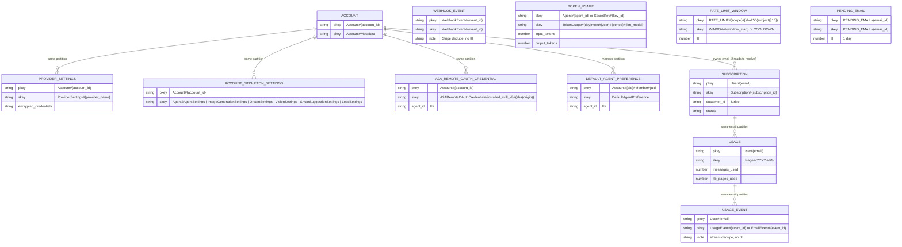

`ACCOUNT_SINGLETON_SETTINGS` stands for six item types that share one shape: a constant `sk` in the
account partition.

**How subscriptions are linked today.** Plans and quotas are charged to the account, but they are stored
under the account owner's email, not under the account:

- The quota middleware reads the account, then the owner's member item, to get the owner's email
  (`account_billing_email`, `rate_limits/billing.py:13`). It then queries that email's partition with
  `begins_with Subscription#`.
- Checkout and the Stripe webhooks write the subscription under the signed-in person's email
  (`payments/stripe/router.py:357`, `:143`). No `account_id` is stored on the item.
- The result is one plan per owner, shared by every account that person owns. The agent quota adds up agents
  across all of the owner's accounts (`rate_limits/service.py:102`).

The code itself says it is meant to belong to the account: "Until billing moves to accounts (KAN-86) the
quota is still keyed by the owner's email" (`rate_limits/billing.py:1`). See O11 for the proposed key.

### 3. Agents and their attachments

```mermaid
erDiagram
    AGENT {
        string pkey "Account#{account_id}"
        string skey "Agent#{agent_id}"
        string gsi_key "Agent#{agent_id}"
        string gsi_sort "Agent"
        string owner_id FK
        bool is_agent2agent_enabled
    }
    AGENT_SKILL {
        string pkey "Agent#{agent_id}"
        string skey "Skill#{installed_skill_id}"
        string encrypted_secrets
    }
    AGENT_KB_LINK {
        string pkey "Agent#{agent_id}"
        string skey "KnowledgeBase#{kb_id}"
        string gsi_key "KnowledgeBase#{kb_id}"
        string gsi_sort "Agent#{agent_id}"
    }
    AGENT_MCP_CONNECTION {
        string pkey "Agent#{agent_id}"
        string skey "MCPConnection#{mcp_id}"
        map sharing
    }
    STANDING_CONSENT {
        string pkey "Agent#{agent_id}"
        string skey "StandingConsent#{skill:id.action | mcp:id.tool}"
    }
    AGENT_SCHEDULE_LOOKUP {
        string pkey "Agent#{agent_id}"
        string skey "Schedule#{schedule_id}"
        string note "written, never read"
    }
    AGENT_API_KEY {
        string pkey "Agent#{agent_id}"
        string skey "ApiKey#{key_id}"
        string gsi_key "ApiKey#{public_key}"
        string gsi_sort "Agent#{agent_id}"
        string created_by "email"
    }
    A2A_SECRET {
        string pkey "A2ASecret#{sha256(secret)}"
        string skey "A2ASecret#Metadata"
        string key_id FK
    }
    AGENT_SECRET_KEY {
        string pkey "Agent#{agent_id}"
        string skey "SecretKey#{key_id}"
        string gsi_key "SecretKey#{sha256(secret)}"
        string gsi_sort "Agent#{agent_id}"
    }
    MCP_CALL {
        string pkey "Agent#{agent_id}#MCPCalls"
        string skey "{called_at}#{call_id}"
        number ttl "90 days"
    }
    MCP_DAILY_USAGE {
        string pkey "Agent#{agent_id}#MCPUsage"
        string skey "Day#{date}#{actor_kind}#{mcp_id}#{tool}"
        string note "written, never read"
    }
    A2A_TASK {
        string pkey "A2A#Agent#{agent_id}"
        string skey "Task#{task_id}"
        string gsi_key "A2ATask#{task_id}"
        string gsi_sort "Agent#{agent_id}"
        list history "grows in the item"
        number ttl
    }
    TOKEN_USAGE {
        string pkey "Agent#{agent_id}"
        string skey "TokenUsage#..."
    }

    AGENT ||--o{ AGENT_SKILL : "Agent#{agent_id}"
    AGENT ||--o{ AGENT_KB_LINK : "Agent#{agent_id}"
    AGENT ||--o{ AGENT_MCP_CONNECTION : "Agent#{agent_id}"
    AGENT ||--o{ STANDING_CONSENT : "Agent#{agent_id}"
    AGENT ||--o{ AGENT_SCHEDULE_LOOKUP : "Agent#{agent_id}"
    AGENT ||--o{ AGENT_API_KEY : "Agent#{agent_id}"
    AGENT_API_KEY ||--o| A2A_SECRET : "key_id"
    AGENT ||--o{ AGENT_SECRET_KEY : "Agent#{agent_id}"
    AGENT ||--o{ TOKEN_USAGE : "Agent#{agent_id}"
    AGENT_SECRET_KEY ||--o{ TOKEN_USAGE : "SecretKey#{key_id}"
    AGENT ||--o{ MCP_CALL : "Agent#{aid}#MCPCalls"
    AGENT ||--o{ MCP_DAILY_USAGE : "Agent#{aid}#MCPUsage"
    AGENT ||--o{ A2A_TASK : "A2A#Agent#{aid}"
```

The agent item lives in the account partition, but everything attached to it lives under `Agent#{agent_id}`.
Getting an agent by id alone therefore needs gsi2, and listing agents with their attachment counts costs
one list query plus three count queries per agent.

### 4. Conversations and the chat runtime

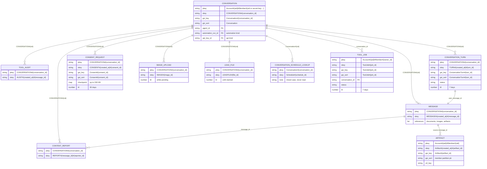

Widget conversations are a separate item type. They are shown in the widget diagram (section 8).

### 5. Memory and dreams

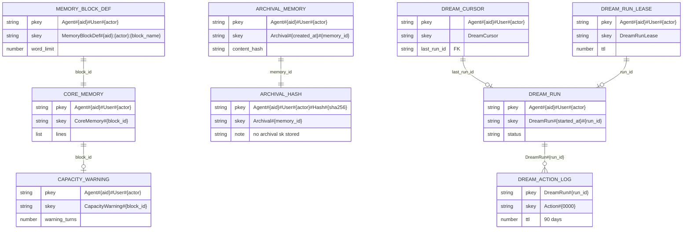

Memory is scoped **per agent per user**. Each agent keeps its own memory of each person, so the partition
always contains both the agent and the user, and two agents never share a memory partition.

`{actor}` depends on the caller: the **email** on the dashboard (`agents/router.py:552`), the visitor id
in the widget, `a2a:{key_id}` for A2A, and `secret-key:{key}[:{end_user}]` for the public API. Memory
items have no `entity_type`.

### 6. Knowledge, crawling and documents

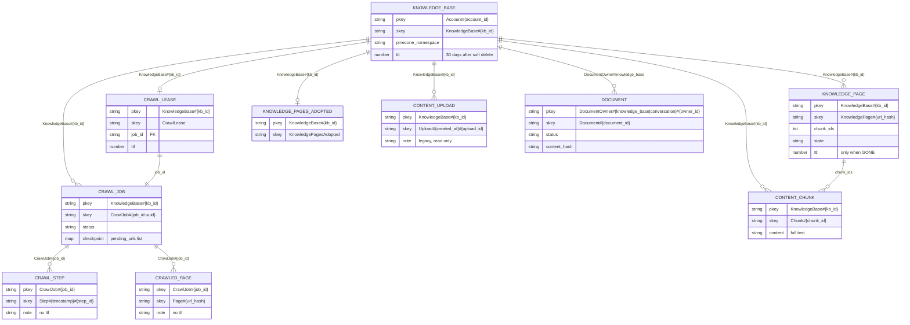

### 7. Connectors: MCP and social

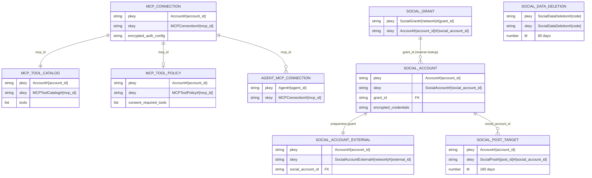

### 8. Widget, guest sessions and public keys

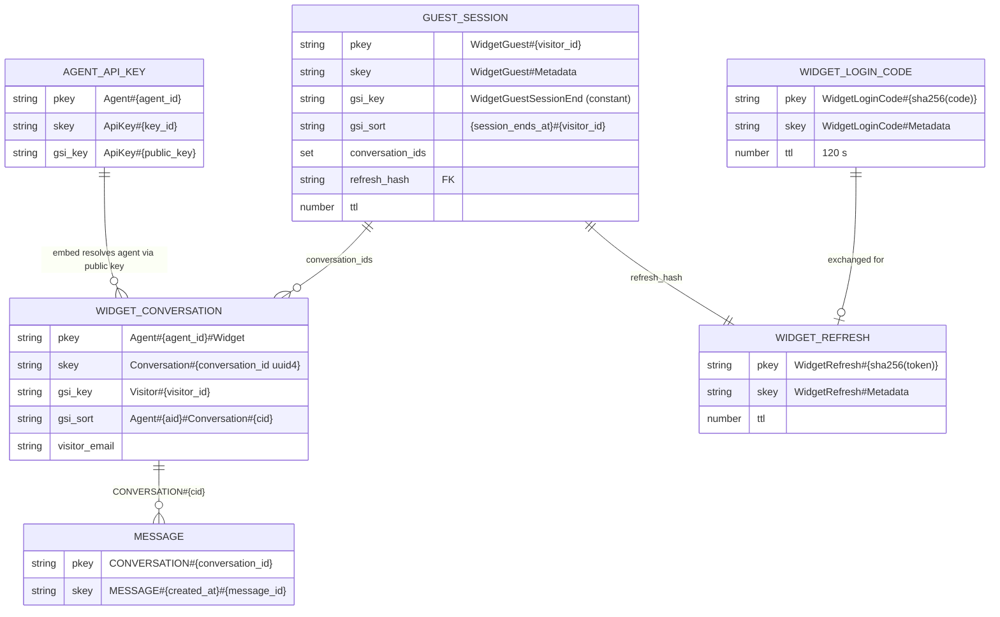

### 9. Automations, scheduler and leads

```mermaid
erDiagram
    AUTOMATION {
        string pkey "Account#{account_id}"
        string skey "Automation#{automation_id}"
        string owner_id FK
    }
    AUTOMATION_NODE {
        string pkey "Automation#{automation_id}"
        string skey "Node#{node_id}"
    }
    AUTOMATION_EDGE {
        string pkey "Automation#{automation_id}"
        string skey "Edge#{edge_id}"
        string source_node_id FK
        string target_node_id FK
    }
    AUTOMATION_TRIGGER {
        string pkey "Automation#{automation_id}"
        string skey "Trigger#{trigger_id}"
        string gsi_key "WebhookTrigger#{token_hash} (never queried)"
        string entry_node_id FK
    }
    AUTOMATION_SKILL {
        string pkey "Automation#{automation_id}"
        string skey "Skill#{installed_skill_id}"
    }
    AUTOMATION_CONSENT {
        string pkey "Automation#{automation_id}"
        string skey "Consent#{node_id}"
    }
    AUTOMATION_RUN {
        string pkey "Automation#{automation_id}"
        string skey "Run#{created_at}#{run_id}"
        map context
        string conversation_id FK
        string note "no ttl"
    }
    AUTOMATION_RUN_LOOKUP {
        string pkey "AutomationRun#{run_id}"
        string skey "Run"
        string note "full copy of the run"
    }
    AUTOMATION_RUN_NODE_RESULT {
        string pkey "AutomationRun#{run_id}"
        string skey "NodeResult#{started_at}#{node_id}"
        string event_log_key "S3"
    }
    AUTOMATION_SCHEDULE_LOOKUP {
        string pkey "Automation#{automation_id}"
        string skey "Schedule#{schedule_id}"
    }
    SCHEDULE {
        string pkey "Account#{account_id}"
        string skey "Schedule#{schedule_id}"
        string gsi_key "ScheduleDue#active (constant)"
        string gsi_sort "{next_run_at}#Schedule#{schedule_id}"
        map target "agent_id, conversation_id, automation_id"
    }
    SCHEDULE_RUN {
        string pkey "Schedule#{schedule_id}"
        string skey "Run#{scheduled_for}#{run_id}"
        string note "no ttl"
    }
    LEAD_TRIGGER_REGISTRATION {
        string pkey "Account#{account_id}"
        string skey "LeadTrigger#{automation_id}#{trigger_id}"
        string form_slug
    }
    LEAD_FORM {
        string pkey "Account#{account_id}"
        string skey "LeadForm#{form_id}"
        number capture_count
    }
    LEAD_FORM_SLUG {
        string pkey "Account#{account_id}"
        string skey "LeadFormSlug#{slug}"
        string form_id FK
    }
    LEAD_CAPTURE {
        string pkey "Account#{account_id}"
        string skey "Capture#{created_at}#{capture_id}"
        string agent_id FK
        string conversation_id FK
        string status
    }
    LEAD_CAPTURE_ID {
        string pkey "Account#{account_id}"
        string skey "CaptureId#{capture_id}"
        string capture_sk
    }
    LEAD_USAGE {
        string pkey "Account#{account_id}"
        string skey "LeadUsage#{YYYY-MM}"
        number captures
    }
    LEAD_EVENT {
        string pkey "Account#{account_id}"
        string skey "LeadEvent#{capture_id}"
        string gsi_key "LeadEventPending (constant, while pending)"
        string gsi_sort "{due_at}"
        number ttl "after finish"
    }

    AUTOMATION ||--o{ AUTOMATION_NODE : "Automation#{id}"
    AUTOMATION ||--o{ AUTOMATION_EDGE : "Automation#{id}"
    AUTOMATION ||--o{ AUTOMATION_TRIGGER : "Automation#{id}"
    AUTOMATION ||--o{ AUTOMATION_SKILL : "Automation#{id}"
    AUTOMATION ||--o{ AUTOMATION_CONSENT : "Automation#{id}"
    AUTOMATION ||--o{ AUTOMATION_RUN : "Automation#{id}"
    AUTOMATION ||--o{ AUTOMATION_SCHEDULE_LOOKUP : "Automation#{id}"
    AUTOMATION_NODE ||--o{ AUTOMATION_EDGE : "source/target node_id"
    AUTOMATION_NODE ||--o{ AUTOMATION_CONSENT : "node_id"
    AUTOMATION_RUN ||--|| AUTOMATION_RUN_LOOKUP : "run_id"
    AUTOMATION_RUN ||--o{ AUTOMATION_RUN_NODE_RESULT : "AutomationRun#{run_id}"
    AUTOMATION_SCHEDULE_LOOKUP ||--|| SCHEDULE : "schedule_id"
    SCHEDULE ||--o{ SCHEDULE_RUN : "Schedule#{schedule_id}"
    AUTOMATION ||--o{ LEAD_TRIGGER_REGISTRATION : "automation_id"
    LEAD_FORM ||--|| LEAD_FORM_SLUG : "form_id"
    LEAD_FORM ||--o{ LEAD_CAPTURE : "form_id"
    LEAD_CAPTURE ||--|| LEAD_CAPTURE_ID : "capture_id"
    LEAD_CAPTURE ||--|| LEAD_EVENT : "capture_id"
    LEAD_FORM ||--o{ LEAD_USAGE : "counts per month"
    LEAD_EVENT ||--o{ LEAD_TRIGGER_REGISTRATION : "dispatched to"
```

### 10. Builder, blueprints and marketplaces

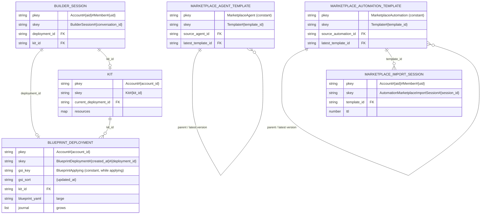

## GSI2 usage

| gsi2_pk | gsi2_sk | Item | Query | Notes |
| --- | --- | --- | --- | --- |
| `Agent#{agent_id}` | `Agent` | Agent | get by id | Copies the whole agent, persona included |
| `Conversation#{cid}` | `Conversation` | Conversation | get by id | |
| `ConversationTurn#{tid}` | same | ConversationTurn | get by id | |
| `ToolJob#{job_id}` | same | ToolJob | get by id, and **before every update** | Results up to 200 KB are duplicated in the index |
| `Consent#{consent_id}` | same | ConsentRequest | get by id | Checkpoints up to 200 KB duplicated; the whole item is rewritten on each status change |
| `Artifact#{id}` | member `pk` | Artifact | get by id + owner | |
| `Identity#{uid}` | `Membership#{aid}` | Member | a person's accounts | |
| `Account#{aid}#Grantee#…` | `Share#{type}#{rid}` | ResourceShare | shared with a grantee | One query per grantee and group |
| `InviteToken#{hash}` | same | Invite | accept by token | |
| `ApiKey#{public_key}` | `Agent#{aid}` | AgentApiKey | embed / widget key | |
| `SecretKey#{hash}` | `Agent#{aid}` | AgentSecretKey | `/v1` auth | |
| `KnowledgeBase#{kb_id}` | `Agent#{aid}` | AgentKnowledgeBase | agents linked to a KB | Single page |
| `Visitor#{vid}` | `Agent#{aid}#Conversation#{cid}` | WidgetConversation | visitor's conversations | Ordered by uuid, not time |
| **`WidgetGuestSessionEnd`** | `{ends_at}#{vid}` | GuestSession | sweeper: ended sessions | **Global key**; rewritten on every guest message |
| **`ScheduleDue#active`** | `{next_run_at}#…` | Schedule | load at startup | **Global key**; `Limit=1000`, not paginated |
| **`LeadEventPending`** | `{due_at}` | LeadEvent | dispatcher poll | **Global key**; every replica polls every few seconds |
| **`BlueprintApplying`** | `{updated_at}` | BlueprintDeployment | reaper | Global key, small |
| `WebhookTrigger#{hash}` | `Automation#…#Trigger#…` | AutomationTrigger | **none** | Written but never queried |
| `A2ATask#{task_id}` | `Agent#{aid}` | A2ATask | **none** | Written but never queried |

## Full key catalogue

Paths are relative to `api/src/` unless noted.

| Domain | Item (model) | pk | sk | gsi2 | ttl | Defined at |
| --- | --- | --- | --- | --- | --- | --- |
| Identity | Identity | `Identity#{user_id}` | `Identity#Metadata` | – | optional | `identity/models.py:26` |
| Identity | Email index | `Email#{email}` | `Email#Identity` | – | copied | `identity/models.py:88` |
| Identity | LoginCode | `AuthCode#{sha256}` | `AuthCode#Metadata` | – | 60 s | `auth/app_tokens.py:50` |
| Identity | RefreshToken | `Identity#{user_id}` | `RefreshToken#{app}` / `RefreshToken#mobile#{device}` | – | yes | `auth/app_tokens.py:73` |
| Identity | OwnedAccountCount | `Identity#{user_id}` | `OwnedAccountCount` | – | – | `accounts/repository.py:44` |
| Accounts | Account | `Account#{aid}` | `Account#Metadata` | – | – | `accounts/models.py:41` |
| Accounts | Member | `Account#{aid}` | `Member#{uid}` | `Identity#{uid}` / `Membership#{aid}` | – | `accounts/models.py:83` |
| IAM | Group | `Account#{aid}` | `Group#{gid}` | – | – | `iam/models.py:37` |
| IAM | GroupMember (both halves) | `Account#{aid}` | `GroupMember#{gid}#{uid}` and `Member#{uid}#Group#{gid}` | – | – | `iam/models.py:55,60` |
| IAM | CustomPolicy / PolicyVersion | `Account#{aid}` | `Policy#{pid}` / `Policy#{pid}#v{n}` | – | – | `iam/models.py:84,65` |
| IAM | Attachment | `Account#{aid}` | `Attachment#{kind}#{id}#{policy}` | – | – | `iam/models.py:117` |
| IAM | ResourceShare | `Account#{aid}` | `Share#{type}#{rid}#{kind}#{id}` | `Account#{aid}#Grantee#{kind}#{id}` / `Share#{type}#{rid}` | – | `iam/shares.py:67` |
| IAM | Invite | `Account#{aid}` | `Invite#{id}` | `InviteToken#{hash}` ×2 | yes | `iam/invitations/models.py:15` |
| Settings | ProviderSettings | `Account#{aid}` | `ProviderSettings#{provider}` | – | – | `settings/models.py:12` |
| Settings | Agent2AgentSettings | `Account#{aid}` | `Agent2AgentSettings` | – | – | `settings/models.py:82` |
| Settings | ImageGenerationSettings | `Account#{aid}` | `ImageGenerationSettings` | – | – | `agents/image_generation/settings.py:18` |
| Settings | DreamSettings | `Account#{aid}` | `DreamSettings` | – | – | `dream/models.py:15` |
| Settings | VisionSettings | `Account#{aid}` | `VisionSettings` | – | – | `vision/models.py:44` |
| Settings | SmartSuggestionSettings | `Account#{aid}` | `SmartSuggestionSettings` | – | – | `smart_suggestions/models.py:17` |
| Settings | DefaultAgentPreference | `Account#{aid}#Member#{uid}` | `DefaultAgentPreference` | – | – | `settings/models.py:136` |
| Settings | A2ARemoteOAuthCredential | `Account#{aid}` | `A2ARemoteOAuthCredential#{isid}#{sha(origin)}` | – | – | `skills/agent2agent_client/oauth.py:70` |
| Billing | Subscription | `User#{email}` | `Subscription#{id}` | – | – | `payments/subscriptions/models.py:7` |
| Billing | WebhookEvent | `WebhookEvent#{id}` | `WebhookEvent#{id}` | – | **none** | `payments/subscriptions/repository.py:72` |
| Billing | Usage | `User#{email}` | `Usage#{YYYY-MM}` | – | – | `rate_limits/models.py:7` |
| Billing | UsageEvent / EmailEvent | `User#{email}` | `UsageEvent#{id}` / `EmailEvent#{id}` | – | **none** | `api/lambdas/usage_stream_handler/handler.py:95,115` |
| Billing | TokenUsageRecord | `Agent#{aid}` or `SecretKey#{key_id}` | `TokenUsage#{period}#{key}#{model}` | – | **none** | `token_usage/models.py:33` |
| Platform | RateLimit window / cooldown | `RATE_LIMIT#{scope}#{hash16}` | `WINDOW#{start}` / `COOLDOWN` | – | yes | `rate_limits/store.py:42` |
| Platform | PendingEmail | `PENDING_EMAIL#{id}` | same | – | 1 day | `email/pending_email.py:25` |
| Agents | Agent | `Account#{aid}` | `Agent#{agent_id}` | `Agent#{agent_id}` / `Agent` | – | `agents/models.py:58` |
| Agents | AgentSkill | `Agent#{aid}` | `Skill#{isid}` | – | – | `skills/models.py:262` |
| Agents | AgentKnowledgeBase | `Agent#{aid}` | `KnowledgeBase#{kb}` | `KnowledgeBase#{kb}` / `Agent#{aid}` | – | `knowledge/models.py:1046` |
| Agents | AgentMCPConnection | `Agent#{aid}` | `MCPConnection#{mcp}` | – | – | `connectors/mcp/models.py:705` |
| Agents | StandingConsent | `Agent#{aid}` | `StandingConsent#{key}` | – | – | `consent/models.py:254` |
| Agents | AgentApiKey | `Agent#{aid}` | `ApiKey#{key_id}` | `ApiKey#{public_key}` / `Agent#{aid}` | – | `apikeys/models.py:77` |
| Agents | A2A secret lookup | `A2ASecret#{sha256}` | `A2ASecret#Metadata` | – | – | `apikeys/repository.py:108` |
| Agents | AgentSecretKey | `Agent#{aid}` | `SecretKey#{key_id}` | `SecretKey#{sha256}` / `Agent#{aid}` | – | `public_api/keys.py:61` |
| Agents | MCPCall | `Agent#{aid}#MCPCalls` | `{called_at}#{call_id}` | – | 90 days | `connectors/mcp/usage.py:33` |
| Agents | MCPDailyUsage | `Agent#{aid}#MCPUsage` | `Day#{date}#{actor_kind}#{mcp}#{tool}` | – | **none** | `connectors/mcp/usage.py:95` |
| Agents | A2ATask | `A2A#Agent#{aid}` | `Task#{task_id}` | `A2ATask#{task_id}` / `Agent#{aid}` | yes | `a2a/models.py:79` |
| Chat | Conversation (chat / automation / api) | `Account#{aid}#Member#{uid\|secret-key:…}` | `CONVERSATION#{cid}` | `Conversation#{cid}` / `Conversation` | – | `conversations/models.py:55,132,188` |
| Chat | Message / tool audit | `CONVERSATION#{cid}` | `MESSAGE#{ts}#{mid}` / `AUDIT#{ts}#{mid}` | – | – | `messages/models.py:211` |
| Chat | ConversationTurn | `CONVERSATION#{cid}` | `TURN#{ts}#{turn_id}` | `ConversationTurn#{id}` ×2 | 7 days | `agents/turns/models.py:48` |
| Chat | ConsentRequest | `CONVERSATION#{cid}` | `CONSENT#{ts}#{consent_id}` | `Consent#{id}` ×2 | 30 days | `consent/models.py:94` |
| Chat | ImageUpload | `CONVERSATION#{cid}` | `IMAGE#{image_id}` | – | while pending | `vision/models.py:160` |
| Chat | ContentReport | `CONVERSATION#{cid}` | `REPORT#{mid}#{reporter}` | – | – | `conversations/reports.py:46` |
| Chat | LeadFile | `CONVERSATION#{cid}` | `LEADFILE#{file_id}` | – | until claimed | `leads/models.py:284` |
| Chat | ToolJob | member partition | `ToolJob#{job_id}` | `ToolJob#{id}` ×2 | 7 days | `agents/tool_runtime/jobs/models.py:29` |
| Chat | Artifact | member partition | `Artifact#{ts}#{id}` | `Artifact#{id}` / member pk | – | `artifacts/models.py:26` |
| Memory | MemoryBlockDefinition | `Agent#{aid}#User#{actor}` | `MemoryBlockDef#{aid}:{actor}:{name}` | – | – | `memory/models.py:22` |
| Memory | CoreMemory | `Agent#{aid}#User#{actor}` | `CoreMemory#{block_id}` | – | – | `memory/models.py:80` |
| Memory | ArchivalMemory | `Agent#{aid}#User#{actor}` | `Archival#{ts}#{memory_id}` | – | – | `memory/models.py:148` |
| Memory | ArchivalHash | `Agent#{aid}#User#{actor}#Hash#{sha}` | `Archival#{memory_id}` | – | – | `memory/models.py:176` |
| Memory | CapacityWarningTracker | `Agent#{aid}#User#{actor}` | `CapacityWarning#{block_id}` | – | – | `memory/models.py:219` |
| Dream | DreamCursor / DreamRun / DreamRunLease | `Agent#{aid}#User#{actor}` | `DreamCursor` / `DreamRun#{ts}#{rid}` / `DreamRunLease` | – | lease only | `dream/models.py:82,120`, `dream/repository.py:55` |
| Dream | DreamActionLog | `DreamRun#{rid}` | `Action#{0000}` | – | 90 days | `dream/models.py:201` |
| Knowledge | KnowledgeBase | `Account#{aid}` | `KnowledgeBase#{kb}` | – | on soft delete | `knowledge/models.py:415` |
| Knowledge | CrawlJob | `KnowledgeBase#{kb}` | `CrawlJob#{job_id}` | – | **none** | `knowledge/models.py:516` |
| Knowledge | CrawlLease | `KnowledgeBase#{kb}` | `CrawlLease` | – | yes | `knowledge/models.py:617` |
| Knowledge | KnowledgePage | `KnowledgeBase#{kb}` | `KnowledgePage#{url_hash}` | – | when GONE | `knowledge/models.py:784` |
| Knowledge | KnowledgePagesAdopted | `KnowledgeBase#{kb}` | `KnowledgePagesAdopted` | – | – | `knowledge/repository.py:390` |
| Knowledge | ContentChunk | `KnowledgeBase#{kb}` | `Chunk#{chunk_id}` | – | – | `knowledge/models.py:913` |
| Knowledge | ContentUpload (legacy) | `KnowledgeBase#{kb}` | `Upload#{ts}#{id}` | – | – | `knowledge/models.py:977` |
| Knowledge | CrawlStep | `CrawlJob#{job_id}` | `Step#{ts}#{step_id}` | – | **none** | `knowledge/models.py:653` |
| Knowledge | CrawledPage | `CrawlJob#{job_id}` | `Page#{url_hash}` | – | **none** | `knowledge/models.py:710` |
| Documents | Document | `DocumentOwner#{kind}#{owner_id}` | `Document#{id}` | – | – | `documents/models.py:128` |
| MCP | MCPConnection / MCPToolCatalog / MCPToolPolicy | `Account#{aid}` | `MCPConnection#` / `MCPToolCatalog#` / `MCPToolPolicy#{mcp}` | – | – | `connectors/mcp/models.py:636,451,486` |
| Social | SocialAccount / external guard | `Account#{aid}` | `SocialAccount#{id}` / `SocialAccountExternal#{net}#{ext}` | – | – | `connectors/social/models.py:37,26` |
| Social | SocialGrant | `SocialGrant#{net}#{grant}` | `Account#{aid}#{said}` | – | – | `connectors/social/models.py:31` |
| Social | SocialPostTarget | `Account#{aid}` | `SocialPost#{pid}#{said}` | – | 180 days | `connectors/social/posts.py:30` |
| Social | SocialDataDeletion | `SocialDataDeletion#{code}` | same | – | 90 days | `connectors/social/meta_callbacks.py:78` |
| Widget | WidgetConversation | `Agent#{aid}#Widget` | `Conversation#{cid}` | `Visitor#{vid}` / `Agent#{aid}#Conversation#{cid}` | **none** | `widget/models.py:56` |
| Widget | WidgetLoginCode / WidgetRefresh | `WidgetLoginCode#{sha}` / `WidgetRefresh#{sha}` | `…#Metadata` | – | yes | `widget/sessions.py:99` |
| Widget | GuestSession | `WidgetGuest#{vid}` | `WidgetGuest#Metadata` | `WidgetGuestSessionEnd` / `{ends_at}#{vid}` | yes | `widget/guests.py:30` |
| Automations | Automation | `Account#{aid}` | `Automation#{id}` | – | – | `automations/models.py:378` |
| Automations | Node / Edge / Trigger / Skill / Consent | `Automation#{id}` | `Node#` / `Edge#` / `Trigger#` / `Skill#` / `Consent#{node}` | Trigger: `WebhookTrigger#{hash}` | – | `automations/models.py:444,501,552,611,188` |
| Automations | AutomationRun | `Automation#{id}` | `Run#{ts}#{run_id}` | – | **none** | `automations/models.py:674` |
| Automations | AutomationRun lookup | `AutomationRun#{run_id}` | `Run` | – | **none** | `automations/models.py:733` |
| Automations | AutomationRunNodeResult | `AutomationRun#{run_id}` | `NodeResult#{ts}#{node}` | – | **none** | `automations/models.py:778` |
| Automations | LeadTriggerRegistration | `Account#{aid}` | `LeadTrigger#{automation}#{trigger}` | – | – | `automations/triggers/lead_captured.py:38` |
| Scheduler | Schedule | `Account#{aid}` | `Schedule#{sid}` | `ScheduleDue#active` / `{next_run_at}#Schedule#{sid}` | – | `scheduler/models.py:97` |
| Scheduler | Schedule lookups | `Agent#{aid}` / `Conversation#{cid}` / `Automation#{id}` | `Schedule#{sid}` | – | – | `scheduler/models.py:166` |
| Scheduler | ScheduleRun | `Schedule#{sid}` | `Run#{scheduled_for}#{run_id}` | – | **none** | `scheduler/models.py:225` |
| Leads | LeadForm / slug guard | `Account#{aid}` | `LeadForm#{id}` / `LeadFormSlug#{slug}` | – | – | `leads/models.py:137`, `leads/repository.py:293` |
| Leads | LeadSettings | `Account#{aid}` | `LeadSettings` | – | – | `leads/models.py:223` |
| Leads | LeadCapture / id guard | `Account#{aid}` | `Capture#{ts}#{id}` / `CaptureId#{id}` | – | – | `leads/models.py:375`, `leads/repository.py:297` |
| Leads | LeadUsage | `Account#{aid}` | `LeadUsage#{YYYY-MM}` | – | – | `leads/repository.py:122` |
| Leads | LeadEvent | `Account#{aid}` | `LeadEvent#{capture_id}` | `LeadEventPending` / `{due_at}` | after finish | `leads/events.py:43` |
| Blueprints | Kit | `Account#{aid}` | `Kit#{kit_id}` | – | – | `blueprints/kits.py:58` |
| Blueprints | BlueprintDeployment | `Account#{aid}` | `BlueprintDeployment#{ts}#{id}` | `BlueprintApplying` / `{updated_at}` | – | `blueprints/models.py:69` |
| Builder | BuilderSession | member partition | `BuilderSession#{cid}` | – | – | `builder/models.py:22` |
| Marketplace | Agent template | `MarketplaceAgent` | `Template#{id}` | – | – | `agent_marketplace/models.py:42` |
| Marketplace | Automation template | `MarketplaceAutomation` | `Template#{id}` | – | – | `automation_marketplace/models.py:77` |
| Marketplace | Import session | member partition | `AutomationMarketplaceImportSession#{id}` | – | yes | `automation_marketplace/models.py:277` |

## Findings

The items below were found by reading the repositories. The most serious were checked against the
source (`get_graph`, the four reaper scans, the A2A scans, `PendingEmail.list_all`,
`find_archival_by_hash`, the widget `sk`, conversation pagination and the email memory actor).

### F1. Full-table scans (about 7 on timers, 2 on public traffic)

Every scan reads the whole table (chunks, messages and so on) to find a handful of rows, and its cost
grows with the whole table, not with the result.

| Scan | Where | Runs |
| --- | --- | --- |
| Running crawl jobs | `knowledge/repository.py:222` | Reaper, every 5 min |
| In-flight documents | `documents/repository.py:137` | Reaper, every 5 min |
| Unsent documents | `documents/repository.py:137` (`unsent`) | Hourly |
| Running turns | `agents/turns/repository.py:114` | Reaper, every 5 min |
| Unfinished tool jobs | `agents/tool_runtime/jobs/repository.py:151` | Reaper, every 5 min |
| Running dream runs | `dream/repository.py:138` | Reaper, every 5 min, then a lease get per run |
| A2A-enabled agents (discovery) | `agents/repository.py:115` | Public `a2a` discovery |
| A2A agent by id | `agents/repository.py:152` | **Public agent card.** gsi2 `Agent#{id}` already gives the same answer |
| Pending emails | `email/pending_email.py:130` | No caller. It uses `Limit=100` before the filter, so it is wrong as well as slow |

### F2. Whole partitions read, then filtered or paginated in memory

- `AutomationRepository.get_graph` (`automations/repository.py:168`) queries `Automation#{id}` **with no
  sort-key condition**. It reads every `Run#` ever written (runs have no TTL) plus the skills, consents
  and schedule lookups, and keeps only nodes, edges and triggers. It runs on graph reads and saves, on
  marketplace publish and on every lead-triggered run.
- The conversation list (`conversations/repository.py:152`) reads the whole member partition, filters it,
  sorts by `updated_at` and slices by an offset cursor, on every page.
- The analytics dashboard (`analytics/service.py:218-288`) reads every conversation in the member
  partition, then runs one full message query per conversation (up to 500).
- `find_by_conversation` reads the full message history on every agent turn
  (`krishna_mini.py:114`, `vishwakarma.py:153`, `krishna_memgpt.py:203`). The report and image routes read
  it too, just to find one message.
- `DeploymentRepository.find_by_id` (`blueprints/repository.py:72`) reads every deployment in the account
  (large YAML and journal) with a `FilterExpression` on `deployment_id`. `KitRepository.holding` reads
  every kit.
- KnowledgePage `list_page` / `count_by_state` / `duplicates_of` (`knowledge/repository.py:413-459`) and
  `PageIndex.load` read every page of a KB per request. CrawlJob listing reads every job, because a uuid
  `sk` has no time order.
- Marketplace `list_templates` (both modules) reads the whole global partition **without pagination**, then
  filters, searches and ranks in memory. `find_latest_for_source_*` scans it with a filter.
- Leads: `captures_with_status` reads every capture. `list_captures` uses a filter on several
  attributes, so a rare filter reads most captures. `monthly_counts` reads every month to use one.
- Memory: `find_archival_by_hash` and `delete_archival` filter the whole `Archival#` range on `memory_id`,
  first page only. Past 1 MB, deduplication misses and deletes silently do nothing. `search_archival`
  pages in memory.
- `IamRepository.load` makes four sequential consistent prefix queries per cache miss, and the cache is
  per process. Invitations add another read of the account and another `Member#` query on top.

### F3. N+1 loops

- **Chat path:** MCP agent links → `find_connection` per link (`connectors/mcp/service.py:740`).
  `readable_by_agent`: one KB get per link (`knowledge/access.py:66`). One standing-consent get per gated
  tool call.
- **Agent list:** `count_attached` makes three count queries per agent (`agents/router.py:256`) and
  reads every conversation to compute use counts (`agents/router.py:227`).
- **Quota middleware:** `account_billing_email` makes two sequential gets; `get_active_for_user`
  reads every subscription; the agent quota runs one `list_in_account` per owned account
  (`rate_limits/service.py:102`).
- **Other:** `list_schedules_for_automation` (a get per lookup); `AccountService.list_accounts` (a policy
  query per account); `ShareRepository.shared_with` (a GSI query per grantee); `for_grant` (a get per
  grant); `DocumentService.attach`; the dream window (`has_messages_after` per conversation, plus full
  history); the guest closer (a checkpoint update plus a delete per row); `delete_all_by_agent` for API
  and secret keys; artifact bulk delete; `delete_all_for_user` (memory).

### F4. Global hot keys

- `gsi2_pk = WidgetGuestSessionEnd`: every guest session in the system, with its `gsi2_sk` rewritten on
  every guest message.
- `gsi2_pk = ScheduleDue#active`: every active schedule, read with `Limit=1000` and no pagination at
  startup only. Anything past 1000 schedules is silently never scheduled after a restart.
- `gsi2_pk = LeadEventPending`: polled every few seconds by every replica.
- Base partitions `MarketplaceAgent` / `MarketplaceAutomation`.
- `CONVERSATION#{cid}` and `KnowledgeBase#{kb_id}` are per tenant, but take heavy write bursts: turn
  heartbeats every 30 s, full consent rewrites, chunk batches and page puts.

### F5. Keys built on mutable or inconsistent values

- **Email-keyed partitions:** `User#{email}` (Subscription, Usage, UsageEvent, EmailEvent, all billed to an
  account but stored by its owner's email), memory and dream under `Agent#{aid}#User#{email}` on the
  dashboard (per agent per user, as it should be, but the user part is the email) (the email is also embedded in the `MemoryBlockDef` sk),
  and `created_by = email` on API and secret keys. `IdentityRepository.change_email` moves none of these, so
  an email change orphans subscriptions, usage, memory and dream history.
- **Mixed casing:** `CONVERSATION#` (chat) vs `Conversation#` (gsi2 and schedule lookups); `MESSAGE#`,
  `TURN#`, `LEADFILE#`, `RATE_LIMIT#`, `PENDING_EMAIL#` vs PascalCase everywhere else; `A2A#Agent#` vs
  `Agent#`.
- **Overloaded prefix:** `Member#{uid}` and `Member#{uid}#Group#{gid}` share a prefix, so three readers
  drop the group links in memory.
- **Time order lost:** `sk` values ending in uuid4 (WidgetConversation, CrawlJob), so "newest first" is not
  chronological.
- **No `entity_type`** on memory items, ContentReport, SocialAccountExternal, or the account-deletion
  Lambda's own items.

### F6. Writes that cost more than they need to

- `save()` gets the item before every put, only to keep `created_at`. This applies to Agent,
  Conversation, KB, MCP connections, settings, automations, AgentSkill, marketplaces and schedules.
- `save_run` writes two full items (the run and its lookup copy, including `context`) on every heartbeat.
  `find_run_by_id` then reads both.
- The blueprint executor rewrites the whole deployment (YAML plus a growing journal) twice per command.
- Token usage costs three to six sequential updates per LLM call. `MCPDailyUsage` is written on every MCP
  call and never read.
- ToolJob updates run a GSI query before every update. ConsentRequest status changes rewrite up to
  200 KB, which is then copied into the ALL-projected GSI.
- Non-atomic counters: `increment_import_count` (get + put), `increment_warning_turns`.

### F7. Retention and orphaned items

- **No TTL, growing without bound:** AutomationRun, its lookup and node results; ScheduleRun; CrawlJob,
  CrawlStep and CrawledPage; MCPDailyUsage; TokenUsage day buckets; WebhookEvent; UsageEvent and
  EmailEvent; WidgetConversation; BlueprintDeployment.
- **Children left behind after a parent is deleted:** deleting a KB leaves CrawlJob, CrawlStep,
  CrawledPage, Upload and Lease items; deleting a conversation leaves TURN# and CONSENT# items until
  their TTL.
- **The account-deletion Lambda uses stale key patterns**
  (`api/lambdas/account_deletion_handler/handler.py`):
  - It deletes API keys at `User#{email}` / `ApiKey#` (line 88), but they live at `Agent#{aid}` / `ApiKey#`.
  - It deletes archival memory at `Agent#{aid}` / `ArchivalMemory#` (line 224), but it lives at
    `Agent#{aid}#User#{actor}` / `Archival#`.
  - Both deletes match nothing.

### F8. Single-page queries that silently stop at 1 MB

Settings `list` (provider settings), subscriptions, `find_all_by_agent` (API keys), `find_kbs_for_agent`,
`find_agents_for_kb`, MCP `list_connections` and `list_agent_connections`, social `list`,
`find_by_visitor_and_agent`, `find_node_results`, automation `list_skills`, `AgentSkillRepository.list_by_agent`,
marketplace `list_templates`, A2A task lists, `list_active_schedules`, message `count_by_conversation`,
reports, dream action logs, memory blocks, `list_standing`, artifact `list_in` (no cursor at all).

## Decisions so far (2026-11-15)

- **Billing stays with the account owner.** One owner pays for every account they own; that model is kept.
  What O11 changes is the key: `User#{email}` becomes `Identity#{user_id}`, so an email change or a Stripe email
  mismatch can't lose a subscription. Moving billing to `Account#{aid}` is only worth it for per-account plans,
  non-owner billing admins or company invoices, none of which are planned.
- **Seat limits come from the owner's plan (built 2026-11-15).** `Account#Metadata.seat_limit` is written at
  account creation and on every plan change; see the KAN-86 seat note in
  [LLD-shared-accounts-and-iam.md](LLD-shared-accounts-and-iam.md).
- **Memory stays per agent per user.** Each agent keeps its own memory of each person. Only the user part of
  `Agent#{aid}#User#{…}` changes, from email to `user_id`, and only on the dashboard path.
- **No new GSI.** Background work queues overload `gsi2` (O7). More indexes add cost and upkeep, and they
  would not carry over if the data moves to MySQL. A sparse marker item maps directly onto a `work_queue`
  table there.
- **Run retention is the newest 10 by default.** Older runs and everything they own are deleted (O12). The
  detailed design is still being worked out in [LLD-automation-run-retention.md](LLD-automation-run-retention.md),
  which still says "off by default, keep 20" and needs updating to match.

## Optimisation candidates

Candidates are ordered by payoff over effort.

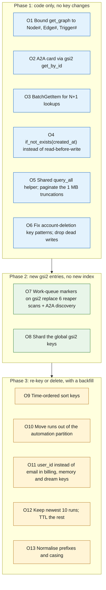

Blue: code-only changes. Green: new item shapes on the existing `gsi2`, with no Terraform change. Amber:
changes or deletes stored items and needs a migration or sweep script.

### Phase 1: code only, no key changes

- **O1. Bound `get_graph`.** Replace the unconditioned partition query with three `begins_with` queries
  (`Node#`, `Edge#`, `Trigger#`). Graph reads then skip run history.
- **O2. A2A agent card by id.** Replace the scan at `agents/repository.py:152` with `AgentRepository.get`
  (gsi2 `Agent#{id}`) plus a check of `is_agent2agent_enabled`.
- **O3. Batch the N+1 lookups.**
  - Use `BatchGetItem` for MCP links → connections, KB links → KBs, schedule lookups → schedules, social
    grants → accounts, and document attach.
  - Store the owner's email on `Account#Metadata` so billing doesn't need a second get. O11 removes the
    email hop entirely.
  - Count attachments with one query on `Agent#{aid}` (all prefixes, `ProjectionExpression sk`), not three
    per agent.
- **O4. Upserts without a read.**
  - Have `save()` use `UpdateItem` with `SET created_at = if_not_exists(created_at, :now)`.
  - Make `increment_import_count` and `increment_warning_turns` atomic `ADD`s.
  - Have ToolJob's `mark_*` methods take the job (or its `pk`/`sk`) rather than just the id, so updates skip
    the gsi2 lookup.
- **O5. One query helper.** Add `query_all(table, **kwargs)` / `query_page(...)` in `utils/dynamodb.py` and
  use it everywhere F8 lists, so no query stops at 1 MB unnoticed. Paginate `list_active_schedules` in the
  same change.
- **O6. Correctness clean-up.**
  - Fix the account-deletion key patterns (F7), and delete `PendingEmail.list_all`.
  - Stop writing `MCPDailyUsage`, the schedule lookups nothing reads, and the gsi2 entries nothing queries
    (`WebhookTrigger#`, `A2ATask#`), or start reading them.
  - Store the archival `sk` on the hash pointer, so `find_archival_by_hash` and `delete_archival` become a
    `GetItem`.

### Phase 2: new gsi2 entries, no new index

- **O7. Work-queue markers on gsi2.** Every background reaper asks one question: which items of type T
  are still unfinished? Answer it with a small marker item that exists only while the work is unfinished:

  | Attribute | Value |
  | --- | --- |
  | `pk` / `sk` | `Work#{type}#{id}` / `Work` |
  | `gsi2_pk` | `Work#{type}` (e.g. `Work#CrawlJob`, `Work#ToolJob`, `Work#DocumentUnsent#{kind}`) |
  | `gsi2_sk` | `{started_at}#{id}` |
  | `target_pk`, `target_sk` | the work item's own keys |

  - **Write it in the same transaction** that creates or starts the work item. Delete it in the same
    transaction that settles the item (succeeded, failed or cancelled). The marker is then present exactly
    when the item is unfinished, and the transaction keeps the two in step.
  - **Each reaper** queries `gsi2_pk = Work#{type}`, then `BatchGetItem`s the targets to check heartbeats.
    The cost scales with in-flight work, not with the table.
  - **What it replaces:** the six reaper scans (crawl jobs, documents in flight and unsent, turns, tool
    jobs, dream runs).
  - **The same pattern replaces the A2A discovery scan.** An `A2AListing#{agent_id}` / `A2AListing` item with
    `gsi2_pk = A2AListing` exists only while A2A is on, and carries the card fields discovery lists.
  - **Why a marker, not sparse gsi2 attributes on the item itself:**
    - Turns, tool jobs and agents already use their `gsi2_pk` for get-by-id, and an item has only one.
    - `gsi2` projects ALL, so tagging the item would copy a crawl job's checkpoint or a tool job's result
      into the index. A marker is a few hundred bytes.
    - One shape for every queue keeps the reapers identical, and it maps one-to-one onto a `work_queue`
      table if the data moves to MySQL.
  - **Hot keys:** a `Work#{type}` key holds only in-flight items (a handful per type), so it needs no
    shard for now. If one type ever grows large, shard it as in O8.
  - `ScheduleDue#active`, `LeadEventPending` and `BlueprintApplying` already follow this idea, but put the
    gsi2 attributes on the item itself. They can stay as they are.
- **O8. Shard the global gsi2 keys.**
  - Add a shard suffix (`#{hash(id) % N}`) to `WidgetGuestSessionEnd`, `ScheduleDue#active` and
    `LeadEventPending`. Readers query all N shards.
  - Stop rewriting the guest session's `gsi2_sk` on every message. Write it only when the end time moves.

### Phase 3: re-key or delete, with a backfill

- **O9. Time-ordered sort keys.**
  - **Conversations:** keep `sk = CONVERSATION#{cid}`, and add a `ConversationActivity#{updated_at}#{cid}`
    pointer item that `touch` keeps up to date. The list becomes a `Limit` query with a real cursor.
  - **Widget conversations and crawl jobs:** use `{created_at}#{id}`.
  - **Token usage:** put `llm_model` before the period where a per-model range is needed.
- **O10. Runs in their own partition.**
  - Move runs to `pk = Automation#{id}#Runs`, `sk = Run#{ts}#{run_id}`, so the graph partition holds only
    the definition.
  - Keep one run item: either the lookup becomes a pointer `{run_sk}`, or the run lives only at
    `AutomationRun#{run_id}`.
  - Write `context` once.
- **O11. `user_id` instead of email in billing, memory and dream keys.**
  - **Billing stays with the owner, keyed by their `user_id`:**

    | Item | Today | Proposed |
    | --- | --- | --- |
    | Subscription | `User#{owner_email}` / `Subscription#{id}` | `Identity#{user_id}` / `Subscription#{id}` |
    | Usage | `User#{owner_email}` / `Usage#{YYYY-MM}` | `Identity#{user_id}` / `Usage#{YYYY-MM}` |
    | UsageEvent, EmailEvent | `User#{email}` / `…Event#{id}` | `Identity#{user_id}` / `…Event#{id}` (with a TTL, O12) |

    - **Checkout:** stores `metadata.user_id`, and the webhook resolves the person by it, falling back to the
      `stripe_customer_id` already on the identity, never by the customer's email.
    - **Quota path:** the account item already holds `owner_id`, so the owner's member read (to get an email)
      goes away.
    - **Effort and risk:** small (about 7 files, 21 call sites). The risk is a subscriber whose email has no
      identity; the migration script reports those rather than guessing.
  - **Memory and dream, still per agent per user:**
    - Dashboard and automation memory moves from `Agent#{aid}#User#{email}` to `Agent#{aid}#User#{user_id}`.
      The `MemoryBlockDef#{aid}:{actor}:{name}` sk changes the same way.
    - Every agent still has its own memory of each person, and nothing is merged across agents.
    - Widget visitors, A2A callers and API end users keep their current actor ids.
    - The backfill copies each `(agent, email)` partition (including its `#Hash#` pointers, DreamCursor and
      DreamRun items) to `(agent, user_id)`.
  - **Keys:** store `created_by` as `user_id` on API and secret keys.
  - **Rollout:** each move needs a backfill script plus a window where reads check both shapes.
- **O12. Retention: keep the newest 10 runs, delete the rest.**
  - The default is to **keep the newest 10 runs** of each run-producing parent, and delete older ones with
    everything they own. The run item itself goes last, as the commit point.
  - Automation runs follow [LLD-automation-run-retention.md](LLD-automation-run-retention.md). The same
    sweep applies the rule to the other run histories:

    | Parent | Runs kept | Deleted with each older run |
    | --- | --- | --- |
    | Automation | newest 10 `Run#` | run lookup, `NodeResult#` items, S3 event logs, the run's conversation (messages, images, documents), artifacts |
    | Schedule | newest 10 `Run#` per schedule | (none) |
    | Knowledge base | newest 10 `CrawlJob#` | the job's `CrawlJob#{id}` partition (`Step#`, `Page#`) |
    | Agent + user (dream) | newest 10 `DreamRun#` | `DreamRun#{id}` / `Action#` (already 90-day TTL) |

    Deleting old schedule runs is safe for deduplication: `save_run_once` keys on `{schedule_id}:{scheduled_for}`,
    and a time that has passed never comes up again.
  - **TTLs for items that are not runs:**
    - WebhookEvent, UsageEvent and EmailEvent: 90 days.
    - TokenUsage day buckets: 400 days. Month and year buckets are kept.
    - WidgetConversation: governed by guest-session archiving.
  - **Cascades:** KB deletes and conversation deletes remove their remaining children.
  - **Confirm:** does "newest 10" apply to schedule, crawl and dream history too, or only to automation runs?
- **O13. Normalise prefixes.**
  - Pick PascalCase and convert `CONVERSATION#`, `MESSAGE#`, `AUDIT#`, `TURN#`, `CONSENT#`, `IMAGE#`,
    `REPORT#`, `LEADFILE#`, `RATE_LIMIT#`, `WINDOW#` and `PENDING_EMAIL#`.
  - Split `Member#{uid}#Group#{gid}` into `MemberGroup#{uid}#{gid}`.
  - Add `entity_type` to every item.
  - This is the riskiest change with the smallest payoff, so do it only together with O9–O11, which
    rewrite the same items anyway.

### Still open

1. Does the newest-10 rule cover schedule, crawl and dream history, or only automation runs (O12)?

## Rollout and compatibility

- **Phase 1** is a set of ordinary code changes, tested against moto, with no data migration.
- **Phase 2** needs no Terraform change, because markers use the existing `gsi2`.
  - A one-off script writes markers for items already in flight.
  - The reapers then switch over, keeping the scan as a fallback for one release.
- **Phase 3** changes keys and deletes history. Each step:
  1. Writes both the old and new shapes.
  2. Backfills or sweeps with a script, and reports its output, per the deterministic-scripts rule.
  3. Switches reads to the new shape.
  4. Stops the old writes and deletes the old items.

  Update `api/README.md` "Single Table Design" and this doc's catalogue in the same change.

## Validation

- The catalogue was built by reading every module under `api/src/` that touches the table, plus the two
  Lambdas under `api/lambdas/`. Repeat the inventory with
  `grep -rn --include='*.py' -E '"pk"|KeyConditionExpression|\.scan\(' api/src api/lambdas`.
- Before and after each phase, measure consumed RCU/WCU per route. On a moto run, a quick proxy is
  counting `query` / `scan` / `get_item` calls per route in a test.

## Related documentation

- [api/README.md](../api/README.md#single-table-design): the original ER diagram (partial; key table out of date)
- [LLD-automations-module.md](../api/docs/LLD-automations-module.md): automation keys
- [LLD-automation-run-retention.md](LLD-automation-run-retention.md): run retention (related to O10/O12)
- [LLD-knowledge-freshness.md](LLD-knowledge-freshness.md): KnowledgePage and CrawlLease design
- [LLD-memory-block-user-scoping.md](../api/docs/LLD-memory-block-user-scoping.md): memory actor scoping (related to O11)
- [LLD-scheduler-architecture.md](../api/docs/LLD-scheduler-architecture.md): schedules and dispatch
