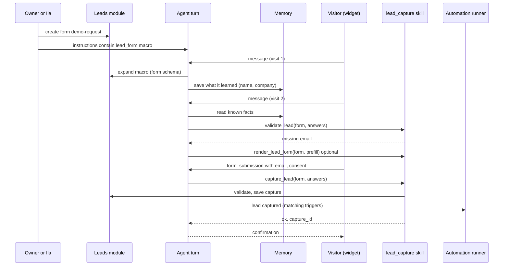
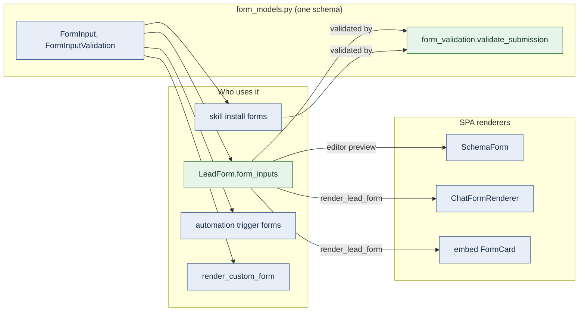
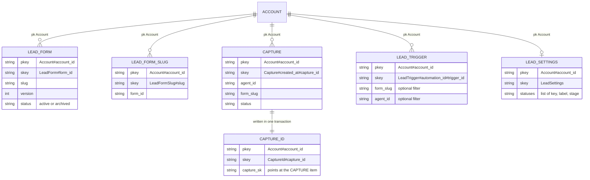
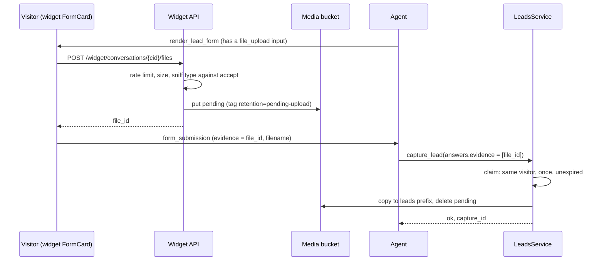
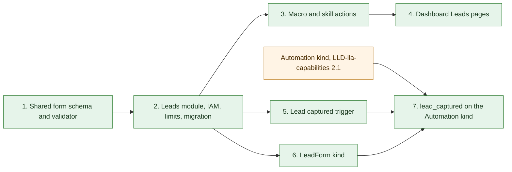

# Leads slice 1: lead forms, agent capture and the Lead captured trigger

| Field | Value |
| --- | --- |
| Status | 🚧 In progress: steps 1 to 6 built and tested; step 7 waits for the `Automation` blueprint kind |
| Owner | vslala |
| Last reviewed | 2026-10-15 |
| Depends on | [LLD-leads-platform.md](LLD-leads-platform.md) (product shape), [api/src/skills/lead_capture](../api/src/skills/lead_capture/manifest.yml), [api/docs/LLD-automations-module.md](../api/docs/LLD-automations-module.md), [LLD-solution-blueprints.md](LLD-solution-blueprints.md), [LLD-ila-capabilities.md §2.1](LLD-ila-capabilities.md#21-automation) (the `Automation` blueprint kind), `docs/LLD-shared-accounts-and-iam.md` |
| Tracker | [KAN-97](https://vslala007.atlassian.net/browse/KAN-97) (epic KAN-63) |

> **Summary:** A new top-level **Leads** module holds lead forms (schemas) and captures. An owner, or Ila,
> defines a form once and drops `{{ lead_form:<slug> }}` into an agent's instructions; each turn the macro
> expands into the form's schema and capture rules. The agent fills the form from the conversation and its
> memory of the visitor, over as many visits as it takes, then calls the `lead_capture` skill's
> `capture_lead`, which validates against the stored form, saves the capture idempotently and fires the new
> **Lead captured** automation trigger. Admins browse captures in the dashboard, filtered by agent, form,
> status and date. Lead forms are ordinary platform forms (`FormInput`), so the dashboard, chat and widget
> renderers show them unchanged and one shared validator checks them. Ila builds the whole solution in one
> blueprint: a `LeadForm`, an `Agent` whose instructions carry the macro, and an `Automation` started by the
> Lead captured trigger.

## Implementation notes

Built on branch `KAN-97-leads` (2026-10-15), steps 1 to 6 of the rollout. Where the code departs from the design
below, this section is right:

- **Statuses** start as the defaults in memory: `LeadSettings` is only written when an admin saves it, so there is no
  write on first read.
- **Text length default** (2000) is filled in by the lead profile (`leads/models.py:visitor_input`) when a form is
  saved, not by the generic validator. Skill configs hold long values (policies, prompts) that a platform-wide default
  would break.
- **File uploads are for stored lead forms only.** `render_custom_form` does not gain `file_upload`: an upload is
  checked against the stored form's own field, and a form the model made up has none.
- **A `LeadForm`'s slug is its blueprint resource name with hyphens** (`demo_request` is `demo-request`). There is no
  `slug` field: one name, so a macro points straight at its resource. An agent may also name a form already in the
  account; the plan checks it exists.
- **Counting a capture** takes the month's next number before saving it. Two identical captures racing each other can
  leave a gap, which only ever lets one fewer capture through that month.
- **Captures made by an agent inside an automation run** come from the owner's actor, so they are test captures
  (`source=dashboard`): not counted, and they fire triggers only with `include_test_captures`. That also keeps an
  automation from triggering itself.
- **"Any form" / "any agent"** in the trigger is `*` (Radix selects can't hold an empty value); the config reads it
  as no filter.
- **Not built in this slice:** the agent instructions editor's "Insert lead form" picker and the unknown-slug warning
  on agent save (the Forms page copies a form's macro, Ila writes it, and an unknown slug renders as "not found");
  the `leads.file_url` smart value (automations get file metadata, members download from the dashboard); deleting
  lead files from S3 on account deletion (the account-deletion Lambda handles DynamoDB only, and only the personal
  account until KAN-83).
- **Refactors on the way:** form submissions are validated in one place (`form_validation.validate_submission`, now
  also used by skill installs); multi-limit upload slots moved to `rate_limits/slots.py`; automation run dispatch
  moved to `automations/dispatch.py`; the runner's run creation is one `_create_run`.

## Decisions from the KAN-97 discussion

These supersede the wording of the ticket where they differ.

| Topic | Decision |
| --- | --- |
| Where it lives | Leads is a top-level module (`api/src/leads/`, dashboard **Leads**). Agents reach it only through the `lead_capture` skill, which stays an ordinary skill. |
| Schema | Defined in the Leads forms editor, stored and versioned. Referenced from agent instructions with a macro so the schema lives in one place and the instructions stay readable. |
| Form format | The platform's one form schema (`form_models.FormInput`), not a lead-specific one. Lead capture adds generic capabilities to it (more validation formats, length and range limits, a shared submission validator) that every form gains. |
| When capture happens | When the agent has every required field, possibly across conversations, using its memory. Not necessarily in one form fill. |
| Delivery to other systems | Through automations started by the Lead captured trigger (REST skill, email, …). No webhook, signing or delivery tracking in Leads. |
| Ila | Builds forms (`LeadForm` kind), agents that use them, and the automations they start. `Automation` becomes a first-class blueprint kind ([LLD-ila-capabilities.md §2.1](LLD-ila-capabilities.md#21-automation)) and is a prerequisite for the last step of this slice. |
| Channels | Wherever the agent runs. The skill calls `LeadsService` directly, so there is no lead route on `/v1` or the widget API; the widget is the main channel because that is where the agent meets visitors. |
| Dashboard captures | Stored with `source=dashboard` so owners can test their agent, and hidden by the default filter. |
| Statuses | Configured per account (default set seeded on first use). |
| Plan limits | Forms and captures per month are tier limits. |
| Positioning | Leads gets its own feature page on the public site and is also part of the Ila story. |
| Contacts | Slice 2. |

KAN-97 acceptance criteria map as follows: the schema is the stored form (version and field snapshot kept on
each capture); "webhook delivery, status, bounded retries, manual retry" become "the Lead captured trigger
starts the owner's automations", whose runs already have status and history.

## Context: what exists today

- Skill [`api/src/skills/lead_capture/`](../api/src/skills/lead_capture/manifest.yml) (displayed as
  "Interactive Forms"): `render_form`, `render_custom_form` (widget forms) and `register_lead`.
- `register_lead` ([`actions.py`](../api/src/skills/lead_capture/actions.py)) writes
  `pk=Agent#{agent_id}`, `sk=Lead#{created_at}#{lead_id}` with a random id, always requires email and
  consent, and nothing reads the items.
- Form submissions come back to the agent as a `<form_submission>` block
  (`spa/src/components/chat/submittedFormParser.ts`).
- Agent instructions are `Agent.agent_persona`, passed as a Jinja **variable** into
  `krishna_memgpt/sections/persona.j2` and `krishna_mini_system_prompt.j2` by
  `KrishnaMemGPTArchitecture` (`agents/architectures/krishna_memgpt.py:293`) and `krishna_mini.py:106`.
  Because it is a variable, not template source, `{{ … }}` in instructions is not evaluated by Jinja today.
- Automation triggers are `manual`, `webhook`, `schedule` (`automations/models.py:39`). Schedule triggers are
  mirrored into the scheduler by `AutomationTriggerLifecycleService.sync_trigger`, and the scheduler starts
  runs with `AutomationRunner.create_scheduled_run` then `execute_run_graph`. `trigger` is a smart-value
  root (`automations/smart_values.py:31`).
- Blueprint kinds are `Agent`, `KnowledgeBase`, `WidgetKey`, `McpConnection` (`blueprints/kinds/`). An
  `Automation` kind is designed in [LLD-ila-capabilities.md §2.1](LLD-ila-capabilities.md#21-automation)
  (trigger plus ordered steps, compiled to the graph) but not built. Ila has no automation tools today
  (`builder/tools.py`), so without that kind she cannot create automations at all.
- Forms are one schema across the platform: `Form` and `FormInput` in `api/src/form_models.py`, mirrored in
  `spa/src/types/form.ts`. Three renderers consume it: `SchemaForm` (dashboard settings, skill installs,
  trigger forms), `ChatFormRenderer` (dashboard chat) and `FormCard` (embed widget, `spa/embed/app/forms.ts`).
  Conventions already in use: required unless `attr.optional="true"` (`FormInput.is_optional`), help under the
  field from `attr.help_text`, checkbox/radio from `attr.variant`, email through
  `validation.format="email"`. Server-side checking is `form_validation.validate_form_value` (email format and
  item counts only), called from skill installs (`skills/registry.py:113`).
- Plan limits are `PricingTierLimits` (`payments/pricing_config.py:9`: agents, messages per month, KB pages,
  memory blocks), enforced by `RateLimitService` with monthly usage records (`rate_limits/`).
- IAM actions are a catalog in `iam/actions.py`. `MemberAccess` grants `*:Create` and `*:List`, and
  `AdministratorAccess` grants `*:List` and `*:Describe`, so a new `leads:List` would reach every member. The
  verbs below are named apart for that reason, as `skills` and `apikeys` are.

## Goals and non-goals

Goals: forms editor on the shared form schema; generic form-schema extensions and a shared submission
validator; macro expansion; capture validated against the form; idempotent, account-scoped captures with
per-account statuses; admin list and detail with filters; plan limits; Lead captured trigger; `LeadForm`
blueprint kind and the `lead_captured` trigger on the `Automation` kind; migration of existing `register_lead`
items.

Non-goals (later slices): contacts and dedupe by person, notes/tags/assignment, export, scoring, follow-ups.
Building the `Automation` kind itself belongs to LLD-ila-capabilities; this slice only adds its trigger
variant.

## Design

### End-to-end flow



Caption: the agent may skip the form and ask in conversation; `render_lead_form` is a convenience.

### 1. Lead forms on the shared form schema

A lead form is not a new form format. It is the platform's `FormInput` list, the same contract the dashboard,
chat and widget already render, wrapped with what Leads needs (slug, purpose, version, status). Leads only
narrows which inputs are allowed and adds generic capabilities to the schema, which every other form then gains.



Caption: green is new. Skill installs move to the shared validator too, so there is one implementation.

**Generic additions to `form_models.py`** (and `spa/src/types/form.ts`):

```python
class FormInputValidationFormat(str, Enum):
    EMAIL = "email"
    PHONE = "phone"      # new: digits, spaces, + - ( ), 6 to 20 digits
    URL = "url"          # new: http:// or https://
    NUMBER = "number"    # new: parses as a number
    DATE = "date"        # new: ISO 8601 date


class FormInputValidation(BaseModel):
    format: FormInputValidationFormat | None = None
    multiple: bool = False
    separator: str = ","
    min_items: int | None = None
    max_items: int | None = None
    min_length: int | None = None   # new
    max_length: int | None = None   # new; text-like inputs default to 2000 when validated
    pattern: str | None = None      # new; compiled on save, max 200 chars
    minimum: float | None = None    # new; with format=number
    maximum: float | None = None    # new
    max_file_bytes: int | None = None   # new; file_upload, per file (lead default 10 MB)
    accept: list[str] | None = None     # new; file_upload, allowed MIME types, checked by sniffing the bytes
```

Input types stay presentational (`text`, `text_area`, `select`, `choice`); what a valid value is lives in
`validation`, as email already does. Renderers map formats to native input types (`email`, `tel`, `url`,
`number`, `date`) as a UI hint only; the server stays authoritative.

**One validator.** `form_validation.validate_submission(inputs, values) -> SubmissionResult` (`values`,
`missing`, `invalid`) generalises `validate_form_value`: required (from `is_optional`), unknown names, every
format and limit, and `select`/`choice` values against their options. `skills/registry.py` switches to it, so
skill installs get length and pattern checks for free.

**The lead profile.** Lead forms are shown to anonymous visitors, so `LeadsService` accepts only a safe subset
of `FormInput`, checked when a form is saved:

| Allowed | Not allowed (dashboard-only) |
| --- | --- |
| `text`, `text_area`, `select`, `choice`, `file_upload` (section 13) | `password`, `key_value`, `search` |
| `validation`, `options`, `values`, `value` (default), `attr` keys `optional`, `help_text`, `variant`, `placeholder`, `agent_hint` | `options_source`, `options_filter`, `smart_suggestion` |

`skills/lead_capture/forms.py:SAFE_INPUT_TYPES` becomes this one list, shared by lead forms and
`render_custom_form`, so both gain `file_upload`. Lead-specific meaning lives in existing conventions rather than new fields:

| Lead need | Expressed as |
| --- | --- |
| Required field | the platform default (required unless `attr.optional="true"`) |
| Guidance for the agent ("ask only after you have helped them") | `attr.agent_hint`: put in the macro, never shown to the visitor |
| Help for the visitor | `attr.help_text`, as today |
| Consent | a required `choice` with one value and `attr.variant="checkbox"`; its label is the consent text |
| Multi-select | `choice` with `attr.variant="checkbox"` and several values |

```python
# api/src/leads/models.py
class LeadForm(BaseModel):
    form_id: str
    account_id: str
    slug: str                        # ^[a-z0-9][a-z0-9-]{1,47}$, unique per account, immutable
    name: str                        # "Demo request"; becomes Form.form_name when rendered
    purpose: str | None = None       # why we collect it; shown to the agent
    form_inputs: list[FormInput]     # 1..30, unique names, lead profile only
    version: int                     # +1 on every form_inputs change
    status: Literal["active", "archived"] = "active"
    created_by: str
    created_at: str
    updated_at: str

    def as_form(self, submit_path: str) -> Form:
        return Form(form_name=self.name, submit_path=submit_path, form_inputs=self.form_inputs)
```

**Slug, not id, in macros.** Slugs are readable in instructions and portable across accounts, so a blueprint
or kit can say `{{ lead_form:demo-request }}` and apply anywhere. Slugs are immutable after create (renaming
the display `name` is free), which keeps every macro valid. Uniqueness is a transaction with a guard item
`LeadFormSlug#{slug}`.

**Archive, don't delete.** Archived forms stop expanding (the macro renders a one-line "not collecting"
note) and stop accepting captures, but existing captures keep their form. Hard delete is only for forms with
no captures.

**Versioning.** Each capture stores `form_version` and a snapshot of the fields it was validated against, so
captures stay readable after the form changes. Old versions are not stored separately.

### 2. The instruction macro

Syntax: `{{ lead_form:<slug> }}`, whitespace inside the braces optional. A namespaced prefix avoids confusion
with automation smart values (`{{ steps.x }}`), and other macro kinds can follow the same shape later.

Expansion happens in Python before prompt rendering, from data the turn already loads (the account's forms
are one query, cached per turn), keeping templates free of I/O as `agents/prompts.py` requires. Macros are a
list of strategies with one expansion function, so the next macro kind is one more entry:

```python
# api/src/agents/instructions.py
@dataclass(frozen=True)
class InstructionMacro:
    prefix: str                                   # "lead_form"
    render: Callable[[str, MacroContext], str]    # (argument, context) -> text


MACRO = re.compile(r"\{\{\s*([a-z_]+):([a-z0-9-]+)\s*\}\}")
MACROS: list[InstructionMacro] = [LEAD_FORM_MACRO]   # from src/leads/macro.py
MAX_MACROS = 5


def expand_instructions(instructions: str, context: MacroContext) -> str:
    """Replace known macros; leave unknown prefixes as written."""
    by_prefix = {macro.prefix: macro for macro in MACROS}
    seen = 0

    def replace(match: re.Match[str]) -> str:
        nonlocal seen
        macro = by_prefix.get(match.group(1))
        if macro is None:
            return match.group(0)
        seen += 1
        if seen > MAX_MACROS:
            return "[lead form skipped: too many forms in these instructions]"
        return macro.render(match.group(2), context)

    return MACRO.sub(replace, instructions)
```

`MacroContext` carries the `account_id`, the forms loaded for the turn and whether `lead_capture` is among
the enabled skills. Both Krishna architectures call `expand_instructions(agent.agent_persona, ctx)` where they
pass `agent_persona` today. Vishwakarma (Ila) does not take owner instructions and is unchanged.

What the lead form macro renders. Each line comes from a `FormInput`: `name`, `input_type`, the validation
format, required or optional, `label`, and `attr.agent_hint`:

```text
<lead_form slug="demo-request" version="3">
Purpose: Understand what the visitor needs so sales can follow up.
Fields:
- name (text, required): Full name.
- email (text, email, required): Work email. Ask only after you have helped them.
- company (text, required)
- team_size (select: 1-10 | 11-50 | 51-200 | 200+, optional): How many people would use it.
- consent (checkbox, required): "I agree to be contacted about my request."
How to capture:
- Gather these over the conversation; you do not need to ask for them all at once.
- Remember what you learn about this visitor in memory, so you can continue on a later visit.
- Use lead_capture validate_lead to see what is missing, and render_lead_form if a form is easier.
- When every required field is known and consent is given, call lead_capture capture_lead with form "demo-request".
- Tell the visitor it is saved only after capture_lead succeeds.
</lead_form>
```

Fallbacks:

| Case | Rendered as |
| --- | --- |
| Unknown slug | `[lead form "x" not found]` and a warning log with agent id |
| Archived form | `[lead form "x" is not collecting]` |
| `lead_capture` not enabled on the agent | The schema block plus "Lead capture is not enabled for this agent; do not claim to save details." |

Visitor text never reaches expansion: only the stored instructions are expanded, so a visitor typing
`{{ lead_form:… }}` changes nothing.

**Authoring.** The agent instructions editor gets an **Insert lead form** picker (lists forms with
`leads:ListForms`) that inserts the macro at the cursor. Saving an agent whose instructions name an unknown
slug returns a warning in the response (not an error), so the form can be created after the agent.

### 3. Skill actions

The skill stays `id: lead_capture` (installs and blueprints reference it); its display name becomes **Lead
Capture**. Actions call `LeadsService`; nothing lead-specific moves into the skill platform.

| Action | Arguments | Result |
| --- | --- | --- |
| `validate_lead` (new) | `form` (slug), `answers: {name: value}` | `{complete, missing: [name], invalid: [{name, reason}]}`; saves nothing |
| `render_lead_form` (new) | `form`, optional `prefill: {name: value}`, `only_missing` (default true) | `ui_form_render` of `LeadForm.as_form(...)`: the stored `FormInput`s, unchanged, so the widget shows the owner's fields, not ones the model invented |
| `capture_lead` (new) | `form`, `answers: {name: value}` | `{ok, capture_id, duplicate}`, or a validation error listing what to fix |
| `render_form`, `render_custom_form` | unchanged | Generic interactive forms for games, choices and ad-hoc questions |
| `register_lead` | unchanged shape, **deprecated** | Saves an ad-hoc capture with no form (`form_slug=null`) so existing agents keep working; the skill prompt points new use at `capture_lead` |

Answers are a `{name: value}` map keyed by `FormInput.name` (values are strings, or lists for multi-value
`choice` inputs) rather than the old `[{field_id, label, value}]` list, because labels now come from the form.
The widget's `<form_submission>` block lists `name` for each field already (`spa/embed/app/forms.ts`), so the
agent can map a submission straight to `answers`.

The skill's `system_prompt` is rewritten around forms: capture over time, keep facts in memory, validate
before capturing, confirm only after success, never invent fields that are not on the form.

All actor kinds may run the actions; each capture records `actor_kind`. The skill calls `LeadsService` in
process, so no channel needs a lead route of its own. Captures from dashboard chat, where owners test their
agents, are stored with `source=dashboard` and hidden by the default list filter (a "Show test captures"
toggle shows them). They do not count towards plan limits and do not fire triggers unless the owner turns on
"Fire automations for test captures" on the trigger, so testing an automation end to end stays possible.

### 4. Validation

`capture_lead` and `validate_lead` call `form_validation.validate_submission(form.form_inputs, answers)`
(section 1); Leads adds no validation of its own beyond two checks:

| Rule | Behaviour |
| --- | --- |
| Unknown names | Rejected (`invalid: unknown field`), so the model cannot add fields |
| Required | From `is_optional`; missing or blank required inputs are listed in `missing` |
| Formats and limits | `validation.format` (email, phone, url, number, date), `min_length` / `max_length` (text default max 2000), `pattern`, `minimum` / `maximum` |
| `select` / `choice` | Every value must be one of the input's options or values (case-insensitive, stored with the option's casing); a required single-value checkbox (consent) must be ticked |
| Total size (Leads) | Serialized answers at most 16 KB |
| Form state (Leads) | Archived forms reject captures |

The account comes from the run context (`runtime_context.account_of`) and the form is looked up in that
account, so arguments can never point a capture at another account.

### 5. Captures

```python
class Capture(BaseModel):
    capture_id: str
    account_id: str
    form_id: str | None        # None for legacy/ad-hoc register_lead captures
    form_slug: str | None
    form_name: str             # form name, or the ad-hoc form_label
    form_version: int | None
    form_inputs: list[FormInput]  # snapshot used for validation and display
    answers: dict[str, str | list[str]]
    agent_id: str
    conversation_id: str | None
    actor_kind: str            # widget visitor, dashboard, api, automation
    actor_id: str              # the widget visitor id for widget captures
    actor_email: str | None
    source: Literal["widget", "dashboard", "api", "automation"]
    status: str                # a key from the account's LeadSettings.statuses
    files: list[CaptureFile] = []   # uploads claimed by this capture (section 13)
    month_seq: int | None = None    # this capture's number in its month; None for test captures (section 12)
    created_at: str
    updated_at: str
```

**Idempotency.** The id is derived from what makes two captures the same lead:

```python
def capture_id_for(account_id: str, form_id: str, actor_id: str, answers: dict) -> str:
    canonical = json.dumps([account_id, form_id, actor_id, answers], sort_keys=True, separators=(",", ":"))
    return hashlib.sha256(canonical.encode()).hexdigest()[:32]
```

The conversation is left out on purpose: a visitor captured on visit 2 and again with identical answers on
visit 3 is one lead. Different answers make a new capture; merging those into one person is slice 2
(contacts).

**Keys.** Captures are newest-first per account, and look-ups by id go through a guard item that is also the
idempotency check:



Caption: `pkey` and `skey` are the table's `pk` and `sk` (Mermaid reserves `pk` as a key marker). All items sit in the account partition, built with `Owner.account_pk`. `LEAD_TRIGGER` is section 7.

- Save: `transact_write_items` of `CAPTURE` and `CAPTURE_ID`, the latter with
  `attribute_not_exists(pk)`. On cancellation by that condition, read the existing capture and return it
  with `duplicate: true`.
- List: `Key("pk").eq(...) & Key("sk").between("Capture#{since}", "Capture#{until}~")`, descending. Date
  range is a key condition; `agent_id`, `form_slug`, `status`, `source` are a `FilterExpression`, with the
  repository paging until it fills `limit` or runs out. Adequate for thousands of captures per account; a GSI
  on `(account_id#agent_id, created_at)` is the upgrade path (Terraform change in `terraform/dynamodb.tf`).
- Get by id: read `CAPTURE_ID`, then the item at `capture_sk`.
- Status change: update the `CAPTURE` item found through `CAPTURE_ID`.

**Statuses are per account.** `LeadSettings.statuses` is an ordered list of `{key, label, stage}` where
`stage` is `open`, `won` or `lost`, so later reporting and the board view (slice 3) can group any account's
custom statuses. The first status is what new captures get.

```python
DEFAULT_STATUSES = [
    LeadStatus(key="new", label="New", stage="open"),
    LeadStatus(key="contacted", label="Contacted", stage="open"),
    LeadStatus(key="qualified", label="Qualified", stage="open"),
    LeadStatus(key="won", label="Won", stage="won"),
    LeadStatus(key="lost", label="Lost", stage="lost"),
]
```

- The item is written on first read if missing (conditional put), so every account starts with the defaults.
- Keys are immutable (`^[a-z][a-z0-9_]{0,31}$`); labels, order and stage are editable. 1 to 20 statuses.
- Removing a status that captures still use requires a `replace_with` key; the service re-labels those
  captures in pages, then saves the settings. Captures store the key, so renaming a label costs nothing.

### 6. Leads API

New module `api/src/leads/` (`router.py`, `service.py`, `repository.py`, `models.py`, `macro.py`, `errors.py`,
`CONTRIBUTION.md`), router registered in `main.py`, following `automations/` for the router/service/repository
split and error translation.

| Route | IAM action | Purpose |
| --- | --- | --- |
| `GET /leads/forms` | `leads:ListForms` | Forms (for the editor and the macro picker) |
| `POST /leads/forms` | `leads:ManageForms` | Create; 409 on a taken slug |
| `GET /leads/forms/{form_id}` | `leads:ListForms` | One form |
| `PUT /leads/forms/{form_id}` | `leads:ManageForms` | Update `form_inputs` (bumps version), name, purpose |
| `POST /leads/forms/{form_id}/archive`, `/restore` | `leads:ManageForms` | |
| `DELETE /leads/forms/{form_id}` | `leads:ManageForms` | Only with no captures (409 otherwise) |
| `GET /leads/captures?agent_id=&form=&status=&source=&since=&until=&limit=&cursor=` | `leads:ViewCaptures` | Newest first; `limit` default 25, max 100; cursor is the base64 `LastEvaluatedKey` |
| `GET /leads/captures/{capture_id}` | `leads:ViewCaptures` | Detail with field snapshot |
| `PATCH /leads/captures/{capture_id}` | `leads:ManageCaptures` | Status |
| `DELETE /leads/captures/{capture_id}` | `leads:ManageCaptures` | Remove a capture (privacy requests) |
| `GET /leads/settings` | `leads:ListForms` | Statuses (every member needs labels to read the page) |
| `PUT /leads/settings` | `leads:ManageSettings` | Edit statuses, with `replace_with` for removed ones in use |
| `GET /leads/usage` | `leads:ViewCaptures` | Forms and captures this month against the plan limits |

Every route takes `Depends(get_principal)`; the account comes only from the principal. A foreign `agent_id`
filter yields an empty list; a foreign id is a 404.

### 7. The Lead captured trigger

```python
class AutomationTriggerType(str, Enum):
    MANUAL = "manual"
    WEBHOOK = "webhook"
    SCHEDULE = "schedule"
    LEAD_CAPTURED = "lead_captured"


class LeadCapturedTriggerConfig(BaseModel):   # automations/triggers/models.py
    form_slug: str | None = None   # None: any form
    agent_id: str | None = None    # None: any agent in the account
    include_test_captures: bool = False   # also fire for source=dashboard
```

- **Form.** `build_lead_captured_trigger_form` in `automations/triggers/schemas.py`, served by the existing
  `GET /automations/{id}/triggers/forms/lead_captured` (add the branch to the strategy that picks a builder,
  next to schedule and manual). Options are the account's forms and agents.
- **Validation.** Strict mode checks the slug and agent exist in the account.
- **Registration.** `AutomationTriggerLifecycleService.sync_trigger` already mirrors schedule triggers into
  the scheduler. Give it a second strategy that writes `LEAD_TRIGGER` when the automation is active and the
  trigger enabled, and deletes it otherwise (also on trigger or automation delete).
- **Firing.** After a capture is saved and not a duplicate, `LeadsService` queries `LeadTrigger#` for the
  account, keeps those whose filters match, and for each loads the graph and starts a run as the automation's
  owner through a new `AutomationRunner.create_event_run(graph, owner, trigger, event)` (same shape as
  `create_scheduled_run`), then dispatches it the way test runs are dispatched. `invoke_automation_run_async`
  moves from `automations/router.py` into `automations/dispatch.py` so both can call it.
- **Run context.** `context.trigger = {"type": "lead_captured", "trigger_id": ..., "lead": <payload>}`, so
  steps use `{{ trigger.lead.answers.email }}`, `{{ trigger.lead.capture_id }}`, `{{ trigger.lead.form_slug }}`.
- **Failures.** Starting a run never fails the capture; errors are logged with the capture id. The run's own
  status and history are the delivery record.
- **Loops.** A capture made by an agent inside an automation run (`source=automation`) does not fire that same
  automation's triggers.
- **Not fired** for duplicates, for `source=dashboard` unless `include_test_captures`, and for captures past
  the monthly limit (section 12).
- **Blueprints.** The `Automation` kind's `trigger` (one of `manual` or `schedule` in LLD-ila-capabilities §2.1)
  gains a third variant, `lead_captured: {form, agent, include_test_captures}`, where `form` names a
  `LeadForm` slug and `agent` an `Agent` in the blueprint or an existing one (section 8).

Lead payload (documented, stable):

```json
{
  "capture_id": "9f2c…",
  "form_slug": "demo-request",
  "form_name": "Demo request",
  "form_version": 3,
  "agent_id": "…",
  "conversation_id": "…",
  "source": "widget",
  "status": "new",
  "answers": {"name": "Jane Doe", "email": "jane@acme.com", "company": "Acme", "consent": "yes"},
  "form_inputs": [{"input_type": "text", "name": "email", "label": "Work email", "validation": {"format": "email"}}],
  "created_at": "2026-10-14T10:12:00Z"
}
```

### 8. Ila: forms, agents and automations in one blueprint

Ila builds a lead solution end to end: the form, the agent that uses it, the widget, and the automation that
acts on each capture. That needs two kinds: `LeadForm` (new, here) and `Automation` (designed in
[LLD-ila-capabilities.md §2.1](LLD-ila-capabilities.md#21-automation), now a prerequisite for this slice's
last step). Both are registered in `RESOURCE_KINDS`, so the JSON Schema, reference, catalog and Ila's book
pages pick them up with no per-kind branching.

```yaml
resources:
  demo_request:                        # slug: demo-request
    kind: LeadForm
    description: What sales needs before a demo call.
    name: Demo request
    purpose: Understand what the visitor needs so sales can follow up.
    form_inputs:                       # the platform FormInput schema, lead profile
      - {input_type: text, name: name, label: Full name}
      - input_type: text
        name: email
        label: Work email
        validation: {format: email}
        attr: {agent_hint: Ask only after you have helped them.}
      - {input_type: text, name: company, label: Company}
      - input_type: select
        name: team_size
        label: Team size
        options: [{value: "1-10", label: "1-10"}, {value: "11-50", label: "11-50"}, {value: "51+", label: "51+"}]
        attr: {optional: "true"}
      - {input_type: choice, name: consent, label: I agree to be contacted, values: ["yes"], attr: {variant: checkbox}}

  qualifier:
    kind: Agent
    name: "{{ params.business_name }} lead qualifier"
    provider: "{{ params.provider }}"
    instructions: |
      You are the website assistant for {{ params.business_name }}.
      {{ lead_form:demo-request }}
    skills:
      - id: lead_capture
        available_to: [visitor, guest]

  sync_to_crm:
    kind: Automation
    title: Send demo requests to the CRM
    enabled: true
    trigger:
      lead_captured:
        form: demo-request
        agent: qualifier
    skills:
      - id: rest_template
    steps:
      - name: post_lead
        skill: rest_template
        action: post
        arguments:
          url: "{{ params.crm_webhook_url }}"
          json_body:
            email: "{{ trigger.lead.answers.email }}"
            name: "{{ trigger.lead.answers.name }}"
            company: "{{ trigger.lead.answers.company }}"
            capture_id: "{{ trigger.lead.capture_id }}"
```

**`LeadForm` kind** (`api/src/blueprints/kinds/lead_form.py`):

- **Spec.** `slug`, `name`, `purpose`, `form_inputs`. `form_inputs` reuses the `FormInput` model, so the
  blueprint JSON Schema documents it from the same descriptions; the lead profile is checked at plan time with
  the same function `LeadsService` uses on save.
- **Matching** by `slug` in the account. If a form with that slug exists and this kit does not own it,
  planning reports a blocker, as agent names do today.
- **Diff rules.** `form_inputs` compared as a keyed list by `name`; a change bumps the version on apply.
- **Undo.** Create is undone by delete (no captures exist yet); update by restoring the previous inputs as a
  new version. Removal archives rather than deletes when captures exist.

**Blueprint templates must let macros through.** `validator.py` matches every `{{ … }}` with `TEMPLATE` and
reports anything that is not `params.*` or `resources.*` as "isn't something a blueprint can fill in"; the fill
step (`validator.py:267`, `executor.py:184`) rewrites every match. Agent `instructions` must recognise an
instruction macro (import `MACRO` from `agents/instructions.py`) and leave it untouched. This sits beside the
`x-smart-values` carve-out that LLD-ila-capabilities §2.1 adds for automation fields (which is what lets
`{{ trigger.lead.answers.email }}` through above): mark `instructions` with `x-instruction-macros`, read by the
same check.

**References.** The validator scans Agent `instructions` for `lead_form` macros, and reads
`trigger.lead_captured.form`; each slug must be a `LeadForm` in the blueprint or an existing form in the
account. `trigger.lead_captured.agent` is an ordinary `x-ref-kind: Agent` field. The planner orders
`LeadForm`, then `Agent`, then `Automation`, and removal in reverse. `references.py` reads `x-ref-kind`
fields today; add a "macro references" extractor beside it rather than a kind-name branch.

**Ila's tools and book.** No new tools: Ila already edits a draft, plans and applies. The book gains a
`LeadForm` page and a lead-capture recipe (the example above, which replaces
`blueprints/examples/lead-qualifier.yaml`, whose instructions today ask for a free-form form and email).

### 9. IAM

```python
# iam/actions.py: Leads is account configuration plus account data, so its actions act on the account.
*_service("leads", ACCOUNT, metadata=["ListForms", "ManageForms", "ManageSettings", "ViewCaptures", "ManageCaptures"], contents=[]),
```

- `AdministratorAccess` adds `"leads:*"`. The account owner is always an admin.
- `MemberAccess` adds `"leads:ListForms"`, so members can insert forms into their agents' instructions.
- `ViewOnlyAccess` adds `"leads:ListForms"` (and not captures, which are personal data).
- The verbs are deliberately not `List` / `Describe`, which the member and view-only wildcards would grant.

### 10. Dashboard

Top-level **Leads** in `spa/src/components/dashboard/Sidebar.tsx`, routes in `spa/src/App.tsx`, pages in
`spa/src/pages/dashboard/leads/` following `spa/AGENTS.md`:

- **Captures** (`/dashboard/leads`): table (received, agent, form, status, email when present, preview of
  answers); filters for agent, form, status, source and date range, kept in query params; detail drawer
  showing every field by label from the snapshot, conversation link, status select, delete. Values render as
  text, never HTML.
- **Forms** (`/dashboard/leads/forms`, `/dashboard/leads/forms/:formId`): list with capture counts; editor for
  name, slug (create only), purpose and the `FormInput` list (add, reorder, remove; input type, label,
  required, format and limits, options, help text, agent hint). It edits the shared types from
  `spa/src/types/form.ts`, previews with the same renderer the widget uses (`FormCard`), and shows the
  copyable macro. The input editor lives in `spa/src/components/forms/` as `FormInputEditor`, since it edits
  the shared schema and nothing in it is lead-specific.
- **Settings** (`/dashboard/leads/settings`): statuses (add, rename, reorder, stage, remove with replacement)
  and usage against the plan.
- **Agent instructions editor:** an **Insert lead form** picker.
- **Automation trigger editor:** the new trigger type renders through `SchemaForm` from its form schema.
- Empty states link Captures → Forms → "install Lead Capture on an agent", and offer "Ask Ila to build it".
- All three renderers (`SchemaForm`, `ChatFormRenderer`, `FormCard`) learn the new validation formats as
  native input types and show `min_length` / `max_length` as attributes.

### 11. Migration and deletion

- `api/scripts/migrate_leads_to_captures.py` reads `Agent#{agent_id}` / `Lead#…` items, finds each agent's
  account, writes ad-hoc captures (`form_id=null`, answers keyed by `field_id`, `form_name` from
  `form_label`) through the repository's idempotent save, and deletes the originals. Run once per environment
  and report its counts.
- Agent deletion keeps captures. Account deletion removes every `LeadForm*`, `Capture*`, `CaptureId#` and
  `LeadTrigger#` item; add them to the account-delete path.

### 12. Plan limits

`PricingTierLimits` gains two limits. `0` means unlimited, as for the existing ones. The values live in the
per-environment pricing files (`payments/{dev,uat,prod}_pricing_config.json`), so changing a tier is a
one-property edit and a deploy, with no code change:

```python
class PricingTierLimits(BaseModel):
    agents: int
    messages_per_month: int
    kb_pages: int
    memory_blocks: int
    lead_forms: int = 0                 # new: active forms per account
    lead_captures_per_month: int = 0    # new: captures per calendar month (UTC)
```

Starting values (a product decision to revisit; the pricing page lists them):

| Tier | `lead_forms` | `lead_captures_per_month` |
| --- | --- | --- |
| free | 1 | 25 |
| starter | 5 | 500 |
| pro | 25 | 5,000 |
| enterprise | 0 (unlimited) | 0 (unlimited) |

- **Forms.** `RateLimitService.check_lead_form_limit` runs on create and restore, counting active forms; the
  `LeadForm` blueprint kind reports it as a plan blocker that links to the upgrade page, as other limits do.
- **Counting.** A monthly counter `Account#{aid}` / `LeadUsage#{yyyy-mm}` is incremented in the same
  transaction as the capture, and the new value is stored on the capture as `month_seq`. Duplicates (cancelled
  transactions) never count; test captures (`source=dashboard`) are not counted and have no `month_seq`. The
  counter is per account, unlike the per-user message counters in `rate_limits/`, because leads belong to the
  account. The tier is the account owner's.
- **Past the limit, captures are kept but locked.** A visitor's details are never thrown away because of a
  quota, but the owner does not get them until they upgrade. Locking is computed when reading, never stored:

  ```python
  def is_locked(capture: Capture, limit: int) -> bool:
      return limit > 0 and capture.month_seq is not None and capture.month_seq > limit
  ```

  So upgrading unlocks the month's captures at once, with no backfill, and a downgrade locks them again.
- **What locked means.** The list omits locked captures and returns `locked_count` for the page's upgrade
  banner ("12 more leads this month. Upgrade to see them."). Detail, status changes and file downloads return
  `402` with code `LEAD_LOCKED`. The trigger does not fire for a capture that is locked when it is saved, and an
  upgrade does not fire it later; the owner can re-run an automation by hand. The visitor and the agent see a
  normal success: the visitor's experience never depends on the owner's plan.
- **Deletion** of locked captures is still allowed (privacy requests), by id from the support route only; the
  dashboard cannot list them.

### 13. File uploads in lead forms

Some forms need evidence (a photo of damage, a receipt, a document), so `file_upload` is part of the lead
profile and works in the widget. It follows the pattern the vision feature built for widget images
(`api/src/vision/`, [LLD-image-input-and-read-image-tool.md](LLD-image-input-and-read-image-tool.md)): upload
first as **pending**, then **claim** once.



Caption: the agent handles only the opaque `file_id`; it never reads or forwards the bytes.

- **Validation.** `validation.max_file_bytes` (lead default 10 MB, ceiling 25 MB), `validation.accept` (lead
  default: `image/png`, `image/jpeg`, `image/webp`, `application/pdf`), `validation.multiple` and
  `max_items` (default 1, ceiling 5). The type is sniffed from the bytes, not the extension or the browser's
  header. The upload route checks the form's own input, found by `form_slug` and input `name` in the request,
  so a visitor cannot upload to an input that does not exist or exceed its limits.
- **Upload route.** `POST /widget/conversations/{conversation_id}/files` (multipart: `file`, `form`, `input`),
  next to the image route in `widget/router.py`, with the same visitor and key checks. Rate limits are new
  settings beside the image ones: `widget_file_uploads_per_visitor_hour` (default 10) and
  `widget_file_uploads_per_key_day` (default 200), in `config/settings.py` and `scripts/deploy_prod_railway.sh`.
  A pending upload is a ledger row `CONVERSATION#{cid}` / `LEADFILE#{file_id}` with `ttl`, plus the S3 tag the
  bucket's existing lifecycle rule already expires (`terraform/conversation_media.tf`).
- **Claim.** `capture_lead` resolves each `file_id` in a `file_upload` answer: it must be pending, uploaded by
  the capture's `actor_id` in the same conversation, for that form and input, and not expired. The claim is a
  conditional update, so a retried capture (same capture id) does not claim twice.
- **Where the bytes live.** Conversation media is deleted with the conversation, and guest conversations are
  short-lived, so claimed files are copied to `leads/{account_id}/{capture_id}/{file_id}.{ext}` in the same
  bucket and the pending object deleted. They live as long as the capture. No new bucket and no Terraform
  change: the `leads/` prefix is outside every prefix delete.
- **On the capture.** `CaptureFile{file_id, input_name, filename, content_type, size_bytes, s3_key}`; the answer
  keeps the `file_id`s.
- **Downloads.** `GET /leads/captures/{capture_id}/files/{file_id}` (`leads:ViewCaptures`, `402` when locked)
  returns a short-lived presigned URL with `Content-Disposition: attachment` and the sniffed content type, so a
  file never renders inline on our origin. The dashboard shows images as thumbnails through the same URL.
- **Automations.** The lead payload lists files as `{file_id, filename, content_type, size_bytes}` without URLs.
  A step that needs the bytes asks for a fresh presigned URL through a `leads.file_url` smart value, resolved at
  run time and valid for the presign TTL (`conversation_media_presign_ttl_seconds`).
- **Agent and macro.** The macro marks file inputs ("ask with render_lead_form; files cannot be typed in chat").
  The agent does not see file contents in this slice; reading uploaded images with `read_image` is a later
  addition.
- **Dashboard chat.** `ChatFormRenderer` gets the same file control, using the dashboard's own upload route, so
  owners can test file forms with `source=dashboard`.
- **Deletion.** Deleting a capture deletes its `leads/{aid}/{capture_id}/` prefix; account deletion deletes
  `leads/{aid}/`.
- **Not in this slice: malware scanning.** Files are only ever downloaded as attachments by account members,
  and types are restricted. Scanning (for example S3 malware protection) is a follow-up before raising the
  allowed types beyond images and PDF.

## Implementation map

| Area | Code | Responsibility |
| --- | --- | --- |
| Shared forms | `api/src/form_models.py`, `api/src/form_validation.py`, `skills/registry.py`, `spa/src/types/form.ts`, `SchemaForm`, `ChatFormRenderer`, `spa/embed/app/components/FormCard.tsx`, `spa/src/components/forms/FormInputEditor.tsx` (new) | New formats and limits, `validate_submission`, renderers, the input editor |
| Leads domain | `api/src/leads/` (new) | Forms (lead profile), captures, statuses, usage, trigger fan-out, macro renderer |
| Macros | `api/src/agents/instructions.py` (new); `krishna_memgpt.py`, `krishna_mini.py` | Expand instructions before prompt render |
| Skill | `api/src/skills/lead_capture/manifest.yml`, `actions.py` | New actions, rewritten prompt, `register_lead` via `LeadsService` |
| Automations | `automations/models.py`, `triggers/models.py`, `triggers/schemas.py`, `triggers/service.py`, `validation.py`, `runner.py`, `dispatch.py` (new) | Trigger type, form, validation, registration, event runs |
| Blueprints | `blueprints/kinds/lead_form.py` (new), `kinds/__init__.py`, `references.py`, `validator.py`, `spec.py` (`lead_captured` trigger variant on `AutomationSpec`), `examples/lead-qualifier.yaml` | `LeadForm` kind, macro references, Automation trigger variant |
| Plans | `payments/pricing_config.py`, `payments/*_pricing_config.json`, `rate_limits/service.py` | `lead_forms`, `lead_captures_per_month`, locking |
| Files | `widget/router.py` (upload route), `leads/files.py` (new: ledger, claim, copy, presign), `config/settings.py`, `scripts/deploy_prod_railway.sh`, `spa/embed/app/components/FormCard.tsx`, `ChatFormRenderer` | Lead form file uploads |
| IAM | `iam/actions.py`, `iam/builtins.py` | `leads:*` actions and policy grants |
| Agents | `agents/service.py` | Unknown-slug warning on save |
| Migration | `api/scripts/migrate_leads_to_captures.py` (new) | Re-key legacy leads |
| SPA | `spa/src/pages/dashboard/leads/` (new), `Sidebar.tsx`, `App.tsx`, agent instructions editor, trigger editor | Leads pages and pickers |
| Docs | this file, [LLD-leads-platform.md](LLD-leads-platform.md), [LLD-ila-capabilities.md](LLD-ila-capabilities.md) §2.1 (trigger variant), `docs/AGENTS.md`, `api/AGENTS.md` module map, `spa/src/components/forms/CONTRIBUTION.md`, wiki copies | |

Two new environment variables (the file upload rate limits). No Terraform change unless the capture GSI is
added.

## Rollout



Caption: orange is the prerequisite from LLD-ila-capabilities. Steps 1 to 6 do not wait for it.

1. Shared form schema: formats, limits, `validate_submission`, renderers; skill installs move to the validator.
2. `leads/` module, statuses, IAM, plan limits, forms and captures API, with `register_lead` writing through
   it; run the migration.
3. Macro expansion and the new skill actions.
4. Dashboard Leads pages, the input editor and the instructions picker.
5. Lead captured trigger in the automations module and dashboard.
6. `LeadForm` blueprint kind; Ila can build form plus agent.
7. Once the `Automation` kind lands, its `lead_captured` trigger variant and the full recipe above.

Each step is additive; agents without macros behave exactly as before.

## Validation

`api/tests/test_leads_*.py`, plus existing suites for the touched modules:

- Forms: slug rules and uniqueness under a race, field validation (bad regex, duplicate keys, option limits),
  version bump, archive and restore, delete blocked with captures.
- Shared validator: every format, length and range limits, pattern, options, required via `attr.optional`,
  unknown names; skill installs still pass their existing tests through it.
- Lead profile: forms with `password`, `file_upload`, `options_source` and other dashboard-only parts are
  rejected on save and at plan time.
- Statuses: defaults seeded once; removing a used status needs `replace_with` and re-labels captures.
- Plan limits: form limit blocks create and restore; past the capture limit captures are stored, omitted from
  the list with a `locked_count`, return `402 LEAD_LOCKED` on detail and download, and do not fire triggers;
  raising the tier limit unlocks them with no write; duplicates and test captures do not count.
- Files: type sniffing rejects a renamed executable; oversize and too many files rejected; a visitor cannot
  claim another visitor's upload or one from another conversation, form or input; a retried capture claims
  once; expired pending uploads are refused; claimed files survive conversation deletion; download is
  attachment-only and 402 when locked; capture deletion removes the files.
- Incomplete capture: `capture_lead` with a missing required field returns the list and writes nothing.
- Idempotency: the same capture twice gives one item and `duplicate: true`; different answers give two.
- Isolation: another account's admin gets 404 and empty lists; a forged `agent_id` filter yields nothing; the
  account comes from context even if arguments name one.
- IAM: a member can list forms but not captures; view-only cannot see captures; an admin can do everything.
- Macros: expansion, unknown slug, archived form, skill not enabled, more than five macros, visitor text not
  expanded, unknown prefixes left untouched.
- Trigger: fires for matching form/agent filters only; not for duplicates; not into the same automation from an
  automation-sourced capture; a failing run start does not fail the capture; `trigger.lead` smart values resolve.
- Blueprints: `LeadForm` validates, macros pass the template check, references order forms, agents and
  automations, a missing slug is an issue, apply and undo; with the Automation kind, the full recipe applies
  and a test capture (with `include_test_captures`) runs the automation.
- Test captures: stored with `source=dashboard`, hidden by default, not counted, not fired unless opted in.
- Migration: legacy items become captures; a second run is a no-op.
- SPA: filters drive the query, answers render as text, form editor preview.
- Manual end to end on an embedded widget across two visits: details learned on visit 1 are remembered, the
  capture happens on visit 2, it appears under Leads, and an automation posts it with the REST skill.

Commands: `uv run pytest tests/ -q -k "leads or lead_capture or automation_trigger or blueprint"` while working,
then `uv run pytest -q`; `uv run ruff check` and `mypy` on touched files; the SPA test and lint commands in
`spa/AGENTS.md`.

## Alternatives and decisions

- **Schema written in natural language in the instructions.** Rejected: no server-side validation, and the
  schema is duplicated across agents.
- **A generic skill data space (store plus manifest-declared views).** Deferred: one consumer, and Leads needs
  a real domain model (status, forms, later contacts). Revisit when a second skill needs browsable data.
- **A lead-specific field model** (`LeadField` with its own types, which an earlier draft of this LLD had).
  Rejected: a fourth form vocabulary next to `FormInput` would need its own renderers, editor and validator.
  Extending `FormInput` gives every form the same validation and lets the widget render lead forms unchanged.
- **Form ids in macros.** Rejected for slugs: readable and portable across accounts and kits.
- **Expanding macros through Jinja.** Rejected: instructions are owner text; making them template source would
  let owners call arbitrary template features and break on stray braces.
- **Webhooks in Leads.** Rejected: automations with the REST skill already deliver, retry and record runs.
- **Including the conversation in the capture id.** Rejected: capture over several visits would duplicate.

## Open questions

1. Malware scanning for uploaded files: which service, and is it needed before launch or before widening the
   allowed types?
2. A YAML file for tier rules and features (tracked separately, see the Jira ticket): limits stay in the
   pricing JSON until then.

## Related documentation

- [LLD-leads-platform.md](LLD-leads-platform.md)
- [LLD-public-api-and-embeddable-widget.md](LLD-public-api-and-embeddable-widget.md)
- [api/src/skills/SKILL_MANIFEST.md](../api/src/skills/SKILL_MANIFEST.md)
- [api/docs/LLD-rest-template-skill.md](../api/docs/LLD-rest-template-skill.md)
- [spa/docs/LLD-automation-smart-values.md](../spa/docs/LLD-automation-smart-values.md)
- [docs/AGENTS.md](AGENTS.md)
