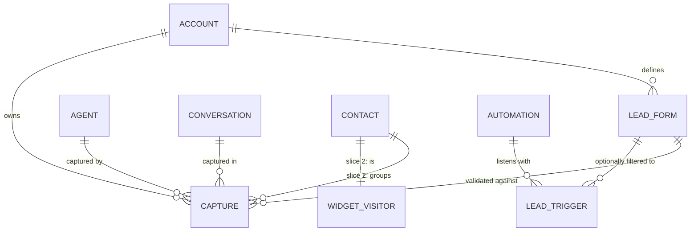
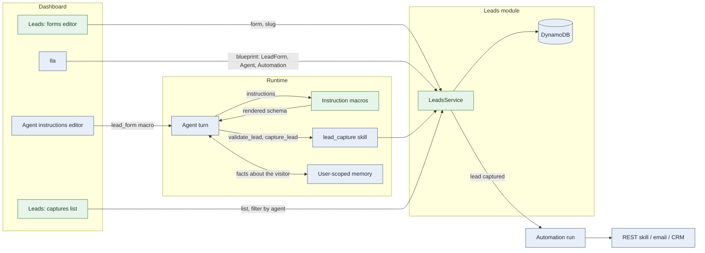

# Leads: an agent-driven lead platform

| Field | Value |
| --- | --- |
| Status | 📝 Proposed |
| Owner | vslala |
| Last reviewed | 2026-10-15 |
| Depends on | [LLD-public-api-and-embeddable-widget.md](LLD-public-api-and-embeddable-widget.md), [api/docs/LLD-memory-block-user-scoping.md](../api/docs/LLD-memory-block-user-scoping.md), [api/docs/LLD-automations-module.md](../api/docs/LLD-automations-module.md), [LLD-solution-blueprints.md](LLD-solution-blueprints.md) |
| Tracker | [KAN-97](https://vslala007.atlassian.net/browse/KAN-97) (slice 1), epic KAN-63 |

> **Summary:** Leads is a top-level product module: lead forms (the schemas), captures (what was collected)
> and, later, contacts. It is driven by agents, not by forms on a page. An agent talks to a visitor, learns
> about them over time through its memory, and when a form's information is complete it calls the
> `lead_capture` skill to save it. Saving fires a **Lead captured** automation trigger, which is how leads
> reach CRMs, email and anything else (through the REST skill and other actions). Ila builds all of it.
> This document is the product shape and the slices; [LLD-lead-capture.md](LLD-lead-capture.md) is the
> detailed design for slice 1.

## Why this shape

What sets InnomightLabs apart is agentic workflows and integrations, so the lead platform is a capability
those agents use, not a form builder with a chat bubble.

| Principle | What it means in the design |
| --- | --- |
| Agents are the driver | Forms are never shown to visitors on their own. An agent decides when to ask, what to ask, and when the lead is complete. |
| Capture over time | The agent does not interrogate. It fills a form from the conversation and from memory across visits, and captures once the required fields are known. |
| One door for agents | Agents reach Leads only through the `lead_capture` skill. No special case in the skill architecture: the skill is a thin client over the `leads/` module, as the `scheduler` skill is over `src/scheduler/` and `upload_file` over `src/artifacts/`. |
| One place for the schema | A lead form is defined once under Leads and referenced from agent instructions with a macro (`{{ lead_form:demo-request }}`), expanded into the prompt each turn. |
| One form format | Lead forms are the platform's `FormInput` schema, the same one dashboard settings, skill installs, chat forms and the widget use. Leads extends that schema (validation formats, limits, one shared validator) instead of defining its own. |
| Integrations are automations | No webhook machinery in Leads. A **Lead captured** trigger starts an automation; the REST skill, email and other actions deliver it. |
| Ila builds it | `LeadForm` and `Automation` are blueprint kinds, so Ila creates the form, puts its macro in an agent's instructions and wires the automation that acts on each capture, in one plan. |

## Domain model

Caption: `CONTACT` arrives in slice 2. Everything else is slice 1.

| Entity | What it is |
| --- | --- |
| Lead form | A named, versioned list of `FormInput`s (the platform form schema, limited to inputs safe for visitors), with a purpose for the agent. Has an immutable account-unique `slug` used by macros and blueprints. |
| Capture | One completed submission against one form version: the answers, which agent and conversation, the visitor, a status from the account's own status list, and a stable id. |
| Lead captured trigger | An automation trigger type, optionally filtered by form and agent. |
| Contact (slice 2) | One person across captures, deduplicated by email and linked to the widget visitor, so their conversations and the agent's memory of them are one click away. |

## How it fits together

Caption: green is new, blue exists today. The skill already exists and gains actions.

## Slices

Each slice ships on its own and is useful alone. Take features from established lead tools one at a time,
and only where an agent makes them better.

| Slice | Scope | Detailed design |
| --- | --- | --- |
| **1. Forms and captures** (KAN-97) | Lead forms on the shared form schema; the instruction macro; skill actions to render, validate and capture against a form; captures list and detail, filterable by agent, form, status and date; per-account statuses; plan limits; test captures from dashboard chat; the Lead captured automation trigger; `LeadForm` blueprint kind, and the trigger on the `Automation` kind once that lands. | [LLD-lead-capture.md](LLD-lead-capture.md) |
| 2. Contacts | Deduplicate captures into contacts by email; link a contact to the widget visitor and their memory blocks; contact timeline (captures and conversations); contact deletion that also removes captures and memory. | to write |
| 3. Pipeline and team work | Notes, tags, assignment to a member, a board view by status, CSV export, an email to the owner on a new lead (or left to automations). | to write |
| 4. Agent intelligence | The agent qualifies and scores a lead from the conversation (a `qualification` block on the capture); follow-ups through scheduler wakeups using what it remembers. | to write |

## Privacy across the platform

- Visitor messages and agent-supplied answers are untrusted. The account, agent and form a capture belongs
  to come from the run context and the stored form, never from arguments.
- Captures are personal data. Reading them is gated by IAM (see slice 1) and they are never returned to
  widget visitors.
- Forms carry consent text; a form with a consent field cannot be captured without it.
- Visitors can upload files (evidence, documents) in lead forms: restricted types, sniffed, downloaded only as
  attachments by account members, kept with the capture rather than the conversation.
- Remembering a visitor across visits is the agent's memory, already user-scoped. Slice 2 makes deletion
  of a contact remove their captures and their memory blocks together.
- The skill calls the Leads service in process, so captures work wherever the agent runs and no channel
  (widget API, `/v1`) needs a lead route that could be called directly.
- Deleting an agent keeps its captures (they belong to the account, and losing leads silently is worse);
  deleting the account removes everything.

## Decisions

| Question | Decision (2026-10-15) |
| --- | --- |
| Positioning | Its own feature page on the public site, and part of the Ila story ("ask Ila to build a lead agent"). |
| Plan limits | Yes: active forms and captures per month are tier limits, set in the pricing config. Captures past the limit are kept but hidden until the owner upgrades. |
| Channels | No lead route on `/v1` or the widget API; the agent's skill is the only way in. |

## Related documentation

- [LLD-lead-capture.md](LLD-lead-capture.md) (slice 1)
- [api/src/skills/lead_capture/manifest.yml](../api/src/skills/lead_capture/manifest.yml)
- [api/docs/LLD-rest-template-skill.md](../api/docs/LLD-rest-template-skill.md)
- [LLD-ila-capabilities.md](LLD-ila-capabilities.md)
