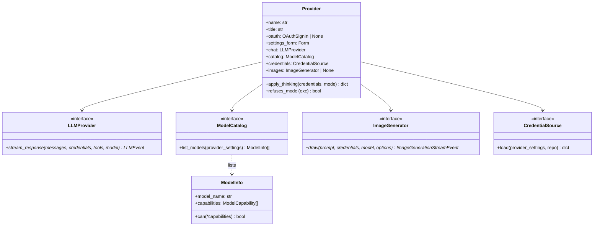
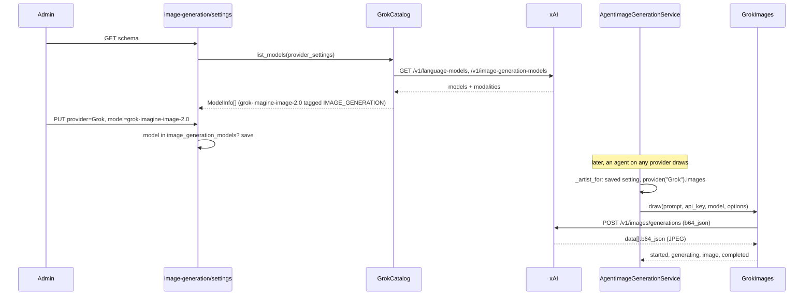

# LLD: One definition per LLM provider, catalog-driven model capabilities, and Grok

| Field | Value |
| --- | --- |
| Status | 📝 Proposed |
| Owner | vslala |
| Last reviewed | 2026-11-12 |
| Depends on | [api/src/llm/CONTRIBUTION.md](../api/src/llm/CONTRIBUTION.md), [LLD-multimodal-image-generation-v1.md](../api/docs/LLD-multimodal-image-generation-v1.md), [LLD-image-input-and-read-image-tool.md](LLD-image-input-and-read-image-tool.md) |

## 1. Goal

1. Add **Grok (xAI)** as a provider. An account adds an xAI key and can then:
   - choose a Grok chat model as an agent's model;
   - choose a Grok model that reads images in Image Reading;
   - choose a `grok-imagine-image*` model in Settings > Image Generation.
2. Before that, fix the structure so the next provider is "one folder plus one list entry". Today it means editing
   seven maps in six files.
3. Let each provider's **own API** say which models chat, read images or draw. Where an API doesn't say, a
   documented rule kept beside that provider's catalog decides. A hand-kept registry elsewhere no longer does.

The design follows [CODE_PHILOSOPHY.md](../CODE_PHILOSOPHY.md). Every interface below already has two or more real
implementations, and each change deletes a concept or a copy of one. It applies the repo's convention for behaviour
that varies by kind: a list of strategies plus one selection function (`api/src/rate_limits/strategies.py`).

## 2. What is wrong today

### 2.1 A provider is scattered across seven name-keyed maps

| Map | File | Holds |
| --- | --- | --- |
| `get_llm_provider` dict | `api/src/llm/providers/factory.py` | chat client |
| `PROVIDER_SCHEMAS` / `SUPPORTED_PROVIDERS` | `api/src/settings/schemas.py` | settings form |
| `PROVIDER_MODEL_SOURCES` | `api/src/llm/models.py` | catalog function (a method on the ~500-line `ModelsService`) |
| `MODEL_REFUSALS` | `api/src/llm/model_fallback.py` | "model not available" rule |
| `build_image_capability_registry` | `api/src/agents/image_generation/capabilities.py` | which providers draw |
| `ImageProviderFactory` | `api/src/agents/image_generation/provider.py` | drawing adapter |
| `PROVIDER_TITLES`, `isOAuth` | `spa/src/pages/dashboard/providerLabels.ts` | label, OAuth vs key |

Provider names are also hard-coded outside those maps:

| Where | What |
| --- | --- |
| `api/src/llm/credentials.py:22` | `if provider_name == "OpenAI"`: token refresh |
| `api/src/settings/router.py:203` | `if provider_name == "OpenAI"`: OAuth only (and a dead `GoogleDrive` branch below it) |
| `api/src/agents/provider_session.py:63` | `if agent.agent_provider == "Ollama"`: the thinking override |
| `api/src/agents/schemas.py:202` | `values=["Bedrock", …, "Ollama"]`, a static provider list on the agent form; and `DEFAULT_MODEL_OPTIONS` (lines 19–23), a stale Claude 3 fallback for Bedrock only |
| `api/src/auth/router.py:362,369` | `provider_name="OpenAI"` literals in the OAuth completion |
| `spa/src/pages/dashboard/Settings.tsx:162,691,711` | `providerName === "OpenAI"`: connect flow, login guide, submit label |
 CONTRIBUTION.md already warns that "a typo in one is a runtime
`ValueError` or a provider that silently never lists models". This is a duplicated source of truth.

### 2.2 Model capabilities come from three places, and chat vs image isn't modelled

- `image_understanding` comes from `api/src/vision/capabilities.py`, a module of per-vendor rules sitting outside the
  catalogs that hold the raw vendor data.
- `image_generation` comes from `ImageCapabilityRegistry`, which is **per provider, not per model**. It's right for
  OpenAI, where any chat model drives the `image_generation` tool. It's wrong for every vendor that draws with a
  dedicated image model: Grok, OpenAI's `gpt-image-*` and Gemini's `*-image`.
- No capability says "can hold a chat". Image-only models are kept out by **dropping** them from the catalogs by name
  (`OPENAI_API_NON_CHAT_MARKERS` has `"image"`, `GEMINI_NON_CHAT_MARKERS` has `"imagen"`), so the Image Generation
  page can never offer them.
- The dependency runs the wrong way: `src/llm/models.py` and `src/vision/capabilities.py` import
  `src/agents/image_generation/capabilities.py` (CONTRIBUTION.md: "do not add more").

### 2.3 Reuse by inheritance

`OpenAIAPIProvider(OpenAIProvider)` reuses the Codex client, Codex-only request fields included. A third Responses
vendor (Grok) would have to inherit them and then remove them. The SSE line loop is also written twice: once in
`openai.py` for chat and once in `image_generation/provider.py` for drawing.

### 2.4 A live bug: the Image Generation skill can't draw

`skills/image_generation/actions.py` calls `AgentImageGenerationService.stream_for_agent_turn`, which calls
`_stream_generate_existing_turn` (`service.py:350`). That method still calls
`self._validate_and_load_provider_settings(agent)`, which commit `2e04c361` deleted. So every skill draw raises
`AttributeError`. It also uses `agent.agent_provider` and not the account's Image Generation setting.
`tests/test_agent_image_generation_service.py:77` hides the bug: its fake service defines the missing method.

## 3. What each provider's API reports (researched 2026-11-12)

| Provider | Listing | Says "chats" | Says "reads images" | Says "draws" | How it draws |
| --- | --- | --- | --- | --- | --- |
| **Grok** | `GET /v1/language-models`, `GET /v1/image-generation-models` | Being in `language-models` (`output_modalities: ["text"]`) | `input_modalities` has `image` | Being in `image-generation-models` | Dedicated model: `POST /v1/images/generations` (`aspect_ratio`, `resolution`, `n`, `response_format: b64_json`), not streamed |
| **Bedrock** | `ListFoundationModels` | `outputModalities` has `TEXT` | `inputModalities` has `IMAGE` | `outputModalities` has `IMAGE` | Dedicated model, `InvokeModel`. Only Stability models are active (Nova Canvas reached EOL 2026-09-30), and none is documented in **eu-west-2** |
| **Anthropic** | `GET /v1/models` | Every model | `capabilities.image_input.supported` | Never | None |
| **Ollama** | `/api/tags` + `POST /api/show` | `capabilities` has `completion` | `capabilities` has `vision` | `capabilities` has `image` (in source) | Experimental, macOS only, no documented HTTP API, reportedly withdrawn in v0.32.6 |
| **OpenAI (ChatGPT sign-in, Codex)** | `GET …/codex/models` | Listed with `supported_in_api` | `input_modalities` has `image` | Not reported | `image_generation` tool on the chat model (verified in [LLD-multimodal-image-generation-v1](../api/docs/LLD-multimodal-image-generation-v1.md)) |
| **OpenAI API key** | `GET /v1/models` (only `id`, `created`, `owned_by`) | Name rule | Name rule | Name rule: `gpt-image-*`, `chatgpt-image-*` | The `image_generation` tool on a chat model, or a dedicated model: `POST /v1/images/generations` (b64 always, `stream` + `partial_images`) |
| **Gemini** | `models.list` (`supportedGenerationMethods`, no modalities) | Name rule (`gemini-*`, not `*-image`) | Name rule (all `gemini-*`) | Name rule: `*-image` (`gemini-3-pro-image`, `gemini-3.1-flash-image`, `gemini-2.5-flash-image`) | Chat modality: `generateContent` with `responseModalities: ["TEXT","IMAGE"]` and `imageConfig.aspectRatio/imageSize`. Imagen is shut down |

**Conclusion.** Only Grok and Bedrock report drawing directly; Ollama reports it, but has no API to draw with. So the
design takes each catalog's word for every capability. The catalog reads the vendor's field when there is one,
and otherwise applies a dated rule kept next to that catalog's other parsing. Drawing also comes in three
mechanisms (a chat tool, a dedicated image model, a chat output modality), so it sits behind one `ImageGenerator`
interface and each provider chooses its mechanism internally.

Sources: [xAI models](https://docs.x.ai/developers/rest-api-reference/inference/models), [xAI images](https://docs.x.ai/developers/rest-api-reference/inference/images), [xAI Responses](https://docs.x.ai/docs/api-reference), [OpenAI models](https://developers.openai.com/api/reference/resources/models/methods/list), [OpenAI images](https://developers.openai.com/api/reference/resources/images/methods/generate), [OpenAI image tool](https://developers.openai.com/api/docs/guides/tools-image-generation), [Codex ModelInfo](https://github.com/openai/codex/blob/main/codex-rs/protocol/src/openai_models.rs), [Anthropic models](https://platform.claude.com/docs/en/api/models-list), [Gemini models](https://aistudio.google.com/api-reference/models), [Gemini image generation](https://aistudio.google.com/docs/image-generation), [Bedrock FoundationModelSummary](https://docs.aws.amazon.com/bedrock/latest/APIReference/API_FoundationModelSummary.html), [Bedrock lifecycle](https://docs.aws.amazon.com/bedrock/latest/userguide/model-lifecycle-legacy.html), [Ollama API](https://raw.githubusercontent.com/ollama/ollama/main/docs/api.md), [Ollama capabilities](https://raw.githubusercontent.com/ollama/ollama/main/types/model/capability.go).

## 4. Design

### 4.1 The concepts



*One `Provider` value per vendor, kept in `PROVIDERS`. Everything that used to be a name-keyed map is read from it.
`LLMProvider` keeps its name (it's used in a dozen modules, and renaming it isn't this change).*

| Interface | Implementations it has (the pattern is real) |
| --- | --- |
| `LLMProvider` (exists) | Bedrock, Anthropic, OpenAI, OpenAIAPI, Gemini, Ollama, Grok |
| `ModelCatalog` | 7 (today `ModelsService.get_<x>_models` methods) |
| `ImageGenerator` (today the `ImageGenerationProvider` Protocol) | OpenAI-Codex tool, OpenAI-API tool, Grok images API. Later: OpenAI-API images API, Gemini modality |
| `CredentialSource` | stored JSON (6), ChatGPT OAuth refresh (1) |

Each interface is a `typing.Protocol`, so a provider is plain objects, with no base-class hierarchy to learn.

### 4.2 Layout

The convention is one folder per provider, like `src/skills/<skill>/`. Wire formats spoken by more than one
provider sit beside them, in `wire/`, and providers use them through composition, not inheritance.

```text
api/src/llm/
  models.py              ModelInfo, ModelCapability (moved here from agents/image_generation/capabilities.py)
  images.py              ImageGenerator protocol + its value types (moved from agents/image_generation/models.py),
                         collect_images(), image_format_of(), image_dimensions()
  credentials.py         CredentialSource, STORED_CREDENTIALS, load_provider_credentials(name, ...)
  model_fallback.py      ModelFallbackProvider (reads refusal rules and catalogs from PROVIDERS)
  router.py              GET /llm/models/{provider}
  wire/
    sse.py               sse_events(response): the one `data:` line loop
    responses.py         Responses API: input/tools conversion, chat event stream, request body
    responses_images.py  the Responses `image_generation` tool (Codex and OpenAI API)
    images_api.py        POST {base}/images/generations with b64_json (Grok; OpenAI API later)
  providers/
    __init__.py          PROVIDERS, provider(name), find_provider(name)
    provider.py          Provider dataclass + ModelCatalog protocol
    bedrock/       __init__.py (the Provider value), chat.py, catalog.py
    anthropic/     __init__.py, chat.py, catalog.py
    openai/        __init__.py, chat.py, catalog.py          (ChatGPT sign-in; credentials = OAuth refresh)
    openai_api/    __init__.py, chat.py, catalog.py
    gemini/        __init__.py, chat.py, catalog.py
    ollama/        __init__.py, chat.py, catalog.py, connection.py (was src/llm/ollama.py)
    grok/          __init__.py, chat.py, catalog.py, images.py
```

The following are deleted: `providers/factory.py`, `providers/base.py` (its contents move to `provider.py`), the
empty `providers/anthropic/` directory, `ModelsService`, `PROVIDER_MODEL_SOURCES`, `MODEL_REFUSALS`,
`PROVIDER_SCHEMAS`/`SUPPORTED_PROVIDERS`, `src/vision/capabilities.py`,
`src/agents/image_generation/capabilities.py`, `ImageProviderFactory`, and `PROVIDER_TITLES`/`isOAuth` in the SPA.

### 4.3 `Provider` and the registry

```python
# api/src/llm/providers/provider.py
"""What one LLM provider offers an account: chat, a model catalog, and optionally drawing.

`name` is stored on agents (`agent_provider`), on `ProviderSettings` and on the account's image and vision settings.
Never rename it."""

class ModelCatalog(Protocol):
    def list_models(self, provider_settings: ProviderSettings) -> list[ModelInfo]:
        """Blocking HTTP. Never raises for a vendor outage: fall back to a configured list (or [] when, like Ollama,
        nothing sensible exists), so a form never fails to render."""
        ...


@dataclass(frozen=True)
class OAuthSignIn:
    """A provider the admin signs into rather than pasting a key. The SPA renders this generically."""

    start_path: str     # POST here for the authorize URL ("/auth/openai/start")
    button_label: str   # "Open OpenAI Login"
    guide: str          # the steps shown above the form
    submit_label: str = "Complete Connection"
    # The form's own `submit_path` is where the pasted callback goes ("/auth/openai/complete").


@dataclass(frozen=True)
class Provider:
    name: str
    title: str
    settings_form: Form
    chat: LLMProvider
    catalog: ModelCatalog
    #: None: an API key form saved through /settings/providers/{name}.
    oauth: OAuthSignIn | None = None
    credentials: CredentialSource = STORED_CREDENTIALS
    #: True when the vendor's error means "this model isn't available to you" (ModelFallbackProvider retries then).
    refuses_model: Callable[[Exception], bool] = lambda exc: False
    #: How this provider draws, if it can. Which of its models draw is the catalog's answer (IMAGE_GENERATION).
    images: ImageGenerator | None = None
    #: Applies an agent's thinking mode to the call's credentials, for providers that have the knob (Ollama).
    apply_thinking: Callable[[dict[str, Any], str | None], dict[str, Any]] | None = None
```

`OAuthSignIn` takes over the SPA's three `=== "OpenAI"` branches. `GET /settings/providers` returns `title` and
`oauth` beside `form`, and `Settings.tsx` posts to `oauth.start_path` and then to `form.submit_path`, with no
OpenAI-specific service methods. `apply_thinking` replaces the `== "Ollama"` branch in `provider_session.py`:

```python
p = provider(agent.agent_provider)
credentials = await p.credentials.load(provider_settings, provider_settings_repo)
if p.apply_thinking:
    credentials = p.apply_thinking(credentials, agent.agent_ollama_thinking)
```

(The persisted field `agent_ollama_thinking` keeps its name, since renaming it would mean a data migration that
nobody needs.)

```python
# api/src/llm/providers/__init__.py
from .anthropic import ANTHROPIC
from .bedrock import BEDROCK
...
from .grok import GROK

#: Every provider, in the order Settings and the model pickers show them.
PROVIDERS: tuple[Provider, ...] = (BEDROCK, ANTHROPIC, OPENAI, OPENAI_API, GEMINI, OLLAMA, GROK)


def find_provider(name: str) -> Provider | None:
    """Case-insensitive, because `/llm/models/{provider}` takes the name from a URL."""
    wanted = name.strip().lower()
    return next((p for p in PROVIDERS if p.name.lower() == wanted), None)


def provider(name: str) -> Provider:
    found = find_provider(name)
    if not found:
        raise ValueError(f"Unknown provider: '{name}'. Supported: {', '.join(p.name for p in PROVIDERS)}")
    return found
```

A provider's package says everything about it in one place:

```python
# api/src/llm/providers/grok/__init__.py
GROK = Provider(
    name="Grok",
    title="Grok (xAI)",
    settings_form=Form(
        form_name="Grok (xAI) API Key Configuration",
        submit_path="/settings/providers/Grok",
        form_inputs=[FormInput(
            input_type=FormInputType.PASSWORD, name="api_key", label="xAI API Key",
            attr={"placeholder": "xai-...", "help_text": "A key from console.x.ai. Usage is billed to that xAI team."},
        )],
    ),
    chat=GrokChat(),
    catalog=GrokCatalog(),
    refuses_model=responses_refuses_model,
    images=GrokImages(),
)
```

How the callers change:

| Today | After |
| --- | --- |
| `get_llm_provider(name)` (agents/provider_session, dream, smart_suggestions, vision, memory/compaction, agentic_loop) | `provider(name).chat` |
| `PROVIDER_SCHEMAS[name]`, `SUPPORTED_PROVIDERS` (settings/router) | `provider.settings_form`, `PROVIDERS` |
| `if provider_name == "OpenAI": raise … OAuth` (settings/router) | `if found.oauth: raise …` (the `GoogleDrive` branch below it is dead; delete it) |
| `if provider_name == "OpenAI": ensure_valid…` (credentials.py) | `await provider(name).credentials.load(settings, repo)` |
| `find_model_source(name).load_models(ps)` (llm/router, form_options, model_fallback) | `find_provider(name).catalog.list_models(ps)` |
| `is_model_refusal(name, exc)` | `provider(name).refuses_model(exc)` |
| `ImageProviderFactory().get(name)` | `provider(name).images` |
| SPA `PROVIDER_TITLES` / `isOAuth` / `Settings.tsx` OpenAI branches | `GET /settings/providers` adds `title` and `oauth` to `ProviderWithStatus` |
| `agents/schemas.py` static `values=[…]` and `DEFAULT_MODEL_OPTIONS` | `options_source=AGENT_MODEL_PROVIDERS` (already used by the edit form) and `AGENT_MODELS`; the stale fallback list is deleted, since each catalog already has its own fallback |
| `auth/router.py` `provider_name="OpenAI"` | `OPENAI.name` |

### 4.4 Capabilities: one enum, set by the catalog

```python
# api/src/llm/models.py
class ModelCapability(StrEnum):
    """What a model can be used for. The catalog that lists the model decides, from the vendor's own fields where it
    has them. The values are on the wire (`/llm/models`, `AgentResponse.capabilities`); keep them."""

    CHAT = "chat"
    IMAGE_UNDERSTANDING = "image_understanding"
    IMAGE_GENERATION = "image_generation"
    IMAGE_EDITING = "image_editing"


class ModelInfo(BaseModel):
    model_id: str
    model_name: str
    display_name: str
    provider: str
    capabilities: list[ModelCapability] = Field(default_factory=list)

    def can(self, *needed: ModelCapability) -> bool:
        return all(capability in self.capabilities for capability in needed)
```

`CHAT` is new and explicit. Image-only models now **stay in the catalog** and are tagged, instead of being dropped by
name. The pickers select by capability:

```python
# api/src/form_options.py, load_agent_model_choices
models=[o for o, m in options if m.can(ModelCapability.CHAT)],
vision_models=[o for o, m in options if m.can(ModelCapability.CHAT, ModelCapability.IMAGE_UNDERSTANDING)],
image_generation_models=[o for o, m in options if m.can(ModelCapability.IMAGE_GENERATION)],
```

`ModelFallbackProvider` always needs `CHAT` in a substitute (`capabilities=(CHAT, *extra)`), so a refused chat model is
never swapped for an image model. The vision caller passes `IMAGE_UNDERSTANDING` as `extra`.

Each catalog owns its rules. Here is how every provider sets capabilities after the change:

| Provider | `CHAT` | `IMAGE_UNDERSTANDING` | `IMAGE_GENERATION` |
| --- | --- | --- | --- |
| Bedrock | listed (byProvider Anthropic, as today) | `inputModalities ∋ IMAGE` | not listed: no active image model in eu-west-2 (§3) |
| Anthropic | every model | `capabilities.image_input.supported` | never |
| OpenAI (Codex) | listed + `supported_in_api` | `input_modalities ∋ image` | every chat model (it hosts the `image_generation` tool) |
| OpenAI API | `OPENAI_API_CHAT_MODEL` name rule (as today) | `OPENAI_API_VISION_MODEL_PREFIXES` (as today) | every chat model (the tool, as today). Phase 5 switches to `gpt-image-*` |
| Gemini | `gemini-*`, `generateContent`, not `*-image` | every `gemini-*` chat model (Google documents all as multimodal) | Phase 5: `*-image` |
| Ollama | `capabilities ∋ completion` | `capabilities ∋ vision` | never: `image` exists, but there is no API to draw with |
| Grok | in `/v1/language-models` | `input_modalities ∋ image` | in `/v1/image-generation-models` |

The vision rules in `src/vision/capabilities.py` (`anthropic_reads_images`, `codex_reads_images`, …) move into the
catalog that reads those fields. The Ollama `/api/show` cache moves to `providers/ollama/catalog.py`. Then the module
is deleted.

**An invariant test** checks that every catalog model tagged `IMAGE_GENERATION` belongs to a provider with `images`
set, and that every provider with `images` tags at least one fallback model. A provider can't advertise drawing that
it can't do.

### 4.5 Who draws: the account setting, validated on save, and nothing else

The image capability registry goes. The answer to "can this provider and model draw?" has one home, the catalog,
and it's checked where the choice is made: `PUT /image-generation/settings` already validates the model against
`ImageGenerationModelsOptionsResolver`. After that, the saved setting is trusted:

```python
# api/src/agents/image_generation/service.py
def _artist_for(self, agent: Agent) -> Artist:
    """Who draws for this agent: the account's Image Generation setting, checked against the catalog when it was saved."""
    chosen = self.image_settings_repo.find_in_account(agent.account_id)
    if not chosen or not chosen.is_configured:
        raise ImageGenerationNotSupportedError(
            "Image generation is off. An admin can turn it on in Settings > Image Generation."
        )
    images = provider(chosen.provider_name).images
    provider_settings = self.provider_settings_repo.find_by_provider(agent.account_id, chosen.provider_name)
    if not images or not provider_settings:
        raise AgentImageGenerationError(f"{chosen.provider_name} can't draw for this account any more.")
    return Artist(chosen.provider_name, chosen.model_name, provider_settings, images)
```

This removes the old fallback ("else the agent's own provider and model", kept for OpenAI agents from before the
setting existed). **Backfill** keeps those accounts drawing: `api/scripts/backfill_image_generation_settings.py`.
Dry run by default, `--apply` to write. For each account with no `ImageGenerationSettings` and at least one agent on
`OpenAI`/`OpenAIAPI` whose provider is still configured, it writes `enabled=True` with the provider and model of that
account's most recently updated such agent, and prints accounts scanned, written and skipped (with the reason). Run
it before deploying the change.

`AgentResponse.capabilities` stops consulting the registry. Drawing is an account fact, so one helper in
`agents/router.py` adds `image_generation` when the setting is on. `list_agents` uses it (as now), and so do
`get_agent` and create/update, which today report a capability from the registry that `list_agents` then overrides.

The four service entry points collapse onto two private methods, `_generate` and `_stream`, both resolving
`_artist_for`. `_stream` takes an optional `user_message_id` (the skill passes one, the dashboard doesn't). That
**fixes the bug in §2.4**, deletes `_stream_generate_existing_turn` and removes the fake method from the test.

### 4.6 `ImageGenerator`: one method

```python
# api/src/llm/images.py
class ImageGenerator(Protocol):
    """Draws `prompt` with `model`, as events: `started`, `generating`, any `partial` frames, one `image` per picture,
    `completed`. A vendor that can't stream sends no `partial` events."""

    def draw(
        self, *, prompt: str, credentials: dict[str, Any], model: str, options: ImageGenerationOptions
    ) -> AsyncIterator[ImageGenerationStreamEvent]: ...


async def collect_images(events: AsyncIterator[ImageGenerationStreamEvent]) -> list[GeneratedImageBytes]:
    """The pictures from a draw, for callers that don't stream (widget, `/v1`)."""
    images = [event.image async for event in events if event.kind == "image" and event.image]
    if not images:
        raise RuntimeError("Image generation completed without image output")
    return images
```

Today's protocol has `generate` and `stream_generate`, and every adapter implements `generate` by draining
`stream_generate`. One method plus `collect_images` keeps that behaviour and halves the surface (interface
segregation: an adapter implements only what's unique to it).

`images.py` also takes `image_format_of(data)` (magic bytes: PNG, JPEG, WebP) and `image_dimensions(data, fmt)`
(today's PNG reader plus a JPEG `SOF0`–`SOF3` reader, as a dict of readers by format), since Grok and Gemini return
JPEG. `ImageGenerationOptions.size`/`quality` stay OpenAI-shaped (`1024x1536`, `low|medium|high|auto`, which the
image skill's manifest documents), and each generator maps them to its vendor's vocabulary.

### 4.7 Shared wire formats, by composition

```python
# api/src/llm/wire/sse.py
async def sse_events(response: httpx.Response) -> AsyncIterator[dict[str, Any]]:
    """The JSON payload of each `data:` line, skipping `[DONE]` and lines that aren't JSON."""
```

```python
# api/src/llm/wire/responses.py
"""The Responses API (OpenAI's, also spoken by xAI). Message/tool conversion and the chat event stream live here once;
each provider builds its own body and headers."""

def responses_input(messages: list[dict]) -> tuple[str, list[dict[str, Any]]]:
    """(instructions, input items): today's `_extract_instructions_and_messages` + `_convert_messages`."""

def responses_tools(tools: list[dict] | None) -> list[dict[str, Any]]: ...

def responses_body(model: str, messages: list[dict], tools: list[dict] | None, **extra: Any) -> dict[str, Any]:
    instructions, items = responses_input(messages)
    return {
        "model": model, "instructions": instructions, "input": items, "tools": responses_tools(tools),
        "tool_choice": "auto",
        # The loop has side-effecting tools (memory writes): one call per iteration.
        "parallel_tool_calls": False,
        "store": False, "stream": True, **extra,
    }

async def stream_chat(url: str, headers: dict[str, str], body: dict[str, Any], *, label: str) -> AsyncIterator[LLMEvent]:
    """Today's `_stream_responses` loop, minus body building: text, tool_use, usage, one stop."""

def responses_refuses_model(exc: Exception) -> bool:
    """`stream_chat` raises RuntimeError("<label> responses error (<status>, …)"). Codex says "model is not
    supported", the public API `model_not_found` / "does not exist", xAI <P2>."""
```

The providers become short and independent:

```python
# providers/openai/chat.py  (ChatGPT sign-in)
CODEX_EXTRAS = {"reasoning": None, "include": ["reasoning.encrypted_content"], "text": {"verbosity": "medium"}}

class OpenAIChat(LLMProvider):
    default_model = "gpt-5.5"

    async def stream_response(self, messages, credentials, tools=None, model=None):
        oauth = OpenAICredentials.model_validate(credentials)
        body = responses_body(model or self.default_model, messages, tools, **CODEX_EXTRAS)
        async for event in stream_chat(settings.openai_oauth_responses_url, codex_headers(oauth), body, label="OpenAI OAuth"):
            yield event

# providers/openai_api/chat.py: same body as today (the public API accepts the Codex extras), its own URL and key.
# providers/grok/chat.py
class GrokChat(LLMProvider):
    """xAI's Responses API. No Codex extras: xAI has no `reasoning.encrypted_content` and no `text.verbosity`."""
    default_model = "grok-4.7"

    async def stream_response(self, messages, credentials, tools=None, model=None):
        body = responses_body(model or self.default_model, messages, tools)
        async for event in stream_chat(f"{GROK_API_BASE_URL}/responses", bearer(credentials), body, label="Grok"):
            yield event
```

`bearer(credentials)` raises `ValueError("Missing required credential: 'api_key'")` and returns the JSON/SSE headers.
It lives in `wire/responses.py` and is shared by OpenAI API and Grok.

The `image_generation` tool parser moves from `agents/image_generation/provider.py` to
`wire/responses_images.py` as `ResponsesToolImages(url, auth_field, label, provider_key)`, built on `sse_events`.
`OPENAI` and `OPENAI_API` each create one with their own endpoint. That's two values of one class, and no subclasses.

### 4.8 Grok

**Catalog**: `providers/grok/catalog.py`

```python
class GrokCatalog:
    """xAI lists chat and image models separately, and says what each takes in and gives back."""

    def list_models(self, provider_settings: ProviderSettings) -> list[ModelInfo]:
        api_key = stored_api_key(provider_settings)
        chat = _listing("language-models", api_key) or [{"id": m, "input_modalities": ["text", "image"]} for m in settings.grok_models]
        drawing = _listing("image-generation-models", api_key) or [{"id": m} for m in settings.grok_image_models]
        return [
            *(_model(e, ModelCapability.CHAT, *_reads_images(e)) for e in sorted(chat, key=_created, reverse=True)),
            *(_model(e, ModelCapability.IMAGE_GENERATION) for e in drawing),
        ]


def _reads_images(entry: Mapping[str, Any]) -> list[ModelCapability]:
    return [ModelCapability.IMAGE_UNDERSTANDING] if "image" in (entry.get("input_modalities") or []) else []
```

`_listing(path, key)` makes a `GET https://api.x.ai/v1/{path}` and returns the model list (`models` or `data`, P3),
or `[]` with a warning on any failure. The settings, with defaults in code and overridable by env, are:
`grok_models = ["grok-4.7", "grok-4.6", "grok-4.5"]` and `grok_image_models = ["grok-imagine-image-2.0"]`.

**Drawing**: `wire/images_api.py` + `providers/grok/images.py`

```python
# wire/images_api.py
async def generate_images(url: str, api_key: str, body: dict[str, Any], *, label: str) -> list[bytes]:
    """POST an OpenAI-style images/generations request and decode `data[].b64_json`. Grok uses it; OpenAI API will."""

# providers/grok/images.py
#: The image skill's OpenAI sizes in xAI's words; anything else is "auto".
ASPECT_RATIOS = {"1024x1024": "1:1", "1536x1024": "3:2", "1024x1536": "2:3"}
#: xAI takes low, medium or auto, so OpenAI's "high" becomes xAI's best.
QUALITIES = {"low": "low", "medium": "medium", "high": "medium"}

class GrokImages:
    async def draw(self, *, prompt, credentials, model, options):
        yield ImageGenerationStreamEvent(kind="started", message="Image generation started")
        body = {
            "model": model, "prompt": prompt, "n": 1,
            # A URL would expire; we keep the bytes in S3 anyway.
            "response_format": "b64_json",
            "aspect_ratio": ASPECT_RATIOS.get(options.size or "", "auto"),
            "quality": QUALITIES.get(options.quality or "", "auto"),
        }
        yield ImageGenerationStreamEvent(kind="generating", message="Generating image")
        for data in await generate_images(f"{GROK_API_BASE_URL}/images/generations", api_key(credentials), body, label="Grok"):
            image = generated_image(data, prompt=prompt, provider_key="grok", quality=body["quality"])
            yield ImageGenerationStreamEvent(kind="image", image=image, mime_type=image.mime_type,
                                             output_format=image.output_format, width=image.width, height=image.height)
        yield ImageGenerationStreamEvent(kind="completed", message="Image generation complete")
```

`generated_image(data, …)` (in `images.py`) sniffs the format, reads the dimensions and builds `GeneratedImageBytes`.
It's shared by every generator that gets bytes back.



*The catalog decides what's offered, the save validates it, and the generator only draws.*

### 4.9 What the next provider costs

To add a provider, create `providers/<name>/` with a `Provider` value, a chat client (reusing `wire/` if it speaks a
known format), a catalog that sets capabilities from the vendor's fields, and optionally an `ImageGenerator`. Then
add it to `PROVIDERS`, add a dated `refuses_model` rule, and add tests. Nothing else changes: not Settings, not the
pickers, not image generation, not the SPA. Rewrite CONTRIBUTION.md's "How to add a provider" to say exactly this.

### 4.10 End state: one home for every provider fact, enforced by tests

At the end of phase 4, every provider fact has exactly one home:

| Fact | Its one home |
| --- | --- |
| A provider exists, its name and title, how it's connected | its `Provider` value in `providers/<name>/__init__.py` |
| Its endpoint, default model, request quirks | constants in `providers/<name>/chat.py` (and `images.py`) |
| Which of its models chat, read or draw | its `catalog.py`: the vendor's field, or a dated rule beside the parsing |
| Its fallback model lists (vendor listing down) | `src/config/settings.py`, overridable by env (`GROK_MODELS`, `OPENAI_MODELS`, …) |
| Which provider and model an account draws or reads images with | the account's settings items in DynamoDB |
| What the SPA shows for a provider | `GET /settings/providers` and the form option sources (no provider names in `spa/src`) |

Some literals stay on purpose, and each has a reason:
- Vendor URLs and default models: they're facts about the vendor, kept in its own package.
- Name rules for OpenAI and Gemini: their APIs report nothing, and each rule is dated (§3).
- Provider names in stored data: they're keys, and they never change.

**Guard tests** stop the old pattern from coming back:

- `api/tests/test_no_hardcoded_providers.py`: scan `api/src/**/*.py` outside `src/llm/providers/` for a string
  literal equal to any `PROVIDERS[*].name`, and fail with the file and line. A provider-specific need becomes a
  `Provider` field, as `oauth` and `apply_thinking` did.
- `spa/src/pages/dashboard/noHardcodedProviders.test.ts`: the same scan over `spa/src` for the names the API serves
  (a fixed list in the test, checked against a recorded `/settings/providers` fixture).
- `tests/test_providers_registry.py` (§7): the drawing invariant, unique names, forms that match their names.

**Scaling.** Adding a provider, a capability, or a drawing mechanism touches one place each:
- A new provider: one folder plus one `PROVIDERS` entry (§4.9).
- A new capability (say `IMAGE_EDITING` or `VIDEO_GENERATION`): one enum value, the catalogs that report it, one
  option source, and an `ImageGenerator`-style interface only once two vendors share the mechanism.
- A new wire format: one module in `wire/`, shared by composition.

No step requires editing a provider that isn't involved.

## 5. Phases

Each phase leaves the test suite green and can ship alone.

| # | Change | Behaviour change |
| --- | --- | --- |
| 0 | **Fix §2.4**: `_stream` with optional `user_message_id` resolving `_artist_for`; delete `_stream_generate_existing_turn`; remove the fake method from the test; add a skill-path test without fakes of our own service | Skill draws again, with the account's setting |
| 1 | **`Provider` + `PROVIDERS`** (§4.3): move each provider into its folder; catalogs leave `ModelsService` one class each; derive settings, refusals, factories; `title`/`oauth` on `/settings/providers`, SPA renders them generically; `apply_thinking`; agent form uses option sources; guard tests (§4.10) | None (pure move); SPA labels and OAuth flow come from the API |
| 2 | **`wire/`** (§4.7): `sse_events`, `responses.py`, `responses_images.py`; `OpenAIAPIProvider` no longer subclasses `OpenAIProvider` | None (request bodies byte-identical; tests assert it) |
| 3 | **Capabilities** (§4.4, §4.5): `ModelCapability` with `CHAT`; vision rules into catalogs; delete the image registry and `vision/capabilities.py`; `_artist_for` setting-only; backfill script; `ImageGenerator.draw` + `collect_images` | Agents without an account setting stop drawing until the backfill writes one (run it first) |
| 4 | **Grok** (§4.8): chat, catalog, images, settings defaults | New provider |
| 5 | **Follow-ups the design now makes cheap**: (a) OpenAI API draws with `gpt-image-*` through `images_api.py` (`stream` + `partial_images`), catalog tags `gpt-image-*`/`chatgpt-image-*` and stops tagging chat models; backfill rewrites saved `OpenAIAPI` chat-model settings to `gpt-image-2`. (b) Gemini draws with `*-image` via `generateContent` `responseModalities: ["TEXT","IMAGE"]` (a `GeminiImages` generator reading `inlineData`). | Each its own change, with probes |

Out of scope:
- Bedrock drawing: no active image model in eu-west-2 (§3). The catalog would tag `outputModalities ∋ IMAGE` once a
  region has one.
- Ollama drawing: no HTTP API.
- Image editing (`IMAGE_EDITING` exists for it).
- Video.

## 6. Files

| File | Change |
| --- | --- |
| `api/src/llm/providers/provider.py`, `__init__.py` | New: `Provider`, `ModelCatalog`, `PROVIDERS`, `provider`, `find_provider` |
| `api/src/llm/providers/<name>/` (7) | New folders; chat code moved from `providers/<name>.py`, catalog code from `ModelsService`, forms from `settings/schemas.py` |
| `api/src/llm/providers/{factory,base,openai,openai_api,anthropic,bedrock,gemini,ollama}.py`, `providers/anthropic/` (empty) | Deleted (moved) |
| `api/src/llm/wire/{sse,responses,responses_images,images_api}.py` | New, extracted from `openai.py` and `agents/image_generation/provider.py` |
| `api/src/llm/models.py` | Only `ModelInfo` + `ModelCapability` |
| `api/src/llm/images.py` | New: `ImageGenerator`, value types, `collect_images`, `generated_image`, format/dimension readers |
| `api/src/llm/credentials.py` | `CredentialSource`, `STORED_CREDENTIALS`; OpenAI's refresh source lives in `providers/openai/` |
| `api/src/llm/model_fallback.py` | Reads `provider(name).refuses_model` and `.catalog`; substitutes need `CHAT` |
| `api/src/llm/router.py`, `api/src/form_options.py` | `find_provider`; pickers by `ModelInfo.can` |
| `api/src/settings/schemas.py`, `api/src/settings/router.py` | Schemas deleted; router reads `PROVIDERS` and `oauth`; dead `GoogleDrive` branch removed; `ProviderWithStatus.title/oauth` |
| `api/src/vision/capabilities.py` | Deleted (rules in catalogs) |
| `api/src/vision/analysis.py`, `agents/provider_session.py`, `dream/*`, `smart_suggestions/service.py`, `memory/compaction.py`, `agents/agentic_loop.py` | `provider(name).chat` |
| `api/src/agents/image_generation/capabilities.py`, `provider.py` | Deleted |
| `api/src/agents/image_generation/service.py` | `_artist_for` setting-only; `_generate`/`_stream`; uses `Artist.images` |
| `api/src/agents/image_generation/models.py` | Request/response models stay; provider value types move to `llm/images.py` |
| `api/src/agents/models.py`, `agents/router.py` | No registry; one helper adds account drawing to every `AgentResponse` |
| `api/src/blueprints/account_pages.py` | `ModelCapability` import |
| `api/src/config/settings.py` | `grok_models`, `grok_image_models` |
| `api/scripts/backfill_image_generation_settings.py` | New, dry run by default |
| `api/src/agents/provider_session.py` | `Provider.credentials` and `apply_thinking`; no `"Ollama"` branch |
| `api/src/agents/schemas.py` | Provider and model inputs from option sources; `DEFAULT_MODEL_OPTIONS` deleted |
| `api/src/auth/router.py` | `OPENAI.name` |
| `spa/src/pages/dashboard/providerLabels.ts` (+ test), `Settings.tsx`, `services/settings/ProviderSettingsService.ts`, Settings types | Title and OAuth sign-in from the API; generic connect (`oauth.start_path`, `form.submit_path`); OpenAI-specific service methods removed |
| `api/tests/test_no_hardcoded_providers.py`, `spa/src/pages/dashboard/noHardcodedProviders.test.ts` | New guard tests (§4.10) |
| `api/src/llm/CONTRIBUTION.md`, `api/src/agents/CONTRIBUTION.md` | Layout, "How to add a provider", image generation paragraph |
| `api/docs/LLD-multimodal-image-generation-v1.md` | *Capability Model* points here: capabilities come from catalogs, drawing is `Provider.images` |

## 7. Tests

All vendors are mocked at the httpx/boto layer, and there are no live calls. Tests target behaviour, so the moves in
phases 1–2 don't rewrite them.

| Test | Covers |
| --- | --- |
| `tests/test_providers_registry.py` (new) | Names unique; each has a form whose `submit_path` matches its name (or is OAuth); `provider()` raises on unknown; `find_provider` case-insensitive; **the drawing invariant** (§4.4) |
| `tests/test_responses_wire.py` (new) | `responses_body` for OpenAI, OpenAI API and Grok (Codex extras only on the first two); `stream_chat` text, tool call, usage, one stop, `response.incomplete`, errors; `sse_events` skips `[DONE]` and non-JSON |
| `tests/test_openai_provider.py`, `test_openai_api_provider.py` | Unchanged assertions on URL, headers and body still pass after phase 2 |
| `tests/test_grok_provider.py`, `tests/test_grok_catalog.py`, `tests/test_grok_images.py` (new) | Endpoint, key, no Codex extras; listing → capabilities, fallback lists; images body mapping, JPEG sniffed with dimensions, non-2xx raises, event order |
| `tests/test_<vendor>_catalog.py` (moved from `test_openai_models.py` and the vision capability tests) | Each catalog's capability rules, `CHAT` on chat models |
| `tests/test_form_options_provider_models.py` | Image-only models absent from the agent and vision pickers, present in the image picker |
| `tests/test_llm_model_fallback*.py` | Substitute must be `CHAT`; refusal rules per provider via `Provider.refuses_model` |
| `tests/test_agent_image_generation_service.py` | No fake `_validate_and_load_provider_settings`; skill stream draws via the setting; no setting → `ImageGenerationNotSupportedError` |
| `tests/test_backfill_image_generation_settings.py` (moto) | Writes for an OpenAI-agent account, skips configured, unconfigured-provider and non-OpenAI accounts; dry run writes nothing |
| `spa` `providerLabels.test.ts` | Labels from the API payload |

Run the LLM suite in `api/src/llm/CONTRIBUTION.md`, then `uv run pytest tests -q`, `uv run ruff check src` and
`uv run mypy src` in `api/`, and `npm test` in `spa/`.

## 8. Probes (one curl each, real key) before phase 4

| # | Question | If not as assumed |
| --- | --- | --- |
| P1 | Does xAI `/v1/responses` stream function calls as OpenAI does (`output_item.added` → `function_call_arguments.delta/.done`)? xAI says a call arrives whole in one chunk | Make `stream_chat` also emit a call from `response.output_item.done` when no `.done` delta came. This is one change in `wire/responses.py`, shared |
| P2 | xAI's status and body for an unknown model | Add that text to `responses_refuses_model` with the date |
| P3 | `/v1/language-models` and `/v1/image-generation-models`: is the list under `models` or `data`, and are `input_modalities` populated? | `_listing` reads whichever; missing modalities → `grok-4*` reads images |
| P4 | `images/generations`: `quality` accepted with `grok-imagine-image-2.0`; output always JPEG; any `revised_prompt` | Drop `quality`; the format is sniffed anyway |

Record the answers in an "Implementation notes" section at the top.

## 9. Rollout

1. Phase 0 ships on its own, now (it's a production bug).
2. Phases 1–2 are refactors; deploy them when green.
3. Phase 3: run `uv run python scripts/backfill_image_generation_settings.py` (dry run) against prod, check the
   counts, run it with `--apply`, then deploy.
4. Phase 4: run the probes, deploy, then a manual check. Add an xAI key; create an agent on `grok-4.7`; chat with a
   tool call and an image; set Image Generation to `grok-imagine-image-2.0`; draw from that agent, from an OpenAI
   agent and through the Image Generation skill.

There's no Terraform and no table change: every item is keyed by provider name, and no name changes.

## Related documentation

- [api/src/llm/CONTRIBUTION.md](../api/src/llm/CONTRIBUTION.md)
- [api/src/agents/CONTRIBUTION.md](../api/src/agents/CONTRIBUTION.md): image generation
- [LLD-multimodal-image-generation-v1.md](../api/docs/LLD-multimodal-image-generation-v1.md)
- [LLD-image-input-and-read-image-tool.md](LLD-image-input-and-read-image-tool.md)
