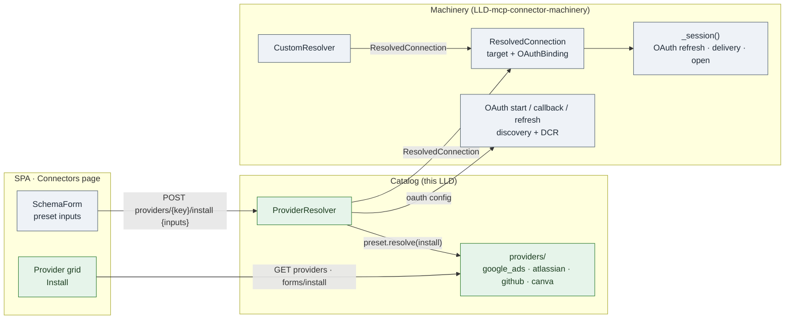
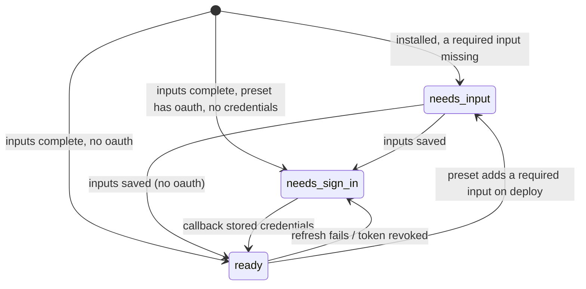
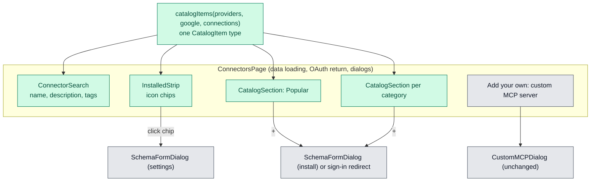

# MCP Provider Catalog

| Field | Value |
| --- | --- |
| Status | 🚧 In progress: implemented on `feature/mcp-connector-machinery`, pending live provider testing |
| Owner | InnomightLabs API / SPA |
| Last reviewed | 2026-10-20 |
| Scope | [`api/src/connectors/mcp/providers/`](https://github.com/vslala/innomightlabs-dynamic-agent-builder/tree/main/api/src/connectors/mcp), [`spa/src/pages/dashboard/ConnectorsPage.tsx`](https://github.com/vslala/innomightlabs-dynamic-agent-builder/blob/main/spa/src/pages/dashboard/ConnectorsPage.tsx) |
| Tracker | — |
| Depends on | [MCP Connector Machinery](LLD-mcp-connector-machinery) |

> **Summary:** InnomightLabs ships a curated catalog of MCP providers, starting with Google Ads, Atlassian, GitHub, and
> Canva. Users install them from a short form, or in one click when the provider supports dynamic client registration.
> Each provider is a **preset**: a small backend module that builds a
> `ResolvedConnection` out of the [machinery's](LLD-mcp-connector-machinery) own parts (targets, auth sources,
> credential deliveries) plus the few values only the user can supply. The catalog adds no transport, auth, or runtime
> code of its own. Transport or auth changes belong to the machinery, and provider changes belong to one preset module.

## Implementation notes (2026-10-20): public hosted providers

The catalog now also includes these Streamable HTTP presets, registered in
`api/src/connectors/mcp/providers/__init__.py`. Existing presets and install semantics are unchanged.

| Preset key | Server URL | Setup and credential delivery |
| --- | --- | --- |
| `deepwiki` | `https://mcp.deepwiki.com/mcp` | No inputs or authentication; public GitHub repository documentation |
| `microsoft_learn` | `https://learn.microsoft.com/api/mcp` | No inputs or authentication; public Microsoft documentation and code samples |
| `exa` | `https://mcp.exa.ai/mcp` | Optional password input `api_key`, delivered as `x-api-key`; omit for free rate-limited access |
| `hugging_face` | `https://huggingface.co/mcp` | Optional password input `token`, delivered as `Authorization: Bearer`; omit for anonymous tools and rate limits |

These presets reuse `HttpTarget`, existing input validation, encrypted secret storage, install forms,
and settings forms. No OAuth client, new environment variable, database migration or dependency is needed.
DeepWiki and Microsoft Learn install immediately. Exa and Hugging Face show a schema-driven form whose
secret can be left blank; authenticated usage is subject to the provider's plan, permissions and limits.
Optional static credentials use the existing API-key auth classification even when omitted.

Each new icon is bundled locally under `spa/src/assets/connectors/`, with provenance in its README.
The shared `ConnectorIcon` renders it in the catalog, Installed strip and details dialog.
`connectionIcon.ts` recognizes their exact MCP hostnames for custom installations without changing
provider membership or authentication. Unknown servers still use the server symbol.

Validation covers preset metadata/transport, credential-free installs, optional credential headers,
secret redaction and settings preservation, backend-to-frontend icon coverage and custom URL matching.
Unit tests use fakes, not live MCP servers. A credential-free Hugging Face initialization was also checked;
live end-to-end tool calls for all four services remain a manual rollout check. Do not put credentials
in server URLs. No deployment or existing account connections are changed by this code update.

Provider references: [DeepWiki](https://docs.devin.ai/work-with-devin/deepwiki-mcp),
[Microsoft Learn](https://learn.microsoft.com/en-us/training/support/mcp),
[Exa](https://docs.exa.ai/reference/exa-mcp),
[Hugging Face](https://huggingface.co/docs/hub/en/hf-mcp-server).

## Context and problem

The machinery already lets a user build any connector by hand: HTTP or stdio, with static credentials or OAuth, and a
user-supplied or dynamically registered client. Building one by hand means knowing the server URL or package, the
OAuth endpoints, client registration, header and env names, and credential formats. End users should never need to
know any of that.

The catalog moves that knowledge into code we write and review. The user sees *Install*, a short form when needed, and a
sign-in.

What the four launch providers ship (checked against provider docs on 2026-09-26), and how each maps onto the
machinery:

| Provider | Target | Auth source | Delivery | User supplies |
| --- | --- | --- | --- | --- |
| Google Ads ([`googleads/google-ads-mcp`](https://github.com/googleads/google-ads-mcp), stdio only) | `StdioTarget(package="google_ads")` | OAuth, fixed Google endpoints, the **user's own** Google OAuth client, scope `adwords` | `GoogleAuthorizedUserFile` | OAuth client id + secret; developer token; optional manager ID |
| Atlassian (remote `https://mcp.atlassian.com/v2/mcp`, OAuth 2.1) | `HttpTarget` | OAuth, **discovered** from the server URL, **dynamic** client (DCR) | `BearerHeader` | nothing: one click |
| GitHub (remote `https://api.githubcopilot.com/mcp/`) | `HttpTarget` + `X-MCP-Toolsets` / `X-MCP-Readonly` headers | OAuth, fixed GitHub endpoints, the **user's own** GitHub OAuth App | `BearerHeader` | OAuth client id + secret; optional toolsets; allow writes |
| Canva (remote; OAuth with a Developer Portal client) | `HttpTarget` | OAuth, **discovered** from the server URL, the **user's own** Developer Portal client | `BearerHeader` | OAuth client id + secret |

Every row uses only machinery parts. That is the test for whether a new provider belongs in the catalog or needs a
machinery change first.

## Goals and non-goals

**Goals**

- A catalog on the Connectors page. Installing a provider takes one click when it needs nothing from the user
  (Atlassian via DCR). Otherwise it takes one `SchemaForm` with only the values the user must own: their OAuth client,
  or a developer token.
- **One module per provider** holds all of its configuration: target, auth, delivery, headers, env names, and safe
  defaults (GitHub is read-only by default, for example).
- **Installs store only user values and tokens.** Everything else is rebuilt from the preset on each call, so a
  provider upgrade reaches every install on deploy.
- Installed providers and custom connectors share one list, one agent-enablement flow, and one runtime.

**Non-goals (v1)**

- An admin UI or DynamoDB-backed catalog. Adding a provider is a reviewed PR, which is where the control comes from.
- Several auth methods for one provider. Each preset chooses exactly one.
- InnomightLabs-owned OAuth clients. Clients are always the user's own and are stored on their connection, as the
  machinery does for custom connectors.
- Anything the machinery can't express yet. That is added to the machinery first, then used by a preset.

## Design



*Green is added by this LLD; grey comes from the machinery LLD. The catalog's only contact with the runtime is
producing a `ResolvedConnection`, the same type `CustomResolver` produces for hand-built connectors.*

### 1. A preset

```python
# api/src/connectors/mcp/providers/base.py
@dataclass(frozen=True)
class ProviderInstall:
    """One user's values for a preset."""
    inputs: dict[str, str]


@dataclass(frozen=True)
class FixedOAuth:
    """Known endpoints. The config is built from the preset plus the user's own client inputs, never stored."""
    config: Callable[[ProviderInstall], MCPOAuthProviderConfig]
    delivery: OAuthDelivery


@dataclass(frozen=True)
class DiscoveredOAuth:
    """Endpoints from the server's metadata, discovered once at install and stored per install.

    register_client=True: the client comes from DCR and is stored with the install ("dynamic").
    register_client=False: the server has no DCR, so the preset declares client inputs and the
    user's own client id/secret are used ("manual").
    """
    server_url: str
    delivery: OAuthDelivery
    register_client: bool = True


def oauth_client_inputs(where: str) -> tuple[FormInput, ...]:
    """The user's own OAuth client, with the redirect URI they must register shown as help text."""
    help_text = f"Create an OAuth client in {where} with redirect URI {settings.mcp_oauth_redirect_uri}"
    return (
        FormInput(input_type=FormInputType.TEXT, name="oauth_client_id", label="OAuth client ID",
                  attr={"help_text": help_text}),
        FormInput(input_type=FormInputType.PASSWORD, name="oauth_client_secret", label="OAuth client secret"),
    )


@dataclass(frozen=True)
class MCPProvider:
    key: str                               # stable id; never rename after users install
    display_name: str
    description: str
    icon: str
    docs_url: str
    target: Callable[[ProviderInstall], MCPTarget]      # static credentials already applied
    inputs: tuple[FormInput, ...] = ()                  # reuses api/src/form_models.py:55
    oauth: FixedOAuth | DiscoveredOAuth | None = None

    def missing_inputs(self, values: dict[str, str]) -> list[str]:
        return [field.label for field in self.inputs if not field.is_optional and not values.get(field.name)]
```

A preset contains no runtime logic. `target` is a pure function of the user's values, and `oauth` uses the machinery's
`MCPOAuthProviderConfig` and `OAuthDelivery` directly. The client id and secret are ordinary preset inputs, named
`oauth_client_id` / `oauth_client_secret` by `oauth_client_inputs`. They are stored encrypted with the install and read
back whenever the OAuth flow or a refresh needs them. That is the same storage model as custom connectors, and no
platform settings are involved. `help_text` is already rendered by `SchemaForm` (`FormFieldShell.tsx:18`).

The registry is an explicit tuple. Four entries don't need directory scanning:

```python
# api/src/connectors/mcp/providers/__init__.py
PROVIDERS: dict[str, MCPProvider] = {
    provider.key: provider
    for provider in (google_ads.PROVIDER, atlassian.PROVIDER, github.PROVIDER, canva.PROVIDER)
}
```

### 2. `ProviderResolver`: a preset plus stored values gives a `ResolvedConnection`

An install is an ordinary `MCPConnection` row with `provider_key` set. Its encrypted blob holds only what can't be
derived:

```python
class ProviderInstallSecrets(BaseModel):
    inputs: dict[str, str] = Field(default_factory=dict)
    oauth_provider: Optional[MCPOAuthProviderConfig] = None   # DiscoveredOAuth only: endpoints (+ DCR client)
    oauth_credentials: Optional[MCPOAuthCredentials] = None   # written by the machinery's callback / refresh
```

```python
# api/src/connectors/mcp/providers/resolver.py
class ProviderResolver:
    """The machinery's ConnectionResolver for catalog installs."""

    def resolve(self, connection: MCPConnection) -> ResolvedConnection:
        provider = PROVIDERS[connection.provider_key]
        secrets = self._secrets(connection)
        missing = provider.missing_inputs(secrets.inputs)
        if missing:
            raise ValueError(f"{provider.display_name} needs setup: {', '.join(missing)}")

        target = provider.target(ProviderInstall(inputs=secrets.inputs))
        if provider.oauth is None:
            return ResolvedConnection(target=target)
        return ResolvedConnection(
            target=target,
            oauth=OAuthBinding(
                auth=MCPOAuthAuthConfig(provider=self._oauth_config(provider, secrets),
                                        credentials=secrets.oauth_credentials),
                delivery=provider.oauth.delivery,
            ),
        )

    def store_oauth_credentials(self, connection: MCPConnection, credentials: MCPOAuthCredentials) -> str:
        secrets = self._secrets(connection)
        return encrypt(secrets.model_copy(update={"oauth_credentials": credentials}).model_dump_json())

    def _oauth_config(self, provider: MCPProvider, secrets: ProviderInstallSecrets) -> MCPOAuthProviderConfig:
        install = ProviderInstall(inputs=secrets.inputs)
        if isinstance(provider.oauth, FixedOAuth):
            return provider.oauth.config(install)
        if provider.oauth.register_client:
            return secrets.oauth_provider                       # discovered endpoints + DCR client, stored at install
        return secrets.oauth_provider.model_copy(update={       # discovered endpoints + the user's own client
            "client_id": secrets.inputs["oauth_client_id"],
            "client_secret": secrets.inputs["oauth_client_secret"],
        })
```

The machinery then does the rest, unchanged:

- `_session` refreshes via `_fresh_credentials`, applies the delivery, and opens HTTP or stdio;
- `start_oauth` and the callback read the config from `resolve().oauth` and save via `store_oauth_credentials`.

The catalog writes no OAuth, refresh, sidecar, or JSON-RPC code.

**Why only values are stored.** URL, headers, env names, package, scopes, delivery, and defaults are recomputed from the
preset each time. So:

- a deploy that changes a preset (a new package pin, a new header, a safer default) applies to every install at once;
- a preset that gains a new **required** input shows every existing install as *Needs setup* until the user fills it
  in.

Input names are therefore a stable contract, like skill ids. Add inputs freely, but never rename one.

`setup_state` is derived at response time and not stored:



*`ready` means the connection can be called. Stdio presets also show the machinery's runtime status (`starting` /
`running` / `failed`).*

### 3. The launch presets

```python
# api/src/connectors/mcp/providers/google_ads.py
def _target(install: ProviderInstall) -> StdioTarget:
    env = {"GOOGLE_ADS_DEVELOPER_TOKEN": install.inputs["developer_token"]}
    if install.inputs.get("project_id"):
        env["GOOGLE_PROJECT_ID"] = install.inputs["project_id"]
    if install.inputs.get("login_customer_id"):
        env["GOOGLE_ADS_LOGIN_CUSTOMER_ID"] = install.inputs["login_customer_id"]
    return StdioTarget(package="google_ads", env=env)


PROVIDER = MCPProvider(
    key="google_ads",
    display_name="Google Ads",
    description="Query campaigns, performance, and account structure with GAQL.",
    icon="google_ads",
    docs_url="https://github.com/googleads/google-ads-mcp",
    inputs=(
        *oauth_client_inputs("your Google Cloud project (Web application type)"),
        FormInput(input_type=FormInputType.PASSWORD, name="developer_token", label="Developer token"),
        # Likely required with authorized_user ADC; optional until testing confirms (then drop "optional").
        FormInput(input_type=FormInputType.TEXT, name="project_id", label="Google Cloud project ID",
                  attr={"optional": "true"}),
        FormInput(input_type=FormInputType.TEXT, name="login_customer_id", label="Manager account ID",
                  attr={"optional": "true", "placeholder": "1234567890"}),
    ),
    target=_target,
    oauth=FixedOAuth(
        config=lambda install: MCPOAuthProviderConfig(
            authorization_url="https://accounts.google.com/o/oauth2/v2/auth",
            token_url="https://oauth2.googleapis.com/token",
            client_id=install.inputs["oauth_client_id"],
            client_secret=install.inputs["oauth_client_secret"],
            scope="https://www.googleapis.com/auth/adwords",
            # Google only returns a refresh token for offline access on a fresh consent.
            authorization_params={"access_type": "offline", "prompt": "consent"},
        ),
        delivery=GoogleAuthorizedUserFile(),
    ),
)
```

```python
# api/src/connectors/mcp/providers/atlassian.py
ATLASSIAN_MCP_URL = "https://mcp.atlassian.com/v2/mcp"

PROVIDER = MCPProvider(
    key="atlassian",
    display_name="Atlassian",
    description="Search and update Jira, Confluence, and Compass.",
    icon="atlassian",
    docs_url="https://support.atlassian.com/atlassian-rovo-mcp-server/",
    target=lambda install: HttpTarget(ATLASSIAN_MCP_URL),
    oauth=DiscoveredOAuth(server_url=ATLASSIAN_MCP_URL, delivery=BearerHeader()),
)
```

```python
# api/src/connectors/mcp/providers/github.py
GITHUB_MCP_URL = "https://api.githubcopilot.com/mcp/"
GITHUB_TOOLSETS = ("repos", "issues", "pull_requests", "actions", "code_security")


def _target(install: ProviderInstall) -> HttpTarget:
    headers = {
        # OAuth App scopes are coarse (`repo` includes write), so read-only is enforced here unless the user opts in:
        # agents act unattended, and writes need an explicit choice.
        "X-MCP-Readonly": "false" if install.inputs.get("allow_writes") == "yes" else "true",
    }
    if install.inputs.get("toolsets"):
        headers["X-MCP-Toolsets"] = install.inputs["toolsets"]
    return HttpTarget(GITHUB_MCP_URL, headers)


PROVIDER = MCPProvider(
    key="github",
    display_name="GitHub",
    description="Repositories, issues, pull requests, and Actions.",
    icon="github",
    docs_url="https://github.com/github/github-mcp-server",
    inputs=(
        *oauth_client_inputs("GitHub → Settings → Developer settings → OAuth Apps"),
        FormInput(input_type=FormInputType.CHOICE, name="toolsets", label="Toolsets", values=list(GITHUB_TOOLSETS),
                  validation=FormInputValidation(multiple=True), attr={"optional": "true"}),
        FormInput(input_type=FormInputType.SELECT, name="allow_writes", label="Allow write actions", value="no",
                  options=[SelectOption(value="no", label="No (read-only)"), SelectOption(value="yes", label="Yes")]),
    ),
    target=_target,
    oauth=FixedOAuth(
        config=lambda install: MCPOAuthProviderConfig(
            authorization_url="https://github.com/login/oauth/authorize",
            token_url="https://github.com/login/oauth/access_token",
            client_id=install.inputs["oauth_client_id"],
            client_secret=install.inputs["oauth_client_secret"],
            scope="repo read:org read:user",
        ),
        # OAuth App tokens don't expire and have no refresh token: see machinery §7 (optional expires_at).
        delivery=BearerHeader(),
    ),
)
```

```python
# api/src/connectors/mcp/providers/canva.py
CANVA_MCP_URL = "https://mcp.canva.com/mcp"

PROVIDER = MCPProvider(
    key="canva",
    display_name="Canva",
    description="Create and edit designs in the user's Canva account.",
    icon="canva",
    docs_url="https://www.canva.dev/docs/apps/mcp/",
    inputs=oauth_client_inputs("the Canva Developer Portal"),
    target=lambda install: HttpTarget(CANVA_MCP_URL),
    oauth=DiscoveredOAuth(server_url=CANVA_MCP_URL, delivery=BearerHeader(), register_client=False),
)
```

**Adding a provider** usually means one module and one line in `PROVIDERS`. A stdio provider also needs its package
baked into the sidecar (see [machinery §5](LLD-mcp-connector-machinery)). If a provider needs a transport, auth source,
or delivery that doesn't exist yet, that is added to the machinery first, and then every custom connector can use it
too.

### 4. Install flow

`POST /connectors/mcp/providers/{key}/install` handles install in one call:

1. It validates the inputs: unknown names are rejected, and required ones must be present.
2. For `DiscoveredOAuth`, it runs the machinery's `discover_oauth_provider(server_url,
   register_client=…)` and stores the result in `oauth_provider`: the endpoints, plus the DCR client when
   `register_client` is set (`client_registration: "dynamic"`). Without DCR, the user's client inputs are applied at
   use time (`"manual"`).
3. It saves the `MCPConnection` row with `provider_key`.
4. When the preset has OAuth, it returns the `authorize_url` from the machinery's `start_oauth`, so the SPA can
   redirect immediately.

```mermaid
sequenceDiagram
    autonumber
    participant User
    participant SPA as Connectors page
    participant API
    participant IdP as Provider auth server
    participant Run as Remote MCP / sidecar

    User->>SPA: Install "Atlassian"
    SPA->>API: POST /connectors/mcp/providers/atlassian/install {inputs: {}, return_to}
    API->>IdP: discovery + DCR (machinery)
    API-->>SPA: {connection: needs_sign_in, authorize_url}
    SPA->>IdP: redirect; user consents
    IdP->>API: GET /connectors/mcp/oauth/callback (machinery)
    API->>IdP: code exchange (PKCE)
    API-->>SPA: redirect ?mcp_oauth=success&mcp_id
    SPA->>User: Atlassian ready. Enable it on an agent
    Note over SPA,Run: Stdio presets (Google Ads): SPA then calls POST …/runtime/restart to warm the process
```

*Steps 3 and 6–7 are machinery code. A preset with no inputs skips the form entirely, so Install goes straight to
consent. Google Ads shows a one-field form (developer token) first, then the same redirect.*

### 5. Connectors page

The MCP section becomes:

1. **Providers.** A grid from `GET /connectors/mcp/providers`: icon, name, description, and **Install**, or "Installed"
   with a count.
   - A provider with no inputs installs and redirects to consent.
   - Otherwise a dialog renders `GET …/forms/install` with the existing `SchemaForm`. There is no per-provider UI, which
     follows the schema-driven forms convention in `AGENTS.md`.
2. **Your connectors.** Installs and custom connectors in one list, each with:
   - a setup badge (`Needs setup` / `Sign in` / `Ready`);
   - for stdio presets, the machinery's runtime badge and **Restart**;
   - **Settings**, which reuses the preset form. Secrets are blank, and blank keeps the stored value;
   - **Sign in again** and **Uninstall**.
3. **Custom MCP server (advanced).** The machinery's custom dialog, with every transport and auth choice.

Per-agent enablement (`AgentMCPToolsPage.tsx`) is unchanged.

## Data model and contracts

### `MCPConnection` for installs

| Attribute | Value for a provider install |
| --- | --- |
| `provider_key` | `google_ads`, `atlassian`, `github`, `canva` |
| `name` | defaults to `display_name`; the user may rename it |
| `transport` | derived from the preset target (`stdio` for `StdioTarget`, else `streamable_http`), stored for listing |
| `auth_type` | derived (`oauth` if the preset has OAuth, `api_key` if it has secret inputs, else `none`), stored for listing |
| `server_url` | `""` (derived at runtime) |
| `encrypted_auth_config` | `ProviderInstallSecrets` JSON |

`transport` and `auth_type` are stored denormalized so that listing and the existing SPA Connect button work without
loading presets. They are rewritten whenever the install is saved.

`MCPConnectionResponse` gains:

```python
provider_key: Optional[str] = None
setup_state: Literal["needs_input", "needs_sign_in", "ready"] = "ready"
inputs: dict[str, str] = {}      # non-secret values only; PASSWORD inputs are never returned
```

### Routes (`api/src/connectors/mcp/router.py`)

| Route | Behavior |
| --- | --- |
| `GET /connectors/mcp/providers` | All presets: `key`, `display_name`, `description`, `icon`, `docs_url`, `has_inputs`, `has_sign_in`, and `installed_count` for the caller. |
| `GET /connectors/mcp/providers/{key}/forms/install` | `Form(form_name="install", submit_path=…/install, form_inputs=provider.inputs)` |
| `POST /connectors/mcp/providers/{key}/install` | `{inputs, name?, return_to}` → `{connection, authorize_url?}`. `404` for unknown presets. |
| `GET /connectors/mcp/{mcp_id}/forms/settings` | The preset form, with non-secret values prefilled. |
| `PATCH /connectors/mcp/{mcp_id}` | Existing route. For installs it accepts `{name?, inputs?, enabled?}`; a blank secret keeps the stored value. |

OAuth start and callback, runtime status and restart, delete, and agent enablement are the machinery's routes,
unchanged.

### No platform settings

The catalog adds no environment variables. Every OAuth client belongs to the user. They register it with the provider
using `MCP_OAUTH_REDIRECT_URI` (`{api_base_url}/connectors/mcp/oauth/callback`, `settings.py:408`), which the install
form shows as help text, and enter its id and secret. These are stored encrypted in `ProviderInstallSecrets.inputs`,
the same way custom connectors store theirs. Atlassian registers its client dynamically; Google Ads, GitHub, and Canva use the client the user registered.

Things the user owns as a result:

- **Google:** the consent screen and its publishing status. While an *External* app is in *Testing* status, Google
  expires refresh tokens after 7 days, so the Google Ads `docs_url` help should tell users to publish the app, or use
  an *Internal* app on Workspace. Sensitive-scope verification for `adwords` is also theirs to handle.
- **Canva:** the Developer Portal app and its redirect URI registration.

## Implementation map

| Area | Main-repository code | Responsibility |
| --- | --- | --- |
| Preset contract | `api/src/connectors/mcp/providers/base.py` *(new)* | `MCPProvider`, `ProviderInstall`, `FixedOAuth`, `DiscoveredOAuth` |
| Presets | `api/src/connectors/mcp/providers/{google_ads,atlassian,github,canva}.py` *(new)* | One module per provider |
| Registry | `api/src/connectors/mcp/providers/__init__.py` *(new)* | `PROVIDERS` |
| Resolver | `api/src/connectors/mcp/providers/resolver.py` *(new)* | `ProviderResolver`, `ProviderInstallSecrets` |
| Wiring | [`service.py`](https://github.com/vslala/innomightlabs-dynamic-agent-builder/blob/main/api/src/connectors/mcp/service.py) | `resolver_for` returns `ProviderResolver` when `provider_key` is set; install/settings methods |
| Routes | [`router.py`](https://github.com/vslala/innomightlabs-dynamic-agent-builder/blob/main/api/src/connectors/mcp/router.py) | Catalog, forms, install |
| Models | [`models.py`](https://github.com/vslala/innomightlabs-dynamic-agent-builder/blob/main/api/src/connectors/mcp/models.py) | `provider_key` on `MCPConnection`; response fields |
| Sidecar package | `infra-cli-runner/mcp_packages/google_ads/` *(new)* | Pinned Google Ads MCP (machinery §5 conventions) |
| SPA | [`ConnectorsPage.tsx`](https://github.com/vslala/innomightlabs-dynamic-agent-builder/blob/main/spa/src/pages/dashboard/ConnectorsPage.tsx), [`ConnectorApiService.ts`](https://github.com/vslala/innomightlabs-dynamic-agent-builder/blob/main/spa/src/services/connectors/ConnectorApiService.ts), [`connectors.ts`](https://github.com/vslala/innomightlabs-dynamic-agent-builder/blob/main/spa/src/types/connectors.ts) | Provider grid, SchemaForm install and settings, setup badge |

## Rollout and compatibility

1. **After machinery step 1** (the resolver refactor): ship the catalog with **Atlassian and GitHub**. Both are HTTP, so
   no sidecar is needed. This proves presets, installs, and one-click OAuth end to end.
2. **Canva**, once the spike confirms that a user-created Developer Portal client can reach the MCP server (see *Open questions*).
3. **Google Ads**, after the machinery's stdio steps (sidecar, deliveries):
   - bake `google_ads`;
   - write the user-facing setup help: create a Web OAuth client with our redirect URI, enable the Google Ads API, and
     publish the consent screen (or use an Internal app) to avoid 7-day refresh-token expiry.
4. **Compatibility:** custom connectors have no `provider_key` and take `CustomResolver`, so they are untouched.

## Validation

**API** (`uv run pytest -v`, new `api/tests/test_mcp_providers.py`) checks:

- **Every preset:**
  - `resolve` on a sample install gives the expected target (URL, headers, package, and env), OAuth binding, and
    delivery type;
  - `missing_inputs` flags required inputs;
- **GitHub** builds a GitHub authorize URL from the user's client, adds `Authorization: Bearer` through
  `BearerHeader`, and sends `X-MCP-Readonly: true` by default (`false` only with `allow_writes=yes`). Its non-expiring
  token is never treated as expired.
- **Google Ads** resolves to `StdioTarget(package="google_ads")` + `GoogleAuthorizedUserFile`, with a config built from
  the user's `oauth_client_id` / `oauth_client_secret`, carrying `access_type=offline` and no `resource`.
- **Install:**
  - rejects unknown and missing inputs;
  - runs discovery with DCR for Atlassian, and for Canva runs discovery without registration and uses the user's
    client inputs;
  - never returns `oauth_client_secret` in responses or settings forms;
  - returns an `authorize_url` for OAuth presets.
- **After the callback**, `store_oauth_credentials` writes into `ProviderInstallSecrets` and `setup_state` becomes
  `ready`.
- **Settings update** with a blank secret keeps the stored value.
- **Contract test:** every `StdioTarget.package` a preset can return has a directory in
  `infra-cli-runner/mcp_packages/`.

The runtime, OAuth, refresh, and sidecar behavior are covered by the machinery's tests. Presets need no runtime tests of
their own, which shows the layering holds.

**SPA:** the provider grid, the one-click Atlassian path (no dialog), the Google Ads form → sign-in → running, and GitHub
settings, checked visually; plus `yarn lint`, `yarn build`, and `yarn test`.

**End to end on Railway:** install each preset, enable it on an agent, and ask one read question per provider.

## Alternatives and decisions

| Option | Decision | Reason |
| --- | --- | --- |
| Catalog with its own endpoint types and runtime path | Rejected | That would be a second machinery that drifts. Presets produce the machinery's `ResolvedConnection`, so there is one runtime. |
| Provider manifests in YAML, like `skills/*/manifest.yml` | Rejected | Presets need code (header logic, conditional env). YAML would need handler indirection. The Python module *is* the manifest. |
| Model each provider as a skill with declared actions | Rejected | MCP tools are discovered at runtime (`tools/list`). Skills need declared actions. |
| Store the resolved config per install | Rejected | Installs would go stale on preset changes. Storing values only makes upgrades global. |
| Admin-editable catalog in DynamoDB | Rejected | Control comes from code review. |
| Host remote-capable providers on the sidecar (e.g. the GitHub local server) | Rejected | The provider's official remote is maintained by them and costs us no sidecar memory. Stdio presets are only for stdio-only providers. |
| InnomightLabs-owned OAuth clients in settings | Rejected | One app could serve every user, since each user still gets their own refresh token. But the app, consent screen, quota, and sensitive-scope verification would be ours, which conflicts with bring-your-own keys for OEM buyers, and our secret would be written onto the sidecar. User-owned clients reuse the existing storage and need no settings. The cost: Google Ads and Canva installs need a client id and secret instead of pure one-click. |

## Resolved questions and what to verify in testing

Resolved on 2026-09-26:

| Provider | Decision |
| --- | --- |
| GitHub | OAuth through the **user's own GitHub OAuth App**: the install form asks for its client id and secret, then runs the same flow as every OAuth preset. The PAT input is removed. Toolsets and read-only headers are unchanged. |
| Canva | The server URL is `https://mcp.canva.com/mcp`. |
| Google Ads | `GOOGLE_PROJECT_ID` is probably needed. It ships as an **optional** `project_id` input and becomes required if testing shows the server needs it. The pinned commit is chosen when the package is baked. |
| Atlassian | DCR plus OAuth already works today; no change. |

The approach is to build the machinery first, then test provider by provider and adjust the presets that differ. Each
item below is a preset-only change if it turns out differently:

1. **GitHub.** Confirm that `api.githubcopilot.com/mcp/` accepts a user OAuth App token, and settle the minimum scopes.
   `repo read:org read:user` is the starting point. If the server rejects OAuth App tokens, the preset falls back to a
   PAT input.
2. **Canva.** Confirm that a user-created Developer Portal client can complete sign-in without the CIMD waitlist, and
   which scopes discovery returns.
3. **Google Ads.** Confirm `project_id`, and pin the commit.

## Implementation notes (2026-09-26)

- **GitHub toolsets are a comma-separated text input.** `SchemaForm`'s `choice` field is single-select, and every form
  value is a string. The preset normalizes the list.
- **Presets declare `transport`.** Listings need it before any inputs exist. A test checks that it matches the type of
  `target`.
- **`DiscoveredOAuth(register_client=False)`** (Canva) stores the discovered endpoints together with the user's client
  at install. The resolver re-applies `oauth_client_id` / `oauth_client_secret` from the inputs on every use, so later
  edits take effect.
- **No developer token.** Google sunset Google Ads developer tokens on 2026-09-09. Sending one is optional and
  ignored, and API access follows the Google Cloud project that owns the OAuth credentials. The preset no longer asks
  for one; the pinned server only sends a token when one is set.
- **Google Ads is pinned to v0.0.4 (`d7f5e8f`).** That version never reads `GOOGLE_PROJECT_ID`; credentials come from
  `google.auth.default()`. `project_id` stays an optional input that is passed through, in case a later version uses
  it.
- **GitHub OAuth is confirmed in practice.** The stored custom GitHub connector already authenticates to
  `api.githubcopilot.com/mcp/` with user OAuth tokens that expire and refresh, so the server accepts app-issued user
  tokens. OAuth App tokens that never expire are handled by the machinery's optional `expires_at`.
- **Verified:** preset, install, sign-in, settings, and route tests (`test_mcp_providers.py`, `test_mcp_stdio.py`).
  The Connectors page was checked in a browser: the catalog, the Google Ads install form, the custom stdio dialog, and
  the existing connector cards. Live installs of each provider are still to be tested by hand.

## Addendum (2026-10-20): Connectors page redesign and catalog growth

**Status: 🚧 In progress.** Backend fields, the Phase 1 providers and the new page are built (see "Implementation notes (2026-10-20)" at the end of this addendum); live installs and brand icons are pending. Everything above stays as built. This addendum changes only how the catalog is presented and
which presets it carries. No machinery, transport or auth change.

### Why

The page works but does not help anyone choose. Findings from the current code:

- The catalog and the installed connections are two stacked sections inside an "MCP" tab, with the Google connectors on
  a separate "Google" tab and a different card design.
- Five providers fit in a grid. Thirty will not: there is no search, no grouping and no ordering.
- Icons are five lucide stand-ins (`connectorUi.tsx`); every other key becomes a generic plug. Lucide has no brand
  marks, so the page looks anonymous.
- Installed cards show internals (`ID`, `Transport: Hosted (stdio)`, `Auth`) that a user does not need to decide
  anything.
- "MCP" is a protocol name. Users look for "Notion" or "Jira", not a transport.

The target is the app-directory layout used by ChatGPT and Claude: one search box, an installed strip, categorised rows
with a trailing `+`.

### Decisions

| Decision | Reason |
| --- | --- |
| **Keep the name "Connectors".** | The product brand is built on it. "Plugin" already means the IDE, macOS and WordPress downloads (`/downloads/plugins`), so reusing it would be ambiguous. |
| **"MCP" leaves user-facing copy** except on the custom path ("Add custom MCP server"). | Users choose a service, not a protocol. |
| **One catalog item type for Google and MCP.** | Same row, same search. Install actions differ (`startConnector` vs `installMCPProvider`), so an adapter hides that. |
| **No Public/Personal toggle.** | Connections belong to the account. There are no per-user connectors. |
| **Icons are static SVGs keyed by `icon`, with a generated fallback.** | Adding a provider never needs a design pass or a frontend change. |
| **Presentation metadata lives on the preset** (`category`, `featured`, `tags`). | One source of truth. The SPA holds no per-provider list. |

### Backend: three fields on the preset

```python
# api/src/connectors/mcp/providers/base.py
@dataclass(frozen=True)
class MCPProvider:
    ...
    category: str = "other"          # one of CATEGORIES, shown as a section heading
    featured: bool = False           # also listed under "Popular"
    tags: tuple[str, ...] = ()       # search synonyms: ("jira", "confluence") on Atlassian

CATEGORIES = ("productivity", "development", "marketing", "payments", "search", "design", "other")
```

```python
# api/src/connectors/mcp/models.py
class MCPProviderResponse(BaseModel):
    ...
    category: str
    featured: bool
    tags: list[str]
```

`MCPService.list_providers` copies the three fields across. A test asserts that every preset's `category` is in
`CATEGORIES`, the same way the transport check works.

### Frontend: the layout



*Green is new. `SchemaFormDialog`, `CustomMCPDialog` and `MCPRuntimeStatus` are reused unchanged.*

```ts
// spa/src/pages/dashboard/connectors/catalogItems.ts
export interface CatalogItem {
  key: string;
  kind: "mcp" | "google";
  name: string;
  description: string;
  icon: string;
  category: string;
  featured: boolean;
  tags: string[];
  installed: boolean;
  needsAttention: boolean;      // setup_state !== "ready", or OAuth not connected
  connectionId?: string;        // present when installed (MCP)
}

/** Case-insensitive match over name, description and tags; an empty query keeps everything. */
export function filterCatalog(items: CatalogItem[], query: string): CatalogItem[];
```

Behaviour:

- **Search** filters every section at once and hides empty sections. With a query, "Popular" and the strip collapse
  into one flat result list.
- **Installed strip** shows icon chips. A chip with `needsAttention` carries a small dot. Clicking opens that
  connection's settings (MCP) or reconnects (Google).
- **Row** shows icon, name, one-line description and a trailing control: `+` when not installed, `…` when installed
  (Settings, Sign in again, Uninstall). Read-only members see no controls and get the existing "your admins manage
  these" note.
- **Several installs of one provider** keep working: the `+` stays available as "Add another" in the `…` menu, and the
  strip shows one chip per install.
- The old connection card (ID, transport, auth lines, runtime badge) moves into a **details panel** opened from the
  chip or `…`, where `MCPRuntimeStatus` still lives.
- Inline styles move to `ConnectorsPage.module.css`; the page file shrinks by splitting out the components named in the
  diagram.

### Icons

- Files: `spa/src/assets/connectors/<icon>.svg`, loaded through a `import.meta.glob` map in
  `ConnectorIcon.tsx`, keyed by the preset's existing `icon` field.
- Fallback: first letter of the name on a tile whose hue is derived from the key, so an unknown or new provider still
  looks intentional.
- Brand terms: most vendors permit their logo for "works with X" use, but each publishes its own rules. Check them
  before shipping each file and keep to the vendor's supplied artwork, unmodified.

### Providers to add

The web search for the most-used MCP servers (2026 listings and usage rankings) converges on a stable set: GitHub,
Playwright, Context7, Notion, Supabase, Figma, Atlassian, Slack, Stripe and HubSpot. Rankings differ by measure (search
volume, GitHub stars, community usage polls) and come from secondary blogs, so treat them as a shortlist, not a
measurement.

| Provider | Category | Source of the preset | Expected sign-in | Phase |
| --- | --- | --- | --- | --- |
| Atlassian | productivity | exists | DCR | built |
| GitHub | development | exists | own OAuth app | built |
| Canva | design | exists | own OAuth client | built |
| Google Ads | marketing | exists (hosted stdio) | Google sign-in | built |
| Tavily | search | exists | DCR | built |
| Gmail, Google Drive | productivity | exist (Google connectors) | Google sign-in | built, shown as rows |
| Notion | productivity | hosted remote server | DCR | 1 |
| Linear | productivity | hosted remote server | DCR | 1 |
| Sentry | development | hosted remote server | DCR | 1 |
| Supabase | development | hosted remote server | DCR | 1 |
| Context7 | development | hosted remote server | none or API key | 1 |
| Figma | design | hosted remote server | allow-listed clients only | not built (see Phase 2 notes) |
| Slack | productivity | hosted remote server | own Slack app; workspace admin approval | 2, built |
| Stripe | payments | hosted remote server | DCR | 2, built |
| HubSpot | marketing | hosted remote server | own MCP auth app | 2, built |
| Playwright | development | hosted stdio | none | 3, deferred (see Phase 3 notes) |

Phases:

1. **Phase 1** are one-click installs. Each is a ~15-line preset like `tavily.py`, and `DiscoveredOAuth` already covers
   them.
2. **Phase 2** need the user's own OAuth client or an admin approval step, so they reuse `oauth_client_inputs(...)`
   like GitHub and Canva.
3. **Phase 3** (Playwright) runs a browser in the sidecar. It is the most-cited server but needs the stdio runtime's
   memory and sandbox limits checked first, so it waits.

**Verify before each preset.** Server URLs, whether the server offers dynamic client registration, and the scopes
must be confirmed from the vendor's own documentation. The search results quoted third-party blog URLs, and some
servers (Google Drive, Gmail) are still in vendor preview. Record each check in "Implementation notes", as the
sections above do.

### Implementation map

| Change | File |
| --- | --- |
| `category`, `featured`, `tags`, `CATEGORIES` | `api/src/connectors/mcp/providers/base.py` |
| Response fields | `api/src/connectors/mcp/models.py`, `service.py` |
| New presets, registered in `PROVIDERS` | `api/src/connectors/mcp/providers/<key>.py`, `__init__.py` |
| Category/metadata test | `api/tests/.../test_mcp_providers.py` |
| `MCPProvider` type gains the three fields | `spa/src/types/connectors.ts` |
| `CatalogItem`, `catalogItems`, `filterCatalog` + vitest | `spa/src/pages/dashboard/connectors/catalogItems.ts` |
| Search, strip, section, row, icon components | `spa/src/pages/dashboard/connectors/` |
| Page rewritten on those parts; tabs removed | `spa/src/pages/dashboard/ConnectorsPage.tsx` and `.module.css` |
| Brand SVGs | `spa/src/assets/connectors/` |
| Sidebar and docs copy: "MCP" becomes "connector" | `Sidebar.tsx`, `DashboardLayout.tsx`, docs pages |

### Rollout and validation

- The three response fields are additive, so an older SPA keeps working against a newer API. Ship the API first.
- Presets and icons ship together; a preset without an icon file still renders through the fallback.
- Tests: preset metadata (valid category, transport matches target); `filterCatalog` (name, tag, case, empty query,
  no match); a component test that an installed item shows `…` and an uninstalled one shows `+`, and that a read-only
  member sees neither.
- Manual: install a Phase 1 provider end to end (the `+` click, sign-in redirect, return to the page, chip appears with
  no dot), search for a tag synonym, and check the page in light and dark themes.
- Run `yarn design:audit`, since the old inline controls are replaced with `components/ui` primitives.

### Open questions

1. Final Phase 2 list, after checking sign-in support with each vendor.
2. Whether Google rows keep a separate "Google" heading or sit under Productivity with the rest.

### Implementation notes (2026-10-20)

- **Departures from the design above.**
  - The installed strip has one chip per connector, not one per install. Several installs of one provider are listed
    in that connector's details dialog, which also holds **Add another**.
  - The `…` menu is a **Manage** button that opens the details dialog. There is no dropdown, so Settings, Sign in
    again and Uninstall sit on each connection's card in the dialog.
  - Install state comes from the account's connections, not the providers' `installed_count`.
  - The page has no side nav or tabs. Google rows appear under Productivity (and Popular). They are listed as
    installed only when connected, and their dialog offers **Reconnect**.
  - Hand-added servers have their own "Your own server" section, which also holds **Add your own**. The old header
    button is gone.
- **Built:** `category`, `featured` and `tags` on presets and `GET /connectors/mcp/providers`; presets for Notion,
  Linear, Sentry, Supabase and Context7; `catalogItems.ts`, `ConnectorCatalog`, `ConnectorDetailsDialog`,
  `MCPConnectionCard`, `ConnectorIcon`; `MCPProviderCatalog.tsx` and `ConnectorsPage.module.css` removed.
- **Sources checked for the presets.** Notion, Linear and Supabase document hosted servers with OAuth and dynamic client
  registration. Sentry documents `https://mcp.sentry.dev/mcp` with OAuth on first connect but states no registration
  details, so a live install is the check. Context7 takes an optional API key as `Authorization: Bearer`; a
  `CONTEXT7_API_KEY` header appears in some third-party READMEs and is not used.
- **Icons.** Each provider's own icon, taken from its site and served from our origin: `spa/src/assets/connectors/`
  (sources listed in its README). Hotlinking vendor URLs was rejected: favicon paths change without notice, vendors can
  block hotlinks, and every page view would tell each vendor which connectors an account is looking at. Glyph-only marks
  (GitHub, Sentry) sit padded on a white tile; the rest are full-bleed app icons. A key with no file, and every server
  added by hand, gets a lettered tile whose hue comes from the name. Canva's icon is 32px (its largest public one).
- **Verified:** preset, install and listing tests (141 MCP tests pass); `catalogItems` and `ConnectorCatalog` tests;
  type check, lint on the connector files and a production build. Not yet done: a browser check of the page and live
  installs of the new providers.

### Implementation notes: Phase 2 and Phase 3 (2026-10-20)

**Phase 2.** Checked against each server's own OAuth metadata, and our `discover_oauth_provider` was run against the
live servers with `register_client=False` (nothing registered).

| Provider | URL | Sign-in | Preset |
| --- | --- | --- | --- |
| Stripe | `https://mcp.stripe.com` | Dynamic registration, public client with PKCE | one click, `DiscoveredOAuth` |
| HubSpot | `https://mcp.hubspot.com` | No registration; the user creates an MCP auth app (Development → MCP Auth Apps) | `DiscoveredOAuth(register_client=False)` with the user's client; scopes follow the server's tools |
| Slack | `https://mcp.slack.com/mcp` | No registration; MCP clients must be backed by an internal or Marketplace Slack app, and a workspace admin must approve | `FixedOAuth` with the user's app |

- **Slack scopes are chosen by the preset, not discovered.** The server lists 30 scopes including writes. Agents run
  unattended, so the preset requests read scopes only and adds `chat:write`, `reactions:write`, `canvases:write`,
  `lists:write` and `files:write` when "Allow posting and edits" is Yes, like GitHub's write switch.
- **Figma is not built.** `mcp.figma.com/mcp` only accepts allow-listed OAuth clients: dynamic registration at
  `api.figma.com/v1/oauth/mcp/register` is restricted by client name, personal access tokens are not accepted, and a
  standard Figma OAuth app does not get `mcp:connect`. It needs Figma to approve us as a client (its MCP catalog
  process), so it waits on that.
- **Stripe is a public preview**, and its MCP docs say full-access and untagged restricted API keys stop working in
  December 2026. We use OAuth, so that does not affect us. OAuth is not available for connected accounts.
- **Not yet verified live:** a real sign-in with each of the three. Slack is the most likely to need a fix: its
  `oauth.v2.user.access` token response and scope parameter were not exercised, only the metadata and the preset's
  scopes.

**Phase 3 (Playwright) is deferred.** The runner only hosts Python servers, Playwright MCP is Node plus Chromium, and a
browser on the runner's private network could reach internal services (Playwright's origin flags are not a security
boundary). It needs its own browser service with network egress limits, or a hosted browser provider, as a separate
design.

## Related documentation

- [Skills and Integrations](Skills-and-Integrations-Index)
- [MCP Connector Machinery](LLD-mcp-connector-machinery): transports, auth sources, delivery, the sidecar
