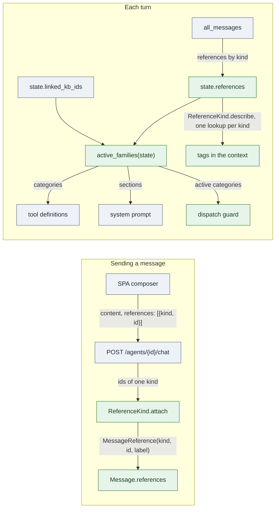

# LLD: Message references and tool families: tools that load when the conversation needs them

| Field | Value |
| --- | --- |
| Status | 🚧 In progress: all phases built and tested locally (2026-10-25); not deployed, manual chat checks pending (see Implementation notes) |
| Owner | InnomightLabs API |
| Last reviewed | 2026-10-25, against the working tree (`main`) |
| Depends on | [LLD-documents.md](LLD-documents.md) (documents, the Documents skill), [LLD-image-input-and-read-image-tool.md](LLD-image-input-and-read-image-tool.md) (the image precedent) |
| Tracker | — |

> **Summary:** A document a user attaches in chat is stored against the conversation, but the message doesn't say so:
> the agent is never told a file arrived, and it can read the file only if someone installed the Documents skill.
> This design adds two registries. **Reference kinds**: a message carries `references` (`kind`, `id`, `label`), and
> each kind says how a reference is attached, shown in the context and recalled. **Tool families**: each set of tools
> declares when it is offered (a reference kind present anywhere in the conversation, or a condition such as a linked
> knowledge base) and the prompt section that goes with it. Documents become the first reference kind, and the
> Documents skill's actions become core tools offered by the `DOCUMENT` family. A new feature of this shape is a
> reference kind, a tool category and one family entry, with no change to the turn, the context or the prompt.

## Implementation notes

Built 2026-10-25 (phases 1 to 6, against moto and fakes). Where the build departs from the design below, the design
sections are left as proposed and this table says what was built.

| Design said | Built | Why |
| --- | --- | --- |
| `Document.attached_to`, the message's `sk`, picked by the route before the turn (3.2, 3.7) | `Document.attached_at`: `0` while waiting to be sent, then when it was sent (epoch seconds); `None` for owners that don't attach (KBs) and documents from before. The route attaches before the turn, like images, with no message id passed | Which message a document went with is already on the message (`references`); the document only needs "sent or not" for the composer and the sweep. No `start_turn` change, and a document can go out again with a later message |
| Sweep only documents created after a rollout cut-off (6) | No cut-off: older documents have `attached_at = None`, which the sweep never matches | One less constant to keep |
| `DocumentFollowUp.unattached_ttl_seconds` (3.7) | `conversations/documents.py` owns `UNSENT_TTL_SECONDS` (24 h) and `sweep_unsent`; the scheduler runs it hourly (`UNSENT_DOCUMENT_SWEEP_INTERVAL_SECONDS`); `documents` offers `attach`, `unsent`, `sweep_unsent` | The TTL is the conversation's rule, not every owner's |
| — | `DocumentRepository.save_in_flight` updates only the worker's fields (never `attached_at`) instead of putting the whole item | Found while building: a worker saving from its copy at claim time would have reset `attached_at` for a document sent while it was being read, and the sweep would then have deleted a document a message points at |
| `TOOL_FAMILIES` in `agents/tool_runtime/families.py` (3.3) | `ToolFamily`, `active_families` and `prompt_sections` there; the list in `agents/architectures/krishna_memgpt_families.py` | The sections are Krishna's templates; `tool_runtime` stays free of architecture code |
| The NATIVE family renders the memory tools section (3.3, 3.4) | `memory_tools.j2` stays an unconditional include; NATIVE has no section | It is on every turn |
| Dispatch guard reads `state.active_categories` (3.6) | `ToolExecutionRouter(registry, offered=...)`: built with the same set the turn offers | One value decides both what is offered and what may run; nothing extra on the state |
| `list_usable` skips installed core skills (3.5) | `SkillRegistry` keeps core skills apart: `list()`/`get()` return installable skills only, `core()`/`core_skills()` the core ones, `execute_action` finds both | Catalog, installs, automations and usable-skill lists all exclude core skills from one place |
| — | `scripts/remove_core_skill_installs.py` (dry run by default, `--apply`) removes `documents` installs | The migration in 6 |
| `ReferenceError` (3.2) | `ReferenceRefused`, a `Refusal` | `ReferenceError` is a Python builtin |

Code cleaned on the way (the scout rule):

- **One `Refusal` base and handler.** It is in `src/exceptions.py`. `ImageInputError`, `LeadsError` and
  `ReferenceRefused` subclass it. Before, the first two were identical classes with identical handlers.
- **Prompt and tools.**
  - `KrishnaMemGPTArchitecture._build_system_prompt` is removed. It was a pass-through repeating its callee's
    signature. `kb_count` is no longer threaded through the turn.
  - `SkillRuntimeService.build_system_prompt_addendum` is removed. It was a second rendering of the skills section
    that only tests called.
- **Skills shared code.**
  - `skills/runtime_context.action_context` and `as_tool_result` serve installed and core skills alike.
  - `current_tool_call_id` moved to `agents/tool_runtime/current_call.py`. This broke an import cycle the core
    tools would have created.
- **Context budget.** `FixedWindowStrategy` formats each message once and counts the words it sends. Before, it
  rendered image tags twice and left out text-attachment content, so large text attachments overran the budget.
  This changes behaviour: long text attachments now take more of the window.
- **Conversation routes.** `conversations/router.py` uses `owned_conversation(...)` instead of 12 copies of
  find-or-404.
- **Broken manifest.** The Documents manifest no longer loaded: a flow mapping in `query_table` held `[low, high]`,
  and the registry skips an invalid manifest with only a warning. It is fixed, and `tests/test_skill_manifests.py`
  now fails when any skill folder's manifest doesn't load.
- **SPA send path.**
  - `ChatService.sendMessage` takes one `OutgoingMessage` instead of positional parts. `sendMessageBody` builds the
    request.
  - The composer's "can send" condition is computed once. It was written twice and had drifted.
- **Smaller fixes.**
  - An untyped lambda in `agents/router.py` (mypy) is replaced.
  - Unused locals are removed.
  - The hierarchical chunker no longer calls `_detect_topic_shift`, whose result was never used. The method is
    removed too.

Left as is:

- **The user message's parts travel as separate arguments.** `user_message`, `attachments`, `images` and now
  `references` go through `start_turn`, `handle_message`, `_run_turn` and about 20 callers and test fakes (widget,
  A2A, automations, scheduler). Folding them into one value is its own change.
- **Partial attach.** The route attaches images, then references. If the second step fails, the first has already
  bound its uploads (as images do today).

Still to do: deploy, then a manual pass in the dashboard (section 7), and `remove_core_skill_installs.py --apply` per
environment after the deploy.

## 1. Context and problem

### 1.1 What images do today

Images are the one attachment that already loads its tool on demand:

| Concern | Where |
| --- | --- |
| The message holds the reference | `Message.image_attachments: list[ImageAttachment]` ([`messages/models.py`](../api/src/messages/models.py)) |
| Bound at send | `SendMessageRequest.image_ids` → `ImageUploadService.attach` claims pending uploads ([`agents/router.py`](../api/src/agents/router.py), [`vision/uploads.py`](../api/src/vision/uploads.py)) |
| The agent is told | `attached_image_tag` → `<attached_image id=… filename=…>` in `_format_with_attachments` ([`llm/conversation_strategy.py`](../api/src/llm/conversation_strategy.py), [`vision/context.py`](../api/src/vision/context.py)) |
| Recall | `recalled_image_line` in `recall_conversation` ([`tools/native/handlers.py`](../api/src/tools/native/handlers.py)) |
| Tool offered only when needed | `state.images = index_images(all_messages)`, `state.image_input_available`, `ToolCategory.IMAGE` in `_tool_categories_for` ([`agents/architectures/krishna_memgpt.py`](../api/src/agents/architectures/krishna_memgpt.py)) |

It works, but every piece is written for images. A second kind of attachment would copy each one.

### 1.2 How the turn chooses tools

```python
# agents/architectures/krishna_memgpt.py
def _tool_categories_for(state: AgentTurnState) -> set[ToolCategory]:
    return {
        ToolCategory.NATIVE,
        *([ToolCategory.KNOWLEDGE] if state.linked_kb_ids else []),
        *([ToolCategory.SKILL] if state.enabled_skills else []),
        *([ToolCategory.MCP] if state.enabled_mcp_connections else []),
        *([ToolCategory.IMAGE] if state.image_input_available else []),
    }
```

The system prompt repeats those conditions in its own `` blocks (`kb_count > 0`, `enabled_skills`,
`enabled_mcp_connections`, in [`krishna_memgpt_system_prompt.j2`](../api/src/agents/prompt_templates/krishna_memgpt_system_prompt.j2)).
Each new feature adds a line to the chain, a field to `AgentTurnState`, a block to the template and a branch in the
context strategy.

Dispatch doesn't check the category: `ToolExecution.execute` runs `self._registry.get(tool_name)` for any registered
tool, so a model that calls a tool it wasn't offered still reaches the handler ([`agents/tool_execution.py`](../api/src/agents/tool_execution.py)).

### 1.3 Documents

- `POST /conversations/{id}/documents` stores the file against the conversation and reads it in the background
  ([`conversations/router.py`](../api/src/conversations/router.py)). The message sent after it carries nothing.
- The agent reads documents through the **Documents skill** ([`skills/documents/`](../api/src/skills/documents/)): it
  must be installed on the agent, and every read is `load_skill` then `execute_skill_action`.
- Nothing tells the agent a file was attached. Unless the user names it, the agent doesn't know to look.
- An upload never sent stays in the conversation with nothing pointing at it, and the composer lists it again on the
  next visit.
- A knowledge base's uploaded files show up in `knowledge_base_search` as `Document:` hits, which point the agent at
  the skill, but the skill is only there if it was installed.

## 2. Goals and non-goals

Goals:

1. A message records what the user attached as **references**, with a kind. Documents are the first kind.
2. The agent sees each reference in the conversation (`<attached_document …>`), including in recalled and reopened
   conversations.
3. A set of tools is offered when its trigger holds: a reference of its kind anywhere in the conversation, or a
   condition such as a linked knowledge base. Their prompt instructions come with them.
4. Adding a feature of this shape takes a reference kind, a `ToolCategory` and one `ToolFamily` entry, with no edits
   to the turn, the context strategy, `recall_conversation` or the system prompt template.
5. The Documents skill's actions become core tools: no install, no `load_skill` round trip.
6. A tool is run only if its family is active this turn.

Non-goals:

- Moving images onto references. They keep `image_attachments`, with their saved analysis and pending-upload ledger,
  and are expressed as a family. Moving them later is a separate change (8.4).
- Document uploads in the widget and `/v1`. The message contract carries references for them when they get upload
  routes.
- Ila (Vishwakarma), which offers only its builder tools, and `krishna_mini`, which offers none.

## 3. Design



Green is new and grey exists. The references saved at send are read back from the whole conversation each turn, which
is what makes a reopened conversation offer the tools again.

### 3.1 Message references

A reference is what a message points at, stored on the message:

```python
# messages/models.py
class MessageReference(BaseModel):
    """Something the user attached that lives elsewhere (a document). The message holds the pointer, never the content."""

    kind: str
    id: str
    #: Shown without a lookup: the filename, say.
    label: str = ""


class Message(BaseModel):
    ...
    references: list[MessageReference] = Field(default_factory=list)
```

`to_dynamo_item` and `from_dynamo_item` write and read `references` like `image_attachments`. `MessageResponse`
returns them, so a reloaded conversation shows them on the message.

### 3.2 Reference kinds

One strategy per kind, in a registry the messages module owns and other modules fill:

```python
# messages/references.py
class ReferenceKind(Protocol):
    kind: str

    def attach(self, conversation: Conversation, ids: list[str], message_sk: str) -> list[MessageReference]:
        """At send: check every id is this conversation's and not attached yet, bind it to the message, return the
        references. Raises ReferenceError for one that isn't."""

    def describe(self, conversation: Conversation, references: list[MessageReference]) -> dict[str, str]:
        """Once per turn, for every reference of this kind in the conversation: id -> the tag the context shows.
        One lookup for all of them, not one per reference."""

    def recall_line(self, reference: MessageReference) -> str:
        """The one line `recall_conversation` prints, from the reference alone."""


REFERENCE_KINDS: dict[str, ReferenceKind] = {}


def register(kind: ReferenceKind) -> None: ...


def references_by_kind(messages: list[Message]) -> dict[str, list[MessageReference]]:
    """Every reference in the conversation, grouped by kind, first sighting of each id kept."""
```

`messages` imports no feature module. A feature registers its kind when its module is imported, the way
`knowledge/documents.py` registers its `DocumentFollowUp` in `FOLLOW_UPS`.

`ReferenceError` carries a stable code and a message fit to show (`reference_not_found`), so the route can answer 4xx
the way `ImageInputError` does.

**Send.** `SendMessageRequest` gains `references: list[ReferenceRequest]` (`kind`, `id`). The route groups the ids by
kind and calls each kind's `attach` before starting the turn. An unknown kind or an id the kind refuses is a 422 with
that code. The references reach `KrishnaMemGPTArchitecture.handle_message` beside `attachments` and `images`, and are
saved on the user message.

`attach` binds to the message's `sk`, a property of `created_at` and `message_id`. Today the user `Message` is built
inside `handle_message` (step 2), after the route has returned, so the route can't know its `sk`. The route picks the
user message's `message_id` and `created_at`, attaches with the `sk` they make, and passes them through `start_turn`.
`handle_message` builds the `Message` with them. Images keep binding as they do (their ledger isn't keyed by message).

**Context.** `conversation_strategy._format_with_attachments` gains the tags for the message's references:

```python
attachment_sections += [reference_tags[(ref.kind, ref.id)] for ref in msg.references if (ref.kind, ref.id) in reference_tags]
```

`reference_tags` is built once per turn from `describe` and passed to `build_context`, and the word count uses the
same tags. A reference whose kind isn't registered, or whose target is gone, shows as
`<attached kind="…" id="…" label="…">(no longer available)</attached>`, so the history stays readable.

**Recall.** `recall_conversation` prints `REFERENCE_KINDS[ref.kind].recall_line(ref)` for each reference, after the
image lines.

### 3.3 Tool families

One entry per set of tools, in order:

```python
# agents/tool_runtime/families.py
@dataclass(frozen=True)
class ToolFamily:
    category: ToolCategory
    #: Offered when the conversation holds a reference of any of these kinds...
    triggered_by: frozenset[str] = frozenset()
    #: ...or when this holds. A family with neither is never offered.
    when: Callable[[AgentTurnState], bool] | None = None
    #: Instructions that come with the tools, rendered into the system prompt while the family is active.
    prompt_section: Callable[[AgentTurnState], str] | None = None

    def active(self, state: AgentTurnState) -> bool:
        return any(state.references.get(kind) for kind in self.triggered_by) or bool(self.when and self.when(state))


TOOL_FAMILIES: list[ToolFamily] = [
    ToolFamily(ToolCategory.NATIVE, when=lambda s: True, prompt_section=memory_tools_section),
    ToolFamily(ToolCategory.KNOWLEDGE, when=lambda s: bool(s.linked_kb_ids), prompt_section=knowledge_base_section),
    ToolFamily(ToolCategory.SKILL, when=lambda s: bool(s.enabled_skills), prompt_section=skills_section),
    ToolFamily(ToolCategory.MCP, when=lambda s: bool(s.enabled_mcp_connections), prompt_section=mcp_section),
    ToolFamily(ToolCategory.IMAGE, when=lambda s: s.image_input_available),
    ToolFamily(
        ToolCategory.DOCUMENT,
        triggered_by=frozenset({"document"}),
        # A linked knowledge base's files can be read at any time, attached or not
        when=lambda s: bool(s.linked_kb_ids),
        prompt_section=core_skill_section("documents"),
    ),
]


def active_families(state: AgentTurnState) -> list[ToolFamily]:
    return [family for family in TOOL_FAMILIES if family.active(state)]
```

- `krishna_memgpt.py` replaces `_tool_categories_for` with
  `state.active_categories = {f.category for f in active_families(state)}` and asks the registry for those.
- `IMAGE` keeps its condition (`image_input_available`, which includes the account's Image Reading setting). It
  doesn't use `triggered_by` because images aren't references yet.
- `DOCUMENT` is on for a document anywhere in the conversation (this message, earlier ones, a reopened
  conversation), and whenever a knowledge base is linked.
- The list is explicit and lives in one file, so the order of the prompt sections is visible and stable. A family
  for a new feature is a line here.

### 3.4 Prompt sections

The template loops over the active families' sections instead of naming each feature:

```jinja
  {# moves into the NATIVE family's section #}


{{ section }}

```

`tool_sections = [f.prompt_section(state) for f in active_families(state) if f.prompt_section]`, rendered by
`build_krishna_memgpt_system_prompt`. Each existing section keeps its template (`knowledge_base.j2`, `skills.j2`,
`mcp_connectors.j2`), rendered by a small function that passes the variables it needs: `kb_count`,
`enabled_skills`, `recent_skill_actions`, `enabled_mcp_connections`, `mcp_shared_by_owner`. The rendered prompt
for today's families is byte-for-byte what it is now (tested in 7).

### 3.5 Core skills: a manifest served as native tools

The Documents skill's actions move from "installable skill" to "core tools of a family", keeping the manifest and
`actions.py` as the single source:

```yaml
# skills/documents/manifest.yml
id: documents
core: true   # served as core tools by a tool family; not offered for install
```

```python
# agents/tool_runtime/core_skills.py
def core_skill_specs(skill_id: str, category: ToolCategory) -> list[ToolSpec]:
    """One tool per manifest action: its name, description and input_schema as the tool's definition."""


async def run_core_skill_tool(skill_id: str, tool_name: str, tool_input: dict[str, Any], state: AgentTurnState) -> str:
    """Runs the action through `SkillRegistry.execute_action` with the context an installed skill would get
    (account, agent, owner, actor, conversation, user message, tool call), built from the turn state, and no config."""


def core_skill_section(skill_id: str) -> Callable[[AgentTurnState], str]:
    """The manifest's system_prompt as the family's prompt section."""
```

- `build_default_tool_registry` binds `core_skill_specs("documents", ToolCategory.DOCUMENT)` to `run_core_skill_tool`.
  Tool names are the action names (`list_documents`, `describe_document`, …). Registration fails on a clash, as it
  does today (`ToolRegistry.register`).
- `SkillRegistry` leaves `core: true` manifests out of the catalog and install routes. A `documents` skill already
  installed on an agent is ignored by `list_usable` and removed by the migration in 6.
- The context dict is the one `SkillRuntimeService.handle_tool_call` builds, from the same fields of
  `AgentTurnState`. It's extracted into one function both call, so the two can't drift apart.
- The actions keep their own owner checks (`_owner` in `skills/documents/actions.py`): the conversation's documents,
  or a knowledge base linked to the agent that its owner may read.
- `SKILL_MANIFEST.md` documents `core`.

A future core skill is a manifest with `core: true`, a `ToolCategory` and a family entry.

### 3.6 The dispatch guard

`ToolExecution.execute` refuses a tool whose category isn't in `state.active_categories`:

```python
tool = self._registry.get(tool_name)
if tool.spec.category not in state.active_categories:
    return ToolExecutionOutcome(result=f"Error: '{tool_name}' isn't available in this conversation.", success=False)
```

It's a result the model reads, like an unknown tool. The categories are worked out once at the start of the turn.
References only change when the user sends a message, so they hold for the whole turn.

### 3.7 The document reference kind

The conversation is the documents' owner, so the kind lives beside the conversation routes, the way the knowledge
base's follow-up lives in `knowledge/documents.py`:

```python
# conversations/documents.py
class ConversationDocuments:
    kind = "document"

    def attach(self, conversation, ids, message_sk):
        documents = get_document_service().attach(document_owner(conversation), ids, attached_to=message_sk)
        return [MessageReference(kind=self.kind, id=d.document_id, label=d.filename) for d in documents]

    def describe(self, conversation, references):
        current = {d.document_id: d for d in get_document_service().documents(document_owner(conversation))}
        return {ref.id: document_tag(current.get(ref.id), ref) for ref in references}

    def recall_line(self, reference):
        return f"[document {reference.id} {reference.label}]"


register(ConversationDocuments())
```

The tag carries what the agent needs to choose its next call, and the status, so it knows if the file is still being
read:

```text
<attached_document id="4617b53a-…" filename="batting-2026.xlsx" status="ready" pages="1" tables="1">
Read it with describe_document, then the section, page or table tools.
</attached_document>
```

A pending or parsing document says "still being read; list_documents shows when it's ready", and a failed one carries
its error. Content is never inlined: the tools read it in bounded parts.

**Binding.** `Document` gains `attached_to: str = ""`, an opaque reference the owner sets (the message's `sk` for a
conversation). `DocumentService.attach(owner, ids, attached_to)` does one conditional update per id
(`attached_to = ""`) and raises `DocumentReadError` for an id that isn't the owner's, is deleting or is already
attached. Two sends can't claim the same upload. `documents` doesn't know what a message is; it keeps the string.

**Unsent uploads.**
- `GET /conversations/{id}/documents?attached=false` lists the uploads not yet sent. The composer shows only those,
  so a reload doesn't bring back files that were already sent.
- `DocumentFollowUp` gains an optional `unattached_ttl_seconds`. The conversation registers a follow-up with 24 hours
  and nothing to do after a read.
- The documents reaper deletes documents left unattached past their owner's TTL, through the normal `delete`.
  Knowledge-base documents have no TTL; they are never attached to a message.

## 4. Data model and contracts

| Item | Change |
| --- | --- |
| `Message` (DynamoDB) | `references: [{kind, id, label}]`, absent on old items (read as `[]`) |
| `MessageResponse` | `references: [{kind, id, label}]` |
| `SendMessageRequest` (`POST /agents/{agent_id}/chat`) | `references: [{kind, id}]`, default `[]`; 422 `reference_not_found` for an id its kind refuses, `reference_kind_unknown` for an unknown kind |
| `Document` (DynamoDB) | `attached_to: str = ""` |
| `GET /conversations/{id}/documents` | `?attached=false`: only uploads not yet sent |
| `skills/*/manifest.yml` | `core: bool = false` |
| `ToolCategory` | `DOCUMENT = "document"` |
| `AgentTurnState` | `references: dict[str, list[MessageReference]]`, `reference_tags: dict[tuple[str, str], str]`, `active_categories: set[ToolCategory]` |

No new environment variables. The unattached TTL is a constant on the conversation follow-up.

## 5. Implementation map and phases

| Phase | Area | Files | What |
| --- | --- | --- | --- |
| 1 | Families | `agents/tool_runtime/families.py` (new), `specs.py`, `krishna_memgpt.py`, `krishna_memgpt_prompt.py`, `krishna_memgpt_system_prompt.j2`, `tool_execution.py`, `runtime_state.py` | `ToolFamily`, `TOOL_FAMILIES` for today's categories, `active_families`, sections loop, dispatch guard. No change in what any turn offers or renders |
| 2 | References | `messages/models.py`, `messages/responses.py`, `messages/references.py` (new), `llm/conversation_strategy.py`, `tools/native/handlers.py` (`recall_conversation`), `agents/router.py`, `agents/turns/run.py`, `krishna_memgpt.py` | The model, the registry, send-time `attach`, per-turn `describe`, tags in the context, recall lines |
| 3 | Document kind | `documents/models.py`, `documents/repository.py`, `documents/service.py` (`attach`, unattached sweep), `documents/follow_ups.py`, `conversations/documents.py` (new), `conversations/router.py` (`?attached=false`) | Binding, the tag, the 24-hour sweep |
| 4 | Core skill | `agents/tool_runtime/core_skills.py` (new), `tool_runtime/factory.py`, `skills/models.py` (`core`), `skills/registry.py`, `skills/service.py` (shared context builder, `list_usable` skips core), `skills/documents/manifest.yml`, `SKILL_MANIFEST.md`, `ToolCategory.DOCUMENT` family | The Documents actions as core tools, offered by the `DOCUMENT` family |
| 5 | SPA | `ConversationDetail.tsx`, `ChatComposer.tsx`, `useConversationDocuments`, the message bubble, `ConversationApiService.ts`, message types | Send `references`; list only unattached uploads in the composer; document chips on sent messages from `references` |
| 6 | Docs | This LLD, `LLD-documents.md` (3.7 and its notes: the skill is core), the wiki copies, `api/AGENTS.md`, `skills/AGENTS.md`, `agents/architectures/CONTRIBUTING.md` (how to add a family) | |

Each phase ships on its own. Phase 1 changes nothing visible. Phases 2 and 3 tell the agent about attached documents
(with the installed skill still reading them). Phase 4 removes the install.

## 6. Rollout and compatibility

- **Old messages** have no `references` and read as `[]`. Documents uploaded before phase 3 have no message pointing
  at them. They aren't announced, `list_documents` still finds them, and the `DOCUMENT` family isn't triggered by
  them. They are read with `attached_to = ""`, so the sweep must not touch documents created before phase 3: the
  sweep only deletes those whose `created_at` is after the rollout cut-off, kept as a constant.
- **Installed `documents` skills:** one script removes the `AgentSkill` rows for `skill_id = documents`, run after phase
  4 is deployed. Until then `list_usable` skips them, so the agent isn't offered both the skill and the core tools.
- **Prompt caching:** the tool list changes on the turn a family first turns on. That costs one cache miss on
  providers that cache tools, once per conversation per family.
- **Old clients** that don't send `references` keep working; their documents are just not announced.

## 7. Validation

Automated (`uv run pytest -q` from `api/`):

- **Families:**
  - For each combination of KB linked, skills enabled, MCP enabled and image input available, the categories and the
    rendered system prompt equal today's. Snapshot both before phase 1.
  - `DOCUMENT` turns on for a document referenced in the current message, in an older message outside the context
    window, and for a linked KB with no references. It stays off otherwise.
- **Dispatch guard:** a call to `describe_document` in a turn without the family returns the error result and doesn't
  reach the handler.
- **References:**
  - `attach` refuses another conversation's document, an already attached one, a deleting one and an unknown kind.
  - A second send of the same id fails.
  - The tag shows status and counts.
  - A deleted document shows "no longer available".
  - `recall_conversation` prints the line.
  - The tags' word count is part of the context budget.
- **Core skill:**
  - The document tools run the manifest's actions with the turn's context.
  - `core: true` skills are missing from `GET /skills` and refused by install.
  - An installed `documents` row isn't listed as usable.
- **Sweep:** an unattached conversation document past 24 hours is deleted (S3 and row). An attached one, a KB one and
  one from before the cut-off are kept.

Manual, on the local stack:

- Attach `batting-2026.xlsx` in a chat and ask about one player's runs. The agent calls `describe_document` and
  `query_table` without being told the file exists.
- Reload the conversation: the chip shows on the message and the composer is empty.
- Reopen it a day later: the tools are offered again.
- On an agent with a linked KB holding the same file, ask the same question with no attachment.

## 8. Alternatives and decisions

1. **A field per attachment kind on `Message`** (`document_attachments` beside `image_attachments`). Rejected: every
   kind would copy the context, recall and trigger code, which is what this design removes.
2. **Auto-enabling the installed skill** when a document is present. Rejected: it keeps the `load_skill` round trip
   and lets the skill be installed twice over the auto-enabled one.
3. **One `documents` tool with an `action` argument.** Rejected: ten actions' schemas in one tool are hard for models
   to fill correctly, and the manifest already describes each action.
4. **Images as references now.** Deferred. Images have a pending-upload ledger, an S3 retention tag and a saved
   analysis written back into `image_attachments[i]`. Moving them is a migration of stored messages and of three
   surfaces (dashboard, widget, `/v1`), for no change in behaviour. `IMAGE` is a family now. Once images become a
   reference kind, its `when` becomes `triggered_by={"image"}` plus the account check.
5. **`DOCUMENT` only when a linked KB actually holds documents.** Rejected for now: a linked KB should be readable at
   any time, and checking means a query per KB per turn. The family costs about ten tool definitions.
6. **Families declared by each module** (registered on import) instead of one list. Rejected: the list's order is the
   prompt's section order, and one file shows every condition the agent's tools depend on.

## Related documentation

- [LLD-documents.md](LLD-documents.md): the documents module and the reading tools.
- [LLD-image-input-and-read-image-tool.md](LLD-image-input-and-read-image-tool.md): the image precedent.
- [api/src/agents/architectures/CONTRIBUTING.md](../api/src/agents/architectures/CONTRIBUTING.md): seams for prompt, tool and runtime-state changes.
- [api/src/skills/SKILL_MANIFEST.md](../api/src/skills/SKILL_MANIFEST.md): the manifest contract.
