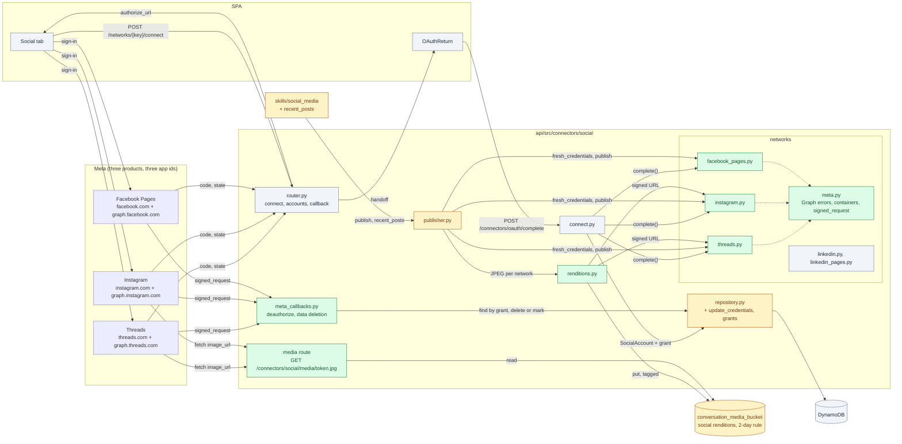
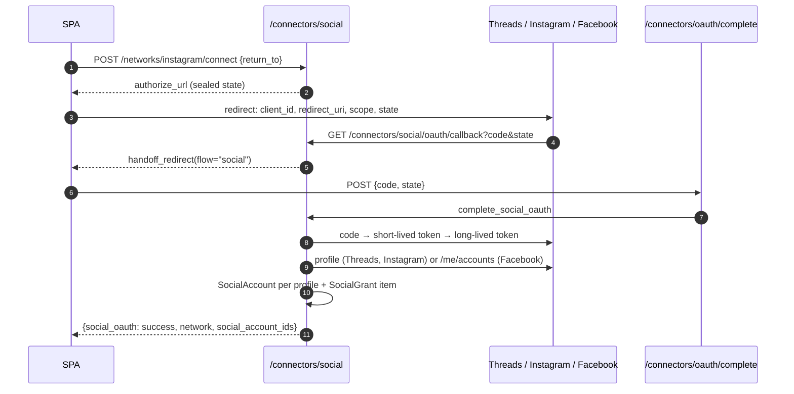
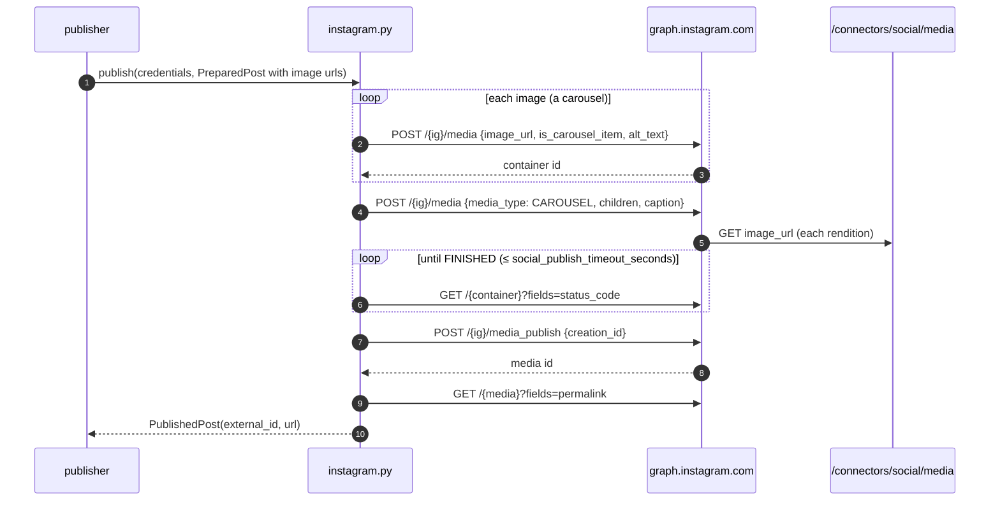
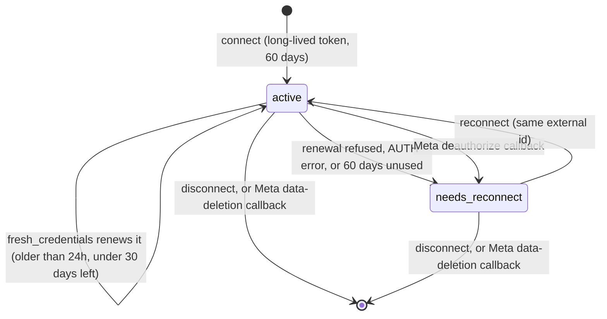
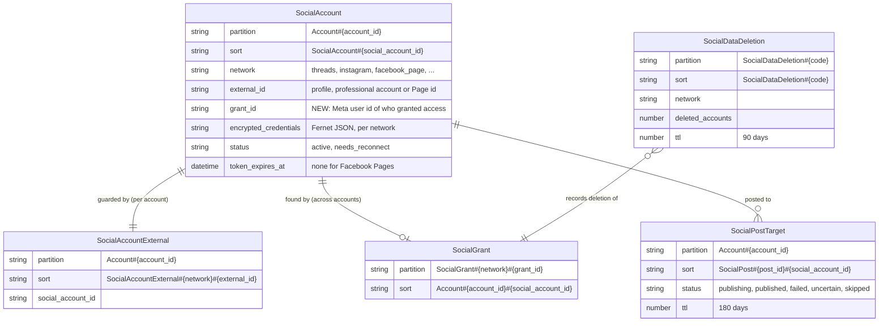

# LLD: Threads, Instagram and Facebook Pages as social networks

| Field | Value |
| --- | --- |
| Status | 🚧 In progress: Facebook Pages built (2026-11-02); Threads and Instagram to come |
| Owner | InnomightLabs API / connectors |
| Last reviewed | 2026-11-02 |
| Depends on | [Social cross-posting](LLD-social-cross-posting.md) (parent: social connectors, the `social_media` skill, the publisher), [Action consent](LLD-action-consent.md) (publishing asks first), [Upload file artifacts](../api/docs/LLD-upload-file-artifact-skill.md) |
| Scope | `api/src/connectors/social/` (three networks, protocol additions, public media, Meta callbacks), `api/src/skills/social_media/`, `api/src/config/settings.py`, `api/lambdas/account_deletion_handler/`, `terraform/conversation_media.tf`, `spa/src/assets/connectors/` |

> **Summary:** Add Threads, Instagram (professional accounts, through Instagram Login) and Facebook Pages to the
> Social tab, with the same flow as LinkedIn and LinkedIn Pages. The InnomightLabs Meta app asks the person for
> publishing scopes, the person signs in at the network, the callback hands off to the SPA, and each granted
> identity becomes a `SocialAccount`. Each network is one strategy file behind the existing `SocialNetwork`
> protocol. The protocol grows by three small, network-neutral capabilities that Meta needs first: token refresh,
> images by public URL, and reading the account's own recent posts. Posts carry text and images, from one image up
> to a carousel. Meta's App Review also needs deauthorize and data-deletion callbacks, so they are built here,
> together with the account-deletion gap the research found.

## Contents

- [Decisions taken with the owner](#decisions-taken-with-the-owner)
- [Implementation notes (2026-11-02)](#implementation-notes-2026-11-02)
- [Context: what exists today](#context-what-exists-today)
- [Goals and non-goals](#goals-and-non-goals)
- [Design](#design)
  - [Components](#components)
  - [1. The three networks](#1-the-three-networks)
  - [2. Connecting](#2-connecting)
  - [3. Protocol additions](#3-protocol-additions)
  - [4. Images: renditions and public URLs](#4-images-renditions-and-public-urls)
  - [5. Publishing calls and error kinds](#5-publishing-calls-and-error-kinds)
  - [6. Token lifecycle](#6-token-lifecycle)
  - [7. Reading recent posts](#7-reading-recent-posts)
  - [8. The `social_media` skill](#8-the-social_media-skill)
  - [9. Meta callbacks: deauthorize and data deletion](#9-meta-callbacks-deauthorize-and-data-deletion)
  - [10. Account deletion](#10-account-deletion)
  - [11. Configuration](#11-configuration)
  - [12. Dashboard](#12-dashboard)
- [Data model](#data-model)
- [Implementation map](#implementation-map)
- [Rollout](#rollout)
- [Validation](#validation)
- [Alternatives and decisions](#alternatives-and-decisions)
- [Open questions](#open-questions)
- [Related documentation](#related-documentation)

## Decisions taken with the owner

| Question | Decision |
| --- | --- |
| Post types | Text and images: one image, or several (a Threads or Instagram carousel, a Facebook multi-photo post). Instagram still needs at least one image. Video and Reels are a later phase. |
| Scopes | Publishing, plus reading the account's own posts, with a new `social_media.recent_posts` action. It answers the gap the LinkedIn editor agent hit on 2026-11-01: "the available social tool cannot inspect earlier posts". |
| Several Facebook Pages | One sign-in connects every Page the person can post to, as LinkedIn Pages does. Facebook's own consent screen already lets them leave Pages out. |
| Instagram sign-in | ~~*Instagram API with Instagram Login*~~. Changed 2026-11-02: Meta doesn't offer Instagram Login to new apps, so Instagram connects through the same Facebook Login for Business sign-in as Facebook Pages (unified login), as a professional account linked to a Page. See [Implementation notes](#implementation-notes-2026-11-02). |
| Order | Facebook Pages first, then Threads and Instagram (2026-11-02). |

## Implementation notes (2026-11-02)

**Facebook Pages is built first**, ahead of Threads and Instagram (Phase D before B and C), with only the parts of
Phase A it needs. Built:

| Area | Code |
| --- | --- |
| The network | `api/src/connectors/social/networks/facebook_pages.py`, in `NETWORKS` |
| Graph errors | `networks/meta.py`: `graph_error`, `graph_call` (one call, its failure classified), `graph_json`, `graph_message` |
| Protocol | `ConnectedProfile.grant_id`, `RecentPost`, `reads_posts` and `recent_posts` (LinkedIn: `reads_posts = False`) |
| Grant items | `SocialAccount.grant_id`, `grant_key`; `SocialAccountRepository.connect`, `_refresh` and `delete` write and remove them in the same transaction; `for_grant(network, grant_id)` |
| Meta callbacks | `api/src/connectors/social/meta_callbacks.py`, public under `/connectors/social/meta/` (`META_CALLBACKS_PATH_PREFIX` in `auth/middleware.py`) |
| Skill | `social_media.recent_posts`; `accounts` adds `requires_image` and `reads_posts`; the preview label uses `display_name` |
| Account deletion | `_delete_social_accounts` in `api/lambdas/account_deletion_handler/handler.py` |
| Settings | `SOCIAL_FACEBOOK_LOGIN_CONFIG_ID`, `SOCIAL_META_GRAPH_VERSION` (both deploy scripts) |
| Dashboard | `spa/src/assets/connectors/facebook.svg`; the privacy policy names Facebook Pages, reading posts, the callbacks and account deletion |

Not built yet, and needed only by Threads and Instagram: `fresh_credentials`, renditions and the public media route,
`text_length`, `aspect_range`, the hashtag and mention limits, and their settings. LinkedIn Pages `recent_posts` is
also still to do (`reads_posts = False` for now).

Departures from the design below:

- **Reading posts** uses `GET /{page}/posts`, not `/{page}/feed`: the feed also holds visitors' posts on the Page.
  The media kind comes from `attachments{media_type}` (`photo` → image, `album` → carousel, `video`).
- **Tokens go in the `Authorization: Bearer` header**, never in a query string. Only the code exchange sends the
  app secret, as Graph requires, in the query of a server-to-server call.
- **Graph codes 1 and 2, and `is_transient`**, are treated like a 5xx: transient before the post call, uncertain on it.
- **No alt text on Facebook** photos, as §5 planned.
- **A Page listed without `tasks`** is kept when it has a Page token: Facebook can leave `tasks` out (a Page
  reached through a Business portfolio). Only a Page whose tasks rule posting out is left out. A sign-in with
  nothing to post as logs the granted permissions and the Pages' tasks, never a token.
- **Disconnect** keeps a grant while any account of it remains, in any InnomightLabs account: it asks `for_grant`,
  not just this account's list. A person who connects the same Page in two accounts keeps both working.
- **A Page reconnected by someone else** moves its grant item to the new person.
- **The account-deletion Lambda** deletes our copy and revokes nothing. It has no network strategies and can't
  decrypt the credentials. The person can remove the app in Facebook.
- **The deletion status page** is a small HTML page. Its record (`SocialDataDeletion#{code}`) holds the networks
  and a count, not who the person was.
- `parse_signed_request` lives in `meta_callbacks.py`, not `meta.py`. `meta.py` holds only what the networks share.
- **A sign-in with nothing to post as** (no Page chosen on Facebook's consent screen, or only an analyst role) raises
  `NothingToPostAs`, and the return says `reason=no_accounts` with a `detail` the network wrote for the person.
  Facebook says which it was: a permission our Login configuration never asked for (our setup, logged as an error),
  a permission the person switched off, no Page chosen, or no role that can post on the Pages chosen. Its `diagnostic` (permission names, Page counts and tasks) goes to the
  log only. The Social tab shows the detail. LinkedIn Pages uses it too. The Social tab also shows
  `last_error` on an account that needs a new sign-in ("Access was removed in Facebook Pages"), and counts the
  accounts one sign-in added.

**Instagram through unified login.** Meta no longer offers Instagram Login to new apps, so Instagram will connect
through the same Facebook Login for Business sign-in, as an Instagram professional account linked to a Page.
Section 1's Instagram column and §2's Instagram notes describe Instagram Login and are rewritten in Phase C. What
is already true for it:

- Instagram will use the same app, `facebook_pages` (one `SOCIAL_FACEBOOK_PAGES_*` pair, one Login configuration
  that also asks for `instagram_basic` and `instagram_content_publish`).
- It finds its accounts through `/me/accounts?fields=instagram_business_account`, and posts with the Page token on
  `graph.facebook.com`.
- `networks_of_app("facebook_pages")` already makes the callbacks cover every network of the app.
- Disconnect must then also count the other network's accounts of the same grant before revoking it.

**Register in the Meta app** (Facebook Login for Business settings and App settings › Basic):

- Deauthorize callback URL: `https://api.innomightlabs.com/connectors/social/meta/facebook_pages/deauthorize`.
- Data deletion request URL: `https://api.innomightlabs.com/connectors/social/meta/facebook_pages/data-deletion`.

## Context: what exists today

| Area | Today | What it means here |
| --- | --- | --- |
| Plug-in contract | `SocialNetwork` protocol (`api/src/connectors/social/networks/base.py`): `key`, `display_name`, `description`, `icon`, `shares_grant`, `app`, `limits`, `configured()`, `authorize_url()`, `complete()`, `revoke()`, `publish()`. `NETWORKS` (`networks/__init__.py`) holds `LinkedInNetwork()` and `LinkedInPagesNetwork()`. | A network is one file plus one entry in `NETWORKS`. |
| Contract test | `api/tests/test_connectors_social_network_contract.py` runs over every `NETWORKS` entry. It checks distinct keys, a brand mark in `spa/src/assets/connectors/`, `max_text > 0`, hiding until the app is registered, and that `authorize_url` carries `state`, `client_id` and the shared callback. | The new networks get the same checks for free, and need `facebook`, `instagram` and `threads` icons. |
| Connect | `authorize_url_for` seals `SocialOAuthState` (with a PKCE verifier) in `state`. `GET /connectors/social/oauth/callback` (public) calls `handoff_redirect`. `complete_social_oauth` (`connect.py`) saves one `SocialAccount` per `ConnectedProfile`. | Unchanged. Meta networks ignore the PKCE challenge, as their docs don't use it. |
| Accounts | `SocialAccount` (`models.py:31`) has `status` (`active`, `needs_reconnect`) and `token_expires_at`. `effective_status()` turns a lapsed token into `needs_reconnect`. `SocialAccountRepository.connect()` writes the account and the per-account guard `SocialAccountExternal#{network}#{external_id}` in one transaction, or refreshes an existing one. | Nothing updates credentials alone, which a token refresh needs. Nothing finds an account from the network's user id across accounts, which Meta's callbacks need. |
| Publisher | `SocialPublisher.publish` (`publisher.py:44`) plans targets, then `asyncio.gather`s them. Each target claims its record, runs `prepare` and `network.publish`, and maps a `PublishError` kind to a status. `AUTH` marks the account `needs_reconnect`. | `prepare` runs once per *target* (`publisher.py:66`), not once per network as the parent LLD says. No refresh hook (`fresh_credentials` is designed in the parent LLD but not built). |
| Images | `media.prepare` (`media.py`) produces an upright JPEG within `max_image_side` and `max_image_bytes`. Renditions live in memory only. | Instagram and Threads fetch an image from a **public URL**. There is no public media route, no stored rendition and no lifecycle rule yet (parent LLD §5, marked "not built"). |
| Skill | `social_media` actions `accounts`, `check`, `publish` (`api/src/skills/social_media/`). `publish` has a consent preview with text, images and targets blocks. The prompt says "(LinkedIn so far)". | `accounts` doesn't expose `requires_image`. The preview label uses `network.capitalize()` (`actions.py:65`), so `linkedin_page` reads "Linkedin_page". |
| Settings and deploy | `social_apps_from_env` reads every `SOCIAL_<APP>_CLIENT_ID` / `_CLIENT_SECRET` pair (`settings.py:59`). Both deploy scripts loop over whatever pairs exist (`scripts/deploy_prod_railway.sh:357`, `scripts/deploy_local.sh:103`). | A new app is just new env vars. Only non-pair settings (the Graph version, the Facebook Login configuration) need new fields. |
| Deletion | The deletion Lambda (`api/lambdas/account_deletion_handler/handler.py:50`) deletes `ProviderSettings#` and more, but no `SocialAccount#`, `SocialAccountExternal#` or `SocialPost#` items, and revokes nothing. | A gap that exists today, for LinkedIn too. Meta's review asks about it, so it is fixed here. |
| Dashboard | The Social tab (`spa/src/pages/dashboard/connectors/social/SocialAccountsTab.tsx`) renders networks from `GET /connectors/social/networks` and hard-codes no network keys. | Only brand icons are needed. |

## Goals and non-goals

**Goals**

1. Connect Threads profiles, Instagram professional accounts and Facebook Pages from the Social tab with the same
   "Connect" flow as LinkedIn.
2. Publish text and images to them from chat (after consent) and from automations (with step pre-consent), through
   the existing `social_media.publish`.
3. Keep Instagram and Threads tokens alive by refreshing them before they lapse, so scheduled posting keeps working.
4. Let an agent read the account's own recent posts (`social_media.recent_posts`), on the Meta networks and on
   LinkedIn Pages, whose `r_organization_social` scope the app now holds.
5. Pass Meta App Review: deauthorize and data-deletion callbacks, a working privacy story, and deleting social
   data when an account is deleted.

**Non-goals**

- Video, Reels, Stories, Threads replies, quote posts and polls.
- Comments, insights and messaging (`instagram_business_manage_comments`, `threads_manage_insights`, ...).
- Instagram through Facebook Login (an Instagram account linked to a Page).
- A chooser for which Pages to connect.
- A background token-refresh reaper: see [§6](#6-token-lifecycle) for why lazy refresh comes first.
- Per-plan posting limits (parent LLD open question 1).

## Design

### Components



*Green is new, amber is changed and grey is existing. Facebook takes image bytes, so only Threads and Instagram
use the public media route.*

### 1. The three networks

Verify each row against Meta's docs when implementing; these APIs change often. The facts below were read from
Meta's documentation on 2026-11-01 (sources at the end). The Graph API examples there use `v26.0`; Threads uses
`v1.0` on its own host.

| | **Threads** | **Instagram** | **Facebook Pages** |
| --- | --- | --- | --- |
| `key` / `app` | `threads` / `threads` | `instagram` / `instagram` | `facebook_page` / `facebook_pages` |
| Who it posts as | The person's Threads profile | An Instagram professional account (Business or Creator) | Each Page the person can create content on |
| Authorize | `https://threads.com/oauth/authorize` | `https://www.instagram.com/oauth/authorize` | `https://www.facebook.com/{v}/dialog/oauth` (with `config_id` when configured) |
| Scopes | `threads_basic,threads_content_publish` | `instagram_business_basic,instagram_business_content_publish` | `pages_show_list,pages_manage_posts,pages_read_engagement` |
| Code exchange | `POST graph.threads.com/oauth/access_token` → `access_token`, `user_id` (1 hour) | `POST api.instagram.com/oauth/access_token` → `access_token`, `user_id`, `permissions` (1 hour) | `GET graph.facebook.com/{v}/oauth/access_token` → user token |
| Long-lived | `GET graph.threads.com/access_token?grant_type=th_exchange_token` → 60 days | `GET graph.instagram.com/access_token?grant_type=ig_exchange_token` → 60 days | `GET .../oauth/access_token?grant_type=fb_exchange_token` → user token ≈60 days; then `GET /me/accounts` → **Page tokens with no fixed expiry** |
| Refresh | `GET graph.threads.com/refresh_access_token?grant_type=th_refresh_token`: token ≥24h old and not expired | `GET graph.instagram.com/refresh_access_token?grant_type=ig_refresh_token`: same conditions | Not needed for Page tokens |
| Profile | `GET /v1.0/me?fields=id,username,name,threads_profile_picture_url` | `GET /{v}/me?fields=user_id,username,name,profile_picture_url,account_type` | `GET /me/accounts?fields=id,name,access_token,tasks,picture` |
| Publish | Container `POST /{user}/threads` (`TEXT`, `IMAGE` + `image_url`, `CAROUSEL` + `children`), wait for `FINISHED`, `POST /{user}/threads_publish {creation_id}` | Container `POST /{ig}/media` (`image_url`, `caption`, `alt_text`; carousel items `is_carousel_item`, parent `media_type=CAROUSEL`, `children`), poll `status_code`, `POST /{ig}/media_publish {creation_id}` | Text: `POST /{page}/feed {message}`. One image: `POST /{page}/photos` (multipart `source`, `message`). Several: each `POST /{page}/photos {published:false}`, then `POST /{page}/feed {message, attached_media:[{media_fbid}]}` |
| Image | Public URL. JPEG/PNG, ≤8 MB, width 320–1440 (scaled), aspect ≤10:1 | Public URL. **JPEG only**, ≤8 MB, width 320–1440, aspect **4:5 to 1.91:1** | Bytes (multipart). ≤10 MB |
| Images per post | 1, or a carousel of 2–20 | 1, or a carousel of 2–20 (see [open question 1](#open-questions)) | 1, or up to 10 attached photos (our cap) |
| Text | 500, emoji counted as their UTF-8 bytes | Caption 2,200, ≤30 hashtags, ≤20 @mentions; no caption on carousel items | 63,206 |
| Needs an image | No | **Yes** | No |
| Rate cap | 250 posts / 24h (`GET /{user}/threads_publishing_limit`) | 100 API posts / 24h (`GET /{ig}/content_publishing_limit`) | Platform rate limits |
| Read own posts | `GET /me/threads?fields=id,text,timestamp,permalink,media_type` (`threads_basic`) | `GET /me/media?fields=id,caption,timestamp,permalink,media_type` (`instagram_business_basic`) | `GET /{page}/feed?fields=id,message,created_time,permalink_url` (`pages_read_engagement`) |
| Revoke | `DELETE /me/permissions` (best effort, see [§9](#9-meta-callbacks-deauthorize-and-data-deletion)) | Not offered by Instagram Login: the person removes the app in Instagram | `DELETE /me/permissions` with the user token, only when the last Page of the grant goes (`shares_grant`) |

Their `NetworkLimits`:

```python
# api/src/connectors/social/networks/threads.py
limits = NetworkLimits(max_text=500, max_images=20, max_image_side=1440, max_image_bytes=8 * MB,
                       text_length=threads_length, public_media=True)

# api/src/connectors/social/networks/instagram.py
limits = NetworkLimits(max_text=2200, max_images=20, requires_image=True, max_image_side=1440,
                       max_image_bytes=8 * MB, aspect_range=(4 / 5, 1.91), max_hashtags=30, max_mentions=20,
                       public_media=True)

# api/src/connectors/social/networks/facebook_pages.py
limits = NetworkLimits(max_text=63_206, max_images=10, max_image_bytes=10 * MB)
```

**Shared Meta code** goes in `networks/meta.py`. It holds only what is the same across the three; each network
keeps its own hosts and fields.

```python
# api/src/connectors/social/networks/meta.py
"""What Threads, Instagram and Facebook share: Graph error classification, the container publish loop,
and Meta's signed_request. Each network keeps its own hosts, fields and tokens."""

#: Graph error codes (https://developers.facebook.com/docs/graph-api/guides/error-handling)
TOKEN_ERRORS = {190, 102}            # expired, revoked or invalid token
THROTTLE_ERRORS = {4, 17, 32, 613}   # app, user and page rate limits


def graph_error(response: httpx.Response, network: str, *, created: bool) -> PublishError:
    """`created` is False before the call that makes the post visible: a server error there is safe to retry."""
    error = _json(response).get("error") or {}
    code = int(error.get("code") or 0)
    if response.status_code == 401 or code in TOKEN_ERRORS:
        return PublishError(PublishErrorKind.AUTH, f"{network} no longer accepts this sign-in")
    if response.status_code == 429 or code in THROTTLE_ERRORS:
        return PublishError(PublishErrorKind.RATE_LIMITED, f"{network} is limiting how often this account can post")
    if response.status_code >= 500:
        return PublishError(PublishErrorKind.UNCERTAIN if created else PublishErrorKind.TRANSIENT,
                            f"{network} failed ({response.status_code})")
    detail = str(error.get("error_user_msg") or error.get("message") or "")[:200]
    return PublishError(PublishErrorKind.REJECTED, f"{network} refused the post{': ' + detail if detail else ''}")


async def publish_container(client, *, network: str, status_url: str, publish: Callable[[], Awaitable[httpx.Response]],
                            timeout: float, interval: float = 3.0) -> str:
    """Wait for a container to be FINISHED, then publish it once. Returns the published media id.

    Until `publish` runs nothing is visible: an ERROR, EXPIRED or a wait that runs out is TRANSIENT (the container
    lapses after 24 hours). `publish` itself timing out or failing with a 5xx is UNCERTAIN."""
```

**Text length on Threads.** Meta counts an emoji as its UTF-8 byte length. `threads_length` counts every
character as 1, except characters in Unicode category `So` and those outside the Basic Multilingual Plane, which
count their UTF-8 bytes. That never under-counts an emoji, and doesn't penalise accented text. `NetworkLimits`
gains `text_length: Callable[[str], int] = len`, and `planning._plan` uses it in place of `len()`.

### 2. Connecting

The flow is the same as LinkedIn's, end to end. Only `complete()` differs per network.



*Facebook returns one profile per Page the person can create content on; Threads and Instagram return one.*

**Threads.**

```python
# api/src/connectors/social/networks/threads.py
class ThreadsNetwork:
    key = "threads"
    display_name = "Threads"
    description = "Post as your Threads profile."
    icon = "threads"
    shares_grant = False
    app = "threads"
    scopes = "threads_basic,threads_content_publish"
    reads_posts = True

    def authorize_url(self, state: str, code_challenge: str) -> str:
        # Threads documents no PKCE; the sealed state is the CSRF guard
        return f"{AUTHORIZE_URL}?{urlencode({'client_id': ..., 'redirect_uri': settings.social_oauth_redirect_uri,
                                             'scope': self.scopes, 'response_type': 'code', 'state': state})}"

    async def complete(self, code: str, code_verifier: str) -> list[ConnectedProfile]:
        async with httpx.AsyncClient(transport=self._transport, timeout=TIMEOUT_SECONDS) as client:
            short = await self._exchange_code(client, code)            # POST graph.threads.com/oauth/access_token
            long = await self._long_lived(client, short["access_token"])  # th_exchange_token
            me = await self._get(client, "/me", long["access_token"],
                                 fields="id,username,name,threads_profile_picture_url")
        expires_at = expiry(long)
        return [ConnectedProfile(
            external_id=str(me["id"]), handle=f"@{me['username']}", display_name=me.get("name") or me["username"],
            avatar_url=me.get("threads_profile_picture_url"),
            credentials={"access_token": long["access_token"], "user_id": str(me["id"]),
                         "issued_at": now_iso(), "expires_at": expires_at.isoformat()},
            scopes=self.scopes, expires_at=expires_at, grant_id=str(me["id"]),
        )]
```

**Instagram** is the same shape on its own hosts. Two details:

- The code exchange answers either a flat object or `{"data": [{...}]}`; accept both.
- Publishing endpoints take the professional account id, `user_id` from `/me`, which is also the `external_id`.
  An account whose `account_type` isn't `BUSINESS` or `MEDIA_CREATOR` raises `ConnectError("Instagram posting needs a
  professional account: switch it in Instagram's settings")`.

**Facebook Pages** connects every Page the grant covers, one account each, sharing the grant like LinkedIn Pages:

```python
# api/src/connectors/social/networks/facebook_pages.py
#: The tasks that let a person publish as a Page
POSTING_TASKS = {"CREATE_CONTENT", "MANAGE"}

async def complete(self, code: str, code_verifier: str) -> list[ConnectedProfile]:
    async with httpx.AsyncClient(...) as client:
        user_token = (await self._long_lived(client, (await self._exchange_code(client, code))["access_token"]))
        me = await self._get(client, "/me", user_token["access_token"], fields="id")
        pages = await self._get(client, "/me/accounts", user_token["access_token"],
                                fields="id,name,access_token,tasks,picture{url}", limit=100)
    postable = [page for page in pages.get("data", []) if POSTING_TASKS & set(page.get("tasks") or [])]
    if not postable:
        raise ConnectError("That Facebook account can't post as any Page")
    return [ConnectedProfile(
        external_id=page["id"], handle=page["name"], display_name=page["name"],
        avatar_url=(page.get("picture") or {}).get("data", {}).get("url"),
        # The Page token doesn't expire; the user token is kept only to revoke the grant
        credentials={"page_access_token": page["access_token"], "page_id": page["id"],
                     "user_access_token": user_token["access_token"]},
        scopes=self.scopes, expires_at=None, grant_id=str(me["id"]),
    ) for page in postable]
```

- **Facebook Login for Business.** When `SOCIAL_FACEBOOK_PAGES_CONFIG_ID` is set, the dialog sends `config_id`
  in place of `scope`, and the configuration in the Meta app decides the permissions. That is Meta's current
  recommendation for business apps. Without it the dialog sends `scope`, which works for app-role testers in
  development mode.
- **Pages without posting tasks** (an Analyst role) are left out, so every connected Page can be posted to.

`ConnectedProfile` gains `grant_id: str | None`: the network's id for the person who granted access (the
Facebook app-scoped user id, the Instagram or Threads user id). It is what Meta's callbacks name
([§9](#9-meta-callbacks-deauthorize-and-data-deletion)), and it is not secret, so it is stored in the clear.

### 3. Protocol additions

Three capabilities, each with a default that means "not this network", so LinkedIn changes in one place only
(LinkedIn Pages reads posts).

```python
# api/src/connectors/social/networks/base.py
@dataclass(frozen=True)
class NetworkLimits:
    max_text: int
    max_images: int = 0
    requires_image: bool = False
    max_image_side: int = 4096
    max_image_bytes: int = 8 * 1024 * 1024
    #: How the network counts text; Threads counts an emoji as its UTF-8 bytes
    text_length: Callable[[str], int] = len
    #: Width / height the network accepts (Instagram); an image outside it is padded onto white
    aspect_range: tuple[float, float] | None = None
    max_hashtags: int | None = None
    max_mentions: int | None = None
    #: The network fetches images from a URL (Threads, Instagram) instead of receiving bytes
    public_media: bool = False


@dataclass(frozen=True)
class PreparedImage:
    data: bytes
    mime_type: str
    alt_text: str = ""
    #: Set for `public_media` networks: where the network fetches this rendition from
    url: str | None = None


@dataclass(frozen=True)
class RecentPost:
    external_id: str
    posted_at: datetime
    text: str
    url: str | None
    #: "text", "image", "carousel", "video" or "other", whatever the network's own type is
    media: str


class SocialNetwork(Protocol):
    ...
    #: `recent_posts` works; networks whose scopes can't read posts (a LinkedIn member) say False
    reads_posts: bool

    async def fresh_credentials(self, credentials: dict[str, Any]) -> RefreshedCredentials | None:
        """New credentials when the token should be renewed now, else None. Raises PublishError(AUTH) when the
        network refuses to renew it."""
        ...

    async def recent_posts(self, credentials: dict[str, Any], limit: int) -> list[RecentPost]:
        """The account's own newest posts, newest first. Raises PublishError."""
        ...


@dataclass(frozen=True)
class RefreshedCredentials:
    credentials: dict[str, Any]
    expires_at: datetime | None
```

The LinkedIn strategies implement `fresh_credentials` as `return None`. They implement `recent_posts` as
`raise PublishError(REJECTED, "LinkedIn doesn't let apps read a member's posts")` with `reads_posts = False`,
except `LinkedInPagesNetwork`, which reads `GET /rest/posts?q=author&author={org_urn}&count=N` (headers as for
publishing) and sets `reads_posts = True`.

**The contract test** (`test_connectors_social_network_contract.py`) adds checks for every network:

- `reads_posts` is a bool;
- `fresh_credentials` and `recent_posts` are coroutine functions;
- a `public_media` network's `limits` has `max_images > 0`.

### 4. Images: renditions and public URLs

**Prepare once per network, not per target.** The publisher groups plans by network and prepares each network's
renditions once. Two Instagram accounts then share one encode and one URL. This fixes the departure noted above
(`publisher.py:66`).

```python
# api/src/connectors/social/publisher.py
async def publish(self, request: PublishRequest) -> dict[str, Any]:
    plans = self.plan(...)
    renditions = Renditions(request)   # lazily prepares, and for public_media networks stores, once per network
    targets = await asyncio.gather(*(self._publish_target(request, plan, renditions) for plan in plans))
    ...

async def _publish_target(self, request, plan, renditions) -> PostTarget:
    ...
    network = network_for(account.network)
    try:
        credentials = await self._fresh(account, network)        # §6
        images = renditions.for_network(network)                  # PreparedImage, with url when public_media
        published = await network.publish(credentials, PreparedPost(text=plan.text, images=images))
```

**`media.prepare` gains aspect padding.** After the EXIF transpose and before the downscale, an image whose
width/height falls outside `limits.aspect_range` is padded with white to the nearest bound. A 9:16 phone
screenshot becomes 4:5 on Instagram, unchanged elsewhere. Generated images are 1:1 and need nothing.

**The public URL** (only for `public_media` networks), as the parent LLD §5 designed it:

```python
# api/src/connectors/social/renditions.py
RENDITION_TAG = "retention=social-rendition"

def store(account_id: str, post_id: str, network: str, index: int, image: PreparedImage) -> str:
    key = f"accounts/{account_id}/social/{post_id}/{network}/{index}.jpg"
    ArtifactStorage().put_artifact(key=key, body=image.data, content_type="image/jpeg", tagging=RENDITION_TAG)
    token = encrypt(json.dumps({"k": key, "exp": int(time.time()) + settings.social_media_url_ttl_seconds}))
    return f"{settings.api_base_url}/connectors/social/media/{token}.jpg"
```

- `GET /connectors/social/media/{token}.jpg` is public: a prefix entry next to the others in
  `api/src/auth/middleware.py:57`. It decrypts the token, checks `exp`, checks that the key starts with
  `accounts/` and contains `/social/`, and streams the object with `Content-Type: image/jpeg`. The token can't be
  forged or widened, it expires after `social_media_url_ttl_seconds` (default 3600), and it only ever names a
  rendition.
- `ArtifactStorage.put_artifact` gains an optional `tagging` argument.
- A Terraform lifecycle rule deletes objects tagged `retention=social-rendition` after 2 days
  (`terraform/conversation_media.tf`, beside the `pending-upload` rule).
- The route answers `HEAD` as well as `GET`: Meta's fetcher may check the URL first.
- **Local development**: Meta can't reach `localhost`. With `API_BASE_URL` on localhost the Threads and Instagram
  strategies still run, but Meta reports a fetch error. Test them against UAT or through a tunnel
  (`SOCIAL_MEDIA_BASE_URL` overrides the URL's base; it defaults to `api_base_url`).

### 5. Publishing calls and error kinds



*Everything before `media_publish` is invisible, so failing there is safe to retry. A single image skips the
carousel parent.*

| Moment | Failure | Kind | Why |
| --- | --- | --- | --- |
| Container create (Threads, Instagram), unpublished photo upload (Facebook) | 5xx, connect error | `TRANSIENT` | Nothing is visible yet |
| Container status | `ERROR`, `EXPIRED`, or still `IN_PROGRESS` at the timeout | `TRANSIENT` (`ERROR` with a media error such as an unreadable image → `REJECTED`) | Same |
| `threads_publish`, `media_publish`, `POST /{page}/feed` or a single `POST /{page}/photos` | timeout, 5xx | `UNCERTAIN` | The post may exist; never retried |
| Any call | Graph code 190/102, HTTP 401 | `AUTH` | The account becomes `needs_reconnect` |
| Any call | codes 4/17/32/613, HTTP 429 | `RATE_LIMITED` | Daily caps (250 Threads, 100 Instagram) |
| Any call | other 4xx | `REJECTED` | The message is Meta's `error_user_msg` or `message`, truncated |
| Permalink read after publishing | anything | none: `url=None` | The post exists; a missing link must not turn success into failure |

**Facebook permalinks** need no call: `https://www.facebook.com/{post_id}`. `photos` returns `post_id`, `feed`
returns `id`.

**Waiting.** Threads asks for about 30 seconds between creating and publishing. Polling every 3 seconds until
`FINISHED` covers that without always paying the full wait. `social_publish_timeout_seconds` (default 120) bounds
the wait. This runs inside the consent-approved chat call or the automation step, both of which already tolerate
long tool calls.

### 6. Token lifecycle



*Facebook Page tokens have no fixed expiry, so Facebook accounts never take the renewal edge.*

- **When to renew.** Threads and Instagram renew when the token is at least 24 hours old (Meta's rule) and has
  under 30 days left. An account posting daily renews about once a month, and a renewal failing once still leaves
  weeks to try again. `issued_at` sits in the credentials for the 24-hour rule.
- **Where.** `publisher._fresh(account, network)` runs before each target's publish. The skill's `recent_posts`
  calls it too. A new token is saved with `SocialAccountRepository.update_credentials(account, refreshed)` before
  it is used. That is a conditional update on `pk`/`sk` that rewrites `encrypted_credentials` and
  `token_expires_at` and leaves the rest alone.
- **A refused renewal** raises `PublishError(AUTH)`. The publisher already marks `needs_reconnect` for that, and
  the Social tab already shows "Reconnect".
- **No background reaper yet.** An account that posts at least once a month stays alive through lazy renewal. An
  account left unused for 60 days lapses, and the Social tab already warns 14 days ahead (`EXPIRY_WARNING`). A
  reaper would need a cross-account index of expiring accounts, and the grant items below don't carry expiry.
  It is a follow-up if idle accounts turn out to matter.

### 7. Reading recent posts

A new skill action, read-only, with no consent:

```yaml
# api/src/skills/social_media/manifest.yml
  - name: recent_posts
    description: The newest posts already published by one connected account, newest first, to avoid repeating a
      post or to continue a series. Works for Threads, Instagram, Facebook Pages and LinkedIn Pages.
    input_schema:
      type: object
      required: [social_account_id]
      properties:
        social_account_id: {type: string, description: An id from accounts.}
        limit: {type: integer, description: "How many, 1 to 25. Defaults to 10."}
```

```python
# api/src/skills/social_media/actions.py
async def recent_posts(arguments, config, context) -> dict[str, Any]:
    account = _owned_account(context, arguments["social_account_id"])   # in the run owner's account, else ValueError
    network = network_for(account.network)
    if not network.reads_posts:
        return {"posts": [], "supported": False, "reason": f"{network.display_name} doesn't let apps read posts"}
    credentials = await SocialPublisher().fresh(account, network)
    posts = await network.recent_posts(credentials, limit=max(1, min(int(arguments.get("limit") or 10), 25)))
    return {"supported": True, "posts": [
        {"posted_at": post.posted_at.isoformat(), "text": post.text[:2000], "url": post.url, "media": post.media}
        for post in posts
    ]}
```

- `accounts` adds `reads_posts` and `requires_image` to each account, so the agent knows what it can do before
  calling.
- The text is capped at 2,000 characters per post, so ten posts can't flood the context.
- Reading posts is not consent-gated. It reads the person's own public posts, like `accounts`.

### 8. The `social_media` skill

The prompt stops saying "LinkedIn so far" and lists the rules the agent must plan around:

```yaml
# api/src/skills/social_media/manifest.yml (system_prompt, changed lines)
  Use this skill to prepare and publish posts to the person's connected social accounts: LinkedIn, LinkedIn Pages,
  Threads, Instagram and Facebook Pages.
  - Call `accounts` to see what is connected and what each one takes (max_characters, max_images, requires_image).
    Instagram always needs at least one image. Threads allows 500 characters.
  - To avoid repeating yourself, call `recent_posts` for an account whose reads_posts is true.
```

Elsewhere in the skill:

- `check` and `publish` keep their arguments.
- `network` stays a free string, validated by `network_for`.
- Planning gains two skip reasons, `too_many_hashtags` and `too_many_mentions`, from the new limits.
- **Preview label fix:** the consent preview's target label uses `network.display_name`, not
  `account.network.capitalize()` (`actions.py:65`). It reads "Instagram · @innomightlabs", "LinkedIn Pages · @innomight-labs".

Nothing changes for Ila or blueprints. They name `social_media.publish` in `allow:` and never list networks.

### 9. Meta callbacks: deauthorize and data deletion

Meta sends a `signed_request` when a person removes the app (deauthorize) or asks for their data to be deleted.
Each product has its own app secret, so each has its own URLs. All of them are public.

```
POST /connectors/social/meta/{app}/deauthorize      app ∈ {threads, instagram, facebook_pages}
POST /connectors/social/meta/{app}/data-deletion
GET  /connectors/social/meta/deletion/{code}        the status page Meta links the person to
```

```python
# api/src/connectors/social/meta_callbacks.py
def parse_signed_request(signed_request: str, app_secret: str) -> dict[str, Any]:
    """Meta's format: base64url(signature).base64url(json payload), HMAC-SHA256 with the app secret.
    Raises ValueError for a bad signature, an algorithm other than HMAC-SHA256, or a malformed payload."""
    encoded_signature, payload = signed_request.split(".", 1)
    expected = hmac.new(app_secret.encode(), payload.encode(), hashlib.sha256).digest()
    if not hmac.compare_digest(_b64url(encoded_signature), expected):
        raise ValueError("bad signature")
    data = json.loads(_b64url(payload))
    if str(data.get("algorithm", "")).upper() != "HMAC-SHA256" or not data.get("user_id"):
        raise ValueError("unexpected payload")
    return data
```

- **Finding the accounts.** A connect writes a grant item: `pk=SocialGrant#{network}#{grant_id}`,
  `sk=Account#{account_id}#{social_account_id}`, holding no secrets, in the same transaction as the account and
  its guard. A disconnect deletes it in the same transaction as the account. A callback queries the partition,
  which is one query whichever DynamoDB accounts the grant spans.
- **Deauthorize:** every account of the grant becomes `needs_reconnect` with `last_error="Access was removed in
  {network}"`. Posting stops and the Social tab offers Reconnect. They are not deleted, because the person may
  reconnect, and Meta treats deletion as the separate request.
- **Data deletion:** the grant's accounts, guards and grant items are deleted. Their `SocialPost` targets keep
  only handle, status and URL, and lapse with their 180-day TTL. The route returns Meta's required
  `{"url": ".../connectors/social/meta/deletion/{code}", "confirmation_code": code}`. A `SocialDataDeletion#{code}`
  item (TTL 90 days) backs the status page, which says what was deleted and when.
- A bad signature answers `400`. The callbacks never call Meta back, so they can't be used to make the API reach
  out.
- **Revoke on disconnect** stays best effort. Threads and Facebook call `DELETE /me/permissions`; Facebook does so
  only when the last Page of the grant goes (`shares_grant`, as LinkedIn Pages). Instagram Login offers no revoke
  call, so its `revoke` logs and returns.

### 10. Account deletion

`delete_user_entities` (`api/lambdas/account_deletion_handler/handler.py:50`) gains the social entities, for
every network including LinkedIn:

- `SocialAccount#*`, `SocialAccountExternal#*` and `SocialPost#*` under `Account#{aid}`;
- each account's `SocialGrant#…` item, found from the account's `network` and `grant_id`;
- a best-effort `revoke` per grant. The Lambda can't import the API's network strategies, so it calls
  `DELETE /me/permissions` for the Meta grants directly and skips the rest. Deleting our copy is what the person
  asked for.

### 11. Configuration

App credentials need no code: the deploy scripts already pass every `SOCIAL_<APP>_CLIENT_ID` / `_CLIENT_SECRET`
pair they find. The rest go in `api/src/config/settings.py` (default in code, `from_env()`), and in
`scripts/deploy_prod_railway.sh` and `scripts/deploy_local.sh` (`set_railway_var` / `export`).

| Setting | Env | Default |
| --- | --- | --- |
| Threads app (the **Threads app id**, not the Meta app id) | `SOCIAL_THREADS_CLIENT_ID` / `_CLIENT_SECRET` | none (network hidden) |
| Instagram app (the **Instagram app id** from "API setup with Instagram business login") | `SOCIAL_INSTAGRAM_CLIENT_ID` / `_CLIENT_SECRET` | none |
| Facebook app (the Meta app id) | `SOCIAL_FACEBOOK_PAGES_CLIENT_ID` / `_CLIENT_SECRET` | none |
| `social_facebook_login_config_id` | `SOCIAL_FACEBOOK_LOGIN_CONFIG_ID` | `""` (send `scope`) |
| `social_meta_graph_version` | `SOCIAL_META_GRAPH_VERSION` | `v26.0` (Facebook and Instagram; Threads stays `v1.0`) |
| `social_media_url_ttl_seconds` | `SOCIAL_MEDIA_URL_TTL_SECONDS` | `3600` |
| `social_media_base_url` | `SOCIAL_MEDIA_BASE_URL` | `api_base_url` |
| `social_publish_timeout_seconds` | `SOCIAL_PUBLISH_TIMEOUT_SECONDS` | `120` |

*The config id is not named `SOCIAL_FACEBOOK_PAGES_CONFIG_ID`: anything ending `_CLIENT_ID` is read as an app.*

### 12. Dashboard

- Add `facebook.svg`, `instagram.svg` and `threads.svg` to `spa/src/assets/connectors/`, using the official brand
  marks under Meta's brand guidelines. `ConnectorIcon.test.tsx` and the contract test fail without them.
- Nothing else changes. The Social tab lists networks from the API, shows "Connect" / "Add another", the
  account note (expiry, needs reconnect) and the outcome from `social_oauth`.
- The Facebook network's description says it connects every Page: "Post as the Facebook Pages you manage. On Facebook's screen, tick each Page to connect;
  you need a Page role that can create content."

## Data model



*`SocialGrant` and `SocialDataDeletion` are new. The grant partition is the only key not under an account,
because Meta's callbacks name a Meta user, not one of our accounts.*

**Credentials per network** (encrypted, opaque outside the strategy):

| Network | Credentials |
| --- | --- |
| Threads | `access_token`, `user_id`, `issued_at`, `expires_at` |
| Instagram | `access_token`, `user_id` (the professional account id), `issued_at`, `expires_at` |
| Facebook Pages | `page_access_token`, `page_id`, `user_access_token` (only for revoking the grant) |

## Implementation map

| Area | Code | Change |
| --- | --- | --- |
| Protocol | `api/src/connectors/social/networks/base.py` | `NetworkLimits` fields, `PreparedImage.url`, `RecentPost`, `RefreshedCredentials`, `ConnectedProfile.grant_id`, `reads_posts`, `fresh_credentials`, `recent_posts` |
| Meta shared | `api/src/connectors/social/networks/meta.py` (new) | Graph error classification, container wait-and-publish, HTTP helpers |
| Networks | `networks/threads.py`, `networks/instagram.py`, `networks/facebook_pages.py` (new); `networks/__init__.py` | The three strategies, added to `NETWORKS` |
| LinkedIn | `networks/linkedin.py`, `networks/linkedin_pages.py` | `fresh_credentials → None`, `reads_posts`, `recent_posts` (Pages reads `/rest/posts`) |
| Planning | `api/src/connectors/social/planning.py` | `limits.text_length`, hashtag and mention reasons |
| Media | `api/src/connectors/social/media.py`, `renditions.py` (new) | Aspect padding; store and sign renditions once per network |
| Publisher | `api/src/connectors/social/publisher.py` | Renditions per network, `fresh()` before publishing |
| Accounts | `api/src/connectors/social/models.py`, `repository.py` | `grant_id`; `update_credentials`; grant item in `connect`/`delete` transactions; `for_grant(network, grant_id)` |
| Routes | `api/src/connectors/social/router.py`, `meta_callbacks.py` (new), `api/src/auth/middleware.py` | Public media route; Meta callbacks; public prefixes |
| Storage | `api/src/artifacts/storage.py`, `terraform/conversation_media.tf` | `tagging` on `put_artifact`; 2-day `social-rendition` lifecycle rule |
| Skill | `api/src/skills/social_media/manifest.yml`, `actions.py` | `recent_posts`; `accounts` fields; prompt; preview label |
| Settings | `api/src/config/settings.py`, `scripts/deploy_prod_railway.sh`, `scripts/deploy_local.sh` | The settings in §11 |
| Deletion | `api/lambdas/account_deletion_handler/handler.py` | Social entities, grant items, Meta revoke |
| SPA | `spa/src/assets/connectors/{facebook,instagram,threads}.svg` | Brand marks |
| Docs | `docs/LLD-social-cross-posting.md` (Implementation notes), `api/src/connectors/CONTRIBUTION.md`, `api/src/skills/social_media` docs | Point to this LLD; drop "LinkedIn first" |

## Rollout

**Before coding: the Meta app (the longest step).**

1. Create a **Business** type app at developers.facebook.com, owned by the InnomightLabs Business portfolio, with
   three use cases:
   - *Manage everything on your Page* (Facebook Login for Business). Create a Login configuration with
     `pages_show_list`, `pages_manage_posts` and `pages_read_engagement`, and note its `config_id`.
   - *Instagram API with Instagram Login* ("API setup with Instagram business login"). Note the separate Instagram
     app id and secret.
   - *Access the Threads API*. Note the separate Threads app id and secret.
2. In each product, set:
   - the redirect `https://api.innomightlabs.com/connectors/social/oauth/callback` (and the UAT one; Meta rejects
     `http://localhost`);
   - the deauthorize URL `.../connectors/social/meta/{app}/deauthorize`;
   - the data deletion URL `.../connectors/social/meta/{app}/data-deletion`.

   Threads won't save a redirect until the uninstall and delete URLs are filled in too.
3. Set the app's privacy policy URL (`https://innomightlabs.com/legal/privacy`) and terms URL (`/legal/terms`). The privacy
   policy needs a section on social account data, as it has for Google Workspace data. Complete Business
   Verification.
4. Add app-role testers. Instagram testers and Threads testers must also accept the invite in their own app
   settings (Threads: *Website permissions*).
5. Put the six client values and `SOCIAL_FACEBOOK_LOGIN_CONFIG_ID` in `.envrc` (`PROD_` prefixed for the deploy).

**Phase A: the network-neutral core.** Everything apart from the three network files:

- protocol additions, with LinkedIn implementing the defaults;
- renditions once per network, aspect padding and the public media route with its lifecycle rule;
- `update_credentials`, `grant_id` and grant items;
- Meta callbacks, account deletion, `recent_posts` with LinkedIn Pages and the skill changes.

Done means the existing LinkedIn tests pass unchanged, and LinkedIn Pages answers `recent_posts`.

**Phase B: Threads.** It is the simplest and exercises the public URL, containers and token renewal. Done means a
text post, a one-image post and a carousel published by an app-role tester from UAT, and the token renewed by a
test that ages `issued_at`.

**Phase C: Instagram.** Adds the JPEG-only, aspect and required-image rules. Done means a padded 9:16 image and a
carousel posted from UAT.

**Phase D: Facebook Pages.** Bytes upload, multi-photo, several Pages per grant and `config_id`.

**Privacy policy, in each phase that ships a network.** The policy Meta reviews is `innomightlabs.com/legal/privacy`
(`spa/src/pages/legal/Privacy.tsx`). As of 2026-11-02 its "Social accounts" section describes only what is live
(LinkedIn). It names Meta only in "Requests from public authorities". When each part ships, add it to the policy:

- **Facebook, Instagram and Threads:** name them in "Social accounts".
- **Instagram and Threads:** the temporary public copy of each image (deleted after 2 days).
- **`recent_posts`:** reading the account's own posts.
- **The Meta deauthorize and data-deletion callbacks:** what happens when someone removes the app.
- **The account-deletion fix (§10):** that deleting an InnoMight Labs account deletes its social accounts. Today it
  doesn't, so the policy can't say it yet.

**Phase E: App Review.** Submit each permission with a screencast of the real flow (connect, post from an
automation with step consent, the consent card, `recent_posts`). Until the review passes, only app-role testers
can connect. The network is still hidden from everyone unless its env vars are set, so production can carry the
code before review.

**Compatibility.**

- Existing LinkedIn accounts have no `grant_id` and no grant item, and need none: LinkedIn has no callbacks. A
  reconnect writes `grant_id` for any network that returns one.
- No migration or backfill.
- The deletion Lambda change also starts deleting LinkedIn social items, which it should have done already.

## Validation

**Unit and route tests** (`api/tests/`, against moto and `httpx.MockTransport`; no real Meta calls):

| Test file | Covers |
| --- | --- |
| `test_connectors_social_network_contract.py` | The three new networks pass the existing checks and the new ones (§3) |
| `test_connectors_social_threads.py` | Authorize URL (scopes, no PKCE), code → long-lived exchange, profile, a text post, an image and a carousel through containers, the status wait (FINISHED; ERROR → TRANSIENT; timeout → TRANSIENT), publish 5xx → UNCERTAIN, 190 → AUTH, `threads_length` with emoji and accented text, renewal only when ≥24h old and <30 days left, `recent_posts` |
| `test_connectors_social_instagram.py` | Both code-exchange response shapes, a non-professional account refused, the required image (plan skip), hashtag and mention skips, carousel with caption on the parent only, alt text, renewal, `recent_posts` |
| `test_connectors_social_facebook_pages.py` | `config_id` vs `scope`, Pages without posting tasks left out, one account per Page with a shared grant, text, one photo (multipart), multi-photo (`published=false` then `attached_media`), permalink from `post_id`, revoke only for the last Page |
| `test_connectors_social_renditions.py` | Prepared once per network across two accounts, aspect padding to 4:5 and 1.91:1, the stored key and tag, the media route (valid, expired, tampered, outside `/social/`, `HEAD`) |
| `test_connectors_social_meta_callbacks.py` | Signature checks (good, bad, wrong algorithm), deauthorize marks every account of the grant across two DynamoDB accounts, deletion deletes them and returns `url` + `confirmation_code`, the status page |
| `test_social_media_skill.py` | `recent_posts` (owned account only, unsupported network, limit clamp, text cap), `accounts` fields, preview label uses `display_name` |
| `test_connectors_social.py` | `update_credentials` doesn't touch other fields; grant items written and deleted with the account |
| `api/lambdas/.../test_handler.py` | Social items and grant items deleted |

Run `uv run pytest tests/ -q -k social` while working, and the full suite (`uv run pytest -q`) before calling it
done. In the SPA, `yarn test ConnectorIcon` checks the icons.

**Manual checks on UAT, as an app-role tester, per network:**

1. Connect, see the account on the Social tab with its avatar.
2. A text post from chat: approve the consent card and open the returned link.
3. An image and a carousel from an automation with step pre-consent.
4. `recent_posts` from an agent.
5. Remove the app in the network's settings: the account turns "Reconnect" (deauthorize), and a data-deletion
   request removes it.
6. Disconnect: the token is revoked where the network supports it.

## Alternatives and decisions

| Option | Decision | Why |
| --- | --- | --- |
| S3 presigned URLs for Meta to fetch | Rejected | Long query strings, and the URL names our bucket. A token route on our domain can't be widened and keeps one place to change. The parent LLD made the same call. |
| Store the rendition URL as an artifact | Rejected | Renditions are throwaway per post and network; a lifecycle rule is simpler than artifact bookkeeping |
| One `meta` network with three modes | Rejected | Three products with three app ids, hosts and token rules; one file each keeps the plug-in contract honest. `meta.py` holds only what is truly shared. |
| A refresh reaper now | Deferred | Lazy renewal covers any account posting monthly; a reaper needs a cross-account expiry index. Revisit if idle accounts lapse in practice. |
| Instagram through Facebook Login | Rejected (owner) | Instagram Login needs no Page and covers creators |
| Choose which Pages to connect | Rejected (owner) | Facebook's own consent screen already lets the person pick Pages; consistent with LinkedIn Pages |
| Ask for every scope the apps hold | Rejected (owner) | Each permission needs App Review evidence; publishing + reading own posts is all the features use |
| Count Threads text as UTF-8 bytes throughout | Rejected | It would penalise accented text; only emoji count as bytes |

## Open questions

1. **Instagram carousel and daily caps.** Meta's content-publishing page says 20 items per carousel and 100 API
   posts per 24h in one place, but 50 posts per 24h in the carousel section. Confirm against
   `GET /{ig}/content_publishing_limit` with a test account. If needed, lower `max_images` to 10, which is safe
   either way.
2. **Threads alt text.** Confirm that the container's `alt_text` parameter is accepted for `IMAGE` and carousel
   items; if not, drop it for Threads, as Facebook does.
3. **Facebook Login for Business configuration.** Confirm with a tester that the configuration's permissions
   produce Page tokens through `/me/accounts` as the `scope` flow does.
4. **Shared accounts.** As for LinkedIn (parent open question 4): every member's agents can post to the account's
   connected Pages and profiles once an admin connects them. Still right?

## Related documentation

- [Social cross-posting](LLD-social-cross-posting.md) (parent), [Action consent](LLD-action-consent.md),
  [Upload file artifacts](../api/docs/LLD-upload-file-artifact-skill.md)
- `api/src/connectors/CONTRIBUTION.md`, `api/src/connectors/social/networks/base.py`
- Meta documentation (read 2026-11-01):
  - Threads: [access tokens and permissions](https://developers.facebook.com/docs/threads/get-started/get-access-tokens-and-permissions),
    [long-lived tokens](https://developers.facebook.com/docs/threads/get-started/long-lived-tokens),
    [posts](https://developers.facebook.com/docs/threads/posts),
    [media retrieval](https://developers.facebook.com/docs/threads/threads-media),
    [profiles](https://developers.facebook.com/documentation/threads/threads-profiles.md),
    [troubleshooting (container status, publishing limit)](https://developers.facebook.com/documentation/threads/troubleshooting.md)
  - Instagram: [Business Login for Instagram](https://developers.facebook.com/docs/instagram-platform/instagram-api-with-instagram-login/business-login),
    [content publishing](https://developers.facebook.com/docs/instagram-platform/content-publishing),
    [IG user media reference](https://developers.facebook.com/docs/instagram-platform/instagram-graph-api/reference/ig-user/media),
    [get started](https://developers.facebook.com/docs/instagram-platform/instagram-api-with-instagram-login/get-started)
  - Facebook: [Pages API posts](https://developers.facebook.com/docs/pages-api/posts),
    [long-lived tokens](https://developers.facebook.com/docs/facebook-login/guides/access-tokens/get-long-lived),
    [manual login flow](https://developers.facebook.com/docs/facebook-login/guides/advanced/manual-flow),
    [Graph API error handling](https://developers.facebook.com/docs/graph-api/guides/error-handling)
