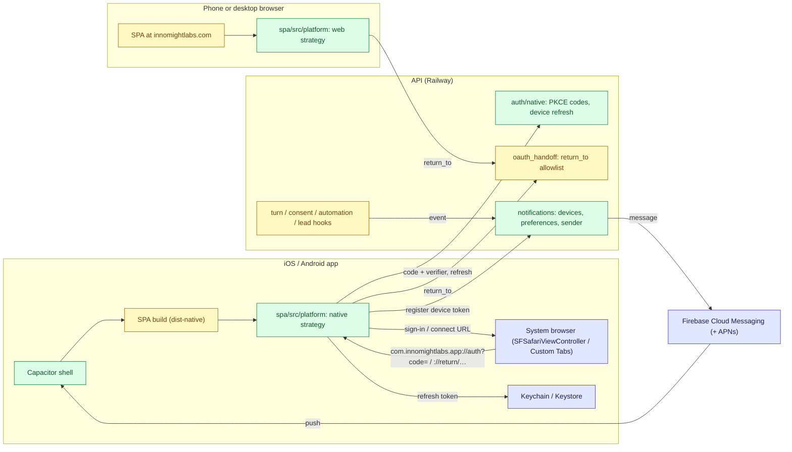
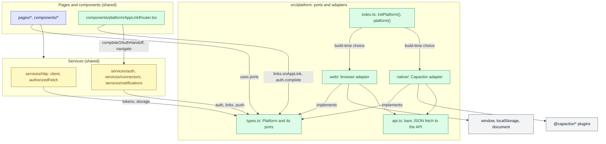
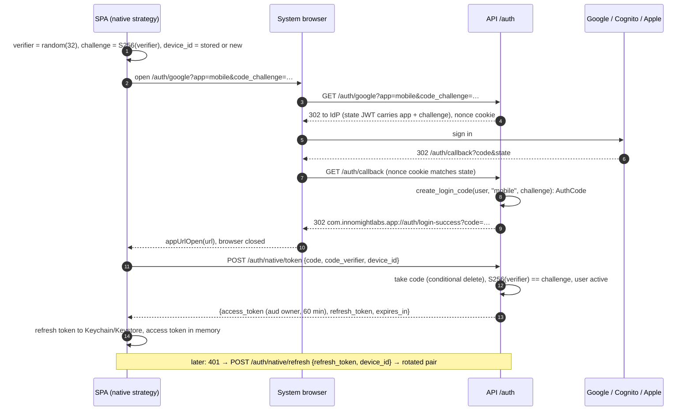
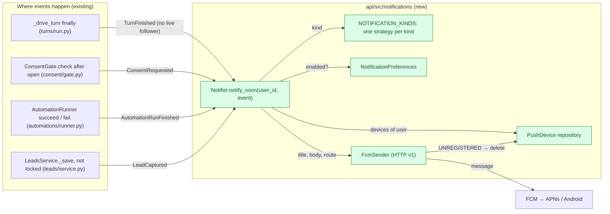
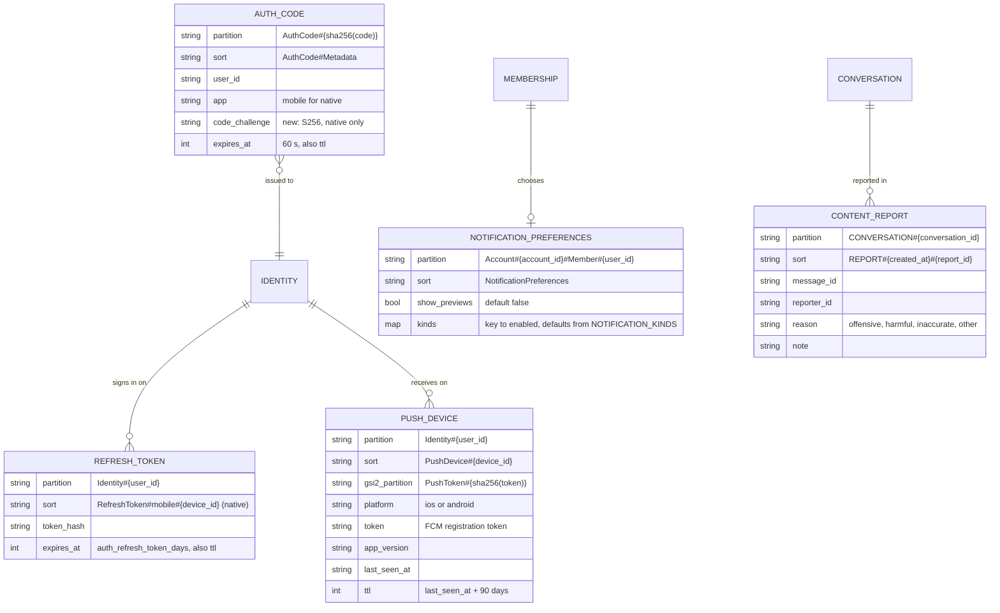

# LLD: A mobile-ready app: the SPA in iOS and Android shells

| Field | Value |
| --- | --- |
| Status | 📝 Proposed |
| Owner | InnomightLabs SPA + API |
| Last reviewed | 2026-10-31 |
| Depends on | [LLD-async-chat-turns](../api/docs/LLD-async-chat-turns.md), [LLD-action-consent](LLD-action-consent.md), [LLD-shared-accounts-and-iam](LLD-shared-accounts-and-iam.md), [LLD-mcp-connector-machinery](LLD-mcp-connector-machinery.md) |
| Scope | `spa/src/platform/` (new), `spa/capacitor.config.ts`, `spa/ios/`, `spa/android/` (new), SPA auth, HTTP client, connect flows, Settings, chat; `api/src/auth/`, `api/src/notifications/` (new), `api/src/builder/connections.py`, turn/consent/automation/lead hooks, the account-deletion Lambda, `terraform/cognito.tf`, `scripts/deploy_prod_railway.sh` |
| Tracker | — |

> **Summary:** We want InnoMight in the App Store and Google Play without writing a second app. The
> dashboard is a client-side React SPA, so we put its build inside a Capacitor shell for each platform.
> Wrapping is the easy part. Four things in the current app stop that shell from working or from passing
> review:
> - **Sign-in.** Login is a full-page redirect that Google refuses inside a webview. The 7-day token never
>   refreshes.
> - **Connect flows.** OAuth popups and `return_to` links only work on the web origin.
> - **Selling subscriptions.** The app sells them through Stripe, which store billing rules restrict.
> - **Native value.** There is nothing native, and Apple rejects a bare wrapper (guideline 4.2).
>
> This design fixes each one:
> - **One `platform` seam in the SPA**, with a web and a native strategy, so the rest of the code never
>   asks "am I in an app?".
> - **Native sign-in in the system browser**, returning through a custom URL scheme, protected by PKCE,
>   with short owner tokens and per-device refresh tokens.
> - **Connect flows return to that scheme**, and the same handoff completes them.
> - **Push notifications through FCM**, starting with consent requests, replies that arrive while nobody
>   watches, and automation failures.
> - **The store obligations**: in-app account deletion, Sign in with Apple, reporting AI responses, no
>   ad tracking, and no purchase flow in the app until we choose in-app billing.
>
> Phase 0 is all web work. It improves the site on phones for everyone and ships before any app exists.

## Context and problem

The conversation screen was made mobile first in `3a69136`:
- a single top bar;
- a docked composer;
- `useStickToBottom`;
- the classic list as a one-column inbox below 1024px.

The rest of the app is usable on a phone but was built for a mouse, and nothing about it is ready to run
inside a native shell. These are the findings, each checked in the code.

### Sign-in and tokens

- **How login works.** `spa/src/pages/Login.tsx:27-33` sets `window.location.href` to
  `${VITE_API_BASE_URL}/auth/google` (or `/auth/cognito`). The API's `_oauth_callback`
  (`api/src/auth/router.py:545-617`) redirects to `{frontend_url_for(app)}/login-success?code=<one-time
  code>`. The SPA redeems the code at `POST /auth/session` (`router.py:257-264`) for an owner JWT.
- **Why it fails in an app.** Google rejects OAuth in embedded webviews (`disallowed_useragent`), so this
  flow cannot run inside the shell.
- **Token lifetime.** The owner JWT lasts `jwt_expiration_hours = 24 * 7` (`api/src/config/settings.py:87`)
  and nothing refreshes it. The `X-Refreshed-Token` header that `spa/src/services/http/client.ts:67-73`
  reads is never set by the API. A phone app that signs the person out every week is not acceptable.
- **Where the token lives.** It sits in `localStorage` under `auth_token`
  (`spa/src/services/auth/index.ts:7,30-47`). iOS can clear a WKWebView's `localStorage` under storage
  pressure, so it is the wrong place for a long-lived credential.
- **What we can reuse.** The app-login machinery already exists: one-time codes stored hashed, single-use
  and bound to an app; rotating refresh tokens (`api/src/auth/app_tokens.py`); and `/auth/token`,
  `/auth/refresh` and `/auth/revoke` (`api/src/auth/app_router.py`).
- **Why we can't use it as is.**
  - `/auth/token` authenticates the app with an HTTP Basic secret (`app_router.py:44-48`). A secret in a
    phone app binary can be extracted, so a native app is a public client and needs PKCE instead.
  - Refresh tokens are keyed `Identity#{user_id} / RefreshToken#{app}` (`app_tokens.py:60-67`), one per
    person per app. A second phone would sign the first one out.
  - App tokens carry `aud = "app:{name}"`, which owner routes refuse (`api/src/auth/middleware.py:63-67`).
- **Prior art.** The VS Code extension signs in through the system browser and a custom scheme
  (`plugins/ide/vscode/innomightlabs-code-assist/src/auth/authService.ts:69-96`, validated by `_IDE_CALLBACK`
  in `api/src/widget/sessions.py:34-35`). Its tokens are widget-visitor tokens, though, not owner tokens.

### Connect flows

- **Two flows depend on popups.**
  - The chat "Connect account" card opens `window.open(authorize_url, …, "popup")` and waits for
    `postMessage({type: "innomight:oauth"})` from `/dashboard/oauth/done`
    (`spa/src/components/chat/ConnectAccountCard.tsx:42-67`,
    `spa/src/pages/dashboard/oauth/OAuthPopupDone.tsx:14-21`).
  - The builder hard-codes that return path (`api/src/builder/connections.py:31,83`).
- **All the redirect flows check the return address.** Google skills, MCP (including DCR), social and A2A
  validate `return_to` with `safe_return_to` (`api/src/auth/oauth_handoff.py:27-33`). That check accepts
  only `settings.frontend_url`'s origin. Inside the app the SPA runs at `capacitor://localhost` (iOS) or
  `https://localhost` (Android), so every `return_to` the SPA builds from `window.location.origin`
  (`spa/src/pages/dashboard/connectors/connectorUrls.ts`, `AgentSkillsPage.tsx:303-307`) is refused.
- **What still works.** The handoff blob itself (`handoff_redirect`, `?oauth_complete=…`) is encrypted,
  and `/connectors/oauth/complete` only completes it for the signed-in person who started the flow
  (`api/src/connectors/oauth_completion.py:41-54`). It is safe to deliver through an app link.
- **OpenAI.** The OpenAI connection opens a tab and has the person paste the callback URL
  (`spa/src/pages/dashboard/Settings.tsx:164-202`). It works anywhere, so it needs no change.

### Payments

- **How people buy today.** Every route to buying leads to `/pricing`, then Stripe Checkout
  (`spa/src/pages/Pricing.tsx:117-123`). The entry points are the nav, footer, hero, landing page,
  `RateLimitBanner`, the Settings billing card, `CapturesPage` and the payment pages.
- **The store rules.** Apple (3.1.1) and Google Play generally require their own billing for digital
  subscriptions sold in an app. Both are loosening, through US rulings and alternative-billing programmes,
  so check the terms on the day of submission.
- **An existing bug.** `Pricing.tsx:66-69` stores `pendingCheckout` without a `timestamp`. `LoginSuccess.tsx:76`
  compares `Date.now() - undefined` with ten minutes, which is never true, so the checkout a signed-out
  visitor started is always dropped after login.

### Store obligations we don't meet

- **In-app account deletion** is required by both stores. `DELETE /users/me` exists
  (`api/src/users/router.py:25-86`) and `authService.deleteAccount()` exists
  (`spa/src/services/auth/index.ts:126-128`), but nothing in the UI calls them.
- **Sign in with Apple** (4.8). It is expected when an app offers Google sign-in. There is none: the only
  providers are Google and Cognito (`api/src/auth/oauth_providers.py`).
- **Reporting AI-generated content.** Google Play requires a way to report offensive AI output in the app.
  There is none.
- **Tracking.** GTM `GTM-5FKVTWPC`, GA4 `G-LZ38HL06XF` and the Google Ads tag are in `spa/index.html:47-88`,
  with an Ads conversion in `PaymentSuccess.tsx:27-39`. In an app they would need Apple's App Tracking
  Transparency (ATT) prompt and tracking disclosures.

### Native value

- **Nothing native today.** There is no push, no device registration, no PWA manifest, no service worker
  and no app icons (`spa/public/` has only `404.html`, `CNAME` and the favicons).
- **The hooks for push already exist:**
  - a turn finishes in `_drive_turn` (`api/src/agents/turns/run.py:159`);
  - a consent request opens in `ConsentGate.check` (`api/src/consent/gate.py:198-213`);
  - an automation run succeeds or fails in `AutomationRunner.execute_run_graph` (`api/src/automations/runner.py:263,289,299`);
  - a lead is captured in `LeadsService._save` (`api/src/leads/service.py:201`).

### Phone ergonomics outside the conversation screen

- **Tap targets.** Icon buttons are `--control-height-sm`, 40px (`spa/src/styles/tokens.css:80`). Apple
  asks for 44pt.
- **Hover-only actions.** These are invisible on touch: `icon-card.module.css:22`, `ArtifactsPage.module.css:203`
  and `KnowledgeBases.tsx`. The conversation list was fixed in `3a69136`.
- **Safe areas.** Only the conversation top bar, the composer dock and the canvas panel respect them. The
  dashboard header and the drawer do not.
- **Dialogs.** They are centred cards (`spa/src/components/ui/dialog.module.css:7`), not bottom sheets.
- **Backgrounding.** When a phone app goes to the background, its open SSE connection dies. The
  conversation page reattaches to a running turn only on mount (`ConversationDetail.tsx`, "Reattach to a
  turn still running"), not when the app comes back to the foreground.
- **What the overflow check showed.** A check at 390px (iPhone 13) found no sideways overflow on any
  dashboard route, but only with empty data. With real data it remains to be done (see "Validation").

## Goals and non-goals

**Goals**

1. The SPA works well on a phone browser (Phase 0) and inside iOS and Android shells built from the same
   source, with no per-platform UI forks.
2. Native sign-in through the system browser. It stays signed in until the person signs out or their
   account goes inactive, and each device can be revoked on its own.
3. Every connect flow (MCP and DCR, Google skills, social, A2A, the chat card) completes inside the app.
4. Push notifications for things the person must act on or would otherwise miss, with preferences and
   private-by-default content.
5. Pass App Store and Play review: account deletion, Sign in with Apple, reporting AI content, no
   tracking, an honest privacy declaration, and no non-compliant purchase flow.

**Non-goals**

- A React Native or fully native rewrite.
- Offline use. The app needs the API, so offline gets a friendly screen, not cached data.
- In-app purchases in the first release. They are designed as Phase 4 and are optional.
- Tightening CORS. `allow_origins=["*"]` (`api/main.py:151-158`) already admits `capacitor://localhost`
  and `https://localhost`, and the widget needs any origin. Changing it is a separate security decision.
- The embeddable widget (`spa/embed/`) and the marketing site (`www/`).
- The web app's 7-day token. The web keeps today's behaviour; only native clients get refresh tokens.
  Moving the web onto them is a follow-up.

## Design

### Overview


*Green: new. Yellow: changed. Blue: existing or external. The app link scheme is `com.innomightlabs.app`.*

### 1. The platform abstraction (SPA)

Running in a browser and running in the app differ in a short, fixed list of ways:
- how sign-in starts and finishes, and where tokens live;
- where a flow returns to, and how a link or file leaves the app;
- where small values are kept, and what happens when the app comes back to the foreground;
- whether push exists, and whether the app may sell.

Everything else is the same code. That list is one interface, `Platform`, made of small capability
**ports**. There are two **adapters** behind it, web and native, and exactly one is chosen when the app
starts. Pages, components and services depend on the ports, never on an adapter or on Capacitor. This
follows the strategies-over-conditionals convention in `AGENTS.md`: no `if (isNative)` anywhere outside
`src/platform/`.

#### Boundaries


*Dependencies point down only. `src/platform/` never imports pages, components or services: the HTTP
client depends on the token port, so the adapters reach the API through their own small `api.ts`
instead of the HTTP client, which avoids a cycle.*

The rules, and how each is kept:

| Rule | Why | Enforced by |
| --- | --- | --- |
| Only `src/platform/native/**` imports `@capacitor/*` or a Capacitor plugin | The website bundle must carry no native code, and the rest of the SPA must not know which adapter runs | ESLint `no-restricted-imports` for `@capacitor/*` and the plugin packages, with an override for `src/platform/native/**` |
| `src/platform/**` imports nothing from `pages/`, `components/`, `services/` or `hooks/` | Adapters are infrastructure; a dependency upwards creates cycles (the HTTP client depends on `tokens`) | ESLint `no-restricted-imports` with patterns `../pages/*`, `../components/*`, `../services/*`, `../hooks/*` inside `src/platform/**` |
| Callers import from `src/platform` (`index.ts`, `types.ts`), never `platform/web` or `platform/native` | One choice, made once | ESLint `no-restricted-imports` for `**/platform/web*` and `**/platform/native*` outside `src/platform/` |
| No caller reads `auth_token` or `active_account_id` from `localStorage`, assigns `location.href` to a sign-in URL, or calls `window.open` for a flow that must return | These are exactly what differs; doing them directly bypasses the native adapter | `yarn design:audit` gains a `platform` check (a grep for those patterns outside `src/platform/`), and review |
| A port method that means nothing on a platform is still implemented, as a no-op or an honest default; only `push` may be `null` | Callers stay free of platform checks; `push` is genuinely absent on the web and callers must hide its UI | TypeScript: the adapters are typed `Platform` |

#### The ports

```ts
// spa/src/platform/types.ts
export type PlatformKind = "web" | "native";
export type LoginProvider = "google" | "cognito" | "apple";
export type Unsubscribe = () => void;
/** A path inside the signed-in app. Flows may only return into the dashboard. */
export type DashboardPath = `/dashboard${string}`;

export interface Platform {
  readonly kind: PlatformKind;
  readonly auth: AuthSession;
  readonly tokens: TokenStore;
  readonly links: Links;
  readonly storage: KeyValueStore;
  readonly lifecycle: Lifecycle;
  readonly files: Files;
  /** Null where push does not exist (the web): callers hide notification settings. */
  readonly push: PushChannel | null;
  readonly commerce: Commerce;
  /** Loads what the first render needs: stored values into memory, a fresh access token. Awaited once. */
  ready(): Promise<void>;
}

/** Starting and finishing sign-in. The adapter owns how a provider page opens and how the code is redeemed. */
export interface AuthSession {
  /** Web: this tab leaves for the provider. Native: the system browser opens; the app link finishes it. */
  begin(provider: LoginProvider, options?: { invitation?: string }): Promise<void>;
  /** Redeems the one-time code from `/login-success` (web) or the `auth` app link (native) for a session. */
  complete(code: string): Promise<void>;
  /** Ends the session on the server where one exists (native: revoke this device), then clears tokens. */
  end(): Promise<void>;
}

/** Credentials for API requests. Synchronous reads, because request headers are built synchronously. */
export interface TokenStore {
  accessToken(): string | null;
  /** A new access token after a 401. Single-flight: concurrent callers share one refresh. Null: signed out. */
  refresh(): Promise<string | null>;
  save(session: Session): Promise<void>;
  clear(): Promise<void>;
}

export interface Session {
  accessToken: string;
  /** Native only: kept in the Keychain or Keystore, never in web storage. */
  refreshToken?: string;
  /** Seconds until the access token expires, when the server says. */
  expiresIn?: number;
}

/** Ways out of the app and back in. */
export interface Links {
  /** The `return_to` a connect flow sends to the API, for a path in the app. */
  returnTo(path: DashboardPath): string;
  /**
   * A provider's sign-in or consent page that will come back through `returnTo`.
   * `popup`: the web opens a named popup instead of leaving the page (the chat card); native ignores it.
   */
  openAuthPage(url: string, options?: { popup?: boolean }): Promise<void>;
  /** An ordinary link that leaves the app: a new tab (web), the system browser (native). */
  openExternal(url: string): Promise<void>;
  /** Links that come back into the app. The web never calls the handler: its returns arrive as page loads. */
  onAppLink(handler: (link: AppLink) => void): Unsubscribe;
}

export type AppLink =
  | { kind: "login"; code: string | null; error: string | null }
  | { kind: "return"; path: DashboardPath; search: string };

/** Small, non-secret values (the active account, the device id, view choices). */
export interface KeyValueStore {
  /** Synchronous: served from memory, which `ready()` filled. */
  get(key: StorageKey): string | null;
  /** Writes memory now and the backing store in the background. */
  set(key: StorageKey, value: string): void;
  remove(key: StorageKey): void;
}

/** Every key the platform stores, in one place, so nothing is written under an ad hoc name. */
export type StorageKey = "active_account_id" | "device_id" | "pkce_verifier" | "conversations:view";

export interface Lifecycle {
  /** The app or tab came back to the foreground. Used to resync streams and refresh tokens. */
  onResume(handler: () => void): Unsubscribe;
}

export interface Files {
  /** A file the person keeps or sends on: a download (web), the share sheet (native). */
  saveOrShare(file: { data: Blob; filename: string }): Promise<void>;
}

export interface PushChannel {
  permission(): Promise<"granted" | "denied" | "prompt">;
  /** Asks the OS. Returns whether pushes may be shown. */
  requestPermission(): Promise<boolean>;
  /** Gets the FCM token and registers it as this device (`PUT /notifications/devices/{device_id}`). */
  register(): Promise<void>;
  /** On sign-out: `DELETE /notifications/devices/{device_id}`. */
  unregister(): Promise<void>;
  /** The person tapped a notification; `route` has already passed the `DashboardPath` check. */
  onOpen(handler: (route: DashboardPath) => void): Unsubscribe;
}

export interface Commerce {
  /** False in the store apps until in-app billing exists (Phase 4): no prices, purchase links or checkout. */
  readonly canSellSubscriptions: boolean;
}
```

#### The two adapters

| Port | Web adapter (`platform/web/`) | Native adapter (`platform/native/`) |
| --- | --- | --- |
| `auth.begin` | `location.href = ${API}/auth/{provider}` (today's behaviour) | Makes a PKCE verifier and challenge, keeps the verifier under `pkce_verifier`, opens `${API}/auth/{provider}?app=mobile&code_challenge=…` with `@capacitor/browser` |
| `auth.complete` | `POST /auth/session {code}` (today's `loginHandoff.ts`) | `POST /auth/native/token {code, code_verifier, device_id}`, then removes `pkce_verifier` |
| `auth.end` | Clears tokens (no server session to end) | `POST /auth/native/revoke`, `push.unregister()`, then clears tokens |
| `tokens` | `localStorage["auth_token"]`; `refresh()` returns `null` (the 7-day token is unchanged) | Access token in memory; refresh token in the Keychain or Keystore (a secure-storage plugin); `refresh()` calls `/auth/native/refresh`, single-flight |
| `links.returnTo` | `${location.origin}${path}` | `${VITE_NATIVE_APP_SCHEME}://return${path}` |
| `links.openAuthPage` | `location.href = url` (redirect flows) | `Browser.open({ url })` |
| `links.openExternal` | `window.open(url, "_blank", "noopener")` | `Browser.open({ url })` |
| `links.onAppLink` | Never fires | `App.addListener("appUrlOpen")`, closes the browser, parses with `parseAppLink`, drops anything that does not parse |
| `storage` | `localStorage`, read straight through | `@capacitor/preferences`, loaded into memory by `ready()`, written through in the background |
| `lifecycle.onResume` | `visibilitychange` becoming `visible` | `App.addListener("resume")`; also `visibilitychange` |
| `files.saveOrShare` | An `<a download>` on an object URL | `@capacitor/filesystem` to the cache directory, then `@capacitor/share` |
| `push` | `null` | `@capacitor-firebase/messaging` (section 5) |
| `commerce.canSellSubscriptions` | `true` | `false` (Phase 4 turns it on with RevenueCat) |
| `ready()` | Nothing to load | Loads Preferences and the refresh token, refreshes the access token when it is missing or within five minutes of expiry, then hides the splash screen |

The chat card's popup (`ConnectAccountCard.tsx`) is the one web flow that is not a redirect. It keeps
`window.open` on the web, but it is still chosen through the port: the card asks for
`platform().links.openAuthPage(url)`, and the web adapter takes an optional `{ popup: true }` option that
opens the named popup and falls back to the current "Open sign-in" link when blocked. The native adapter
ignores the option, because the system browser is already a separate window.

#### Choosing the adapter

The choice is made at **build time**, not by asking Capacitor at runtime. The website and the app are
separate builds (`vite build` and `vite build --mode native`), so a build constant lets Vite drop the
unused adapter. The website ships no Capacitor code at all, not even `@capacitor/core`.

```ts
// spa/src/platform/index.ts
import type { Platform } from "./types";

let current: Platform | null = null;

/** Called once by main.tsx before the first render. */
export async function initPlatform(): Promise<Platform> {
  current = import.meta.env.VITE_PLATFORM === "native"
    ? (await import("./native")).createNativePlatform()
    : (await import("./web")).createWebPlatform();
  await current.ready();
  return current;
}

/** The platform for this run. Throws if used before initPlatform(): a startup-order bug, not a state. */
export function platform(): Platform {
  if (!current) throw new Error("platform() used before initPlatform()");
  return current;
}

/** Tests only: swap in a fake (see testing.ts). */
export function setPlatformForTests(fake: Platform | null): void {
  current = fake;
}
```

```ts
// spa/src/main.tsx
await initPlatform();
createRoot(document.getElementById("root")!).render(<App />);
```

- `.env.native` sets `VITE_PLATFORM=native`. Every other mode leaves it unset, so the web is the default.
- `src/platform/testing.ts` exports `createFakePlatform(overrides?: Partial<Platform>)`. Its in-memory
  ports record calls (`fake.links.opened`, `fake.storage.values`), so services and the HTTP client are
  tested against the ports without either adapter.
- `useAppResume`, `usePush` and similar hooks live in `src/hooks/`. They wrap the ports for React
  (subscribe in `useEffect`, unsubscribe on cleanup); they are not part of the platform layer.

#### Layout

```
spa/src/platform/
  types.ts              the ports (above)
  index.ts              initPlatform(), platform(), setPlatformForTests()
  api.ts                apiPost(path, body): bare JSON fetch to VITE_API_BASE_URL, no auth
  appLinks.ts           parseAppLink(): pure, shared by the native adapter and tests
  pkce.ts               createVerifier(), challengeFor(verifier): pure, RFC 7636 test vector
  testing.ts            createFakePlatform()
  web/
    index.ts            createWebPlatform()
    tokens.ts           localStorage auth_token
  native/
    index.ts            createNativePlatform()
    auth.ts             begin/complete/end with PKCE
    tokens.ts           memory + secure storage, single-flight refresh
    links.ts            Browser, appUrlOpen
    storage.ts          Preferences with a memory cache
    push.ts             FCM registration and taps
    files.ts            Filesystem + Share
spa/src/components/platform/
  AppLinkRouter.tsx     links.onAppLink → auth.complete / completeOAuthHandoff / navigate
```

#### Callers that move onto the ports

| Today | Becomes |
| --- | --- |
| `Login.tsx:27-33`: `window.location.href = …/auth/google` (and `/auth/cognito`) | `platform().auth.begin("google")`, `begin("cognito")`, `begin("apple")` |
| `LoginSuccess.tsx` + `invitations/loginHandoff.ts`: `POST /auth/session`, `setToken` | `platform().auth.complete(code)` on the web route. Native reaches the same method through `AppLinkRouter` |
| `services/http/client.ts:11-15,30-41,67-81`: `localStorage` token and account id, redirect on 401 | `platform().tokens.accessToken()`, `platform().storage.get("active_account_id")`. On 401: `await tokens.refresh()`, retry once, else `auth.end()` and go to `/login`. The dead `X-Refreshed-Token` read is removed |
| `services/chat/ChatService.ts` (raw `fetch` with `authHeaders()`) | `authorizedFetch` in `services/http/`, with the same refresh-and-retry, so SSE requests refresh too |
| `services/auth/index.ts:30-47,110-113`: get/set/remove token, logout | `getToken` → `tokens.accessToken()`; logout → `auth.end()`. `getUserFromToken` stays, decoding whatever the token port returns |
| `connectorUrls.ts` `returnToConnectors`, `AgentSkillsPage.tsx:303-307,322-328,436-443` | `platform().links.returnTo("/dashboard/connectors…")`, `returnTo(`/dashboard/agents/${id}/skills`)` |
| `ConnectorsPage.tsx:105-158`, `SocialAccountsTab.tsx:87-89`, `AgentSkillsPage.tsx`: `location.href = authorize_url` | `platform().links.openAuthPage(authorize_url)` |
| `ConnectAccountCard.tsx:61-67`: `window.open(…, "popup")` | `platform().links.openAuthPage(authorize_url, { popup: true })` |
| `target="_blank"` on generated images and canvases (`ChatStreamRenderer.tsx`, `CanvasSidePanel.tsx`) | `links.openExternal(url)` for URLs; `files.saveOrShare` for `blob:` images |
| `conversations/conversationView.ts` (`localStorage`) | `platform().storage` with the `conversations:view` key |
| Pricing, upgrade and checkout links (list in "Context") | Rendered only when `platform().commerce.canSellSubscriptions` (section 6) |
| Notification settings (new) | Rendered only when `platform().push` is not null |

### 2. Native sign-in: system browser, PKCE, per-device refresh


*The login code reaches the app through a custom scheme, which another app could also register. PKCE
makes an intercepted code useless without the verifier, which never leaves the app.*

**Why this shape.** RFC 8252 (OAuth for native apps) is explicit: use the system browser, use PKCE, and
use a reverse-domain custom scheme. All the machinery behind it already exists: the state JWT and nonce
cookie, single-use hashed codes, rotating refresh tokens, and `create_access_token(user, lifetime)`
(`api/src/auth/jwt_utils.py:23`). The new parts are a public app, a challenge on the code, refresh keyed
per device, and owner-audience access tokens.

**API changes (`api/src/auth/`):**

- `apps.py`: a native app, no secret, PKCE required.

  ```python
  NATIVE_APP = "mobile"

  def frontend_url_for(app: str) -> str:
      if app == DEFAULT_APP:
          return settings.frontend_url
      if app == NATIVE_APP and settings.native_app_scheme:
          return f"{settings.native_app_scheme}://auth"
      return settings.auth_app_urls[app].rstrip("/")
  ```

  - `create_login_state` puts `code_challenge` into the state JWT.
  - `_start_login` (`router.py:220-234`) gets `code_challenge: str | None = None` and
    `code_challenge_method: str = "S256"`. It returns 400 when `app == NATIVE_APP` and the challenge is
    missing, malformed (it must be 43 base64url characters) or not `S256`. It also returns 400 for
    `NATIVE_APP` when `settings.native_app_scheme` is empty, so the feature is off until configured.
- `app_tokens.py`: the challenge travels with the code, and refresh is per device.

  ```python
  def create_login_code(user_id: str, app: str, code_challenge: str | None = None) -> str: ...
  # put_login_code stores "code_challenge" when given

  def redeem_native_login_code(code: str, code_verifier: str) -> Optional[str]:
      item = repository.take_login_code(_hash(code))          # conditional delete: single use
      if item is None or item["app"] != NATIVE_APP or int(item["expires_at"]) < time.time():
          return None
      challenge = base64.urlsafe_b64encode(hashlib.sha256(code_verifier.encode()).digest()).rstrip(b"=").decode()
      if not secrets.compare_digest(challenge, str(item.get("code_challenge", ""))):
          return None
      return str(item["user_id"])

  def _native_key(device_id: str) -> str:
      return f"{NATIVE_APP}#{device_id}"                      # sk RefreshToken#mobile#<device_id>

  def issue_native_tokens(user: Identity, device_id: str) -> AppTokens:
      refresh_token = secrets.token_urlsafe(32)
      repository.put_refresh_token(user.user_id, _native_key(device_id), _hash(refresh_token), _refresh_expiry())
      access = create_access_token(user, lifetime=timedelta(minutes=settings.native_access_token_minutes))
      return AppTokens(access_token=access, refresh_token=refresh_token,
                       expires_in=settings.native_access_token_minutes * 60)
  ```

  `refresh_native_tokens(user, device_id, refresh_token)` and `revoke_native_tokens(user_id, device_id)`
  reuse `get_refresh_token`, `replace_refresh_token` and `delete_refresh_token` with `_native_key`. The
  repository methods already take the key suffix as `app`, so only the key string changes. The access
  token has `aud = "owner"`, so every owner route accepts it with no middleware change.

- `native_router.py` (new), under prefix `/auth/native`:

  | Route | Body | Result |
  | --- | --- | --- |
  | `POST /auth/native/token` | `{code, code_verifier, device_id}` | `{access_token, refresh_token, expires_in}`, or 401 `invalid_grant` |
  | `POST /auth/native/refresh` | `{user_id, device_id, refresh_token}` | A rotated pair, or 401 `invalid_grant` (expired, reused, or user inactive) |
  | `POST /auth/native/revoke` | `{user_id, device_id, refresh_token}` | 204. It proves possession of the refresh token rather than a bearer, so a signed-out app can still revoke |

  - `device_id` is a random UUID the app creates once and keeps in secure storage. It is not a hardware id.
  - The three paths join `PUBLIC_PATHS` (`api/src/auth/middleware.py:20-52`), like `/auth/token`.
  - Each route takes a `RateLimitPolicy` keyed by client IP, as `contact/router.py` does.
  - `/auth/me` already works with owner tokens.

- Errors in `_oauth_callback` already redirect to `{frontend_url_for(app)}/login?error=…`. For the native
  app that becomes `com.innomightlabs.app://auth/login?error=…`, which the deep-link handler shows on
  the login page.
- **Invitations** stay on the default app (`router.py` restricts them already). An invitation link opens
  in the browser, is accepted there, and the person then signs in to the app as usual.

**Sign in with Apple** goes through Cognito, which already backs "Continue with email"
(`terraform/cognito.tf`, `api/src/auth/oauth_providers.py` `CognitoOAuthProvider`). Cognito federates
Apple as an identity provider, so the API gains no second OAuth implementation:

- Terraform: an `aws_cognito_identity_provider` with `provider_name = "SignInWithApple"` and
  `provider_type = "SignInWithApple"`, using the Apple Services ID, team id, key id and private key. Map
  `email` and `email_verified` to Apple's `email` and `email_verified`. Add `"SignInWithApple"` to
  `supported_identity_providers` on `aws_cognito_user_pool_client.hosted_ui` (`cognito.tf:24`).
- API: `GET /auth/apple` is `_start_login` with the Cognito provider plus `identity_provider=SignInWithApple`
  on the authorize URL, so Cognito skips its own page. It also joins `PUBLIC_PATHS`.
- `_oauth_callback` requires a verified email (`router.py:582`). Apple's emails, including private-relay
  addresses, arrive verified, so a person who hides their email gets an account under their relay
  address. That is the behaviour Apple requires.
- SPA: a "Continue with Apple" button on `Login.tsx`, on every platform, so one person can sign in the
  same way on web and phone.

### 3. Connect flows in the app

Two changes make every connect flow finish inside the app. They are one more allowed return origin, and
one deep-link handler that reuses the completion the web already performs.

**API.** `safe_return_to` accepts the app's return links as well as the web origin:

```python
# api/src/auth/oauth_handoff.py
NATIVE_RETURN_HOST = "return"

def _allowed_return_origins() -> set[tuple[str, str]]:
    frontend = urlsplit(settings.frontend_url)
    origins = {(frontend.scheme, frontend.netloc)}
    if settings.native_app_scheme:
        origins.add((settings.native_app_scheme, NATIVE_RETURN_HOST))
    return origins

def safe_return_to(return_to: str) -> str:
    """Connect flows only ever send the person back to our own SPA: the site, or the app's return links."""
    target = urlsplit(return_to)
    if (target.scheme, target.netloc) not in _allowed_return_origins():
        raise ValueError("return_to must be a page of this app")
    return return_to
```

- Every caller (Google skills, MCP, social, A2A) gets this for free.
- MCP DCR registers `redirect_uris: [settings.mcp_oauth_redirect_uri]` (`connectors/mcp/oauth.py:343-370`).
  That is the API's callback, not the app's, so providers never see the custom scheme.
- `handoff_redirect` appends `?oauth_complete=<encrypted blob>`. It is still completed only by the signed-in
  person who started the flow, so an app that intercepts the link learns nothing it can use.

`api/src/builder/connections.py:75-96` stops hard-coding `frontend_url + POPUP_RETURN_PATH`. `POST
/builder/{id}/connect` accepts an optional `return_to`, validated by `safe_return_to`, and defaults to
today's path. The web keeps its popup.

**SPA.** `OAuthReturn.tsx` runs its completion inline today. That moves into a service function, so both
the page and the deep-link handler use it:

```ts
// spa/src/services/connectors/oauthCompletion.ts
/** Completes a sealed connect handoff and returns the result params to show, e.g. { mcp_oauth: "success" }. */
export async function completeOAuthHandoff(completion: string): Promise<Record<string, string>> { … }
```

```ts
// spa/src/platform/appLinks.ts: pure, unit-tested, used by the native adapter's links.onAppLink
import type { AppLink, DashboardPath } from "./types";

export function parseAppLink(url: string, scheme: string): AppLink | null {
  const link = new URL(url);
  if (link.protocol !== `${scheme}:`) return null;
  if (link.host === "auth") {
    return { kind: "login", code: link.searchParams.get("code"), error: link.searchParams.get("error") };
  }
  // Only app paths: never a link that points the router outside the dashboard
  if (link.host === "return" && link.pathname.startsWith("/dashboard/")) {
    return { kind: "return", path: link.pathname as DashboardPath, search: link.search };
  }
  return null;
}
```

`AppLinkRouter` (`spa/src/components/platform/AppLinkRouter.tsx`) is mounted once inside the router in
`App.tsx`. It subscribes to `platform().links.onAppLink`, which never fires on the web, and acts on each
link:

- **`login`**: `await platform().auth.complete(code)`, then go to `/dashboard`. With an `error`, go to
  `/login?error=…`.
- **`return` to `/dashboard/oauth/done`** (the chat card's flow): call `completeOAuthHandoff` in place,
  without navigating away from the open conversation. Then
  `window.postMessage({ type: "innomight:oauth", result }, window.location.origin)`. That is the message
  `OAuthPopupDone` sends today, so `ConnectAccountCard` and `connectOutcome` work unchanged.
- **Any other `return`**: `navigate(path + search)`. `OAuthReturn` sees `oauth_complete` as it does on the
  web.

```mermaid
sequenceDiagram
  autonumber
  participant Card as ConnectAccountCard (native)
  participant SB as System browser
  participant API as API
  participant Link as AppLinkRouter
  Card->>API: POST /builder/{id}/connect {provider, return_to: app://return/dashboard/oauth/done}
  API-->>Card: {authorize_url}
  Card->>SB: platform().links.openAuthPage(authorize_url)
  SB->>API: provider callback (/connectors/mcp/oauth/callback)
  API-->>SB: 302 com.innomightlabs.app://return/dashboard/oauth/done?oauth_complete=blob
  SB-->>Link: appUrlOpen → links.onAppLink(return)
  Link->>API: POST /connectors/oauth/complete {completion: blob} (bearer)
  API-->>Link: {result: {mcp_oauth: "success"}}
  Link->>Card: window.postMessage({type: "innomight:oauth", result})
```
*The conversation stays mounted throughout. The message is the same one the web popup sends.*

### 4. The native shell

**Where it lives.** Capacitor's JavaScript plugins are imported by the SPA, so the shell lives with it:
`spa/capacitor.config.ts`, `spa/ios/` and `spa/android/` (generated by `cap add`, then committed).

```ts
// spa/capacitor.config.ts
import type { CapacitorConfig } from "@capacitor/cli";

const config: CapacitorConfig = {
  appId: "com.innomightlabs.app",
  appName: "InnoMight",
  webDir: "dist-native",
  ios: { contentInset: "never", scheme: "InnoMight" },
  android: { allowMixedContent: false },
  plugins: {
    Keyboard: { resize: "native" },        // the layout shrinks with the keyboard, so the composer stays above it
    SplashScreen: { launchAutoHide: false }, // the native adapter's ready() hides it
    PushNotifications: { presentationOptions: [] }, // foreground pushes are not shown: the app is open
  },
};
export default config;
```

**The build ships with the app.** The shell loads the files in the app bundle, not
`https://innomightlabs.com`. That gives a fast start, a working offline screen, and is the version Apple
reviews.

- A new Vite mode `native` with `spa/.env.native` (`VITE_PLATFORM=native`,
  `VITE_API_BASE_URL=https://<prod API>`, `VITE_NATIVE_APP_SCHEME=com.innomightlabs.app`).
  `VITE_PLATFORM` picks the adapter at build time (section 1).
- Scripts:
  - `build:native`: `tsc -b && vite build --mode native --outDir dist-native`;
  - `cap:sync`: `yarn build:native && cap sync`.
- A small Vite plugin (`spa/scripts/vite-plugin-native-html.ts`) transforms `index.html` in `native` mode
  only:
  - removes the blocks between `<!-- analytics:start -->` and `<!-- analytics:end -->` markers, added
    around the GTM/gtag code (`index.html:47-88`);
  - adds `viewport-fit=cover` to the viewport meta, so the `env(safe-area-inset-*)` paddings take effect;
  - skips `publicPagesPlugin`'s per-page HTML copies, which only matter to crawlers.

**What the app shows.**

- `/` redirects to `/dashboard`, and `ProtectedRoute` sends a signed-out person to `/login` instead of the
  landing page.
- `PublicSiteConcierge` (the Mira widget) is not mounted.
- Legal pages stay routable, because the stores require a reachable privacy policy. Marketing pages,
  pricing and `/payments/*` are not linked from anywhere in the app.

**Native plugins** (all dynamically imported from `spa/src/platform/native/`):

| Plugin | Why |
| --- | --- |
| `@capacitor/app` | `appUrlOpen` (deep links), `appStateChange` (resume) |
| `@capacitor/browser` | Sign-in and connect pages in the system browser |
| `@capacitor/keyboard` | Resize mode, and a `keyboard-open` class for fine-tuning |
| `@capacitor/status-bar`, `@capacitor/splash-screen` | Status bar style per theme; no white flash at launch |
| `@capacitor/preferences` | `active_account_id`, `device_id` lookup, the theme |
| A Keychain/Keystore plugin (e.g. `capacitor-secure-storage-plugin`) | The refresh token |
| `@capacitor-firebase/messaging` | FCM tokens on both platforms, and tap handling (section 5) |
| `@capacitor/share`, `@capacitor/filesystem` | Sharing generated images and artifacts where a `blob:` link cannot open |

**The app scheme** `com.innomightlabs.app` is one value in four places, which must agree:

- `NATIVE_APP_SCHEME` (API);
- `VITE_NATIVE_APP_SCHEME` (`.env.native`);
- `CFBundleURLTypes` in `ios/App/App/Info.plist`;
- the `<intent-filter>` with `android:scheme` in `android/app/src/main/AndroidManifest.xml`, on the main
  activity with `android:launchMode="singleTask"`, so a deep link returns to the running app.

**Coming back to the foreground.** A hook `useAppResume(callback)` wraps `platform().lifecycle.onResume`
(`visibilitychange` on the web; Capacitor's `resume` plus `visibilitychange` in the app). It gives
`ConversationDetail` a `resyncConversation()` step:

- When a turn was running, call `chatService.getActiveTurn`. If it is still running, `attachToTurn(turn_id)`;
  that already aborts the dead stream and replays from the transcript.
- Otherwise fetch the newest page of messages and append the ones not yet shown (`appendOnce` from
  `turnMessages.ts`), so a reply that finished in the background appears.
- In every case refresh the access token if it is within five minutes of expiry.

### 5. Push notifications

**Sending.** We send through FCM HTTP v1 for both platforms. `@capacitor-firebase/messaging` returns an
FCM registration token on iOS too, and Firebase forwards to APNs with an APNs key uploaded once to the
Firebase project. That gives one sender, one credential and one error model. `google-auth` is already a
dependency (`api/pyproject.toml:14`), so a service account can mint the FCM access token with no new
library.

**Delivery** is best effort. It runs in-process as an `asyncio.create_task`, like chat turns and tool jobs,
because there is no queue (no SQS or SNS). A lost push is acceptable: everything a push points to is
also in the app.


*Each source hands over one event. The notifier looks up the kind's strategy, the person's preferences
and devices, and sends. Dead tokens are removed as FCM reports them.*

**Kinds, as strategies** (`api/src/notifications/kinds.py`). Each kind owns its default, its wording and
where tapping it goes. Adding a kind is one entry.

```python
@dataclass(frozen=True)
class NotificationKind:
    key: str                              # stable: stored in preferences
    label: str                            # shown in Settings
    default_enabled: bool
    render: Callable[[NotificationEvent, bool], PushContent]   # (event, show_previews) → title, body, route

NOTIFICATION_KINDS: list[NotificationKind] = [
    NotificationKind("consent_requested", "An agent asks before acting", True, render_consent_requested),
    NotificationKind("reply_ready", "A reply arrives while you're away", True, render_reply_ready),
    NotificationKind("automation_failed", "An automation fails", True, render_automation_failed),
    NotificationKind("automation_succeeded", "An automation finishes", False, render_automation_succeeded),
    NotificationKind("lead_captured", "A lead is captured", True, render_lead_captured),
]

def kind_for(key: str) -> NotificationKind:
    return next(kind for kind in NOTIFICATION_KINDS if kind.key == key)
```

**Private by default.** A lock screen is public, so content is generic unless the person turns on
"Show previews". The body never carries message text or tool arguments, even with previews on.

| Kind | Previews off | Previews on | Route |
| --- | --- | --- | --- |
| `consent_requested` | "{agent} asks before acting" / "Open to approve or reject" | Body: the consent `title` ("Publish to LinkedIn") | `/dashboard/conversations/{conversation_id}` |
| `reply_ready` | "{agent} replied" / "Open to read the reply" | Body: the conversation title | `/dashboard/conversations/{conversation_id}` |
| `automation_failed` / `_succeeded` | "An automation failed" / "finished" | Body: the automation name | `/dashboard/automations/{automation_id}` |
| `lead_captured` | "New lead captured" | Body: the form name | `/dashboard/leads` |

**When "reply ready" fires.** It should fire only when nobody is reading. `TurnTranscript`
(`api/src/agents/turns/transcript.py`) gains a follower count. There is one process and one replica
(LLD-async-chat-turns), so an in-memory count is exact.

```python
@dataclass
class TurnTranscript:
    ...
    followers: int = 0

    async def follow(self, *, after_sequence: int = 0) -> AsyncIterator[tuple[int, SSEEvent]]:
        self.followers += 1
        try:
            ...  # today's body
        finally:
            self.followers -= 1
```

In `_drive_turn` (`api/src/agents/turns/run.py:194-199`), right after the success-or-failure
`turn_repo.finish(...)`, and not in the cancelled or exception branches:

```python
if not failed_error and transcript.followers == 0:
    notifier.notify_soon(turn.created_by, ReplyReady(conversation_id=turn.conversation_id, agent_id=turn.agent_id))
```

`turn.created_by` is the owner's email. `Notifier` resolves it to a `user_id` through `IdentityRepository`
(by its unique email index) and works with the `user_id` from there. If the phone backgrounds and iOS
drops the stream, the follower goes away within about 30 seconds, so a long reply still notifies.

**The other hooks:**

- **Consent.** In `ConsentGate.check` after `self.repository.open(...)` (`gate.py:213`), notify the
  request's `actor_id`, the person who must decide. Skip it when the request's turn has a live follower,
  since they are looking at the card.
- **Automations.** In `AutomationRunner.execute_run_graph` after `succeed` / `fail`
  (`runner.py:263,289,299`), notify `run.created_by` (a `user_id`).
- **Leads.** In `LeadsService._save` after the transaction, only when the capture is not `locked`, notify
  the account's owner.

**Routes** (`api/src/notifications/router.py`, prefix `/notifications`, owner tokens):

| Route | Body | Notes |
| --- | --- | --- |
| `PUT /notifications/devices/{device_id}` | `{platform: "ios" \| "android", token, app_version}` | Upsert. Called at startup and when FCM rotates the token |
| `DELETE /notifications/devices/{device_id}` | — | On sign-out |
| `GET /notifications/preferences` | — | `{show_previews, kinds: [{key, label, enabled}]}`, with defaults for kinds never set |
| `PUT /notifications/preferences` | `{show_previews?, kinds?: {key: bool}}` | Unknown keys are rejected with 422 |

**SPA.**

- Where `platform().push` exists (the app), it asks for permission after sign-in. It asks once, after the
  person's first conversation, not at launch: Apple's guidance, and a better acceptance rate.
- It calls `push.register()`, and a `usePush` hook subscribes to `push.onOpen(route => navigate(route))`.
  The native adapter only passes on routes that pass the same `/dashboard/` check `parseAppLink` uses.
- Settings gains a "Notifications" section when `platform().push` is not null: the kinds as switches, plus
  "Show previews". On the web `push` is null, so the section is not rendered.

### 6. Store obligations and payments

- **Account deletion** (web too). Settings gets a "Delete account" section in a danger card. A
  `ConfirmationDialog` asks the person to type their email, then calls `authService.deleteAccount()`
  (`DELETE /users/me`) and signs out.
  - Inactive identities already fail `/auth/session` and owner requests, and `_active` makes them fail
    `/auth/native/refresh` too.
  - The deletion Lambda already removes `Identity#{user_id} / RefreshToken#*`
    (`api/lambdas/account_deletion_handler/handler.py:106`), which covers the per-device tokens. Add
    `PushDevice#` beside it.
- **Reporting AI responses** (Play's AI-generated content policy; Apple 1.2):
  - An assistant message gets a "Report response" action, in the message's overflow on phones.
  - It calls `POST /conversations/{id}/messages/{message_id}/report {reason, note?}`, which stores a
    `ContentReport` and emails the support inbox through the `send_email_safe` helpers.
  - `reason` is one of `offensive`, `harmful`, `inaccurate`, `other`.
- **No purchase flow in the app** until Phase 4. With `platform().commerce.canSellSubscriptions === false`:
  - The nav and footer pricing links, the landing "See pricing" link and `CapturesPage`'s "Upgrade" are
    not rendered.
  - `RateLimitBanner` says "You've reached your plan's limit" without the "Upgrade plan" link.
  - The Settings billing card shows the plan and status and says "Plans are managed on the InnoMight
    website", with no link and no cancel button. Outside the US, linking out to buy is still treated as
    steering.
  - A subscription bought on the web keeps working in the app, which Apple allows for multiplatform
    services (3.1.3(b)) as long as the app neither sells nor points to the sale. The API does not change:
    limits come from `get_active_for_user` (`api/src/payments/subscriptions/repository.py:42`) whatever
    the platform.
- **Fix `pendingCheckout`** (web): `Pricing.tsx` writes `timestamp: Date.now()`, so a checkout a signed-out
  visitor started resumes after login as `LoginSuccess` intends.
- **Phase 4, optional: in-app purchases.** RevenueCat sells the App Store and Play subscriptions. Its
  webhook writes a `Subscription` item with `source = "app_store" | "play"` beside Stripe's, keyed by the
  same `User#{email}`, so `get_active_for_user` and every limit work as they are.
  `commerce.canSellSubscriptions` turns true in the native adapter and the purchase screen uses RevenueCat's paywall. This
  needs its own LLD and a pricing decision, since stores take 15–30%.

### 7. Phone ergonomics across the SPA (Phase 0)

These ship to the website first, for everyone.

- **Tap targets.** In `spa/src/styles/tokens.css`:

  ```css
  /* Fingers, not pointers: Apple's 44pt minimum. Button size "icon" and small controls read this. */
  @media (pointer: coarse) {
    :root { --control-height-sm: 2.75rem; }
  }
  ```

- **No hover-only actions.** Show the row actions in `icon-card.module.css:22`, `ArtifactsPage.module.css:203`
  and `KnowledgeBases.tsx` when `@media (hover: none)` (the conversation list already does). Keep them on
  `:focus-within` for keyboards.
- **Safe areas.**
  - `.dashboard-header` gets `padding-top: env(safe-area-inset-top)`.
  - The drawer (`Sidebar.css`) gets top and bottom insets.
  - `.dashboard-layout__main` gets `padding-bottom: calc(var(--dashboard-gutter) + env(safe-area-inset-bottom))`.
  - These are zero in a browser without `viewport-fit=cover`, so they are safe to ship on the web.
- **Dialogs as bottom sheets on phones.** In `dialog.module.css`, below 640px:
  - `.content` is anchored to the bottom, full width, rounded top corners, `max-height: 90dvh` with
    scrolling, and bottom padding of `env(safe-area-inset-bottom)`.
  - The footer buttons stack full width.
  - Above 640px nothing changes. Check every dialog with long forms (agent create, skill install
    `SchemaForm`, lead form editor).
- **Installable site (PWA).** Adds `spa/public/manifest.webmanifest`:
  - name, `short_name`, `start_url: "/dashboard"`, `display: "standalone"`, theme and background colours
    from `tokens.css`, icons at 192, 512 and maskable 512;
  - `apple-touch-icon.png` (180), plus `<link rel="manifest">`, `<meta name="theme-color">` and
    `<link rel="apple-touch-icon">` in `index.html`.
  - No service worker: offline caching for a live-API app is not worth its update bugs.
- **The automation workspace on phones.** The rule-chain editor (`spa/docs/LLD-automation-workflow-editor-redesign.md`)
  gets the real-data audit below. If it cannot be made usable at 390px, phones show the runs, activation
  and test-run panels, with "Edit on a larger screen" in place of the chain editor.

## Data model and contracts


*New: `PUSH_DEVICE`, `NOTIFICATION_PREFERENCES`, `CONTENT_REPORT`, and `AUTH_CODE.code_challenge`.
`REFRESH_TOKEN` gains a per-device sort key for the native app. All of them live in the one table
(`terraform/dynamodb.tf:4`), so no Terraform table changes.*

- **`PushDevice`.**
  - Upserts are `put_item`, keyed by `device_id`.
  - Before writing, query `gsi2` for `PushToken#{hash}` and delete any other item holding the same token.
    A phone signed out of one account and into another must not get the first account's pushes.
  - `last_seen_at` refreshes on every app start, so `ttl` removes devices unused for 90 days.
- **`NotificationPreferences`** follows `DefaultAgentPreference`'s per-member key
  (`api/src/settings/models.py:136-151`), so preferences belong to the person in this account.
- **`ContentReport`** sits under the conversation's partition, beside its messages and consents, so
  deleting the conversation deletes its reports.
- There is no `gsi1`. Never copy `gsi1_*` attributes (LLD-async-chat-turns).

### Settings (`api/src/config/settings.py`)

```python
# Native app (iOS/Android): empty scheme turns native sign-in and app return links off
native_app_scheme: str = ""                  # NATIVE_APP_SCHEME, e.g. com.innomightlabs.app
native_access_token_minutes: int = 60        # NATIVE_ACCESS_TOKEN_MINUTES
push_notifications_enabled: bool = False     # PUSH_NOTIFICATIONS_ENABLED
fcm_project_id: str = ""                     # FCM_PROJECT_ID
fcm_service_account_json: str = ""           # FCM_SERVICE_ACCOUNT_JSON (secret: the service account key)
```

- In `from_env()`:
  - `native_app_scheme=os.getenv("NATIVE_APP_SCHEME", "")`;
  - `native_access_token_minutes=positive_env_int("NATIVE_ACCESS_TOKEN_MINUTES", 60)`;
  - `push_notifications_enabled=env_bool("PUSH_NOTIFICATIONS_ENABLED", False)`;
  - the two FCM strings.
- `validate_push()` raises `ConfigValidationError` when push is enabled without both FCM values.
- The Apple identity provider needs no API setting; its secrets go to Terraform variables.
- `scripts/deploy_prod_railway.sh`, beside the Mailjet lines (:397-398):

  ```bash
  set_railway_var "NATIVE_APP_SCHEME" "$(get_var_default 'NATIVE_APP_SCHEME' 'com.innomightlabs.app')"
  set_railway_var "PUSH_NOTIFICATIONS_ENABLED" "$(get_var_default 'PUSH_NOTIFICATIONS_ENABLED' 'false')"
  set_railway_var "FCM_PROJECT_ID" "$(get_var 'FCM_PROJECT_ID')"
  set_railway_var "FCM_SERVICE_ACCOUNT_JSON" "$(get_var 'FCM_SERVICE_ACCOUNT_JSON')"
  ```

  Add `scripts/test_deploy_prod_railway.py` cases for the new names.
- `terraform/variables.tf`: `apple_services_id`, `apple_team_id`, `apple_key_id`, `apple_private_key`
  (sensitive), used by the new `aws_cognito_identity_provider`.

## Implementation map

| Area | Code | Responsibility |
| --- | --- | --- |
| SPA platform layer | `spa/src/platform/` (new; layout in section 1): ports, `initPlatform`, the web and native adapters, `appLinks.ts`, `pkce.ts`, `testing.ts`; `spa/src/main.tsx` awaits `initPlatform()` | The one place web and native differ |
| SPA boundaries | `spa/eslint.config.js` (`no-restricted-imports` rules from section 1), `spa/scripts/design-audit.mjs` (the `platform` check) | Keep Capacitor and storage access inside the platform layer |
| SPA deep links | `spa/src/components/platform/AppLinkRouter.tsx` (new), mounted in `spa/src/App.tsx` | Login codes and connect returns |
| SPA auth | `spa/src/pages/Login.tsx`, `LoginSuccess.tsx`, `services/auth/index.ts`, `services/http/client.ts`, `components/auth/ProtectedRoute.tsx` | Open sign-in via the seam, native exchange, refresh-and-retry, the "Continue with Apple" button |
| SPA connect flows | `services/connectors/oauthCompletion.ts` (new), `components/dashboard/OAuthReturn.tsx`, `components/chat/ConnectAccountCard.tsx`, `pages/dashboard/connectors/connectorUrls.ts`, `agent-detail/AgentSkillsPage.tsx`, `services/builder/BuilderApiService.ts` | `platform.returnTo`, completion shared with the deep-link handler |
| SPA chat | `pages/dashboard/ConversationDetail.tsx`, `hooks/useAppResume.ts` and `hooks/usePush.ts` (new), `components/chat/ChatStreamRenderer.tsx`, `CanvasSidePanel.tsx` | Resync on resume, `openExternal`, "Report response" |
| SPA store items | `pages/dashboard/Settings.tsx` (delete account, notifications, billing copy), `components/RateLimitBanner.tsx`, nav/footer/landing, `leads/CapturesPage.tsx`, `pages/Pricing.tsx` (timestamp fix) | Obligations and `canSellSubscriptions` |
| SPA ergonomics | `styles/tokens.css`, `components/ui/dialog.module.css`, `components/dashboard/{Header,Sidebar,DashboardLayout}.css`, `icon-card.module.css`, `ArtifactsPage.module.css`, `KnowledgeBases.tsx` | Phase 0 |
| SPA build | `spa/vite.config.ts`, `scripts/vite-plugin-native-html.ts` (new), `.env.native` (new), `index.html` (analytics markers, manifest links), `public/manifest.webmanifest` and icons (new), `package.json` scripts | The app build and the PWA |
| Native shell | `spa/capacitor.config.ts`, `spa/ios/`, `spa/android/` (new) | Shell, scheme, permissions, icons, splash |
| API native auth | `api/src/auth/{apps,app_tokens,router,middleware}.py`, `native_router.py` (new), `main.py` | PKCE public app, device refresh, Apple start |
| API handoff | `api/src/auth/oauth_handoff.py`, `api/src/builder/{connections,router}.py` | App return links, a builder `return_to` |
| API notifications | `api/src/notifications/{models,repository,kinds,service,fcm,router}.py` (new), `main.py` | Devices, preferences, kinds, sending |
| API hooks | `agents/turns/{transcript,run}.py`, `consent/gate.py`, `automations/runner.py`, `leads/service.py` | One `notify_soon` call each |
| API reports | `api/src/conversations/` (report route), `email/helpers.py` | `ContentReport` and the support email |
| Deletion | `api/lambdas/account_deletion_handler/handler.py` | Delete `PushDevice#` |
| Config | `api/src/config/settings.py`, `scripts/deploy_prod_railway.sh`, `scripts/test_deploy_prod_railway.py`, `terraform/cognito.tf`, `terraform/variables.tf` | New settings, Apple identity provider |
| Docs | `spa/AGENTS.md` (commands, `platform/`), `spa/src/components/dashboard/CONTRIBUTION.md` (safe areas), `api/AGENTS.md` module map (`notifications/`), this LLD's wiki copy | Keep the guides true |

## Rollout and compatibility

Each phase ships on its own and leaves the web working as it does now.

| Phase | Ships | Visible to | Exit criteria |
| --- | --- | --- | --- |
| 0. Phone web | Section 7, account deletion, the `pendingCheckout` fix, the `platform` seam with only the web strategy, `useAppResume`, the PWA manifest | Everyone on the web | Real-data audit clean at 390px; no web regressions |
| 1. Shell and sign-in | Sections 1–4 and 6 without push; Sign in with Apple; the Report action | TestFlight and Play internal testing | Sign-in (Google, email, Apple), refresh, sign-out and revoke, and every connect flow pass on real devices |
| 2. Push | Section 5, behind `PUSH_NOTIFICATIONS_ENABLED` | Testers, then everyone | Each kind delivers; preferences respected; dead tokens removed |
| 3. Store submission | Listings, screenshots, privacy labels, Data safety form, age rating, a reviewer account (email sign-in), App Review notes on the notifications and the share and camera features | Public | Both stores approve |
| 4. In-app purchases (optional) | RevenueCat, a separate LLD | Public | A decision on store pricing |

**Compatibility:**

- Nothing changes for web sign-in: `/auth/session`, the 7-day token and `localStorage` are untouched.
- The native routes and the app `return_to` origin do nothing while `NATIVE_APP_SCHEME` is empty, so the
  API can deploy before any app exists.
- Existing app-login partners (`AUTH_APP_URLS` / `AUTH_APP_SECRETS`) are unaffected. `NATIVE_APP` is a
  reserved name; configuration validation rejects an `AUTH_APP_URLS` entry called `mobile`.
- `RefreshToken#{app}` items for existing apps keep their key. Only the native app uses the per-device key.
- Releases: store builds carry the web files, so a UI change needs a new build and review. We start with
  that. A live-update service (Capgo, Ionic Appflow) can come later; Apple allows JavaScript updates that
  don't change what the app is.
- CI: a GitHub Actions job on `macos-latest` runs `yarn cap:sync`, then Fastlane `gym` and `pilot` to
  TestFlight. An Ubuntu job runs Gradle `bundleRelease` and `supply` to Play internal testing. Signing
  keys go in GitHub secrets, never in the repo.

## Validation

**API tests** (`api/tests/test_auth_native_*.py`, `test_notifications_*.py`, moto):

- **Native login and tokens:**
  - `GET /auth/google?app=mobile` without a challenge, with `plain`, or with a malformed challenge
    returns 400. With an empty `NATIVE_APP_SCHEME` it returns 400 too.
  - The callback for `mobile` redirects to `com.innomightlabs.app://auth/login-success?code=…`.
  - The code redeems once. A wrong verifier, a reused code, an expired code, a code issued for another
    app, or an inactive user each give 401 `invalid_grant`.
  - The access token has `aud = owner`, lasts `native_access_token_minutes`, and works on an owner route.
  - Refresh rotates. Reusing an old refresh token fails. Two devices refresh independently, and revoking
    one leaves the other.
- **The return allowlist.** `safe_return_to` accepts the site origin and
  `com.innomightlabs.app://return/dashboard/x`. It rejects `com.innomightlabs.app://auth/…`,
  `com.innomightlabs.app://evil/…`, other schemes and other hosts. It rejects all app links while the
  scheme is unset.
- **The builder.** `POST /builder/{id}/connect` with a bad `return_to` returns 400; without one it returns
  today's popup path.
- **Notifications:**
  - The device upsert takes the token away from another identity's device.
  - Preferences default from `NOTIFICATION_KINDS`, and unknown keys return 422.
  - `Notifier` skips disabled kinds and sends generic content with previews off.
  - An FCM `UNREGISTERED` deletes the device. No exception escapes `notify_soon`.
  - The follower count rises and falls around `follow()`, and `reply_ready` is sent only at zero followers.
- **Reports and deletion.** The report route stores a `ContentReport`, rejects a message not in the
  conversation, and emails through `send_email_safe`. Account deletion removes `PushDevice#` items.
- **Settings.** `validate_push` fails without the FCM values; the deploy-script test covers the new
  variables.

**SPA tests** (vitest, pure logic):

- `parseAppLink`: login with a code, login with an error, a dashboard return, a non-dashboard path, the
  wrong scheme, and the `auth` host with a path.
- Each adapter against the port contract, with its plugins and browser APIs mocked:
  - `links.returnTo` gives the site URL (web) and `com.innomightlabs.app://return/…` (native);
  - `storage.get` is synchronous after `ready()`;
  - native `tokens.refresh()` is single-flight;
  - web `push` is null;
  - native `auth.begin` stores a verifier that `auth.complete` sends and then removes.
- Services and the HTTP client against `createFakePlatform()`, never an adapter.
- The boundary rules: an ESLint fixture importing `@capacitor/app` from `src/pages/` fails, and the
  same import from `src/platform/native/` passes.
- The refresh-and-retry in the HTTP client: concurrent 401s refresh once, one retry happens, and a failed
  refresh signs out.
- The PKCE helper: verifier length and alphabet, and the S256 challenge against RFC 7636's test vector.
- The `pendingCheckout` round trip.
- `canSellSubscriptions` hides each purchase entry point (a helper that lists them, so the list is tested
  rather than remembered).

**The phone-width audit with real data.**

- **The tool.** `spa/scripts/mobile-audit.mjs` (Playwright) loads each dashboard route at 390×844 against a
  mocked API with realistic fixtures (`spa/scripts/mobile-audit-fixtures/`), and writes screenshots.
- **What it checks.** It fails on:
  - `.dashboard-layout__main` with a `scrollWidth` greater than its `clientWidth` (the check in
    `components/dashboard/CONTRIBUTION.md`);
  - a visible interactive element under 44px on a coarse pointer;
  - a `:hover`-only reveal.
- **What has run so far.** Only the empty-data version, for this LLD: no overflow at 390px on any route,
  and the agent tab bar scrolls sideways by design. It shows nothing about pages with data.

**On real devices** (an iPhone and an Android phone, both themes, before each store build):

- Sign in with Google, email and Apple; kill the app and reopen it signed in; sign out, and confirm the
  refresh token is revoked.
- Every connect flow: an MCP provider with DCR, Gmail and Drive, LinkedIn, an A2A remote, and the chat card
  inside Ila's conversation, all returning to the same screen.
- The keyboard: the composer stays above it and the transcript does not jump; dialogs above the keyboard.
- Safe areas: notch, Dynamic Island, home indicator, Android gesture bar.
- Backgrounding: background the app mid-reply for a minute, then return. The reply is there, or still
  streaming, with no error banner.
- Push: each kind arrives, tapping opens the right screen, previews follow the setting, and nothing shows
  while the app is in front.
- Files: photos from the camera and the library, a PDF, sharing a generated image.
- Account deletion signs out and blocks sign-in. "Report response" sends the email.
- No analytics request in the network log of the native build.

## Alternatives and decisions

- **Capacitor, not React Native or native.** The SPA is the product, and a rewrite doubles every UI change.
  Capacitor keeps one codebase and gives real native APIs. A wrapper that only shows a web page fails
  Apple 4.2; push, the share sheet and native sign-in are what get it through.
- **Ship the build, not the live URL.** Pointing the shell at `innomightlabs.com` would update instantly, but
  it starts slower, has no offline screen, and is what reviewers reject as "a website". Live updates can
  return the speed later.
- **A Trusted Web Activity (TWA) for Android.** A TWA runs the site in Chrome, so Google sign-in works
  unchanged. It would mean a second push stack (web push with VAPID), a second sign-in path, and nothing
  for iOS. One Capacitor build for both platforms is less work in total. The PWA manifest from Phase 0
  keeps the option open.
- **PKCE public client, not an app secret.** `/auth/token`'s HTTP Basic secret would have to ship in the
  binary, where anyone can extract it. PKCE binds the code to the app instance that asked for it.
- **Custom scheme, not universal links / App Links.** Universal links depend on the OS choosing to open
  the app after a server redirect, and from a browser that is unreliable. A custom scheme, returning into
  the browser session the app opened, is what RFC 8252 recommends. PKCE (sign-in) and the
  person-bound handoff (connect flows) cover interception.
- **SFSafariViewController and Custom Tabs, not `ASWebAuthenticationSession`.** `@capacitor/browser` is
  maintained by Capacitor and enough for both platforms. If the "Open in InnoMight?" prompt on iOS hurts
  sign-in, a small plugin wrapping `ASWebAuthenticationSession` replaces `openAuthPage`'s native side
  without touching anything else.
- **FCM for both platforms, not APNs directly.** It means one sender and one credential, and `google-auth`
  is already there. The cost is a Firebase project and an APNs key uploaded to it.
- **Sending in-process, not a queue.** There is no queue in the stack, and a missed push loses nothing. If
  delivery proves unreliable, the DynamoDB stream on the main table (already consumed by
  `usage_stream_handler`) could feed a sender Lambda from an outbox item.
- **Short native tokens, web unchanged.** Refresh on the web would need cookie or storage hardening that is
  out of scope. Native gets it now because the app cannot sign people out weekly.
- **Sign in with Apple through Cognito.** It avoids a third OAuth implementation and Apple's JWT
  client-secret rotation in our code.

**Open decisions:**

1. **Payments.** No purchase in the app (this design), or in-app purchases at launch (Phase 4 first).
2. **App name and bundle id.** `InnoMight` / `com.innomightlabs.app` are placeholders; the scheme follows the
   bundle id.
3. **The automation editor on phones.** Made usable, or "Edit on a larger screen", decided by the audit.
4. **Live updates** after launch, and which service.

## Related documentation

- [LLD-async-chat-turns](../api/docs/LLD-async-chat-turns.md): turns, transcript replay and reattach.
- [LLD-action-consent](LLD-action-consent.md): consent requests, the first push kind.
- [LLD-shared-accounts-and-iam](LLD-shared-accounts-and-iam.md): accounts and memberships, the key for
  preferences.
- [LLD-mcp-connector-machinery](LLD-mcp-connector-machinery.md): MCP OAuth and DCR, which return through the handoff.
- [LLD-frontend-design-system-hardening](../spa/docs/LLD-frontend-design-system-hardening.md): the shared
  primitives the ergonomics changes touch.
- [spa/src/components/dashboard/CONTRIBUTION.md](../spa/src/components/dashboard/CONTRIBUTION.md): responsive
  shell rules and the overflow check.
- RFC 8252 (OAuth 2.0 for Native Apps) and RFC 7636 (PKCE).
