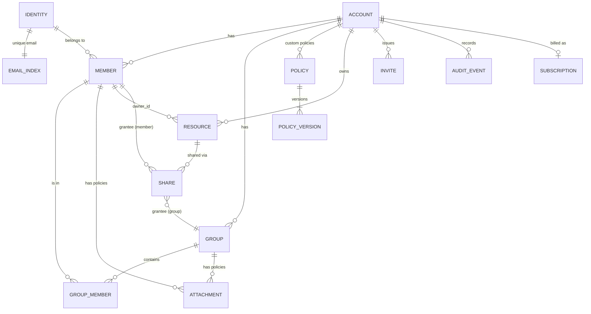
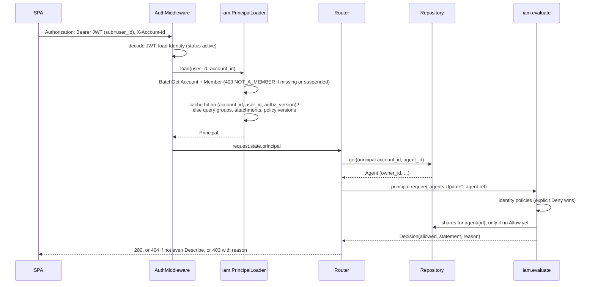
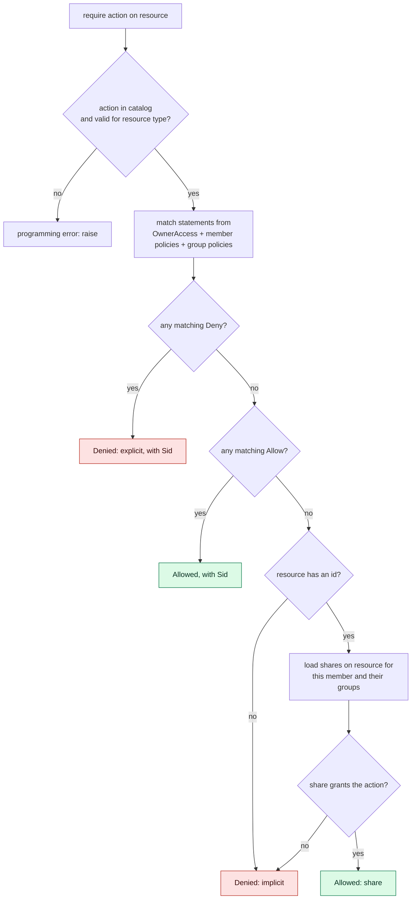
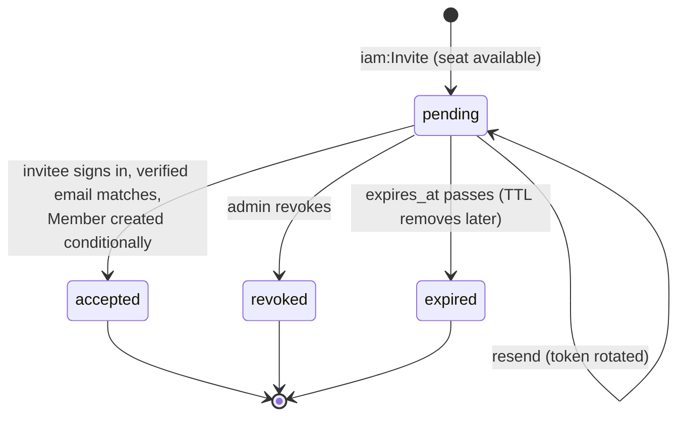
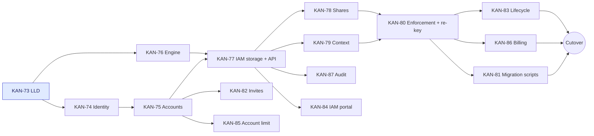
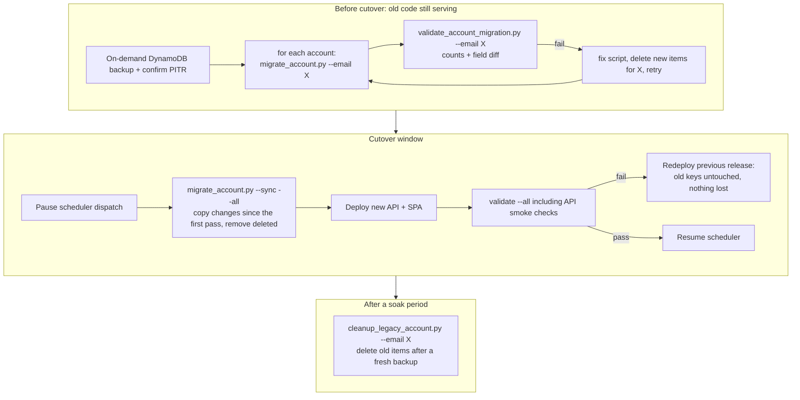

# Shared Accounts and IAM-Style Authorization

| Field | Value |
| --- | --- |
| Status | 📝 Proposed |
| Owner | InnomightLabs API / SPA |
| Last reviewed | 2026-10-10 |
| Scope | `api/src/auth/`, `api/src/users/`, new `api/src/identity/`, `api/src/accounts/`, `api/src/iam/`; every owner-scoped repository and router; `api/src/payments/`, `api/src/rate_limits/`, `api/src/public_api/`, `api/src/apikeys/`, `api/src/widget/`, `api/src/a2a/`; `spa/src/services/`, `spa/src/pages/dashboard/`; `api/scripts/` |
| Tracker | [KAN-72](https://vslala007.atlassian.net/browse/KAN-72) (epic), this design is [KAN-73](https://vslala007.atlassian.net/browse/KAN-73) |
| Depends on | [Security hardening](LLD-security-hardening-and-conversation-context.md), [Public API and Embeddable Widget](LLD-public-api-and-embeddable-widget.md), [MCP Sharing for Widget, A2A, and API Callers](LLD-mcp-sharing-for-widget-a2a-api.md), [User-Scoped Memory Blocks](../api/docs/LLD-memory-block-user-scoping.md) |

> **Summary:** Today a person, their email address and their data are the same thing: everything is stored
> under `User#{email}`, and the only authorization rule is that you own what is under your email. This
> design separates the three:
>
> - an **identity**, with an immutable `user_id` and a verified email used to sign in;
> - an **account** that owns resources, billing and quotas;
> - a **membership** that links an identity to an account.
>
> Authorization becomes an **AWS IAM-style policy engine**:
>
> - JSON policies with Allow and Deny rules, each naming an action and a resource;
> - policies attach to members or to groups, and owners can share single resources with members or groups;
> - an explicit Deny always wins, and anything not allowed is denied.
>
> Resources stay **private by default**, so a shared account feels like today's personal account. Admins
> run a new IAM portal and can see other members' resources **as metadata only**. Existing data is
> re-keyed into account partitions, one account at a time, by a migration script that a separate
> validation script checks.

## Implementation notes

### KAN-74: identity split (done)

- **New module.** `api/src/identity/` (`Identity`, `IdentityRepository`, `normalize_email`) replaces
  `api/src/users/models.py` and `repository.py`. `api/src/users/` keeps only `DELETE /users/me`.
- **Interim email key.** Until resources move into accounts
  ([KAN-80](https://vslala007.atlassian.net/browse/KAN-80)), they are still keyed by the owner's email.
  So `AuthMiddleware` sets `request.state.user_id` **and** `request.state.user_email`. The email is read
  from the identity record, never from the token.
- **Stripe customer.** `stripe_customer_id` stays on the Identity until billing moves to the account
  ([KAN-86](https://vslala007.atlassian.net/browse/KAN-86)).
- **App token contract.** `/auth/refresh` and `/auth/revoke` still take `email` in the body, so BidSignal
  is not broken. The email only finds the identity; the refresh token proves the caller. `TokenResponse`
  gains `user_id`, and app tokens carry `sub = user_id` plus an `email` claim.
- **Provider refresh tokens.** The OAuth provider's refresh token is no longer stored on the person's
  record. Nothing read it.
- **Account deletion.** The account-deletion Lambda lives in `api/lambdas/account_deletion_handler/`,
  which answers open question 6.
  - Its payload is now `{user_id, user_email}`.
  - It deletes the identity, its refresh tokens and its email index entry, so the email is free to sign
    up again.
  - The welcome email triggered by the stream (`api/lambdas/usage_stream_handler/`) now fires on
    `Identity#Metadata` inserts.
- **Local dev sign-up.** The identity and its email index carry the same TTL, so an expired dev user
  frees the username.
- **Testing concurrent sign-ups.** Real threads can't test this under moto, because its in-memory table
  isn't thread-safe. The test drives the race step by step instead: every racer misses the lookup, one
  transaction wins, and the rest return the winner.

### KAN-75: accounts and memberships (done)

- **New module.** `api/src/accounts/` (models, repository, service, router) holds `Account`, `Member`,
  `GET /accounts` and `POST /accounts`.
- **One transaction per account.** `AccountRepository.create` writes three items in one
  `TransactWriteItems`:
  - the Account;
  - its first Member;
  - the `OwnedAccountCount` increment.

  (The first version also attached `AdministratorAccess` to the creator. That attachment was dropped in
  KAN-77, when the account owner became an admin by definition.)

  The increment has no condition yet. KAN-85 adds `n < :max` together with its setting, the rate limit and
  `ACCOUNT_LIMIT_REACHED`, so every account created before then is already counted.
- **The personal account.**
  - It is created at every InnomightLabs sign-in (the OAuth callback for the default app, local sign-up
    and local login) for an identity that belongs to no account, not only at the first sign-in.
  - Its id is `uuid5("personal-account:{user_id}")`, and the Account put is conditional. Racing or retried
    sign-ins therefore make exactly one.
  - This also covers an identity whose first sign-in failed part way, and identities created under KAN-74
    before accounts existed. The migration (KAN-81) can use the same id.
  - Other apps' sign-ins (BidSignal) create none. Such a person gets one the first time they sign in to
    InnomightLabs.
- **`GET /accounts`** returns `[{account_id, name, access_summary, membership_status, joined_at}]`.
  `access_summary` is `admin` when `AdministratorAccess` is attached directly, and `member` otherwise,
  until KAN-77 brings custom policies and groups.
- **Removing a member** (`AccountService.remove_member`; moved to `IamService.remove_member` in KAN-77) deletes the member's attachments, both halves of
  each group membership and then the Member item, and finally bumps `authz_version`.
  - The Member goes last, so a failure part way leaves fewer permissions, never stale ones waiting for a
    re-invite.
  - Permission checks, protecting the owner, shares and resource transfer stay with KAN-77, KAN-78 and
    KAN-83.
- **Not yet.** `Identity.last_account_id` and `PUT /accounts/active` come with the account context
  (KAN-79). The account-deletion Lambda doesn't remove memberships yet; that is KAN-83.

### KAN-76: policy engine (done)

- **Where it lives.** `api/src/iam/`:
  - `actions.py`: the catalog, `ResourceRef`, `expand` and `describe_action_for`;
  - `policy.py`: the pydantic document and its validator;
  - `engine.py`: `evaluate`, `NamedPolicy`, `Share` and `Decision`;
  - `builtins.py`: the four built-in policies.

  A test checks that these modules import only the standard library and pydantic.
- **API key verbs are renamed (a change to the catalog).** They are now `apikeys:ListKeys`,
  `apikeys:CreateKey` and `apikeys:RevokeKey`, not `List`, `Create` and `Revoke`.
  - The reason: they act on an existing `agent/{id}`. `MemberAccess` and `AdministratorAccess` allow
    `*:Create` and `*:List` on `*` so that people can create their own resources, and with the old names
    that would have let any member create a key on someone else's agent, then chat with it through the
    key.
  - Skills already had verbs of their own (`Install`, `Configure`, `Uninstall`).
  - Rule for the catalog: an action on a child of a resource must not reuse a top-level verb.
- **Resource matching.** `type/*` matches every resource of that type, including the agent actions that
  name no id (Create and List). Account-wide actions (`iam`, `billing`, `audit` and `account`) use the
  `account` type and match only `*`.
- **Validation.** Parsing a `PolicyDocument` validates it and expands the action patterns. Expanding at
  parse time means a stored `agents:*` picks up actions added later.
  - Unknown fields are rejected, so `Principal` isn't allowed.
  - Action patterns can only use letters, `:` and `*`, so `?` and `[...]` aren't allowed.
  - Resource types must be in the catalog.
- **Decisions on misuse.** `evaluate` raises `ValueError` when an action doesn't exist or doesn't apply
  to the resource's type, because that is a bug in a route. For an Allow that came from a share,
  `Decision.policy` holds the share's grantee.
- **Built-ins.** The policy names come from the LLD, which wins over the ticket's wording:
  - the view-only policy is `ViewOnlyAccess` (the ticket says `ReadOnlyAccess`);
  - the condition is `iml:ResourceOwner` / `${iml:PrincipalId}`.

### KAN-77: IAM storage and API (done)

- **Where it lives.** `api/src/iam/`:
  - `models.py`: `Group`, `CustomPolicy`, `PolicyVersion`, `Attachment`, and `AccountIam`, a snapshot of
    one account's permissions;
  - `repository.py`: `load` and `commit`;
  - `guard.py`: the escalation guard, pure;
  - `service.py`: every IAM write;
  - `principal.py`: `Principal` and the cached loader;
  - `dependencies.py`, `router.py` and `schemas.py`: the HTTP layer.
- **One write path.**
  - Every change loads `AccountIam` and checks the caller's action against that fresh state.
  - Grants are judged with the escalation guard.
  - `IamRepository.commit` then writes the change and `authz_version + 1` in one transaction, on the
    condition `authz_version = :seen`.
  - So a change is always judged on the state it actually changes. If another change lands in between,
    the second gets 409 `CONFLICT` and retries.
- **The escalation guard is conservative.** It allows a grant only through the caller's unconditional
  Allows that are at least as broad as the grant, and any Deny of theirs that could touch the grant blocks
  it.
  - Allows conditioned on ownership always pass, because they grant only what `OwnerAccess` already gives.
  - A specific `type/id` doesn't yet count the caller's ownership or shares, which arrive with KAN-80 and
    KAN-78. The guard can therefore wrongly refuse a grant, never wrongly allow one.
  - **Adding someone to a group is guarded like attaching**, because it grants the group's policies.
- **The account owner is fixed, like AWS's root user (a design change, decided 2026-10-10).** This
  replaces the last-admin rule. The person who creates an account owns it and always has the most power
  in it; it is theirs.
  - `Account.owner_id` starts as the creator. Only an explicit transfer of ownership (KAN-83) changes it.
  - The owner holds `OwnerAccess` and `AdministratorAccess` because they own the account, not through an
    attachment.
  - Policies from the owner's groups add to the owner's power and never take from it: their Deny
    statements are dropped for the owner. Groups therefore stay useful for sharing with the owner.
  - The owner can't be removed, and policies can't be attached to or detached from them (both refused
    with `ACCOUNT_OWNER`).
  - So the account always has an admin. The last-admin rule, `LAST_ADMIN` and its after-state checks
    are removed.
  - `GET /accounts` reports `access_summary: "owner"`, and `GET /iam/members` flags `is_owner`.
- **Policies.**
  - A custom policy is referred to as `custom:{policy_id}`, and routes accept either that or the bare id.
  - Writing a policy is guarded only by `iam:ManagePolicies`: an unattached policy grants nothing.
  - What is guarded is attaching a policy, and changing the default version of one that is attached.
  - Documents are stored as JSON text and capped at 6144 characters, IAM's limit for managed policies.
  - Names are unique per account, ignoring case, and can't reuse a built-in name.
  - An attached policy can't be deleted (409 `POLICY_ATTACHED`).
  - `OwnerAccess` can't be attached (400 `IMPLICIT_POLICY`).
- **Deleting a group** also deletes its memberships and attachments, within the rules above.
- **Account context for now.** `get_principal` requires the `X-Account-Id` header and returns 400
  `ACCOUNT_REQUIRED` without it. KAN-79 moves this into the middleware and adds the fallbacks.
  - Every request reads the account's version and the caller's membership. On a cache miss it loads the
    whole `AccountIam`.
  - The cache is keyed `(account, member, authz_version)` and sized by `settings.authz_cache_size`
    (env `AUTHZ_CACHE_SIZE`, default 1024). Like the other tuning defaults, it is not set in the deploy
    script.
- **Membership routes.** `GET /iam/members` is added. `IamService.remove_member` enforces
  `iam:ManageMembers` and refuses the owner, but the `DELETE /iam/members/{uid}` route waits for KAN-83's
  transfer plan.
- **Not yet.** Audit events for these writes come with KAN-87.

### KAN-78: shares (backend done; resolvers and SPA with KAN-80 and KAN-79)

- **Where it lives.** `api/src/iam/shares.py` holds the presets, `ResourceShare`, `ShareRepository`,
  `ShareService` and `RESOLVERS`. `api/src/iam/shares_router.py` serves
  `GET /{collection}/{id}/shares` and `PUT|DELETE /{collection}/{id}/shares/{members|groups}/{id}`, for
  `agents`, `knowledge-bases`, `automations` and `kits`.
  - The routes are registered as literal paths for each type. A single `/{collection}/...` route would
    answer 422 for the resources' own routes instead of letting them through.
- **Keys follow this LLD, not the ticket.** Shares use `Share#{type}#{rid}#{member|group}#{id}`, so
  listing a type never returns shares, plus the gsi2 reverse key for "shared with me".
- **Finding resources.** `RESOLVERS` maps each shareable type to a function `(account_id, id) ->
  ResourceRef` that carries the owner.
  - The map stays empty until resources live in accounts. **KAN-80 registers the real resolvers**, so
    until then the share routes answer 404.
  - The tests register a stand-in resolver.
- **Rules.**
  - Sharing needs `{service}:Share` on the resource. A caller who can't even `Describe` the resource
    gets 404.
  - Every granted action must be one the sharer can do on that resource, whether through ownership, a
    policy or a share (`ESCALATION` lists what's missing).
  - Advanced mode may pick any action on the resource's type except `Create`, `List` and `Transfer`.
  - Presets follow the table above.
  - Grantees must be members or groups of the account.
  - Sharing again replaces the grantee's access.
  - Conversations and MCP connections can't be shared (`NOT_SHAREABLE`).
- **Writes.** Share and revoke go through `IamService.commit`, so each one bumps `authz_version` and is
  judged on the state it changes. `ShareService.forget_resource` deletes a resource's shares, and
  KAN-80's delete routes call it.
- **Evaluation.**
  - `Principal.can` reads the shares that reach the caller, their own and their groups', with one
    BatchGet on exact keys. It does so only when no policy decided.
  - Shares aren't cached, so a revoke takes effect on the next request.
  - Leaving a group drops that group's shares, because the group list comes from the principal's version.
- **Not yet.**
  - The escalation guard for *policies* still ignores the caller's shares and ownership (see KAN-77).
  - Run-as-owner and account quota for shared chats belong with KAN-80 and KAN-86.
  - The Share dialog, "Shared with me" and the shared badges in the SPA need the account context
    (KAN-79) and account-keyed resources (KAN-80).

### KAN-79: account context (done)

- **Where the account is resolved.** `get_principal` (`api/src/iam/dependencies.py`) resolves it, not
  the middleware.
  - The middleware keeps the `Identity` it already loads on `request.state.identity`.
  - The first dependency that needs the principal resolves the account and caches the principal on
    `request.state.principal`.
  - Routes that don't use it, such as `/auth/*`, public routes and routes not yet converted by KAN-80,
    pay for no extra reads and ignore the header.
- **Which account.** The order is: `X-Account-Id`; then `Identity.last_account_id`; then the oldest
  active membership.
  - An account named in the header that the caller isn't an active member of is refused with 403
    `NOT_A_MEMBER`.
  - The fallbacks quietly skip accounts the caller has left, or whose membership is suspended.
  - With no membership at all, the response is 403 `NO_ACCOUNT`.
  - Membership status is read on every request, so a suspension applies at once.
- **API.** `PUT /accounts/active {account_id}` checks the membership and sets `Identity.last_account_id`.
  `GET /accounts` marks the account requests act in with `active`.
- **No `authorize(action, resource_fn)` factory.** The ticket asked for one, but routes call
  `principal.require(action, resource.resource_ref)` after loading the resource, as
  [Enforcement in routes](#enforcement-in-routes) decides.
- **SPA.**
  - `services/http/client.ts` keeps the tab's account in `localStorage.active_account_id`.
    `authHeaders()` adds `X-Account-Id` next to the token. It is used by the client and by the direct
    `fetch` calls: chat streams, image blobs and canvas HTML.
  - `components/dashboard/AccountSwitcher.tsx` sits in the dashboard header on every page and shows the
    account name and the caller's access (Owner, Admin or Member).
  - On load it pins the tab to its account, so a switch on another device doesn't move a running tab.
  - Switching calls `PUT /accounts/active` and reloads `/dashboard`, so nothing fetched for the previous
    account stays on screen.
  - Signing in or out clears the tab's choice.
- **Waiting on KAN-80.** "Lists show only the active account's resources" depends on resources moving
  into accounts.

### KAN-80: enforcement and re-keying (in progress)

The work is done one resource type at a time. Each slice moves a type into accounts, checks every route
through the principal, and leaves the suite green.

**The common pieces**
- **`Owner(account_id, user_id, email)`** (`api/src/accounts/owner.py`) replaces the bare email as "whose
  data this is".
  - `account_pk` gives `Account#{aid}`, and `member_pk` gives `Account#{aid}#Member#{uid}`.
  - `email` stays only while some data is still keyed by email. It goes once every slice is in.
  - `get_owner` (`api/src/iam/dependencies.py`) is the caller in the active account.
- **Interim rule for flows still keyed by email.** Blueprints, kits, Ila's sessions, skill install forms
  and automations are implicitly personal until their own slice.
  - Through `personal_owner(email)` they act in the person's personal account.
  - So a kit applied while you're switched to another account still creates its agents in your personal
    account. That only matters once invites (KAN-82) put people in shared accounts, and the kits slice
    fixes it.
- **Agent pickers on forms** list the owner's agents in the given owner's account, or in the personal
  account when no owner is given.

**Slice 1: agents (done)**
- **Keys.** `Agent` is at `Account#{aid}/Agent#{id}`, with `account_id` and `owner_id`. `created_by` is a
  user_id kept for audit only.
  - A gsi2 entry `Agent#{id}` / `Agent` lets credential and background paths find an agent by id alone.
  - Owner routes read in the account with `find_in_account`, because the index is eventually consistent.
- **Repository.** It provides `get`, `find_in_account`, `list_in_account`, `list_owned`,
  `find_by_name(account_id, owner_id, name)` and `delete(account_id, agent_id)`. The email-keyed methods
  are gone.
- **Route helpers** in `api/src/agents/access.py`:
  - `require_agent` and its `agent_with(action)` dependency for dashboard routes;
  - `require_own_agent` and `own_agent_with` for connecting the owner's own accounts: skill OAuth, A2A
    remote OAuth and MCP connection links;
  - `owner_of(agent)` for the member an agent runs as;
  - `owned_agent(agent_id, email)` for paths that still carry an email: scheduler, dream, automations,
    agent invocation, the league report and the clean-up script.

  The module also registers the `agent` share resolver, so the KAN-78 share routes work for agents.
- **Actions per route.**

  | Route | Action |
  | --- | --- |
  | create | `agents:Create` |
  | list | own, shared, and others' as admin metadata; each carries `access` |
  | get | `agents:Describe`; the admin projection has no persona |
  | update, A2A sharing toggle, KB link and unlink | `agents:Update` |
  | delete | `agents:Delete` (it also forgets the agent's shares) |
  | A2A tasks, analytics, token usage, linked KBs, installed skills | `agents:Get` |
  | chat, conversations, image generation, memory, dream runs, default agent | `agents:Chat` |
  | skills | `skills:Install`, `skills:Configure`, `skills:Uninstall` |
  | widget keys and `/v1` secret keys | `apikeys:ListKeys`, `apikeys:CreateKey`, `apikeys:RevokeKey` |
- **Run as owner, everywhere.**
  - Owner chat, widget, embed, `/v1`, A2A and image generation all take the owner email from the
    agent's owner (`owner_of`), never from a key's `created_by`.
  - A key's `created_by` is now the creator's user_id, for audit. The A2A OAuth token no longer carries
    `owner_email`.
  - A member chatting with a shared agent is a new actor kind, `member`. Skills and MCP tools reach them
    only if the owner opted that audience in, the same way as visitors and API keys. The SPA audience
    picker offers it.
  - Their conversation is their own (slice 2). Their memory is still keyed by their email until the
    memory slice.
- **Middleware.** The analytics special case in `AuthMiddleware` is gone; the analytics routes authorize
  through the principal. Rate limits stay per person until KAN-86, and count the agents a person owns
  across all their accounts.
- **Lambdas.** The usage stream finds an agent's owner email through `owner_id`. Account deletion removes
  the person's agents in their personal account; offboarding from shared accounts is KAN-83.
- **SPA.** `AgentResponse` gains `account_id`, `owner_id` and `access`. The agent list shows "Shared with
  you" or "Admin view" on agents the person doesn't own.
- **Tests.**
  - conftest seeds a personal account for every test identity. `owner_for`, `owner_ids` and
    `agent_fields` build owners and agent ownership fields.
  - `tests/test_agent_access.py` covers private by default, a User share, run-as-owner with the `member`
    actor kind, admin metadata-only access, isolation across accounts, secret keys acting as the owner,
    and deletion forgetting shares.

**Slice 2: conversations (done)**
- **Keys.** A conversation is at `Account#{aid}#Member#{uid}/CONVERSATION#{id}`, with `account_id`, and
  `created_by` is the starter's user_id. `member_partition(account_id, user_id)` builds the partition,
  and `Owner.member_pk` and `Agent.owner_partition` both use it.
  - Messages, tool audit and turns stay under `CONVERSATION#{id}`. They never named the owner.
  - The dead `gsi1_*` attributes are gone. A gsi2 entry `Conversation#{id}` / `Conversation` replaces
    them.
- **Repository.** Methods take the partition instead of an email: `find_by_id(id, partition)`,
  `find_all_by_user(partition)`, `find_all_by_user_paginated(partition, ...)` and `delete_by_id(id,
  partition)`.
  - `get(id)` finds a conversation by id alone, through gsi2. It is only for work already running inside
    the conversation: skill actions (agent invocation), scheduled messages and image generation.
  - Those paths used to look up by the owner's email, so they missed a member's conversation on a shared
    agent. They now find it.
- **Whose partition, per path.**

  | Path | Partition |
  | --- | --- |
  | dashboard `/conversations`, agent chat routes | the caller's (`get_principal` / `get_owner`) |
  | Ila (builder) | the caller's (her sessions stay email-keyed until slice 5) |
  | A2A, WordPress AI client | the agent owner's (`agent.owner_partition`) |
  | `/v1` | `ApiConversation.partition_for(agent.account_id, key_id, end_user_id)` |
  | automation runs | the owner's in their personal account (`personal_owner`, interim until slice 4) |
  | dream, analytics (dashboard source) | the agent owner's, so only the owner's own chats count, as before |
- **Departure from the re-key table.** `/v1` conversations were going to stay at
  `USER#secret-key:...`. Instead they move into the agent's account as a pseudo-member,
  `Account#{aid}#Member#secret-key:{key_id}[:{end_user}]`, so that no partition names a person outside
  an account. The scoping is unchanged: per key, and per end user within a key.
- **No admin reach.** An admin can't list or open a member's conversations. Conversation contents are
  not metadata.
- **Lambdas and scripts.**
  - Account deletion clears the person's conversations in their personal account, including every row
    under each conversation (audit and turns, which were missed before).
  - `cleanup_ila_builds.py` finds the owner of an Ila conversation through its `created_by` user_id.
  - `scripts/delete_user_account.py` already queried the wrong prefix (`User#`), and is left for KAN-83.
- **Tests.**
  - `conversation_fields(email)` and `conversations_of(email)` build test ownership.
  - `test_conversations_repository.py` covers isolation between members of one account, and `get`.
  - `test_agent_access.py` covers a member's chat on a shared agent being invisible to its owner and to
    admins, and a conversation staying in the account it was started in.

## Context and problem

### How it works today

| Concern | Today | Code |
| --- | --- | --- |
| Identity | The email address is the user's id; there is no other identifier | `User.pk = f"User#{self.email}"` in `api/src/users/models.py:36` |
| Token | `sub` holds the email | `create_access_token` in `api/src/auth/jwt_utils.py:23` |
| Per request | The middleware decodes the JWT, loads the user by email and sets `request.state.user_email` | `AuthMiddleware.dispatch` in `api/src/auth/middleware.py:84` |
| Getting the caller | Each router has its own copy of `get_user_email(request)`, with about 129 uses of `request.state.user_email` across 20 routers | e.g. `api/src/conversations/router.py:34` |
| Authorization | Ownership only:<br>• the repository looks up under the owner's partition, so someone else's resource is "not found";<br>• a few explicit field comparisons such as `link.owner_email != owner_email` (MCP service), `subscription.user_email != user_email` (Stripe router), `template.publisher_user_email` (marketplaces) | `AgentRepository.find_agent_by_id(agent_id, created_by)` in `api/src/agents/repository.py:57` |
| Records under an agent | Skills, API keys, MCP links and analytics live under `Agent#{id}` and are checked through the agent | `validate_agent_ownership` in `api/src/apikeys/router.py:52`, `require_owned_agent` in `api/src/knowledge/router.py:141` |
| Credentials | `sk_live`, `pk_live` and A2A keys act as `key.created_by` (an email) | `require_secret_key` in `api/src/public_api/auth.py:33`, `api/src/a2a/oauth.py:127` |
| Billing and quotas | Per email: `Subscription` under `User#{email}`, tier lookup by email | `RateLimitService.get_user_tier` in `api/src/rate_limits/service.py:28` |
| Roles, teams, scopes | None. The closest thing is the actor-kind rules (`available_to`: owner, api, a2a, visitor) | `api/src/skills/models.py:13` |

### What KAN-72 asks for

- Several people collaborating in one account.
- A person can be admin in one account and a member in another.
- Invitations, a member list, switching accounts, and access scoped to the account.
- A configurable limit on how many accounts one email can create.
- Migrating existing users.
- On top of that, a **flexible, IAM-like permission system**: the admin chooses, for each user or group,
  which parts of the product they can use.

## Goals and non-goals

**Goals**

1. Separate identity from email, and the account from the person.
2. An authorization model that is deny-by-default, has an explicit Deny, uses policies, and works for
   individual users and for groups, in the style of AWS IAM.
3. Resources are private by default, with opt-in sharing of single resources inside the account.
4. Admins manage members, groups, policies and billing, but see other members' resources as metadata only.
5. A single enforcement point, `Principal.require(action, resource)`, used by every route.
6. Re-key existing data with no loss, one account at a time, with a separate validation step.
7. A per-email limit on owned accounts, with seats per account set by the plan.

**Non-goals (v1)**

- Sharing across accounts. To share with someone outside the account, invite them first.
- A policy simulator ([KAN-88](https://vslala007.atlassian.net/browse/KAN-88)), account-level provider
  credentials ([KAN-89](https://vslala007.atlassian.net/browse/KAN-89)), and policies attached to keys
  ([KAN-90](https://vslala007.atlassian.net/browse/KAN-90)). These are follow-ups; this design leaves room for them.
- Conditions beyond "the resource's owner is the caller". No tags, IP or time conditions yet.
- Nested groups, SSO or SCIM provisioning, or usernames.
- Sharing conversations.

## Design

### Concepts



*Every entity except IDENTITY and EMAIL_INDEX lives inside one account. A RESOURCE is any owned thing:
an agent, knowledge base, automation, kit, conversation and so on.*

- **Identity:** a person. It has an immutable `user_id` (uuid4), a verified email used to sign in, a
  profile and a status. One email maps to exactly one identity.
- **Account:** the unit that owns resources and holds billing, quotas and seats. Every existing user
  becomes the owner of a personal account.
- **Account owner:** the person who created the account, like AWS's root user. They are always its admin,
  nothing can be detached from them or denied to them, and they can't be removed. Only an explicit
  transfer of ownership changes who it is.
- **Member:** a membership linking an identity to an account. **It has no role field.** "Admin" and
  "Member" are the built-in policies `AdministratorAccess` and `MemberAccess` attached to the membership,
  so there is one mechanism instead of two.
- **Group:** a flat set of members in one account. Policies attached to the group apply to every member.
- **Policy:** a versioned JSON document, either built in (defined in code, read-only) or custom (stored
  in the account).
- **Attachment:** a policy attached to a member or to a group.
- **Share:** a grant on a single resource to a member or group in the same account. It plays the role
  of an IAM resource policy.
- **Principal:** the caller of one request, as the evaluator sees it: `(user_id, account_id, group_ids,
  policies)`.

### Request lifecycle



*Shares are only loaded when the identity policies neither denied nor allowed the request. So the
common case, a member acting on their own resource, never reads them.*

### The policy language

The policy language copies the IAM document shape on purpose. Many admins already know it, and the
evaluation rules are well understood and documented.

```json
{
  "Version": "2026-10-10",
  "Statement": [
    {
      "Sid": "SupportUsesTwoAgents",
      "Effect": "Allow",
      "Action": ["agents:Describe", "agents:Get", "agents:Chat"],
      "Resource": ["agent/8c1e…", "agent/590a…"]
    },
    {
      "Sid": "NoAutomationsForInterns",
      "Effect": "Deny",
      "Action": "automations:*",
      "Resource": "*"
    }
  ]
}
```

| Element | Rules |
| --- | --- |
| `Version` | Required; `"2026-10-10"` is the only value in v1. A new grammar would get a new date. |
| `Effect` | `Allow` or `Deny`. |
| `Action` | A string or a list of `service:Verb`. The `*` wildcard can appear in either part: `agents:*`, `*:List`, `*`. Every pattern is expanded against the action catalog when the policy is saved, so one that matches nothing is rejected. |
| `Resource` | A string or a list of `*`, `{type}/*` or `{type}/{id}`. **There is no account segment.** The account always comes from the request, so a policy cannot point at another account by construction. |
| `Condition` | Optional. The only condition in v1 is `{"StringEquals": {"iml:ResourceOwner": "${iml:PrincipalId}"}}`. Anything else is rejected when the policy is saved. |
| `Sid` | Optional label, shown in decisions and the audit log. |

**There is no `Principal` element in identity policies**, as in IAM: the principal is whoever the policy
is attached to. Shares have their own fixed shape (see [Shares](#shares)) rather than a free-form
`Principal` element. This keeps v1 easy to validate.

### The action catalog

`api/src/iam/actions.py` is the single source of truth. Policies are validated against it, the SPA's
visual builder draws its choices from it (`GET /iam/actions`), and the routes refer to it. Each action
declares:

- the resource types it applies to;
- whether it touches **contents** or only **metadata**. Admins' "metadata only" reach follows from this flag.

| Service | Actions (M = metadata, C = contents) | Resource |
| --- | --- | --- |
| `agents` | `Create` M, `List` M, `Describe` M, `Get` C, `Update` C, `Chat` C, `Delete` M, `Transfer` M, `Share` M | `agent/{id}`; `*` for Create and List |
| `knowledge` | `Create` M, `List` M, `Describe` M, `Get` C, `Update` C, `Crawl` C, `Delete` M, `Transfer` M, `Share` M | `knowledge-base/{id}` |
| `automations` | `Create` M, `List` M, `Describe` M, `Get` C, `Update` C, `Run` C, `Delete` M, `Transfer` M, `Share` M | `automation/{id}` |
| `kits` | `Create` M, `List` M, `Describe` M, `Get` C, `Apply` C, `Rollback` C, `Delete` M, `Transfer` M, `Share` M | `kit/{id}` |
| `skills` | `Install` C, `Configure` C, `Uninstall` C | `agent/{id}` (skills are children of an agent) |
| `apikeys` | `ListKeys` M, `CreateKey` C, `RevokeKey` C (renamed in KAN-76, see Implementation notes) | `agent/{id}` |
| `mcp` | `Create` M, `List` M, `Describe` M, `Get` C, `Update` C, `Link` C, `Delete` M | `mcp-connection/{id}` |
| `conversations` | `List` M, `Describe` M, `Read` C, `Delete` M | `conversation/{id}` |
| `iam` | `ListMembers` M, `ListGroups` M, `ListPolicies` M, `Invite` M, `ManageMembers` M, `ManageGroups` M, `ManagePolicies` M, `AttachPolicies` M | `*` |
| `billing` | `View` M, `Manage` M | `*` |
| `audit` | `Read` M | `*` |
| `account` | `Update` M, `Delete` M | `*` |

Notes on the catalog:

- **`Describe` vs `Get`.** `Describe` returns metadata: name, owner, timestamps and status. `Get` returns
  the full configuration, for example an agent's system prompt or a knowledge base's documents.
  Metadata-only callers receive a projection of the resource from `Describe`.
- **Starting a conversation** needs `agents:Chat` on the agent. The new conversation is owned by its
  creator. Conversations belong to one member and are never shared in v1, so there is no `Share` verb
  for them.
- **Adding a service** means adding a row to `actions.py`. Policies that use `service:*` pick up the new
  actions automatically, as in IAM.

```python
# api/src/iam/actions.py
@dataclass(frozen=True)
class Action:
    name: str                      # "agents:Chat"
    resource_types: tuple[str, ...]  # ("agent",)
    touches_contents: bool

def _service(service: str, resource_type: str, metadata: list[str], contents: list[str]) -> list[Action]:
    return [Action(f"{service}:{verb}", (resource_type,), False) for verb in metadata] + [
        Action(f"{service}:{verb}", (resource_type,), True) for verb in contents
    ]

CATALOG: dict[str, Action] = {
    action.name: action
    for action in [
        *_service("agents", "agent",
                  metadata=["Create", "List", "Describe", "Delete", "Transfer", "Share"],
                  contents=["Get", "Update", "Chat"]),
        *_service("knowledge", "knowledge-base",
                  metadata=["Create", "List", "Describe", "Delete", "Transfer", "Share"],
                  contents=["Get", "Update", "Crawl"]),
        # ... automations, kits, skills, apikeys, mcp, conversations, iam, billing, audit, account
    ]
}

def expand(pattern: str) -> set[str]:
    """Concrete action names matched by a pattern such as 'agents:*' or '*:List'."""
    return {name for name in CATALOG if fnmatch.fnmatchcase(name, pattern)}
```

### Built-in policies

Built-in policies are defined in code (`api/src/iam/builtins.py`) and referred to by name. They are not
stored per account, so improving one improves it everywhere.

| Policy | Attached | Statements |
| --- | --- | --- |
| `OwnerAccess` | **Implicitly, to every member.** It cannot be detached. | Allow `*` on `*` when `iml:ResourceOwner == ${iml:PrincipalId}`. This is what makes resources private by default and makes a shared account feel like today's personal one. |
| `MemberAccess` | By default, to people who accept an invite | Allow `*:Create`, `*:List`, `iam:ListMembers`, `iam:ListGroups` on `*`. Members can create their own resources, see the directory so they can share, and see lists, which are filtered to what they own or was shared with them. |
| `AdministratorAccess` | Held implicitly by the account owner; attached to anyone an admin promotes | Allow `iam:*`, `billing:*`, `audit:*`, `account:*`, `*:Create`, `*:List`, `*:Describe`, `*:Transfer`, `*:Delete` on `*`. **It includes no contents actions**, which is how admins see metadata only. |
| `ViewOnlyAccess` | Optional | Allow `*:List`, `*:Describe`, `iam:List*` on `*` (the same idea as AWS's ViewOnlyAccess). |

An admin who owns a resource can still do everything with it through `OwnerAccess`. "Metadata only"
applies to *other members'* resources.

### Evaluation



*This is IAM's same-account logic. An explicit Deny in any identity policy beats every Allow, including
an Allow from a share. A Deny on `*:Share`, for example, stops a member sharing even their own resources.*

The engine is pure and does no I/O, so it can be tested with plain tables of cases:

```python
# api/src/iam/engine.py
@dataclass(frozen=True)
class ResourceRef:
    type: str                 # "agent"
    id: str | None            # None for Create/List/iam/billing actions
    owner_id: str | None

    @property
    def name(self) -> str:
        return f"{self.type}/{self.id}" if self.id else "*"

@dataclass(frozen=True)
class Decision:
    allowed: bool
    reason: Literal["explicit_deny", "allow", "share", "implicit_deny"]
    policy: str | None = None   # "AdministratorAccess" or the custom policy id
    sid: str | None = None

def evaluate(
    principal_id: str,
    action: str,
    resource: ResourceRef,
    policies: Sequence[NamedPolicy],
    load_shares: Callable[[], Sequence[Share]],
) -> Decision:
    matches = [
        (policy, statement)
        for policy in policies
        for statement in policy.document.statements
        if statement.matches(action, resource, principal_id)
    ]
    for policy, statement in matches:
        if statement.effect == "Deny":
            return Decision(False, "explicit_deny", policy.name, statement.sid)
    if matches:  # no Deny matched, so every match is an Allow
        policy, statement = matches[0]
        return Decision(True, "allow", policy.name, statement.sid)
    if resource.id and any(action in share.actions for share in load_shares()):
        return Decision(True, "share")
    return Decision(False, "implicit_deny")
```

`Statement.matches` checks three things:

- **Action:** the statement's expanded action set, computed and stored when the policy is loaded,
  contains `action`.
- **Resource:** the resource name matches one of the statement's patterns (`*`, `type/*`, or exact).
- **Condition:** the condition holds. In v1 that is `resource.owner_id == principal_id`; a resource with
  no owner, such as `*`, never satisfies it.

### Enforcement in routes

One dependency replaces the ~20 copies of `get_user_email`:

```python
# api/src/iam/dependencies.py
def get_principal(request: Request) -> Principal:
    principal = getattr(request.state, "principal", None)
    if principal is None:
        raise HTTPException(status_code=401, detail="Not authenticated")
    return principal

# api/src/iam/principal.py
@dataclass
class Principal:
    user_id: str
    account_id: str
    group_ids: frozenset[str]
    policies: tuple[NamedPolicy, ...]
    share_repository: ShareRepository

    def can(self, action: str, resource: ResourceRef) -> Decision:
        return evaluate(self.user_id, action, resource, self.policies,
                        lambda: self.share_repository.for_resource(self.account_id, resource, self.user_id, self.group_ids))

    def require(self, action: str, resource: ResourceRef) -> None:
        decision = self.can(action, resource)
        if decision.allowed:
            return
        # Don't reveal that a resource exists to someone who can't even see it.
        if resource.id and not self.can(describe_action_for(resource.type), resource).allowed:
            raise HTTPException(status_code=404, detail=f"{resource.type} not found")
        raise HTTPException(status_code=403, detail={"code": "ACCESS_DENIED", "action": action, "reason": decision.reason})

    def visible(self, items: Iterable[T], action: str) -> list[T]:
        """Filter a list to what the caller may `action` (List-then-filter, see Listing)."""
        return [item for item in items if self.can(action, item.resource_ref).allowed]
```

A route then reads naturally:

```python
@router.patch("/agents/{agent_id}")
def update_agent(agent_id: str, body: UpdateAgentRequest, principal: Principal = Depends(get_principal)) -> AgentResponse:
    agent = agent_repository.get(principal.account_id, agent_id)
    if agent is None:
        raise HTTPException(status_code=404, detail="agent not found")
    principal.require("agents:Update", agent.resource_ref)
    ...
```

The loaded resource is passed to `require` explicitly, rather than through a decorator that guesses the
resource from path parameters. Whether a request is allowed depends on the resource's `owner_id`, so the
route has to load the resource anyway. Doing the check in the route makes it visible and keeps it next
to the data it depends on.

Every model that can be authorized exposes `resource_ref`:

```python
class Agent(BaseModel):
    ...
    account_id: str
    owner_id: str        # user_id; can change by Transfer
    created_by: str      # user_id; audit only, never used for authorization

    @property
    def resource_ref(self) -> ResourceRef:
        return ResourceRef("agent", self.agent_id, self.owner_id)
```

**Records under an agent** (`Agent#{id}` partitions: skills, API keys, MCP links, analytics, token usage,
widget conversations) keep their keys. Agent ids are globally unique, so these records need no re-keying;
they are authorized through the agent. `validate_agent_ownership`, `require_owned_agent` and the
analytics prefix check in `AuthMiddleware` become a single `require_agent(principal, agent_id, action)`.

### Listing

- **"My" resources and the admin view.** Query `pk = Account#{aid}` with `begins_with(sk, "Agent#")`.
  For members, add `FilterExpression owner_id = :me`. Admins skip the filter and receive the
  `Describe` projection for resources owned by others.
- **"Shared with me".** Query gsi2 with `gsi2_pk = Account#{aid}#Grantee#member#{uid}`, plus one query for
  each of the member's groups (`…#Grantee#group#{gid}`). Then BatchGet the resources and run
  `principal.visible(...)` to apply any Denies.
- **Response shape.** List responses carry `access: "owner" | "shared" | "admin"`, so the SPA can show a
  badge and hide actions the caller can't use.

Accounts have tens of resources of each type, not millions, so filtering a partition query is fine.
[Data model](#data-model-and-contracts) explains which types get a partition per member instead.

### Shares

A share grants a fixed list of actions on one resource to one grantee, a member or a group. It is the v1
form of an IAM resource policy.

- **Presets.** The Share dialog offers presets defined in `api/src/iam/shares.py`, plus an advanced mode
  for picking individual actions.

  | Resource type | Viewer | User | Editor |
  | --- | --- | --- | --- |
  | agent | `Describe`, `Get` | + `Chat` | + `Update`, `skills:Configure` |
  | knowledge-base | `Describe`, `Get` | (same as Viewer) | + `Update`, `Crawl` |
  | automation | `Describe`, `Get` | + `Run` | + `Update` |
  | kit | `Describe`, `Get` | + `Apply` | + `Rollback` |

  `Delete`, `Transfer` and `Share` are never in a preset.
- **Who can share.** Sharing requires `{service}:Share` on the resource. Owners have it through
  `OwnerAccess`; admins can Deny it.
- **What can be shared.** The sharer can grant only actions they are allowed themselves on that resource
  (see the escalation guard).
- **Running as the owner.** When Bob chats with Alice's shared agent:
  - it runs on Alice's provider settings, skills and MCP connections, the way widget and `/v1` callers
    already run;
  - usage counts against the account;
  - the conversation belongs to Bob;
  - memory blocks are scoped per user (`Agent#{id}#User#{user_id}`), so Bob doesn't see what the agent
    remembers about Alice.
- **Deletion.** When a resource is deleted, its shares are deleted in the same batch.

### Changing permissions safely

These rules live in `api/src/iam/service.py`, the only code that writes members, groups, policies,
attachments or shares.

1. **The escalation guard: you can only grant what you hold.**
   - **Attaching an Allow policy** (to a member or group), or **creating or changing a share**, requires
     the caller to be allowed every concrete pair (action, resource pattern) it grants.
     - Action patterns are expanded against the catalog.
     - A resource pattern `type/*` or `*` is covered only by an Allow in the caller's own policies whose
       pattern is at least as broad and has no condition.
     - A concrete `type/id` is covered by evaluating the caller against it, which includes ownership and
       shares.
   - **Deny statements** are not restricted: they never add privilege.
   - **What follows:**
     - Nobody can make themselves an admin.
     - An admin cannot grant themselves, or anyone else, contents access to resources that other people
       own. Only the owner can share contents.
     - Admins can still build the "Support group may chat with two agents" setup when they own those
       agents, or when the owner shares the agents with the group.
2. **The owner is out of reach.** The account owner can't be removed, suspended, attached to or
   detached from, and their groups' Denies don't apply to them (`ACCOUNT_OWNER`). The account therefore
   always has an admin. This replaced the original last-admin rule; see the KAN-77 implementation notes.
3. **Invalidation.** Every write increments `Account.authz_version` in the same `TransactWriteItems`
   as the change.
4. **Audit.** Every write appends an `AuditEvent` in the same transaction (see [Audit log](#audit-log)).

### Account context and switching

- The JWT keeps identifying only the person: `sub = user_id`. The account is **not** in the token, so
  switching accounts needs no new token.
- The SPA sends `X-Account-Id` on every request. If it is missing, the middleware uses
  `Identity.last_account_id`, and failing that the oldest membership.
- `PrincipalLoader.load(user_id, account_id)`:
  1. BatchGets `Account#{aid}/Account#Metadata` and `Account#{aid}/Member#{uid}`.
  2. If the membership is missing or `suspended`, it returns 403 `NOT_A_MEMBER`. A forged header
     therefore gets nothing.
  3. On a cache hit for `(aid, uid, authz_version)` it is done. Otherwise it queries the member's groups,
     the member's and the groups' attachments, and BatchGets the default versions of the custom policies.
- The cache is an in-process LRU (`settings.authz_cache_size`). It is correct across Railway replicas
  because each request reads the current `authz_version` (two reads), and a stale version never matches.
- `PUT /accounts/active` records `last_account_id` so the account is remembered across devices.

### Invitations



*Accepting twice, or two acceptances at once, creates exactly one Member: the Member put is conditional
(`attribute_not_exists(sk)`) and in the same transaction as the invite's status change.*

- **The token.** It is 32 random bytes in the email link. Only `sha256(token)` is stored, under gsi2
  `InviteToken#{hash}`.
- **The flow.**
  1. The invitee opens `/{frontend}/invite?token=…`.
  2. They sign in (Google or Cognito) or sign up through the normal flow.
  3. The SPA calls `POST /accounts/invites/accept {token}`.
  4. The server requires the identity's verified email to equal the invite's email.
  5. It then attaches the policies and groups recorded on the invite (by default `MemberAccess`).
- **No automatic personal account.** People who sign up through an invite don't get one. They can create
  one later, subject to the limit.
- **Limits.**
  - **Seats:** `active members + pending invites ≤ plan.seats`, checked both at invite and at accept.
  - **Rate:** a per-account invite rate limit using the existing `SlidingWindowStrategy` (`api/src/rate_limits/strategies.py`).
  - **Pending cap:** at most `settings.account_max_pending_invites` pending invites.

### Offboarding and transfer

- **Removing a member** (`iam:ManageMembers`) or **leaving** requires choosing what happens to the
  resources they own: transfer them to another member, or delete them. The service then, in one batch:
  1. sets `owner_id` on each transferred resource;
  2. deletes the Member, their group memberships, their attachments and the shares granted to them;
  3. increments `authz_version`.
- **Keys keep working.** Widget, `/v1` and A2A keys under transferred agents keep working: they follow the
  agent's `owner_id`.
- **One caveat for transferred agents.** They still point at the previous owner's provider settings and
  MCP connections, which belong to that member and are removed with them. The transfer dialog warns about
  this, and the new owner has to reconnect. Account-level credentials
  ([KAN-89](https://vslala007.atlassian.net/browse/KAN-89)) remove this rough edge.
- **What is kept.** The identity, and its memberships in other accounts, are never touched.

### Billing, quotas and seats

- **Subscription:** moves to `Account#{aid}/Subscription#{id}`.
- **Stripe customer:** the id moves to the Account. Checkout sets `metadata.account_id`. The webhook
  resolves the account from that metadata, falling back to the gsi2 key `StripeCustomer#{customer_id}`,
  and no longer uses the customer email (`api/src/payments/stripe/router.py:477`).
- **Usage:** `Usage#{YYYY-MM}` and `Usage#active` move to the account.
  - `RateLimitService` becomes account-based, so `get_user_tier(email)` becomes `get_account_tier(account_id)`.
  - Every member's messages count, including messages to shared agents.
  - The superuser bypass (`settings.is_superuser_email`) checks the caller's identity email.
- **Seats:** a new `limits.seats` field in `api/src/payments/{dev,uat,prod}_pricing_config.json`. A
  downgrade below the current member count removes nobody. The account is marked over its limit and new
  invites are blocked.
- **Who can manage billing:** only members holding `billing:Manage`.

### Account creation limit

- **The limit:** `settings.max_owned_accounts_per_email` (env `MAX_OWNED_ACCOUNTS_PER_EMAIL`). **The
  default value is an open decision** (see [Open questions](#open-questions)); the epic asks us not to
  pick an arbitrary number.
- **The counter:** `Identity#{uid}/OwnedAccountCount`. `POST /accounts` writes the Account (owned by the
  caller), the Member and a conditional increment
  (`ConditionExpression: attribute_not_exists(n) OR n < :max`) in one `TransactWriteItems`. N+1
  concurrent creates therefore produce exactly N accounts.
- **Decrements:** on account deletion, or when ownership of the account moves to another person.
- **Invitations never count** toward the limit.
- **The error:** 409 `ACCOUNT_LIMIT_REACHED` with a readable message. Account creation is also
  rate-limited per identity and per IP.

### Credentials as the account

| Credential | Today | After |
| --- | --- | --- |
| `sk_live` (`/v1`) | `PublicApiCaller.owner_email = key.created_by` | The key item stores `account_id`. The caller acts as the agent's `owner_id` within that account (the run-as-owner rule) and must pass `require_owner_active`. |
| `pk_live` / widget | Visitor tokens scoped to the agent; the owner is resolved by email | The same, resolved through the agent's `account_id` and `owner_id` |
| A2A secret / OAuth | `api_key.created_by` | Resolved the same way as the agent's owner |
| App tokens (BidSignal) | `sub = email` | `sub = user_id`, plus an `email` claim (see [Rollout](#rollout-and-compatibility)) |

Actor-kind rules (`available_to`, MCP `usable_by`) stay as they are in v1. KAN-90 folds them into
policies on keys.

### Audit log

- **Storage:** `pk = Account#{aid}#Audit`, `sk = {iso_ts}#{event_id}`, with the DynamoDB `ttl` set from
  `settings.audit_retention_days`.
- **Fields:** `actor_user_id`, `action` (an IAM action name), `target` (`member/{uid}`, `group/{gid}`,
  `policy/{pid}`, `agent/{id}`…), `summary`, `before` and `after` (small diffs, never secrets or tokens),
  `ip`, `user_agent`.
- **Where events come from:** only `iam/service.py`, `accounts/service.py` and the billing webhook, each
  in the same transaction as its change.
- **Reading:** `GET /iam/audit` with filters, guarded by `audit:Read`.

## Data model and contracts

All of this is in the existing single table (`dynamic-agent-builder-main`) and the existing `gsi2`.
**No Terraform change is needed.**

### New items

| Item | pk | sk | gsi2_pk / gsi2_sk | Notes |
| --- | --- | --- | --- | --- |
| Identity | `Identity#{uid}` | `Identity#Metadata` | none | email, `email_verified`, name, picture, status, `last_account_id`, password_hash/salt (local dev only) |
| Email index | `Email#{normalized_email}` | `Email#Identity` | none | `user_id`, written with `attribute_not_exists(pk)` in the same transaction as the Identity |
| Refresh token | `Identity#{uid}` | `RefreshToken#{app}` | none | moved from `User#{email}` (`api/src/auth/app_tokens.py:62`) |
| Owned-account counter | `Identity#{uid}` | `OwnedAccountCount` | none | `n` |
| Account | `Account#{aid}` | `Account#Metadata` | `StripeCustomer#{cid}` / `Account` | name, `created_by`, `owner_id`, status, `authz_version`, `stripe_customer_id`, `over_seat_limit` |
| Member | `Account#{aid}` | `Member#{uid}` | `Identity#{uid}` / `Membership#{aid}` | status, `joined_at`, `invited_by`, display email and name (denormalized for lists) |
| Group | `Account#{aid}` | `Group#{gid}` | none | name, description |
| Group membership | `Account#{aid}` | `GroupMember#{gid}#{uid}` | none | written together with `Member#{uid}#Group#{gid}` so it can be read in either direction |
| Custom policy | `Account#{aid}` | `Policy#{pid}` | none | name, description, `default_version` |
| Policy version | `Account#{aid}` | `Policy#{pid}#v{n}` | none | `document` (JSON). At most 5 versions; the oldest non-default version is pruned |
| Attachment | `Account#{aid}` | `Attachment#{member\|group}#{id}#{policy}` | none | policy is a built-in name or `custom:{pid}` |
| Share | `Account#{aid}` | `Share#{type}#{rid}#{member\|group}#{id}` | `Account#{aid}#Grantee#{member\|group}#{id}` / `Share#{type}#{rid}` | `actions[]`, `preset`, `granted_by`, `granted_at` |
| Invite | `Account#{aid}` | `Invite#{iid}` | `InviteToken#{sha256}` / `Invite` | email, policies[], groups[], `invited_by`, `expires_at`, status, `ttl` |
| Audit event | `Account#{aid}#Audit` | `{iso_ts}#{eid}` | none | see above, `ttl` |

`Share#` and `Policy#` are sk prefixes of their own, so listing agents (`begins_with(sk, "Agent#")`) never
returns shares or policies.

### Re-keyed resources

The rule for each type:

- **Shareable** resources go in the account partition, with an `owner_id` attribute.
- **Private-only** resources, which are never shared, go in a partition per member,
  `Account#{aid}#Member#{uid}`. Querying "my conversations" then needs no filter, and one member's
  history never makes another member's queries bigger.

| Resource | Today pk | New pk | Why |
| --- | --- | --- | --- |
| Agent | `User#{email}` | `Account#{aid}` | shareable |
| Knowledge base (+ `CrawlJob#` children under their own partitions, unchanged) | `User#{email}` | `Account#{aid}` | shareable |
| Automation (nodes, edges, triggers stay under `Automation#{id}`); run lookup | `User#{email}` | `Account#{aid}` | shareable |
| Kit, blueprint deployment | `User#{email}` | `Account#{aid}` | shareable (kits) / follows kit |
| Schedule | `User#{email}` | `Account#{aid}` | follows its agent or automation |
| Marketplace templates | global `MarketplaceAgent` | unchanged; `publisher_user_email` becomes `publisher_user_id` + `publisher_account_id` | the catalog is global |
| Conversation | `USER#{email}` | `Account#{aid}#Member#{uid}` | private-only |
| `/v1` conversation | `USER#secret-key:{key_id}[:{end_user}]` | `Account#{aid}#Member#secret-key:{key_id}[:{end_user}]` (see KAN-80 slice 2) | already scoped to the key; now inside the agent's account |
| Provider settings, A2A settings, default-agent preference, dream settings, smart-suggestion settings | `User#{email}` | `Account#{aid}#Member#{uid}` | belong to the person, within this account |
| MCP connection, tool catalog, A2A client OAuth | `User#{email}` | `Account#{aid}#Member#{uid}` | personal credentials (KAN-89 adds account-level ones) |
| Artifact (+ S3 `users/{scope}/artifacts/…`) | `User#{email}` | `Account#{aid}#Member#{uid}`; S3 `accounts/{aid}/members/{uid}/artifacts/…` | private-only |
| Tool job, builder session, marketplace import session | `User#{email}` | `Account#{aid}#Member#{uid}` | private-only |
| Memory, dream state | `Agent#{id}#User#{email}` | `Agent#{id}#User#{uid}` | owner chats; visitor and end-user keys are unchanged |
| Subscription, usage | `User#{email}` | `Account#{aid}` | billing is per account |
| User | `User#{email}/User#Metadata` | replaced by Identity + Email index | |

Every resource that used to carry an owner email field (`created_by`, `owner_email`, `user_email`) now
carries:

- `account_id`;
- `owner_id`: the user_id used for authorization;
- `created_by`: the creator's user_id, kept for audit only.

### API contracts (new)

| Method and path | Guard | Purpose |
| --- | --- | --- |
| `GET /accounts` | any identity | my memberships: `[{account_id, name, access_summary}]` |
| `POST /accounts` | limit + rate limit | create an account; I become its admin |
| `PUT /accounts/active` | membership | remember my last account |
| `PATCH /accounts/current` / `DELETE` | `account:Update` / `account:Delete` | rename or delete the account |
| `POST /accounts/invites/accept` | verified email matches | accept an invite |
| `GET /iam/actions` | any member | the catalog, for the visual builder |
| `GET /iam/members`, `PATCH/DELETE /iam/members/{uid}` | `iam:ListMembers` / `iam:ManageMembers` | list, suspend or remove (with a transfer plan) |
| `POST /iam/members/me/leave` | membership | leave the account (with a transfer plan) |
| `GET/POST/PATCH/DELETE /iam/groups[/{gid}]`, `PUT/DELETE /iam/groups/{gid}/members/{uid}` | `iam:ListGroups` / `iam:ManageGroups` | groups |
| `GET/POST/DELETE /iam/policies[/{pid}]`, `POST /iam/policies/{pid}/versions`, `PUT /iam/policies/{pid}/default-version` | `iam:ListPolicies` / `iam:ManagePolicies` | custom policies |
| `POST /iam/policies/validate` | any member | dry-run validation for the editor |
| `PUT/DELETE /iam/{members\|groups}/{id}/policies/{policy}` | `iam:AttachPolicies` + escalation guard | attach or detach |
| `GET /iam/members/{uid}/effective-policies` | `iam:ListPolicies` | policies listed by where they come from |
| `GET/PUT/DELETE /{type}/{rid}/shares[/{grantee}]` | `{service}:Share` + escalation guard | shares |
| `GET /iam/invites`, `POST /iam/invites`, `POST /iam/invites/{iid}/resend`, `DELETE /iam/invites/{iid}` | `iam:Invite` | invitations |
| `GET /iam/audit` | `audit:Read` | the audit log |

Errors use the existing `{detail: {code, message}}` shape. New codes: `NOT_A_MEMBER`, `ACCESS_DENIED`,
`ACCOUNT_OWNER`, `ESCALATION`, `SEAT_LIMIT`, `ACCOUNT_LIMIT_REACHED`, `INVITE_INVALID`,
`INVITE_EMAIL_MISMATCH`, `MIGRATION_PENDING`.

### Settings

These go in `api/src/config/settings.py`, each with a default in code that env can override, and in
`scripts/deploy_prod_railway.sh`.

| Setting | Env | Default |
| --- | --- | --- |
| `max_owned_accounts_per_email` | `MAX_OWNED_ACCOUNTS_PER_EMAIL` | **open decision** |
| `account_invite_ttl_days` | `ACCOUNT_INVITE_TTL_DAYS` | 7 |
| `account_max_pending_invites` | `ACCOUNT_MAX_PENDING_INVITES` | 50 |
| `audit_retention_days` | `AUDIT_RETENTION_DAYS` | **open decision** (proposed: 365) |
| `authz_cache_size` | `AUTHZ_CACHE_SIZE` | 1024 |

## Implementation map

| Area | Main-repository code | Responsibility | Ticket |
| --- | --- | --- | --- |
| Identity | new `api/src/identity/` (models, repository); `api/src/auth/router.py` `_oauth_callback`, `/auth/local/*`; `api/src/auth/jwt_utils.py`; `api/src/auth/app_tokens.py` | user_id, email index, JWT `sub` | [KAN-74](https://vslala007.atlassian.net/browse/KAN-74) |
| Accounts | new `api/src/accounts/` (models, repository, service, router) | Account, Member, personal account, account limit, invites | [KAN-75](https://vslala007.atlassian.net/browse/KAN-75), [KAN-82](https://vslala007.atlassian.net/browse/KAN-82), [KAN-85](https://vslala007.atlassian.net/browse/KAN-85) |
| Engine | new `api/src/iam/actions.py`, `policy.py` (pydantic document and validator), `builtins.py`, `engine.py` | catalog, policy grammar, `evaluate` | [KAN-76](https://vslala007.atlassian.net/browse/KAN-76) |
| IAM storage and API | `api/src/iam/repository.py`, `service.py` (escalation guard, the account owner, audit), `router.py` | groups, policies, versions, attachments | [KAN-77](https://vslala007.atlassian.net/browse/KAN-77) |
| Shares | `api/src/iam/shares.py` (presets, repository) + a Share router per resource type | sharing | [KAN-78](https://vslala007.atlassian.net/browse/KAN-78) |
| Context | `api/src/auth/middleware.py` (build the Principal), `api/src/iam/principal.py`, `dependencies.py`; `spa/src/services/http/client.ts` (header), an account switcher in the dashboard header | active account | [KAN-79](https://vslala007.atlassian.net/browse/KAN-79) |
| Enforcement | every owner-scoped repository and router (see [Re-keyed resources](#re-keyed-resources)); `api/src/public_api/auth.py`, `api/src/widget/router.py`, `api/src/a2a/oauth.py` | `require()` everywhere, account keys | [KAN-80](https://vslala007.atlassian.net/browse/KAN-80) |
| Migration | new `api/scripts/migrate_account.py`, `validate_account_migration.py`, `cleanup_legacy_account.py` | re-key | [KAN-81](https://vslala007.atlassian.net/browse/KAN-81) |
| Lifecycle | `api/src/iam/service.py` (remove, leave, transfer); `api/src/users/router.py` `DELETE /users/me`; `api/scripts/delete_user_account.py` | offboarding, deleting an identity | [KAN-83](https://vslala007.atlassian.net/browse/KAN-83) |
| IAM portal | new `spa/src/pages/dashboard/iam/` (Members, Groups, Policies, Invitations, Audit), `spa/src/services/iam/` | the admin UI | [KAN-84](https://vslala007.atlassian.net/browse/KAN-84) |
| Billing | `api/src/payments/subscriptions/`, `api/src/payments/stripe/router.py`, `api/src/rate_limits/service.py`, `api/src/rate_limits/middleware.py`, pricing JSON | account billing, seats | [KAN-86](https://vslala007.atlassian.net/browse/KAN-86) |
| Audit | `api/src/iam/audit.py` | events and reads | [KAN-87](https://vslala007.atlassian.net/browse/KAN-87) |

**Deleting an identity** (`DELETE /users/me`, which today invokes the account-deletion Lambda with
`{user_email}`) changes meaning. It now does the following:

- leaves every account;
- deletes the accounts where the identity is the only member;
- refuses, with 409, while the identity owns an account that has other members, until ownership moves
  to someone else.

The Lambda payload becomes `{user_id}`, and the cascade in `api/scripts/delete_user_account.py` is
updated to the new keys.

### Suggested build order



*The engine (KAN-76) does no I/O, so it can be built in parallel with the identity work from day one.
Everything is merged behind the cutover: no production traffic uses the new keys until every account is
migrated.*

## Rollout and compatibility

There are about 20 production users, which makes a **copy, sync, cut over** migration practical. It
needs no dual-read code paths: the new code reads only the new keys.



*The first pass only copies, so the old code keeps working on the old items. Rolling back during
cutover means redeploying the previous release; the cleanup step is the only irreversible one, and it
comes last.*

### Migration script

`api/scripts/migrate_account.py --email X [--dry-run] [--sync]`:

1. **Identity.** Find or create the Identity and email index. A fixed `user_id` is generated once and
   recorded on the legacy User item as `migrated_user_id`, so re-runs are idempotent.
2. **Account.** Create the Account (named "{name}'s account"), the Member and the `AdministratorAccess`
   attachment, and set `OwnedAccountCount = 1`.
3. **Copy the user's partitions.** For each item under `User#{email}` and `USER#{email}`, map it with a
   registered mapper per entity type. Each mapper is a small function from the old item to the new
   item: new pk, new sk if it changes, `account_id`, `owner_id`, `created_by`. Every copied item carries
   `migrated_from = "{old_pk}|{old_sk}"`. **An item type with no mapper stops the run**, so nothing is
   silently left behind.
4. **Copy partitions that embed the email.** `Agent#{id}#User#{email}` (memory, dream), the artifact S3
   prefixes, and the email-valued attributes in records under an agent (`ApiKey`, `SecretKey`, MCP
   links, `created_by`, `owner_email`).
5. **Billing.** Move `stripe_customer_id` to the Account. Update the Stripe customer's and
   subscription's `metadata.account_id` through the API; this step is skipped in `--dry-run`.
6. **`--sync`.** Upsert again from every legacy item, and delete new items whose `migrated_from` source
   no longer exists.

`--dry-run` prints the planned writes per entity type and writes nothing.

### Validation script

`api/scripts/validate_account_migration.py --email X | --all` exits non-zero on any failure. It checks:

- **Counts:** every legacy item has exactly one migrated item, per entity type.
- **Field diff:** the mapped fields are equal, apart from the expected key and owner rewrites.
- **No email left in authorization fields** on migrated items.
- **API smoke checks,** run with a token minted locally for the migrated identity: `GET /accounts`;
  list agents, conversations, knowledge bases and automations, with counts matching; open one
  conversation's messages; resolve a widget key; make a `/v1` call with a test-only `sk_live` if
  one exists; `GET /payments/...` subscription status.

### Compatibility

- **Logged-in sessions.** Old JWTs (`sub = email`) are rejected after cutover with 401
  `MIGRATION_PENDING`, and the SPA sends the user to sign in again. With about 20 users, this is simpler
  than accepting both token kinds.
- **Apps sharing the login (BidSignal).** `sub` changes from the email to the user_id. We add an `email`
  claim, and `/auth/me` returns both. **BidSignal must switch to `user_id` (or `email`) before cutover**
  (see [Open questions](#open-questions)).
- **External integrations.** Widget embeds, `/v1` integrations and A2A clients keep their keys. The keys
  live under `Agent#{id}` and only their owner attributes are rewritten.
- **Visitors and end users.** Widget visitor ids and `/v1` end-user ids are not emails of members, and
  are unchanged.

## Validation

**Engine** (`api/tests/test_iam_engine.py`, table-driven):

- Deny beats Allow, within one policy and across policies, including over a share.
- Implicit deny.
- Wildcard actions (`agents:*`, `*:List`) and resources (`*`, `agent/*`, exact).
- The owner condition holds for the owner, fails for others, and fails on `*`.
- A share grants only its own actions.
- An admin is denied `conversations:Read` on another member's conversation, and allowed `Describe`,
  `Transfer` and `Delete` on it.
- Unknown actions, resource types and conditions are rejected by the validator.

**Escalation and the account owner** (`api/tests/test_iam_service.py`):

- A member cannot attach `AdministratorAccess` to themselves or to a group they are in.
- An admin cannot attach `conversations:Read` on `conversation/*` to anyone.
- A sharer cannot grant `Update` while holding only `User`.
- Removing the owner, or attaching to or detaching from them, returns `ACCOUNT_OWNER`. A Deny on a group
  the owner is in doesn't apply to them.
- Every IAM write increments `authz_version` and emits exactly one audit event.

**Isolation** (`api/tests/test_cross_account_isolation.py`, `test_cross_member_isolation.py`):

- **Across accounts.** A parametrized suite builds two accounts with one resource of every type. For
  every owner route in the OpenAPI schema, a member of account B using account A's ids gets 404; with
  B's own ids it succeeds. A test fails if a newly added router has no entry in the suite.
- **Within an account.** A resource that isn't shared is invisible to other members (404 on direct
  access, absent from lists). Shared as `User`, it can be chatted with but not updated (403).

**Concurrency** (moto, threads):

- Two accepts of one invite produce one Member.
- N+1 account creates with the limit at N produce N accounts.
- Two sign-ups with one email produce one Identity.

**Migration:**

- A moto fixture is seeded with every legacy entity type.
- Migrate, then validate, passes.
- Running the migration again changes nothing.
- `--sync` after edits and deletes converges.
- An unmapped entity type stops the run.

**End to end (manual, UAT):**

1. Alice invites Bob.
2. Bob accepts and sees an empty dashboard.
3. Alice shares an agent with Bob as User.
4. Bob chats with it; the usage shows on the account.
5. Alice puts Bob in a group that has `Deny automations:*`; Bob can't open the Automations page.
6. Alice removes Bob and transfers his resources.
7. Bob can still use his own personal account.

## Alternatives and decisions

| Decision | Chosen | Alternatives considered | Why |
| --- | --- | --- | --- |
| Identity | One identity (`user_id`), many memberships | Several usernames per email (the original proposal) | One person, one login, no ambiguity in OAuth or password reset. Multiple memberships cover the "admin here, member there" need without duplicate identities. |
| Engine | IAM-shaped JSON policies with an in-house evaluator | **Cedar** via `cedarpy`; **OpenFGA / SpiceDB** (Zanzibar ReBAC); **Casbin**; **OPA / Rego** | Cedar has the best semantics (forbid wins, schema-checked), but its Python binding is community-maintained and its language would be new to admins. We borrow its catalog validation instead. Zanzibar systems are ideal for sharing at scale, but need a separate service with its own consistency model; our scale is tens of resources per account. Casbin and OPA are generic and string-based, and would add a dependency while still leaving us to define the model. A few hundred lines of pure Python with exhaustive tests is the simpler complete solution, and the IAM shape keeps the door open to Cedar later: the concepts map one to one. |
| Roles | Built-in policies attached to members | A `role` enum on the membership | One mechanism instead of two. "Admin" is just `AdministratorAccess`, and custom roles are just custom policies. |
| Granularity | An action on a specific resource, with wildcards; one owner condition | Actions per resource type only; full attribute-based conditions | Covers "Bob may use only the support agent" without a condition language we would have to secure. |
| Privacy | Private by default (`OwnerAccess`), opt-in shares | Everything shared within the account | It should feel like today; sharing is deliberate. |
| Admin reach | Metadata only (`List`, `Describe`, `Transfer`, `Delete`) | Full access; no access | Admins can offboard and clean up without reading people's conversations and memory. |
| Escalation guard | You can grant only what you hold, checked per action and resource | Trust anyone with `iam:*` | Without the guard, metadata-only admins could grant themselves contents access, and "private" would mean nothing. |
| Running shared agents | On the owner's credentials; usage counts against the account | The caller's own credentials; account-level credentials | Matches how widget and `/v1` callers already run. KAN-89 adds account-level credentials. |
| Sharing scope | Same account only | Any verified email | Billing, quotas and Deny rules stay unambiguous. |
| Account in the JWT | No; sent as the `X-Account-Id` header, checked against the membership | Claim in the JWT, re-issued on switch | Switching needs no new token; the membership check makes forging the header useless. |
| Migration | Full re-key with copy, sync and cutover, plus validation | Keep `User#{email}` as the partition of migrated accounts | One key scheme in code forever; the user count makes a careful migration cheap. |
| Partitioning | Account partition for shareable types, member partition for private-only types | Everything in the account partition, filtered | Private histories (conversations, artifacts) stay out of everyone else's queries. |

## Open questions

1. **`max_owned_accounts_per_email` default.** The epic asks not to choose an arbitrary number. A
   product decision is needed before KAN-85 ships.
2. **Seats per plan** (free, starter, pro, enterprise) for `limits.seats`. Needed before KAN-86.
3. **Audit retention.** 365 days is proposed.
4. **BidSignal.** Confirm it can move from `sub = email` to `user_id` or the `email` claim before
   cutover, or we keep issuing app tokens with `sub = email` during a transition.
5. **The escalation-guard consequence.** Admins cannot give anyone contents access to resources they
   don't own; owners must share. Confirm that this is the intended strength of "private".
6. ~~**The account-deletion Lambda.**~~ Resolved: the handler is `api/lambdas/account_deletion_handler/handler.py`.
   KAN-74 moved it onto identities; KAN-83 moves its cascade onto accounts.

## Related documentation

- [KAN-72 epic](https://vslala007.atlassian.net/browse/KAN-72) and its tasks KAN-73…KAN-90
- [Security hardening and conversation context](LLD-security-hardening-and-conversation-context.md): the actor-kind policy, one token per audience, and quotas
- [Public API and Embeddable Widget](LLD-public-api-and-embeddable-widget.md): `sk_live` keys and the end-user partitions
- [MCP Sharing for Widget, A2A, and API Callers](LLD-mcp-sharing-for-widget-a2a-api.md): rules for running as the owner
- [User-Scoped Memory Blocks](../api/docs/LLD-memory-block-user-scoping.md): memory per user, which shared agents rely on
- AWS IAM [policy evaluation logic](https://docs.aws.amazon.com/IAM/latest/UserGuide/reference_policies_evaluation-logic.html) and [Cedar](https://www.cedarpolicy.com/): the models this design borrows from
