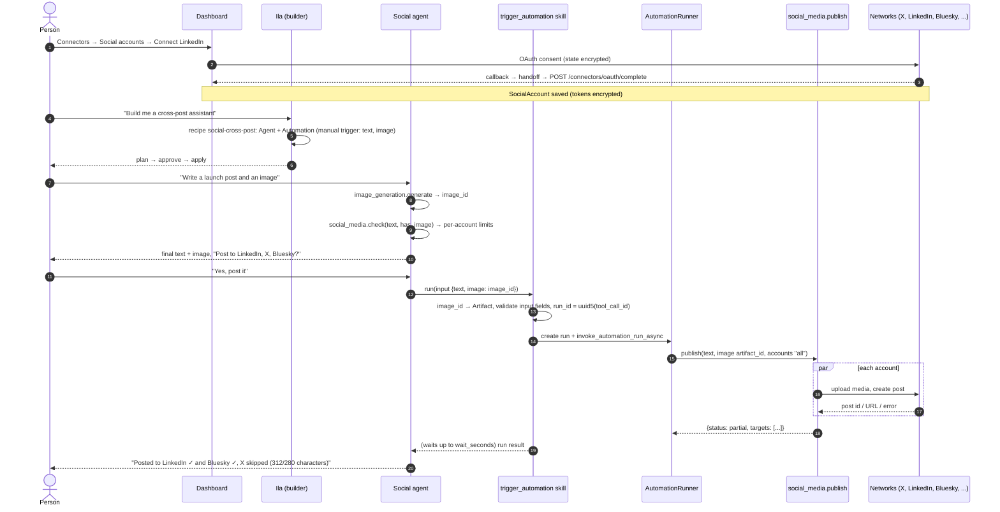
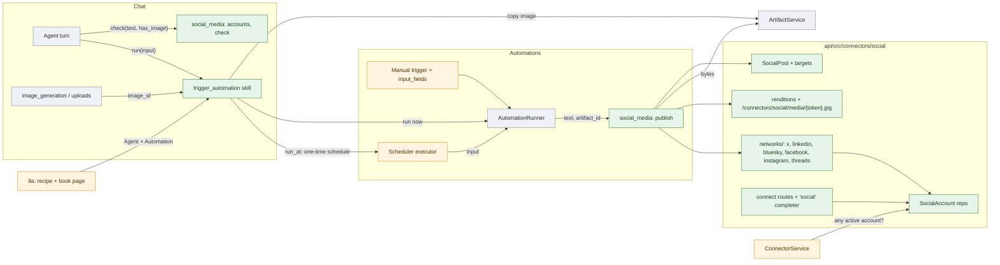
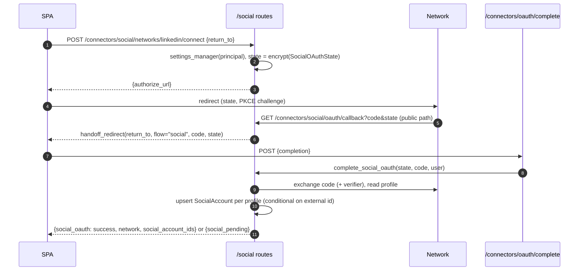
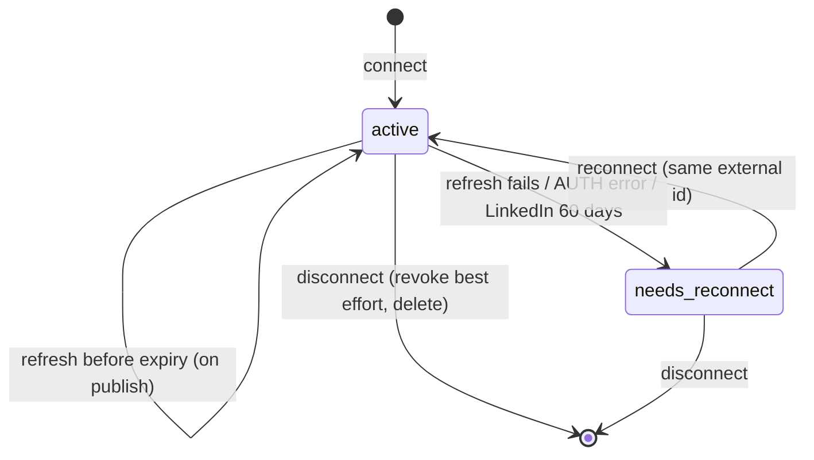
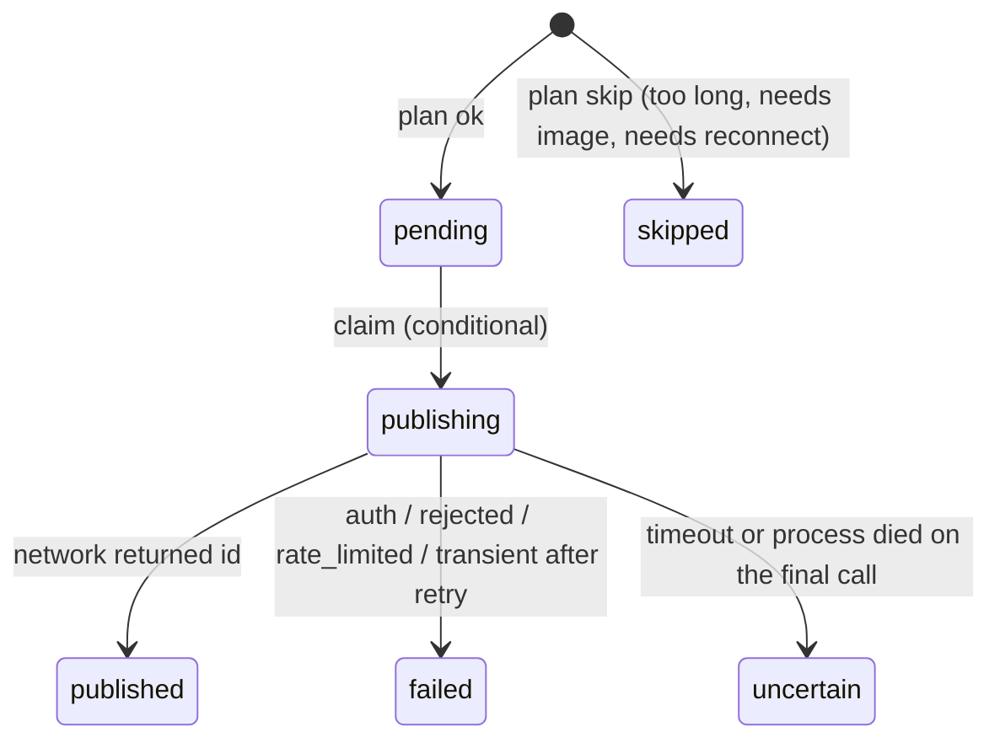
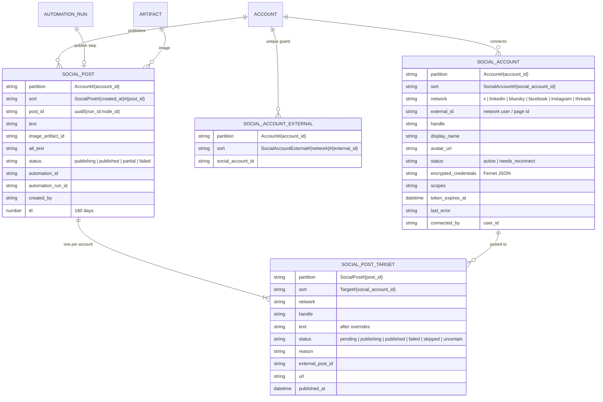

# LLD: Social cross-posting

| | |
| --- | --- |
| Status | 📝 Proposed |
| Owner | vslala |
| Last reviewed | 2026-10-21 |
| Depends on | [Automations module](../api/docs/LLD-automations-module.md), [Unified skill automation actions](../api/docs/LLD-unified-skill-automation-actions.md), [Scheduler](../api/docs/LLD-scheduler-architecture.md), [Ila capabilities](LLD-ila-capabilities.md), [Solution blueprints](LLD-solution-blueprints.md), [Image generation](../api/docs/LLD-multimodal-image-generation-v1.md), [Shared accounts and IAM](LLD-shared-accounts-and-iam.md) |
| Tracker | - |

> **Summary:** A person connects their social accounts once (LinkedIn first, then X and Bluesky as plug-ins;
> Facebook Pages, Instagram and Threads after Meta's app review). They ask Ila for a cross-post solution. Ila builds an agent
> and a **cross-post automation**: a manual trigger that takes `text` and `image`, then one `social_media.publish`
> step. The person writes the post with the agent, including the image, and says "post it". The agent calls
> the new **`trigger_automation`** skill. The automation publishes to every connected account at once and
> reports a result per account. The same run can wait for a set time (`run_at`), and the same automation can be
> started from the dashboard or on a cron.
>
> New code: **social connectors**, `api/src/connectors/social/` (beside `connectors/mcp/`): accounts, one strategy
> per network, posts and public media URLs. Also two skills (`social_media`, `trigger_automation`), typed input
> fields on manual triggers, and a **Social** tab on the Connectors page next to the existing **MCPs** tab.
> Existing code changes in a few places: the connector status check, the blueprint manual trigger, the scheduler
> run's trigger id (a bug fix), and the auth public paths.

## Implementation notes

- **2026-10-21: LinkedIn Pages built, as its own network** (§1, §2). `linkedin_page` (`networks/linkedin_pages.py`)
  extends `LinkedInNetwork`: its own OAuth app (`SOCIAL_LINKED_IN_PAGES_CLIENT_ID/_SECRET`, the Community Management API
  needs its own), scopes `r_organization_admin w_organization_social`. One sign-in lists the pages the member can post as
  (`organizationAcls`, roles ADMINISTRATOR and CONTENT_ADMIN) and connects each as an account storing `author_urn`; posting
  and image uploads use it as the author and owner. The skill, publisher, planner and automations are unchanged.
  - **Generalised:** `SocialNetwork` gained `description` (shown on the Social tab so each connection reads as what the agent
    posts as) and `shares_grant` (disconnecting one page keeps the token for the others, and the last one revokes it).
  - **Not built:** page logos (the avatar falls back to the initial); unverified against the real API until the app is approved.
  - **Tests:** `api/tests/test_connectors_social_linkedin_pages.py` (7).
- **2026-10-21: images, one or many, built for LinkedIn** (§5, §6). `publish` and `check` take `images` (ids) and
  `alt_texts`. An id is found only in the caller's scope: an artifact the member owns, an upload in this conversation,
  or an image generated in it (`skills/social_media/images.py`). `connectors/social/media.py` fits each image to the
  network's `NetworkLimits` (upright, flattened onto white, JPEG, side and size within limits), once per network.
  - LinkedIn uploads each image (`/rest/images?action=initializeUpload`, then a PUT), then posts one image as `media`
    and two or more as `multiImage` (up to 20). A failed upload is `TRANSIENT`: nothing visible exists yet.
  - Plans skip an account with `too_many_images`, `images_not_supported` or `image_required`.
  - **Departures:** no public media route or Terraform lifecycle yet (only Instagram and Threads need a URL); the
    renditions are not cached or stored; no artifact copy at trigger time (the automation slice adds it).
  - **Tests:** `api/tests/test_social_media_images.py` (9).
- **2026-10-21: `social_media` skill built (text-only, LinkedIn)** (§6, §7). Actions `accounts`, `check`, `publish`
  (`api/src/skills/social_media/`), on `connectors/social/{planning,posts,publisher}.py`. Departures from the design:
  - **`publish` also runs from chat** (for now), so the skill can be tried from an agent before the automation slice. The
    system prompt makes the agent show the exact text and publish only after a yes. The automation-only guard can be
    restored with one `if` in `actions.publish`.
  - **One automation per network**, not one for all: `publish` takes a `network` argument (and `accounts`) to narrow the
    targets, so each automation names its network.
  - **Idempotency** is a record per (post, account) claimed by a conditional put (`SocialPostRepository.claim`), keyed by
    `uuid5(run_id, node_id)` in an automation and a fresh id in chat. A `failed` target is retried; `publishing` or
    `uncertain` never is. No per-day cap, images, or `social_accounts` connector status yet.
  - `SocialNetwork` gained `limits` and `publish`; errors are `PublishError(kind)`. LinkedIn posts through
    `/rest/posts` (version `202609`) and escapes the characters it reads as markup.
  - **Tests:** `api/tests/test_social_media_skill.py` (15).
- **2026-10-21: scheduler entry-trigger bug fixed** (§9, change 1). `AutomationRunner.create_scheduled_run`
  now passes its `trigger_id` to `_create_run` (`api/src/automations/runner.py:150`). It used to pass `None`,
  so a run started by a schedule trigger entered at the first manual trigger.
  - **Tests:** `test_scheduled_run_enters_at_its_schedule_trigger` (it failed before the fix) and
    `test_scheduled_run_without_a_trigger_enters_at_the_manual_trigger` (the `run_at` path keeps the manual
    trigger), both in `api/tests/test_automations_runner.py`.
  - **Also found, not changed:** `scheduler.schedule_automation` stores `context["automation_node_id"]` as
    the target's `trigger_id` (`api/src/skills/scheduler/actions.py:239`). The executor would skip such a
    schedule as `trigger_missing`. That action is disabled in automations (`automation.enabled: false`), so
    nothing reaches it today. Fix it when the action is enabled.
- **2026-10-21: social connectors built for LinkedIn (§1-§4, §11 connect half; no posting yet).** Done, with tests
  (`api/tests/test_connectors_social.py`, `test_connectors_social_network_contract.py`,
  `spa/.../connectors/social/socialAccounts.test.ts`, `connectorUrls.test.ts`):
  - **Backend:** `api/src/connectors/social/` (models, repository, connect flow, router, `networks/linkedin.py`).
    Routes: `GET /connectors/social/networks`, `POST …/networks/{network}/connect`, `GET …/oauth/callback` (public),
    `GET …/accounts`, `DELETE …/accounts/{id}`. Completion goes through the shared `POST /connectors/oauth/complete`
    (flow `social`). Connecting the same LinkedIn member again refreshes the account; disconnecting revokes the token
    at LinkedIn (best effort) and removes the account and its uniqueness guard in one transaction.
  - **Dashboard:** the Connectors page has **MCPs** and **Social** tabs (`?tab=`). The Social tab lists the offered
    networks with Connect / Add another, and the connected accounts with status, expiry warning (last 14 days),
    Reconnect and Disconnect. Members see accounts; only admins get the buttons.
  - **Settings:** `settings.social_apps` is filled from every `SOCIAL_<APP>_CLIENT_ID` / `_CLIENT_SECRET` pair, and
    `settings.social_oauth_redirect_uri` defaults to `{API_BASE_URL}/connectors/social/oauth/callback`. The deploy
    scripts find the pairs by name too, so no script or settings change adds a network.
  - **Departures from the design:**
    - The env vars are `SOCIAL_LINKED_IN_CLIENT_ID/SECRET` (what `.envrc` already had), so a strategy names its app
      with `app = "linked_in"`; the key stays `linkedin`. There is no `SOCIAL_NETWORKS` list and no `extras` yet.
    - The `SocialNetwork` protocol holds only what connecting needs (`key`, `display_name`, `icon`, `app`,
      `configured`, `authorize_url`, `complete`, `revoke`). `connect_kind`, `connect_form`, `limits`,
      `fresh_credentials` and `publish` arrive with the first network or slice that needs them (Bluesky, the
      publisher).
    - Not built: the "choose accounts" dialog (`social_pending`), credential networks, the token refresh, the daily
      cap, the `social_accounts` connector status, and everything in §5-§9.
  - **Confirmed with a real sign-in (2026-10-21):** LinkedIn returned `refresh_token=False` with `expires_in=5183999` (60
    days). A self-serve app gets no refresh token, so there is no "mint a fresh token before posting" step for
    LinkedIn: publishing uses the stored token until it expires, then the account needs a new sign-in. The posting
    slice therefore checks `token_expires_at` first and fails the target with "Reconnect LinkedIn" instead of
    trying to refresh. The Social tab already warns in the last 14 days. The connect code still stores a
    `refresh_token` if a network sends one, for networks that do (X).
  - **Register with LinkedIn:** `https://api.innomightlabs.com/connectors/social/oauth/callback` and, locally (API on
    `LOCAL_PORT`), `http://localhost:1455/connectors/social/oauth/callback`.
- **2026-10-21: install title and description built (§15, first slice).** Done, with tests
  (`api/tests/test_skills_install_title.py`, `spa/src/pages/dashboard/agent-detail/skillInstallIdentity.test.ts`):
  - **Install form:** `GET /skills/{id}/install-schema` now starts with **Title** (required, at most 80
    characters, default the skill's name) and **Description** (optional, at most 300, default the skill's
    description), plus the note *"Your agent sees this title and description…"*. The install and Configure
    dialogs render them with `SchemaForm`. Only that route adds them. `get_install_schema` is also used by
    the marketplace import form, which must not get them.
  - **API:** `InstallSkillRequest` and `UpdateInstalledSkillRequest` take `title` and `description`. A blank
    title is rejected (422), and an empty description clears it. Skills with no settings now show the form
    too, since `has_form` no longer decides whether to fetch the schema.
  - **Stored as** `skill_name` and `skill_description` on `AgentSkill`, so there is no migration.
  - **Update never resets them.** Toggling, reconfiguring and a blueprint reinstall keep the install's own.
    Before this change they were overwritten with the manifest's on every update.
  - **Prompt line:** an install with no description shows its title alone.
  - **Departure from §15:** a description left out of an API call (internal callers: the OAuth callback
    auto-install, blueprint apply) takes the **skill's description**, as before, rather than staying empty.
    Only an explicit empty string clears it. Otherwise Gmail or Drive would lose their built-in description
    when installed by a caller that doesn't ask.
  - **Not built yet:** the `install_defaults` manifest handler (nothing needs it until `trigger_automation`),
    `title`/`description` on Ila's `SkillEntry`, the small skill-name label on the installed card, and the
    `agent_invocation` `usage_description` backfill.
- **2026-10-21: every skill install has a title and description** (§15).
  - **What the agent sees:** the title (required) and description (optional) are set at install, and the
    agent's installed-skills list shows them instead of the manifest's generic name.
  - **`trigger_automation`:** an install defaults to its automation's title and description. That is how the
    agent tells several apart without extra context, so the skill drops its `usage_description` setting and
    its `describe` action.
- **2026-10-21: social accounts are connectors.**
  - **Code:** the package is `api/src/connectors/social/` (beside `connectors/mcp/`), not a top-level
    `social/` module.
  - **Routes:** they moved under `/connectors/social/*`. The OAuth redirect to register with each network is
    now `{api_base_url}/connectors/social/oauth/callback`.
  - **Dashboard:** the Connectors page gets two tabs, **MCPs** (today's page) and **Social**.
- **2026-10-21: networks are plug-ins** (decision 2, §1 "Adding a network"). A new network is one strategy
  file plus one line in `NETWORKS`. Skills, automations, Ila, the SPA and the data model don't change.
  LinkedIn is the first network to build; X and Bluesky follow as the first plug-ins.

## Contents

- [Ferryman: what it does](#ferryman-what-it-does)
- [Context: what exists today](#context-what-exists-today)
- [Goals and non-goals](#goals-and-non-goals)
- [Key decisions](#key-decisions)
- [Design](#design)
- [Data model](#data-model)
- [Implementation map](#implementation-map)
- [Rollout](#rollout)
- [Validation](#validation)
- [Alternatives and decisions](#alternatives-and-decisions)
- [Open questions](#open-questions)
- [Related documentation](#related-documentation)

## Ferryman: what it does

[Ferryman](https://ferryman.io/) presents itself as "post everywhere from wherever you write". It is two
products in one.

| Area | What Ferryman does |
| --- | --- |
| **Sync flows** (its core) | Watches an *origin* account and re-posts each new post to chosen destinations. It polls every few minutes and copies usually appear within about 5 minutes. Plans cap the active flows (3 / 6 / unlimited) and the auto-synced posts a day (10 / 25 / unlimited). |
| **Create** (direct and scheduled posts) | Compose once and pick the destinations. These posts are unlimited on paid plans and are not picked up again by sync flows. |
| **Networks** | X, Bluesky, Threads, Mastodon, LinkedIn, Instagram, Facebook, YouTube Shorts, TikTok, Twitch (clips as a source), Discord, Slack, Pinterest, Telegram, Tumblr, Substack Notes. |
| **Connection methods** | OAuth for most networks. Bluesky uses an app password, Mastodon needs the instance URL, and Substack needs a session cookie. Discord, Slack, Pinterest, Tumblr and Telegram also ask for a destination (channel, board, blog). |
| **Content types** | Text, images and video, with per-network video conversion. Videos over a network's limit are skipped for that network. Threads are re-posted as threads, and quote posts and reposts are handled. |
| **Per-network adaptation** | Each network has its own character limit. With "Thread long posts" on, long posts are split into threads. Pinterest requires media, and Tumblr has no threads or quotes. |
| **Filtering rules** | `#noferry` skips a post. `#ad`/`#BrandPartner` posts are skipped by default. Only self-replies are synced, quotes only of your own already-synced posts, and posts with @mentions are optional. |
| **Edits** | An edited post is synced only if no earlier version was. Deletes are not propagated. |
| **Format routes** | Shorts ↔ TikTok ↔ Reels ↔ Facebook video, and Twitch Clips → short-video networks. |
| **Posts page** | One place for every post and *why* it was skipped for a network. |
| **Analytics** | Likes, reposts and replies per post, follower reach, trends over 7/30/90 days, and a cross-post counter. |
| **AI** | "AI content filters", and posting from Claude, Codex, Cursor or any MCP app (Ferryman is an MCP server). |
| **Teams** | 5-seat workspaces on Pro. |
| **Pricing** | $30 / $60 / $100 a month with a 7-day trial. Connected accounts: 15 / 30 / unlimited. |

**What we take for v1:** compose once and publish everywhere with one click. Per-network limits are checked
*before* posting and explained per account. Every post gets a per-account result with a reason, like the Posts
page. Scheduled posts. App passwords where a network has no usable OAuth (Bluesky).

**What we leave out:** watching an origin account (sync flows), video, threads/auto-split, analytics and the
filter hashtags. Our edge over Ferryman is not syncing. It is that **the agent writes the post and makes the
image**, and the same automation fits into larger solutions Ila builds (a blog published → a post drafted →
posted on approval).

## Context: what exists today

What the feature builds on, with the gaps it has to fill:

| Need | Today | Gap |
| --- | --- | --- |
| Connect accounts with OAuth | Google skills keep one `ProviderSettings` record per (account, provider), keyed `Account#{aid}` / `ProviderSettings#{name}` (`api/src/settings/models.py:12`). The flow is: encrypted state → callback → `handoff_redirect` (`api/src/auth/oauth_handoff.py:36`) → SPA `OAuthReturn` → `POST /connectors/oauth/complete`, which dispatches by `flow` (`api/src/connectors/oauth_completion.py:31`). | Only **one** record per provider, so two LinkedIn profiles or two Facebook pages can't both be connected. Social accounts need their own entity, many per account. The handoff/completer machinery can be reused as is. |
| "Is the skill's account connected?" | `ConnectorService.is_connected` only checks that a `ProviderSettings` record exists (`api/src/connectors/service.py:61`). | It needs a second kind of check: "at least one active social account". |
| Skill actions in automations | `skill_action` nodes call `registry.execute_action(...)` with an automation context (`api/src/automations/runner.py:468-489`). That context carries `account_id`, `owner_id`, `automation_id`, `automation_run_id`, `automation_node_id` and `orchestrator_type: "automation"`, but **no `agent_id`**. | None. Fan-out across accounts happens inside the action, because the graph has no foreach (`validation.py` rejects cycles). |
| Automation input | Input is a free `dict`: `StartAutomationRunRequest.input` (`api/src/automations/models.py:328`). It is read as `{{ input.* }}`, and a whole-token smart value keeps its native type (`smart_values.py:217`). | There is **no input contract**. An agent can't discover what to pass, and nothing validates it. |
| Agent → automation | Nothing. `agent_invocation` goes the other way, and `scheduler.schedule_automation` only works *inside* a running automation (it needs `context["automation_id"]`). | A new skill is needed. The building blocks exist: `AutomationRunner._create_run` (it takes a caller-chosen `run_id`), `invoke_automation_run_async` (`api/src/automations/dispatch.py:19`) and `owner_of_automation` (`api/src/automations/access.py:60`). |
| Schedules carrying input | A schedule target `{automation_id, trigger_id, input}` is run by `AutomationScheduledRunExecutor` (`api/src/scheduler/executors.py:97`). | **Bug:** `create_scheduled_run` passes `trigger_id=None` to `_create_run` (`runner.py:150-159`), so `_select_trigger` picks the first *manual* trigger. It is fixed here (see §9). |
| Images | Generated images: `MessageImage` on the assistant message, S3 key `agents/{agent}/conversations/{conv}/messages/{msg}/…` (`image_generation/storage.py`). Uploads: `ImageUpload` (`vision/models.py:160`). Artifacts: account-scoped `Artifact`, read with `ArtifactService.get_content` (`artifacts/service.py:45-126`), all in `conversation_media_bucket`. | Every URL is either a 15-minute presigned URL or an authenticated route, and nothing hands an image from chat to an automation. **Instagram and Threads can only fetch media from a public URL** (`image_url`). |
| Ila | A new skill manifest automatically gets a book page, and a file in `api/src/blueprints/examples/` becomes a recipe. `TriggerSpec.manual` has no fields (`api/src/blueprints/spec.py:280`). Skill config fields whose `options_source` is in `REFERENCE_OPTION_SOURCES` (`skills_schema.py:24`, today only `agents`) can name a blueprint resource. | The manual trigger needs `input`, and there needs to be an `automations` reference source. |

## Goals and non-goals

**Goals**

1. Connect any number of accounts per network to the InnomightLabs account. Show a status per account
   (active / needs reconnect), and allow reconnect and disconnect.
2. One action publishes `text` with an optional `image` to all selected accounts in parallel. It returns a
   result per account (posted with URL / skipped with reason / failed with reason) and never double-posts on
   retry.
3. Agents in chat check the post against each network's limits, then trigger an allow-listed automation with
   typed input. They can wait for the result or schedule it (`run_at`).
4. Ila builds the whole solution from one request, and the person's only manual step is connecting accounts.
5. Automations take typed inputs, which is useful beyond social posting.

**Non-goals (v1):** video, multiple images or carousels, threads or auto-split, sync flows (watching an origin),
analytics, editing or deleting a published post, LinkedIn company pages (that needs Community Management
API approval), Mastodon, Pinterest, TikTok, YouTube and Telegram, per-member restrictions on who may use a
connected account (KAN-89), and the automation marketplace for this recipe.

## Key decisions

1. **Social accounts are a kind of connector: `api/src/connectors/social/`, beside `connectors/mcp/`.** Both
   connect the person to an outside account through InnomightLabs; social ones exist to post. Social
   accounts don't use `ProviderSettings`: there are many per network, each with its own token lifecycle.
   Routes live under `/connectors/social/*` (like `/connectors/mcp/*`), and the dashboard shows them on the
   Connectors page's **Social** tab. They belong to the InnomightLabs *account*, like every other connection
   (Slice 6 of the IAM LLD). Connecting and disconnecting need `settings:Manage`.
2. **Networks are plug-ins.** There is one strategy per network (`connectors/social/networks/*.py`) behind one
   `SocialNetwork` protocol, and a `network_for(key)` selection function.
   - Nothing outside `networks/` branches on the network: not the skills, the publisher, the automation, Ila
     or the SPA.
   - Each strategy declares its connect method, connect form, limits, icon and credentials. Everything else
     reads them.
   - Its app credentials come from env vars named after its key.
   - Adding a network is one file plus one line, and one shared contract test proves it (see "Adding a
     network" in §1).
3. **The agent previews, the automation posts.** `social_media.publish` refuses to run outside an automation.
   In chat the agent gets only `accounts` and `check`. The user's flow becomes the platform's flow: the
   automation is what runs on demand, on a schedule or from the dashboard, and every post is an auditable
   automation run.
4. **Automations receive images as artifact ids.** When an agent triggers a run, the `trigger_automation`
   skill copies each chat image (generated or uploaded) into an account `Artifact`. The automation and the
   scheduler only ever see a durable, account-scoped id, never an S3 key or an expiring URL.
5. **Public media through our own API, not public S3 or a CDN.** `GET /connectors/social/media/{token}.jpg` serves a
   per-network JPEG rendition for one hour. No Terraform change, no public bucket, and the URL carries no
   query string, which avoids the media fetchers' quirks with signed query URLs.
6. **Validate, never silently rewrite.** The text is never truncated. A post that is too long for a network is
   *skipped* for that network, with the count ("312/280"). Images are the one adjustment: converted to JPEG,
   downscaled or padded to a network's limits, because that keeps what the person sees.
7. **Idempotent by construction.** The run id is derived from the agent's tool call, the post id from the run
   and node, and each target is claimed with a conditional write. A target whose final create call may have
   gone through is marked `uncertain` and never retried automatically.
8. **Explicit confirmation before posting.** This is the agent's instruction, backed by hard limits: owner-only
   skills, allow-listed automations, an *active* automation required, and a daily cap per account.

## Design

### End-to-end flow



*Steps 1-3 happen once per account and steps 4-6 once per solution. After that, every post is steps 7-17.*

### Components



*Green is new, amber is changed and grey is existing. Only Instagram and Threads read `/connectors/social/media`; the
others receive the bytes directly.*

### 1. Social connectors (`api/src/connectors/social/`)

This is a sub-package of the connectors domain, laid out like `connectors/mcp/`. The connector registry
(`connectors/service.py`) and the OAuth completer (`connectors/oauth_completion.py`) already live one level
up, so this package plugs into both.

```
api/src/connectors/social/
  CONTRIBUTION.md        # how to add a network
  models.py              # SocialAccount, SocialPost, SocialPostTarget, PreparedPost, PublishOutcome
  repository.py          # SocialAccountRepository, SocialPostRepository
  networks/
    __init__.py          # NETWORKS list + network_for(key) + enabled_networks()
    base.py              # SocialNetwork protocol, NetworkLimits, PublishError
    text.py              # weighted length (X), code-point length, LinkedIn escaping, Bluesky facets
    x.py  linkedin.py  bluesky.py  facebook.py  instagram.py  threads.py
  connect.py             # OAuth start/complete, credential connect, the "social" completer
  media.py               # renditions (Pillow) + signed public media tokens
  publisher.py           # SocialPublisher: fan-out, idempotency, results
  router.py              # /connectors/social/* routes
```

**The network strategy.** Everything that varies by network lives behind this protocol. Callers only call
`network_for(account.network)`.

```python
# api/src/connectors/social/networks/base.py
class ConnectKind(StrEnum):
    OAUTH = "oauth"
    CREDENTIALS = "credentials"   # Bluesky app password


@dataclass(frozen=True)
class NetworkLimits:
    max_text: int
    #: How text is measured against max_text: X weights code points and counts every URL as 23
    measure: Callable[[str], int]
    image_required: bool = False
    max_image_bytes: int = 5_000_000
    max_image_side: int = 4096
    #: (min, max) width/height ratio; images outside are padded to fit
    aspect_range: tuple[float, float] | None = None
    #: Network fetches the image from a public URL (Instagram, Threads) instead of receiving bytes
    needs_public_url: bool = False


class PublishErrorKind(StrEnum):
    AUTH = "auth"                 # token revoked/expired -> account needs_reconnect
    RATE_LIMITED = "rate_limited"
    REJECTED = "rejected"         # the network refused the content
    TRANSIENT = "transient"       # 5xx / timeout before the post was created: safe to retry once
    UNCERTAIN = "uncertain"       # the final create call may have succeeded


class PublishError(Exception):
    def __init__(self, kind: PublishErrorKind, message: str, retry_after: int | None = None): ...


@dataclass(frozen=True)
class ConnectedProfile:
    """One postable identity a connect grants: a member, a Page, a professional account."""
    external_id: str
    handle: str
    display_name: str
    avatar_url: str | None
    #: Opaque to everything but the strategy that wrote it; stored encrypted
    credentials: dict[str, Any]
    expires_at: datetime | None = None


class SocialNetwork(Protocol):
    key: str                      # "linkedin", "x", "bluesky", "facebook", "instagram", "threads"
    display_name: str
    #: An icon name the SPA's ConnectorIcon knows, or a URL; unknown names fall back to the initial
    icon: str
    connect_kind: ConnectKind
    limits: NetworkLimits

    def configured(self) -> bool:
        """Its app credentials are set: `settings.social_app(self.key)` (§13), or always True for CREDENTIALS."""
    def connect_form(self) -> Form | None: ...                 # CREDENTIALS only: the fields connect_with takes
    def authorize_url(self, state: str, code_challenge: str) -> str: ...     # OAUTH only
    async def complete(self, code: str, code_verifier: str) -> list[ConnectedProfile]: ...
    async def connect_with(self, values: dict[str, str]) -> list[ConnectedProfile]: ...  # CREDENTIALS only
    async def fresh_credentials(self, account: SocialAccount) -> dict[str, Any] | None:
        """The credentials to post with, refreshed if close to expiry; None when unchanged. Raises PublishError(AUTH)."""
    async def publish(self, credentials: dict[str, Any], post: PreparedPost) -> PublishedPost: ...
    async def revoke(self, credentials: dict[str, Any]) -> None: ...  # best effort on disconnect
```

```python
# api/src/connectors/social/networks/__init__.py
#: Adding a network: write networks/<key>.py and add it here. Nothing else changes (see "Adding a network").
NETWORKS: tuple[SocialNetwork, ...] = (LinkedInNetwork(), XNetwork(), BlueskyNetwork(),
                                       FacebookPagesNetwork(), InstagramNetwork(), ThreadsNetwork())

def network_for(key: str) -> SocialNetwork:
    for network in NETWORKS:
        if network.key == key:
            return network
    raise ValueError(f"Unknown social network: {key}")

def enabled_networks() -> list[SocialNetwork]:
    """Networks whose app credentials are set: an unset client id hides the network everywhere."""
    return [network for network in NETWORKS if network.configured()]
```

`complete` and `connect_with` return a **list** of profiles because one login can grant several, as with
Facebook Pages. When there is more than one, the person picks which to connect through a generic chooser
(§3), so no network needs its own connect UI.

#### Adding a network (the plug-in contract)

**What a new network needs:**

1. **A strategy file:** `api/src/connectors/social/networks/<key>.py` implementing `SocialNetwork`. It declares its
   limits, `measure`, icon, connect kind and connect form, and it owns its `credentials` shape and every HTTP
   call. Shared helpers are in `networks/text.py` (length, escaping) and `connectors/social/media.py` (renditions).
2. **One line in `NETWORKS`.**
3. **Its app registration**, with the redirect `{api_base_url}/connectors/social/oauth/callback`. The redirect is the
   same for every network.
4. **Its env vars** `SOCIAL_<KEY>_CLIENT_ID` / `SOCIAL_<KEY>_CLIENT_SECRET`, plus the key in the deploy
   script's `SOCIAL_NETWORKS` list (§13). `settings.py` doesn't change. A credentials network (Bluesky) needs
   none of this.
5. **Optional:** an icon in `spa/src/assets/connectors/`, otherwise the initial is shown.

**What stays unchanged:**

| Unchanged | Why it already works |
| --- | --- |
| `social_media` skill (manifest, `accounts`, `check`, `publish`) | It lists accounts and limits from `network_for(account.network)` and only knows `social_account_id`s |
| `trigger_automation` skill, the automation, its input fields | They pass `text` + `image` artifact id; `accounts: all` picks up the new account |
| `SocialPublisher`, `plan_targets`, idempotency, the daily cap | They loop over targets and call the protocol |
| Data model | `network` is a string. Credentials are an opaque encrypted dict |
| Connect routes and the OAuth completer | They dispatch on `{network}` through `network_for` |
| Ila's recipe and book | The recipe says `accounts: all`. The book's skill page is the manifest |
| SPA Connectors → Social tab | It renders `GET /connectors/social/networks`: name, icon, connect kind, `connect_form` through `SchemaForm`, and the generic chooser |

**How the contract is enforced:** `api/tests/test_connectors_social_network_contract.py` is parametrized over
`NETWORKS`. Each strategy must pass the same suite with an `httpx.MockTransport` serving its recorded
responses. The suite checks that:

- the strategy is reachable through `network_for`, and `configured()` is false with its settings unset;
- its limits are sane (`max_text > 0`, `measure("") == 0`);
- `publish` returns a `PublishedPost` with a URL, and maps 401 → `AUTH`, 429 → `RATE_LIMITED` and a timeout on
  the final call → `UNCERTAIN`;
- `fresh_credentials` never returns a dict that drops keys.

A network added without passing this suite fails CI. Per-network specifics, such as LinkedIn's little-text
escaping or X's weighted length, get their own focused tests next to it.

### 2. Networks in v1

Verify each row against the network's current docs when implementing. These APIs change often (sources at
the end).

| Network | Connect | Scopes / product | Token life | Publish calls | Text limit (measure) | Image |
| --- | --- | --- | --- | --- | --- | --- |
| **X** | OAuth 2.0 + PKCE | `tweet.read tweet.write users.read media.write offline.access` | 2h access, rotating refresh | `POST https://api.x.com/2/media/upload` (multipart, `media_category=tweet_image`) → `POST /2/tweets {text, media:{media_ids:[…]}}` | 280, weighted: URL = 23, CJK/emoji = 2 (`text.x_weighted_length`) | ≤5 MB JPEG/PNG |
| **LinkedIn** (member) | OAuth 2.0 auth code | Products "Share on LinkedIn" + "Sign In with LinkedIn (OIDC)": `openid profile w_member_social` | 60 days, **no refresh** for non-partner apps | `GET /v2/userinfo` (`sub` → `urn:li:person:{sub}`, at connect). `POST /rest/images?action=initializeUpload` → `PUT uploadUrl` → `POST /rest/posts` (headers `LinkedIn-Version`, `X-Restli-Protocol-Version: 2.0.0`) | 3000 code points. Commentary is "little text": escape `\ \| { } @ [ ] ( ) < > # * _ ~` | JPG/PNG/GIF |
| **Bluesky** | App password (handle + password form) | - | Session JWTs. Re-login with the stored app password when the refresh token expires | `com.atproto.server.createSession` (once, at connect; PDS from `didDoc`) → `com.atproto.repo.uploadBlob` → `com.atproto.repo.createRecord` (`app.bsky.feed.post` with `facets` for links, `embed: app.bsky.embed.images` with `alt` and `aspectRatio`) | 300 graphemes, measured as code points (never under-counts) | ≤1,000,000 bytes (the documented lexicon limit; newer servers allow 2 MB) |
| **Facebook Pages** | Facebook Login for Business | `pages_show_list pages_manage_posts pages_read_engagement` | Page token from a long-lived user token: does not expire unless revoked | `POST /{page-id}/photos` (multipart `source`, `caption`) or `POST /{page-id}/feed {message}` | 63,206 | ≤10 MB |
| **Instagram** (professional accounts) | Instagram API with Instagram Login | `instagram_business_basic instagram_business_content_publish` | Long-lived 60 days, `GET /refresh_access_token` (token ≥24h old) | `POST graph.instagram.com/{ig-user}/media {image_url, caption}` → poll `GET /{container}?fields=status_code` until `FINISHED` → `POST /{ig-user}/media_publish {creation_id}` | 2,200; at most 30 hashtags | **Required**. JPEG, ≤8 MB, aspect 4:5 to 1.91:1, public URL |
| **Threads** | Threads OAuth | `threads_basic threads_content_publish` | Long-lived 60 days, `GET /refresh_access_token` (`th_refresh_token`) | `POST graph.threads.net/v1.0/{user}/threads {media_type: TEXT\|IMAGE, text, image_url}` → poll status → `POST /{user}/threads_publish {creation_id}` | 500 | JPEG/PNG ≤8 MB, public URL |

Network-imposed caps the publisher reports as `rate_limited`: Instagram allows 100 API posts per 24h and
Threads 250 per 24h. X has no free tier for new apps: posting costs us per post (about $0.015 a post, more
with a link), so X posts count against the account's daily cap.

**When one login grants several profiles** (Facebook Pages today), the step is generic, not Facebook's. The
completer stores the profiles as a short-lived `SocialPendingConnection` (TTL 15 minutes) and returns
`social_pending=<id>`. The SPA shows the same "Choose accounts to connect" dialog for any network, then posts
`POST /connectors/social/connections/{pending_id}/accounts {external_ids}`. LinkedIn, X, Bluesky, Instagram and Threads
each grant one profile and skip the dialog.

### 3. Connecting accounts

OAuth reuses the existing handoff, so it needs no new SPA return page.



*The state carries the PKCE verifier. It is safe there because the whole state is Fernet-encrypted, like
`GoogleMailOAuthState` (`api/src/skills/google_mail/oauth.py:25`).*

```python
# api/src/connectors/social/connect.py
class SocialOAuthState(BaseModel):
    nonce: str
    network: str
    account_id: str
    user_id: str
    user_email: str
    code_verifier: str
    return_to: str
    expires_at: datetime     # 10 minutes


async def complete_social_oauth(*, state: str | None, code: str | None, error: str | None,
                                user_email: str, user_id: str) -> dict[str, str]:
    session = read_state(state)                       # decrypt, check expiry
    if session.user_email != user_email or not may_manage_settings(user_id, session.account_id):
        raise HTTPException(403, "Sign in as the person who started connecting")
    if error or not code:
        return {"social_oauth": "error", "network": session.network, "reason": error or "cancelled"}
    network = network_for(session.network)
    profiles = await network.complete(code, session.code_verifier)
    if len(profiles) > 1:
        pending = SocialPendingConnectionRepository().save(session, profiles)
        return {"social_oauth": "choose", "network": network.key, "social_pending": pending.pending_id}
    saved = [SocialAccountRepository().connect(session.account_id, user_id, network.key, p) for p in profiles]
    return {"social_oauth": "success", "network": network.key,
            "social_account_ids": ",".join(a.social_account_id for a in saved)}
```

Register it in `_completers()` (`api/src/connectors/oauth_completion.py:31`): `"social": complete_social_oauth`.
Add `/connectors/social/oauth/callback` to `PUBLIC_PATHS` (`api/src/auth/middleware.py:20`).

**Credential connect (Bluesky).** `GET /connectors/social/networks/{network}/forms/connect` serves the strategy's
`connect_form()`. Bluesky's is a `form_models` form (`identifier` text, labelled "Handle or email", and `app_password` password, with help text linking to
*Settings → Privacy and security → App passwords*). `POST /connectors/social/networks/{network}/accounts` calls
`connect_with`, which creates a session to prove the password works, and saves. The main account password is
rejected by the hint text, not by code: we can't tell the two apart.

**Reconnecting** writes the same `SocialAccount`. `connect()` looks up the uniqueness item
`SocialAccountExternal#{network}#{external_id}` and updates the existing account (new tokens, `status=active`)
instead of creating a duplicate. A new account is created with `transact_write_items`: the account item plus
the uniqueness item, `attribute_not_exists(pk)`.

### 4. Token lifecycle



*Refresh happens lazily inside publish, the way the Google skills refresh (`google_mail/actions.py:106`).*

- `publisher` calls `network.fresh_credentials(account)` before each target. It saves the credentials if they
  changed (X rotates the refresh token on every refresh, so it **must** be saved before posting).
- An `AUTH` error sets `status=needs_reconnect` and `last_error`. The target fails with "Reconnect your
  LinkedIn account in Connectors". `accounts`/`check` show the status so the agent says so before posting.
- LinkedIn and the Meta 60-day tokens store `token_expires_at`. The Connectors page shows "expires in N days"
  under 14 days. A weekly reaper that refreshes Meta tokens and emails about LinkedIn expiries is a follow-up
  (`scheduler/runtime.py`), not v1.

### 5. Media: from a chat image to what a network can read

**Getting the image to the automation (at trigger time, in chat).** The agent passes the `image_id` it was
given:

- a generated image: `images[].image_id` from `image_generation.generate`
- an upload: `<attached_image id=…>` in the conversation context
- an existing artifact: its `artifact_id`

`trigger_automation` resolves the id **within the current conversation** and copies the image into an
artifact owned by the run's holder:

```python
# api/src/artifacts/from_chat.py
def artifact_from_chat_image(context: dict[str, Any], ref: str) -> Artifact:
    """A durable, account-scoped copy of an image the agent can see in this conversation.
    Order: an artifact the holder owns, an upload in this conversation, a generated image in this conversation."""
    holder = run_artifact_holder(context)
    if artifact := ArtifactService().find(holder, ref):
        return artifact
    image = (ImageUploadRepository().get(context["conversation_id"], ref)
             or find_generated_image(context["conversation_id"], ref))   # scans this conversation's messages
    if image is None:
        raise ValueError(f"No image {ref} in this conversation")
    return ArtifactService().create_from_s3(
        holder, artifact_type="image", s3_key=image.s3_key, filename=image.filename, mime_type=image.mime_type,
        source=ArtifactSource(skill_id="trigger_automation", agent_id=context["agent_id"],
                              conversation_id=context["conversation_id"]),
    )
```

The lookup is scoped to `context["conversation_id"]`, so an agent can't name another conversation's or
account's image. `create_from_s3` is a server-side S3 `copy_object` within the same bucket, so the bytes never
pass through the API.

**Preparing it for each network (at publish time).** `media.prepare(artifact_bytes, limits) -> Rendition`
with Pillow (already a dependency, `api/pyproject.toml:42`):

1. Apply the EXIF orientation, convert to RGB, and flatten transparency onto white.
2. If `aspect_range` is set and the image is outside it, pad it to the nearest bound (white). This only
   applies to Instagram, whose range is 4:5 to 1.91:1. Generated images are 1:1 and need no padding.
3. Downscale to `max_image_side`, then encode JPEG, stepping quality 90 → 60 until the size is at most
   `max_image_bytes`. If it still doesn't fit, fail with `REJECTED` "image too large".

The rendition is cached per (post, network), so two Instagram accounts don't encode twice.

**Public URL (Instagram, Threads only).** The rendition is written to
`accounts/{account_id}/social/{post_id}/{network}.jpg` in `conversation_media_bucket`, tagged
`retention=social-rendition`. Its URL is:

```
{api_base_url}/connectors/social/media/{token}.jpg
token = encrypt({"k": s3_key, "exp": now + settings.social_media_url_ttl_seconds})   # src/crypto.py Fernet
```

`GET /connectors/social/media/{token}.jpg` is public (a prefix check next to `DOWNLOADS_PLUGINS_PATH_PREFIX` in
`api/src/auth/middleware.py:92`). It decrypts, checks `exp`, checks that the key starts with
`accounts/` and contains `/social/`, and streams the object with `Content-Type: image/jpeg`. The token can't
be forged or widened, it expires after one hour, and it only ever names a rendition. A Terraform lifecycle
rule deletes `retention=social-rendition` objects after 2 days (`terraform/conversation_media.tf`).

### 6. The `social_media` skill

```yaml
# api/src/skills/social_media/manifest.yml
id: social_media
namespace: integrations.social
owner_only: true
name: Social media
description: See your connected social accounts, check a post against each network's limits, and publish it from an automation.
connectors:
  - connector_id: social_accounts
    required: true
system_prompt: |
  Use this skill to prepare posts for the person's connected social accounts.
  - Before offering to post, call `check` with the final text and whether there is an image. Fix what it
    reports (shorten for X's 280 or Bluesky's 300, add an image for Instagram), or tell the person which
    accounts will be skipped and why.
  - You don't publish from chat: publishing runs in the person's cross-post automation (the
    trigger_automation skill). `publish` only works inside an automation.
  - Never post, or ask to post, an account whose status is needs_reconnect: tell the person to reconnect
    it in Connectors.
actions:
  - name: accounts
    description: The connected social accounts, with each network's text limit and image rules.
    input_schema: {type: object, properties: {}}
    handler: actions:accounts
  - name: check
    description: Check a post against each selected account without posting. Returns problems per account.
    input_schema:
      type: object
      required: [text]
      properties:
        text: {type: string}
        has_image: {type: boolean, description: Whether an image will be attached.}
        accounts:
          description: '"all", or a list of social_account_ids.'
          oneOf: [{type: string, enum: [all]}, {type: array, items: {type: string}}]
    handler: actions:check
  - name: publish
    description: Publish text and an optional image to the selected accounts at once. Automations only.
    automation:
      required_arguments: [text]
    input_schema:
      type: object
      required: [text]
      properties:
        text: {type: string, description: "The post. Read from the trigger, e.g. {{ input.text }}."}
        image: {type: string, description: "An image artifact id, e.g. {{ input.image }}. Optional."}
        alt_text: {type: string, description: Image description for screen readers (Bluesky, X, LinkedIn).}
        accounts:
          description: '"all" (default), or a list of social_account_ids.'
          oneOf: [{type: string, enum: [all]}, {type: array, items: {type: string}}]
        overrides:
          type: object
          description: 'Text per network or per social_account_id, e.g. {"x": "Short version"}. Optional.'
          additionalProperties: {type: string}
    handler: actions:publish
```

`check` and `publish` share one function, `plan_targets(accounts, text, overrides, has_image) -> list[TargetPlan]`.
It makes no network calls. Each `TargetPlan` is `ok` or `skip` with a reason: `text_too_long` ("312/280"),
`image_required`, `needs_reconnect` or `network_disabled`. What the agent was told is therefore exactly what
the automation does.

```python
# api/src/skills/social_media/actions.py
async def publish(arguments: dict[str, Any], config: dict[str, Any], context: dict[str, Any]) -> dict[str, Any]:
    if context.get("orchestrator_type") != "automation":
        raise ValueError("Publishing runs in your cross-post automation. Use trigger_automation to start it.")
    return await SocialPublisher().publish(PublishRequest.from_arguments(arguments, context))
```

### 7. Publishing: fan-out, idempotency, results

```python
# api/src/connectors/social/publisher.py
class SocialPublisher:
    async def publish(self, request: PublishRequest) -> dict[str, Any]:
        # One post per (run, node): a retried node finds the same post and its targets
        post_id = str(uuid5(SOCIAL_POST_NAMESPACE, f"{request.run_id}:{request.node_id}"))
        accounts = self.accounts.selected(request.account_id, request.accounts)
        plans = plan_targets(accounts, request.text, request.overrides, has_image=bool(request.image))
        post = self.posts.create_or_get(post_id, request, plans)          # conditional put; targets pending/skipped
        image = self.artifacts.get_content(request.holder, request.image) if request.image else None
        await asyncio.gather(*(self._publish_target(post, plan, image) for plan in plans if plan.ok))
        return self.posts.finish(post_id).to_result()                     # published | partial | failed

    async def _publish_target(self, post, plan, image) -> None:
        if not self.posts.claim(post.post_id, plan.account.social_account_id):   # pending -> publishing, conditional
            return                                                       # already done or in flight
        if not self.daily_cap.acquire(plan.account.account_id):
            return self.posts.fail(post, plan, PublishError(PublishErrorKind.RATE_LIMITED, "Daily post limit reached"))
        network = network_for(plan.account.network)
        try:
            credentials = await self._credentials(network, plan.account)
            prepared = PreparedPost(text=plan.text, image=self.media.rendition(post, network, image),
                                    alt_text=post.alt_text)
            published = await asyncio.wait_for(network.publish(credentials, prepared),
                                               settings.social_publish_timeout_seconds)
            self.posts.succeed(post, plan, published)                     # external id + URL
        except asyncio.TimeoutError:
            self.posts.fail(post, plan, PublishError(PublishErrorKind.UNCERTAIN, "No answer from the network"))
        except PublishError as error:
            if error.kind == PublishErrorKind.AUTH:
                self.accounts.mark_needs_reconnect(plan.account, str(error))
            if error.kind != PublishErrorKind.UNCERTAIN:
                self.daily_cap.release(plan.account.account_id)
            self.posts.fail(post, plan, error)
```

The rules each strategy follows:

- **Retries.** A `TRANSIENT` failure on a call that creates nothing visible (media upload, container create,
  status poll) is retried once after 2 seconds, inside the strategy. The **final** create call (`/2/tweets`,
  `/rest/posts`, `createRecord`, `media_publish`, `threads_publish`, `/photos`) is never retried. Any error
  without a clear "not created" status becomes `UNCERTAIN`.
- **Claims.** `claim` only moves `pending → publishing`. A target left in `publishing`, because the process
  died mid-call, is shown as `uncertain` when the post finishes. It is never reclaimed automatically.
- **Result.** The action returns this, and the automation stores it under
  `steps.<alias>.output.result`:

```json
{
  "post_id": "…", "status": "partial",
  "targets": [
    {"network": "linkedin", "handle": "Varun Lala", "status": "published", "url": "https://www.linkedin.com/feed/update/urn:li:share:…"},
    {"network": "bluesky", "handle": "@varun.bsky.social", "status": "published", "url": "https://bsky.app/profile/…/post/…"},
    {"network": "x", "handle": "@varun", "status": "skipped", "reason": "text_too_long", "detail": "312/280 characters"}
  ]
}
```

- **Node status.** The node **fails only when every target failed or was skipped**, and that error lists the
  reasons. A partial success succeeds, so an `error` edge (for example "email me") fires only on a total
  failure.



*Target lifecycle (`SocialPostTarget.status`). Only `pending` can be claimed.*

### 8. Typed input on manual triggers

Automations get an input contract, declared with the same `FormInput` model every form uses.

```python
# api/src/automations/triggers/models.py
class ManualTriggerConfig(BaseModel):
    """What a person or an agent gives when starting the automation by hand. Steps read `{{ input.<name> }}`.
    No fields means free-form input (today's behaviour)."""

    input_fields: list[FormInput] = Field(default_factory=list)
```

- **Field types:** `text`, `text_area`, `select` (with `options`) and `file_upload` with `attr.accept: "image/*"`.
  An image field's value is an artifact id. No new `FormInputType` is needed.
- **Validation:** `validate_run_input(fields, input, holder) -> dict` lives in
  `api/src/automations/triggers/inputs.py`. It rejects unknown fields when fields are declared, missing
  required values (a blank string counts as missing), select values outside `options`, and image values
  that aren't an artifact the holder owns. Its callers are the test-run route
  (`automations/router.py:440`), `trigger_automation.run`, and the scheduler executor when the schedule came
  from `run_at` (see §9).
- **Saving:** `AutomationService.validate_graph` checks that field names match `^[a-z][a-z0-9_]{0,62}$` and
  are unique. The SPA editor must keep `config.input_fields` when it saves a manual trigger, even before it can
  edit them (see §12).

### 9. The `trigger_automation` skill

It follows `agent_invocation`'s shape: **one install per automation**, repeatable, with the automation picked
from a select. Each install is one explicit permission: "this agent may run this automation".

**How the agent tells installs apart.** Every install has a title and a description (§15, for every skill),
and the agent's installed-skills list shows those instead of the manifest's generic ones. A
`trigger_automation` install takes its automation's title and description by default, so an agent with two
of them sees one line each, with nothing else in its context:

```
- trigger_automation:3f9a1c…: Cross-post to social accounts - Publishes an approved post (text, optional image) to every connected social account. (skill_id: trigger_automation)
- trigger_automation:b72e04…: Weekly newsletter - Sends this week's newsletter draft to the subscriber list. (skill_id: trigger_automation)
```

So the skill needs no "when to use" setting and no `describe` action. The description says what the
automation takes. When the agent passes the wrong input, `run`'s error lists the fields, so the agent learns
them only when it needs them.

```yaml
# api/src/skills/trigger_automation/manifest.yml
id: trigger_automation
namespace: core.automation
owner_only: true
name: Run automation
description: Start one of your automations from chat with the input it asks for, now or at a set time.
repeatable: true
repeatable_identity_fields: [automation_id]
automation:
  enabled: false            # automations don't start automations in v1
form:
  - input_type: select
    name: automation_id
    label: Automation
    options_source:
      type: automations
system_prompt: |
  Use this skill to start the automation this install names (its title and description say what it does
  and what it takes).
  - Starting it acts in the world (for example, posts publicly). Before `run`, show the person exactly what
    will be sent (the final text and the image) and wait for a clear yes in this conversation. A yes to an
    earlier draft is not a yes to a changed one.
  - Pass images by the id you were given (a generated image's image_id, an attached image's id).
  - To post later, pass run_at (ISO 8601 with an offset) worked out from the current time; `cancel` undoes it.
  - Report the result per account from the run result; never claim success the result doesn't show.
actions:
  - name: run
    description: Start the automation now (waiting up to wait_seconds for the result), or at run_at.
    input_schema:
      type: object
      required: [input]
      properties:
        input: {type: object, description: Values for the input fields, by name.}
        run_at: {type: string, description: "ISO 8601 date-time to run once, e.g. 2026-10-22T09:00:00+01:00."}
        wait_seconds: {type: integer, description: "0-90, default 60. How long to wait for the result."}
    handler: actions:run
  - name: status
    description: A run's status and its last step's result.
    input_schema: {type: object, required: [run_id], properties: {run_id: {type: string}}}
    handler: actions:status
  - name: cancel
    description: Cancel a run scheduled with run_at.
    input_schema: {type: object, required: [schedule_id], properties: {schedule_id: {type: string}}}
    handler: actions:cancel
```

```python
# api/src/skills/trigger_automation/actions.py
async def run(arguments: dict[str, Any], config: dict[str, Any], context: dict[str, Any]) -> dict[str, Any]:
    owner = run_owner(context)
    graph = AutomationService().get_graph(config["automation_id"], owner)       # 404 outside the owner's reach
    if graph.automation.status != AutomationStatus.ACTIVE:
        raise ValueError("This automation is turned off. Turn it on in Automations first.")
    trigger = manual_trigger(graph)                                            # the enabled manual trigger, or error
    fields = ManualTriggerConfig.model_validate(trigger.config).input_fields
    input_data = with_image_artifacts(fields, arguments["input"], context)     # image ids -> artifact ids (§5)
    # Raises with the fields listed ("this automation takes: text (required), image (image)"), so a wrong
    # guess teaches the agent the input without a describe call
    input_data = validate_run_input(fields, input_data, run_artifact_holder(context))
    # The same tool call never starts two runs (a retried tool call, a replayed turn)
    key = f"{graph.automation.automation_id}:{context['tool_call_id']}"

    if run_at := arguments.get("run_at"):
        schedule = SchedulerService().create_one_time(
            schedule_id=f"automation:{graph.automation.automation_id}:agent-run:{uuid5(AGENT_RUN_NS, key)}",
            owner=owner, run_at=parse_run_at(run_at),
            target_type=ScheduleTargetType.AUTOMATION_RUN,
            target={"automation_id": graph.automation.automation_id, "input": input_data},
            source_type="agent_run_at",
            source={"agent_id": context["agent_id"], "conversation_id": context["conversation_id"]},
        )
        return {"status": "scheduled", "schedule_id": schedule.schedule_id, "run_at": schedule.next_run_at}

    run = AutomationRunner().create_agent_run(
        graph, trigger, input_data, owner, run_id=str(uuid5(AGENT_RUN_NS, key)),
        started_by={"agent_id": context["agent_id"], "conversation_id": context["conversation_id"]},
    )                                                     # conditional save: an existing run_id returns that run
    if run.status == AutomationRunStatus.PENDING:
        invoke_automation_run_async(run.run_id, graph.automation.automation_id, owner_of_automation(graph.automation))
    return await wait_for_run(run.run_id, owner, seconds=clamp(arguments.get("wait_seconds", 60), 0, 90))
```

- `create_agent_run` is a thin sibling of `create_test_run` (`runner.py:124`). It sets
  `trigger_context={"type": "manual", "started_by": {...}}` and passes `run_id` to `_create_run`. It saves the
  run with `attribute_not_exists(pk)`, and on a conflict it loads and returns the existing run.
- `wait_for_run` polls the run record every 2 seconds. It returns
  `{run_id, status, error, result: <last skill node's output.result>, run_url}`, where `run_url` is the
  dashboard run page.
- `status` uses the same projection and checks that the run belongs to the configured automation.
- `cancel` deletes the schedule only if its id starts with `automation:{config.automation_id}:agent-run:`
  and it is in the owner's account.
- **The chat turn isn't blocked** while it waits: turns are detached (`LLD-async-chat-turns.md`), so a
  60-second wait only delays the reply.

**Scheduling.** One-time posts go through the scheduler above. Two scheduler changes are needed:

1. **Bug fix (done 2026-10-21).** `create_scheduled_run` passes its `trigger_id` through to `_create_run`
   (`runner.py:150-159`). It used to pass `None`, so a run started by a schedule trigger entered at the first
   manual trigger.
2. **`agent_run_at` schedules** have no `trigger_id` in their target. They run at the manual trigger, through
   `_select_trigger(None)`, which is now the documented behaviour for them. They still skip when the
   automation is no longer active (`executors.py:117`). So turning the automation off stops queued posts, which
   is the expected kill switch.

**Recurring posts** need no new code. A schedule trigger plus an `invoke_agent` step that writes the post,
then `social_media.publish` with `text: "{{ steps.draft.output.response }}"`, posts on a cron. The limit is
that `image_generation` can't run inside an automation (it needs `context["agent_id"]`), so recurring posts
are text-only or reuse a fixed image artifact. This is listed in open questions.

### 10. Ila

1. **Blueprint spec** (`api/src/blueprints/spec.py:280`):

   ```python
   class InputFieldSpec(Strict):
       name: str = Field(pattern=STEP_NAME, description="Read in steps as `{{ input.<name> }}`.")
       label: str
       type: Literal["text", "text_area", "select", "image"] = "text"
       required: bool = False
       description: str | None = Field(None, description="Shown to the person, and to agents that run it.")
       options: list[str] = Field(default_factory=list, description="For `select` only.")

   class ManualTriggerSpec(Strict):
       """Started by hand, by a test run, or by an agent with the trigger_automation skill."""
       input: list[InputFieldSpec] = Field(default_factory=list, description="What starting it asks for.")
   ```

   The Automation kind compiles `input` to `ManualTriggerConfig.input_fields`. `image` becomes `file_upload`
   with `accept: image/*`.
2. **References.** Add `"automations": "Automation"` to `REFERENCE_OPTION_SOURCES`
   (`api/src/blueprints/skills_schema.py:24`). The `trigger_automation` config's `automation_id` can then name
   the blueprint's Automation resource, and apply orders the Automation before the Agent. Add
   `FormOptionSourceType.AUTOMATIONS` with a resolver listing the member's non-deleted automations
   (`api/src/form_options.py:18`).
3. **Setup tier.** `social_media` has `connectors`, so it is the `account` tier. Ila's `AccountConnection`
   requirement (`api/src/builder/requirements.py`) sends the person to **Connectors → Social**
   when no account is connected. The connector's `connect_page` (§11) makes that a link, not an OAuth start.
4. **Recipe** `api/src/blueprints/examples/social-cross-post.yaml`:

```yaml
# yaml-language-server: $schema=https://api.innomightlabs.com/blueprints/schema/v2.json
apiVersion: innomight/v2
kind: Blueprint
metadata:
  name: social-cross-post
  title: Social cross-posting studio
  description: An agent that writes your social posts and makes their images, then publishes each approved post to all your connected social accounts at once, now or at a set time. Connect your accounts in Connectors → Social first.

params:
  brand:
    type: string
    label: Brand or person
    description: Whose voice the posts are in.
  provider:
    type: string
    label: Model provider
    description: A provider you've set up in Settings > Provider Configuration. Images need a model that can make them.
    default: Bedrock

resources:
  crosspost:
    kind: Automation
    title: Cross-post to social accounts
    description: Publishes one post with an optional image to every connected social account.
    enabled: true
    trigger:
      manual:
        input:
          - name: text
            label: Post text
            type: text_area
            required: true
          - name: image
            label: Image
            type: image
            description: Required by Instagram; optional elsewhere.
    skills:
      - id: social_media
    steps:
      - name: publish
        skill: social_media
        action: publish
        arguments:
          text: "{{ input.text }}"
          image: "{{ input.image }}"
          accounts: all

  studio:
    kind: Agent
    description: Writes and publishes {{ params.brand }}'s social posts.
    name: "{{ params.brand }} social studio"
    provider: "{{ params.provider }}"
    instructions: |
      You write social posts for {{ params.brand }}. Draft the post, make an image when it helps, and revise until
      the person is happy. Before offering to publish, check the final post with social_media.check and adapt it
      (X allows 280 characters, Bluesky 300; Instagram needs an image). Show the final text and image and ask
      which accounts it will go to. Publish only after a clear yes, with the Run automation skill, and report
      each account's result with its link.
    skills:
      - id: image_generation
      - id: social_media
      - id: trigger_automation
        title: Cross-post to social accounts
        description: Publishes an approved post (text, optional image) to every connected social account, now or at run_at.
        config:
          automation_id: crosspost

outputs:
  agent_id:
    description: Open the studio and ask for a post.
    value: "{{ resources.studio.id }}"
```

5. **Book.** The skill pages are generated from the two manifests. `api/tests/test_builder_book.py` already
   fails if a skill or example has no page. Add `social_media` and `trigger_automation` to their
   `SKILL_CHAPTERS` chapter (`api/src/blueprints/book.py:167`): "Integrations" and "Automation".

### 11. Connectors, routes and the dashboard

**Connector status.** Today `ConnectorService.is_connected` assumes `ProviderSettings`. Give
`ConnectorDefinition` the check it uses, so each connector picks one of two strategies:

```python
# api/src/connectors/service.py
class ProviderSettingsCheck:  # today's behaviour
    def __init__(self, provider_name: str): ...
    def connected(self, account_id: str) -> bool: ...

class SocialAccountsCheck:
    def connected(self, account_id: str) -> bool:
        return SocialAccountRepository().any_active(account_id)

CONNECTORS["social_accounts"] = ConnectorDefinition(
    connector_id="social_accounts", display_name="Social accounts", icon="share_2",
    check=SocialAccountsCheck(), connect_page="/dashboard/connectors?tab=social",
)
```

`ConnectorStatus` gains `connect_page: str | None`. When it is set, `AgentSkillsPage.handleConnectSkillOAuth`
(`spa/src/pages/dashboard/agent-detail/AgentSkillsPage.tsx:286`) and Ila's connect card navigate there instead of
calling `startConnector`.

**Routes** (`api/src/connectors/social/router.py`, registered in `main.py`):

| Route | Who | What |
| --- | --- | --- |
| `GET /connectors/social/networks` | member | Enabled networks: `key`, `display_name`, `icon`, `connect_kind`, limits. The SPA renders only this |
| `POST /connectors/social/networks/{network}/connect` | `settings:Manage` | OAuth start → `{authorize_url}` |
| `GET /connectors/social/oauth/callback` | public | → `handoff_redirect(flow="social")` |
| `GET /connectors/social/networks/{network}/forms/connect` | `settings:Manage` | The strategy's `connect_form()` (credentials networks) |
| `POST /connectors/social/networks/{network}/accounts` | `settings:Manage` | Credential connect |
| `POST /connectors/social/connections/{pending_id}/accounts` | `settings:Manage` | Pick which profiles to connect, when a login grants several |
| `GET /connectors/social/accounts` | member | Connected accounts (never credentials) |
| `DELETE /connectors/social/accounts/{id}` | `settings:Manage` | Revoke at the network (best effort), delete account and uniqueness item |
| `GET /connectors/social/posts?limit=20` | member | Recent posts with targets |
| `GET /connectors/social/media/{token}.jpg` | public | Rendition bytes (§5) |

**SPA** (`spa/AGENTS.md` rules: SchemaForm for forms, singleton services over `http/client.ts`):

- **Two tabs on `ConnectorsPage.tsx`** (`spa/src/components/ui/tabs.tsx`, Radix), selected by `?tab=`:
  - **MCPs** (`?tab=mcp`, the default): today's page unchanged, the catalog and MCP connections. The Google
    rows (Gmail, Drive, Ads) are catalog items too, so they stay on this tab.
  - **Social** (`?tab=social`): social accounts.

  Deep links and returns use the `tab` parameter, so an OAuth return lands on the right tab.
- `spa/src/pages/dashboard/connectors/social/SocialAccountsTab.tsx` is the Social tab. It has one card per
  enabled network with a **Connect** button: OAuth redirects through `authorize_url`, while
  credentials open a dialog rendering the form with `SchemaForm`. Connected accounts are listed underneath
  with avatar, handle, status badge (active / needs reconnect / expires in N days), and Reconnect and
  Disconnect buttons. The generic "Choose accounts to connect" dialog opens when the return carries
  `social_pending`. Nothing in the SPA names a network: a new network appears once the API lists it.
- `OAuthReturn.tsx` passes the `social_oauth` params back to `/dashboard/connectors?tab=social`, and the tab
  shows a toast.
- `spa/src/services/connectors/SocialConnectorApiService.ts` (beside `ConnectorApiService.ts`) and
  `spa/src/types/socialConnectors.ts`.
- **Automation editor:** the manual trigger panel lists `input_fields` read-only, and its save sends them
  back unchanged. Editing fields in the editor and an image upload in the "Run" dialog come in phase 2.
  Ila and agents cover v1.
- **Run results:** the existing run page shows the node output. The per-target list with links renders from
  `output.result.targets`, using a small component keyed on `skill_id == "social_media"`.

### 12. Limits, cost and safety

- **Daily cap per account.** `RateLimitPolicy` fixed window, 24h, subject `social:{account_id}`, limit
  `settings.social_posts_per_account_per_day` (default 50). It counts *targets*, so one post to 3
  accounts counts 3. The slot is released on any failure except `uncertain`. Plan-based limits are an open
  question.
- **X cost** is ours. X is enabled only when `SOCIAL_X_CLIENT_ID` is set, and the X app's spend cap is set in
  the X developer console.
- **Prompt injection.** A crawled page or an email could ask the agent to "post this". The mitigations are:
  owner-only skills (no widget visitors or guests), an allow-listed automation per install, an *active*
  automation required, confirmation in the instructions, and the daily cap. Every post is also an automation
  run the owner can audit.
- **Secrets.** Credentials are Fernet-encrypted (`src/crypto.py`) in `encrypted_credentials`. They are never
  returned by routes and never logged: log only the network, `social_account_id` and the error kind. Network
  error bodies are logged truncated, with no headers.
- **Meta platform requirements**, which App Review checks: a privacy policy URL, and a data deletion callback
  `POST /connectors/social/meta/data-deletion` (a signed request; delete that user's `SocialAccount`s, return a status URL).
  This is phase 1b.

### 13. Configuration

The settings go in `api/src/config/settings.py` (a default in code, `from_env()`), then in
`scripts/deploy_prod_railway.sh` (`set_railway_var`) and `scripts/deploy_local.sh`. No Lambda needs these
settings, so there is no Terraform change except the lifecycle rule.

**App credentials are keyed by network, so adding a network doesn't change `settings.py`.**

- `from_env()` reads every `SOCIAL_<KEY>_CLIENT_ID` / `SOCIAL_<KEY>_CLIENT_SECRET` pair into
  `social_apps: dict[str, SocialAppCredentials]`. `settings.social_app(key)` returns the pair, or `None` when
  it is unset.
- Network-specific extras (`SOCIAL_<KEY>_API_VERSION`) go into the same record's `extras`.
- The deploy scripts loop over `SOCIAL_NETWORKS="linkedin x bluesky"` and set each key's vars that exist.

```python
# api/src/config/settings.py
@dataclass(frozen=True)
class SocialAppCredentials:
    client_id: str
    client_secret: str
    extras: dict[str, str] = field(default_factory=dict)   # e.g. {"api_version": "202609"}

def _social_apps_from_env(env: Mapping[str, str]) -> dict[str, SocialAppCredentials]:
    keys = {m.group(1).lower() for name in env if (m := re.fullmatch(r"SOCIAL_([A-Z0-9]+)_CLIENT_ID", name))}
    return {
        key: SocialAppCredentials(
            client_id=env[f"SOCIAL_{key.upper()}_CLIENT_ID"],
            client_secret=env.get(f"SOCIAL_{key.upper()}_CLIENT_SECRET", ""),
            extras={name.removeprefix(f"SOCIAL_{key.upper()}_").lower(): value for name, value in env.items()
                    if name.startswith(f"SOCIAL_{key.upper()}_") and not name.endswith(("_CLIENT_ID", "_CLIENT_SECRET"))},
        )
        for key in keys if env[f"SOCIAL_{key.upper()}_CLIENT_ID"]
    }
```

| Setting | Env | Default |
| --- | --- | --- |
| `social_oauth_redirect_uri` | `SOCIAL_OAUTH_REDIRECT_URI` | `{api_base_url}/connectors/social/oauth/callback` (one for every network) |
| `social_apps` (per network) | `SOCIAL_<KEY>_CLIENT_ID` / `SOCIAL_<KEY>_CLIENT_SECRET`, e.g. `SOCIAL_LINKEDIN_CLIENT_ID` | none (network hidden) |
| ↳ LinkedIn extra | `SOCIAL_LINKEDIN_API_VERSION` | the strategy's own default `YYYYMM` |
| ↳ Meta extra (Facebook, Instagram, Threads) | `SOCIAL_<KEY>_GRAPH_VERSION` | the strategy's own default `vNN.0` |
| `social_media_url_ttl_seconds` | `SOCIAL_MEDIA_URL_TTL_SECONDS` | `3600` |
| `social_publish_timeout_seconds` | `SOCIAL_PUBLISH_TIMEOUT_SECONDS` | `120` (Instagram container polling) |
| `social_posts_per_account_per_day` | `SOCIAL_POSTS_PER_ACCOUNT_PER_DAY` | `50` |

Bluesky, a credentials network, needs no settings.

### 14. Disconnect and deletion

- **Disconnect** deletes the `SocialAccount` and its uniqueness item in one transaction, after a
  best-effort `revoke` (X `POST /2/oauth2/revoke`; Meta `DELETE /me/permissions`; LinkedIn has no member
  revoke; Bluesky `deleteSession`). Past `SocialPost` targets keep their handle and URL as plain text.
- **Account deletion** (`DELETE /users/me` and account teardown) deletes `SocialAccount#*`,
  `SocialAccountExternal#*` and `SocialPost#*` items under `Account#{aid}`, plus the `SocialPost#{id}` target
  partitions. Add this to the same deletion path as `ProviderSettings`.
- **Retention.** `SocialPost` records are kept for 180 days (`ttl`), and renditions for 2 days (S3
  lifecycle).

### 15. Install title and description, for every skill

**Status: ✅ built** (first slice; see Implementation notes for what is still to do: `install_defaults`, Ila's `SkillEntry`, the card label, the `usage_description` backfill).

Every skill install gets a **title** (required) and a **description** (optional). The person sets them when
installing, and the agent sees them in its installed-skills list. This is a platform change, made here
because `trigger_automation` needs it. It helps any repeatable skill (`agent_invocation`, `send_email`),
and it lets a person say what a skill is *for* on this agent.

**Model and API**

- `AgentSkill` already stores `skill_name` and `skill_description` per install (`api/src/skills/models.py:209`).
  Today `install_skill` overwrites them with the manifest's on every install or update
  (`api/src/skills/service.py:180`). They become the install's own **title** and **description**. The field
  names stay the same, so there is no migration.
- `InstallSkillRequest` and `UpdateInstalledSkillRequest` gain `title: str | None` (1-80 characters, trimmed)
  and `description: str | None` (at most 300 characters, trimmed; blank clears it).
- `install_skill(..., title=None, description=None)` resolves each value in this order:
  1. the value given;
  2. the existing install's value, so updating the config never resets a title someone wrote;
  3. the skill's install default (below);
  4. the manifest's `name` for the title, and nothing for the description.

  So every install always has a title. Internal callers that don't pass one get the manifest name: the OAuth
  callback auto-install (`AgentSkillsPage.tsx:218`) and automation auto-installs.
- **Install defaults.** This is an optional `install_defaults: actions:install_defaults` handler in the
  manifest. It takes the normalised config and the owner, and returns `{title, description}`.
  `trigger_automation`'s handler returns the selected automation's title and description, and
  `agent_invocation`'s could return the target agent's name. The handler runs once, at install, never per
  turn.

**What the agent sees.** `build_system_prompt_addendum` (`api/src/skills/service.py`) already prints
`skill_name - skill_description`. The only change is the fallback: an install with no description shows its
title alone, with no generic text appended. The manifest's `description` stays the catalog text, and its
`system_prompt` is still what `load_skill` returns. Context doesn't grow: each line is the same length or
shorter.

**Dashboard** (`spa/src/pages/dashboard/agent-detail/AgentSkillsPage.tsx`, the install and settings dialogs)

- **Two fields above the skill's own `SchemaForm`:**
  - **Title** (required): prefilled with the install default, else the skill's name.
  - **Description** (optional): prefilled with the install default.
- **Prefill when the identity changes.** For a repeatable skill, changing the identity field (picking a
  different automation or agent) re-fetches the defaults with `GET /skills/{skill_id}/install-defaults?…`.
  This only replaces fields the person hasn't edited.
- **The note**, under the two fields: *"Your agent sees this title and description and uses them to decide
  when to use this skill. Keep them short and specific."*
- The installed skill card shows the title, with the skill's name as a small label when they differ.

**Ila.** `SkillEntry` (`api/src/blueprints/spec.py:134`) gains `title` and `description`, with the same rules.
Both are optional in a blueprint, because the install defaults fill them. The skill's book page says "give
repeatable skills a title that says what this install does".

**Folding in `usage_description`.** `agent_invocation`'s `usage_description` setting
(`expose_to_runtime`, "Use when") said what its description now says.

- A one-off script copies each install's `usage_description` into its description where that is empty, then
  the field leaves the manifest.
- Other `expose_to_runtime` fields (`agent2agent_client`'s registry set, `google_ads`' account id) are facts
  about the install, not its purpose, so they stay.

## Data model



*`SocialPost` is also written as a lookup copy, `SocialPost#{post_id}` / `Post`, so `create_or_get` and
`finish` find it by id. This follows the `AutomationRun` double write (`automations/models.py:683`).
`SocialPendingConnection` (`Account#{aid}` / `SocialPending#{id}`, `ttl` 15 minutes) holds the Facebook
Pages awaiting a pick.*

`encrypted_credentials` per network:

| Network | Fields |
| --- | --- |
| X | `access_token`, `refresh_token`, `expires_at` |
| LinkedIn | `access_token`, `expires_at`, `person_urn` |
| Bluesky | `identifier`, `app_password`, `did`, `pds_url`, `access_jwt`, `refresh_jwt` |
| Facebook | `page_access_token`, `page_id` |
| Instagram | `access_token`, `expires_at`, `ig_user_id` |
| Threads | `access_token`, `expires_at`, `threads_user_id` |

## Implementation map

| Area | Main-repository code | Responsibility |
| --- | --- | --- |
| Social connectors | `api/src/connectors/social/` (new, beside `connectors/mcp/`): `models.py`, `repository.py`, `networks/`, `connect.py`, `media.py`, `publisher.py`, `router.py`, `CONTRIBUTION.md` | Accounts, network strategies, publishing, renditions, routes |
| Skills | `api/src/skills/social_media/` (new), `api/src/skills/trigger_automation/` (new) | Agent and automation actions |
| Chat images → artifacts | `api/src/artifacts/from_chat.py` (new), `ArtifactService.create_from_s3`/`find` (`api/src/artifacts/service.py`) | Durable image handle |
| Automation input | `api/src/automations/triggers/models.py` (`ManualTriggerConfig`), `triggers/inputs.py` (new), `router.py:440`, `validation.py` | Typed input fields and validation |
| Runner | `api/src/automations/runner.py`: `create_agent_run` (new), `create_scheduled_run` fix (`:150`), conditional run save | Idempotent agent runs; correct entry trigger |
| Scheduler | `api/src/scheduler/service.py` (`create_one_time` if missing), `executors.py` | `agent_run_at` schedules |
| Connectors | `api/src/connectors/service.py`, `models.py` (`check`, `connect_page`), `oauth_completion.py` (`"social"`) | Connection status and OAuth completion |
| Auth | `api/src/auth/middleware.py` (`/connectors/social/oauth/callback`, `/connectors/social/media/` prefix) | Public paths |
| Forms | `api/src/form_options.py` (`AUTOMATIONS` source) | Automation picker |
| Install title and description | `api/src/skills/models.py` (requests), `service.py` (`install_skill` resolution, prompt fallback), `models.py` (`install_defaults` manifest field), `router.py` (`GET /skills/{id}/install-defaults`), `api/src/blueprints/spec.py` (`SkillEntry.title/description`), `AgentSkillsPage.tsx` (fields and note), a one-off `usage_description` backfill script | Every install is named for what it does (§15) |
| Blueprints / Ila | `api/src/blueprints/spec.py` (`InputFieldSpec`, `ManualTriggerSpec.input`), `kinds/automation.py`, `skills_schema.py:24`, `book.py:167`, `examples/social-cross-post.yaml` | Ila builds the solution |
| Settings / deploy | `api/src/config/settings.py` (`social_apps` keyed by network, once), `scripts/deploy_prod_railway.sh`, `scripts/deploy_local.sh` (`SOCIAL_NETWORKS` loop) | App credentials and limits |
| Terraform | `terraform/conversation_media.tf` | 2-day lifecycle for `retention=social-rendition` |
| SPA | `ConnectorsPage.tsx` (MCPs / Social tabs), `spa/src/pages/dashboard/connectors/social/SocialAccountsTab.tsx`, `OAuthReturn.tsx`, `AgentSkillsPage.tsx:286`, `services/connectors/SocialConnectorApiService.ts`, `types/socialConnectors.ts`, `types/connectors.ts`, automation trigger panel and run output | Connect UI, results |
| Deletion | the account/user deletion path that removes `ProviderSettings` | Remove social items |

## Rollout

**Before coding (today: the app registrations take the longest).**

- **LinkedIn (first; in progress):** an app with the products *Share on LinkedIn* and *Sign In with
  LinkedIn using OpenID Connect* (both self-serve). Add the redirect `{api}/connectors/social/oauth/callback` (and the
  local `http://localhost:8000/connectors/social/oauth/callback`). Put the client id and secret in `.envrc` as
  `SOCIAL_LINKEDIN_CLIENT_ID` / `SOCIAL_LINKEDIN_CLIENT_SECRET`. The LinkedIn app also needs a company page
  to be associated with it.
- **X:** a developer app with OAuth 2.0 (confidential client), the same callback, pay-per-use credits, and a
  spend cap.
- **Meta:** one app with the use cases Facebook Login for Business (Pages), *Instagram API with Instagram
  Login* and *Access the Threads API*, plus redirects. In development mode only app-role testers can connect.
  App Review needs screencasts, a privacy policy and the data deletion callback.

**Phase 1 (tomorrow): the whole path with LinkedIn, then the plug-ins.**

1. **The network-agnostic core, built against LinkedIn:**
   - the `connectors/social/` package with the protocol, `NETWORKS` and the contract test;
   - the `LinkedInNetwork` strategy, which is the only network-specific code in this step;
   - connect routes, the completer and the Connectors page's Social tab;
   - the publisher;
   - the two skills, manual trigger `input_fields`, and Ila's recipe.

   Done means a LinkedIn post from chat, end to end.
2. **X and Bluesky as plug-ins:** each is one strategy file plus one line in `NETWORKS`. Bluesky is the first
   credentials network. If either needs a change outside `networks/`, the contract is wrong: fix the
   contract, not the caller.

Also in phase 1:

- Media renditions and the public media route. Build both anyway: Threads/Instagram need them next, and
  they are small.
- The `social_media` skill, manual trigger `input_fields`, and the `trigger_automation` skill (with `run_at`
  and `cancel`).
- The connector check, and Ila's spec changes. The scheduler fix is already done (Implementation notes).

**Phase 1b (after Meta App Review).** The Facebook Pages, Instagram and Threads
strategies, and the data deletion callback. The code can land in phase 1 behind the empty Meta settings and
be tested with app-role testers.

**Phase 2.** Editing input fields in the automation editor and image upload in the Run dialog, a Posts
history page, token-expiry emails and the weekly refresh reaper, multiple images, and per-network text
overrides in chat (the agent drafts a short X version).

**Phase 3.** Video, threads/auto-split, LinkedIn company pages, Mastodon/Pinterest/Telegram, analytics, and
publishing as an MCP tool for outside clients (Ferryman's "post from any MCP app").

Compatibility: automations without `input_fields` behave exactly as today, and existing schedule-trigger runs
start entering at the right trigger after the fix.

## Validation

**Automated (`uv run pytest -q` from `api/`, moto + `respx`/`httpx.MockTransport` for network calls):**

- `tests/test_connectors_social_networks_text.py`:
  - X weighted length: URL = 23, emoji = 2, 280 boundary.
  - Bluesky facets: UTF-8 byte offsets with emoji before a link.
  - LinkedIn little-text escaping.
- `tests/test_connectors_social_network_contract.py`: the shared suite every entry in `NETWORKS` must pass (§1, "Adding
  a network"). It is what keeps networks plug-ins.
- `tests/test_connectors_social_networks_<network>.py`, one per strategy, against recorded request/response shapes:
  - The publish call sequence, and refresh rotation saved (X).
  - AUTH → `needs_reconnect`.
  - The final create call is never retried, and a timeout → `uncertain`.
  - Instagram container polling.
- `tests/test_connectors_social_media_renditions.py`:
  - EXIF rotation, PNG transparency → JPEG.
  - Instagram 9:16 padded into range.
  - Bluesky fitted under 1,000,000 bytes.
  - An image too large → `REJECTED`.
- `tests/test_connectors_social_media_route.py`:
  - A valid token streams JPEG.
  - Expired, tampered and non-rendition keys get 404.
  - The route needs no auth.
- `tests/test_connectors_social_connect.py`:
  - State round trip, and a user mismatch → 403.
  - A non-manager → 403.
  - Reconnect updates rather than duplicates (uniqueness item).
  - Facebook multi-Page → pending → pick.
  - Bluesky bad app password → 400.
- `tests/test_connectors_social_publisher.py`:
  - `plan_targets` matches `check` for the same input.
  - Partial success → node succeeds; all failed → node fails.
  - Re-running the same (run, node) posts nothing twice.
  - Daily cap reached → `rate_limited`, and the slot is released on failure.
- `tests/test_automation_trigger_inputs.py`:
  - Required, unknown, select and image validation.
  - Free-form input is still accepted when no fields are declared.
- `tests/test_skills_trigger_automation.py`:
  - An inactive automation is refused.
  - The same `tool_call_id` → the same run.
  - Image id resolution only within the conversation.
  - `run_at` creates an `agent_run_at` schedule; `cancel` only works on the configured automation's agent
    schedules.
  - The `wait_seconds` clamp.
- `tests/test_skills_install_title.py`:
  - A title given is stored; updating the config keeps it.
  - With no title, the install default is used, then the manifest name.
  - The prompt line shows the title alone when the description is empty.
  - `trigger_automation`'s defaults are the automation's title and description.
  - Titles over 80 characters and descriptions over 300 are rejected.
- `tests/test_scheduler_*`: a schedule-trigger run records and enters at its own `trigger_id` (a regression
  test for the bug).
- `tests/test_builder_book.py`, `tests/test_blueprints_*`: the recipe validates and plans; `automation_id`
  resolves to the Automation resource, ordered before the Agent.
- `tests/test_connectors_*`: `social_accounts` is connected with ≥1 active account.
- SPA: `npm run test` for `SocialAccountsTab` and the tab switch (`?tab=social` deep link, render, connect click, status badges) and the
  `OAuthReturn` social branch, plus `npm run build`.

**Manual (with real test accounts):**

1. Connect LinkedIn, X and Bluesky; each shows active.
2. Ask Ila for "a cross-post studio for InnomightLabs". Approve the plan, then check that the Agent and the
   active Automation exist.
3. In the studio, ask for a post with an image. The agent calls `check` and flags X's 280 limit. Shorten,
   approve, post. Every account shows a link that opens the live post with the image.
4. Idempotency: retry the same run's publish node (re-run the failed node, or restart the API mid-run).
   Already-published targets are not posted again, and a target cut off mid-call shows `uncertain`.
5. "Post this tomorrow at 9am": a schedule is created; cancel it; schedule another for 2 minutes ahead and
   watch it post.
6. Revoke the app in LinkedIn settings, then post: LinkedIn fails with "Reconnect" and the account shows
   needs reconnect; reconnect fixes it.
7. Turn the automation off: the agent refuses with the "turned off" message.

## Alternatives and decisions

| Option | Decision | Why |
| --- | --- | --- |
| Store social tokens in `ProviderSettings` | Rejected | One record per provider; we need many accounts per network |
| Social accounts as MCP connections (a third-party MCP poster, or Ferryman's) | Rejected | Adds a vendor in the posting path and per-user costs; no control over results, limits or idempotency |
| A unified posting API (Ayrshare, Late, Postproxy) | Rejected for v1 | Fastest to ship but a paid dependency per account and their review status becomes ours; keep the strategy seam so a network could be backed by one later |
| Agent posts directly with `social_media.publish` in chat | Rejected | The user's flow, scheduling, dashboard runs and audit all live in the automation; one path, one place for limits |
| One automation node per account | Rejected | The graph has no foreach and accounts change; fan-out inside the action keeps the automation stable when accounts are added |
| Public S3 prefix or a CloudFront distribution for media | Rejected | New public infra for two networks' one-hour need; the API route is a few lines and stays private-by-default |
| Presigned S3 URLs for `image_url` | Rejected | 15-minute default, query-string URLs that some fetchers mishandle, bound to the API's credentials' session |
| Truncate or auto-split long text | Rejected | Changes what the person approved; skip with a reason and let the agent adapt with `check` |
| Bluesky atproto OAuth | Deferred | Needs DPoP, PAR and a client metadata document; app passwords are the documented path for third-party posting tools today |
| `trigger_automation` lists every automation | Rejected | One install per automation is an explicit permission and follows `agent_invocation` |
| A new `FormInputType.IMAGE` | Rejected | `file_upload` with `accept: image/*` already says it |

## Open questions

1. **Plan limits.** Should posts per month or connected accounts be per-plan (like Ferryman's 15/30/unlimited)
   in `payments/` pricing configs, or is the daily cap enough for launch?
2. **X cost.** Absorb it, limit X to paid plans, or let accounts bring their own X app (an `oauth_client_inputs`
   style form, like MCP presets)?
3. **Images in recurring automations.** Pass `agent_id` into the automation context for `image_generation`
   (it would need an agent to bill and store under), or keep recurring posts text-only?
4. **Shared accounts.** Every member's agents can post to the account's social accounts once an admin connects
   them. Is that right before KAN-89 adds per-connection restrictions?
5. **The dashboard Run dialog with an image** needs an upload-to-artifact route. Is
   `POST /automations/{id}/inputs/images` acceptable, or should it reuse a general artifact upload?

## Related documentation

- [Automations module](../api/docs/LLD-automations-module.md), [Smart values](../spa/docs/LLD-automation-smart-values.md), [Scheduler](../api/docs/LLD-scheduler-architecture.md)
- [Unified skill automation actions](../api/docs/LLD-unified-skill-automation-actions.md), [Skill manifest](../api/src/skills/SKILL_MANIFEST.md), [Skill contribution guide](../api/src/skills/CONTRIBUTION.md)
- [Ila capabilities](LLD-ila-capabilities.md), [Solution blueprints](LLD-solution-blueprints.md)
- [Image generation](../api/docs/LLD-multimodal-image-generation-v1.md), [Image input and read_image](LLD-image-input-and-read-image-tool.md), [Upload file artifacts](../api/docs/LLD-upload-file-artifact-skill.md)
- [MCP connector machinery](../wiki/LLD-mcp-connector-machinery.md), [Shared accounts and IAM](LLD-shared-accounts-and-iam.md)
- Network references (checked 2026-10-21; re-verify while implementing):
  - Ferryman: [home](https://ferryman.io/), [help](https://ferryman.io/help)
  - X: [API pricing 2026](https://postproxy.dev/blog/x-api-pricing-2026/), [pay-per-use explained](https://opentweet.io/how-to/x-api-pay-per-use-explained)
  - Instagram: [Meta content publishing](https://developers.facebook.com/docs/instagram-platform/content-publishing/)
  - Threads: [Threads API overview](https://developers.facebook.com/documentation/threads/overview)
  - LinkedIn: [posting guide](https://zernio.com/blog/linkedin-posting-api)
  - Bluesky: [posts guide](https://docs.bsky.app/docs/advanced-guides/posts), [image size limit](https://adaptlypost.com/blog/bluesky-image-size-limit)
