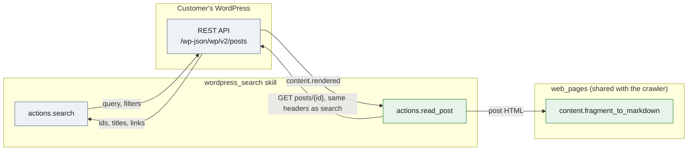

# WordPress Search: Reading a Post's Full Content

| Field | Value |
| --- | --- |
| Status | ✅ Implemented locally; deployment and live agent verification pending |
| Owner | InnomightLabs API |
| Last reviewed | 2026-10-24 |
| Depends on | WordPress Search skill; WordPress REST API (`/wp/v2/posts`); `api/src/web_pages/content.py` |

## Implementation notes

- 2026-10-24: this replaces an undeployed `read_page` action (formerly `LLD-wordpress-search-page-reading.md`). It
  fetched the post's public page and stripped the theme's chrome with the crawler's extractor. That needed URL and
  redirect checks, could not read the drafts and private posts that search can find, and duplicated what the REST
  API already returns. While doing that work, the page fetch, the browser renderer and the HTML-to-Markdown code moved
  from `api/src/crawler/` into `api/src/web_pages/`. The crawler uses all of it, and this skill uses
  `fragment_to_markdown`.

## Context and problem

WordPress Search returns post metadata (id, title, date, author, categories, link), not article bodies. An agent
cannot reliably summarize an article from that alone. The REST API that search already calls returns the full body
too: `GET /wp-json/wp/v2/posts/{id}` has `content.rendered`, the post's HTML after shortcodes and filters ran.

## Goals and non-goals

- Read one post's full content on demand and return it to the LLM as Markdown.
- Use the same endpoint, credentials and audience controls as search. Visitors, guests, A2A and API callers use the
  action only when the owner has shared the installed skill with them.
- Not a general web-page reader, and no pages (`/wp/v2/pages`): search covers posts only. No WordPress plugin change.

## Design and contract

`wordpress_search.read_post` takes `{ "id": 42 }`, the id search prints in brackets (`- [42] Title | …`).
`ReadPostRequest` (`models.py`) requires a positive integer; `"42"` is accepted, `0`, `-1` and `"abc"` are not.

```python
async def read_post(arguments, config, context) -> dict[str, Any]:
    post_id = ReadPostRequest.model_validate(arguments).id
    endpoint = f"{_site_url(config)}/wp-json/wp/v2/posts/{post_id}"
    async with outbound.async_client(timeout=20.0, follow_redirects=False) as client:
        response = await client.get(endpoint, params={"_fields": "id,link,title,date,content"}, headers=_build_headers(config))
    ...
    markdown = fragment_to_markdown(post["content"]["rendered"])
```

The result:

```json
{
  "id": 42,
  "url": "https://example.com/2026/10/article/",
  "title": "Article title",
  "date": "2026-10-20T09:00:00",
  "markdown": "## Research findings\n\nSome **important** findings…",
  "word_count": 8
}
```

`title` is HTML-unescaped (`&#8217;` becomes `’`). `markdown` is the whole body: not an excerpt or a summary.

`fragment_to_markdown` (`api/src/web_pages/content.py`) converts HTML that is already the content. It drops scripts,
styles and embeds and applies the crawler's Markdown rules: Cloudflare email decoding, fact lists as `label: value`,
cards as headings, spacing between inline elements, links reduced to their text. It does not strip site chrome or
pick a main area as `extract_content` does for whole pages, because `content.rendered` has no chrome: a block styled
as a `<header>` or a `.widget` inside a post is part of the post.



Green is new. Both actions go through `common.outbound` with redirects off, to the configured `site_url`.

Manifest instructions tell the agent to search, read the post by id before summarizing it, cite the returned URL,
treat post text as untrusted evidence, and say so when a post can't be read instead of passing off search metadata
as the article.

## Behaviour and security

- **Only the configured site is called.** The agent supplies an integer, not a URL, so there's nothing to validate
  or redirect. Redirects are off, as for search.
- **Same credentials as search.** The application password, when configured, authenticates the REST API, so drafts,
  private and scheduled posts that search finds can also be read. The WAF bypass header is sent too. Sharing the skill
  lets its callers read what those credentials can; use a public-only installation for widget visitors.
- **Errors match search.** A 4xx/5xx raises `WordPress API error (<status>): <first 400 characters>`. A post with no
  body (for example a password-protected post, whose `content.rendered` is empty) raises "WordPress post <id> has no
  readable content".
- **Prompt injection.** Post text is untrusted input; Markdown conversion doesn't change that.
- **Limits.** Content a theme adds outside the post body (template parts, some page-builder layouts) isn't in
  `content.rendered`. For blog posts, which this skill searches, that is rare.

## Implementation map

| File | Responsibility |
| --- | --- |
| `api/src/skills/wordpress_search/manifest.yml` | `read_post` action schema and reading instructions |
| `api/src/skills/wordpress_search/models.py` | `ReadPostRequest`: positive integer id |
| `api/src/skills/wordpress_search/actions.py` | `read_post`; `_site_url` shared with `search` |
| `api/src/web_pages/content.py` | `fragment_to_markdown` beside `extract_content`; noise removal split into `_remove_tags` and `_remove_boilerplate` |
| `api/src/web_pages/fetch.py`, `renderer.py` | Moved from `crawler/`; used only by the crawler |
| `api/tests/test_wordpress_search_read_post.py` | Body as Markdown, auth headers, id validation, errors, empty posts, registry dispatch |

## Rollout and compatibility

Deploy the API. Installed WordPress Search skills discover `read_post` from their manifest. No migration, plugin
upload, frontend release or environment variable is needed. `read_page` was never deployed, so nothing calls it. A
skill already loaded in a running conversation may need to be loaded again to see the new action.

## Validation

Run from `api/`:

```sh
uv run pytest tests/test_wordpress_search_read_post.py tests/crawler -q
uv run ruff check src/web_pages src/skills/wordpress_search tests/test_wordpress_search_read_post.py
uv run mypy src/web_pages src/crawler src/skills/wordpress_search
uv run pytest -q
```

## Alternatives and decisions

- **REST `content.rendered` over the public page.** It is the post body without the theme, so no chrome stripping;
  the agent passes an id, not a URL; and drafts and private posts work with the credentials search already uses. The
  public page would only add template-injected content, at the cost of URL and redirect checks.
- **Read by id, not URL.** Search already prints ids. Resolving a URL means parsing permalinks (`?p=`, slugs, date
  structures); add it if users paste links often.
- **Markdown, not raw HTML.** Fewer tokens and cleaner text for the model, written by the same rules the crawler uses.
- **A generic web-page reader is a separate skill.** Reading any public URL has a different risk profile (any site,
  prompt injection from anywhere) and isn't needed to read WordPress posts. It would build on `web_pages`
  (`fetch_page` + `extract_content`) and gets its own LLD if wanted.

## Related documentation

- Existing public Ask design: `docs/LLD-wordpress-public-ask.md` (separate excerpt-grounded, tool-free flow; not
  altered here).
- Skill authoring contract: `api/src/skills/CONTRIBUTION.md`.
- Shared HTML to Markdown and page fetch: `api/src/web_pages/CONTRIBUTION.md`.
