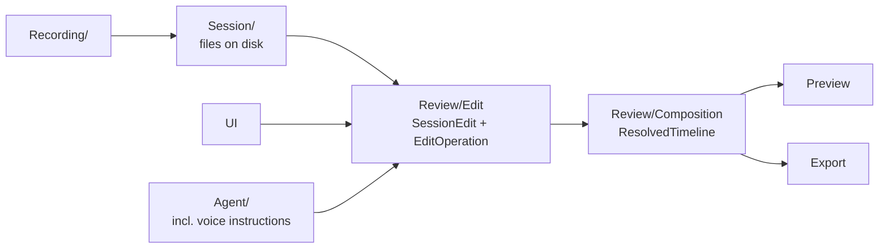

# Contributing to Aura

Aura is a screen and camera recorder with a non-destructive editor. This guide covers how to add or
change a feature so the architecture stays clean. Read it before writing code, and use it as the
checklist when reviewing.

It builds on the repo-wide [CODE_PHILOSOPHY.md](../../../CODE_PHILOSOPHY.md). Where the two differ, this
guide applies to Aura and spells out the Aura-specific reasoning.

## The philosophy in one paragraph

Build small components that each do one thing, have one reason to break, and can be used from more than
one place. A component that is likely to fail, such as a decoder, a detector or a network call, goes
behind a narrow seam. Its failure then cannot spread, and the rest of the app can reuse it. Everything
else stays direct and boring.

## 1. Reuse is a design requirement, not a cleanup step

Before writing a feature, list the places that will need its core logic. Aura has three callers for
almost everything: **the mouse/keyboard UI**, **the AI agent**, and **voice control**. A feature that
only works from one of them is incomplete.

- Put the logic in one component with a plain input and a plain output. The UI, the agent, the command
  palette and the tests all call that same component.
- `SilenceDetector` is the model. It works on plain bucket levels, with no audio and no AVFoundation. The
  silence command, the agent's digest and the tests can all call it.
- If you write the same logic a second time, extract it. If a component only has one caller and no
  reason to have more, leave it inline. The repo rule still holds that three clear lines beat the wrong
  abstraction. Reuse means *designing so a second caller is easy*, not adding indirection for callers
  that don't exist.

### Isolate what can break

When a component can plausibly fail or change, wrap it so the failure has one home:

| Likely to break or change | Where it lives | Why it is contained |
|---|---|---|
| Speech-to-text (WhisperKit) | `SessionTranscriber` | One place knows about the model. Everything else reads a `Transcript`. |
| AVFoundation composition | `CompositionBuilding` protocol | The edit model never touches AVFoundation, so the builder can be swapped. |
| The InnomightLabs agent | `EditSuggesting` protocol | The UI never sees the transport. Tests pass in their own implementation. |
| Capture devices | `CaptureSource` + `CaptureSourceFactory` | `RecordingController` has no per-source branches. |

A protocol is justified when it marks one of these real boundaries: an external system, hardware, or a
second implementation that exists or is about to. It is not justified for internal code that only has
one implementation and no external boundary.

## 2. The architecture

Data flows one way. Do not add arrows that go backwards.



| Folder | Owns | Must not |
|---|---|---|
| `Recording/` | Capture sources, writers, the state machine | Know about editing |
| `Session/` | The on-disk session folder, manifest and event log | Know about the UI |
| `Review/Edit/` | `SessionEdit`, `EditOperation`, `EditDocumentStore` | Import AVFoundation or SwiftUI |
| `Review/Composition/` | Turning a resolved timeline into AVFoundation objects | Mutate the edit document |
| `Review/Projection/` | Mapping between session time and playhead time | Hold UI state |
| `Agent/` | Talking to the agent and parsing suggestions | Apply edits itself |
| `Audio/`, `Voice/` | Signal analysis, wake word | Depend on `Review/` |
| `App/` | App shell, menus, preferences, feature flags | Hold domain logic |

The edit layer is the center. Put pure logic at the bottom and a thin view on top. A feature that needs
AVFoundation, a file read, or a network call keeps that part in a small adapter and leaves the decision
logic pure.

## 3. Every change to a recording goes through `EditOperation`

`EditOperation` is the only way a `SessionEdit` changes. A drag, an agent suggestion and a voice command
all produce the same operations and go through `EditDocumentStore.apply`.

This gives Aura three guarantees, and a feature must not break any of them:

1. **Undo works.** A bulk action is **one** operation (see `removeRanges`), so one Cmd+Z reverses it.
2. **The agent gets the same powers as the user, and no more.** Suggestions are never applied silently.
3. **Edits are non-destructive.** The recorded files are never rewritten. The edit document describes
   what to do with them.

To add a user-visible capability that changes the result:

1. Add a case to `EditOperation`.
2. Give it a hand-written `op` discriminator and flat fields in the `Codable` code. The JSON is a
   contract the agent depends on. Do not leave the synthesized form, which nests payloads under `_0`.
3. Handle it in `SessionEdit` and the resolver.
4. Add it to the agent's operation vocabulary and cover it in `AgentOperationVocabularyTests`.
5. Add a migration if the stored shape changed (`SessionEditMigration`).

**All times in an operation are session time**, the pause-compacted clock shared by the recorded files
and the transcript. Convert from the playhead through `TimeMap` at the UI boundary and nowhere else.
Doing the conversion by hand has caused clock bugs before.

## 4. One source of truth

- A list the user sees, such as commands, actions or sections, is derived from one enum or table. The
  palette, the menus and the key bindings read from it. Don't keep a parallel list.
- Behavior that varies by kind goes in a list of strategies plus one function that selects from it. Don't
  repeat `if` chains. `CaptureSourceFactory` is the only place that asks whether a source is enabled.
- A value that two files need goes in one named constant. Document what it means and why it has that
  value. The `−40 dBFS` silence floor and the `0.35s` minimum gap are the standard.
- Derived data, such as waveform peaks and filmstrips, lives in a cache keyed by its inputs. It is never
  the authoritative copy.

## 5. Write the component so it can be reused

A reusable component has these properties:

- **Pure core.** It takes values and returns values. No singletons, no `UserDefaults`, no file or device
  access hidden inside. Anything impure is passed in as a parameter.
- **Plain types at the edges.** It takes `[Float]`, `TimeSpan` or `URL`. It does not take a view model.
- **`Sendable` value types** where the data crosses actors. Use an `actor` for a stateful resource that
  owns non-Sendable AVFoundation objects (see `WaveformExtractor`), and publish only `Sendable` results.
- **Typed errors** with a `LocalizedError` message a user can read. The error names what happened, not
  which framework threw it.
- **No UI knowledge.** If a view needs to show progress, the component exposes progress as a value. It
  does not reach into a view.
- **Cancellation is safe.** A cancelled operation does not leave a half-written result that looks
  complete. `WaveformExtractor` returns whether it decoded the whole file for that reason.

Heavy work (decoding, analysis, rendering) never runs on the main actor. Stream large media instead of
loading it. The extractor comment explains why: half an hour of PCM is about 317 MB, and the envelope is
about 2 MB.

## 6. Naming and comments

- Name things for the domain: `SilenceDetector`, `PauseClock`, `TimelineResolver`. Avoid `Manager`,
  `Helper`, `Processor` and `Utils`.
- Put behavior on the type that owns the data.
- Comments explain **why**: a constraint, a trade-off, or what a simpler-looking alternative would break.
  If a comment is explaining what the code does, rename or restructure instead.
- When a value or approach looks wrong but is deliberate, say so. Existing examples are the
  `Not Sendable: AVAsset isn't` note and the padding around detected silences.

## 7. Unfinished work is visible, not hidden

- An unbuilt capability appears as visibly disabled with a stated reason (`StudioAction.Kind.unavailable`).
  It never appears as a button that silently does nothing.
- Work that isn't ready goes behind a flag in `FeatureFlags`, off by default, with a comment saying what
  it costs. When the work ships, delete the flag.
- Delete dead code and finished flags in the same change that makes them dead.

## 8. Privacy and permissions

Aura handles screen, camera and microphone data.

- Use the microphone, camera or screen only while the user is recording or has explicitly started
  something. Don't hold a device open in the background.
- Process audio and video **on-device** by default. Transcription and noise reduction run locally. Send
  data to the agent only through `Agent/`, and send only what the request needs (the session digest, not
  the media).
- Add a usage description in `project.yml` for any new permission, and say why in plain words.

## 9. Dependencies

Aura currently depends on WhisperKit only. The default answer to a new dependency is "not yet". Check, in
order: existing Aura code, then Apple frameworks (AVFoundation, Accelerate, Core ML, Vision, Speech), then
a small local addition, and only then a package. A change that adds one must include this in the PR:

```text
Need:
Why the existing stack is insufficient:
Why this choice is the smallest adequate solution:
New operational/conceptual cost:
```

## 10. Tests

Test behavior that a user or another component relies on.

- Pure components get plain unit tests with plain inputs (`SilenceDetectorTests`, `PiPGeometryTests`).
- Edit behavior is tested through `EditDocumentStore` and `SessionEdit`, including undo.
- A bug fix includes a regression test that fails before the fix and passes after.
- Don't mock what Aura owns. Fake only the real boundaries: the agent transport, devices, time and
  randomness. Tests substitute `EditSuggesting` for this reason.
- Visual or audible changes also get checked by eye or ear. State what you checked.

```bash
scripts/test.sh     # generates the project and runs the full suite
scripts/run.sh      # builds and launches the app
```

Run the focused tests while working, then the full suite before you finish.

## 11. Docs

- A feature with real design decisions gets an LLD in `docs/`, named like `LLD-aura-phase<N>-<topic>.md`.
  Existing LLDs show the format.
- A change that alters an approved design updates that LLD in the same change.
- Diagrams are Mermaid only, never ASCII art. Render-check them before calling them done.
- `project.yml` is the source of truth for the Xcode project. The `.xcodeproj` is generated.

## 12. Commits

- One logical change per commit, with a one-line message in the imperative mood.
- No body, no bullet list and no attribution trailer unless explicitly asked.
- Don't mix refactoring, formatting, dependency changes and feature work.

## Checklist for a new feature

- [ ] Which components does this need, and can each be used from the UI, the agent and the tests?
- [ ] Is the logic pure, with I/O in a small adapter at the edge?
- [ ] Is anything likely to break wrapped so the failure has one home?
- [ ] Does every change to the recording go through an `EditOperation`, and is bulk work a single undo step?
- [ ] Is there one source of truth for every list, constant and piece of state?
- [ ] Are all times in session time, converted only at the UI boundary?
- [ ] Does heavy work run off the main actor and stream rather than load?
- [ ] Is unfinished work visibly disabled or behind a flag?
- [ ] Is any dependency justified in the four-line form?
- [ ] Are there tests, and did the full suite run?
- [ ] Is the LLD updated if a design changed?
- [ ] Can any code, flag or option now be deleted?
