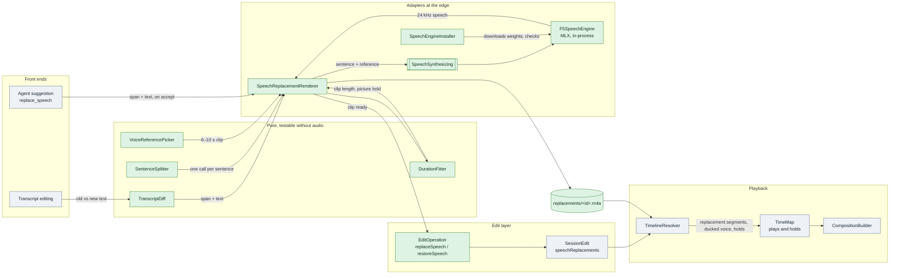
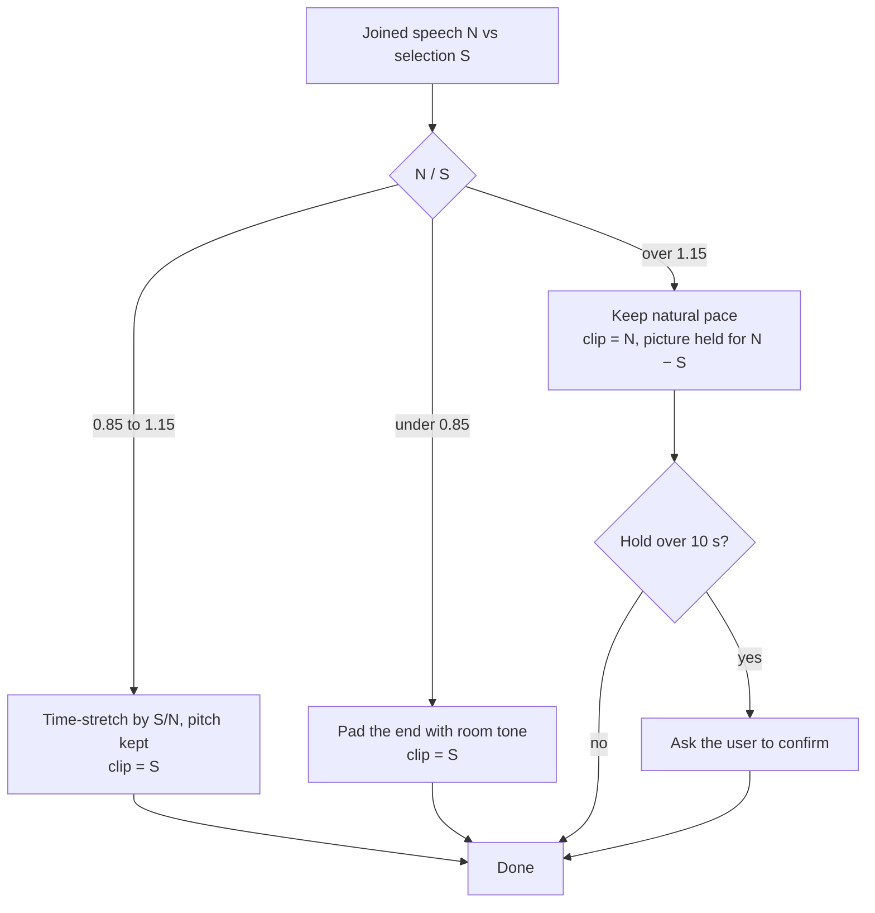
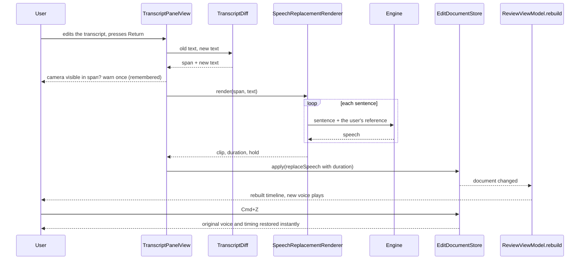
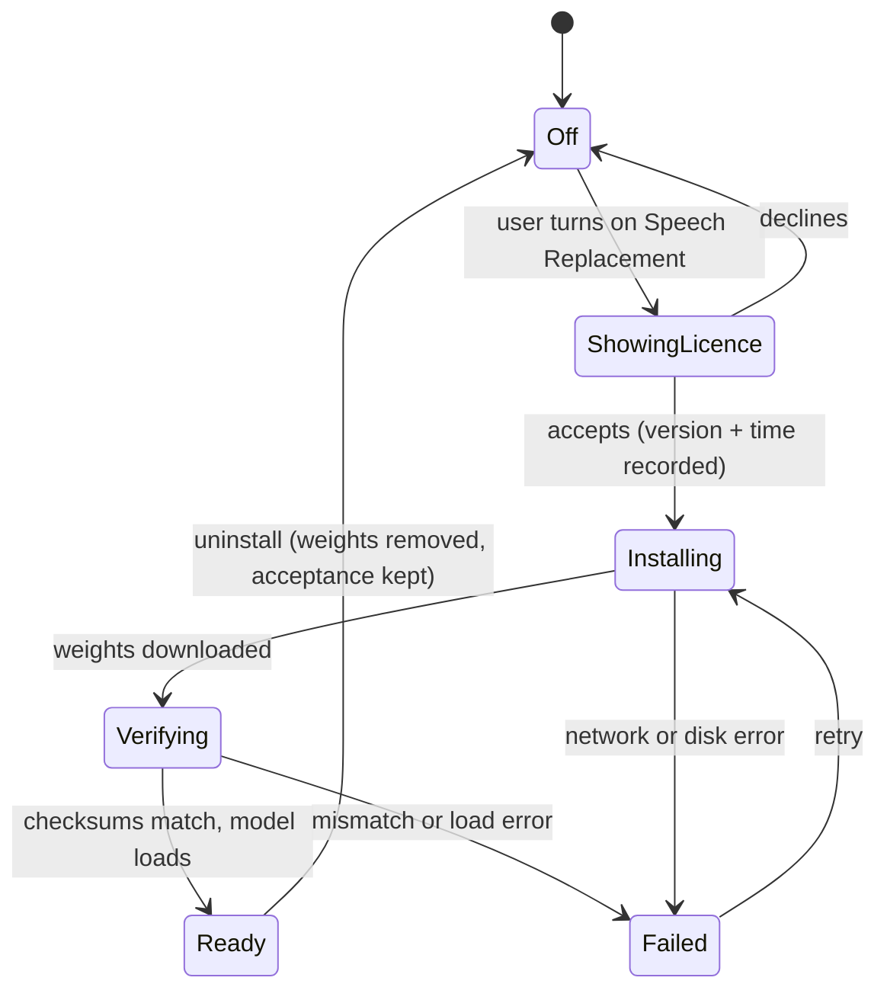

# Aura Phase 8 — Speech Replacement (re-speak a selection in your own voice)

| | |
| --- | --- |
| **Status** | 🚧 In progress — built and tested end to end; the on-device model has been run once for real (see Implementation notes). Not yet used from the app window by a person |
| **Owner** | vslala |
| **Last reviewed** | 2026-10-17 |
| **Depends on** | Studio Sound (derived-audio pattern), Phase 3 review editor, Phase 4 timeline editing |

## Implementation notes

Built and tested (750 tests, including real-media compositions and the whole flow through the view
model with a fake voice): the edit and its rules, `TimeMap` holds and the freeze-frame, ducking and
the replacement track, `SentenceSplitter`, `DurationFitter`, `TimeStretcher`, `VoiceReferencePicker`,
`VoiceSampleExtractor`, `TranscriptDiff`, the renderer, the installer and its consent flow, the
settings screen, transcript editing, the agent operation and its digest entry.

**The real engine** (`F5SpeechEngine`, MLX through `speech-swift`) was run end to end once, by an
opt-in test (`RealVoiceTests`, skipped unless `AURA_REAL_VOICE_DIR` is set) in a Debug build on an
M4 with 16 GB:

- Aura's own installer downloaded the pinned 702 MB bundle in 11 s and **every checksum matched**.
- An 82-character sentence was spoken in the user's voice: natural length 6.64 s against the
  original line's 6.46 s (the PyTorch evaluation gave 6.67 s), fitted by a 1.03× stretch to exactly
  6.46 s.
- **32 flow steps, not the package's default of 16.** Listened to side by side on that sentence, 32
  sounds clearly less synthetic; whether the clip was then stretched and saved as 64 kbps AAC made
  no audible difference. `F5SpeechEngine` therefore defaults to 32.
- **Speed at 32 steps, measured:** 24–27 s for the first sentence including loading the model, and
  about 17 s for a short sentence once it is loaded, in both Debug and Release builds (so the
  time is in the model, not in Swift). Roughly 3× real time for a typical sentence: a long
  paragraph takes a minute or more. At 16 steps it was about half that. The cost grows with the
  reference clip's length as well as the sentence's, since the model works over both.
- The loudness of the output matches the speaker's recording (about −29.6 LUFS against −28.5 LUFS
  for the original, peak −14.8 dBFS), so the engine is not adding level. Both are quiet by speech
  standards; evening out the loudness of a whole recording is a separate job.

Building it needs Xcode's Metal Toolchain and command-line builds need `-skipPackagePluginValidation`
(mlx-swift's build plugin must be trusted); the project scripts pass it. WhisperKit is now declared
under its old repository name (`argmaxinc/WhisperKit`), because `speech-swift` uses that name and
SwiftPM refuses to resolve the same package under two names.

Where the implementation departs from the design below:

- **Engine package.** `soniqo/speech-swift` (module `F5TTS`) rather than `lucasnewman/f5-tts-swift`.
  The latter is the original F5-TTS release, not v1 Base, and creates its vocoder from the network on
  every `generate` call. `speech-swift` ships v1 Base (the model that was listened to) as a 670 MB MLX
  bundle, and loads a local bundle with `F5TTSModel.fromBundle`, so Aura downloads, pins and
  verifies the files itself. Its dependency graph is large (it brings WhisperKit, MCP and others
  into resolution); only the F5 product is built.
- **Hold and a missing clip.** The design said the hold would be skipped with a missing clip. The
  timeline is defined by the document, not by which files exist, so the picture stays held — silent —
  until the clip is made again (`repairMissingSpeechClips`, which re-speaks it from the stored text
  and rebuilds). A hold that moved would shift everything after it.
- **Two limits, not one.** The UI asks for confirmation above a 10 s hold
  (`DurationFitter.confirmationThreshold`); the document refuses only above 60 s
  (`SpeechReplacement.maximumHold`). The design used one number for both, which made a confirmed
  hold impossible to apply.
- **Licence screen.** The publisher's repository has no licence file to display, so the screen states
  the licence's name, a plain-language summary, and links to the full legal code and the model page.
  The consent copy still needs the legal read in gate G5.
- **Padding is silence.** A clip shorter than its selection is padded with digital silence, not room
  tone sampled from the recording. Room tone needs the original audio inside the renderer; it is a
  refinement, not a blocker.
- **Edges.** Replaced-voice silencing uses step keyframes rather than 20 ms ramps; the clip itself
  fades in and out over 8 ms, which is what keeps the splice from clicking.
- **The unit is the transcript cue.** `TranscriptDiff` returns the changed text and the cue's span;
  an agent's replacement can cover several cues, shown as one entry.
- **Reference choice has no confidence.** The transcript carries no per-word confidence, so
  `VoiceReferencePicker` judges fluency by fillers, pauses and pace alone.
- **Agent drafts.** `replace_speech` decodes with no `duration`, making it a draft; accepting it runs
  the same speak-then-apply path as the transcript editor, and several accepted together are queued
  and land one at a time.
- **Not done:** the blurred hold, a command-palette entry, and word timings inside a replaced line.

## Context

A recording has sentences the speaker would not keep: abandoned starts, strings of "um", a garbled
word. Cutting them leaves a hole in the story; re-recording costs more time than the whole edit.

This phase lets the user **replace a selection with new text spoken in their own voice**, from two
front ends that share one edit:

- **Transcript editing.** The user edits the transcript; Aura speaks the new text and puts it where
  the old speech was.
- **Ask the agent.** "Replace this part with …" becomes a suggestion the user accepts, like a cut.

The speech comes from a local voice-cloning model (F5-TTS) running on the user's Mac. The feature is
enabled from inside the app after the user accepts the model's licence. Nothing is installed with
Aura itself.

### What the evaluation showed

Run on 2026-10-16 in a CPU Docker container (`~/aura-tts-eval`, not part of the repo), with the
Oct 13 rehearsal recording. The user listened and judged the clone "not bad at all".

| Finding | Evidence | Consequence |
| --- | --- | --- |
| The clone is usable | User listening verdict, 5 sentences in the user's voice | Worth building |
| Output length does not match the original | 1.03×–2.54× the original across 5 lines; closest on the longest sentence | Length is handled by the fitting rules below, not hoped for |
| Reference is capped near 12 s | `utils_infer.py` trims to 12 000 ms | Pick a 6–10 s clip automatically |
| Long text is chunked, one chunk is ~22 s minus the reference | `infer_process`, `max_chars` formula | Always speak one sentence per call |
| CPU in a VM is 18–30× slower than real time | RTF 18–131 | Says nothing about a native run — **gate G1** |
| A 3–3.3 GB container OOM-kills on the longest line | exit 137, 4 runs | A native run on 16 GB is expected to fit — **gate G3** |
| The transcript's mistakes get spoken | "inner mitel apps" | Replacement text must be editable; brand words need respelling |

Unproven and gating the build: speed on the real machine, whether a ±15 % time-stretch still sounds
natural, and how the splice sounds against the untouched audio.

## Goals and non-goals

**Goals**

1. Replace the speech of a selection with new text in the user's own voice, as one undoable edit.
2. One edit operation behind both front ends, so undo, the agent and the digest come for free.
3. The model is opt-in: shown, explained and licensed inside the app, installed only on consent.
4. The recording is never modified; replacement audio is derived data.
5. Any selection works. Text is always split into sentences and spoken one sentence at a time.
6. When the new speech is longer than the selection, the picture is held at the end of the
   selection rather than the speech being squeezed.

**Non-goals (this phase)**

- Other speakers' voices. The reference is always drawn from the session's own microphone track,
  which keeps this to the user's own voice. Voice presets are Phase 5 and need their own consent
  design.
- Matching lip movement. Aura warns when the camera is visible in the selection (see Camera
  warning).
- Redistributing the model. Aura downloads it from its publisher; it is never bundled or mirrored.
- Intel Macs. The engine needs Apple Silicon; on Intel the feature is not offered.

## Design

### Components



New (green) and existing (grey) components. The edit is applied only after its clip exists, so the
document never describes audio that has not been made. `SpeechSynthesizing` is the protocol seam;
`F5SpeechEngine` is its only implementation and the only place that knows about the model.
`TimeMap` is existing but gains one new kind of segment.

Files, under `Sources/Aura/Speech/` (one folder, like `Audio/` and `Voice/`):

| File | Kind | Responsibility |
| --- | --- | --- |
| `SpeechSynthesizing.swift` | protocol | `synthesize(sentence:reference:) async throws -> [Float]` |
| `SentenceSplitter.swift` | pure | New text → sentences, each short enough for one chunk |
| `VoiceReferencePicker.swift` | pure | Best 6–10 s of the user's speech: confident words, no fillers, no long pauses |
| `TranscriptDiff.swift` | pure | Old vs edited text → the span to re-speak and the new text |
| `DurationFitter.swift` | pure | Spoken length vs selection length → stretch, pad or hold plan |
| `SpeechReplacementRenderer.swift` | I/O | Split → synthesize each sentence → join → fit → write the clip (atomic, cancellable, like `StudioSoundRenderer`) |
| `F5SpeechEngine.swift` | adapter | Loads the model, runs it, unloads when idle |
| `SpeechEngineInstaller.swift` | actor | Consent record, weights download, verification, uninstall |

### The edit

Both front ends produce the same operation, so the agent gets exactly the user's powers
(`EditOperation` is the only way a document changes).

```swift
/// A selection re-spoken from text. The clip is derived data; this is the whole edit.
struct SpeechReplacement: Codable, Hashable, Identifiable, Sendable {
    let id: UUID
    /// Session time, like every time in an operation.
    var span: TimeSpan
    var text: String
    /// What was said, kept so restore and the transcript view never need the transcript.
    var originalText: String
    /// Length of the generated clip. Never shorter than `span`; the excess is how long the
    /// picture is held. Stored, not measured, so the document alone defines the timeline.
    var duration: TimeInterval

    var hold: TimeInterval { max(0, duration - span.duration) }
}

// EditOperation
case replaceSpeech(SpeechReplacement)
case restoreSpeech(ids: [UUID])        // one undo step for a batch, like removeRanges
```

Agent vocabulary (hand-written `op` discriminator, flat fields, per `EditOperation`'s contract):

```json
{"op":"replace_speech","start":26.56,"end":34.7,"text":"I build InnomightLabs because …"}
{"op":"restore_speech","ids":["<replacement id>"]}
```

The agent's operation carries no `duration`: that exists only once the audio does, so accepting the
suggestion renders first and the stored operation gains the measured value.

Rules enforced in `SessionEdit.applying` (pure, so they are unit-tested):

- Spans must lie inside the recording and must not overlap another replacement.
- Text must be non-empty; spans shorter than 0.3 s are rejected.
- `duration` must be at least the span's length, and a hold over 10 s is rejected here and
  confirmed in the UI before it is requested.
- `speechReplacements` decodes with a default of `[]`, so existing documents load unchanged and no
  schema bump is needed (same approach as `studioSound`).

### Long selections: always one sentence at a time

The model speaks whatever it is given in chunks of about 12–16 s, and joins chunks with a short
crossfade, so a long text would be spoken as several generations with seams the user cannot control.
Aura takes that choice itself: **`SentenceSplitter` always splits the new text into sentences**, and
the renderer generates each one with its own call, joins them with a natural gap of about 0.25 s, and
treats the result as one clip for the whole selection. Splitting uses sentence punctuation, then
commas for any sentence still over the model's limit, and never splits inside a quoted brand name.

The selection is one replacement however many sentences it holds, because the new text rarely has
the same sentence count as the old: the unit of the edit is "this stretch of the recording", the unit
of synthesis is "one sentence".

### Fitting: natural pace, hold the picture if it runs long

The model is always run at its natural pace for the voice. Compare the joined length `N` to the
selection length `S`:



Never squeezing long speech is the point: speech made fast enough to fit sounds hurried, and the
evaluation showed lengths up to 2.5× the original. The 0.85–1.15 band is a **placeholder set by
gate G2**. Padding uses room tone sampled from the quiet edges of the span so the gap is not digital
silence.

### Holding the picture

When `duration > span.duration`, the timeline grows by `hold` at the end of the span: both video
tracks show the frame at the span's last instant for that long, while the replacement speech keeps
playing. Everything after shifts later, which is already correct because every edit is anchored in
**session time**, not composition time.

This is the largest change in the phase because `TimeMap` assumes a one-to-one mapping:
`Segment.composition` and `Segment.source` have equal durations, and `init(clips:)` skips any clip
whose source range is empty. A hold has a source range of zero length and a composition range of
`hold` seconds, so it needs a segment kind of its own:

```swift
struct Segment {
    let composition: CMTimeRange
    let source: CMTimeRange        // zero-length for a hold: one instant shown for a while
    var isHold: Bool { source.duration == .zero }
}
```

Every function in `TimeMap` that assumes the one-to-one mapping gets a defined behaviour for a hold
(`sourceTime(forComposition:)` returns the held instant; `compositionTimes(forSource:)` names the
span's end only, so a cut or marker at that instant has one answer), and the existing tests extend to
cover it. The builder produces the picture by inserting the held frame's range and scaling it to the
hold's length (the standard freeze-frame technique for `AVMutableComposition`). A softly blurred hold
is a second step that reuses the Core Image compositor already used for the picture-in-picture
(`CoreImagePiPCompositor`); the first version ships a plain hold and the blur is a style choice made
after seeing it.

### Playback

A replacement is a source file with a known time offset, which is what `PlacedSegment` already
expresses (`ResolvedTimeline.swift`). The builder inserts clips per `TimeMap` segment at composition
time (`insertClips`, `LayerInstructionCompositionBuilder.swift`).

- `ResolvedTimeline` gains `replacements: [ResolvedSpeechReplacement]` (clip URL, span, hold, gain).
- `TimelineResolver` derives, for the voice lane, extra **zero-gain keyframes over each replaced
  span** (with 20 ms ramps) so the original voice is silent there. This uses the existing
  `mapToComposition` keyframe machinery that already re-emits state at each surviving segment.
- `LayerInstructionCompositionBuilder` adds one audio track for all replacements (they cannot
  overlap, so one track suffices) and gives it the voice lane's gain keyframes, so mute and level
  apply to the new speech too.
- A replacement whose clip file is missing is skipped and the original plays, never silence — the
  same fallback Studio Sound uses (`SourceTrackProbe.playing(studioSound:)`). The hold is skipped
  with it, so the timeline stays consistent with what plays.

### Rendering

A replacement is rendered **before** its edit is applied: speaking takes seconds to minutes and
`EditDocumentStore.apply` is synchronous and undoable, so the user sees "speaking…" first and the
edit lands as one step when the clip is ready. That also means the document never holds a replacement
without its measured `duration`.

Clips live at `<session>/replacements/<id>.m4a`, derived from the id
(`SessionFolder.replacementURL`). If a clip is later missing (the folder was moved, another machine),
`ReviewViewModel.rebuild` re-renders it from the stored text and **stretches it to the stored
`duration`**, so the timeline cannot change underneath the user. Studio Sound already renders missing
derived audio at the top of `rebuild` (`renderMissingStudioSound`); replacements are the **second
derived-audio job**, so the work includes extracting the shared part (find missing, render with
progress, record the result, report failure) rather than copying it.

### Front end 1 — transcript editing



- The selection is whatever the user edited: a phrase, a sentence or several. The renderer treats it
  as one replacement and the splitter handles the sentence boundaries.
- `transcript.json` is never rewritten: it describes the recording. `ReviewProjector` overlays
  `speechReplacements` so the transcript, captions and SRT export show the new text. In v1 a
  replaced selection shows one cue; word timings inside it need the on-device transcriber run over
  the new clip, which is a later step.
- While a clip renders, the selection shows a "speaking…" state and the old voice keeps playing.

### Front end 2 — agent

The agent needs no new mechanism: `replace_speech` is one more entry in the operation vocabulary in
`EditSuggestionPrompt`, listed in `AgentOperationVocabularyTests`. Suggestions stage in the panel;
accepting one runs the same render-then-apply path as the transcript editor. The prompt tells the
agent the text must be speakable aloud, and that a much longer text will hold the picture.

### Camera warning

When the camera is visible anywhere in the selection, new words will not match the speaker's mouth.
Before rendering, Aura says so once, with the choices *Replace anyway*, *Cancel*, and a checkbox
**Don't warn me again**. The checkbox is stored in `UserDefaults` (`Aura.speechReplacementCameraWarning`)
and can be reset in Settings. "Camera visible" is a pure function of the resolved overlay keyframes
and the span, so it is tested without a window.

### Enabling the feature: licence, install, uninstall

The model is **not** bundled. The feature is off until the user turns it on in Settings.



**What the consent screen must say.** F5-TTS's *code* is MIT, but the pretrained *weights* are
CC-BY-NC (per the project README, which does not state a version), trained on the Emilia dataset. The
screen therefore:

- shows the model licence text itself, fetched from the pinned model revision, not a paraphrase;
- states plainly that the model is licensed for **non-commercial use** and that the user is
  responsible for how audio made with it is used and published;
- records the accepted licence identifier, version and time, and asks again if the pinned model
  changes.

Whether a CC-BY-NC weights licence also restricts the *generated audio* is not settled by the README.
**The consent copy needs a legal read before release** (gate G5); until then the screen should not
claim more than the licence says.

**What gets installed**, under `~/Library/Application Support/Aura/Engines/f5tts/`: only the **model
weights** and vocoder, downloaded **directly from the publisher** at a **pinned revision**, with a
manifest of SHA-256 checksums verified before the model is loaded. There is no runtime to install,
because the engine is a Swift library inside Aura (see Runtime). The evaluation's 1.3 GB weights cache
is the upper bound; the 2.8 GB Docker image was almost all PyTorch and is not part of this. The
installer checks free space first (the dev machine is at 91% disk) and shows the size before asking.
Uninstall deletes the folder and returns the space; the acceptance record stays.

### Runtime: no Python

**Decision: run F5-TTS in-process through MLX Swift.** MLX is Apple's array framework for Apple
Silicon, with a Swift API, and F5-TTS already has Swift ports built on it
([lucasnewman/f5-tts-swift](https://github.com/lucasnewman/f5-tts-swift), and the F5-TTS module in
[soniqo/speech-swift](https://github.com/soniqo/speech-swift)). That removes the downloaded Python,
the package installs, the helper process and the notarization problem of shipping PyTorch's native
libraries. It also means the installer only downloads weights.

Two alternatives were considered and rejected as the first choice:

| Option | Why not first |
| --- | --- |
| Python + PyTorch (what the evaluation used) | A downloaded Python, hash-pinned wheels, a helper process, GBs of libraries to sign |
| ONNX Runtime from C/C++ | F5 exports to three ONNX graphs (about 1.26 GB for the transformer) that are run in a loop by the caller; community exports exist but nothing evidences a Core ML path on Mac |

**Dependency justification (`CONTRIBUTION.md`):**

```text
Need: run F5-TTS on the user's Mac without a Python runtime.
Why the existing stack is insufficient: no Apple framework runs this diffusion transformer;
  a Core ML conversion is unproven.
Why this choice is the smallest adequate solution: MLX Swift is Apple's own framework and the
  ports are Swift packages; it replaces a runtime, a helper process and its IPC.
New operational/conceptual cost: a Swift package dependency (MLX and the F5 port) and its Metal
  shaders in the Xcode build; about 2.5 GB resident while the model is loaded, so it loads on first
  use and unloads after a few idle minutes; a community port to maintain against, bounded by the
  SpeechSynthesizing seam.
```

Open points that **gate G1** settles before this is committed to: which F5 version the MLX weights
are (the evaluation used v1 Base, the one the user judged), the port's real speed and quality, how
well it is maintained, and whether `mlx-swift` builds under the project's `xcodegen`/Xcode setup.
Apple Silicon only, so the Settings entry is hidden on Intel.

### Privacy and safeguards

- Everything runs on the user's machine; no audio or text leaves it. The only network use is the
  one-time weights download from the publisher.
- The reference is taken from the session's own microphone track; there is no "import any voice".
- Aura writes `speechReplacements` into `edit.json`, so a session always records which selections
  were synthesized.

## Implementation phases

| Phase | Work | Done when |
| --- | --- | --- |
| **0 — gates** | Native benchmark and listening tests (below) | G1–G5 answered; engine and fit band chosen |
| **1 — edit and playback** | `SpeechReplacement`, the two ops, document rules, resolver ducking, builder replacement track, **`TimeMap` holds and the freeze-frame**, the shared derived-audio hook. Tested with a **fake `SpeechSynthesizing`** that returns a tone | A document with a replacement plays the clip in place, extends the picture when it runs long, undoes in one step, and falls back when the file is missing |
| **2 — engine and consent** | `SpeechEngineInstaller`, `F5SpeechEngine`, `VoiceReferencePicker`, `SentenceSplitter`, `DurationFitter`, `SpeechReplacementRenderer`, Settings screen | Turning the feature on downloads weights, speaks a multi-sentence text, and uninstalls cleanly |
| **3 — transcript editing** | Edit mode in `TranscriptPanelView`, `TranscriptDiff`, camera warning, projector overlay | Editing the transcript replaces the speech, captions follow |
| **4 — agent** | `replace_speech` in the prompt, vocabulary tests | The agent proposes a replacement and acceptance works |
| **5 — optional** | Blurred hold, other voices as presets with their own consent | Not designed here |

Phase 1 needs no model at all, which is deliberate: the risky, slow part (the engine) stays behind a
protocol while the edit, playback and undo behaviour — including the new hold — is built and proven
first.

### Gates (Phase 0)

- **G1 — Engine and speed.** On the M4, outside Docker, run the same five sentences through the
  Swift MLX port, the Python MLX port and PyTorch on MPS. Compare speed (a 6 s sentence in well under
  20 s) and listen against the v1 Base clips already judged. Decides the engine and whether the
  transcript-edit loop feels interactive.
- **G2 — Stretch band.** Time-stretch generated clips by ±10 %, ±15 % and ±20 % and listen. Sets the
  band in the fitting rules.
- **G3 — Memory.** Line 14 (the longest) must complete natively.
- **G4 — Splice.** Put a generated clip back into a real recording with Studio Sound on, and listen
  for the seam: level, room tone, crossfade length.
- **G5 — Licence.** Read the model card and licence text and settle the consent copy.

### Tests

- `SessionEdit` / `EditOperation`: round-trip and old-document load; overlap, bounds, empty-text and
  `duration` rules; restore as one undo step.
- `TimeMap`: a hold maps composition time to the held instant; cuts and markers at the span's end
  have one answer; durations and `compositionTimes` stay consistent with holds present.
- `TimelineResolver`: ducking keyframes land over the span and survive a cut inside it; a missing
  clip leaves the original voice and timeline untouched; mute and level apply to replacements.
- `DurationFitter`: stretch, pad and hold decisions at the band edges; hold over 10 s flagged.
- `SentenceSplitter`: sentence and comma splitting, abbreviations, brand names kept whole, empty and
  one-word input.
- `VoiceReferencePicker`: skips fillers and pauses, never exceeds 10 s, returns nothing for a
  session with no usable speech.
- `TranscriptDiff`: a changed word yields the surrounding selection; unchanged text yields no edit.
- Camera warning: visible-in-span is computed from keyframes; "don't warn again" is honoured.
- `SpeechReplacementRenderer`: exact clip length per the fitting rules, cancellation leaves no file
  (fake synthesizer).
- `SpeechEngineInstaller`: state transitions, checksum failure, insufficient disk, uninstall.
- `AgentOperationVocabularyTests`: the new `op` names appear in the prompt.

## Open questions

1. **Short selections.** The evaluation overshot 2×+ on very short lines; with holds this is now
   harmless, but a 0.5 s selection replaced by a long sentence holds the picture for a long time.
   Whether to refuse or auto-widen to the neighbouring words is decided after seeing it.
2. **Word timings inside a replaced selection.** v1 shows one cue; running the on-device transcriber
   on the new clip would give word-level timings and make later word edits possible.
3. **Blurred hold.** Plain freeze first; the blur is a look choice to make after seeing a real hold.
