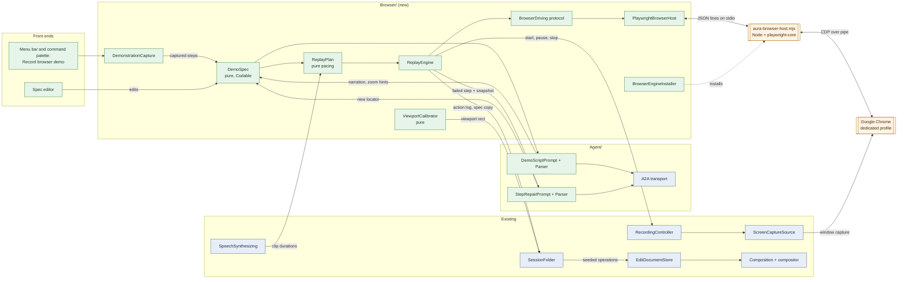
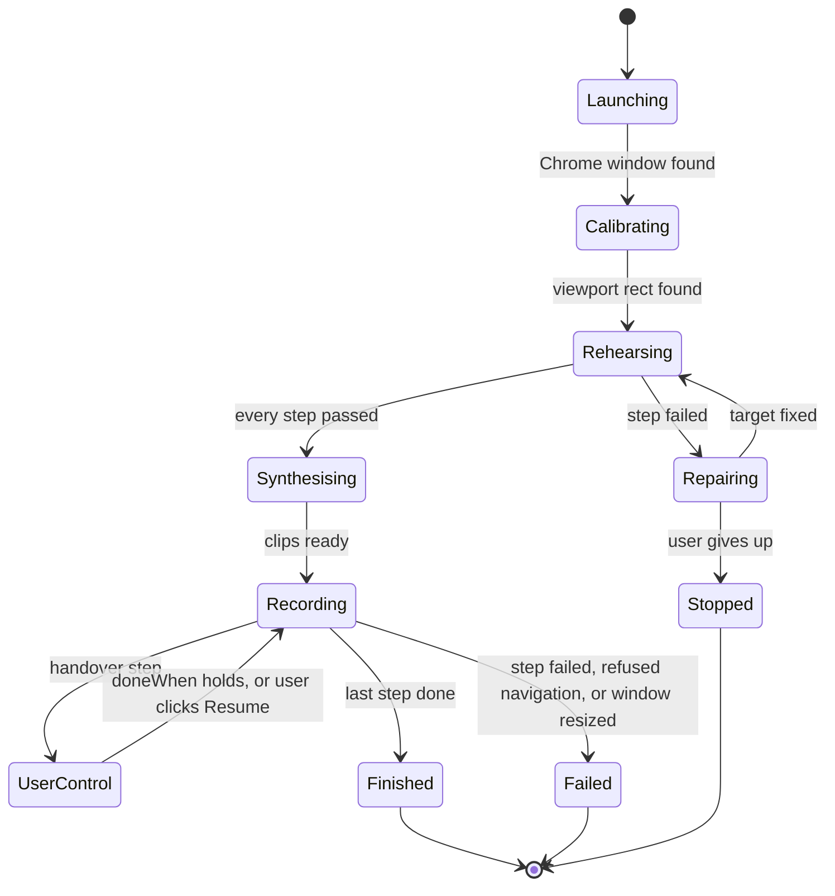
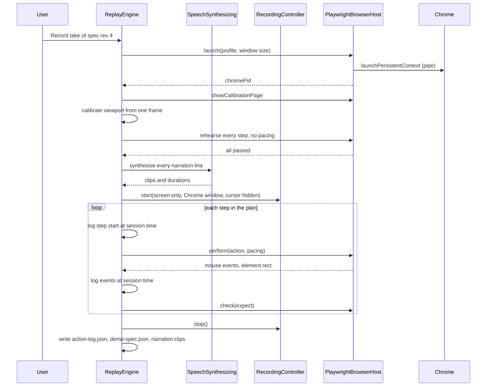

# Aura Phase 9 — Browser Demo Recorder (demonstrate once, replay a polished take)

| | |
| --- | --- |
| **Status** | 🚧 In progress: slices 1–5 built (agent repair, artifact upload and the live gates are not) |
| **Owner** | vslala |
| **Last reviewed** | 2026-10-17 |
| **Depends on** | Phase 1 recording core, Phase 3/4 edit model and timeline, Phase 6 recording profiles, Phase 8 speech replacement (`SpeechSynthesizing`, installer pattern, `TimeMap` holds) |

## Text and keyboard capture fixes — 2026-10-17

Chat composers often submit and clear their value on Enter without blurring, so native `change`
events alone lost the message. Capture now snapshots trusted `input` events for non-sensitive native
inputs, textareas, and plain contenteditable editors. Edits coalesce per typing run into `fill`;
queued values flush before keyboard submission, pointer/click handlers, blur, and Finish, preserving
input/scroll ordering. A field's later programmatic clear cannot replace the submitted message.

Enter, Escape, and Tab retain modifiers and repeated presses rather than being deduplicated. In
multiline editors, Shift+Enter is represented by the resulting newline in the fill, not a second
submit. IME composition confirmation is not captured as a submission. Replay inserts multiline
text without accidentally submitting on an embedded newline, then performs the explicit submit key.
This is semantic form capture, not a global keystroke logger; ordinary editing keys are reflected in
the final field value. The spec stores non-secret conversation text locally; credentials stay excluded.

Editable values are never used as locator names, including through label references. Names prioritize
`aria-labelledby`, then `aria-label`, then deduplicated native/wrapping labels, while credential checks
continue to inspect all identity sources. Existing demonstrations missing input must be re-recorded;
previously lost text cannot be recovered.

Validation: **938 Swift tests executed, 2 skipped, 0 failures** and **26 Node tests passed**, including
real Chrome chat submission with synchronous clearing, consecutive messages, multiline/IME input,
contenteditable capture, exact message replay, Finish flushing, credential exclusion, and locator labels.

## Scroll capture and narration quality fixes — 2026-10-17

- **Scrolls:** capture listens in the document capture phase, not just on `window`, so nested overflow
  containers are included. `ScrollPosition` adds an optional semantic `target`; omitted means the
  document viewport, preserving old specs. Capture debounces per container, flushes before subsequent
  actions, and explicitly drains pending scrolls and earlier events before Finish snapshots the spec.
  Replay resolves the target, scrolls it, and verifies the final position. Missing, ambiguous, and
  unreachable targets fail rather than silently scrolling the wrong element. Existing demonstrations
  missing scroll actions must be re-recorded; the lost positions cannot be reconstructed.
- **Narration format:** generated clips remain mono AAC at **64 kbps**, with **24 kHz Float32** PCM
  processing. Lowering bitrate to 32 kbps does not improve naturalness; 32 kHz sample rate and 32-bit
  samples are distinct settings. The cloning-model sample-rate contract has not changed.
- **Voice selection/cache:** automatic selection excludes novelty voices, prefers installed quality
  and locale, and deduplicates the picker. Explicit saved voices remain honored. The voice is resolved
  once per render and that actual identifier is used for synthesis and cache identity, including
  fallback from an unavailable selection. `narration-v2` cache keys regenerate clips without deleting
  older files. Mixed PCM buffer formats now fail explicitly instead of silently losing audio.
- These changes correct voice choice and stale reuse, not the subjective quality of an installed
  voice. No listening comparison is claimed; users can select an installed Enhanced/Premium voice.

Validation: **937 Swift tests executed, 2 skipped, 0 failures**; **22 Node tests passed**, including
native Chrome wheel scrolling of the document and two independent containers, scroll/action ordering,
immediate Finish before debounce expires, and target-aware replay position checks.

## Rehearsal startup fixes — 2026-10-17

A follow-up reproduced Chrome's native **Restore pages** bubble covering the top-right marker after
an unclean profile exit. Aura now launches its dedicated Chrome with `--hide-crash-restore-bubble`.
Two disposable crash-profile A/B checks failed without the flag and calibrated on the first frame
with it. The real-Chrome regression seeds a crash-marked profile and checks the launch switch.
This does not change the user's regular Chrome profile or clear authentication. The marker-not-found
message now suggests dismissing browser popups rather than incorrectly implying another app's window
is covering Chrome; desktop-independent capture includes Chrome's own native UI.

A live startup reproduction found two calibration defects: default ScreenCaptureKit screenshot colors
could differ from the CSS marker RGB values, and Chrome's native window edges clipped the corner
markers. Calibration screenshots now explicitly use sRGB. The host places markers 32 CSS pixels
inside the viewport, and the calibrator extrapolates viewport bounds from their known relative
positions without weakening marker density or geometry checks.

The fix passed three fresh native Chrome launches on a 1× display: a 1440×900 captured window with a
1440×757 CSS viewport mapped to `(0,143,1440,757)`, verified independently with DOM rulers at **0 px
error**. Native 2×, the full 20-launch/occlusion gate, real-provider sign-in, and notarized builds are
still not validated by this check.

Capture also no longer turns startup redirect chains into `goto` actions or splits one login flow
into intermediate `/login` handovers. Credential touches and redirects stay within one handover;
the next non-sensitive post-login interaction remains a replayable action. External-auth initiating
clicks fold into the handover so replay does not attempt them under the automated origin restriction.
Existing saved specs are not rewritten: older specs containing redundant startup navigation or a
login handover ending at `/login` may need those steps removed in the editor, or a new demonstration.

Replay failures now identify the phase and recognized calibration, window-discovery, or host error
without exposing arbitrary page/error text. The UI only reports a retained partial take when a
session folder actually exists.

Validation after these fixes: **925 Swift tests executed, 2 skipped, 0 failures**, and **20 Node tests
passed**, including real-Chrome host/capture fixtures. Full authenticated user-flow recording remains
a supervised check; no credentials or live-site writes were used in the startup reproduction.

## Implementation notes — slice 1

Slice 1 (replay and record) is built behind `FeatureFlags.isBrowserDemoEnabled`, **enabled by
default**. Engine downloads still require consent, and an explicit false preference disables the feature. The remainder of this LLD retains the full phased design; demonstration capture, agent
repair/enrichment, narration and rendered cursor effects described below are not slice 1 features.
These notes describe the current implementation where it differs from that design.

### Enable and run

The preview is available by default. To disable it, run the following and restart Aura:

```sh
defaults write com.innomightlabs.aura Aura.browserDemoEnabled -bool NO
```

Set the preference to `YES`, or delete it, to enable the preview again.

1. Open **Record browser demo** from Aura's menu and choose **Import demo spec…** to import a
   hand-written JSON spec. Install the pinned browser engine only after approving its download;
   Google Chrome must already be installed.
2. Review the spec and approve **I approve running this spec twice**. Rehearsal is mandatory before
   each take: both rehearsal and recording perform real actions on the site. Writes can happen
   twice; use a demo account. Navigating back to the start URL does not undo server-side changes.
3. Sign-in is **always manual handover**, never automated credential entry. The user enters
   credentials directly in Chrome and selects **Resume** when ready; a failed `doneWhen` leaves
   control with the user. Never put credentials in specs, parameters or documentation, including
   localhost, test or admin credentials. Recording excludes sign-in: a leading handover finishes
   before capture starts, and a later handover pauses capture.
4. **Always ask me to complete login handovers** (`forceLoginHandover`) bypasses the already-signed-in
   shortcut. It does **not** log out, clear cookies or force the provider to show its login form.
   **Let me reset the site after rehearsal** (`manualResetBeforeTake`) offers a manual reset handover
   before the take; Aura does not generate or run cleanup actions.
5. A finalized take is an ordinary Aura session and automatically opens in the editor. Its calibrated
   viewport crop is an ordinary, undoable edit. Slice 1 does not add narration, zooms, rendered cursor
   or click-ripple effects.

Use [browser-demo-localhost.json](browser-demo-localhost.json) for a non-writing localhost smoke
example. It starts at `http://localhost:5173/login`, hands sign-in to the user, then only waits and
checks the dashboard URL. The SPA router declares `/dashboard` in `spa/src/App.tsx`. Its
`doneWhen: { "url": "/dashboard" }` is an illustrative placeholder for a post-login condition:
review and adjust it (and the final expectation) to the actual site's URL/UI, including any route
basename. No credential values belong in this file; enter them manually in Chrome during handover.

### Boundaries and implementation details

- Chrome launches on a blank page for viewport calibration **before** site navigation. Navigation for
  a leading login handover happens only after granting the user control, allowing identity-provider
  redirects without first treating them as automated replay navigation.
- The host uses a **CDP Fetch guard on every top-level document redirect hop**, not just Playwright
  request routing, to enforce `allowedOrigins` during automation. The restriction is lifted only for
  manual handover and restored when control returns to an allowed origin.
- There is **no frame automation** in slice 1: no frame targets or locator traversal into iframes.
  Normal iframe content may still load and render; this is not a ban on pages containing iframes.
- Actions are persisted incrementally in `action-log.jsonl`, then finalized to `action-log.json` at
  stop. The log and viewport metadata accompany the ordinary recording session.
- Engine downloads pin **Node.js 22.22.0** and **playwright-core 1.52.0**, with hash verification.
  These pins are not proof of compatibility with every installed Chrome version; the compatibility
  gate remains pending.
- **Stop** is available in Aura. Escape while Chrome or another app has focus depends on macOS
  external-event monitoring and its permissions; it is not an unconditional global-stop guarantee.
- Repair in slice 1 is **manual JSON editing and re-import only**. There is no agent repair,
  re-demonstration UI or automatic retry that changes the spec.

### Validation snapshot and remaining gates

The full `scripts/test.sh` run passed: **829 tests executed, 2 skipped, 0 failures**. The two skips
are opt-in real-voice tests, unrelated to browser recording. **18 host/Chrome Node tests passed**,
including a real installed Chrome with the pinned Playwright against disposable local HTTP fixtures.
Those tests cover blank launch, manual-control navigation, forbidden redirect/POST and popup requests,
subframe loading, credential-label protection, and recoverable premature Resume. Calibration deadline
tests use an injected logical clock rather than scheduler-dependent elapsed-time assertions.

Still **unverified**: G1's live 20-launch native-resolution window-capture gate (including an
occluded Chrome window), G2's ±2 px calibration on real screens at 1×/2×, G3's real login-provider
handover and relaunch, and G5's notarized/hardened-runtime host launch and pinned-engine/current-Chrome
compatibility. Unit and host tests do not substitute for those live checks. Later-slice rendered
cursor and narration gates are not claimed by slice 1.

## Implementation notes — slices 2 to 5

Built on top of slice 1 and covered by tests: **907 Swift tests, 0 failures, 2 skipped** (the two
opt-in real-voice tests), and **20 Node tests against a real installed Chrome**, including the
demonstration-capture test described below. Nothing in this section has been run through the
signed app with Screen Recording permission, a real login provider or a person watching; see
"Still unverified".

### What a user can do now

1. **Record a demonstration.** *Record a browser demo → Record a new demonstration…*, enter a name and
   where it starts, and Chrome opens. Do the flow. Steps appear as you go. Closing Chrome, or
   *Finish demonstration*, saves the spec.
2. **Edit it.** The demo window lists the steps: rename a step, write what the narrator says, choose
   *Zoom on the element*, toggle the click ripple, reorder or delete steps, and write an intro and
   outro. What a step *does* is not editable; that is what the user showed.
3. **Have Ila write the words.** *Write the script with Ila* sends the steps (described in words, never
   values) with an optional brief ("friendly, for developers, about a minute"). The reply is applied
   by `DemoScriptParser`, which can change only title, intro, outro, and per-step intent, narration,
   zoom and emphasis.
4. **Take it.** *Rehearse and record* speaks every line first, then replays the spec paced to them
   while ScreenCaptureKit records the Chrome window. The session opens in the editor with the
   viewport crop, zooms, the rendered cursor with click ripples, and the narration already in place,
   as **one** undoable edit.
5. **Polish by instruction.** In the editor, the assistant understands the new operations
   (`set_zoom`, `remove_zooms`, `set_cursor_style`, `set_narration`, `remove_narration`), and its
   digest now says what each step did and when. A rewritten narration line is a draft until it has
   been spoken, then it replaces the old clip.

### Where the build departs from the design below

- **No `seed_demo` operation, no `ReplayPlan`.** Seeding applies an ordinary batch of
  `set_zoom`/`set_narration` operations through `EditDocumentStore.apply`, which is already one undo step.
  Pacing is a handful of constants and one function (`NarrationTiming` in `Narration.swift`) used by
  `ReplayEngine`, not a separate planner.
- **Operations are singular.** The table of new operations below lists `set_zooms`/`set_narration`
  taking arrays; the built ones are `set_zoom` (one segment, upserted by id), `remove_zooms`,
  `set_cursor_style`, `set_narration` (one line, upserted by id) and `remove_narration`. Schema is
  **v4**; v2 and v3 documents migrate with empty effects.
- **Narration never makes a hold.** The take is paced to its own lines, so they fit by construction.
  A cut inside a line trims its clip, the same rule speech replacement follows. Two lines may not
  overlap (`narrationOverlaps`), so rewriting a line to be longer than its gap is refused with a
  message, not mixed.
- **No narration lane controls yet.** Narration plays at full level. Remove a line, or rewrite it, with
  the agent or the document; per-lane gain and mute are not wired for it.
- **Zoom is against the visible frame**, as designed, but the seed only makes a zoom for steps whose
  `zoom` is `target`. A `region` zoom can be written in the file and is honoured, but the editor
  cannot create one.
- **Click ripples follow `emphasis`.** Captured clicks default to `ripple`. A click ripples only if its
  step asks for it; a take whose spec cannot be read ripples every click. `CursorStyle.ripple` turns
  them all off.
- **Navigation folding has no time window.** The design said "a navigation within 1 s of a click is that
  click's result". The build attaches a navigation to the *latest* step instead (the last one wins, so
  a redirect chain ends on the page the user saw), which does not misfile a slow page as a `goto`. A
  navigation with no step before it, after the start page, is a `goto`. A page with a query string or
  fragment gets no expectation, because replay compares the exact path.
- **Sign-in detection is two rules, both ending the same way.** The user reaching for a credential
  field, or leaving for another origin, opens a `handover(login)`; coming back to an approved origin
  closes it with that page's path as `doneWhen`. A field that is *not* a login (an invitee's email
  address) is treated the same, because the host cannot tell them apart, and that step becomes a
  handover the user completes by hand.
- **The voice is macOS's, not the cloned one.** `SystemSpeechSynthesizer` conforms to
  `SpeechSynthesizing` and ignores the `VoiceSample` it is handed. The cloning model learns from the
  user's own microphone, and a browser take has none, so wiring it needs a way to choose a reference
  clip. `NarrationVoice` is the one place that would change. Clips are cached by SHA-256 of the voice
  and the text, so retaking an unchanged demo speaks nothing.
- **Host capture reports raw interactions.** The host sends `captured` events (`click`, `input`,
  `press`, `scroll`, `sensitiveInput`); `DemonstrationCapture` (Swift, pure) turns them into steps. The
  page script describes targets with `testId`, `role`+name, `text` and a `css` path, and **withholds a
  candidate that matches more than one visible element**, because replay refuses an ambiguous match
  rather than falling through to the next candidate.
- **Credentials have three fences.** The page script never reports a credential-looking field's value;
  the host script re-checks the field's own name before accepting any report; and
  `DemonstrationCapture` ignores everything between a sign-in's start and its end. The Chrome test
  types a password and asserts that it appears in no event.

### Not built

- **Agent repair** of a step that no longer matches (`StepRepairPrompt`). A failed rehearsal says which
  step failed; fixing it is editing the step or recording again.
- **Uploading the finished video** to InnomightLabs as an artifact, and the consent flow for it.
- **The cloned voice** for narration, per above, and per-line voice choice.
- **A narration level control**, and `region` zooms from the editor.
- **Live agent control** from voice (the "Later" section below).

### Still unverified

The same live gates slice 1 listed (G1–G5), and these new ones, need a person with the signed app:

- A real take end to end: Screen Recording permission, the Chrome window found and recorded, the
  cursor and zoom lining up with a real page's pixels at 1× and 2× (the rendering tests use a flat
  grey 640×360 source and prove placement, ease, ripple and cut behaviour through AVFoundation's
  compositor, not how it looks on a real site).
- Narration voice quality (G6) and that the system voices read the intro naturally.
- Whether the Playwright 1.52 pin works with the Chrome version on the machine in use.
- Sign-in through an identity provider in the demonstration window.

## Context

People want product demos: "show how to build a chatbot for my site with Ila". Recording one by hand
means many takes, a wandering cursor, dead time while pages load, and narration recorded separately
and lined up by eye.

This phase lets Aura **drive Google Chrome through Playwright and record the result as an ordinary
Aura session**. The editor, captions, export and the agent then work on it unchanged.

The flow is **spec-driven**:

1. **Demonstrate.** The user runs the flow once in an Aura-controlled Chrome window. Aura captures
   each step as a semantic action, not as pixels or coordinates.
2. **Enrich.** The agent reads the resulting spec and writes the narration, the zooms and the click
   emphasis. It does not add, remove or reorder actions.
3. **Rehearse.** Aura replays the spec quickly, without recording, to check every step still works.
   A broken step can be repaired with the agent's help.
4. **Take.** Aura synthesises the narration first, then replays the spec paced to it while
   ScreenCaptureKit records the Chrome window. Every action is logged with its session time.
5. **Edit.** The action log becomes ordinary edit operations: zooms, a rendered cursor with click
   ripples, and narration clips. The user can change any of them like any other edit.

Login is handed to the user. Chrome runs with a dedicated, persistent profile, so the user signs in
once, by hand, and Aura takes control back afterwards.

### Why this shape

Earlier options and why they lost:

| Option | Why not |
| --- | --- |
| Headless Playwright in the `infra-cli-runner` sidecar | Playwright's `record_video` is low-bitrate VP8 with no cursor. The browser is remote, so the user can't sign in to it. |
| `WKWebView` inside Aura | No new dependency, but WebKit-in-an-app has the worst site compatibility, and some providers refuse sign-in in embedded web views. |
| A live agent loop, one model call per action | Slow (seconds of dead air per step), costly, and the agent scripts a page it has never seen. Irregular timing makes the effects impossible to place. |

Playwright gives the best compatibility. ScreenCaptureKit gives the best picture (native Retina
pixels, HEVC, up to 60 fps). A demonstrated spec makes the take deterministic, which is what makes
the zooms, the cursor and the narration line up.

## Goals and non-goals

**Goals**

1. Capture a user-demonstrated browser flow as an editable, versioned spec.
2. Replay a spec deterministically in a visible Chrome window, paced for a viewer.
3. Record the take with Aura's existing screen capture, into an ordinary session.
4. Hand control to the user for sign-in, and take it back, without the agent ever seeing credentials.
5. Turn the action log into ordinary, undoable `EditOperation`s: zoom, cursor and narration.
6. Let the agent enrich and repair a spec in a few calls, not one call per action.
7. Narrate on-device by default.

**Non-goals (this phase)**

- The agent writing new actions, or driving the browser live. The spec format leaves room for it
  (see "Later: live agent control"), but every action in this phase was performed by the user.
- Flows that continue in popup windows or other tabs. A popup is allowed during sign-in, while the
  user has control.
- Browsers other than Google Chrome, and a bundled Chromium.
- Replaying with different data per take. Inputs can be parameters, but there is one value set.
- Cleaning up data a take creates on the real site (see "Takes have side effects").

## Decisions

| Decision | Choice | Reason |
| --- | --- | --- |
| Browser control | Playwright (`playwright-core`, Node) | Best site compatibility, auto-waiting locators, `ariaSnapshot()` for repair. Node is Playwright's native implementation. Python would add a second runtime for no gain. |
| Browser | The user's installed Google Chrome, `channel: "chrome"` | No 150 MB Chromium download, and real Chrome is less likely to be refused at sign-in. The cost is version drift (gate G5). |
| Browser profile | Dedicated persistent profile per spec, under Aura's Application Support | Sign-in survives between takes. The user's real Chrome profile and cookies are never touched. |
| How Aura talks to Playwright | A small host script, spawned as a child process, speaking JSON lines over stdio | No local port. Playwright itself talks to Chrome over `--remote-debugging-pipe`, so nothing listens on the network. |
| Recording | Existing `ScreenCaptureSource` with `CaptureTarget.window` | Native-quality capture, already built and tested. A desktop-independent window filter records Chrome even when it is covered. |
| Cursor | System cursor hidden; Aura renders its own from the action log | Playwright's mouse events don't move the macOS cursor, so the real one would sit still or wander. A rendered cursor can glide and ripple. |
| Chrome's toolbar | Recorded, then cropped away by an edit | The edit model is non-destructive, and the crop also removes any "controlled by automated software" bar. |
| Effects | New `EditOperation` cases, seeded from the action log | Undo, the agent and the digest come for free, as with `CameraOverlaySeed`. |
| Narration engine | `SpeechSynthesizing`. Apple's `AVSpeechSynthesizer` by default, the Phase 8 cloned voice when installed | On-device, no new dependency. F5 isn't built yet (Phase 8 implementation notes). |
| Pacing | Narration is synthesised before the take; each step lasts at least as long as its line | Recording first and dubbing afterwards drifts. Synthesising first lets the replay wait for the voice. |
| Agent transport | Existing A2A `SendMessage`, text in and JSON out, as `InnomightLabsEditSuggester` does | No server change. Enrichment and repair are a handful of request/response calls. |
| Engine install | Node and `playwright-core` download on consent, pinned and hash-checked, like `SpeechEngineInstaller` | Nothing extra is bundled. Users who never record a browser demo download nothing. |

## Design

### Components



Green is new, blue exists, orange runs outside Aura's process. Aura reaches Playwright only through
`BrowserDriving`. Only `PlaywrightBrowserHost` knows the host script exists.

### Folder layout

Following the ownership rules in [CONTRIBUTION.md](../CONTRIBUTION.md):

```text
Sources/Aura/Browser/
  DemoSpec.swift                 spec model, Codable with hand-written discriminators
  DemoSpecStore.swift            load, save, revision, copy into a session
  DemonstrationCapture.swift     turns host capture events into DemoStep values
  BrowserDriving.swift           the seam (protocol + value types)
  PlaywrightBrowserHost.swift    the conformer: Process, stdio, JSON lines
  BrowserEngineInstaller.swift   consent, download, pin, verify, remove
  ReplayPlan.swift               pure: steps + narration durations -> timed plan
  ReplayEngine.swift             runs a plan, owns the control state machine
  ActionLog.swift                the take's actions in session time
  ViewportCalibrator.swift       pure: finds the viewport rect in a captured frame
  ChromeWindowLocator.swift      finds the SCWindow of the Chrome Aura launched
Sources/Aura/Resources/
  aura-browser-host.mjs          the host script, signed with the app
Sources/Aura/Agent/
  DemoScriptPrompt.swift, DemoScriptParser.swift
  StepRepairPrompt.swift, StepRepairParser.swift
Sources/Aura/Review/Edit/
  ZoomSegment.swift, CursorStyle.swift, NarrationLine.swift
Sources/Aura/Review/Composition/
  CursorPath.swift               pure: action log -> cursor position at time t
```

`Browser/` may depend on `Recording/` and `Session/`, but never on `Review/`. Seeding edits from the
action log happens when the review window opens the session, in the same place `CameraOverlaySeed`
runs.

## The spec

A spec describes **what the user did, in terms a page can be searched for**. It is a plain JSON file
the user can read and edit, and it is the single source of truth for a demo.

```json
{
  "format": "aura-demo/v1",
  "id": "7f1c2b8e-3d4a-4c55-9a1e-2b6f0e9d1a77",
  "revision": 4,
  "title": "Build a chatbot for your site with Ila",
  "startURL": "https://app.innomightlabs.com/dashboard",
  "allowedOrigins": ["https://app.innomightlabs.com"],
  "window": { "width": 1440, "height": 900 },
  "parameters": { "site_url": "https://example.com" },
  "intro": "In under a minute, let's give example.com its own AI assistant.",
  "outro": "That's it. Your chatbot is live.",
  "steps": [
    {
      "id": "s1",
      "action": "handover",
      "reason": "login",
      "intent": "Sign in",
      "doneWhen": { "visible": { "role": "button", "name": "New agent" } }
    },
    {
      "id": "s2",
      "action": "click",
      "intent": "Open the agent builder",
      "target": {
        "candidates": [
          { "testId": "new-agent" },
          { "role": "button", "name": "New agent" },
          { "text": "New agent" },
          { "css": "header > div:nth-child(2) > button" }
        ],
        "hintRect": { "x": 1210, "y": 72, "width": 140, "height": 36 }
      },
      "expect": { "url": "/agents/new" },
      "narration": "Start from the dashboard and create a new agent.",
      "zoom": "target",
      "emphasis": "ripple"
    },
    {
      "id": "s3",
      "action": "fill",
      "intent": "Enter the website",
      "target": { "candidates": [{ "role": "textbox", "name": "Website" }] },
      "value": { "parameter": "site_url" },
      "narration": "Paste your site's address. Ila reads it to learn about your business.",
      "zoom": "target"
    }
  ]
}
```

```swift
struct DemoSpec: Codable, Equatable, Sendable {
    static let format = "aura-demo/v1"

    var id: UUID
    /// Bumped on every save. A session copies the exact revision it replayed, so a take can always
    /// be traced back to the spec that produced it.
    var revision: Int
    var title: String
    var startURL: URL
    /// Navigation outside these is refused during replay, enforced in the host, not in a prompt.
    var allowedOrigins: [String]
    var window: WindowSize
    var parameters: [String: String]
    var intro: String?
    var outro: String?
    var steps: [DemoStep]
}

enum DemoAction: Equatable, Sendable {
    case goto(URL)
    case click(ElementTarget)
    /// Typed visibly, one character at a time, so the viewer sees it happen.
    case fill(ElementTarget, value: InputValue)
    case press(key: String)
    case scroll(to: ScrollPosition)
    case wait(seconds: TimeInterval)
    /// Control goes to the user until `doneWhen` holds, or the user says they are done.
    case handover(reason: HandoverReason, doneWhen: Expectation?)
}

struct DemoStep: Codable, Equatable, Identifiable, Sendable {
    var id: String
    var action: DemoAction
    /// A short, human description. The agent writes narration from it; the spec editor shows it.
    var intent: String
    var expect: Expectation?
    // Written by the agent or the user, never by capture:
    var narration: String?
    var zoom: ZoomHint            // .none, .target, .region(NormalizedRect)
    var emphasis: ClickEmphasis   // .none, .ripple
}

enum InputValue: Codable, Equatable, Sendable {
    case literal(String)
    case parameter(String)
}
```

`DemoAction` and every other enum in the file get hand-written `Codable` code with a flat `action`
discriminator. The rule is the same as for `EditOperation`: the JSON is a contract, here with the user
and with the agent, so the synthesized `_0` nesting is not acceptable.

Specs live in `~/Library/Application Support/Aura/DemoSpecs/<id>/spec.json`. Each spec folder also
holds its Chrome profile (`profile/`) and a narration cache (`narration/<hash>.m4a`, derived data,
safe to delete).

### Locators

Each target keeps **ranked candidates**, tried in order. Replay uses the first one that matches
exactly one visible element:

1. `testId`: `data-testid`, `data-test`, `data-qa`.
2. `role` + accessible `name`, which maps to Playwright's `getByRole(role, { name, exact: true })`.
3. `text`: visible text, exact.
4. `css`: a structural path, last resort.

`hintRect` is the element's position at capture time. It is not used for clicking. It breaks ties
when several elements match, and it shows the user which element a step means in the spec editor.

## Demonstration

The user picks **Record browser demo → New demonstration** and enters a start URL. Aura launches
Chrome with the spec's profile and starts capture.

The host injects one init script into every frame (`context.addInitScript`) and exposes one binding
(`context.exposeBinding("__auraCapture")`). The script listens in the capture phase and reports:

| Page event | Captured as | Rule |
| --- | --- | --- |
| `click` | `click` | Target is the nearest interactive ancestor (button, link, role, `[onclick]`). |
| `input` / `change` | `fill` | Coalesced per field: one step with the final value, not one per keystroke. |
| `keydown` of Enter, Escape or Tab | `press` | Only when not part of typing into a field. |
| `scroll` | `scroll` | Debounced 400 ms; records the final position. |
| Main-frame navigation | `goto`, or the previous click's `expect.url` | A navigation within 1 s of a click is that click's result. Otherwise it is a `goto` step. |

**Secrets never enter the spec.** For `input[type=password]` and `autocomplete="one-time-code"`, the
script reports that a sign-in field was used and never sends the value. Capture then folds the steps
from the first sign-in field to the next navigation into one `handover(.login)` step. Its `doneWhen`
is the first element the user clicked after signing in.

The user can mark any captured `fill` value as a parameter in the spec editor. The editor also lets
them delete, reorder and rename steps. Capture writes `intent` from the element's accessible name
("Click New agent"). The agent improves it later.

The capture script is our own code, about 200 lines. Playwright's code generator isn't used, because
its locator generator isn't a public API and its output is source code, not data.

## Driving the browser

### The seam

```swift
/// The one way Aura reaches a browser. `PlaywrightBrowserHost` is the real one; tests use a fake
/// that replays scripted results, because a real Chrome is not something a unit test should need.
protocol BrowserDriving: Sendable {
    func launch(_ configuration: BrowserLaunch) async throws -> BrowserSession
    func perform(_ action: DemoAction, pacing: ActionPacing) async throws -> ActionOutcome
    func check(_ expectation: Expectation, timeout: TimeInterval) async throws -> Bool
    /// The page's accessibility tree as text, for repair. Never includes field values.
    func snapshot() async throws -> String
    func showCalibrationPage() async throws
    func close() async
    var events: AsyncStream<BrowserEvent> { get }
}

struct BrowserSession: Sendable {
    /// Chrome's browser process, found as the child of the host process. Used to find its window.
    let chromeProcessID: pid_t
}

enum BrowserEvent: Sendable {
    case captured(DemoStep)
    case mouseMoved(to: CGPoint)            // viewport CSS pixels
    case mouseDown(at: CGPoint), mouseUp(at: CGPoint)
    case navigated(URL)
    case navigationRefused(URL)
    case viewportResized(CGSize)
    case closed(reason: String)
}
```

### Host protocol

The host is a small Node script, `aura-browser-host.mjs`, bundled in `Resources` and signed with the
app. Aura starts it with the installed Node, and messages are newline-delimited JSON on stdin and
stdout (stderr is for logs only).

```json
{"id":1,"cmd":"launch","profileDir":".../profile","startURL":"https://app.innomightlabs.com/dashboard","window":{"width":1440,"height":900},"allowedOrigins":["https://app.innomightlabs.com"],"capture":false}
{"id":1,"ok":true,"chromePid":51234}
{"id":2,"cmd":"perform","action":{"action":"click","target":{"candidates":[{"role":"button","name":"New agent"}]}},"pacing":{"moveSeconds":0.6,"steps":24,"typeDelayMs":45}}
{"event":"mouseMoved","x":1262,"y":90}
{"event":"mouseDown","x":1280,"y":90}
{"event":"mouseUp","x":1280,"y":90}
{"id":2,"ok":true,"rect":{"x":1210,"y":72,"width":140,"height":36},"matched":"role"}
```

Launch uses `chromium.launchPersistentContext(profileDir, { channel: "chrome", headless: false,
viewport: null, args: ["--window-size=1440,900"], ignoreDefaultArgs: ["--enable-automation"] })`.
With `viewport: null`, the page uses the real window size and the screen's own device scale.

The host performs each action **visibly**:

- **Click.** It moves the mouse along an eased path in `steps` points over `moveSeconds`, calling
  `page.mouse.move` for each point. The page sees real hover states. Then it clicks the centre of
  the element.
- **Fill.** It clicks the field, then types with `locator.pressSequentially(value, { delay })`,
  instead of `fill`, which would set the value instantly.
- Every pointer position goes out as an event, so Aura draws the cursor exactly where the page
  received it. The log is the one source of truth for the path, so the easing curve exists only in
  the host.

**Origin allowlist.** The host installs `context.route("**/*")` and aborts any top-level document
request whose origin isn't in `allowedOrigins`, reporting `navigationRefused`. During a handover the
allowlist is lifted, because sign-in commonly passes through an identity provider. It is restored
when control returns.

**Finding the window.** `launchPersistentContext` does not expose Chrome's process ID. The host looks
it up as its own child process and returns it. `ChromeWindowLocator` then picks the `SCWindow` whose
`owningApplication.processID` matches and whose size matches the requested window size. Gate G1
verifies this.

### Engine install

`BrowserEngineInstaller` follows `SpeechEngineInstaller`: an explanation screen, nothing downloaded
before consent, pinned URLs and SHA-256 hashes, and files moved into place only after they verify.

| File | Source | Size (approx.) |
| --- | --- | --- |
| Node.js LTS, `darwin-arm64` or `darwin-x64` | nodejs.org | 45 MB compressed |
| `playwright-core` at the pinned version | registry.npmjs.org tarball | 9 MB |

The installer also checks that Google Chrome is installed
(`NSWorkspace.urlForApplication(withBundleIdentifier: "com.google.Chrome")`). If it isn't, the
feature shows as unavailable with that reason, following CONTRIBUTION.md §7.

## Rehearsal and repair

A rehearsal replays the spec at full speed, with no recording and no narration, and checks every
`expect`. It runs automatically before every take, so a broken spec fails before any recording, not
three minutes into one.

When a step fails because no candidate matched, more than one did, or an `expect` timed out, Aura
offers a repair:

1. It shows the user exactly what will be sent: the step, the failure, and the page's
   `ariaSnapshot()` text, which includes structure and names but never field values.
2. On consent, `StepRepairPrompt` asks the agent for a replacement `target`.
3. `StepRepairParser` accepts only a `target` for the **same step**. A reply that changes the action,
   adds steps or changes values is rejected. This keeps the guarantee that every action was
   performed by the user.
4. The repaired target is tried at once. If it works, the spec is saved as a new revision.

The user can also fix a step themselves by re-demonstrating just that step.

## Enrichment by the agent

One A2A call turns a captured spec into a script. `DemoScriptPrompt` sends the title, intents,
URLs, element names, parameters (names only), and any narration already written. It never sends
values or snapshots. It asks for:

```json
{
  "title": "Build a chatbot for your site with Ila",
  "intro": "In under a minute, let's give example.com its own AI assistant.",
  "outro": "That's it. Your chatbot is live.",
  "steps": [
    { "id": "s2", "intent": "Open the agent builder", "narration": "Start from the dashboard and create a new agent.", "zoom": "target", "emphasis": "ripple" }
  ]
}
```

`DemoScriptParser` applies only `title`, `intro`, `outro`, and per-step `intent`, `narration`,
`zoom` and `emphasis`, matched by `id`. Unknown ids and fields are dropped and listed to the user.
The result opens in the spec editor for review. Nothing is applied silently, which is the same rule
as for edit suggestions.

The request reuses `InnomightLabsEditSuggester.request(to:secret:body:)` and `rpcBody(prompt:
contextID:)`, with a `contextId` per spec, so later enrichment calls continue one conversation.

## The take

### Pacing

`ReplayPlan` is a pure function. It takes the steps and each narration clip's duration, and returns,
for every step, when it starts, when the action fires and when the next step may begin:

```swift
struct ReplayTiming: Equatable, Sendable {
    /// Pause before the first step and after the last, so the video doesn't start mid-motion.
    static let edgeHold: TimeInterval = 1.0
    /// How far into its line a step's action begins. The viewer hears "click New agent"
    /// just before it happens, not after.
    static let actionLead: TimeInterval = 0.6
    /// Settle time after a step completes before the next begins.
    static let gap: TimeInterval = 0.4
}
```

For each step, the rules are:

- The narration starts at the step's start.
- The action begins `actionLead` later, or immediately if the step has no narration.
- The next step begins once three things are true: the action is done, the `expect` holds, and the
  narration has finished. Then `gap` is added.

So a long line holds the page still, and a slow page holds the voice back. Neither is stretched.

Narration clips are synthesised **before** the take, through `SpeechSynthesizing`, with one sentence
per call, as in Phase 8 (`SentenceSplitter`). Clips are cached by a hash of the text and voice, so
re-taking a spec doesn't synthesise again.

The engine is chosen by one selection function over a list of strategies (CONTRIBUTION.md §4):

```swift
enum NarrationVoice: Codable, Equatable, Sendable {
    /// Apple's on-device voices. Always available, no download.
    case system(identifier: String)
    /// The user's own voice through the Phase 8 engine, when it is installed.
    case clone
}
```

`SystemSpeechSynthesizer` is a new `SpeechSynthesizing` conformer that wraps
`AVSpeechSynthesizer.write(_:toBufferCallback:)` and resamples to `SpeechAudio.sampleRate`. It
ignores the `VoiceSample` argument, which is the only voice-related input today. If a second
conformer needs a voice other than a sample, change the protocol's voice parameter to
`NarrationVoice` rather than adding a second protocol.

### Control state



`ReplayEngine` owns this machine. The rules that matter:

- **Only `Recording` performs actions.** While in `UserControl`, the engine sends nothing to the
  browser.
- **A handover pauses the recording** (`RecordingController.pause()`), and `resume()` resumes it.
  The pause-compacted session clock removes the sign-in from the video for free.
- **A handover at the start of a spec runs before recording starts.** If its `doneWhen` already
  holds, because the profile is still signed in, the step is skipped.
- **The agent receives nothing during `UserControl`**, no snapshot and no event.
- **A take never retries a failed step silently.** It stops, keeps the partial session, and marks it
  as failed in the manifest, so the user can still use what was recorded.
- **The Stop button and Escape** move to `Stopped` from any state. A banner on the Chrome window,
  rendered by Aura and not by the page, says that Aura is controlling it.

### Sequence



### Recording

The take uses a screen-only `RecordingRequest` targeting `CaptureTarget.window(chromeWindow)`. Two
small changes to the recording layer:

- `RecordingRequest` gains `hidesSystemCursor: Bool`, which `CaptureSourceFactory` passes to
  `ScreenCaptureSource`, which then sets `configuration.showsCursor` from it. It is `true` for
  browser takes and `false` everywhere else.
- `RecordingController` exposes `currentSessionTime() -> TimeInterval?`, the public form of the
  existing private `mediaElapsed`, so the action log uses the same clock as the files.

The take's frame rate stays at `ScreenCaptureSource.captureFrameRate` (60). The rendered cursor
moves on every composed frame either way, but scrolling and page transitions benefit.

### Calibration

Before rehearsal, the host opens a calibration page: a `data:` URL that fills the viewport with a
flat colour and four distinct corner markers. `ViewportCalibrator`, a pure function over one captured
`CVPixelBuffer`, finds the markers and returns the viewport rectangle in window pixels. With the
page's `devicePixelRatio`, that gives the mapping from viewport CSS pixels, the coordinates every
host event uses, to recorded pixels.

This is more reliable than calculating the offset from `outerHeight - innerHeight`, which depends on
Chrome's toolbar layout and zoom. If the window is resized during a take, the host reports
`viewportResized` and the take fails, because the mapping is no longer true.

## Session data

New files in the session folder, with new `SessionFolder` URLs:

```text
<session>/
  demo-spec.json      the exact spec revision this take replayed
  action-log.json     every step and pointer event, in session time
  viewport.json       the calibrated viewport rect and device scale
  narration/          generated clips, derived data: <line-id>.m4a
```

```swift
/// What happened in the browser during a take, on the session clock. Recorded data, like the
/// transcript: edits read it, nothing rewrites it.
struct ActionLog: Codable, Equatable, Sendable {
    struct Entry: Codable, Equatable, Sendable {
        let t: TimeInterval           // session time
        let stepID: String
        let kind: Kind                // stepStart, mouseMove, mouseDown, mouseUp, typed, stepEnd
        let point: CGPoint?           // viewport CSS pixels
        let rect: CGRect?             // the step's element, viewport CSS pixels
    }
    let entries: [Entry]
}
```

One `RecordingEvent` is added: `.browserStep`, logged at each step start with the step's intent as
its `label`, so the existing event log, markers and digest show what happened without reading the
action log.

`RecordingManifest` records that the session is a browser take, with the spec id and revision. As
`RecordingManifest`'s own comment requires, nothing downstream may depend on that field existing.

## Effects as edits

When the review window first opens a browser take, a `DemoEditSeed` (the counterpart of
`CameraOverlaySeed`) turns the action log and the spec's hints into **one** bulk operation, so a
single undo removes all of them. After that, they are ordinary edits.

### New operations

| `op` | Payload | Notes |
| --- | --- | --- |
| `set_screen_crop` | `rect: NormalizedRect?` | Crops the screen layer to the viewport, which hides Chrome's toolbar. `nil` shows the whole window. Normalized against the **source** frame, unlike overlay rects, which are normalized against the render size. |
| `set_zooms` | `zooms: [ZoomSegment]` | Adds or replaces zoom segments, keyed by `id`. |
| `remove_zooms` | `ids: [UUID]` | |
| `set_cursor_style` | `style: CursorStyle` | Visible, size, ripple on or off. The path itself is recorded data and is never edited. |
| `set_narration` | `lines: [NarrationLine]` | Adds or replaces lines, keyed by `id`. |
| `remove_narration` | `ids: [UUID]` | |
| `seed_demo` | crop, zooms, cursor style, lines | The one bulk operation `DemoEditSeed` applies. |

```swift
struct ZoomSegment: Codable, Hashable, Identifiable, Sendable {
    var id: UUID
    /// Session time. The zoom eases in at `span.start` and out at `span.end`.
    var span: TimeSpan
    /// Within the cropped screen frame.
    var rect: NormalizedRect
    var easeSeconds: TimeInterval = 0.45
}

struct NarrationLine: Codable, Hashable, Identifiable, Sendable {
    var id: UUID
    var at: TimeInterval          // session time
    var text: String
    var voice: NarrationVoice
    /// Stored, not measured, so the document alone defines the timeline, as in `SpeechReplacement`.
    var duration: TimeInterval
}
```

Each case follows the five steps in CONTRIBUTION.md §3: hand-written `op` and flat fields, handled in
`SessionEdit` and the resolver, added to the agent vocabulary and `AgentOperationVocabularyTests`, and
a `SessionEditMigration` entry. The edit document's shape changes, so a migration is required.

### Seeding rules

`DemoEditSeed` is pure. Its inputs are the action log, the viewport, the spec and the narration
durations, and its output is the `seed_demo` payload.

- **Crop.** The calibrated viewport.
- **Zoom `target`.** Starts 0.3 s before the step's first `mouseMove`. The rect is the element's
  rect, padded by 2.5× its size and kept at the output aspect ratio, never zooming past 2.5×. It
  ends at the step's `stepEnd`. Adjacent zooms less than 0.8 s apart are merged, so the camera
  doesn't pump in and out between quick steps.
- **Zoom `region`.** As written in the spec.
- **Emphasis `ripple`.** A ripple at the step's `mouseDown`. Ripples are drawn from the action log
  while `CursorStyle.ripple` is on. A step with `.none` is listed in the style's exclusions.
- **Narration.** One line per step that has narration, at the step's `stepStart`, plus intro and
  outro lines at the take's start and end holds.

### Rendering

The work is in the existing CoreImage compositor (`CoreImagePiPCompositor`), which already receives
per-instruction data:

- **Crop and zoom** become one transform of the screen layer per frame: the crop rect, interpolated
  toward the active zoom rect with an ease-in-out curve, scaled to the render size.
- **Cursor and ripples** are drawn on top of the screen layer, after the transform, from
  `CursorPath.position(at:)`. That is a pure function over the action log that interpolates linearly
  between logged points. The host already applied the easing, and the path's coordinates go through
  the same viewport mapping and zoom transform as the picture.
- Instructions that contain a zoom or cursor motion set `containsTweening = true`.

The preview uses the same video composition as export, so the user sees the effects while editing.

**Narration audio** reuses Phase 8's replacement-track path: `NarrationLine` clips play from
`narration/` on a generated-speech track, with the same 8 ms fades. Narration gets a new
`AudioLane.narration`, so the existing gain and mute controls work on it. Editing a line's text
re-speaks it through the same speak-then-apply flow as transcript editing. If the new clip runs past
the next line's `at`, a `TimeMap` hold is inserted at that point, with Phase 8's thresholds: confirm
above `DurationFitter.confirmationThreshold`, refuse above `SpeechReplacement.maximumHold`.

### Agent vocabulary and digest

`SessionDigest` gains the take's steps: id, intent, start and end in session time. The agent can
then act on requests like "zoom in when they click Save" or "make the intro shorter" with the new
operations, through the normal suggestion and accept flow.

## Safety and privacy

| Concern | Rule |
| --- | --- |
| Credentials | Never captured, never in a spec, never sent. Sign-in is always a `handover`. |
| What the agent sees | Enrichment: intents, element names, URLs. Repair: one step and an `ariaSnapshot()`, after the user sees it and agrees. Never media, values or cookies. |
| What actions run | Only actions the user performed in the demonstration. Agent replies are restricted to narration, effects and replacement targets. |
| Where the browser goes | `allowedOrigins`, enforced by request routing in the host, lifted only during a handover. |
| The user's real browser | Untouched. Each spec has its own Chrome profile, and deleting the spec deletes the profile. |
| Local exposure | The host has no listening port: stdio to Aura, a pipe to Chrome. |
| Holding devices open | Screen capture runs only during a take, as with any recording (CONTRIBUTION.md §8). |
| Prompt injection from page text | Page text reaches the agent only through a repair snapshot, and a repair reply can only change one step's target, which the next check verifies. |

### Takes have side effects

A take performs real actions on the real site. Replaying "create a chatbot" creates another chatbot
every time, and rehearsals do too. The spec editor says so when a spec contains a click on a submit
button or a `press` of Enter in a form. The recommendation is a demo account. Generated cleanup steps
are out of scope.

## Failure modes

| Failure | What the user sees | Design response |
| --- | --- | --- |
| Element not found or ambiguous | Rehearsal stops on that step | Repair with consent, or re-demonstrate the step. |
| Site changed since capture | Same | Same. The spec gets a new revision. |
| Slow page | Longer pause in the take | Pacing waits for `expect`. The user cuts dead time in the editor. |
| Sign-in refused (automation detected) | The provider blocks the handover | Real Chrome and a persistent profile reduce this. The user can sign in again later. Gate G3. |
| Chrome updated past the pinned Playwright | Launch fails | Clear error naming both versions. The pin moves with Aura releases. Gate G5. |
| Window resized or closed mid-take | Take fails | Partial session kept and marked failed. |
| Host process crashes | Take fails | Same. The next launch starts a fresh host. |
| Aura crashes mid-take | A partial session | The existing session folder and event log recovery. `action-log.json` is written incrementally as JSON lines and finalized at stop, so a crash keeps what happened. |

## Dependency justification

Required by CONTRIBUTION.md §9.

```text
Need: drive a real Chrome reliably (locators, auto-waiting, frames, accessibility snapshots) and
      capture a demonstration as semantic steps.
Why the existing stack is insufficient: WKWebView is WebKit, not Chrome, has the weakest site
      compatibility and is refused by some sign-in providers. Driving Chrome directly over CDP from
      Swift means writing and maintaining a CDP client, locators and auto-waiting ourselves.
Why this choice is the smallest adequate solution: playwright-core alone (no bundled browsers) plus
      Node, downloaded on consent and run as a child process. No Swift package is added, Aura's
      binary is unchanged for users who never use the feature, and it reuses the user's Chrome.
New operational/conceptual cost: two pinned downloads to keep current (Node LTS, playwright-core);
      a Node script (~400 lines) in a second language with its own tests; compatibility with Chrome
      releases; a child process to supervise.
```

## Rollout

Work is behind `FeatureFlags.isBrowserDemoEnabled`, enabled by default at the owner's request.
The engine still installs only with consent; Chrome is controlled only after the user starts a demo.

| Slice | Contents | Useful alone because |
| --- | --- | --- |
| 1. Replay and record | Engine installer, host, `BrowserDriving`, hand-written spec, rehearsal, window capture, calibration, action log, crop | Proves the hardest assumptions (gates G1, G2, G4, G5) and produces a clean, scripted recording. |
| 2. Demonstration | Capture script, `DemonstrationCapture`, spec editor, handover | Users can make specs without writing JSON. |
| 3. Effects | Cursor rendering, ripples, zoom operations, `DemoEditSeed`, agent vocabulary | Takes look like finished demos. |
| 4. Narration | `SystemSpeechSynthesizer`, `ReplayPlan` pacing, narration operations and lane | Takes are narrated in sync. |
| 5. Agent | Enrichment, repair, digest entries | The agent writes the script and fixes broken specs. |

Uploading a finished export to InnomightLabs as an artifact, with the user's consent, follows slice 4
and needs its own small design, because Aura has no upload path today (see Open questions).

### Later: live agent control

A voice instruction ("record a demo of building a chatbot") could let the agent propose new steps
without a demonstration. It would use the same `DemoAction` vocabulary over the same A2A transport:
Aura sends a snapshot, the agent replies with one action, and Aura performs it. It needs a
confirmation for every proposed action and a step budget, and the output is still a spec, so the
take itself stays deterministic. It is deliberately not in this phase.

## Validation gates

| Gate | Question | Pass |
| --- | --- | --- |
| G1 | Can Aura find and record the Chrome window it launched? | The window found from the child PID in 20 out of 20 launches, recorded at native resolution while covered by another window. |
| G2 | Is calibration accurate? | Viewport rect within ±2 px at 1× and 2× scale, in light and dark mode, with Chrome zoom at 100 %. |
| G3 | Does sign-in work in an automated Chrome? | The InnomightLabs dashboard, including Google sign-in, completes a handover and survives a relaunch. |
| G4 | Do rendered cursor and clicks line up with the picture? | The time from `mouseDown` to the page's visible reaction is under 2 frames at 60 fps, measured on a recording. |
| G5 | Does the Release build run the downloaded Node under the hardened runtime? | Host launches from a notarized build. Pinned Playwright drives current stable Chrome. |
| G6 | Is `AVSpeechSynthesizer` narration good enough? | Listened to: Premium or Enhanced voices acceptable for a product demo. Durations match playback within 20 ms. |

## Testing

Pure components get plain unit tests, and real boundaries are faked (CONTRIBUTION.md §10):

- `DemoSpec` round-trips, rejects unknown `action` discriminators, and decodes the example above.
- `DemonstrationCapture`: click-caused navigation folds into `expect`, field input coalesces, a
  password field becomes one `handover`, and no sign-in value appears in the output.
- `ReplayPlan`: long narration holds the action, slow `expect` holds the next line, edge holds, and
  steps without narration.
- `ReplayEngine` with a fake `BrowserDriving`: the state machine, handover pausing and resuming the
  recording, no actions sent in `UserControl`, failure keeping the partial session, and Stop from
  every state.
- `ViewportCalibrator` on generated pixel buffers at 1× and 2×, with offsets and noise.
- `DemoEditSeed`: zoom padding, aspect ratio, maximum zoom, merging, ripple exclusions, narration
  placement, and that seeding is one undoable operation.
- `CursorPath` interpolation and clamping.
- Each new `EditOperation` through `EditDocumentStore`, including undo and migration of an old
  document, plus `AgentOperationVocabularyTests`.
- `DemoScriptParser` and `StepRepairParser`: unknown ids dropped, and action, step or value changes
  rejected.
- `BrowserEngineInstaller`: nothing downloads before consent, a hash mismatch is never installed, and
  removal deletes everything (using the `FileDownloading` fake).
- The host script: Node's built-in test runner against a local static test page. A browser
  integration test runs the real host against Chrome and skips when the engine or Chrome isn't
  installed.
- Checked by eye: a full take of the InnomightLabs "new agent" flow, with crop, zoom, cursor and
  narration, previewed and exported.

## Open questions

1. **Artifact upload.** Which endpoint should Aura upload exports to? The upload-file-artifact skill
   ([api/docs/LLD-upload-file-artifact-skill.md](../../../../api/docs/LLD-upload-file-artifact-skill.md))
   is agent-side. Aura probably needs a presigned upload authenticated with its A2A secret.
2. **Sharing specs.** Should specs live only on the Mac, or sync to the account, so a team can re-take
   the same demo?
3. **Bundled Chromium fallback.** If gate G5 shows frequent Chrome version breakage, offer Playwright's
   pinned Chromium as an optional, larger download.
4. **Encoder bitrate.** `TrackSpec.video` sets no `AVVideoAverageBitRateKey`, so the HEVC encoder
   chooses one. Small UI text may need a higher floor for browser takes. Measure in slice 1.

## Related documentation

- [CONTRIBUTION.md](../CONTRIBUTION.md): architecture, the `EditOperation` rules, dependencies.
- [Phase 6: recording profiles](LLD-aura-phase6-recording-profiles.md): `RecordingRequest`,
  `CaptureSourceFactory`, the manifest.
- [Phase 8: speech replacement](LLD-aura-phase8-speech-replacement.md): `SpeechSynthesizing`,
  the installer pattern, `TimeMap` holds, the replacement track.
- [infra-cli-runner README](../../../../infra-cli-runner/README.md): the server-side Playwright runner,
  kept for quick headless screenshots, not for demo takes.
